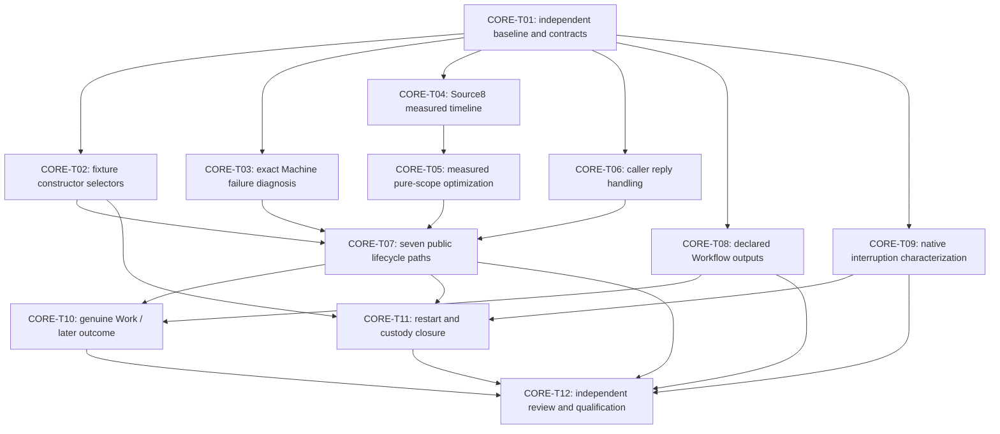

# Core runtime and workflow implementation analysis

Status: analysis candidate, 2026-10-13. Owned scope: `lab-runtime`, `lab-context`, `lab-continuity`, `lab-workflows`, `lab-work`, and `lab-ontology`, including their selected API16 wrappers and tests. This is static implementation and retained public-receipt analysis, not a new qualification run. No credentials, live stores, services, or frozen predecessor bytes were changed. The machine-readable findings, task requirements, dependency edges, acceptance evidence, and future command recommendations are in [core-findings.json](core-findings.json).

API16 selection: source `8ac40a51e23b8e528178807792b8ae477aa9c46cd50d92a5b1522c82945413c7`, profile `8cc29da16d3881d8816cdc45c55358d9229fcaf226d1b9a757402ebc8675d18c`. Implementation admission is separate: [ADMISSION.md](/home/vlad_/projects/CyberAlchemy-lab/implementation/lab-runtime/ADMISSION.md:1) admits v1 against D74 through Decision0075; v2 targets D75 as a separate candidate. Neither this analysis nor an implemented API route establishes full current qualification or owner acceptance.

## Implementation inventory

### Runtime: signed local transactions, replay, and ephemeral Agent context

Entrypoint `lab.py → lab_runtime.cli.main` exposes inspection/catalog/query, initialization, review/authorize/apply, recovery and Session commands. [cli.read_data](/home/vlad_/projects/CyberAlchemy-lab/implementation/lab-runtime/v2/lab_runtime/cli.py) distinguishes repository inspection without an initialized store from an explicitly selected store. [sources.capture](/home/vlad_/projects/CyberAlchemy-lab/implementation/lab-runtime/v2/lab_runtime/sources.py:124) freezes the selected corpus; schema resolution stays inside it ([validate_schema](/home/vlad_/projects/CyberAlchemy-lab/implementation/lab-runtime/v2/lab_runtime/sources.py:23)); `freshness` rechecks material and epoch inventory at299, and `resolve` selects exact identities/versions at311.

State comprises baseline, sealed configuration, genesis/transactions, HEAD, and derived projection. [Store.replay](/home/vlad_/projects/CyberAlchemy-lab/implementation/lab-runtime/v2/lab_runtime/store.py:128) verifies chain/store/profile, deterministic preparation, signatures, consequences and projection digests. `require_current` refuses stale writes; historical readability does not renew authority. [Store.apply](/home/vlad_/projects/CyberAlchemy-lab/implementation/lab-runtime/v2/lab_runtime/store.py:221) locks the writer, stages PENDING and the next transaction, rechecks freshness and atomically publishes HEAD. HEAD is the commit point. [recover](/home/vlad_/projects/CyberAlchemy-lab/implementation/lab-runtime/v2/lab_runtime/store.py:256) requires the exact expected HEAD and removes recognized uncommitted residue while preserving unknown future transactions for inspection.

Dependencies include the profile-selected source/schema/admission corpus, Ed25519 owner authorization, offline JSON Schema resources, and local filesystem semantics. Repeatable-operation [ReplayPins/full_replay](/home/vlad_/projects/CyberAlchemy-lab/implementation/lab-runtime/candidates/repeatable-operation/lab_runtime/replay.py:12) additionally bind independently trusted executable/configuration/baseline/HEAD and load freshly verified legacy code, rather than trusting a store's self-description. [Session.context/close](/home/vlad_/projects/CyberAlchemy-lab/implementation/lab-runtime/v2/lab_runtime/session.py:139) enforce source/HEAD/real lifetime and erase notes.

Test inventory, statically counted: v1 `tests/test_runtime.py` has33 authored methods; v2 has38. Relevant v2 assertions include fresh-process replay at189, stale HEAD/approval at251, source drift at431, three crash points at492–498, changed HEAD invalidation at518, and unknown recovery material at551. These counts describe available tests, not new PASS results.

### Context: exact native read plus declared generator provenance

[NativeReadStore.read](/home/vlad_/projects/CyberAlchemy-lab/implementation/lab-context/candidates/v1/native_reader.py:54) reads a bounded regular-file closure, verifies executable/event/request/cursor/projection pins, executes native replay against an immutable temporary copy, and rereads originals and executable after. The native [main.rs](/home/vlad_/projects/CyberAlchemy-lab/implementation/lab-context/candidates/v1/native/src/main.rs:40) loads semantic and governance streams separately, requires the exact governance prefix, and derives ontology cut/context/governed nodes. This is a read path with `authority_effect=none`.

[ContextSession](/home/vlad_/projects/CyberAlchemy-lab/implementation/lab-context/candidates/v1/context.py:109) joins selected Project/source state, original carriers, explicit owner/scope/capability references, exact generator implementation and actual native output. `context` at193 verifies generator/core/native state on use; failure closes and erases the pack. No durable Session memory is reconstructed. Dependencies are pinned runtime read adapter, source snapshot, native executable, generator manifest, carrier schemas and exact join semantics. There are23 authored Context test methods covering native/project cursor separation, source drift, detached packs, budgets, altered schema/generator/executable bytes, expiry and fresh-process reconstruction ([test_context.py](/home/vlad_/projects/CyberAlchemy-lab/implementation/lab-context/candidates/v1/tests/test_context.py:44)).

### Continuity: durable custody evidence without RAM restoration

[ReadCustodian](/home/vlad_/projects/CyberAlchemy-lab/implementation/lab-continuity/candidates/v2/custody.py) owns a private scoped lock, allocations and chained metadata events, plus an in-memory map of actual consumers. [history](/home/vlad_/projects/CyberAlchemy-lab/implementation/lab-continuity/candidates/v2/custody.py:82) checks permissions, bounded closed metadata, exact scope/cut, identity and revision chain. `open` at136 prevents an allocated key from recreating a consumer. [inspect](/home/vlad_/projects/CyberAlchemy-lab/implementation/lab-continuity/candidates/v2/custody.py:172) reports lost live resources as indeterminate; [close_consumer](/home/vlad_/projects/CyberAlchemy-lab/implementation/lab-continuity/candidates/v2/custody.py:206) cannot invent disposal after process loss. Cleanup at216 erases owned RAM even if metadata verification fails.

Dependencies are actual signed-state/native Context via [local_context.ContextSession](/home/vlad_/projects/CyberAlchemy-lab/implementation/lab-continuity/candidates/v2/local_context.py:144), independent custody scope/source-cut/control and fresh consumer identity. The25 authored [test_foundation.py](/home/vlad_/projects/CyberAlchemy-lab/implementation/lab-continuity/candidates/v2/test_foundation.py:101) methods include same-key no-recreation, foreign-principal refusal, metadata/native/transaction drift, lock and private-mode checks, unknown consumers, exact close binding, expiry, and corrupt-metadata cleanup. These establish the intended restart contract; selected API successor evidence is still required.

### Workflows and learning: explicit authority, controlled effects, independent observations

[HostAuthority.check](/home/vlad_/projects/CyberAlchemy-lab/implementation/lab-workflows/candidates/v1/authority/evaluator.py:165) uses actual Session lease, current records/status/grant/delegation/tool and budget inputs. [LocalDispatcher.dispatch](/home/vlad_/projects/CyberAlchemy-lab/implementation/lab-workflows/candidates/v1/authority/dispatch.py:105) validates exact controls under a lock, durably records pending state before the counter tool effect and records observed output. [reconcile](/home/vlad_/projects/CyberAlchemy-lab/implementation/lab-workflows/candidates/v1/authority/dispatch.py:182) observes actual before/predicted/other tool state and never blindly redispatches.

[EngineeringWorkflow](/home/vlad_/projects/CyberAlchemy-lab/implementation/lab-workflows/candidates/v1/workflows/engineering.py:237) and [ResearchWorkflow](/home/vlad_/projects/CyberAlchemy-lab/implementation/lab-workflows/candidates/v1/workflows/research.py:168) separate design, execution, assessment and materialization. Evidence is original scoped material/observations; failure and challenge services keep proposed causal hypotheses and accountable gate outcomes distinct. Local workflow state is not automatically repository admission.

[LessonService.select](/home/vlad_/projects/CyberAlchemy-lab/implementation/lab-workflows/candidates/v1/learning/lessons.py:125) checks exact durable controlled review, current cut/scope, expiry, family/version, exclusions and instruction precedence; application rechecks selection at183. [LessonApplicationService.apply](/home/vlad_/projects/CyberAlchemy-lab/implementation/lab-workflows/candidates/v1/learning/application.py:28) is a closed inline-repair case with a pending no-redispatch journal. Assessment at94 derives a bounded disposition from actual observations and explicitly refuses a general causal-benefit claim. Persistence uses [CurrentCutGuard/persist_exact_lesson](/home/vlad_/projects/CyberAlchemy-lab/implementation/lab-workflows/candidates/v1/learning/durability.py:20).

Static authored test inventories include28 integration methods,53 learning methods,33 engineering methods and41 research methods, plus authority-boundary/failure/challenge/W09 suites. They cover meaningful controlled cases; their existence does not demonstrate an arbitrary user Work lifecycle. API16 wraps independently selected LessonHost45/Application3/Assessment2, actual Machine custody, private Operator attachment and completed Application journal inputs; public current lifecycle remains blocked by the retained Source8 failure described below.

### Work: genuine bounded episode and independently verified archive

[episode.perform](/home/vlad_/projects/CyberAlchemy-lab/implementation/lab-work/candidates/v1/episode.py:79) performs a concrete C12 source-readiness audit over13 exact review members in an owned numbered package and disposable provisioned branch. It uses actual Context, a temporary note, original source checks and candidate signed publication, while explicitly leaving human outcome, canonical admission, operational Lesson creation and Product benefit unclaimed. This is substantive Work evidence with a narrow task scope, not a generic task executor.

[verify_audit_exact](/home/vlad_/projects/CyberAlchemy-lab/implementation/lab-work/candidates/v1/verification.py:9) independently checks membership, boundaries, dependencies, authority gaps and performance posture. [decode_archive/restore_archive](/home/vlad_/projects/CyberAlchemy-lab/implementation/lab-work/candidates/v1/verification.py:30) bind original files, refuse keys/notes and restore only to a fresh isolated destination before full replay. Existing W09 audit/control tests and C12 verification address archive privacy/source fidelity; new completion claims need task-specific actual observations, not only replaying an old audit.

### Ontology: semantic/governance replay, projections and a separate append protocol

The native [EventStore](/home/vlad_/projects/CyberAlchemy-lab/implementation/lab-ontology/candidates/v1/adapters/native/src/lib.rs:541) loads streams at547, derives `ontology_at` at610, `governed_node_view` at845 and `context_projection` at907, and provides semantic/governance batch append at985/1028. Exact identities, predecessor digests, closed qualifiers, source references and cursor separation underpin mapper/Context joins. Original objects and their represented views remain separate.

Recovery semantics must distinguish this native protocol from runtime Store HEAD transactions. Native [persist_batch](/home/vlad_/projects/CyberAlchemy-lab/implementation/lab-ontology/candidates/v1/adapters/native/src/lib.rs:2176) uses a create-new sentinel lock, synced temporary files and per-file hard links; its cleanup is on returned errors. [reject_in_progress_append](/home/vlad_/projects/CyberAlchemy-lab/implementation/lab-ontology/candidates/v1/adapters/native/src/lib.rs:2228) refuses residual lock presence. Process-kill partial publication is a static risk requiring characterization, not an observed failure asserted here. Native `tests/replay.rs` and `tests/context_binding.rs`, lifecycle/withdrawal, represented-subject, query-guard and portable-currentness tests exist; the currentness successor explicitly partitions retained/changed/dropped obligations. No power-loss or multi-host guarantee follows from their presence.

## Selected API16 findings and their boundaries

**CORE-F01: observed Source8 lifetime overrun; exact cost attribution unresolved.** The actual [events](/home/vlad_/projects/CyberAlchemy-lab/docs/plans/0010-lab-one-shot-execution/runs/0001-candidate-construction/common-all34-0275/units/member--Source8-lifecycle.events.jsonl:6) deliver Context expiring05:54:35Z; Session.open inherits that expiry. Positive Session.open takes312.7seconds; Machine select/proof/authentication take30.3/25.6/39.3seconds. Positive `lesson.select` starts05:52:24.516551 and ends05:54:46.318682 with `unauthenticated-channel`, `effect_may_have_started=false`. It crosses the real recorded expiry; this does not identify the exact exception or which guard dominated its132second duration. [MachinePeer.live](/home/vlad_/projects/CyberAlchemy-lab/product/lab/release-candidates/v1/interface/api-integration-v16/machine_transport.py:125) and [LessonHost.select](/home/vlad_/projects/CyberAlchemy-lab/product/lab/release-candidates/v1/interface/lesson-host-composition-v45-action-0148/host.py:278) correctly preserve live-resource/current-clock checks.

**CORE-F02: observed secondary caller error.** [source8_episode:432–433](/home/vlad_/projects/CyberAlchemy-lab/docs/plans/0010-lab-one-shot-execution/runs/0001-candidate-construction/common-all34-0275/caller.py:432) directly indexes `selection['message']` after that transport refusal. The actual [KeyError](/home/vlad_/projects/CyberAlchemy-lab/docs/plans/0010-lab-one-shot-execution/runs/0001-candidate-construction/common-all34-0275/units/member--Source8-lifecycle.json:1765) is an error-handling defect; correcting it will expose the same primary refusal, not make the lifecycle pass.

**CORE-F03: observed fixture drift.** API16 [Sessions setup](/home/vlad_/projects/CyberAlchemy-lab/product/lab/release-candidates/v1/interface/api-integration-v16/test_custody_sessions.py:18) selects fresh legacy composition. Its [method23](/home/vlad_/projects/CyberAlchemy-lab/product/lab/release-candidates/v1/interface/api-integration-v16/test_custody_sessions.py:172) locally selects original custody instead, producing the actual worker1 ERROR because [custody constructor:110](/home/vlad_/projects/CyberAlchemy-lab/product/lab/release-candidates/v1/interface/api-integration-v16/custody_context_sessions.py:110) demands original adapter/class. Sequential [run_session_checks method23](/home/vlad_/projects/CyberAlchemy-lab/product/lab/release-candidates/v1/interface/api-integration-v16/run_session_checks.py:171) selects generic ContextSessions instead. Proposed successor fixture correction must retain the no-live-recreation/closed metadata assertions and original production guards.

**CORE-F04: observed integrity refusal, with a static selected-class mismatch.** Actual [worker9](/home/vlad_/projects/CyberAlchemy-lab/docs/plans/0010-lab-one-shot-execution/runs/0001-candidate-construction/final-api-regression-0173-0274.worker-9.json:13) fails [test_machine_transport.py:87](/home/vlad_/projects/CyberAlchemy-lab/product/lab/release-candidates/v1/interface/api-integration-v16/test_machine_transport.py:87) on `context.get`, after earlier status/catalog/query/inspect assertions. Its [same-case recorded reply](/home/vlad_/projects/CyberAlchemy-lab/product/lab/release-candidates/v1/interface/api-integration-v16/receipts/per-call-observations/0cb8537fd64e4bdea5ec9b18a9e64a89.json:17), SHA256 `66ef5cfabb93929102f87ef2e8ff8765dfffe21154563e8ec4b1193b63542124`, is `integrity-failed` at06:07:44.889395Z under the exact API16 profile. [legacy_context_sessions.view_get:130–135](/home/vlad_/projects/CyberAlchemy-lab/product/lab/release-candidates/v1/interface/api-integration-v16/legacy_context_sessions.py:130) routes its actual legacy Machine custodian into the original [machine-context-scope-v1.selected:21–27](/home/vlad_/projects/CyberAlchemy-lab/product/lab/release-candidates/v1/interface/machine-context-scope-v1/generation.py:21), which imports original custody composition and requires that exact class. This selected path has a deterministic static class mismatch. A causal trace is still required to establish whether this guard, or an earlier guard, threw in the retained run. Do not infer Source8 expiry or call the actual exception cause proved from static reachability alone.

**CORE-F05: implemented Workflow subset.** [preflight:149–151](/home/vlad_/projects/CyberAlchemy-lab/product/lab/release-candidates/v1/interface/api-integration-v16/workflow_transition.py:149) refuses all nonempty declared output carriers. `apply` at154 performs a real owned coordination transaction and replay, returning empty output refs. Full declared-output workflows need actual closed producers, or an explicit narrower completion decision.

**CORE-F06–F10:** native interruption is an inferred risk; generic Work/learning support is bounded rather than universally demonstrated; lost-process custody must stay indeterminate; repeated source/native verification is a measured-diagnostic candidate rather than permission to cache; admitted v1/D74, candidate v2/D75, API16 and current qualification remain separate. Full structured source anchors and task links appear in JSON.

## Proposed implementation DAG input

The other four areas and final ownership/admission/package obligations must be integrated by the parent plan. `CORE-T03` gates any Machine production repair on evidence. `CORE-T09` first characterizes the approved durability model; it does not assume a new recovery implementation is always necessary. Genuine human outcomes remain external evidence requirements, not automatable acceptance assertions.

Safe future mutation scopes are new successor implementations, new pinned callers, and fresh isolated fixtures listed per task in JSON. API16, original v1/v2 sources, all original periods/signatures, previous failure reports and test callers stay immutable. Selector-only fixture changes require an exact before/after AST ledger and independent expected class/source inputs. Runtime performance changes may borrow only a verified synchronous pure read scope; full fresh entry/exit verification, callback identity, drift rejection, private policy, nonce, revocation and real-clock checks remain mandatory. No across-call digest/permission cache or enlarged/fake lease is an acceptable completion shortcut.

Recommended commands in JSON use placeholders for a future independently reviewed interpreter, caller, manifest/profile pins and owned destination. They were not executed. Start with static AST/manifest checks, then focused causal cases, then cold native/restoration evidence, then whole-class regression and common-operation collectors. Record instrumentation separately from qualification. Independent review follows the integrated complete analysis/DAG and reviews actual successor postimages before any implementation qualification is treated as closure.
