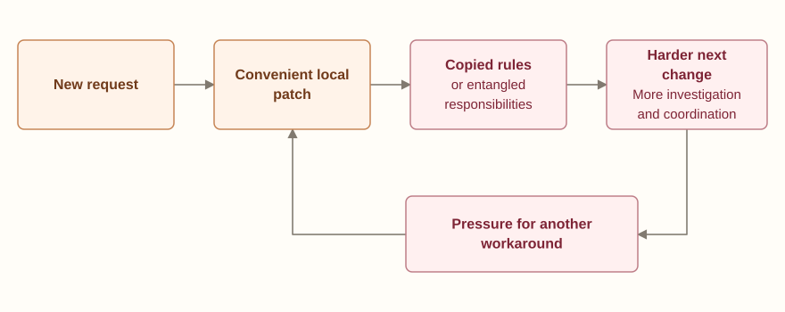
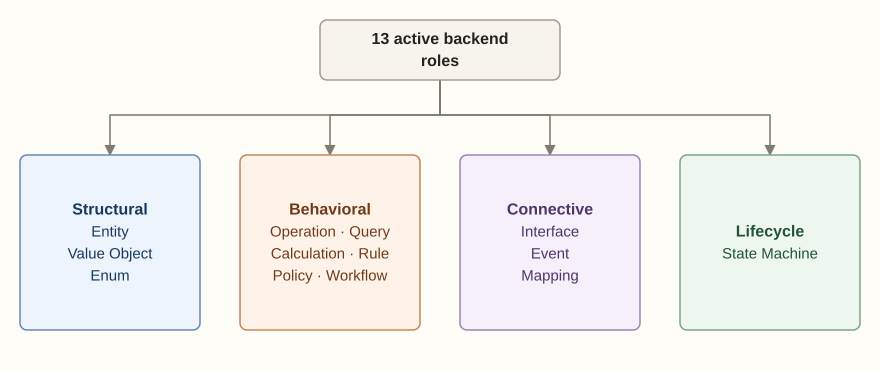
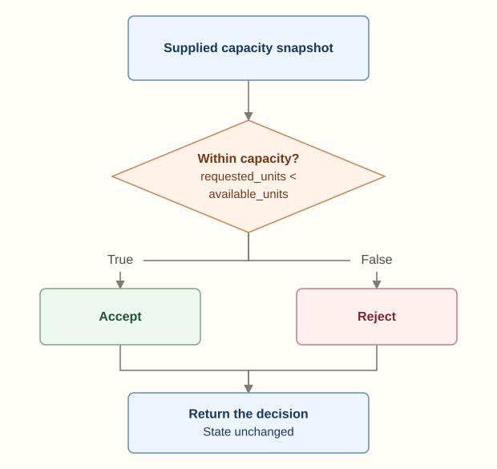
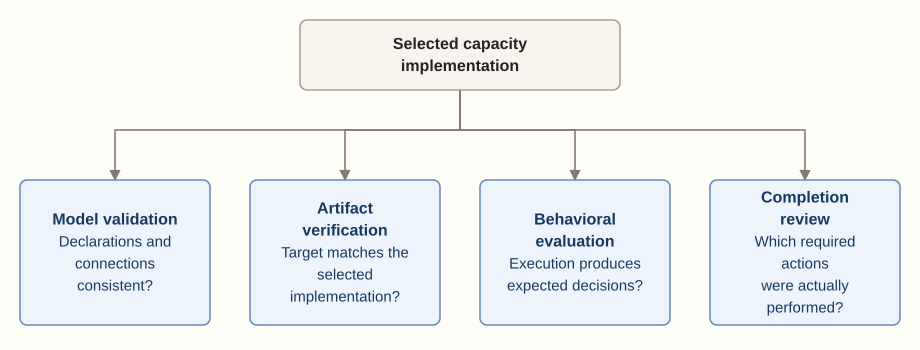
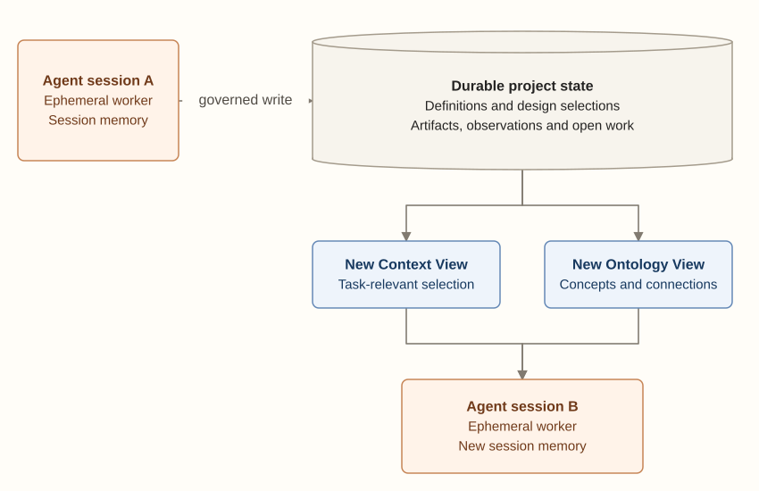
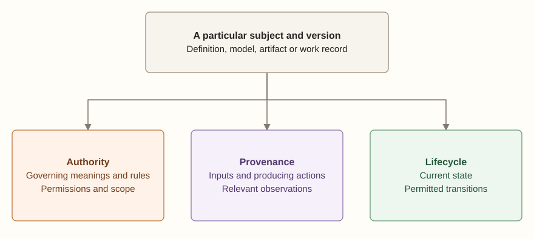

[Documentation home](../README.md)

<a id="top"></a>

Craft · Software design

# Compiling software from explicit models

We’re building Craft as a software-design, domain-modeling and enforceable-architecture product for a closed beta. The aim is to compile software from an explicit model, keeping its meaning connected to the choices that shape the code.

Craft sits within CyberAlchemy Lab’s wider model of knowledge and work. The [Lab guide](../guide/intent-product-project.md#purpose) follows a requirement into a project, assigned work and evidence for an owner decision. Here we follow the software model and implementation developed during that work. Craft’s design contracts and the Lab’s acceptance and deployment decisions retain their own responsibilities.

In development · Preparing for closed beta 45 min read 11 October 2026 Draft 0.21

<a id="article"></a>

<a id="modelling"></a>

<a id="heading-modelling"></a>

## Software modeling connects meaning and implementation

Domain-Driven Design gives us a starting point: build a model with people who understand the domain, develop a shared language and keep the implementation connected to it. That language has a context. The same word can mean different things in different parts of a business. [Eric Evans, *Domain-Driven Design Reference*](https://www.domainlanguage.com/wp-content/uploads/2016/05/DDD_Reference_2015-03.pdf)

A software model states the concepts, behavior, states and connections a design depends on. Consider deciding whether a request is acceptable and changing state to fulfill it. Those jobs might use the same information, yet they have different consequences. The model gives us a way to name and examine both.

A developer can return to the model to understand a concept’s meaning, its responsibility and permitted interactions. The same reference helps someone joining later work understand what a change needs to preserve.

Shopify’s monolith example makes the architectural issue concrete. Shipping and checkout had become tightly coupled. The team worked on dependency isolation, public interfaces and visibility into access across domain boundaries. Organizing components was part of deciding which interactions were allowed and observing whether the implementation followed those decisions. [Shopify engineering, 2019](https://shopify.engineering/deconstructing-monolith-designing-software-maximizes-developer-productivity)

Behavior needs similar care. Stripe’s PaymentIntent distinguishes customer action, processing and success. Some asynchronous methods take days. For fulfillment, those states affect what “complete” means and when the next action is permitted. [Stripe's payment lifecycle documentation](https://docs.stripe.com/payments/paymentintents/lifecycle)

In these examples, meaning and architecture meet in an action: a payment state governs when fulfillment begins, and component boundaries govern where the responsibility belongs. Both need to survive software changes and handoffs to new people or agents.

<a id="failure-causes"></a>

<a id="heading-failure-causes"></a>

## Why design breaks down during implementation

Those decisions often live across conversation, diagrams, prose and code. A team might agree where a rule belongs or what should happen after failure without leaving a precise account for the next contributor. That becomes a problem when someone has to recover the design.

An assumption can survive in conversation and disappear from implementation. Code can also change an obligation without recording that change. An order gets fulfilled too early, a retry repeats an effect, or one component’s change breaks another. The visible symptom is only part of the story.

A wrong result or failing check gives us a starting point. Understanding it means following the assumptions, responsibilities and dependencies behind the symptom. Familiar names can remain in the code while the conditions they once represented have changed.

<a id="failure-causes-design-context-is-lost-between-sessions"></a>

### Design context is lost between sessions

Agent work introduces more handoffs. A task can span sessions with partial design context. Anthropic’s work on long-running coding agents describes unclear unfinished work, later sessions guessing at earlier progress and completion claims lacking enough end-to-end evaluation. That gives us a concrete continuity problem to examine. [Anthropic, *Effective harnesses for long-running agents*](https://www.anthropic.com/engineering/effective-harnesses-for-long-running-agents)

<a id="failure-causes-required-work-never-reaches-the-finished-result"></a>

### Required work never reaches the finished result

An agent can understand a requirement and still omit part of the work. It might implement the main path, leave a failure branch out, declare a rule without using it, or update a component while leaving a caller unchanged.

The omission becomes visible when someone compares the result with the whole requirement or exercises the missing path. Listing an action in a task does not ensure its completion.

A patch shows what changed. To find what was never delivered, we need an account of the required work too. Connections, branches and follow-up actions belong in that completion assessment.

<a id="failure-causes-a-local-repair-changes-the-intended-behavior"></a>

### A local repair changes the intended behavior

A plausible patch might weaken a condition to make a request succeed, copy a rule into a convenient component, or change a test without examining the requirement. Looking at the patch alone can miss a change to the meaning the system was supposed to preserve.

The reviewer needs to know whether the proposal repairs implementation or revises the requirement. That question matters before a symptom fix becomes a different business rule.

<a id="failure-causes-shortcuts-accumulate-into-architectural-brittleness"></a>

### Shortcuts accumulate into architectural brittleness

Shortcuts can accumulate. An agent adds a condition, copies a rule into a caller or reaches into another component’s data because it solves the immediate example. The next change inherits that structure, and another exception makes the responsibilities harder to recover.

That leaves future work with more coordination and repair. A copied capacity rule needs several updates. A function combining decisions, persistence and retry behavior makes a change to one responsibility affect the others. Those are concrete forms of technical debt.

The design question is how responsibilities hold up as the software grows. Explicit boundaries help a small implementation accommodate later changes. Repeated exceptions and copies can make a routine feature require reconstruction, with regressions eventually forcing redesign.

<a id="figure-1"></a>

Figure 01 [Open diagram](../assets/0ffb593d3146-figure-01.svg)



Scroll the diagram or open it at full size.

<a id="figure-caption-1"></a>

A possible cycle of architectural brittleness. A successful local patch can leave obligations that make the next change harder; the cycle describes design pressure, not an inevitable outcome.

Research examines successive changes too. SlopCodeBench reports growing redundancy and concentrated complexity in many evaluated trajectories. CodeTaste finds agents more successful with detailed refactoring instructions than with identifying human-selected refactorings. These results support examining the sequence of changes alongside the current result. [SlopCodeBench, May 2026 preprint](https://arxiv.org/abs/2603.24755v2) · [CodeTaste, ICML 2026](https://proceedings.mlr.press/v306/thillen26a.html)

The next contributor has to recover meaning, find missing work and understand responsibilities that moved or became entangled. Craft’s taxonomy gives us vocabulary for distinguishing those jobs and stating what each must preserve.

<a id="taxonomy"></a>

<a id="heading-taxonomy"></a>

## The taxonomy of a Craft model

A taxonomy helps answer practical questions. What has identity? Which responsibility derives a value, decides a condition, changes state or coordinates actions? Craft’s categories give those answers names.

A **contract** states what a responsibility requires: its inputs, result, dependencies and applicable conditions. Those requirements give us something specific to examine when the implementation changes.

The category tells us which contract the concept needs. A Rule needs a Boolean condition, while a Workflow needs an account of coordinated Operations. The project then supplies the particular condition or coordination being designed.

The map below brings together the backend roles and their permitted connections. It also shows the proposed UI extensions, plus the implementation selections and work records around them. Their status matters as much as their place in the map.

<a id="taxonomy-separate-meaning-responsibility-and-representation"></a>

### Separate meaning, responsibility and representation

Several kinds of information contribute to a software design:

| Kind of information | What it describes |
| --- | --- |
| Definition | What a term or concept means within a stated context. |
| Meta-type | The software responsibility a concept occupies, such as Entity, Rule or Operation, and the declarations that role requires. |
| Project concept | A particular named concept in a project's model, assigned a meta-type and its own contract. |
| Typed contract | The concept's declared fields, inputs, results, conditions, dependencies or effects, as appropriate to its role. |
| Relationship | A directed connection between concepts, with a defined meaning and permitted endpoint roles. |
| Architecture profile | Rules for organizing responsibilities, composing them and constraining dependencies. |
| Realization | The selected implementation form for a supported role under a language and architecture profile. |
| Artifact and observation | An output of the work, and a record of what was inspected or evaluated about a particular target. |

“Type” refers to two things here. A **meta-type** names responsibility; a value type such as string or unsigned integer constrains a field’s contents. Declaring Entity creates an identity obligation. Declaring a string field restricts its values. A typed model makes both choices explicit.

The graph records concepts and contracts. Runtime objects instantiate those concepts. One Entity node can describe many running objects, so another object does not require another type node.

Craft’s 13 active backend meta-types fall into structural, behavioral, connective and lifecycle families. A project selects the responsibilities its design needs. The catalog supplies choices, without requiring every category in every model.

<a id="figure-2"></a>

Figure 02 [Open diagram](../assets/8d55a2b6d681-figure-02.svg)



Scroll the diagram or open it at full size.

<a id="figure-caption-2"></a>

The backend vocabulary, grouped by responsibility. These arrows show classification into families. The permitted relationships between project concepts are defined separately below.

<a id="taxonomy-structural-roles-identity-values-and-alternatives"></a>

### Structural roles: identity, values and alternatives

Structural roles define how domain information is distinguished and organized.

| Role | Responsibility | What the model must make explicit |
| --- | --- | --- |
| **Entity** | Describe a domain object tracked by a stable identity. | Typed fields and the field or fields that establish its identity. |
| **Value Object** | Describe a value whose equality is determined by its contents. | Typed fields and the equality rule, without a separate identity field. |
| **Enum** | Define a closed set of named alternatives. | The allowed alternatives that make up the set. |

Identity changes how we understand sameness. An Entity keeps its identity while fields change. Value Objects with equal contents have the same value under their declared equality rule. References, updates and comparisons need that distinction.

An Enum declares alternatives. To decide which transitions between them are permitted, we need a State Machine. The list of alternatives alone leaves that behavior unspecified.

<a id="taxonomy-behavioral-roles-actions-questions-decisions-and-coordination"></a>

### Behavioral roles: actions, questions, decisions and coordination

Behavioral roles state what the software does and which responsibility owns that behavior.

| Role | Responsibility | What the model must make explicit |
| --- | --- | --- |
| **Operation** | Own a state-changing business action in the backend role catalog. | Inputs, outcomes, governing conditions, reads, writes, effects and failure continuation. A rejected attempt can leave state unchanged; the successful path owns the declared change. |
| **Query** | Retrieve information without changing state or producing effects. | Inputs and filters, information read, and the result shape. |
| **Calculation** | Derive a value from explicit inputs through a pure computation. | Input values, derivation and return type; the same inputs yield the same value. |
| **Rule** | Evaluate a condition that gates an Operation. | A boolean predicate, its parameters and the Operation it governs. |
| **Policy** | Select a strategy or behavior according to declared conditions. | Cases, selection criteria and the behavior selected for an Operation or Calculation. |
| **Workflow** | Coordinate ordered Operations within or across feature boundaries. | Steps, ordering, ownership scope and applicable recovery responsibilities. |

A Query retrieves domain information. A Calculation derives a value from supplied inputs and has no Entity-reading relationship in the current catalog. Both can return data while owning different jobs. A read-only Query can return a different result when its underlying information changes.

A Rule returns true or false for a condition. A Policy selects how behavior proceeds. Reviewing a change means asking whether eligibility changed or a strategy changed after an allowed choice.

An Operation declares its state boundary through reads, **writes** and **external effects**. Its **guard** refers to the Rule governing the action, and the contract needs failure behavior too. A rejection can leave state unchanged while a successful action owns the change. A pure classifier of supplied values belongs to Calculation.

Workflow coordinates Operations, each of which keeps responsibility for its changes and effects. Recovery adds another distinction: evaluating the need for recovery and executing compensation have separate jobs. The current taxonomy places the earlier Saga role within Workflow.

<a id="taxonomy-connective-roles-boundaries-facts-and-transformations"></a>

### Connective roles: boundaries, facts and transformations

Connective roles describe how software responsibilities communicate and exchange meaning.

| Role | Responsibility | What the model must make explicit |
| --- | --- | --- |
| **Interface** | Define a logical API boundary through which Operations or Queries are exposed. | Boundary kind, callable responsibilities, and request and response contracts. |
| **Event** | Record a domain fact that has already occurred. | The fact's meaning, typed payload and declared relationships to its source and consumers. |
| **Mapping** | Transform information from one declared shape into another. | Source and target shapes, direction and field transformations. |

An Interface declares calls available to a consumer. A Mapping changes information’s shape across a boundary. They can cooperate without becoming the same responsibility.

An Event records a past occurrence. A request asks for work. The distinction tells a consumer whether something has happened or whether someone is asking it to act.

The domain Interface role has a narrower meaning than every interface in source code. A repository, clock or transaction-provider interface can serve implementation infrastructure without becoming a domain Interface node. Those infrastructure boundaries still need explicit contracts.

<a id="taxonomy-lifecycle-role-states-and-permitted-transitions"></a>

### Lifecycle role: states and permitted transitions

| Role | Responsibility | What the model must make explicit |
| --- | --- | --- |
| **State Machine** | Define the states a subject may occupy and the transitions it may take. | States, valid transitions, triggers, guards, effects and invariants governing those transitions. |

A lifecycle adds behavior beyond a list of state names: triggering events, required conditions, effects and preserved invariants. We can then examine what happens over time.

<a id="taxonomy-relationships-how-the-roles-may-connect"></a>

### Relationships: how the roles may connect

A relationship names a source, verb and target. Its **signature** permits particular roles at the ends, and its scope limits where the connection applies. Feature ownership makes an internal connection and a cross-**feature** connection carry different obligations.

The backend catalog contains 17 relationship signatures:

| Connection | Meaning | Permitted feature scope |
| --- | --- | --- |
| Entity → **performs** → Operation | An Entity or modeled actor initiates an action. | Same feature. |
| Operation → **produces** → Event | Successful completion of an action causes a domain fact. | Same feature. |
| Operation → **produces-for** → Entity | An action writes or projects information into an Entity owned by another feature. | Across features. |
| Operation → **creates** → Entity | An action owns the creation of new instances of one Entity type. | Same feature. |
| Event → **triggers-cross** → Operation | A fact in one feature activates an action in another. | Across features. |
| Rule → **enforces** → Operation | A condition gates an action. | Same feature or across features. |
| Calculation → **calculates** → Operation | A derivation supplies values used by an action. | Same feature. |
| Event → **transitions** → State Machine | A fact advances a lifecycle under its transition rules. | Same feature or across features. |
| Interface → **exposes** → Operation or Query | An API boundary makes a responsibility callable. | Same feature or across features. |
| Workflow → **orchestrates** → Operation | Coordination orders the participating actions. | Same feature or across features. |
| Policy → **applies** → Operation or Calculation | A strategy selection governs the behavior used. | Same feature. |
| Mapping → **maps** → Entity or Interface | A transformation connects declared data shapes. | Same feature or across features. |
| Entity → **contains** → Value Object | An identity-bearing object embeds a value in its structure. | Same feature. |
| Query or Operation → **reads** → Entity | A responsibility depends on Entity information by reading it. | Same feature. |
| Entity → **emits** → Event | An Entity is the subject or source of a domain fact. | Same feature. |
| Entity → **owns** → Entity | An Entity carries lifecycle, custody or write responsibility for another. | Same feature or across features. |
| Entity → **belongs-to** → Entity | An Entity has a membership, classification or assignment relationship to another. | Same feature or across features. |

The verbs answer different questions. produces links the action causing an Event; `emits` identifies its Entity subject or source. owns establishes a responsibility boundary. `belongs-to` records membership or assignment without proving ownership. reads records a dependency while leaving other Operation writes to their own declarations.

The `creates` signature also constrains multiplicity. One Operation concept owns creation of at most one Entity type, and that type has at most one such creation owner. The Operation can still create many runtime instances. The limit concerns design ownership.

Typed contract references are separate from graph relationships. An input can name an Entity type, a result can name an Enum, and a field can describe data without introducing a new edge. A new verb needs a distinct meaning and explicit endpoint, scope and composition rules in the catalog.

A permitted catalog signature is only part of a composition decision. The selected architecture profile can restrict the connection further. We need both before calling the composition allowed.

<a id="taxonomy-the-proposed-ui-vocabulary"></a>

### The proposed UI vocabulary

The UI vocabulary addresses navigation, presentation, input and backend access. Nine roles are candidates and two labels are deferred while boundaries are resolved. That standing differs from the active backend core.

| Role | Responsibility | Status |
| --- | --- | --- |
| **Page** | Own a navigable destination, its route and primary content. | Candidate. |
| **Layout** | Provide a reusable frame with declared slots and shared visual structure. | Candidate. |
| **Component** | Provide a visual unit with typed inputs and outputs, without an independent route. | Candidate. |
| **View Model** | Shape information for a particular display context while preserving references to its sources. | Candidate. |
| **Hook** | Describe reactive behavior, typed inputs and results, and applicable lifecycle and effects. | Candidate; its boundary with Binding still needs resolution. |
| **Form** | Own a typed input collection, validation, errors and submission. | Candidate. |
| **Action** | Express a named user intent, its trigger, target, effects and observable outcomes. | Candidate. |
| **Guard** | Apply an existing rule to access or visibility of a protected UI surface. | Candidate. |
| **Binding** | Record how a UI connects to an endpoint: mode, target, trigger, parameter and result mappings, and cache behavior. | Candidate; its boundary with Hook still needs resolution. |
| **Adapter** | Transform boundary data into a display shape. | Deferred because this responsibility currently overlaps Mapping. |
| **State Indicator** | Represent domain states visually. | Deferred while domain-state representation is distinguished from loading, error and empty display states. |

A View Model shapes presentation while leaving domain meaning to its governing source. A UI Guard applies a Rule; hiding or showing a Page supplies no backend authorization. Components have visual responsibilities, with routing and form validation retaining their more specific roles.

Two overloaded names deserve attention. UI **Guard** is a proposed node role; an Operation **guard** refers to its Rule. UI **Binding** records endpoint use; artifact **binding** traces model and implementation inputs. The context tells us which meaning applies.

The relationship catalog records eight UI signatures:

| Connection | Meaning |
| --- | --- |
| Page → **renders** → Component | A destination presents visual units. |
| Layout → **wraps** → Page | A shared frame surrounds a destination. |
| Component → **composes** → Component | A visual unit includes child units. |
| Component → **consumes** → Hook | A visual unit uses reactive state or data behavior. |
| Form → **submits** → Action | Validated input delegates to a named user intent. |
| Adapter → **shapes** → View Model | A transformation constructs a display shape. |
| Guard → **protects** → Page | An existing rule governs access to a destination. |
| Component → **displays** → View Model | A visual unit presents a declared display shape. |

Six further signatures connect UI responsibilities to the backend model:

| Connection | Meaning |
| --- | --- |
| Binding → **fetches** → Query | The UI retrieves information through a read-only responsibility. |
| Binding → **mutates** → Operation | The UI invokes a business action. |
| State Indicator → **reflects** → State Machine | The UI represents a domain lifecycle state. |
| View Model → **derives** → Entity | Display information is derived from domain fields. |
| Form → **contracts** → Interface | Input structure aligns with the API contract. |
| Guard → **mirrors** → Rule | The UI gate applies the backend condition. |

The intended signatures include deferred Adapter and State Indicator roles. Their presence settles neither the open role boundaries nor compiled UI completeness. UI and UI-to-backend connections are within-feature signatures. Crossing a layer supplies no automatic permission to cross feature ownership.

<a id="taxonomy-implementation-selections-and-records-of-work"></a>

### Implementation selections and records of work

Taxonomy gives us responsibilities. Architecture profiles and realizations choose organization and code representation. Different supported forms can implement the same responsibility, provided its contract stays intact.

Manifests, receipts, observations and evidence describe construction and examination around the model. They add no backend meta-types. A Craft receipt records a particular construction or check; saving it in Lab Project State needs the applicable recording contract, attribution and permission. It supplies no admission decision. Handoff knowledge is separate from compiled domain behavior.

Next, we’ll follow the declarations into compilation, examine the results and record the work performed along the way.

<a id="process"></a>

<a id="heading-process"></a>

## How Craft carries the design into code

Compilation starts from explicit declarations and selected profiles and realizations. The active vocabulary describes modelable responsibilities. Actual code generation depends on the exact contracts and forms the selected compiler supports. Active standing alone establishes no uniform language or behavior support.

The connection from meaning to observed implementation is:

<a id="figure-3"></a>

Figure 03 [Open diagram](../assets/4e9774db2682-figure-03.svg)


Scroll the diagram or open it at full size.

<a id="figure-caption-3"></a>

Construction and observation use explicit selections. Recording their results in Lab Project State is a governed action with its own contract and permission. These process arrows do not establish automatic synchronization or that a check or integration action has been performed.

The work around this path addresses the earlier failure causes:

| Part of the work | Responsibility | Failure it helps address |
| --- | --- | --- |
| Model the intended behavior | Record meanings, roles, required behavior and connections. | Contributors having to reconstruct the design from scattered assumptions. |
| Validate the model | Check types, references and required relationships. | A declared rule or dependency being missing or disconnected. |
| Compile the selected design | Construct supported behavior through explicit translation rules. | Required code pieces depending on an agent remembering to handwrite each one. |
| Inspect the target | Compare the observed artifacts with the selected model and implementation forms. | Code drifting from the design, or selected artifacts being missing. |
| Record performed work | Preserve changes, observations and outstanding obligations in project state. | Later sessions guessing what happened or treating unfinished work as complete. |

Before construction, we need to review those choices. Persistence adds state ownership and failure behavior. An entry point adds a consumer. A retry raises repeated-effect questions. The model gives each change a subject to examine before code exists.

These responsibilities answer three different questions:

1. Does the model cover the requirement?
2. Does the implementation match the model?
3. Has the required work actually been performed?

Each question needs review or evidence. A structurally valid model might omit a business requirement, and conforming code might still await integration or evaluation. We need to keep those open questions visible.

AI can help explore the domain, author declarations and investigate disagreements. Supported source-code construction follows explicit compiler translations. The next session can use those declarations instead of reconstructing and handwriting the same behavior.

Let’s follow a compute-service capacity decision. Entity, Rule, Calculation and Enum supply four backend roles with typed references. Starting with this narrow decision makes its obligations visible. Reservation and retry work will add further responsibilities later.

<a id="definition"></a>

<a id="heading-definition"></a>

## Define the domain decision

A caller supplies a request identity, requested units and available units. The business wants capacity left after a request of that size. The decision must reject a request consuming all available capacity and leave state unchanged. Those conditions belong in the model before implementation.

`R-104` requests 4 units from 5 available, so acceptance is expected. A request for all 5 should be rejected. The boundary is part of the requirement.

“Accept when capacity is sufficient” leaves equality unresolved. The agent and reviewer need to decide precisely what acceptance means before writing its implementation.

For this task, the definition is:

> **Within capacity**
> For a given capacity snapshot, a request is within capacity when its requested units are strictly less than the available units. Equality does not satisfy this condition.

````text
requested_units < available_units
````

The **snapshot** supplies the request and capacity quantities for this decision. Accept means the condition holds for that record. Reservation and job execution are still separate responsibilities.

<a id="figure-4"></a>

Figure 04 [Open diagram](../assets/86aa06fc5be7-figure-04.svg)



Scroll the diagram or open it at full size.

<a id="figure-caption-4"></a>

The required execution flow. A false condition produces the normal Reject result. Neither branch reserves capacity or starts a job.

Once accepted within scope, the definition gives later work a stable reference for the strict boundary and separation from reservation. Allowing equality revises acceptance’s meaning. Reserving capacity adds state ownership and consistency requirements. Both need explicit design changes.

<a id="typed-model"></a>

<a id="heading-typed-model"></a>

## Turn the domain meaning into a typed model

The condition is now stated. We still need to identify the supplied information, the responsibility deriving a decision and the allowed results. Four concepts give those obligations a place in the model.

| Concept | Role | Declared responsibility |
| --- | --- | --- |
| Capacity snapshot | Entity | Identify the request and carry its supplied capacity quantities. |
| Within capacity | Rule | Evaluate the strict comparison as a Boolean condition. |
| Classify capacity | Calculation | Derive Accept or Reject from the supplied snapshot. |
| Capacity decision | Enum | Define the complete set of decision alternatives. |

The snapshot has a request identifier and two unsigned integer quantities, whole numbers that cannot be negative. `R-104` uses 4 requested units and 5 available. The identifier is explicitly selected as the record’s identity.

<a id="typed-model-calculation-and-the-capacity-example"></a>

### Calculation and the capacity example

Classify capacity accepts the supplied snapshot and returns a Capacity decision. Its conditional expression calls Within capacity, producing Accept when true and Reject otherwise. Retrieval, mutation and external effects are absent from this responsibility. The Rule supplies the single declared strict comparison.

The earlier fixture called the pure decision an Operation. The corrected example uses Calculation, preserving Operation’s state-changing meaning. The fixture stays as historical compiler evidence, with current role guidance supplied by this correction.

A readable summary is:

````text
Capacity snapshot
  identity: request_id
  requested_units: UInt64
  available_units: UInt64

Within capacity — Rule
  parameter: Capacity snapshot
  predicate: requested_units < available_units

Classify capacity — Calculation
  input: Capacity snapshot
  result: Capacity decision
  condition: call Within capacity with this snapshot
  if true: Accept
  if false: Reject
  state change: none
````

The compiler consumes structured contracts behind this summary. `domainspec.typed-calculation/v2` supports a conditional expression with explicit scalar or named-record inputs, a typed Rule expression and a payloadless Enum result. Numeric `v1` Calculations keep their UInt64 arithmetic contract. The successor adds neither Operation guards nor write or effect declarations.

Reject is an ordinary result of the classification. It says neither that execution failed nor that an exception occurred. The model needs both alternatives before construction.

<a id="typed-model-a-reservation-is-a-different-responsibility"></a>

### A reservation is a different responsibility

Classifying 4 against 5 returns Accept and leaves available capacity at 5. A separate **Reserve capacity Operation** would check current state, reduce capacity to 1 and create a 4-unit reservation together. A request for 5 fails the strict condition and leaves capacity unchanged.

The reservation owns the successful change. A rejected attempt can leave state unchanged. Meanwhile, another request might make a snapshot’s Accept stale for live reservation. Reservation therefore needs its own owner, authorization and consistency contract. The compiled example covers classification; reservation is an extension.

<a id="architecture"></a>

<a id="heading-architecture"></a>

## Make architectural choices explicit

The classifier names its snapshot type, result type and called Rule. Together they form the checked dependency closure needed to construct this Calculation.

<a id="figure-5"></a>

Figure 05 [Open diagram](../assets/28a6cd1adfda-figure-05.svg)


Scroll the diagram or open it at full size.

<a id="figure-caption-5"></a>

All arrows are typed contract references. The classification example authors no graph edges. Figure 4 shows execution; this figure shows which declarations that execution depends on.

Every dependency must resolve: required Rule parameters, compatible types, selected Enum variants and properties belonging to the supplied record. Merely placing the Rule elsewhere in the project leaves its use unbound.

Expression references and authored relationships have different contracts. `enforces` admits Rule to Operation, and `reads` admits Query or Operation to Entity. Neither admits this Calculation endpoint. Correcting the example removes those edges instead of broadening their signatures.

Reservation could use the existing Within capacity Rule through **enforce**s. An actually used Calculation could derive a value for the Operation under an existing signature. The state-changing design must declare those connections. A new meaning would need a catalog extension.

A caller supplies the record and receives Accept or Reject. An architecture profile and supported realizations should preserve that boundary while governing placement and dependencies. A handwritten caller still needs review for duplicated rules, ignored decisions or undeclared reservation.

<a id="compilation"></a>

<a id="heading-compilation"></a>

## Compile that design into source code

For the capacity Calculation, we select the supported Rust realization of its typed contract. That selection determines the source-code form used for the declared behavior.

The three selections remain identifiable:

| Selection | Capacity example |
| --- | --- |
| Role | Calculation: a pure derivation of a decision value. |
| Project concept | Classify capacity: this specific decision and its contract. |
| Realization | The selected Rust implementation form for the typed contract. |

For this selection, the compiler constructs the snapshot, result alternatives, Rule and conditional Calculation. The outputs retain model and realization bindings. A later reviewer has an exact design to compare with each artifact.

The abbreviated Rust example below follows the corrected classification contract and its typed translation rules. We’ve left out auxiliary bindings, provenance metadata and derivation attributes to make the behavior easier to read. This is an illustration of the translation, rather than a newly captured compiler run.

````rust
pub struct CapacitySnapshot {
    pub request_id: String,
    pub requested_units: u64,
    pub available_units: u64,
}

pub enum CapacityDecision {
    Accept,
    Reject,
}

pub fn within_capacity(snapshot: &CapacitySnapshot) -> bool {
    snapshot.requested_units < snapshot.available_units
}

pub fn classify_capacity(snapshot: &CapacitySnapshot) -> CapacityDecision {
    if within_capacity(snapshot) {
        CapacityDecision::Accept
    } else {
        CapacityDecision::Reject
    }
}
````

Each part has a source in the design:

| Model declaration | Consequence in the code |
| --- | --- |
| Typed snapshot fields | A record with a String identifier and u64 quantities. |
| Closed result alternatives | An Enum with Accept and Reject variants. |
| Strict Rule expression | The less-than comparison in `within_capacity`. |
| Calculation's bound Rule reference | A call to that specific Rule inside `classify_capacity`. |
| True and false result constructors | Explicit branches returning the declared alternatives. |
| Pure Calculation boundary | A bounded decision body with no reservation, persistence or dispatch logic. |

The generated Rule implements `within_capacity`, and the Calculation calls it before choosing Accept or Reject. The selected contracts require that use and both outcomes. Explicit translations construct the connected behavior, reducing what the agent has to remember to assemble by hand.

The reviewer can trace declared obligations into code. Finding a function is a starting point. We also need its selected Rule call, both outcomes and preserved state boundary.

Construction is intended to be deterministic for identical selected inputs. The artifacts bind to their source and selections, giving later inspection an exact subject. The supported contracts supply that construction; absent callers, deployment procedures or requirements remain absent.

<a id="enforcement"></a>

<a id="heading-enforcement"></a>

## Enforce the rules at different boundaries

“Enforcement” needs a subject. Model validation examines declarations, artifact inspection examines output, the executable Rule governs a running decision, and behavioral evaluation examines that execution. They support different claims.

We follow the capacity example from model to code and observed behavior. Completion also needs an account of performed checks and integration work.

<a id="figure-6"></a>

Figure 06 [Open diagram](../assets/f28b644f020d-figure-06.svg)



Scroll the diagram or open it at full size.

<a id="figure-caption-6"></a>

Four review questions, each requiring its own subject and evidence. Success in one does not supply the answer to the others.

<a id="enforcement-check-the-model-are-its-declarations-connected"></a>

### Check the model: are its declarations connected?

Internal consistency requires the Calculation’s Rule reference, every compatible parameter, record property and Enum variant to resolve. A separate reservation design would need its own authored Operation relationships too.

| Inconsistency | Expected validation consequence |
| --- | --- |
| The condition references a missing Rule. | Reject the unresolved dependency. |
| The Rule exists but its arguments are missing or incompatible. | Reject the invalid Rule reference. |
| A result branch names a variant absent from the selected Enum. | Reject the invalid result constructor. |
| The comparison refers to an unknown field or incompatible operands. | Reject the invalid typed expression. |

These checks expose particular omissions and inconsistent inputs. A Rule can exist while its required connection is missing. Internal consistency still leaves a review question: do the checked contracts cover the intended task?

<a id="enforcement-check-the-artifacts-does-the-code-match-the-selection"></a>

### Check the artifacts: does the code match the selection?

Suppose someone changes the compiled comparison to allow equality:

````rust
snapshot.requested_units <= snapshot.available_units
````

The edited target now implements a different decision. Exact verification can compare it against the selected source and realization and reject it as nonconforming.

An unconditional Accept, omitted Reject branch, missing Rule call or added persistence changes the expected output. The observer also compares the selected target’s files with its recorded inventory, revealing missing and unexpected files.

That inventory belongs to the selected generated target. Wider application completeness needs an account of the other required work.

Rust types could permit many of those edits. Artifact comparison examines fidelity to the selected design. Behavioral evaluation examines execution under chosen conditions. Both are useful, for different questions.

Exact output comparison identifies drift. Translation-rule correctness still needs independent behavioral or formal evidence within its stated scope.

A refactoring can preserve behavior while changing representation. Selecting a different form needs explicit selection and applicable evidence. Fidelity to the selected output and architectural suitability for future change stay separate review questions.

The architectural contract gives checks their obligations. They report a subject, disagreement and evidence. Detection gives us something to correct, without establishing that the correction has occurred.

<a id="enforcement-examine-behavior-does-execution-follow-the-condition"></a>

### Examine behavior: does execution follow the condition?

`R-104` compares 4 requested units with 5 available and must return Accept through the bound Rule. Equality and over-capacity cases exercise Reject. The Calculation selects the result of the actual comparison.

| Requested units | Available units | Rule result | Required decision |
| --- | --- | --- | --- |
| 4 | 5 | True | Accept |
| 5 | 5 | False | Reject |
| 6 | 5 | False | Reject |

The equality case exposes a meaningful difference. Strict and permissive comparisons both accept 4/5, while disagreeing at 5/5. The bound Rule supplies acceptance; a caller-supplied Boolean cannot substitute for it.

On 11 October 2026, local regression checks ran all three cases in the in-memory runtime and in generated TypeScript, Python and Rust. Each returned the required decision and left the supplied snapshot unchanged. Numeric v1 Calculations were checked across those four implementations too, including arithmetic, division rounding and rejected inputs. That evidence covers the selected contracts and cases. Live capacity changes and concurrent reservations still need their own design and evidence.

<a id="enforcement-account-for-completion-what-work-was-performed"></a>

### Account for completion: what work was performed?

These results establish the observed behavior for selected targets, input quantities and toolchain conditions. Other callers, concurrency, integrations and environments need their own evidence.

Cloudflare’s July 2019 outage shows what an existing check can miss. A firewall rule exhausted CPU through excessive regular-expression backtracking. The postmortem describes a removed resource protection, tests that missed excessive CPU consumption and a routine rollout that reached the world without staging. The delivery process accepted the change. It had not established the performance and rollout properties the service needed. [Cloudflare's postmortem](https://blog.cloudflare.com/details-of-the-cloudflare-outage-on-july-2-2019/)

For Craft, we need to state the obligations and identify which checks address them. A compiler or artifact comparison examines selected structural and behavioral contracts. Resource limits and rollout safety need their own explicit constraints and evidence.

<a id="evolution"></a>

<a id="heading-evolution"></a>

## Change the design through the model

The decision now gives us a reference for two changes: revising acceptance’s meaning and adding behavior after acceptance. We should establish which change the request asks for.

<a id="figure-7"></a>

Figure 07 [Open diagram](../assets/333966f7092d-figure-07.svg)


Scroll the diagram or open it at full size.

<a id="figure-caption-7"></a>

Two design paths for two different requirements. Reservation is a proposed extension that needs additional ownership and consistency design; the diagram does not report an implemented extension.

<a id="evolution-revise-the-existing-meaning"></a>

### Revise the existing meaning

Suppose the business later permits requests that consume all available capacity.

Allowing equality changes the definition’s boundary, then the Rule and expected boundary cases. Compilation translates the selected successor. New evidence concerns that successor, while earlier results retain their original inputs and scope.

<a id="evolution-add-a-state-changing-responsibility"></a>

### Add a state-changing responsibility

“Reserve capacity when the decision succeeds” adds state change, ownership, concurrency and failure questions. Those responsibilities need declarations and architecture constraints. Accept alone specifies none of that behavior.

Decrementing capacity inside the classifier would change its read-only responsibility and affect every caller. Writes, effects and failure behavior would now differ. Review can require a separate reservation responsibility, with explicit state ownership and consistency, before construction.

Two requests might each ask for 4 while their snapshots show 5 available. Both satisfy the comparison, but reserving both requires 8. The reservation design needs a consistent check and state change when requests overlap.

The model helps us locate the evolution: the changed meaning, added responsibility, declared dependencies and evidence needing refresh. Those are the subjects of the next review.

A continuing agent should start with that difference. Changing a Rust comparison and its test still disagrees with the original model. Changing the model without examining the business requirement puts the mistake into the source. We need to review meaning and implementation together.

Declared relationships help find affected concepts. Consumers outside the graph still need identification and review. Missing dependencies contribute nothing to the model’s impact analysis.

<a id="evolution-preserve-identity-and-behavior-across-attempts"></a>

### Preserve identity and behavior across attempts

Retries supply another example. Stripe API v1 binds an executed request’s saved response to an idempotency key and checks parameters on reuse. Request identity and contract matter. Repeating a payload alone leaves the meaning of a repeated business operation unspecified. [Stripe's idempotency documentation](https://docs.stripe.com/api/idempotent_requests)

The design needs to establish request identity, recognition period, partial-failure behavior and repeatable effects. Those requirements shape the Operation across its lifecycle even when its function name is unchanged.

Role, relationship and realization extensions need declared scope and effects. A claimed preservation of meaning needs examination under explicit conditions. Precise formal statements and assumptions can establish selected preservation properties.

<a id="agent-sessions"></a>

<a id="heading-agent-sessions"></a>

## Continue the example across agent sessions

We have followed the capacity decision through modeling, construction and checks. Now consider an incomplete result and a later request changing the design. Both need to be recoverable by the next agent.

Suppose the agent implements `within_capacity` and reports completion. The comparison is correct, yet the required Calculation using it and returning both decisions is missing. The helper leaves connected behavior unfinished.

The following walkthrough shows where Craft could expose that omission. It is an explanation of the example, rather than a newly executed run.

<a id="agent-sessions-trace-the-missing-work"></a>

### Trace the missing work

Start with the selected contract. Does the model declare the conditional decision and both outcomes? Missing typed dependencies are model problems. If the model is complete but the generated Calculation or a branch is missing, target verification exposes an implementation disagreement.

The helper alone does not become the criterion for completion. The selected design supplies required output and inventory. An API caller update included in the task is another obligation to record and design. Compiling the decision leaves that integration work to be performed.

Evaluation also needs the other outcomes. 4/5 exercises Accept, 5/5 the equality boundary and 6/5 rejection above capacity. One successful acceptance case leaves the other cases unexamined, with their expected results still available to the next session.

<a id="agent-sessions-leave-an-accurate-handoff"></a>

### Leave an accurate handoff

Suppose the artifact was checked while the equality case and caller update are unfinished. The next session needs both the completed work and those gaps. Its project record should distinguish the following facts.

| Obligation | Evidence or remaining work |
| --- | --- |
| Preserve the strict acceptance boundary | Selected definition and Rule expression. |
| Construct the conditional decision with both results | Selected compiled artifact, identified by its source and version. |
| Check artifact fidelity | A verification result for that exact target, if performed. |
| Evaluate acceptance, equality and rejection | Results for each required case; any unperformed case remains open. |
| Update the caller, if included in the task | The caller change and relevant integration evidence; still pending in this scenario. |

This handoff explains obligations and evidence, without introducing a new Craft schema. Conforming decision code leaves unperformed caller changes and evaluations to their own completion records.

<a id="agent-sessions-keep-successive-changes-from-accumulating-design-debt"></a>

### Keep successive changes from accumulating design debt

Now extend the service through several requests. Each introduces something the previous design must accommodate. This is a possible evolution sketch: reservation and retries add responsibilities beyond the compiled classifier.

| New request | Convenient patch | Debt carried into the next change |
| --- | --- | --- |
| Reserve capacity after acceptance. | Put a database decrement inside the decision function. | Callers can no longer use the decision without causing a state change; decision and reservation responsibilities become entangled. |
| Support a background submission path. | Copy the comparison and decrement into the worker. | Two places now own versions of the same rule and state-changing behavior. |
| Retry failed submissions. | Wrap the whole path in a retry loop and add flags for special cases. | Repeated attempts may repeat a reservation unless its identity and failure contract explicitly prevent that; callers inherit more exceptions. |
| Change the acceptance boundary. | Update the API path that is easiest to find. | The worker can retain the old rule, leaving inconsistent behavior across entry points. |

Individual patches could pass narrow examples while making the next change harder. The next agent would need to find copied rules, infer flags and establish which effects occurred. Changing acceptance could require coordinating several implementations. More exceptions can then deepen the same problem.

For Craft, begin by declaring the added responsibility before choosing its implementation form. That makes the proposed change available for review.

- **Decision:** keep the existing snapshot-based decision explicit, including its strict Rule and absence of writes or effects. Its result retains the meaning established earlier.
- **Reservation:** give the capacity mutation an owning Operation. Declare its reads, writes, guard, failure continuation and consistency contract for shared capacity.
- **Entry points:** connect the modeled API and worker paths to their intended responsibilities. Review external callers for bypasses or copied rules.
- **Orchestration and retries:** state which Operations are coordinated, what identifies a repeated request and which effects may repeat. Workflow orchestration and Operation-owned state changes retain separate contracts.

The review questions become concrete. Do the API and worker use the same decision? Who owns mutation? How do overlapping requests stay consistent, and what prevents a retry from reserving twice? The reservation design must answer the state and retry questions beyond the original classifier’s scope.

Craft supplies responsibility roles, typed relationships and architecture constraints for checking the composition. Compilation constructs supported declarations in selected forms. Target verification can expose a database decrement patched into the original decision because it differs from the selected output.

The wider design still needs review. A handwritten worker’s copied comparison falls outside that target comparison. A poor model or realization can consistently encode a poor architecture. Maintaining the graph, profiles and consumer evidence matters alongside deterministic construction.

Follow the sequence of changes. After each addition, examine ownership, duplicated rules, crossed boundaries and failure behavior. Evaluate new behavior and inherited obligations. Growing complexity, duplication or change effort are reasons to investigate redesign, with no single complete maintainability measure implied.

<a id="agent-sessions-return-to-the-failure-causes"></a>

### Return to the failure causes

The omissions and later design changes return us to the earlier causes. Each gives us a different place to intervene:

| Failure mode | Contribution from Craft or the surrounding Lab work | What still needs examination |
| --- | --- | --- |
| A later session loses the reason for a rule | Explicit definitions and source bindings preserve the selected meaning. | The agent must retrieve the relevant project context. |
| Brittleness through accumulated design shortcuts | Explicit roles, relationships and architecture constraints expose where each new responsibility belongs; compilation and verification bind supported code to the selected design. | Review successive changes for duplicated rules, entangled responsibilities and deferred redesign. A consistent model can still embody a poor design. |
| A required connection is omitted | Typed validation checks references and relationships, including the bound Rule reference. | Requirements or dependencies absent from the model need review. |
| A declared code path is left unfinished | Supported translation constructs the Rule call and both result branches; exact verification detects altered output. | Compiler translation correctness needs evidence beyond comparing its own expected output. |
| A local fix weakens a rule | The model provides a reference against which artifact changes can be detected. | A proposed model change must be reviewed against the business requirement. |
| A caller duplicates or bypasses the decision | Declared relationships and architecture constraints make the intended responsibilities inspectable. | Unmodeled callers and their behavior need integration review. |
| An agent skips an action or claims completion too early | Project records can distinguish required, performed and evaluated work for exact subjects. | Someone or an explicit workflow must compare the task's obligations with those records. |

The agent works from a design that persists beyond its session. Selected contracts and observations let it propose changes, investigate disagreements and identify missing work. Earlier shortcuts and unresolved questions should remain visible for the next session too.

Compilation can faithfully construct an incomplete, incorrect or difficult design. Review still needs to examine the choices and consequences before later work depends on them.

In the Lab, a machine agent is ephemeral and working memory belongs to its session. Durable design knowledge enters Project State through governed writes. Context and Ontology Views select relevant information and connections with exact sources and use conditions. They supply derived selections. A later session needs fresh checked views and current permission, using compiler inputs, results and open obligations for its new assignment.

<a id="figure-8"></a>

Figure 08 [Open diagram](../assets/2d73d247b103-figure-08.svg)



Scroll the diagram or open it at full size.

<a id="figure-caption-8"></a>

Continuity comes from governed Project State and new views of it. Recording outputs requires an attributable action and the applicable permission and contract. The diagram does not establish an automatic Craft-to-Lab write. The later session retrieves selected knowledge; it does not inherit the earlier agent's memory.

<a id="governance"></a>

<a id="heading-governance"></a>

## Keep design, evidence and authority connected

The Lab organizes knowledge and work. Craft specializes software design, composition, compilation and implementation conformance: comparing an observed implementation with its selected design.

<a id="governance-place-craft-inside-the-work"></a>

### Place Craft inside the work

Craft has its own Product promise. A project using it might work on another Product, such as Northstar’s customer-data platform. The Project coordinates export repair. Craft could supply tools for later repair Work while retaining its own identity. [Lab guide's Northstar incident](../guide/intent-product-project.md#purpose)

Northstar’s current task is investigation under the accepted account, filters and snapshot. Later authorized implementation could express the criterion as a Craft Rule and model retrieval responsibilities and permitted connections. Profiles and supported contracts would govern construction. Code and checks would return as traceable outputs. Repair evidence, adoption, activation and closure would follow their own routes. This describes possible use, without claiming an executed Northstar compilation or repair.

The capacity example involves a definition, software model, code artifacts and records of work and observations. The Lab connects them so the next participant can recover their meaning, origin and current state.

<a id="governance-apply-the-same-three-governance-questions"></a>

### Apply the same three governance questions

The Lab's governance axes apply to that work:

| Axis | Question for this example |
| --- | --- |
| Authority | Which accepted definition, record contracts, connection rules and profiles govern this subject, and who may perform or approve each action within which limits? |
| Provenance | Which model, profile and compiler inputs produced this artifact, and which observations concern it? |
| Lifecycle | What is the state of this exact definition, model, implementation or Work record, and what is required for that subject to change? |

<a id="figure-9"></a>

Figure 09 [Open diagram](../assets/1f4101bdb4ad-figure-09.svg)



Scroll the diagram or open it at full size.

<a id="figure-caption-9"></a>

Governance lenses applied to a named subject. They are independent questions, not successive stages or new software relationship kinds.

<a id="governance-keep-the-two-kinds-of-model-identifiable"></a>

### Keep the two kinds of model identifiable

A business definition and its implementing Rule need explicit versioned correspondence under the applicable contract. Equal labels leave that correspondence to be established. The Calculation’s Rule reference and a future `enforces` link belong to Craft’s contracts. Connections among Lab definitions, Work and evidence belong to the Lab model.

| Term | In the Lab | In Craft's software model |
| --- | --- | --- |
| Type | An Artifact Type governs the shape and obligations of a retained record. | A meta-type names a software responsibility, such as Entity or Rule; value types constrain fields and results. |
| Work | A Work item records a bounded project effort, such as designing or evaluating a Workflow. | Operation and Workflow describe software behavior: an action and orchestration of modeled Operations. They are not task-assignment records. |
| Realization and binding | A Capability Realization Binding associates exact Product Capability and Implementation revisions, with their roles and adoption posture. | A realization selects an implementation form; artifact bindings identify the inputs and selections that produced an output. They do not establish capability adoption. |
| Relationship | A global Typed Relation must fit a Lab Relation Kind and its allowed endpoint pair. | A software connection must fit Craft's catalog and selected architecture constraints. Its verb does not automatically become a global Lab relation. |
| Lifecycle | Each governed record has its own state and transition requirements. | A State Machine models states and transitions in the software's domain. A running domain object's state does not describe the acceptance of its design. |

The admitted Lab Workflow meaning is software orchestration of Operations within or across Product Feature boundaries. Work can ask an agent to design, build or evaluate it. Evaluation can produce recovery intent and plan; a separate executor invokes Operation bindings. Recording the declaration does not make it a general project plan.

An ontology can represent software concepts and connections under a declared local contract with source bindings. A [Lab Ontology View](../guide/records-and-connections.md#records) selects them for a purpose while preserving authority and the distinction between local and global connections. A global extension needs an admitted contract. A Craft feature alone establishes no Lab Bounded Context.

The three governance questions also help us read a handoff. Authority supplies governing meanings, contracts and permission. Provenance connects code and results to exact inputs and responsible actions. Lifecycle records each subject’s state through required transitions.

Model acceptance, evaluation progress and compute-job execution are different subjects. Keeping the subject visible lets a reader understand which state a status describes.

A successful check supplies a scoped claim. Design approval or deployment permission requires a separate authorized decision. An agent’s completion report is assessed against the applicable obligations and evidence.

Deployment can disagree with intended state too. In Knight Capital’s 2012 incident, one of eight servers missed a deployment and a repurposed flag activated obsolete behavior there. The SEC’s account gives a concrete reason to examine artifact identity, compatibility and actual deployment alongside design and code. [SEC findings, 2013](https://www.sec.gov/Archives/edgar/data/1569391/000119312513401173/d613486dex101.htm)

A conformance claim needs a named target and version. Whether every running target has those bytes and meets its operational contracts needs further observation.

<a id="governance-read-integration-claims-at-their-stated-scope"></a>

### Read integration claims at their stated scope

We’re building Craft to give design a traceable consequence in software. Domain meaning informs the model, architecture constrains composition, and supported translations produce code. Checks then examine whether an observed target follows that selection.

The [shared site](../guide/operational-scope.md#today) lets readers follow those explanations together. It establishes no automatic Lab execution of Craft tools, recording of every output or continuous ontology refresh. Those integrations need selections, recording contracts, authorization and evidence. The Lab’s operational-scope page keeps its inspected runtime snapshot separate from this development article.

For agent work, the supported scope reduces repeated reconstruction and manual assembly of declared behavior. It also supplies a reference for omissions and drift. Requirements still need modeling, checks need execution and integrations need their own evidence. The closed beta focuses on developing and examining that scope.

Craft is being built within CyberAlchemy Lab.

[Back to top ↑](model.md#top)
