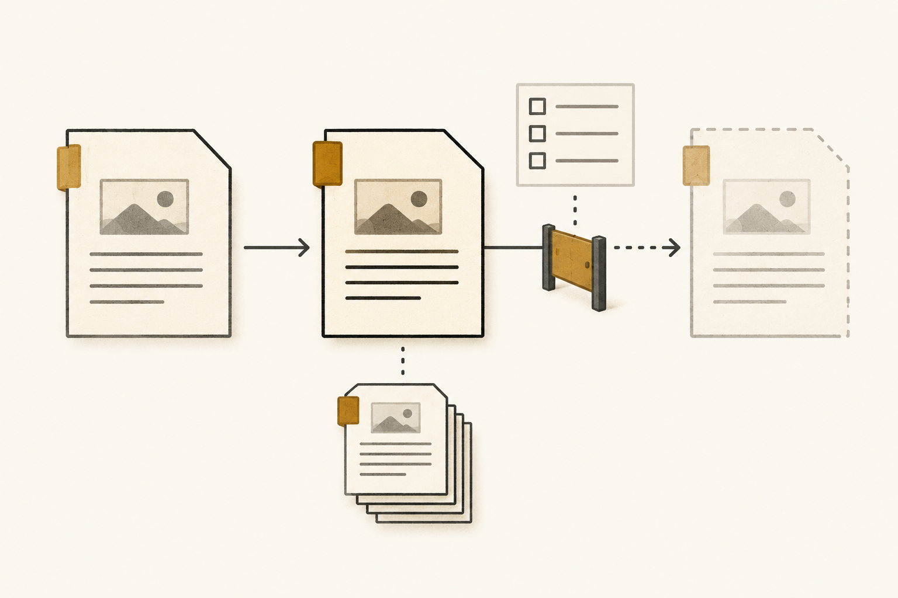

[Documentation home](../README.md)

# Lifecycle and admission

03

## Make accepted changes explicit

 [Explore this in the system map ↑](system-map.md#system-map) 

By the next review checkpoint, the agent has saved a comparison and prepared candidate assessment material. It might also propose a code change, based on a hypothesis that needs evaluation.

The owner needs to see what is accepted, what is proposed and what is unresolved. **Lifecycle** gives each subject its states and change rules. The definition below explains that structure.

### Lifecycle

A next state needs its own transition conditions.

A lifecycle declares, for a kind of governed item, its states, initial state and permitted transitions. Each transition specifies the conditions that must be met and the effects it may produce. A particular item’s recorded state and transition history identify which changes actually occurred.

`Lifecycle(C) = (States(C), Initial(C), T(C), Gates(C), Effects(C))``Permitted(x, C, s, t) ⇔ Applies(C, x) ∧ State_C(x) = s ∧ (s, t) ∈ T(C) ∧ GatesMet(C, x, s, t)`

### Read the full definition

Symbols in the formula

**x**

The exact item version whose tracked state may change.

**C**

The governing lifecycle contract and its exact version.

**`States(C)`, `Initial(C)`**

The declared states and the initial state for items governed by the contract.

**`State_C(x)`**

The state of item x on the particular track governed by C. Record lifecycle, acceptance, response closure and view usability retain their own tracks.

**s, t**

The current state and proposed next state on that track.

**`Applies(C, x)`**

The contract governs this kind of item and this state track within the declared scope.

**`T(C)`**

The set of ordered state pairs whose transitions the contract permits.

**`Gates(C)`, `Effects(C)`**

The required conditions and declared effects for each transition.

**`GatesMet(C, x, s, t)`**

All conditions for this exact transition are met, including validation, review or an authorized owner’s decision where required.

This expression identifies a permitted change. Its execution and declared effects must also be recorded against the exact item and transition.

Scope and boundaries

**Applicability**

Items governed by a lifecycle contract: for example, a definition, implementation, project record or task view.

**Exclusions**

Establishing factual truth, granting general permission to act or advancing the state of another item.

**Semantic owner and scope**

The responsible owner maintains the contract for its declared item kind and scope. The authorized owner for a transition is identified by that contract.

**Boundary conditions**

Each item keeps its own lifecycle. A completed check, a recorded review and an acceptance decision have the distinct effects declared by the applicable contract.

**Plain-language voice**

The states something can be in, the conditions for moving between them and the record of what changed.

**Domain-context voice**

In the Northstar incident, the agent recovers the completeness definition’s earlier acceptance, the current candidate fix and the incident’s open response. Closure, code activation and view expiry are assessed on their respective tracks.

**Illustrative identity**

`example.definition.lifecycle` · version 1.0.0.

**Source basis and standing**

This explanatory definition is based on the Lab’s lifecycle contracts, including the Definition lifecycle profile. It is not a separately admitted Lifecycle definition.

**Primary consumers**

Item owners, reviewers, change operations and agents deciding which route a proposed change must follow.

**Testable conditions**

The item and contract are identifiable, the state pair is permitted, the transition conditions are recorded and the resulting effects stay within the contract.

**Registry and index**

No registry selection is created for this illustrative definition. A real definition would need exact owner acceptance and synchronized lookup records.

**Drift and challenge route**

Questions about state or transition evidence go to the responsible item owner. Changes to the governing contract follow that contract’s review and acceptance route.

Illustration generated with imagegen. [Prompt and asset record](../assets/3576b635d532-definition-card-images.json).

Apply the structure to each incident subject

The definition gives us the structure. The example applies it to four subjects in the same incident, with separate conditions for changing each one.

Lifecycle in the incident

### Read each state and its route for change

At INC-0241’s latest checkpoint, four things are moving in parallel. Each track below shows its current state, what would allow the next state or replacement, and what that completed change would do.

1. #### Completeness definition · version 1.0.0

    Definition acceptance track  

   Current **Accepted (admitted)** Governs this export assessment scope

   

   Possible next **Superseded** An admitted successor is selected

    

   **What must happen**

   Validate and review the successor meaning. An authorized human owner must admit that exact version and issue a successor decision naming it as the replacement.

   

   **Effect if completed**

   Current lookup selects the successor. Version 1.0.0, its earlier acceptance and its evidence remain identifiable.
2. #### Proposed code · revision 8

    Implementation record lifecycle  

   Current **Candidate record** Efficacy still needs assessment

   

   Possible next **Active record** Only under its declared lifecycle

    

   **What must happen**

   Evaluate the exact revision against its implementation contract, preserve conformance evidence and obtain the owner’s authorization for the specified record transition.

   

   **Effect if completed**

   The implementation record becomes active within the approved scope. Adoption for use, deployment and running-service activation keep their own decisions and execution evidence.
3. #### Incident response · INC-0241

    Response closure track · incident record currently active  

   Current **Open response** Cause and recovery unestablished

   

   Possible next **Closed response** Owner-authorized closure

    

   **What must happen**

   The accountable owner reviews the assessment, containment and recovery posture, communications, uncertainty and follow-up obligations under the incident’s Policy, then authorizes closure if its conditions are met.

   

   **Effect if completed**

   The response closure field changes. Failure Occurrences, unresolved cause, evidence and remaining obligations are preserved. The incident record’s lifecycle is governed separately.
4. #### Task information · view 3

    Context View usability track  

   Current **Expired view 3** Agent work is paused

   

   Replacement **New usable view** Resolved and checked for this task

    

   **What must happen**

   Resolve a new view against the intended Context and exact source epoch. Check its sources, digests, coverage, limitations and use conditions. Confirm that the agent’s delegation is still current.

   

   **Effect if completed**

   The new immutable view supplies usable task information; view 3 retains its history. Resuming work also requires current permission. Producing a view does not extend the delegation window.

**Apply only the effects authorized for that track.**

These tracks report different facts: the definition’s authority, evidence for the omission, code state, incident closure and agent permission. A completed change identifies its exact subject, decision or required checks, and resulting state.

### How the definition reached its current state

Definition 1.0.0 was already accepted before the incident. Here is the route the owner followed through the example’s declared Definition profile. Each completed transition needed its own gate and produced its own effect.

1. **Written · candidate-authored**

   To become *validated-candidate*, the exact candidate must pass its bound evaluation profile. The resulting state records validation.
2. **Validated · validated-candidate**

   To become *owner-reviewed*, the owner must review the exact candidate digest and evidence set. The resulting state records review completion.
3. **Owner reviewed · owner-reviewed**

   To become *admitted*, an authorized human admission decision must bind the exact candidate, evidence, registry selection, index and drift review. The selected version becomes authoritative within its scope.
4. **Accepted · admitted**

   An exact successor decision selecting an admitted replacement can make it *superseded*. An authorized withdrawal decision with a replacement or terminal route can make it *withdrawn*, removing current authority while preserving history. Earlier candidate states may also be withdrawn through their declared owner route.

`x = completeness definition 1.0.0``C = its declared Definition lifecycle profile``s = owner-reviewed; t = admitted`

That earlier acceptance met the conditions and selected this version to govern the assessment. The service examples help explain the Lab’s distinctions. For an actual change, look to the subject’s applicable profile or Policy for its exact gates and effects.

### Authorize each requested effect

If later software work uses Craft, compilation produces selected artifacts and a receipt. Checks supply evidence about an exact target. Saving those outputs in Project State is an attributable, governed action.

Acceptance and permission to put the revision into use still need their own decisions. The compiler receipt alone does not establish an achieved repair goal or permission to close Northstar’s incident.

The owner reviews a proposal against its implementation contract, evidence and requested effects. Acceptance, adoption, activation, recovery and incident closure each have requirements to meet. Even a closure record needs to preserve unresolved cause, uncertainty and follow-up obligations.

### Record the decisions and resulting state

A **Decision Bundle** lets an owner review distinct decisions together without extending their limits. Formal acceptance is called **admission**. Once the bundle is authorized, an **Admission Transaction** applies the accepted records and declared consequences together.

The resulting **Project State** retains the project’s records, definitions, evidence and decisions. One history records the change; another records why it was accepted. Every referenced record keeps its own standing, so a saved proposal is still a proposal until its acceptance route is completed.

**Diagram labels:** Specific proposal · Records, versions and requested changes · Decision bundle · Independent decisions, one review checkpoint · Admission transaction · Accepted record changes applied together · review · authorize · Updated Project State · The saved result of the accepted changes · Change history · What changed? The preceding state and resulting state. · Approval history · Why was it accepted? Decision, authorization and applicable rules. · Both histories refer to the same specific change event.

### Read this diagram as text

A specific proposal enters a Decision Bundle for review. An authorized Admission Transaction then applies the accepted record changes together and saves the new Project State. The change history records what happened; the approval history records why it was accepted. They identify the same event.

- Specific proposal
- Records, versions and requested changes
- Decision bundle
- Independent decisions, one review checkpoint
- Admission transaction
- Accepted record changes applied together
- Updated Project State
- The saved result of the accepted changes
- Change history
- What changed? The preceding state and resulting state.
- Approval history
- Why was it accepted? Decision, authorization and applicable rules.

Figure 02 The Lab calls these the Project Semantic Event History and Project Governance Event History. Sharing a review does not extend any decision’s permission; the transaction may apply only authorized effects.

### What a later agent can recover

A later session reads the transition to find out what changed and which conditions were met. An accepted software revision, for instance, might still await deployment. The state belongs to that particular subject.

A machine-agent instance belongs to one session. It ends with that session, along with its working memory. The next session recovers continuity from saved Project State, using a **Context View** prepared for its task and an **Ontology View** of the relevant concepts and connections.

Task view 3 was usable at the start of the investigation. Its use period later ended, and the agent paused. Continuing requires a newly checked view and current permission.

A new session begins with empty working memory. It recovers the assessment, proposal and owner decisions through current views.

The incident record is active and its response closure field is open. Closing the response follows the governing Policy and retains uncertainty and follow-up obligations. Evidence of recovery can exist while the cause is still unresolved.

### Read the same incident through all three lenses

Authority **What governs the work?**

Definition 1.0.0 tells the agent what to check. The owner’s delegation permits this investigation. Adopting a fix, activating it and closing the incident each need a decision with the appropriate scope.

Provenance **What produced this assessment?**

We can inspect this comparison because its conditions are named: S1, Northstar, the filters, E12, method version 2 and session 12. The evidence supports the omission claim within those conditions.

Lifecycle **Where are we, and what may change?**

The definition is accepted, while the fix is still a candidate. The incident record is active and its response remains open. Before the agent continues, it needs a newly checked view to replace the expired information.

The three questions meet in a particular change. The definition supplies the criterion, provenance identifies the basis, and the lifecycle contract governs the change using the required evidence and authorization. The recorded change then has a source trail of its own. We keep following those connections through the investigation and later response.

### Three kinds of change—and why they matter

A changed meaning, a changed encoding and a rebuilt view have different consequences. The distinction matters when a format update is meant to preserve the rule it represents. A **canonical record** is the designated primary representation for its scope. A derived view is rebuilt from that record.

**Semantic Epoch · changed meaning**

If the owner determines that a change materially alters meaning, scope or semantic requirements, it needs a successor meaning version and explicit owner selection. Changing which rows qualify for an export would be such a change.

**Representation Revision · changed format**

A new machine encoding needs evidence of equivalent meaning, validation and owner selection. Keep the earlier revision identifiable so someone can examine what changed.

**Derived Refresh · rebuilt view**

A regenerated view adds no meaning or authority when it uses unchanged canonical input and the exact generator binding, then passes validation. Changing the generator is a separate governed change.

### How someone can challenge an accepted record

A **Challenge Contract** tells us who can contest a revision, which reasons and evidence count, and who must respond. A **Challenge Event** records one eligible challenge, such as evidence contradicting an export-completeness finding.

Filing the challenge creates something to resolve. Suspension or withdrawal still follows the contract and requires an authorized decision.

### Definitions and sources

[Decision Bundle](../reference/records/def-cal-definition-decision-bundle.md#def-cal-definition-decision-bundle) · [Admission Transaction](../reference/records/def-cal-definition-admission-transaction.md#def-cal-definition-admission-transaction) · [Semantic Epoch](../reference/records/def-cal-definition-semantic-epoch.md#def-cal-definition-semantic-epoch) · [Representation Revision](../reference/records/def-cal-definition-representation-revision.md#def-cal-definition-representation-revision) · [Derived Refresh](../reference/records/def-cal-definition-derived-refresh.md#def-cal-definition-derived-refresh) · [Challenge Contract](../reference/records/def-cal-definition-challenge-contract.md#def-cal-definition-challenge-contract) · [Challenge Event](../reference/records/def-cal-definition-challenge-event.md#def-cal-definition-challenge-event) · [Incident](../reference/records/def-cal-definition-incident.md#def-cal-definition-incident) · [Failure Assessment](../reference/records/def-cal-definition-failure-assessment.md#def-cal-definition-failure-assessment) · [Governance-Axis Independence Invariant](../reference/records/def-cal-definition-governance-axis-independence-invariant.md#def-cal-definition-governance-axis-independence-invariant) · [Definition](../reference/records/def-cal-definition-definition.md#def-cal-definition-definition) · [Project State](../reference/records/def-cal-definition-project-state.md#def-cal-definition-project-state) · [Context View](../reference/records/def-cal-definition-context-view.md#def-cal-definition-context-view) · [Ontology View](../reference/records/def-cal-definition-ontology-view.md#def-cal-definition-ontology-view) · [Agent Instance](../reference/records/def-cal-definition-agent-instance.md#def-cal-definition-agent-instance) · [Agent Session](../reference/records/def-cal-definition-agent-session.md#def-cal-definition-agent-session) · [Session Memory](../reference/records/def-cal-definition-session-memory.md#def-cal-definition-session-memory)

- [Governance transaction approval](../assets/17c191453d8d-DECISION.md)
- [Committed Project State](../assets/8ba8ee25ccbf-current.json)
- Local runtime: storage, approvals and replay
- Local runtime: governed consequences
- [Local runtime implementation overview](../assets/78623efb7024-README.md)
- Local runtime: temporary agent sessions
