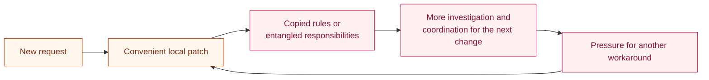
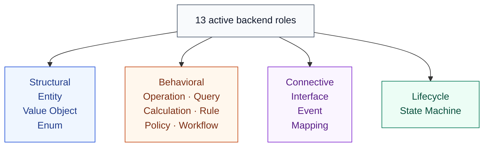
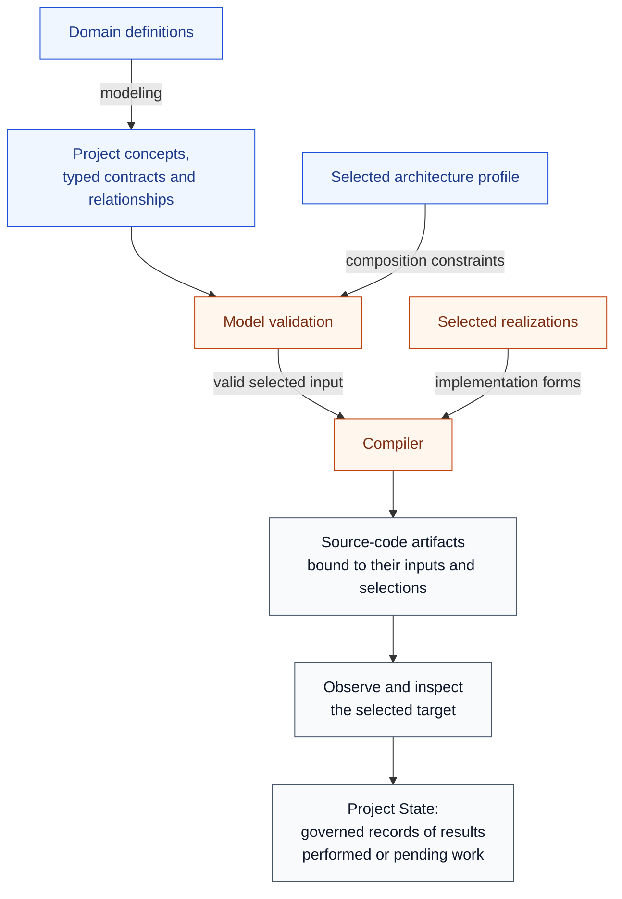
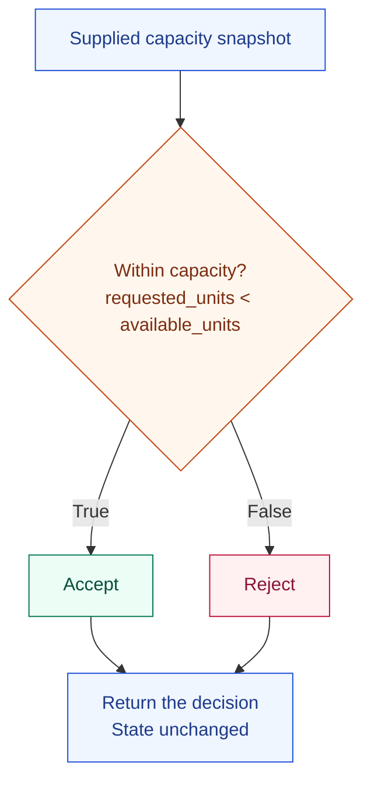
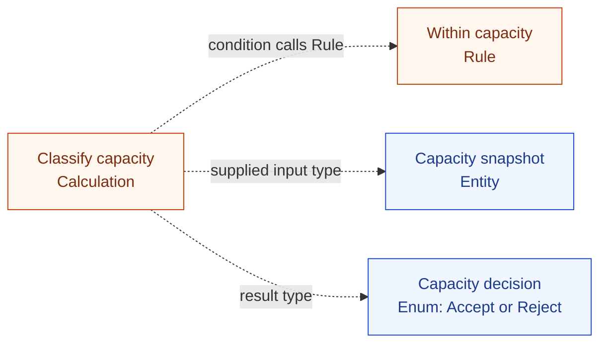
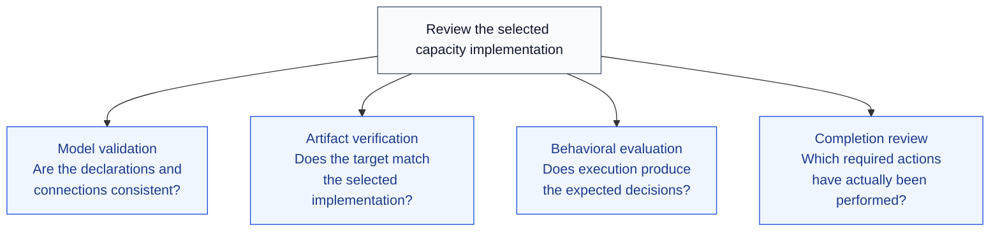
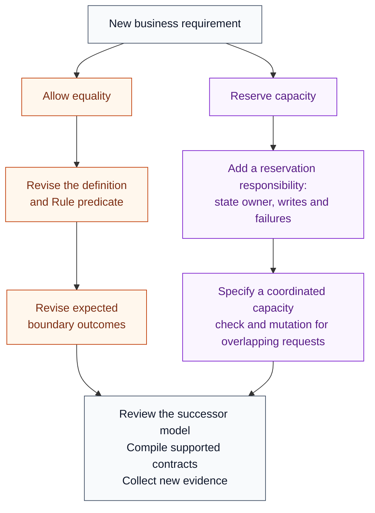
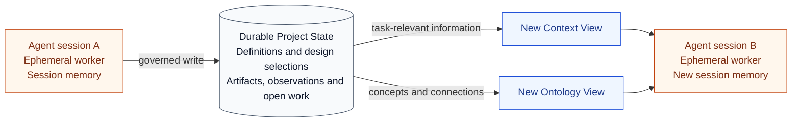
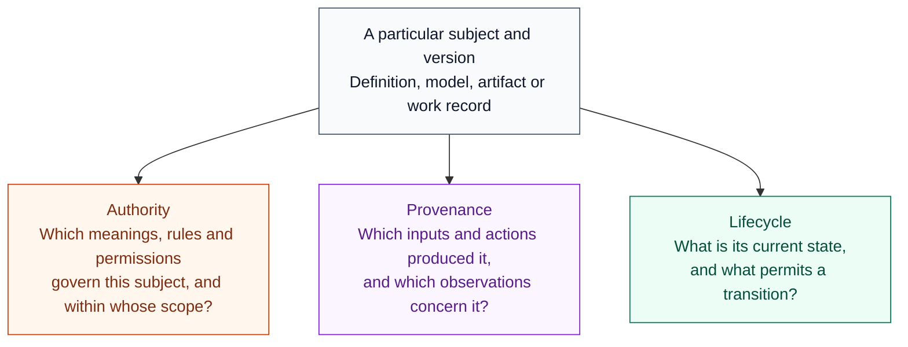

# Craft: compiling software from explicit models

> Working draft · Version 0.21 · 11 October 2026  
> Focus: the high-level model of a product we are building for closed beta. Software design, domain modeling, architecture, code compilation and enforcement.

We're building Craft, a system for software design, domain modeling and enforceable architecture, as we prepare for a closed beta. Our goal is to compile software from an explicit model, preserving its meaning through the choices that shape the code.

Craft is the software-design product in CyberAlchemy Lab's broader model of knowledge and work. The [Lab guide](../governance-lab-series/governance-lab-reference.html#purpose) explains how a requirement becomes a project, assigned work and evidence for an owner decision. This article follows the software model and implementation that can be developed within that work. Craft has its own design contracts; using its tools does not by itself accept a Lab record or authorize deployment.

## 1. Software modeling connects meaning and implementation

Domain-Driven Design provides a useful starting point: develop a model with people who understand the domain, build a shared language around it, and keep that model connected to the implementation. Its language has a defined context, so the same word can carry different meanings in different parts of a business. [Eric Evans, *Domain-Driven Design Reference*](https://www.domainlanguage.com/wp-content/uploads/2016/05/DDD_Reference_2015-03.pdf)

A software model makes the system's meanings and responsibilities explicit: which concepts exist, what behavior they have, which states matter and how responsibilities connect. For example, it can distinguish deciding whether a request is acceptable from changing state to fulfill that request. Those responsibilities can use the same information while having different consequences.

This gives implementation a reference to work from. A developer can examine what a concept means, which responsibility belongs to it and which interactions the design permits. The same reference helps a later contributor understand what a change must preserve.

Shopify's account of modularizing its monolith makes the architectural problem concrete. Shipping and checkout code had become tightly coupled. Organizing components was followed by work to isolate dependencies, define public interfaces and track access that crossed domain boundaries. The problem involved deciding which interactions were allowed and observing whether the code respected those decisions. [Shopify engineering, 2019](https://shopify.engineering/deconstructing-monolith-designing-software-maximizes-developer-productivity)

The model of behavior can be equally important. Stripe's PaymentIntent lifecycle distinguishes a payment requiring customer action, one still processing and one that has succeeded. Asynchronous payment methods can take days to resolve. For a service deciding when to fulfill an order, these distinctions change what “complete” means and when the next action is permitted. [Stripe's payment lifecycle documentation](https://docs.stripe.com/payments/paymentintents/lifecycle)

Together, these examples connect meaning to architecture: a payment's state determines when fulfillment may begin, while the boundaries between components determine where that responsibility belongs. Implementation needs to preserve both. The difficulty is carrying those decisions through changes to the software and the people or agents working on it.

## 2. Why design breaks down during implementation

Those decisions often remain distributed across discussions, diagrams, prose and existing code. People may agree on where a business rule belongs, which information an operation can read and what should happen when it fails, without recording those obligations precisely enough for a later contributor to recover them.

The difficulty appears when an assumption is preserved in conversation but lost during implementation, or when code changes an obligation without making that change explicit. An order is fulfilled too early. A retry repeats an effect. A change in one component breaks behavior elsewhere.

The visible failure may be a wrong result or a failing test. Understanding it requires tracing the assumptions, responsibilities and dependencies behind that symptom. The code may still contain familiar names even though the conditions those names once represented have changed.

### Design context is lost between sessions

Agentic engineering adds another source of discontinuity. Work can span several sessions, each with only part of the design context. Anthropic's work on long-running coding agents describes unfinished work with unclear handoffs, later sessions guessing what happened, and completion claims made without sufficient end-to-end testing. [Anthropic, *Effective harnesses for long-running agents*](https://www.anthropic.com/engineering/effective-harnesses-for-long-running-agents)

### Required work never reaches the finished result

An agent can also understand the requirement and still leave the work incomplete. It may implement the main path but omit a failure branch, define a rule without connecting it to the operation, or update one component while leaving a dependent caller unchanged. Mentioning a required action in the task does not ensure that it reaches the finished result. The code that exists may look coherent; the missing piece becomes visible only when someone compares the result with the full requirement or exercises the neglected path.

This creates a practical review problem: inspecting the patch tells us what changed, but identifying what was never implemented requires a separate account of what should have been delivered. Completion needs to be assessed against explicit obligations, including required connections, branches and follow-up actions.

### A local repair changes the intended behavior

An agent might weaken an acceptance condition to make a failing request succeed, duplicate a business rule in a convenient component, or update a test to match changed behavior without examining the requirement. The patch can look reasonable in isolation while changing the conditions the system was meant to preserve.

The review needs to distinguish repairing the implementation from revising the requirement. Otherwise, an attempt to fix a symptom can silently change the system's meaning.

### Shortcuts accumulate into architectural brittleness

Another failure mode is **brittleness through accumulated design shortcuts**. An agent may choose the first convenient way to satisfy the immediate request: add a condition to an existing function, copy a rule into a new caller or reach directly into another component's data. The change can work for today's case while leaving responsibilities more entangled. Later work inherits those choices and adds further exceptions around them.

This creates technical debt: future changes require more coordination, investigation and repair because earlier design decisions made the structure harder to change. A capacity rule copied into several callers must be updated in several places. A function combining decision, persistence and retry behavior becomes difficult to modify without affecting all three.

The important design question is whether the responsibilities remain clear as the software grows. A small implementation can support later changes when its boundaries are explicit. When new behavior repeatedly arrives as another exception or copy, a routine feature can require extensive reconstruction of the system, and repeated regressions can make further development impractical without redesign.



*Figure 1. A possible cycle of architectural brittleness. A successful local patch can leave obligations that make the next change harder; the cycle describes design pressure, not an inevitable outcome.*

Research now examines this across successive changes. SlopCodeBench lets agents repeatedly extend their own code under evolving specifications and reports increasing redundant code and concentrated complexity in many evaluated trajectories. CodeTaste finds that agents are better at implementing detailed refactoring instructions than identifying the refactorings human developers chose. These results support examining how a design evolves across changes, alongside whether the current change works. [SlopCodeBench, May 2026 preprint](https://arxiv.org/abs/2603.24755v2); [CodeTaste, ICML 2026](https://proceedings.mlr.press/v306/thillen26a.html).

These failures leave the next contributor with several kinds of reconstruction: recover the intended meaning, identify missing work and discover which responsibilities moved or became entangled. Addressing them requires a model that distinguishes those responsibilities and records what each one must preserve. Craft's taxonomy provides the vocabulary for doing that.

## 3. The taxonomy of a Craft model

A taxonomy classifies concepts by their responsibilities. Craft's categories answer practical design questions: what has an identity, what computes a value, what governs a decision, what changes state and what coordinates several actions?

A **contract** records what a responsibility requires and how it must behave: its inputs, result, dependencies and applicable conditions.

Each category establishes the kind of contract a concept needs. A Rule requires a condition with a boolean result; a Workflow requires an account of the Operations it coordinates. The project then supplies the specific condition or coordination being designed.

The following map covers backend roles and their permitted connections, proposed UI extensions, and the implementation selections and work records around them.

### Separate meaning, responsibility and representation

Several kinds of information contribute to a software design:

| Kind of information | What it describes |
| --- | --- |
| Definition | What a term or concept means within a stated context. |
| Meta-type | The software responsibility a concept occupies, such as Entity, Rule or Operation, and the declarations that role requires. |
| Project concept | A particular named concept in a project's model, assigned a meta-type and its own contract. |
| Typed contract | The concept's declared fields, inputs, results, conditions, dependencies or effects, as appropriate to its role. |
| Relationship | A directed connection between concepts, with a defined meaning and permitted endpoint roles. |
| Architecture profile | Rules for organizing responsibilities, composing them and constraining dependencies. |
| Realization | The selected implementation form for a supported role under a language and architecture profile. |
| Artifact and observation | An output of the work, and a record of what was inspected or evaluated about a particular target. |

The word “type” appears at two levels here. A **meta-type** identifies a concept's responsibility; a field's value type, such as a string or unsigned integer, identifies the information that field can hold. Naming a concept Entity establishes an identity obligation. Declaring one of its fields as a string constrains that field's values. A typed model makes both kinds of declaration explicit.

The graph's nodes represent project concepts and their contracts. Runtime objects are instances of those concepts. A single Entity node can describe a type with many objects in a running system; adding another object does not require adding another type to the model.

Craft groups its 13 active backend meta-types into four families: structural, behavioral, connective and lifecycle. A project selects the roles its design needs. It does not have to instantiate every category.



*Figure 2. The backend vocabulary, grouped by responsibility. These arrows show classification into families. The permitted relationships between project concepts are defined separately below.*

### Structural roles: identity, values and alternatives

Structural roles define how domain information is distinguished and organized.

| Role | Responsibility | What the model must make explicit |
| --- | --- | --- |
| **Entity** | Describe a domain object tracked by a stable identity. | Typed fields and the field or fields that establish its identity. |
| **Value Object** | Describe a value whose equality is determined by its contents. | Typed fields and the equality rule, without a separate identity field. |
| **Enum** | Define a closed set of named alternatives. | The allowed alternatives that make up the set. |

The distinction between Entity and Value Object determines how sameness is understood. An Entity can retain its identity while its fields change. Two Value Objects with equal contents represent the same value under their declared equality rule. This affects references, updates and comparisons.

An Enum defines which alternatives exist. It does not say which transitions between alternatives are permitted. That second responsibility belongs to a State Machine.

### Behavioral roles: actions, questions, decisions and coordination

Behavioral roles state what the software does and which responsibility owns that behavior.

| Role | Responsibility | What the model must make explicit |
| --- | --- | --- |
| **Operation** | Own a state-changing business action in the backend role catalog. | Inputs, outcomes, governing conditions, reads, writes, effects and failure continuation. A rejected attempt can leave state unchanged; the successful path owns the declared change. |
| **Query** | Retrieve information without changing state or producing effects. | Inputs and filters, information read, and the result shape. |
| **Calculation** | Derive a value from explicit inputs through a pure computation. | Input values, derivation and return type; the same inputs yield the same value. |
| **Rule** | Evaluate a condition that gates an Operation. | A boolean predicate, its parameters and the Operation it governs. |
| **Policy** | Select a strategy or behavior according to declared conditions. | Cases, selection criteria and the behavior selected for an Operation or Calculation. |
| **Workflow** | Coordinate ordered Operations within or across feature boundaries. | Steps, ordering, ownership scope and applicable recovery responsibilities. |

A Query reads domain information. A Calculation derives a value from the inputs it receives; it has no Entity-reading relationship in the current catalog. This keeps retrieval and computation identifiable even when both return data. A Query's result can change when the underlying information changes; read-only behavior does not imply permanently identical answers.

A Rule returns true or false for its declared condition. A Policy selects how behavior proceeds. Keeping those results distinct lets a reviewer identify whether a proposed change alters eligibility or changes the strategy used after a choice is permitted.

An Operation's contract declares its state boundary. **Reads** identify information it uses; **writes** identify state it changes; **external effects** identify interactions beyond that state boundary. A **guard** references the Rule whose **predicate**, or true-or-false condition, governs the action. The contract must also state what happens if that condition fails. A rejected attempt can leave state unchanged while the successful action owns the declared change. A pure function classifying supplied values belongs to Calculation, as the capacity example demonstrates below.

A Workflow owns coordination across Operations. Each Operation retains responsibility for its own changes and effects. When recovery is required, the design also needs to distinguish deciding that recovery is necessary from actually executing a compensating action. The current taxonomy incorporates the role formerly called Saga into Workflow.

### Connective roles: boundaries, facts and transformations

Connective roles describe how software responsibilities communicate and exchange meaning.

| Role | Responsibility | What the model must make explicit |
| --- | --- | --- |
| **Interface** | Define a logical API boundary through which Operations or Queries are exposed. | Boundary kind, callable responsibilities, and request and response contracts. |
| **Event** | Record a domain fact that has already occurred. | The fact's meaning, typed payload and declared relationships to its source and consumers. |
| **Mapping** | Transform information from one declared shape into another. | Source and target shapes, direction and field transformations. |

An Interface defines what a consumer may call. A Mapping defines how information changes shape when crossing a boundary. Those responsibilities can work together while remaining independently inspectable.

An Event expresses a past occurrence. A request to perform work belongs to a different part of the design. Confusing the two makes it unclear whether a consumer is being asked to act or being informed that an action has already happened.

The Interface role also has a specific domain meaning. A language-level interface for a repository, clock or transaction provider can serve an implementation concern without becoming a domain Interface node. Such infrastructure contracts support the model's implementation and need their own declared boundaries.

### Lifecycle role: states and permitted transitions

| Role | Responsibility | What the model must make explicit |
| --- | --- | --- |
| **State Machine** | Define the states a subject may occupy and the transitions it may take. | States, valid transitions, triggers, guards, effects and invariants governing those transitions. |

This adds obligations that a list of state names cannot express: which event permits a transition, which condition must hold, what effect follows and which invariants remain true. The lifecycle can then be examined as behavior over time.

### Relationships: how the roles may connect

A relationship has a source, a verb and a target. Its **signature** declares which roles are permitted at the two ends. Its scope declares where the connection may be used. A **feature** is an ownership and organization unit in the model; a connection within one feature and a connection across features can carry different obligations.

The backend catalog contains 17 relationship signatures:

| Connection | Meaning | Permitted feature scope |
| --- | --- | --- |
| Entity → **performs** → Operation | An Entity or modeled actor initiates an action. | Same feature. |
| Operation → **produces** → Event | Successful completion of an action causes a domain fact. | Same feature. |
| Operation → **produces-for** → Entity | An action writes or projects information into an Entity owned by another feature. | Across features. |
| Operation → **creates** → Entity | An action owns the creation of new instances of one Entity type. | Same feature. |
| Event → **triggers-cross** → Operation | A fact in one feature activates an action in another. | Across features. |
| Rule → **enforces** → Operation | A condition gates an action. | Same feature or across features. |
| Calculation → **calculates** → Operation | A derivation supplies values used by an action. | Same feature. |
| Event → **transitions** → State Machine | A fact advances a lifecycle under its transition rules. | Same feature or across features. |
| Interface → **exposes** → Operation or Query | An API boundary makes a responsibility callable. | Same feature or across features. |
| Workflow → **orchestrates** → Operation | Coordination orders the participating actions. | Same feature or across features. |
| Policy → **applies** → Operation or Calculation | A strategy selection governs the behavior used. | Same feature. |
| Mapping → **maps** → Entity or Interface | A transformation connects declared data shapes. | Same feature or across features. |
| Entity → **contains** → Value Object | An identity-bearing object embeds a value in its structure. | Same feature. |
| Query or Operation → **reads** → Entity | A responsibility depends on Entity information by reading it. | Same feature. |
| Entity → **emits** → Event | An Entity is the subject or source of a domain fact. | Same feature. |
| Entity → **owns** → Entity | An Entity carries lifecycle, custody or write responsibility for another. | Same feature or across features. |
| Entity → **belongs-to** → Entity | An Entity has a membership, classification or assignment relationship to another. | Same feature or across features. |

These distinctions describe different responsibilities. `Produces` identifies the action causing an Event; `emits` identifies its Entity subject or source. `Owns` declares a responsibility boundary; `belongs-to` declares membership or assignment and does not establish ownership. `Reads` records a dependency without implying that every other part of the reading Operation is free of writes.

Multiplicity also matters. In the current `creates` relationship, one Operation concept can be the creation owner of at most one Entity type, and that Entity type can have at most one such owner. The Operation can still create many instances at runtime. This is a constraint on the design's ownership structure, not a limit on how many objects may exist.

Typed references inside a contract remain distinct from graph relationships. An input can refer to an Entity type, and a result can refer to an Enum, without introducing new relationship verbs. Similarly, a field declaration supplies information that need not become a separate graph edge. A new verb needs a distinct meaning and an explicit extension to the catalog, including endpoint, scope and composition rules.

The architecture profile can further constrain a connection that the catalog permits. A valid signature is therefore one part of deciding whether a particular composition is allowed.

### The proposed UI vocabulary

The model also has a proposed vocabulary for user interfaces. These roles describe navigation, presentation, input and access to backend responsibilities. Their status differs from the active backend core: nine are candidates, and two further labels remain deferred while their boundaries are resolved.

| Role | Responsibility | Status |
| --- | --- | --- |
| **Page** | Own a navigable destination, its route and primary content. | Candidate. |
| **Layout** | Provide a reusable frame with declared slots and shared visual structure. | Candidate. |
| **Component** | Provide a visual unit with typed inputs and outputs, without an independent route. | Candidate. |
| **View Model** | Shape information for a particular display context while preserving references to its sources. | Candidate. |
| **Hook** | Describe reactive behavior, typed inputs and results, and applicable lifecycle and effects. | Candidate; its boundary with Binding still needs resolution. |
| **Form** | Own a typed input collection, validation, errors and submission. | Candidate. |
| **Action** | Express a named user intent, its trigger, target, effects and observable outcomes. | Candidate. |
| **Guard** | Apply an existing rule to access or visibility of a protected UI surface. | Candidate. |
| **Binding** | Record how a UI connects to an endpoint: mode, target, trigger, parameter and result mappings, and cache behavior. | Candidate; its boundary with Hook still needs resolution. |
| **Adapter** | Transform boundary data into a display shape. | Deferred because this responsibility currently overlaps Mapping. |
| **State Indicator** | Represent domain states visually. | Deferred while domain-state representation is distinguished from loading, error and empty display states. |

A View Model shapes presentation without acquiring authority to redefine the domain. A UI Guard applies a source Rule; showing or hiding a Page does not independently authorize a backend action. Likewise, a Component is a specific visual responsibility: more specific responsibilities such as routing and form validation retain their own roles.

Two names need care. A UI **Guard** is a proposed node role; an Operation's **guard** is a reference to the Rule governing that action. A UI **Binding** records endpoint use; an artifact's **binding** records its connection to the model and implementation selections that produced it. Each term needs its context to remain explicit.

The relationship catalog records eight UI signatures:

| Connection | Meaning |
| --- | --- |
| Page → **renders** → Component | A destination presents visual units. |
| Layout → **wraps** → Page | A shared frame surrounds a destination. |
| Component → **composes** → Component | A visual unit includes child units. |
| Component → **consumes** → Hook | A visual unit uses reactive state or data behavior. |
| Form → **submits** → Action | Validated input delegates to a named user intent. |
| Adapter → **shapes** → View Model | A transformation constructs a display shape. |
| Guard → **protects** → Page | An existing rule governs access to a destination. |
| Component → **displays** → View Model | A visual unit presents a declared display shape. |

Six further signatures connect UI responsibilities to the backend model:

| Connection | Meaning |
| --- | --- |
| Binding → **fetches** → Query | The UI retrieves information through a read-only responsibility. |
| Binding → **mutates** → Operation | The UI invokes a business action. |
| State Indicator → **reflects** → State Machine | The UI represents a domain lifecycle state. |
| View Model → **derives** → Entity | Display information is derived from domain fields. |
| Form → **contracts** → Interface | Input structure aligns with the API contract. |
| Guard → **mirrors** → Rule | The UI gate applies the backend condition. |

These signatures describe the intended connections without making every participating role an active backend type. In particular, the catalog retains connections involving the deferred Adapter and State Indicator roles. Their presence does not settle those roles' open boundaries or establish a complete compiled UI implementation. The UI and UI-to-backend signatures are scoped within a feature; crossing layers does not automatically permit crossing feature ownership boundaries.

### Implementation selections and records of work

The taxonomy identifies the responsibilities available to a design. Architecture profiles and realizations then specify how a selected design is organized and represented in code. A role can have different supported implementation forms while retaining the same responsibility and contract.

Manifests, build receipts, observations and evidence records describe construction and examination of the software. They serve the work around the model; they are not additional backend meta-types. A Craft receipt records a particular construction or check. Retaining it in Lab Project State requires the applicable recording contract, attribution and permission; its existence does not supply an admission decision. Project State and agent handoffs preserve knowledge about the design and work performed without becoming the domain behavior being compiled.

The next section follows how these declarations enter compilation, how the results are examined and how performed work is recorded.

## 4. How Craft carries the design into code

Craft uses explicit model declarations as compiler input. The selected model, architecture profile and realizations become the reference for construction and later inspection. The active role vocabulary describes what can be modeled; code construction depends on the exact contracts and realizations supported by the selected compiler. An active role does not establish uniform compiler support for every behavior or language.

The connection from meaning to observed implementation is:



*Figure 3. Construction and observation use explicit selections. Recording their results in Lab Project State is a governed action with its own contract and permission. These process arrows do not establish automatic synchronization or that a check or integration action has been performed.*

The work around this path addresses the earlier failure causes:

| Part of the work | Responsibility | Failure it helps address |
| --- | --- | --- |
| Model the intended behavior | Record meanings, roles, required behavior and connections. | Contributors having to reconstruct the design from scattered assumptions. |
| Validate the model | Check types, references and required relationships. | A declared rule or dependency being missing or disconnected. |
| Compile the selected design | Construct supported behavior through explicit translation rules. | Required code pieces depending on an agent remembering to handwrite each one. |
| Inspect the target | Compare the observed artifacts with the selected model and implementation forms. | Code drifting from the design, or selected artifacts being missing. |
| Record performed work | Preserve changes, observations and outstanding obligations in project state. | Later sessions guessing what happened or treating unfinished work as complete. |

Before construction, contributors must also review the choices the compiler will receive. Adding persistence introduces a state owner and failure behavior. Adding an entry point introduces a consumer. Adding a retry introduces questions about repeated effects. The model gives these design changes an explicit subject to examine before they become code.

These responsibilities answer three different questions:

1. Does the model cover the requirement?
2. Does the implementation match the model?
3. Has the required work actually been performed?

Each question needs its own review or evidence. A valid model can still omit a business requirement, and conforming code can still await integration or evaluation.

AI can help explore the domain, author the model and investigate disagreements. Producing the supported source code follows the compiler's explicit translation rules, so each coding session need not reconstruct and handwrite the same declared behavior.

We can now follow that process through a capacity decision for a compute service. The example uses four backend roles—Entity, Rule, Calculation and Enum—with explicit typed references. Starting with a narrow decision makes each obligation visible; later sections add reservation and retries to show how the same design can evolve.

## 5. Define the domain decision

Consider an agent asked to implement a capacity decision for a compute service. A caller supplies a request identifier, the number of units requested and the number available. The business wants some capacity to remain after a request of that size. The decision must reject requests that would consume all available capacity, and it must leave state unchanged.

For example, request `R-104` asks for 4 units when 5 are available. It should be accepted. A request for all 5 should be rejected.

“Accept when capacity is sufficient” does not fully express that requirement: it leaves the equality boundary open. Before implementing it, the agent and reviewer need a precise account of what acceptance means.

For this task, the definition is:

> **Within capacity**  
> For a given capacity snapshot, a request is within capacity when its requested units are strictly less than the available units. Equality does not satisfy this condition.

```text
requested_units < available_units
```

A **snapshot** is the supplied record of the request and capacity quantities used for this decision. Acceptance means that the request satisfies the condition in that record. It does not mean that capacity has been reserved or a job has started.



*Figure 4. The required execution flow. A false condition produces the normal Reject result. Neither branch reserves capacity or starts a job.*

Once accepted for this scope, the definition gives the agent and reviewer a durable reference: preserve the strict boundary and keep the decision separate from reservation. A proposal to allow equality revises the meaning of acceptance. A proposal to reserve capacity adds a responsibility with state ownership and consistency rules. Both require a design change, and the selected definition makes the difference visible.

## 6. Turn the domain meaning into a typed model

The definition fixes the condition. The model must identify the information it uses, the responsibility that derives a decision and the complete set of results. Those requirements give us four concepts:

| Concept | Role | Declared responsibility |
| --- | --- | --- |
| Capacity snapshot | Entity | Identify the request and carry its supplied capacity quantities. |
| Within capacity | Rule | Evaluate the strict comparison as a Boolean condition. |
| Classify capacity | Calculation | Derive Accept or Reject from the supplied snapshot. |
| Capacity decision | Enum | Define the complete set of decision alternatives. |

The snapshot declares a request identifier and two unsigned integer quantities—whole numbers that cannot be negative. In request `R-104`, these quantities are 4 requested units and 5 available units. The model explicitly marks the request identifier as its identity.

### Calculation and the capacity example

Classify capacity takes a supplied snapshot and returns a Capacity decision. Its conditional expression calls the existing Within capacity Rule, returning Accept when the Rule is true and Reject otherwise. It owns no retrieval, mutation or external effect. The Rule remains the single declared source of the strict comparison.

The earlier compiler fixture labeled this pure decision as an Operation. The corrected example uses Calculation and preserves Operation's state-changing meaning. The earlier fixture is retained as historical compiler evidence; it no longer supplies the role guidance used in this article.

A readable summary is:

```text
Capacity snapshot
  identity: request_id
  requested_units: UInt64
  available_units: UInt64

Within capacity — Rule
  parameter: Capacity snapshot
  predicate: requested_units < available_units

Classify capacity — Calculation
  input: Capacity snapshot
  result: Capacity decision
  condition: call Within capacity with this snapshot
  if true: Accept
  if false: Reject
  state change: none
```

This summary explains the model; the compiler consumes the corresponding structured contracts. The conditional Enum result uses `domainspec.typed-calculation/v2`. Existing `v1` Calculations retain their UInt64 arithmetic contract. The v2 contract supports one conditional expression with explicit scalar or named record inputs, a typed Rule expression and a payloadless Enum result. It does not introduce an Operation guard or write/effect declarations.

Reject is a normal value in this classification. It is neither an exception nor evidence that execution failed. Both alternatives must be declared before code is constructed.

### A reservation is a different responsibility

With 4 requested units and 5 available units, classification returns Accept and available capacity remains 5. A separate **Reserve capacity Operation** would check current capacity and coordinate that check with a state change: reduce available capacity from 5 to 1 and create a 4-unit reservation. A request of 5 units fails the strict condition and leaves capacity unchanged.

The successful reservation owns a change; a rejected attempt can leave state unchanged. The supplied snapshot's Accept value is insufficient to reserve live capacity, because another request may have changed it. Reservation needs its own state owner, authorization and consistency contract. The current compiled example implements classification; reservation remains a design extension.

## 7. Make architectural choices explicit

The classifier names its snapshot input type, its decision result type and the Rule called by its expression. These references form a checked dependency closure: the exact declarations needed to construct this calculation.



*Figure 5. All arrows are typed contract references. The classification example authors no graph edges. Figure 4 shows execution; this figure shows which declarations that execution depends on.*

These dependencies must resolve. The Rule reference must supply its exact parameters with compatible types. The result constructors must name variants in the selected Enum. The referenced properties must belong to the supplied record. A Rule sitting elsewhere in the project is insufficient unless the classifier actually binds it.

An expression reference and an authored software relationship have different contracts. The existing `enforces` signature connects Rule to Operation; `reads` connects Query or Operation to Entity. Neither signature admits this Calculation endpoint. Reclassifying the example therefore removes those edges from the current design rather than changing their permitted endpoints.

If the design adds reservation, Within capacity can **enforce** the new Operation. A Calculation can **calculate** a derived value for that Operation when the Operation actually uses it. Those are already permitted signatures, and the state-changing design must declare its own connections. A new kind of connection would require a catalog extension.

The decision remains self-contained: a caller provides a record and receives Accept or Reject. We then select an architecture profile and supported implementation forms that preserve this boundary. The profile constrains placement and dependencies within the wider application. A handwritten caller still needs examination: it could duplicate the comparison, ignore the decision or add an undeclared reservation.

## 8. Compile that design into source code

For this example, we select the supported Rust realization for the capacity Calculation's typed contract. That choice determines the source-code form used to implement the declared behavior.

The three selections remain identifiable:

| Selection | Capacity example |
| --- | --- |
| Role | Calculation: a pure derivation of a decision value. |
| Project concept | Classify capacity: this specific decision and its contract. |
| Realization | The selected Rust implementation form for the typed contract. |

For this selection, the compiler constructs the snapshot record, decision alternatives, Rule and conditional Calculation. The resulting artifacts retain bindings to the model and implementation selections used to produce them. Later inspection can therefore identify which design each output is expected to implement.

The following abbreviated Rust example follows the corrected capacity classification contract and its typed translation rules. Auxiliary bindings, provenance metadata and derivation attributes are omitted for readability. It illustrates the translation; it is not a newly captured compiler run.

```rust
pub struct CapacitySnapshot {
    pub request_id: String,
    pub requested_units: u64,
    pub available_units: u64,
}

pub enum CapacityDecision {
    Accept,
    Reject,
}

pub fn within_capacity(snapshot: &CapacitySnapshot) -> bool {
    snapshot.requested_units < snapshot.available_units
}

pub fn classify_capacity(snapshot: &CapacitySnapshot) -> CapacityDecision {
    if within_capacity(snapshot) {
        CapacityDecision::Accept
    } else {
        CapacityDecision::Reject
    }
}
```

Each part has a source in the design:

| Model declaration | Consequence in the code |
| --- | --- |
| Typed snapshot fields | A record with a String identifier and u64 quantities. |
| Closed result alternatives | An Enum with Accept and Reject variants. |
| Strict Rule expression | The less-than comparison in `within_capacity`. |
| Calculation's bound Rule reference | A call to that specific Rule inside `classify_capacity`. |
| True and false result constructors | Explicit branches returning the declared alternatives. |
| Pure Calculation boundary | A bounded decision body with no reservation, persistence or dispatch logic. |

The Rule and its use are constructed together: the strict comparison becomes `within_capacity`, and the Calculation calls it before selecting Accept or Reject. This addresses the omission described earlier. Declaring the comparison alone is insufficient; the selected contracts also require its use and both outcomes. Their construction follows explicit translation rules, so the agent need not remember to handwrite each piece separately.

This gives the reviewer a trace from each declared obligation to its code. “The function exists” is a weaker claim than showing that it calls the selected Rule, covers both results and keeps the declared state boundary.

For the same selected model and compilation inputs, the intended construction is deterministic. The resulting artifacts remain bound to the source and selections that produced them, giving later inspection a precise subject. That construction covers the selected supported contracts; it does not invent a caller, deployment procedure or business requirement absent from the model.

## 9. Enforce the rules at different boundaries

“Enforcement” needs a concrete subject. Model validation checks declarations and connections. Artifact inspection checks the selected output. The executable Rule condition determines the decision when the function runs, and behavioral evaluation examines that execution.

For the capacity example, these checks follow the path from design to code to observed behavior. Completion also requires recording which checks and integration actions were performed.



*Figure 6. Four review questions, each requiring its own subject and evidence. Success in one does not supply the answer to the others.*

### Check the model: are its declarations connected?

The typed model needs to be internally consistent. In the capacity example, the Calculation's Rule reference must resolve and bind every required parameter with a compatible type. Its record properties and Enum alternatives must resolve too. The separate reservation design would also need its authored Operation relationships.

| Inconsistency | Expected validation consequence |
| --- | --- |
| The condition references a missing Rule. | Reject the unresolved dependency. |
| The Rule exists but its arguments are missing or incompatible. | Reject the invalid Rule reference. |
| A result branch names a variant absent from the selected Enum. | Reject the invalid result constructor. |
| The comparison refers to an unknown field or incompatible operands. | Reject the invalid typed expression. |

These checks prevent an inconsistent declaration from being treated as a valid compilation input. They make particular omissions observable: the Rule may be present, but its required connection can still be missing. They establish internal consistency within the checked contracts; review must also ask whether those contracts cover the intended task.

### Check the artifacts: does the code match the selection?

Suppose someone changes the compiled comparison to allow equality:

```rust
snapshot.requested_units <= snapshot.available_units
```

The target now implements a different decision. Exact target verification can compare it with the selected source and realization and reject the changed artifact as nonconforming.

The same comparison addresses incomplete code. Replacing the decision body with an unconditional Accept, omitting the Reject branch or removing the bound Rule call changes the expected implementation. Adding persistence changes it too. The observer also compares the files in the selected target with the recorded artifact inventory, exposing missing files as well as unexpected ones.

That inventory is for the selected generated target. It establishes which artifacts belong to that selection; it does not establish that every required part of the wider application has been implemented.

Rust type checking alone would accept many such edits. The artifact check concerns fidelity to the selected design. Behavioral evaluation addresses another question: what does a particular implementation actually do under the chosen conditions?

Exact output comparison can reveal drift; it does not independently prove that the compiler's translation rules are correct. Independent behavioral comparisons and formal checks can supply further evidence within their own stated scope.

Exact verification concerns the selected artifact. A refactoring can preserve behavior while changing its representation, so accepting a different implementation form requires an explicit selection and applicable evidence. Fidelity to a selected output and suitability of the architecture for future changes remain separate review questions.

The architectural contract defines the obligations. Checks exercise those obligations and report the affected subject, disagreement and evidence. Detection supports correction; it does not itself establish that correction has happened.

### Examine behavior: does execution follow the condition?

The Rule becomes an executable comparison. The Calculation calls that Rule and selects its declared result. For request `R-104`, 4 requested units compared with 5 available units must produce Accept. The equality and over-capacity cases exercise the other outcome.

| Requested units | Available units | Rule result | Required decision |
| ---: | ---: | --- | --- |
| 4 | 5 | True | Accept |
| 5 | 5 | False | Reject |
| 6 | 5 | False | Reject |

The equality case distinguishes the intended strict comparison from a more permissive one: both would accept 4/5, but they disagree at 5/5. Acceptance follows the bound Rule; the caller does not supply an arbitrary Boolean to stand in for the Rule.

Local regression checks on 11 October 2026 executed all three cases in the in-memory runtime and in generated TypeScript, Python and Rust. Each produced the required decision and left the supplied snapshot unchanged. Numeric v1 Calculations were also checked across those four implementations, covering arithmetic, division rounding and rejected inputs. These results establish behavior for the selected contracts and cases. Changing live capacity and handling concurrent reservations require their own design and evidence.

### Account for completion: what work was performed?

The existence of a check does not establish that an agent ran it. If the task requires observing the 4/5, 5/5 and 6/5 cases, the completion record needs results for the relevant implementation version. A check left unperformed remains an open obligation. If a caller update is also required, conformance of the decision artifact alone cannot establish that update.

Cloudflare's July 2019 outage shows why the checked properties matter. A firewall rule exhausted CPU through excessive regular-expression backtracking. Its postmortem describes a removed resource protection, a test suite that did not detect excessive CPU consumption and a routine rule rollout that went global without staging. The change passed the existing delivery process, but that process did not establish the needed performance and rollout properties. [Cloudflare's postmortem](https://blog.cloudflare.com/details-of-the-cloudflare-outage-on-july-2-2019/)

For Craft, the design implication is to make the required obligations and available checks visible. A compiler or artifact comparison can address selected structural and behavioral contracts. Resource bounds and rollout safety need their own explicit constraints and evidence.

## 10. Change the design through the model

The original decision now gives us a reference for two different kinds of change: revising what acceptance means and adding behavior after acceptance.



*Figure 7. Two design paths for two different requirements. Reservation is a proposed extension that needs additional ownership and consistency design; the diagram does not report an implemented extension.*

### Revise the existing meaning

Suppose the business later permits requests that consume all available capacity.

The definition must first change its acceptance boundary. The corresponding Rule expression and its expected boundary cases then need revision. Compilation translates the selected successor model into code, and new evidence concerns that successor. Earlier results remain evidence about their original inputs.

### Add a state-changing responsibility

A different request—“reserve capacity when the decision succeeds”—has wider consequences. It introduces state-changing behavior, ownership, concurrency and failure questions. Those responsibilities need their own declarations and applicable architecture constraints. They cannot be inferred from the existing Accept result.

The convenient patch might decrement capacity inside the existing decision function. That would give a previously read-only responsibility a state-changing meaning and make every caller part of the reservation behavior. The model makes this change visible: writes, effects and failure behavior would now differ. Design review can require an explicit reservation responsibility before construction, with the relevant state owner and consistency rules.

The distinction matters under concurrency. Two requests can each ask for 4 units while using snapshots that show 5 available. Each satisfies the original comparison, but reserving both would require 8 units. The reservation design needs to specify how the capacity check and state change remain consistent when requests overlap.

This is how a model guides evolution. It exposes which meaning changed, which responsibility was added, which declared dependencies follow and which evidence needs refreshing.

For an agent continuing the work, the change should begin with that explicit difference. Changing the Rust comparison and a test expectation together would still disagree with the original selected model. Changing the model without reviewing the business requirement would move the mistake into the source of construction. The review therefore concerns both the intended meaning and its implementation.

Declared relationships help locate affected concepts. Consumers outside the graph still need to be identified and reviewed; a dependency absent from the model cannot contribute to that impact analysis.

### Preserve identity and behavior across attempts

Retries are another everyday example. Stripe's API v1 binds an executed request's saved response to an idempotency key and compares parameters when that key is reused. A retry has an explicit identity and contract; sending the same payload again is not by itself the whole definition of repeating the same business operation. [Stripe's idempotency documentation](https://docs.stripe.com/api/idempotent_requests)

The design questions include which request identity is preserved, how long it is recognized, what happens after partial failure and which effects may be repeated. These details affect the meaning of the operation across its lifecycle, even when its function name stays the same.

Extensions to roles, relationships or implementation forms need to declare their scope and effects. Where an extension claims to preserve existing meaning, that claim needs examination under explicit conditions. Formal methods can establish selected preservation properties when their statements and assumptions are precise.

## 11. Continue the example across agent sessions

The previous sections show how the capacity decision is modeled, constructed and checked. Now consider how an agent continues that work when some of it is missing, and how later requests can affect the design.

Suppose an agent implements `within_capacity` and reports that capacity acceptance is finished. The helper contains the correct comparison, but the task also requires a Calculation that uses it and returns both decisions. The helper alone leaves a required connection and behavior unfinished.

Craft gives the work several places where that omission can be examined. The following is a walkthrough of the example, not a report of a newly executed run.

### Trace the missing work

The agent can trace the omission against the selected Calculation contract. Does the model contain the conditional decision and both outcomes? If a required typed dependency is absent, validation identifies a model problem. If the model is complete but the expected Calculation or a branch is missing from the selected generated target, artifact verification identifies an implementation disagreement.

The partial helper cannot become the completion criterion simply because it is the code the agent produced. The selected design supplies the expected output and file inventory. An API caller update, if included in the task, adds a separate obligation that must be recorded and designed where applicable. Compiling the decision does not perform that integration work.

Behavioral evaluation has a separate purpose. The 4/5 case exercises acceptance, 5/5 checks the equality boundary, and 6/5 exercises rejection above capacity. A successful acceptance case alone gives no execution evidence for the other two. Their expected results remain visible even if an agent forgets to evaluate them.

### Leave an accurate handoff

Imagine the decision artifact has been checked, but the equality case has not been evaluated and the API caller has not been updated. The next session needs those gaps alongside the work already performed. A useful project record would distinguish:

| Obligation | Evidence or remaining work |
| --- | --- |
| Preserve the strict acceptance boundary | Selected definition and Rule expression. |
| Construct the conditional decision with both results | Selected compiled artifact, identified by its source and version. |
| Check artifact fidelity | A verification result for that exact target, if performed. |
| Evaluate acceptance, equality and rejection | Results for each required case; any unperformed case remains open. |
| Update the caller, if included in the task | The caller change and relevant integration evidence; still pending in this scenario. |

These are the contents of an explanatory handoff, not a new Craft schema. They show why completion needs an account of obligations and evidence. The existence of conforming decision code cannot stand in for a caller update or an evaluation that has not happened.

### Keep successive changes from accumulating design debt

Once the decision's responsibilities are explicit, consider a sequence of requests to extend the service. Each request adds something the earlier design must now accommodate. The following is a design sketch of possible evolution; reservation and retry behavior are additional responsibilities beyond the compiled decision shown earlier.

| New request | Convenient patch | Debt carried into the next change |
| --- | --- | --- |
| Reserve capacity after acceptance. | Put a database decrement inside the decision function. | Callers can no longer use the decision without causing a state change; decision and reservation responsibilities become entangled. |
| Support a background submission path. | Copy the comparison and decrement into the worker. | Two places now own versions of the same rule and state-changing behavior. |
| Retry failed submissions. | Wrap the whole path in a retry loop and add flags for special cases. | Repeated attempts may repeat a reservation unless its identity and failure contract explicitly prevent that; callers inherit more exceptions. |
| Change the acceptance boundary. | Update the API path that is easiest to find. | The worker can retain the old rule, leaving inconsistent behavior across entry points. |

Each patch could satisfy a narrow example. Together, they make changes increasingly expensive: the next agent must find every copied rule, infer which flags matter and determine where an effect has already happened. Changing the acceptance boundary now requires coordinating several implementations instead of revising one declared responsibility. New fixes can then add another branch or copy, continuing the cycle.

With Craft, the design change should declare the new responsibility before choosing its implementation form:

- **Decision:** keep the existing snapshot-based decision explicit, including its strict Rule and absence of writes or effects. Its result retains the meaning established earlier.
- **Reservation:** give the capacity mutation an owning Operation. Declare its reads, writes, guard, failure continuation and consistency contract for shared capacity.
- **Entry points:** connect the modeled API and worker paths to their intended responsibilities. Review external callers for bypasses or copied rules.
- **Orchestration and retries:** state which Operations are coordinated, what identifies a repeated request and which effects may repeat. Workflow orchestration and Operation-owned state changes retain separate contracts.

The resulting questions are concrete. Can the API and worker reach the same declared decision? Who owns the capacity mutation? What happens when two requests observe the same available capacity? What evidence establishes that a retry cannot reserve twice? The original read-only decision cannot answer the last two questions; the reservation design must address them.

Craft contributes explicit responsibility roles, typed relationships and selected architecture constraints against which the proposed composition can be checked. Compilation constructs supported declarations through the selected implementation forms. Target verification can expose a direct patch to the original decision that adds a database decrement, because that patch differs from its selected output.

The wider design still needs review. A copied comparison in a handwritten worker outside the model is outside that artifact comparison, and a poorly chosen model or realization can encode an unsuitable architecture consistently. Keeping the graph, profiles and relevant consumer evidence current is part of maintaining the design. Deterministic construction does not establish that a design will remain easy to extend.

A useful review therefore follows the sequence of changes. After each addition, examine whether ownership remains clear, rules have been duplicated, dependencies have crossed declared boundaries and failure behavior is still explicit. Evaluate the new behavior and the obligations inherited from earlier versions. Concentrated complexity, duplication and growing change effort can help identify areas needing redesign; they are signals to investigate rather than a complete measure of maintainability.

### Return to the failure causes

The initial omissions and later design changes bring us back to the causes described earlier. Each has a different point of intervention:

| Failure mode | Contribution from Craft or the surrounding Lab work | What still needs examination |
| --- | --- | --- |
| A later session loses the reason for a rule | Explicit definitions and source bindings preserve the selected meaning. | The agent must retrieve the relevant project context. |
| Brittleness through accumulated design shortcuts | Explicit roles, relationships and architecture constraints expose where each new responsibility belongs; compilation and verification bind supported code to the selected design. | Review successive changes for duplicated rules, entangled responsibilities and deferred redesign. A consistent model can still embody a poor design. |
| A required connection is omitted | Typed validation checks references and relationships, including the bound Rule reference. | Requirements or dependencies absent from the model need review. |
| A declared code path is left unfinished | Supported translation constructs the Rule call and both result branches; exact verification detects altered output. | Compiler translation correctness needs evidence beyond comparing its own expected output. |
| A local fix weakens a rule | The model provides a reference against which artifact changes can be detected. | A proposed model change must be reviewed against the business requirement. |
| A caller duplicates or bypasses the decision | Declared relationships and architecture constraints make the intended responsibilities inspectable. | Unmodeled callers and their behavior need integration review. |
| An agent skips an action or claims completion too early | Project records can distinguish required, performed and evaluated work for exact subjects. | Someone or an explicit workflow must compare the task's obligations with those records. |

The practical shift is that the agent works against a design that persists beyond the session. It can propose changes, investigate disagreements and identify missing work using the selected contracts and recorded observations. Earlier shortcuts and unresolved design questions should also remain visible, so the next session can address them rather than unknowingly building another workaround on top.

Its model still needs review: compilation can faithfully implement an incomplete, incorrect or difficult-to-maintain design. The aim is to make design choices and their consequences explicit enough to examine before they become the foundation for further work.

Within the Lab, the machine agent is ephemeral. Its session can have short-term memory. Durable design knowledge belongs to Project State, retained through explicit governed writes. Context Views select information relevant to the task; Ontology Views select relevant concepts and relationships with exact source versions and use conditions. They are derived selections, not a second canonical store. A later session obtains new checked views and current permission rather than extending an expired view or delegation. The selected compiler inputs, completed work, observed results and remaining obligations can then inform its next assignment.



*Figure 8. Continuity comes from governed Project State and new views of it. Recording outputs requires an attributable action and the applicable permission and contract. The diagram does not establish an automatic Craft-to-Lab write. The later session retrieves selected knowledge; it does not inherit the earlier agent's memory.*

## 12. Keep design, evidence and authority connected

CyberAlchemy Lab organizes knowledge and work. Craft contributes a specialized model for software design, architectural composition, code compilation and implementation conformance—the comparison of an observed implementation with its selected design.

### Place Craft inside the work

Craft is a Product with its own software-design promise. A project using Craft can be working on another Product. In the [Lab guide's Northstar incident](../governance-lab-series/governance-lab-reference.html#purpose), that other Product is the customer-data platform, and the Project coordinates its export repair. Craft could supply software-modeling and construction tools for a later repair Work item. It would not become the customer platform or the repair Project.

The incident's current task is investigation: compare the saved export with the required identifiers under the accepted account, filters and snapshot. A later authorized implementation task could express that criterion in a Craft Rule and model the retrieval responsibilities and their permitted connections. Its architecture selections and supported contracts would govern construction. Generated code and check results would return to the repair work as identifiable outputs with a source trail. Evidence of repair, adoption, activation and incident closure would still need their own records and decisions. This is a possible use of Craft, not a report that it compiled or repaired the Northstar example.

The capacity example connects several different subjects: a definition, a software model, source-code artifacts and records of work and observations. The Lab connects those subjects so that the next person or agent can understand their meaning, origin and current state.

### Apply the same three governance questions

The Lab's governance axes apply to that work:

| Axis | Question for this example |
| --- | --- |
| Authority | Which accepted definition, record contracts, connection rules and profiles govern this subject, and who may perform or approve each action within which limits? |
| Provenance | Which model, profile and compiler inputs produced this artifact, and which observations concern it? |
| Lifecycle | What is the state of this exact definition, model, implementation or Work record, and what is required for that subject to change? |



*Figure 9. Governance lenses applied to a named subject. They are independent questions, not successive stages or new software relationship kinds.*

### Keep the two kinds of model identifiable

The Lab and Craft retain distinct contracts. A business definition and the Rule implementing its predicate need an explicit, versioned correspondence under the applicable contract. Equal labels alone do not establish that correspondence. The Calculation's Rule reference belongs to Craft's software contract. A future Rule-to-reservation `enforces` edge would belong to Craft's relationship model. Connections among Lab definition, Work and evidence records belong to the Lab artifact model.

| Term | In the Lab | In Craft's software model |
| --- | --- | --- |
| Type | An Artifact Type governs the shape and obligations of a retained record. | A meta-type names a software responsibility, such as Entity or Rule; value types constrain fields and results. |
| Work | A Work item records a bounded project effort, such as designing or evaluating a Workflow. | Operation and Workflow describe software behavior: an action and orchestration of modeled Operations. They are not task-assignment records. |
| Realization and binding | A Capability Realization Binding associates exact Product Capability and Implementation revisions, with their roles and adoption posture. | A realization selects an implementation form; artifact bindings identify the inputs and selections that produced an output. They do not establish capability adoption. |
| Relationship | A global Typed Relation must fit a Lab Relation Kind and its allowed endpoint pair. | A software connection must fit Craft's catalog and selected architecture constraints. Its verb does not automatically become a global Lab relation. |
| Lifecycle | Each governed record has its own state and transition requirements. | A State Machine models states and transitions in the software's domain. A running domain object's state does not describe the acceptance of its design. |

The Lab's admitted Workflow definition uses the same software meaning: ordered orchestration of Operations within or across Product Feature boundaries. A Work item may ask an agent to design, construct or evaluate that Workflow. Evaluation can produce a recovery intent and plan; invoking exact Operation bindings belongs to a separate executor. Retaining a workflow declaration as a governed record does not turn it into a general project plan.

An ontology can represent the software model and its connections with explicit source bindings and a declared local contract. A Lab Ontology View selects such records for a purpose; it does not replace their authority or turn local connections into global ones. The [Lab guide's connection rules](../governance-lab-series/governance-lab-reference.html#records) explain why a new global connection needs its own admitted contract. A Craft feature is an organization unit; it does not by itself establish a Lab Bounded Context.

The three axes also make an agent's handoff interpretable. Authority identifies its governing definitions, contracts and permission to act. Provenance connects the code and evaluation results to their exact inputs and responsible actions. Lifecycle records whether a proposal, artifact or Work item has reached the applicable state through its required transitions.

Each state belongs to a particular subject. The model's acceptance, an evaluation's progress and a compute job's execution are different lifecycle questions. Keeping the subject visible prevents one status from being used to describe all three.

A successful check supports a scoped claim. Approving a design change or permitting deployment remains a separate authorized decision. An agent's statement that the work is complete must be assessed against the applicable obligations and evidence.

Deployment can introduce another disagreement between intended and observed state. In the 2012 Knight Capital incident, a deployment missed one of eight servers. A repurposed flag activated obsolete behavior on that server. The SEC's account illustrates why artifact identity, version compatibility and actual deployment state matter alongside the design and code. [SEC findings, 2013](https://www.sec.gov/Archives/edgar/data/1569391/000119312513401173/d613486dex101.htm)

A claim that code follows a model therefore needs a named target and version. Whether every running target has that code, and whether its surrounding operational contracts hold, requires further observation.

### Read integration claims at their stated scope

We are building Craft so that design has a traceable consequence in software: domain meaning informs the model; architectural selections constrain its composition; the compiler translates the supported design into code; checks reveal whether the observed target respects that selection.

The shared documentation site makes those explanations navigable together. It does not establish that the Lab runtime already executes Craft tools, records every compiler output or continuously refreshes an ontology of every project object. Those integrations require explicit tool and implementation selections, recording contracts, authorized actions and evidence. The [Lab's operational-scope section](../governance-lab-series/governance-lab-reference.html#today) describes its inspected runtime snapshot separately from this Craft development article.

For agentic engineering, this reduces the work that depends on repeatedly reconstructing design intent and manually assembling declared behavior. It also provides a reference for investigating omissions and drift. Requirements must still be modeled, checks must still be performed, and wider integration needs its own evidence. The closed-beta work is focused on developing and examining this supported scope.

---

## Editorial notes for iteration

- Position Craft as a product we are building for closed beta, with explicit model-to-code compilation as the goal.
- Keep Domain-Driven Design as a conceptual reference. Do not equate a Craft feature with a DDD bounded context or imply full coverage of every DDD pattern.
- Preserve meaning throughout the design, architecture, compilation and enforcement explanations.
- Explain the full role and relationship taxonomy before the capacity example. Keep meaning, concept roles, value types, relationships, architecture profiles, realizations and work records distinct.
- Keep the progression explicit: modeling establishes the design problem; failure causes motivate the taxonomy; the taxonomy defines the vocabulary; the Craft process connects it to construction and observation; the example applies it. Introduce terms once, then use them for new obligations and consequences. Keep one overall compilation diagram in the process section.
- Keep diagrams editable as Mermaid. Captions distinguish classification, work process, execution flow, typed model relationships and governance questions. All arrows in Figure 5 are typed references; that example authors no graph edges. Other diagrams do not add relationship kinds or report freshly performed work.
- Preserve the distinction between the 13 active backend roles, nine UI candidates and two deferred UI labels. Cataloged UI relationships do not settle candidate admission or complete UI compiler support.
- Operation remains the state-changing business action. The corrected classifier is Calculation; an Operation may reject before mutation while its successful path owns the declared change.
- The owner approved correcting the pure capacity example and adding Calculation support. Preserve the historical fixture as regression evidence without treating its Operation label as current guidance.
- Keep Craft's Product identity separate from the Product being built with its tools and the Project coordinating that work. Reciprocal Lab links explain the intended use without claiming an executed integration.
- Keep artifact production, governed recording in Project State, record acceptance, capability adoption and activation distinct. Views are checked selections with their own freshness and use conditions.
- Treat the readable model summary as explanation, not a new schema or input language.
- The Rust example is abbreviated from inspected fixture contracts and translation rules. It is not a freshly compiled artifact or a newly executed result.
- Keep model validity, executable guarding, artifact fidelity, behavioral evidence and formal assurance distinct.
- Distinguish requirement coverage, construction completeness and performed work. Craft compiles supported declared behavior; wider task completion uses explicit obligations and evidence in project state.
- The agent walkthrough describes expected checks and an illustrative handoff. It does not report freshly observed results or introduce a new completion schema.
- Use brittleness here for difficulty sustaining change as local shortcuts accumulate technical debt and erode responsibility boundaries. Prompt sensitivity is related agent research, retained separately in the research notes.
- The reservation/worker/retry sequence is an illustrative design extension, not implemented or evaluated behavior from the capacity fixture.
- SlopCodeBench v2 is a preprint measuring redundant code and concentrated complexity in iterative tasks; these are maintainability signals, not proof that every agent-built project becomes unworkable. CodeTaste evaluates refactoring choices and execution. Neither measures Craft's effectiveness at reducing debt.
- Commands, installation and detailed implementation baselines belong in later documentation.

- External cases illustrate distinct design and lifecycle obligations. They do not establish that Craft implements all of those obligations or would have prevented the incidents.
- Additional researched cases and source boundaries are kept in [real-world-examples.md](real-world-examples.md).

### Working sources

- [SlopCodeBench v2, May 2026 preprint](https://arxiv.org/abs/2603.24755v2) — structural erosion and redundant code as agents repeatedly extend their own solutions.
- [CodeTaste, ICML 2026](https://proceedings.mlr.press/v306/thillen26a.html) — identifying and implementing refactorings in real codebases.
- [SWE-CI v4, April 2026 preprint](https://arxiv.org/abs/2603.03823v4) — evaluating repository maintenance through repeated development and CI rounds.

- [Anthropic: Effective harnesses for long-running agents](https://www.anthropic.com/engineering/effective-harnesses-for-long-running-agents) — observed handoff and premature-completion failures in long-running coding work.
- [Anthropic: Effective context engineering for AI agents](https://www.anthropic.com/engineering/effective-context-engineering-for-ai-agents) — maintaining relevant context across extended work.

- [Eric Evans: Domain-Driven Design Reference](https://www.domainlanguage.com/wp-content/uploads/2016/05/DDD_Reference_2015-03.pdf) — shared domain language, model-driven design and context boundaries.
- [Product thesis](/home/vlad_/projects/CyberAlchemy-lab/craft/PRODUCT-THESIS.md)
- [Architecture](/home/vlad_/projects/CyberAlchemy-lab/craft/ARCHITECTURE.md)
- [Definitions and architectural constraints](/home/vlad_/projects/CyberAlchemy-lab/craft/definitions/DEFINITIONS.md)
- [Meta-type definitions](/home/vlad_/projects/CyberAlchemy-lab/craft/definitions/meta-types/meta-types.md)
- [Relationship definitions](/home/vlad_/projects/CyberAlchemy-lab/craft/definitions/relationships/relationships.md)
- [Capacity snapshot](/home/vlad_/projects/CyberAlchemy-lab/craft/impl/cli/examples/capacity-classification/specs/capacity-decision/nodes/capacity-snapshot.json)
- [Within-capacity Rule](/home/vlad_/projects/CyberAlchemy-lab/craft/impl/cli/examples/capacity-classification/specs/capacity-decision/nodes/within-capacity.json)
- [Classify-capacity Calculation](/home/vlad_/projects/CyberAlchemy-lab/craft/impl/cli/examples/capacity-classification/specs/capacity-decision/nodes/classify-capacity.json)
- [Typed model closure checks](/home/vlad_/projects/CyberAlchemy-lab/craft/impl/cli/src/typed-operation/closure.ts)
- [Typed Rust translation](/home/vlad_/projects/CyberAlchemy-lab/craft/impl/cli/src/typed-operation/rust.ts)
- [Target observation and verification](/home/vlad_/projects/CyberAlchemy-lab/craft/impl/cli/src/conformance/observe-target.ts)

Source links and editorial notes are working material to remove from the published article.
