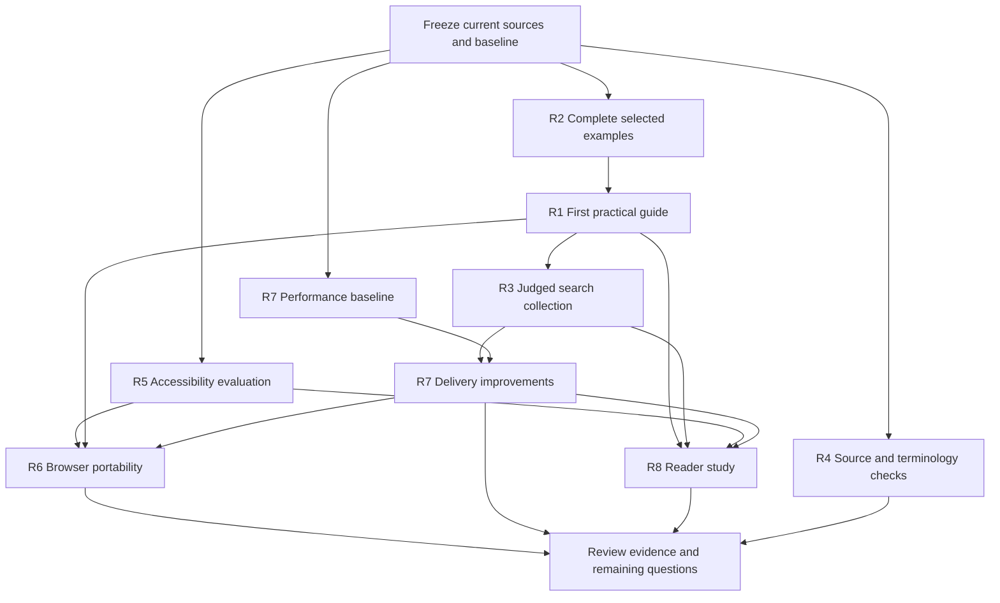

# Next documentation work

Research and plan · 11 October 2026

The baseline descriptions below refer to the captured state before execution. The execution status at the end and the linked release review identify what has since been delivered and what still needs external observations.

## Objective

Help a new reader use the Lab model: find the right contract, prepare the right information, understand what a record establishes, and identify the next permitted step. Keep the guide, examples, essays, reference library and Craft documentation coherent as they evolve.

This plan follows the documentation review from 11 October and the subsequent governance consolidation. The first implementation should be a small set of practical instructions, supported by exact reference examples.

## What the original review still requires

| Original recommendation | Current evidence | Disposition |
| --- | --- | --- |
| Clear starting point | Start here exists in shared navigation and search. | Delivered. |
| Separate “What works today” page | The user declined it because it would become stale. | Excluded. Retain source dates and scope where claims need them. |
| Guided incident walkthrough | Six steps cover the report, bounded question, comparison, assessment, proposed repair and session handoff. | Delivered as an explanatory walkthrough. |
| Concept comparisons | Eight sections distinguish meanings, records, responsibilities, evidence, memory and Craft behavior. | Delivered. |
| More useful reference entries | All 454 entries have reading aids. Only 32 of 183 definitions have a specific incident example paired with a common mistake; 31 type entries have a content example. | Introductions delivered; broader examples and complete record examples remain. |
| Visual consequences | Definition anatomy, evidence connections and session handoff are present. | Delivered; comprehension and accessible equivalents still need evaluation. |

The original review also proposed an **Understand / Follow / Do / Look up** reading structure. Explanation, walkthroughs and reference now have destinations. A dedicated route for practical tasks is still missing. Diátaxis distinguishes these reader needs; the current walkthrough should not be relabelled as a hands-on tutorial merely because it has numbered steps. [Diátaxis](https://diataxis.fr/), [tutorials](https://diataxis.fr/tutorials/), [how-to guides](https://diataxis.fr/how-to-guides/).

Source evidence: [Start here completion](start-here-completion-audit.json), [documentation additions](documentation-improvements-completion-review.json), [governance consolidation](governance-consolidation-review.json). The older [UI review result](ui-ux-fix-result.md) explicitly leaves assistive technology, other browser engines, participant comprehension and field performance open.

## Research findings

1. **Readers need a concrete outcome.** Audience roles, prior knowledge and intended tasks should determine what a document explains. Our next pages should state the output the reader will prepare and link to the existing conceptual explanation. [Google: audience](https://developers.google.com/tech-writing/one/audience), [document structure](https://developers.google.com/tech-writing/one/documents).
2. **Examples need exact contracts.** A content illustration is useful, but it is not a complete schema-conforming record. The present type introductions explicitly make that distinction. The next examples should show the complete selected contract and the precise reason a contrasting record fails it.
3. **Working search and useful search require different evidence.** Earlier browser reviews establish navigation and result delivery. Ranking quality needs a judged query set with acceptable destinations. Retrieval research supports evaluating early ranked results. The proposed targets below are local project targets. [Stanford: ranked retrieval evaluation](https://nlp.stanford.edu/IR-book/html/htmledition/evaluation-of-ranked-retrieval-results-1.html).
4. **Browser inspection cannot establish comprehension or complete accessibility.** Automated accessibility tools assist evaluation; manual judgement remains necessary. Participant tasks can reveal misunderstandings even when every link works. [W3C: evaluation tools](https://www.w3.org/WAI/test-evaluate/tools/selecting/), [NIST: usability testing](https://www.nist.gov/programs-projects/usability-testing).
5. **Delivery needs a fresh baseline.** The current search index is **1,763,284 bytes** and is loaded by every content page. The guide is **511,690 bytes**; the reference page is **3,028,851 bytes**. These are uncompressed file sizes, not latency or field measurements. Earlier performance receipts describe earlier artifacts. [Google: Web Vitals and measurement](https://web.dev/articles/vitals).

## Prioritized work

### R1 — Give practical tasks a destination

**Priority:** first content work. **Depends on:** R2 for the examples used in the first page.

Prepare four focused how-to guides:

1. Read an exact record, its selected version and its standing.
2. Prepare an evidence-bounded incident assessment.
3. Prepare a definition for owner review.
4. Resume agent work after its task view becomes unusable.

Each guide should contain a result, prerequisites, selected contracts, necessary inputs, steps, expected output, common failure cases and the next applicable review or permission route. Show which actions are manual and which have a supported tool. Document real commands only when their current source and behavior have been checked. Connect the practical pages through one sidebar group and shared search.

**First page recommendation:** “Prepare an incident assessment.” It reuses the Northstar case while changing the reader's task from following an explanation to preparing a bounded assessment.

**Acceptance:** the reader can identify the governing completeness criterion and permission, select S1 / Northstar / `status = active` / E12 / method 2, preserve the identifier comparison, and prepare an assessment that separates the established omission from unresolved cause, wider impact and recovery. The page supplies the selected record requirements and expected output. Preparing material is not described as accepting it or closing the incident.

**Research basis:** task focus from [Diátaxis how-to guidance](https://diataxis.fr/how-to-guides/); audience and expected outputs from [Google's document guidance](https://developers.google.com/tech-writing/one/documents). The page choice is our inference from the existing material.

### R2 — Add complete reference examples where readers need them

**Priority:** first content work, prepared alongside R1.

Start with the exact contracts selected for the assessment and session handoff. Inventory the applicable versions before drafting examples. Prioritize Work, Operational Observation, Measurement Result, Evidence Set, Failure Assessment, Agent Assignment, Delegation, Agent Session, Context View and the definition used by the assessment.

For each selected record format, supply a complete candidate example and a contrasting example with one specific defect. For relations, show exact endpoint kinds, direction and required qualifiers, then a counterexample that violates a declared rule. For a definition, explain the semantic boundary and a case outside it. These are different kinds of examples.

Record whether an example is complete and schema-checked, a content illustration, or a permitted connection pattern. Keep that distinction in the example manifest and in relevant explanations; avoid adding repetitive presentation badges to the definition cards. Expand beyond this first set according to task coverage and observed reader confusion.

**Acceptance:** every example used by R1 has an exact source binding and an explicit expected result. The selected schema checks, relation checks and semantic review agree with that result. Account, filters and fixed snapshot are present wherever the completeness criterion requires them. Schema conformance alone is never presented as acceptance, truth or permission.

**Evidence class:** deterministic for an exact schema or declared signature; editorial review for semantic suitability. An example outside a concept's applicability is not automatically a malformed record.

### R3 — Make ordinary-language questions find the right topic

**Priority:** next, after the first practical pages and examples exist.

Create a judged collection of about 30 queries, covering exact names, common language, abbreviations, confusable concepts and task questions. Examples: “what lets an agent act?”, “where is long-term memory?”, “what proves an export is complete?”, “can I close the incident?”, and “does Accept reserve capacity?”.

For each query, declare acceptable destinations and why they answer it. Use aliases that connect ordinary language to exact terms. Preserve the distinctions between assignment and permission, durable state and session memory, calculated classification and state-changing Operation. Avoid synonym rules that merge different meanings.

**Acceptance:** all exact-title queries rank their intended topic first; at least 90% of the judged task queries have an acceptable destination among the first three results. Define and report that second measure as the proportion of queries with a relevant top-three hit, not Precision@3. These are proposed project targets. Retain keyboard navigation, scope selection, useful empty results, canonical guide destinations and local-file delivery.

**Tools:** the existing search builder and browser scenarios, plus a small relevance manifest. [Ranked retrieval evaluation](https://nlp.stanford.edu/IR-book/html/htmledition/evaluation-of-ranked-retrieval-results-1.html) supplies the method; reviewers must judge relevance for this site.

### R4 — Keep the explanations aligned as the model changes

**Priority:** establish with R1/R2, then maintain with each content change.

Extend the current source-preservation and consistency receipts into a reusable documentation manifest: exact source identity, selected version, source digest, affected pages, explanatory claims and example coverage. A changed source should identify the explanations that need review.

Automate checks for stable anchors, valid local destinations, search coverage, duplicate IDs, source fingerprints and exact reference-body preservation. Use a small terminology configuration for explanatory prose. Keep readability and wording findings advisory where judgement is needed. Existing formal statements remain governed by their own records.

**Acceptance:** rebuilding identifies affected explanations when a selected source changes; direct links and redirects continue to resolve; the incident facts and Craft capacity behavior agree across pages. The critical review includes authority versus permission, provenance versus proof, accepted code versus activation, ephemeral agents, typed connections, and pure Calculation versus Operation.

**Tools:** existing renderers and manifests, [Vale](https://docs.vale.sh/) for configurable prose consistency, and the [Nu HTML Checker](https://validator.w3.org/nu/about.html) for markup mistakes. Neither tool decides whether the Lab model is correct.

### R5 — Finish accessibility evaluation for the current design

**Priority:** alongside content work; resolve identified barriers before publishing the additions.

Evaluate representative pages and interactive states: search open, mobile navigation open, definition details expanded, a reference entry expanded, a selected graph node and any diagram modal. Include keyboard operation, focus movement, announcements and a screen reader. Revisit SVG contrast findings against the current styles instead of carrying old findings forward as current defects.

For each diagram, check that a concise description and an accessible account of its essential relationships let a reader recover the same meaning. Review formulas and tables separately. Check real text enlargement and 400% browser zoom as well as narrow viewports.

**Acceptance:** selected journeys can be completed without a pointer; focus and results are understandable; essential content and controls remain available at 320 CSS pixels, accounting for the documented two-dimensional-content exceptions. Relevant diagrams have usable text alternatives. Record each automated incomplete result as manually resolved or still open.

**Tools and standards:** [axe-core](https://github.com/dequelabs/axe-core), a screen reader such as NVDA where available, [W3C complex-image guidance](https://www.w3.org/WAI/tutorials/images/complex/), [reflow](https://www.w3.org/WAI/WCAG22/Understanding/reflow.html) and [focus not obscured](https://www.w3.org/WAI/WCAG22/Understanding/focus-not-obscured-minimum.html). Seek unobscured focus throughout; the cited AA criterion requires that the focused control is not entirely hidden.

### R6 — Check the same journeys in other browser engines

**Priority:** after the first content and accessibility changes.

Use Chromium, Firefox and WebKit for representative journeys across the guide, practical pages, learning pages, essays, catalog and Craft. Cover direct anchors, redirects, Back/Forward, details, search, diagram controls, mobile navigation and local-file delivery. Keep a separately identified localhost run for server delivery.

**Acceptance:** equivalent journeys retain their meaning and navigation in each supported engine; failures are reproduced and attributed to a specific environment. Rerun affected journeys against the final artifact revisions after delivery or interaction code changes. A WebKit run is recorded as WebKit evidence. Actual Safari and assistive-technology combinations remain separate environment checks when available.

**Research basis:** [Playwright browser documentation](https://playwright.dev/docs/browsers). Existing Chromium receipts remain useful evidence for the earlier checked artifact versions.

### R7 — Reduce the cost of opening and searching the documentation

**Priority:** measure early; implement after R3 establishes search-quality expectations.

Capture a fresh cold-load and interaction baseline on the current artifacts. Investigate loading the full index when search is first opened, reducing repeated indexed text, and dividing detailed record search into local script assets. Preserve offline search and complete reference access. Compare options using measured startup and first-search costs.

Start with the introduction pages: a 15–18 KB page currently includes the same 1.76 MB index as the guide and reference. The reference library's complete content should remain available on explicit navigation.

**Acceptance:** initial resources for a basic reading route meet a proposed **1,000,000-byte uncompressed project budget**, with post-interaction search assets reported separately. Record guide HTML and actual initial DOM separately; source HTML element counts can include inert template content. Compare at least five cold runs per chosen environment and report distributions, configuration and before/after bytes. Search relevance and all destinations survive the change.

Use LCP and CLS for loading and stability diagnostics. Use interaction traces for responsiveness; Lighthouse's TBT is a proxy and does not establish INP. Google's field targets are LCP ≤ 2.5 s, INP ≤ 200 ms and CLS ≤ 0.1 at the 75th percentile, evaluated across real visits. These guide measurement; no field result is available for this local attachment. [Web Vitals](https://web.dev/articles/vitals).

**Tools:** Chrome DevTools, Lighthouse on localhost, browser traces and byte receipts. Public PageSpeed services cannot inspect a private `file://` attachment.

### R8 — Observe whether new readers can use the material

**Priority:** after the first practical pages, reference examples and search improvements. Prepare the study script early.

Plan a formative round with 5–8 available readers across the intended roles and levels of familiarity. Have them find a topic, prepare or interpret an assessment, locate the required permission, explain the session handoff, and distinguish calculated eligibility from reservation. Use the shared incident and one new situation to see whether the explanation transfers.

Record successful completion, assistance, errors, time and comments. Ask readers to explain their choices before showing the expected answer. Review recurring misconceptions and revise the relevant passage, diagram, example or search alias.

**Acceptance:** a report maps each observed problem to evidence and a content change or explicit open question. Material misunderstandings about authority, evidence, memory and permitted effects receive targeted revisions and a follow-up check. A small formative sample guides improvement; it is not a statistical population estimate.

**Research basis:** [NIST usability testing](https://www.nist.gov/programs-projects/usability-testing). Participants and their consent are dependencies for running the study; research and preparation can proceed now.

## Sequence and dependencies

### First implementation batch

1. Select and inspect the exact records needed for a bounded incident assessment.
2. Prepare the complete examples and precise contrasting failures.
3. Draft “Prepare an incident assessment,” linking to those records and the existing guide.
4. Add the practical route to navigation and search.
5. Inspect its source consistency, reading layout, keyboard flow and relevant browser journeys.

The following batch broadens task guidance and reference examples, evaluates search ranking, and uses the accessibility and performance baselines to choose fixes.

## Evidence classes and completion

| Evidence | What it can establish |
| --- | --- |
| Exact schema, ordered pair, source digest and local-anchor checks | Specific structural failures or preservation facts. |
| Browser measurements and interaction receipts | Behavior in the recorded artifact, environment and scenario. |
| Screenshot and diagram review | Observed presentation problems and reviewed visual meaning. |
| Editorial and semantic review | Whether the explanation and example match the selected source meaning. |
| Reader and assistive-technology sessions | Observed task outcomes and barriers for those participants and environments. |

Reusable automated rules need known-valid, known-invalid and false-positive examples before becoming hard gates. A changed document, a passing schema, a working link or a high Lighthouse score alone does not demonstrate understanding or complete accessibility.

**Research artifacts:** [source cards](documentation-next-sources.json), [current baseline](documentation-next-baseline.json).

**Execution status:** the technical documentation release is implemented. Four practical guides, complete specimens, judged search, source maintenance checks and browser/delivery improvements are recorded in the [execution review](documentation-plan-execution.md). The [portable release receipt](documentation-release.json) identifies the exact archive. All map-view contrast checks and relationship text equivalents are reviewed. Actual reader observations, real screen-reader operation and actual Safari are still open. The reader study is prepared and awaits the participants arranged by the user.
