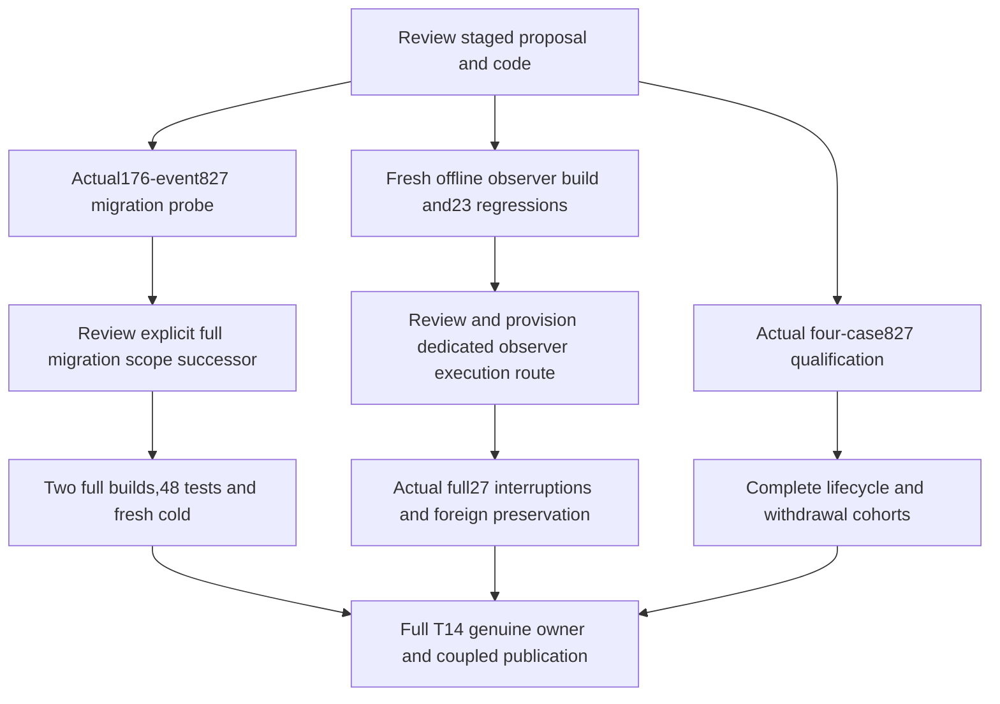

# Remaining native qualification proposal

This package prepares the next T32 qualification work. It preserves all eleven original N01–N11 obligations, the three maintained native paths, the complete original 27-case interruption cohort, and T14’s separate full publication scope. No actual native, compiler, API, Source guard, installation, fixture source effect, factory constructor or lease operation was run by the author.

The current installed role is explicitly 827136, selected by T07/ontology-installation-root-0002/execution-selection.json, digest3b679213. Historical production57416 and migration480d scopes remain unchanged. The missing480 executable and the25 unavailable historical proof inputs remain unresolved. Preparation, pure parser fixtures and earlier historical runs establish no new empirical compatibility or owner authority.

## Concrete staged code

`migration827/compatibility_probe.py` is an explicit successor of the frozen migration-v2 probe. It selects the actual827 executor at its new6dc origin and3b679 selection, retains all90 original public migration inputs literally, and adds11 current role/provenance/Source declarations. Its actual probe algorithm still restores all176 historical metadata events, reads their full cold projections, reseals every original typed draft, appends all88 semantic and88 governance events to a fresh owned store, then cold-reads the complete result. It retains exact request/stdout/stderr bytes and progress before interpreting responses. The evidence parser independently derives full event sets, sealed event equality, append byte equality and full cold projection equality. The new evidence version is explicit; old574 evidence cannot satisfy it. This probe is usable only from a reviewed trusted Root bootstrap that supplies the actual executor, a fresh explicit technical boundary and an empty outside-repository0700 root. Root must perform full28597 Source/profile and all153+176 selected input entry/exit checks, exact installed proofs and independent cleanup/FD accounting. The data-only ROOT-PROBE-INACTIVE.json grants no permission and has null activation fields.

`callers/lifecycle.py` and `callers/withdrawal.py` preserve the complete original run algorithms after their initial factory check. The successor replaces the obsolete relative factory import/type check with an explicit verifier for the accepted83bd StoreFactory at its true origin, actual module/class identity, exact captured method code and the unchanged factory.guard. It introduces no class alias, direct-host native fallback, lifecycle algorithm change or wider type acceptance. Root still needs to select the caller package and original native_store/mapping/source modules at their actual origins, bind the same current827 executor/factory and run the original maintained routes with fresh evidence destinations. The withdrawal route performs exactly the original two signed local fixture effects and original private-key/source cleanup; it confers no real owner authority.

`observer-build/observer` is a separately staged technical observer crate. Removing exactly the original three checkpoint calls and the appended wait helper restores current production lib.rs byte for byte. Cargo.lock, manifest, other source modules, all23 original Rust regressions and the W1 fixture are copied exactly from current production inputs. ROOT-BUILD-INACTIVE.json proposes the same five explicit toolchain/version/build/test/independent-build commands with offline/locked Cargo, a fresh Cargo home and two new owned targets. Actual setup, compilation, raw streams, complete23-name accounting, two binary comparisons, actual archive and ELF/provider review remain pending. Existing build and installation receipts for827 are retained as provenance inputs; they do not establish the identity of a future observer binary. The current production827 executable and its executor policy remain unchanged.

## Complete remaining scope

| Gate | Preserved scope | Required empirical result |
| --- | --- | --- |
| Lifecycle | All26 original LifecycleTests; complete selected Work/node/relation/challenge episode; retire/reactivate/remove; original validation/cold paths | Actual selected827 route, exact original event/source/cursor bytes, cold replay and negative currentness/expiry checks |
| Withdrawal | All29 original WithdrawalGuards; local signed admit/withdraw, governance-only mapping, stale eligibility refusal, idempotence and original key cleanup | Actual selected827 route and original signed fixture replay; no genuine owner claim |
| Migration | All140 dispositions,9 blocked revisions,220 carriers,88+88 native events, two complete builds, all48 original ImportGuards, independent cold consumer | First actual176-event827 probe; then explicit full execution/scope successor and original900-second qualification |
| Interruptions | Original6 direct native interruptions,14 wrapper/foreign cases and7 controls; additional original direct foreign-lock check retained | Fresh dedicated observer role and explicit technical execution route, actual owned SIGKILL, full cold recovery, exact files/inodes/link counts/HEAD and foreign-byte preservation |
| T14 | All291 original declarations and full29/230/88 target families; original ArtifactRef/body scope distinction | Actual current Source/permission/Work joins, genuine original owner response/signature/route, coupled publication, fresh cold read/reconcile and maintained consumer adoption |

ORIGINAL27.json enumerates every case rather than treating the count as coverage. The three direct native checkpoint stages are after-lock, after-first-link and before-cleanup in each event family. The wrapped cohort repeats those six cases, adds before-generation-publish/before-head-commit/after-head-commit, and retains all five foreign-residue modes. The seven control cases include the actual concurrent writer. Old hardcoded episode locations and old native binaries must not be reused under an827 label.

The observer execution adapter is deliberately an explicit next code gate. Current production GenerationStore refuses native_observer_env and the production executor excludes CAL_T32 variables. A separately selected technical observer capability and versioned GenerationStore/caller successor must implement the original checkpoint behavior, selected loader/ABI, owned marker/custody checks, owned child termination/reaping and full27 routing before execution. This proposal does not claim that copying an observer crate completes that integration. Its exact closed role and environment requirements are recorded in observer-build/EXECUTION-CONTRACT-INACTIVE.json.

The full migration successor is also a separate gate. Frozen v2 serializes technical_packet_binding into its scope and generated output scope_binding. Changing authorization therefore changes artifact bytes. The plan retains900 seconds, both identical builds, all48 tests and cold reconstruction. It makes no unmeasured claim that the bulk88+88 native append cannot fit. No timeout extension, permission reuse, omitted binding or split stable artifact scope is inferred. Any later contract change requires an explicit reviewed successor; the bounded probe can proceed first.

## Dependency order

Root owns the sole actual runtime slot. This graph is a dependency plan; no node transfers future effect authority or revives an expired Session. A successful four-case run is only its bounded coverage, not N01–N11, the27 cases, the three paths or T14 completion.

The author ran40 selected0004 static/owned-inert controls with FD0 and no ctypes. They verify the complete caller body preservation, exact observer source delta, original test inventories, all27 cases, all N01–N11 original obligation text, acyclic dependencies, probe algorithm preservation and synthetic full176 evidence-parser positive/negative cases. Synthetic streams are parser fixtures, not empirical native evidence. All actual remaining qualification gates are pending.
