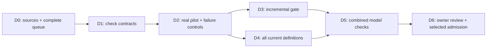

# Definition Formal Assurance

Started 2026-10-07. Project record: [Project/v1 candidate](../../../coordination/projects/definition-formal-assurance/v1/project.json). Canonical planning record: [project-plan.json](project-plan.json). Authority effect: none.

## Objective

Formalize the Lab's definitions so that each new or revised definition receives a formal semantic non-collapse check, and the combined set receives internal consistency checks. The initial registry selects 183 current identities from 189 admitted versions. This is a source baseline count, not formal proof coverage.

The full project covers the existing definitions and the ongoing addition workflow. The first delivery is an exact coverage queue, reviewed check contracts, and a small executable pilot. Later waves extend the same checks to the entire current set. The [source baseline and complete intake queue](source-baseline.json) binds all 183 current source files by verified SHA-256 digest. Their existing formalization and proof coverage remains unassessed.

## What a formal definition contains

Each formal interpretation binds the exact source ID, version, path and digest. It declares its symbols, universe, assumptions, dependency closure, logical statement, operational interpretation, plain-language intuition, realistic example and counterexample. A review checks that the formal statement preserves the source meaning. Machine checking cannot replace this correspondence review.

## Two checks and a prerequisite

1. **Non-collapse:** does the new concept preserve its declared distinction from other concepts? Comparisons declare whether concepts are aliases, specializations, overlapping but distinct, disjoint, or independent axes. A different name or nominal type is insufficient evidence. Legitimate overlap is permitted.
2. **Internal consistency:** can the selected definitions, couplings and invariants hold together? Evaluate the combined dependency theory and then the complete current formal snapshot. Pairwise checks alone cannot establish joint consistency.
3. **Non-vacuity:** do the assumptions admit a model, with the required concepts inhabited? Contradictory assumptions or empty required populations must not make distinction obligations appear proved.

For same-domain predicates A and B intended to have different extensions, one useful obligation is a witness satisfying `(A(x) and not B(x)) or (B(x) and not A(x))`. Its direction and strength depend on the declared concept relationship. A witness shows a permissible distinction; it does not by itself prove that every admissible model keeps that distinction. If universal separation is required, generate and discharge that stronger obligation separately.

## Realistic first example

A Lab artifact can have a known origin and still await admission. The pilot can represent an artifact with provenance and no authority grant. That witness tests the forbidden inference **having provenance implies having authority**. A separately justified artifact can be admitted; this permitted coupling must remain expressible.

The actual Authority and Provenance definitions and the Governance-Axis Independence Invariant must determine the formal statement. This example is a proposed interpretation, pending fidelity review and execution. Lifecycle distinctions join the pilot only after resolving their actual current definition identities; a convenient invented `Lifecycle` definition must not replace the repository model.

Controls deliberately introduce a provenance-to-authority implication, conflicting admission constraints, an empty required population, and an unbound dependency. The check suite must identify the correct failure in each case.

## Workflow for every addition or revision

Resolve source -> bind reviewed interpretation -> classify neighbours and declared couplings -> generate obligations -> check satisfiability and inhabitation -> check distinction and inference obligations -> run affected dependency closure and combined snapshot regression -> produce exact evidence and realistic example -> owner decision.

Changes to meaning, dependencies, assumptions, provider profile or source bytes invalidate the affected evidence. The report separates formalization coverage, fidelity review, outcome, evidence strength and currentness. Missing translation, timeout and unsupported logic remain visible.

## Dependency plan

## Reuse and evidence limits

Start from [Craft formalization](../../../craft/formalization/README.md), its existing claim bindings and provider profiles, and the [relational theorem checker analysis](../relational-theorem-checker/ANALYSIS.md). Their current implementation and authority status must be assessed before reuse. This project adds definition assurance across the Lab and shares relation obligations with that checker.

Structural validators, finite model witnesses, bounded searches, solver results and mechanized theorems carry different conclusions. A satisfying model establishes satisfiability for its encoded theory and interpretation. A theorem is relative to its audited assumptions. Neither establishes that all unformalized natural-language definitions are consistent. The proposed checks follow the distinction between satisfiability in the [official Z3 guide](https://microsoft.github.io/z3guide/docs/logic/intro/) and propositions admitting proofs in the [Lean reference](https://lean-lang.org/doc/reference/latest/The-Type-System/Propositions/); provider selection remains a project decision.

No new semantic admission or proof is asserted by these project-start artifacts. Revised interpretations and examples are shown before owner admission, following the existing review process.
