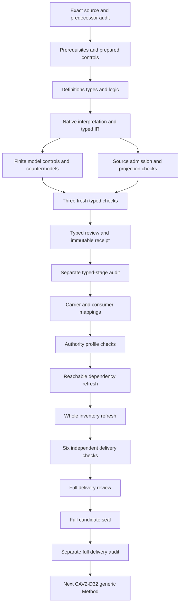

# Craft Method: full partial candidate delivery review

Craft Method's full candidate delivery preserves the complete selected Definition and all original episode scope. Definitions,types and logic were produced and separately audited before carrier observations or delivery packaging. This review explains the current formalization and its practical limits. It does not claim source-owner acceptance,whole-definition proof or execution authority.

The author,builder,model,source,consumer,profile,static-reuse,reachable-dependency and whole-inventory producers have actual successful terminal observations. Six independent fresh delivery processes also succeed:contract,model,source,profile,dependency and inventory. Their captured outputs match the initial observations for every corresponding noncontract producer. The exact full candidate seal and separate read-only audit follow this review;the live prepared current-state record provides their eventual terminal results.

## 1. Target, evidence and completion boundary

This review selects CAV2-D20@1.0.0-candidate.1, Craft Method, at digest f99635daec1bb7f3df027f6aa7bcfbcd0e14f1d20a700e93588dfb6268112a17. The selected Definition is admitted by CAL-DECISION-0029-CML07-SEMANTIC-FOUNDATION-V1. This candidate translation is separate from that admission. It does not establish source-owner acceptance, whole-definition proof, an adopted Method binding or execution of construction.

The predecessor is Typed Connection Extension Rule's full candidate delivery: 9735 sealed files and a separately captured successful audit. Its manifest hashes are rechecked before authoring and during verification. All 201 original source files remain bound to the current snapshot. The original planning scope remains 183 identities, 189 versions, 121 tasks, 511 planning edges, 797 work units and 36 frontiers. This candidate contributes one working typed draft; it does not complete that episode.

Authoring, building, model verification and source verification have actual terminal exit zero. The source verifier performs 84 checks, including exact admission references, independently reproduced Definition projections and source-query correspondence. The prepared model check supplied 353 controls, 51 countermodel queries and a maximum 15314 evaluation steps within the existing limit. The typed-stage receipt is created only after separate fresh contract, model and source processes succeed. Consumer inspection,profile checks,dependency/inventory refresh and six actual delivery replays are now complete. The exact full seal and separate audit follow this full review.

The current delivery verifies353finite controls,51nonentailment countermodels,84source checks and53source-query obligations. It compares27exact Definition meanings and six independently admitted current identity contracts. Whole Definition translation,accepted source-to-consumer maps and whole proof remain pending. These are separate dimensions of completion;an actual exit-zero delivery process closes a software evidence boundary while preserving unresolved owner/semantic judgments. The receipt reports PARTIAL-DRAFT-VERIFIED so downstream readers cannot silently promote these observations into accepted meaning or operational readiness.

The earlier Measurement Method,Measurement Result and Provenance candidate deliveries remain immutable in the9735-file predecessor seal. Their six actual checks and full reviews remain bound. This continuation extends the same definitions/types/logic-first episode rather than restarting or overwriting those results. Unrelated tracked work remains outside this candidate write scope. No canonical Definition,admission decision,private routing document,live service,publication artifact or memory file is rewritten.

## 2. Source accounting and formalization model

The model uses many-sorted first-order logic with equality. All 25 nonempty source units have complete character accounting. Fourteen clauses are encoded, nine units remain explanatory and two units are explicitly deferred. The normative statement selects eight primitive rules; the formal expression selects the eleven-coordinate root rule. Applicability selects root, recomposition and closure rules. Source boundaries and tests select the appropriate primitive guards.

Explanatory notation, domain examples, the original workspace label and plain-language explanation remain visible in the correspondence packet. They are not converted into executed processes or authority. The authority-scope reference and candidate claim ceiling remain deferred; complete accounting is not evidence that their denotations have been accepted.

The signature contains 32 sorts, one EMPTY token constant, 75 total functions and 201 predicates or relations, for 309 declarations. Sorts distinguish Craft Method from generic Method, scope, Product, Project, all eleven tuple coordinates, construction stages, subjects, identities, types, sources, evidence, generated views, canonical inputs, digests, residue, routes, recomposition, closure, owners and decisions. An independently qualified dependency reference does not import another Definition's whole theory.

The translation separates T,the necessary candidate declaration theory,from I,the independently requested population conditions,and from actual-outcome queries. A populated witness can satisfy T and I while violating an actual-outcome target. That countermodel is meaningful evidence of nonentailment for the encoded candidate theory. It is not an accepted translation of the source or a proof that the corresponding real-world outcome is impossible. Independent actual construction or authority can coexist with T when supported separately.

The declared formalization features remain first-order logic and equality. Quantifiers range over supplied nonempty sorted domains. Total functions are interpreted on every domain argument;selected applicability and conditional guards decide which results require exact meaningful bindings. No hidden temporal logic,recursive process interpreter,infinite-domain completeness assumption,termination axiom or external authority oracle is introduced. The normative source statement remains the source-precedence target,and its22finding descriptions remain unresolved.

## 3. Typed references, applicability and exact bindings

The six primary carriers are Craft, Stage, View, Residue, Recompose and Closure. Applicability is tied to the selected in-scope declaration for each. Necessary obligations are guarded by applicability, so an out-of-scope object cannot accidentally inherit them. Nonempty sort domains alone do not assert that a construction or closure exists.

Every required reference has declared membership and a nonempty handle. Each selected field has an exact binding relation: a candidate value is bound if and only if it equals the nominated function value. This rejects missing and conflicting bindings. Total function semantics are retained without demanding meaningful bindings for unused optional fields. EMPTY is a token marker, not a fabricated object of every reference sort.

The 26 required population obligations are independent from the primary theory. They request selected and outside carriers, root and child stages, implementation and nonimplementation cases, following-CAV2-D65 and prerequisite-residue cases, generated views without actual determinism, open and nonopen residues, same and different child/parent scopes, distinct subject identities and pending and closed closures. Removing a requested population can leave the necessary theory true while failing coverage. Another 201 populations remain unresolved rather than acquiring invented owner mappings.

Type discipline catches structurally malformed denotations before semantic evaluation. Empty or missing domains,partial functions,foreign argument/result values,wrong tuple arity and missing symbols are rejected. Each valid finite model is then checked against the qualified static IR rather than unqualified display names. The native interpretation,source correspondence and compiled IR are compared exactly. This prevents a field name,shared label or independently admitted carrier type from accidentally importing a different Definition's meanings.

Coverage is explicit rather than vacuous. Positive outside-scope witnesses ensure guards do not become unrestricted global obligations. Required populations request root,child,implementation,prerequisite,view,residue,recomposition and closure alternatives. The suite includes true-T/false-I cases so removal of important examples cannot masquerade as broad coverage. Actual outcome predicates appear in coverage and queries without becoming assumptions of the primary encoded clauses.

## 4. Craft Method and its eleven-coordinate tuple

The root rule declares specialization of generic Method, recursive construction, typed identity preservation, canonical source authority, separate construction and conformance, view derivation, typed residue, recomposition, owner closure and ledger continuity. It nominates context, product intent, domain meaning, system specification, realization selection, construction, conformance, operation, recovery/evolution, owner continuation and ledger state. Generic Method and the bounded Product/Project scope are separate references surrounding those eleven coordinates.

Distinct sorts prevent treating a ledger state as a Method or a Product as a Project. They do not provide accepted real-world meanings for the proposed sorts. The functions are typed nominations; they do not execute the construction process or specify every legal lifecycle transition. The translation leaves actual specialization, preservation, authority and operational fidelity independent.

Craft Method's eleven coordinates and generic Method's eleven minimum specification fields describe different forms. Craft coordinates include product intent,domain meaning,system specification,realization selection,construction,conformance,operation,recovery/evolution,continuation and ledger state. Generic Method fields include inputs,actions,roles,gates,outputs and three rules. Referencing CAV2-D32 acknowledges the specialization dependency;it does not equate the two tuples or merge their identities.

No inference about a bounded Product or Project is made from a repository directory or the historic workspace label in the source. Product and Project references are separately typed and scoped. The current real Product/Project carriers have exact C31identity admissions,while their correspondence to every proposed Craft coordinate remains an owner mapping obligation. An admitted Product embodies a Method only in the separately selected relation/binding scope;it cannot grant universal construction permission from that relation alone.

## 5. Construction stages and predecessor evidence

Each selected stage nominates its Method, subject, canonical source, predecessor evidence, result evidence and construction coordinate. The subject has exact identity and type nominations and their declared binding. The stage declares preservation of typed identity and canonical authority, and its construction agrees with the Method's construction coordinate.

A stage is exactly one of root or child. Roots can cite external prerequisite evidence without a fabricated parent stage. Children nominate a distinct parent and an exact parent-to-predecessor-evidence relation. Parent and child stages may represent different subjects and artifact types, as a definitions-to-carriers-to-instances chain requires. The model does not force them to share an identity. It also does not establish global ordering, well-founded recursion or termination from a finite example.

The source test requests exact predecessor evidence for each construction stage. The proposed logic makes that relationship explicit through typed source,evidence and parent references;it does not assume a single global canonical source across every stage. Root construction can depend on external prerequisite evidence. Child construction can introduce a new artifact type and subject identity while preserving the declared relationship to its parent. These choices keep definitions,contracts and instances usable as different stages of a recursive chain.

The suite rejects both-root-and-child and neither-root-nor-child classifications,wrong construction nominations and missing exact predecessor relationships. Actual predecessor evidence resolution still needs a source-to-carrier map. A finite example with three stages does not prove the absence of larger cycles,correct scheduling or eventual closure. The existing semantic dependency cycle likewise remains explicitly unclassified;it is not converted into a benign recursive construction theorem.

## 6. Implementation prerequisites

For an implementation-bearing stage, declared following of CAV2-D65 satisfies one branch. The alternative requires an exact applicable residue, declared typed and prerequisite, whose Method agrees with the stage's Method. Actual following and actual prerequisite adequacy have separate query targets.

A type label is insufficient evidence that a real prerequisite was met. Residue is not permission to build. Nonimplementation stages and stages declaring that they follow CAV2-D65 need no fabricated prerequisite record. Controls explicitly preserve the absence of those unused binding relations. The selected prototype-first Definition is independently referenced; its whole theory is not merged into this one.

The source's CAV2-D65 prerequisite has its own exact admitted Definition reference. The candidate does not infer that a implementation-bearing stage satisfied it merely because a binding references that Definition. It separately admits declared-following and declared-prerequisite-residue alternatives. The actual following/adequacy queries remain conditioned on those source branches,which prevents testing an unrelated nonimplementation stage as if it had a missing prerequisite.

A prerequisite residue preserves unresolved construction prerequisites through a typed record. Its Method nomination must match the stage's Method. Owner routing is required if the residue is open,but the presence of a route does not authorize work. Actual adequacy and permission depend on separate evidence and owner decisions. This is part of the substantive source meaning retained in the theory,not a status convention that can be replaced by a valid schema label.

## 7. Generated views and canonical direction

A generated view nominates its Method, machine-canonical input and two render digests. The input separately nominates source and input digest. The input digest need not equal the output digest: a generated representation can have different bytes from its canonical input. The two nominated render digests must agree.

This necessary declared reproducibility condition does not prove that a real generator is deterministic. The theory therefore allows the declarations to hold while actual deterministic reproduction remains false. Separately, the source checker extracts the three pure Definition rendering functions, renders twice and compares both outputs against the existing projection without mutating the source document. That observed 4425-byte projection reproduction is a bounded software result, not proof of every Craft generator.

Boundaries reject nominating a generated view as canonical source, reverse writable authority, conformance from view shape or actual determinism from digest labels. Actual source authority and deterministic generation still require source-to-consumer evidence.

Current consumer analysis observes two independently scoped projection families. Artifact Type artifacts and valid fixtures use the CML07identity_artifact pure functions. Actual C31identity carriers use the separate CML07identity_carrier renderer bound in the admitted manifest. The initially incorrect assumption that those families shared a renderer produced an actual failed consumer run;its producer and captures remain retained. The corrected comparison uses each family's exact bound helper and representation without rewriting any canonical or fixture bytes.

The real Product,Project,Method Binding,Goal,Lineage and Identity Graph projections are checked against the appropriate pure carrier renderer. The helper executes no generator command or file writer. Matching projection bytes substantiate bounded representation parity;they do not establish arbitrary construction generators deterministic,canonical authority transferred to Markdown or actual Method execution. The original source's directional canonical-state/view distinction remains an independent boundary.

## 8. Typed residue and owner routes

Every selected residue nominates its Method and type. Open residue additionally requires an exact declared owner route with a nonempty handle. Nonopen residue has no invented owner-route obligation. Residue continuity and prerequisite adequacy remain actual-outcome queries.

One failed prepared run is retained intact. The negative empty-handle test first selected route0, which no open residue referenced. The interpretation correctly remained valid. The corrected test empties route1, actually selected by both open residues. Neither the formula nor the evaluator limits changed. The successful replay then rejected that interpretation as intended. This is a test-target correction, not a weakened theory or a hidden failed result.

Retained failure evidence distinguishes a mistaken negative control from a defective formula. The prepared handle test originally chose an unused route and correctly left T true. Its correction chooses the handle referenced by open residues. The first consumer failure instead confused fixture and actual-carrier renderers. Both failures are preserved as actual exit-one observations with the relevant source,producer and capture hashes. Neither was used to lower evaluator limits or remove substantive source requirements.

Closed or unused residue records do not fabricate open owner routes. The full model suite tests absence of unused binding relations as a valid case,alongside failure of a missing required route. The difference matters operationally:forcing every optional nomination to resolve would invent records and decisions absent from the source,whereas permitting an open selected residue without a route would erase a stated testable condition. The candidate preserves both distinctions.

## 9. Child-to-parent recomposition

Each selected recomposition nominates exact child, parent, evidence and residue. The child is declared a child stage, its parent matches the nominated parent, and child and parent differ. Recomposition evidence agrees with the child's result evidence; the residue belongs to the child's Method and is declared propagated. A declared scope-within relation relates child and parent Method scopes.

The supplied models include both distinct and equal child/parent scopes. They include different subject identities. Recomposition cannot erase residue or merge identities, and it does not establish parent conformance. Actual evidence adequacy, residue propagation and identity preservation remain independent. No convergence or termination theorem follows from this finite reference structure.

Recomposition obligations are expressed as exact relations among separately typed stages,evidence,residue and Method scopes. Their witness can show distinct scopes or a shared bounded scope. It can also show different subject identities. The model checks child-to-parent evidence agreement and declared residue propagation without imposing that child success automatically proves parent conformance. Real consistency of scope inclusion,evidence sufficiency and residue continuity remains independently reviewable.

No operational compensator,merge algorithm,ledger rewriter or recursive constructor is executed by this delivery. Actual relation admission is sourced separately from C31's five identity graph relations. Those graph relations have their own allowed Product/Project/Method/Goal signatures and exact endpoints. They are neither evidence that every proposed recomposition relation is admitted nor an excuse to erase C31's positive identity effects. The current review keeps those scopes visible.

## 10. Owner-controlled closure

A closure nominates its Method, owner and continuation. The continuation agrees with the Method's owner-continuation coordinate, and the owner agrees with the continuation's owner. Every selected closure declares owner control.

Only a declared closed closure requires exact decision and evidence references, a declared decision-owner-Method relation and resolved evidence. A pending closure may leave those fields unused; it acquires no fabricated approval. The controls reject turning that pending record into a closed record without the required references. Conversely, independently supported actual owner authority may coexist with the theory; actual claims are not universally prohibited.

Closure labels cannot establish runtime conformance, adoption, permission or publication. The corresponding actual targets remain separate, including three targets explicitly conditioned on declared closure. This preserves owner-controlled continuation without treating a reference to an owner as an authorization.

The owner-continuation coordinate supplies the closure owner by an exact typed binding. A closed nomination adds decision and evidence requirements tied to that owner and Method. Pending closure deliberately leaves those fields unused. Turning a pending record into closed without matching decision/evidence fails a control. Declared closed records can nevertheless have false actual owner-authorization,actual evidence adequacy or actual Method-closure predicates while satisfying the necessary declaration theory.

Those three closure-conditioned countermodels are source-relevant:they demonstrate insufficiency of declarations at a stated owner closure boundary. They do not deny an independently authorized closure. Schema-valid owner strings,challenge routes,evidence labels and identity admission are distinct evidence surfaces. Neither closure,naming nor an independently selected Method Binding grants permission to build,adopt,publish or claim runtime conformance.

## 11. Admission, upstream provenance and dependencies

C29 positively admits fourteen Definitions, one Artifact Type, four owner bindings, one selected chain and eleven exact source selections. Those effects are retained. Eight independently owned requests remain distinct. S2 is evaluable but not executed; identity carrier admission and accepted implementation binding counts remain zero. Source-body chain 0001 evidence is retained alongside the current selected chain 0002 overlay.

The local Definition upstream matches its bound digest. The original external definitions path is absent, while the relocated file supplies exactly lines 1014–1185 at the bound selected digest. Its full-file digest differs from the historical authoring digest; that does not invalidate the unchanged selected scope. The external Craft Product identity whole file also matches its bound digest. Only paths, digests, selectors and admission observations are retained in this candidate; external private meaning is not imported into the primary theory.

The immutable source body's candidate-unadmitted labels remain intact. C29's scoped source-use admission is represented as a separate overlay. Earlier narrower source admission does not silently widen use. Source selection, Definition admission and Method binding activation remain separate claims.

Twenty-five direct semantic dependencies are selected by complete identities, including CAV2-D32 generic Method, CAV2-D60 Project and CAV2-D59 Goal. Missing canonical labels for domain meaning, specification, realization selection, stage, recovery/evolution, continuation and ledger state remain explicit. No synthetic canonical Definitions are invented for them.

Craft Method CAV2-D20 remains separate from generic Method CAV2-D32,Product,Project,ledger,generated views,runtime and capability. The typed-stage receipt binds17inputs and has a separate actual audit0. Current consumer inspection follows that boundary and evaluates185checks,27selected Definition meanings,30Definition shape probes with6acceptances,233wholecarrier probes with67acceptances,and21candidate-only T/I comparisons. Accepted semantic maps remain zero.

The current registry has143admitted contract rows and121current rows. Its sole direct Craft Method binding is Method Binding/v1. The summary row selects Craft Method and Identity Relation;the immutable Artifact Type artifact binds generic Method,Craft Method,Identity Relation and Identity Carrier. Both exact reference scopes are retained. No merged accepted semantic map is invented from their shared labels.

The six compared types are Product Identity,Project Identity,Method Binding,Goal,Identity Lineage and Identity Graph. C30 admits their exact Artifact Type artifacts,schemas and validation receipts. This makes S3 evaluable without executing S3 at that boundary. C31 subsequently admits six exact Craft identity carriers and five graph relations. It recognizes PASS at schema and identity-contract conformance while keeping implementation/runtime not_evaluable and goal achievement not_proven. The immutable type/instance bodies still say candidate-unadmitted and authority_effect:none. Those body labels are not used to erase the separate positive decision overlays.

The first consumer producer failed because it used the Artifact Type fixture renderer on a real Product carrier projection. The actual carrier has a different independently C31-manifest-bound generator. The failed checker,actual exit1,stdout,stderr and explanation are retained in retained-failed-consumer-comparisons/001-fixture-vs-carrier-renderer. The corrected producer executes only the two pure fixture renderer functions and four pure carrier renderer functions. It checks the correct projection for each representation. Primary formulas,models,schemas,shared validators and limits remain unchanged.

All27selected current Definitions retain their exact source digests,whole Definition schema shape and two reproducible pure projections. Each six-type package has its complete schema and admitted artifact hash checked. Its valid fixture passes shape and the isolated shared semantic_errors helper. Its exact C31real carrier also passes shape and that helper. Each package's Artifact Type projection,fixture projection and real carrier projection is compared to the correctly scoped pure renderer. No package validator or writer,admission transaction,build,owner decision or live consumer executes.

Whole Method Binding schema closes the root,requires explicit method_ref,subject_ref,subject_kind,application_scope,binding_owner_ref,evidence_refs and challenge_route,and restricts status/authority to their candidate body values. Added approval,canonical authority and closure fields fail. Empty required references fail. Binding id equal to an endpoint,or Method equal to subject,can pass schema shape but fail semantic_errors. The guard preserves three identities without proving actual identity resolution.

Changing subject_kind from product to project can pass both schema and that isolated helper,which only checks identity collapse. Opaque owner,evidence,challenge and endpoint strings can remain valid shape. Scope includes must be nonempty. A schema-valid binding therefore does not prove that a selected subject really is a Product or Project,that its references resolve,that its owner controls construction or that a build is authorized. Current binding admission remains a separate exact C31observation,not a consequence of these hypothetical probe acceptances.

Identity Graph semantics checks unique node identities,unique relation identities,resolved endpoints and five relation signatures. The whole node array schema does not itself reject a duplicate node,and unresolved relation endpoints or changed relation kinds can remain valid shape. The isolated helper rejects them when they collapse identities,fail endpoint resolution or violate a relation signature. Identity Lineage schema can likewise accept its id collapsing into a predecessor while the helper rejects that collapse. The exact admitted real graph and lineage pass both current checks.

Product Identity,Project Identity and Goal retain their own scope,ownership,purpose,outcome,evidence and challenge fields. Their actual conformance/admission maps remain separately sourced. No probe turns them into a Craft execution,state machine or closure proof. Prose claim ceilings can contain hypothetical runtime/permission overclaims while shape remains valid;the consumer review records that limitation without accepting the prose as meaning.

Definition schema similarly permits hypothetical ledger-is-Method,construction-is-conformance,view-is-authority,residue-is-permission and closure-is-adoption text. Pure projection parity preserves that text faithfully without deciding whether it is true or admitted. This distinguishes character/projection fidelity from accepted semantic fidelity. The primary Craft theory rejects prohibited identity and authority nominations within its selected scope,while independent actual outcomes remain possible when supported separately.

The21candidate-only comparisons freshly evaluate primary T and population I in the qualified Craft signature. They preserve optional unbound prerequisite/parent/owner/decision fields,input versus rendered digest distinction,extra scope-within relationships and distinct child/parent subject identities. Negative cases reject missing selected route handles,root/child ambiguity,unapproved closed pending records,wrong construction/view/recomposition/owner coordinates and missing exact predecessor/source relationships. Population coverage remains separately evaluated;an interpretation may satisfy T without providing all requested instances. The report stores actual evaluations and model hashes,not inherited pass labels.

The eleven-tuple and stage/view/residue/recomposition/closure vocabulary has no complete accepted operational map in any one of these six schemas. Typed prerequisite residue does not prove adequacy or permission. Declared predecessor evidence does not prove well-founded ordering or termination. Render digest labels do not prove arbitrary generated views deterministic. Recomposition does not merge identities or establish parent conformance. Pending closure does not fabricate approval,and declared owner closure does not imply adoption,runtime authority or publication.

Eight unresolved consumer findings below retain these source-to-carrier and owner/lifecycle gaps. The next checks qualify profile/map hypotheses,refresh reachable dependencies and the entire current draft inventory,then independently replay contract,model,source,profile,dependency and inventory. A detailed full review,exact seal and separate read-only audit must complete before native generic Method CAV2-D32 begins. No whole Definition translation or proof is claimed from this candidate delivery.

- CRM-CONSUMER-FINDING-001: Current Method Binding directly binds Craft Method;its registry summary has two semantic refs while its immutable artifact binds four. Preserve both exact scopes,including generic Method and Identity Carrier,without inventing a reconciled accepted mapping.

- CRM-CONSUMER-FINDING-002: C30 admits six orthogonal Artifact Types and makes S3 evaluable. C31 later admits six carriers,five identity graph relations and schema/identity-contract conformance;implementation/runtime remain not_evaluable and goal achievement not_proven. Body candidate labels do not erase these positive overlays.

- CRM-CONSUMER-FINDING-003: Definition schema accepts hypothetical ledger/conformance/generated-view/residue/closure overclaim prose. Complete source accounting and pure rendering do not validate those meanings.

- CRM-CONSUMER-FINDING-004: Method Binding schema permits identity collapse;isolated shared semantic_errors rejects it. It does not resolve method/subject refs or verify the declared Product/Project kind,owner,evidence,challenge route or actual execution authority.

- CRM-CONSUMER-FINDING-005: Identity Graph whole schema and shared semantic guard enforce different constraints:unresolved endpoint and wrong relation-signature shapes can pass while the semantic helper rejects them. Actual binding and relation admission remains separately bound by C31.

- CRM-CONSUMER-FINDING-006: Equal supplied digest nominations and exact CML07 projections do not prove arbitrary Craft generators deterministic. None of the six carrier schemas carries the entire eleven-tuple/stage/view/residue/recomposition/closure operational theory.

- CRM-CONSUMER-FINDING-007: Prerequisite adequacy,predecessor ordering,typed open residue routing,scope-within,recomposition continuity and well-founded termination need accepted source-to-consumer maps. Correct optional-field guards must not fabricate pending decisions or collapse child/parent identities.

- CRM-CONSUMER-FINDING-008: Twenty-one freshly evaluated candidate T/I comparisons and exact fixture/carrier shapes establish bounded evidence. They do not accept common denotations,source fidelity,whole translation,whole proof or build/runtime/closure authority.

## 12. Logic checks and unresolved findings

The native finite model suite evaluates 104 controls with primary theory true, 241 with it false and eight malformed models rejected structurally. Controls cover exact bindings, empty selected handles, source/evidence relations, optional fields, source direction, wrong construction coordinates, residue mismatch, child/parent mismatch, closure ownership and prohibited identity or authority inferences. Malformed cases cover missing and empty domains, partial functions, ill-sorted results and tuples, missing symbols and wrong predicate arity.

All 51 nonentailment queries use a supplied interpretation satisfying both the primary theory and required populations, with the actual-outcome target false and the witness condition true. Six queries include source-specific implementation, open-residue or declared-closure conditions. They establish that those actual outcomes do not follow from these candidate declarations. They do not prove the Definition itself, validate universal operational behavior or establish a common denotation with every dependency.

The correspondence packet records CRM-FINDING-001 through CRM-FINDING-022. The findings retain specialization and identity separation; the proposed tuple; stage preservation, sources and predecessor evidence; recursion and termination; conditional prerequisites; view direction and digest limitations; residue typing and owner routing; recomposition scope and preservation; pending versus closed closure; owner authority; C29 positive effects and historical/current chain separation; relocated external provenance; consumer mappings; and the overall source-fidelity and proof ceiling. Their exact descriptions are in clause-analysis.json and correspondence.json. None is marked accepted.

All six delivery replays are actual separate processes with exact retained argv,exit code,stdout and stderr. The final audit checks their ordered identities and compares fresh noncontract outputs against their initial producer observations. Static-only snapshot verification reuse has15adversarial differential controls. It reuses identical static bytes,restores the original verifier and does not reuse live currentness checks or skip per-definition model evaluation or correspondence checks.

The full inventory separately evaluates one supplied satisfying T/I interpretation for each current typed draft. That establishes a bounded witness for each qualified partial theory. It does not establish a common carrier universe or a jointly meaning-aligned model for all definitions. Dependency graph compilation records declared uses,missing or quarantined counterparts and cycle-review obligations. Required edge completeness remains independently reviewable rather than being inferred from the number of nodes or passing software checks.

## 13. Detailed continuation DAG

The machine-readable continuation DAG records dependencies and completion criteria. The typed-stage receipt and its separate audit closed the types-and-logic boundary. Current carrier observations follow; they cannot retroactively manufacture accepted meanings for this theory. Generic Method native authoring waits for Craft Method's full delivery seal and separate audit. Original-scope final review follows all remaining definitions and required assurance tasks, with acceptance and proof gaps stated explicitly.

Exact pending source-owner findings:

- CRM-FINDING-001: Exact C29 Craft Method Definition/source use admission does not accept this translation,bind/adopt Method or execute construction.
- CRM-FINDING-002: CAV2-D20 Craft Method specializes the separate CAV2-D32 generic Method;their whole theories and identities are not merged.
- CRM-FINDING-003: Eleven tuple fields are proposed independent nominations;formal M_Craft(S) is not an executed process or complete operational state machine.
- CRM-FINDING-004: Bounded Product/Project scope remains separately typed;Method,Product,Project,ledger,generator,runtime and capability do not collapse.
- CRM-FINDING-005: Stage subject identity/type nominations and preserved-identity flags do not force parent/child stages to share identities or artifact types.
- CRM-FINDING-006: Canonical source authority is separately declared per stage/input;no global one-source-for-all-construction rule is invented.
- CRM-FINDING-007: Each stage has exact predecessor evidence;root stages may cite external prerequisite evidence without a fabricated parent stage.
- CRM-FINDING-008: Child stages nominate a distinct parent and exact parent evidence relation;actual ordering,well-foundedness and termination remain unproved.
- CRM-FINDING-009: Implementation-bearing construction either follows declared CAV2-D65 or carries an exact typed prerequisite residue;residue is not permission.
- CRM-FINDING-010: Nonimplementation and declared-following cases leave unused prerequisite fields unbound without fabricated residue records.
- CRM-FINDING-011: Generated views nominate machine-canonical input/source and equal declared render digests;actual deterministic generation remains independent.
- CRM-FINDING-012: Equal digest references are not computed cryptographic equality or proof that a real generator reproduces canonical inputs.
- CRM-FINDING-013: Every selected residue has type;open residues have exact owner route while closed/unused routes are not fabricated.
- CRM-FINDING-014: Recomposition binds child,parent,evidence,residue and bounded child/parent method scopes;different child scopes and subject identities are allowed.
- CRM-FINDING-015: Child residue propagation is a necessary relation without actual parent conformance,residue deletion or identity merge inferred.
- CRM-FINDING-016: Closure nominates owner/continuation and requires exact owner-method decision/evidence only when declared closed;pending closure fabricates no approval.
- CRM-FINDING-017: Owner-controlled closure is not runtime conformance,adoption,permission or publication and actual owner authority remains independent.
- CRM-FINDING-018: C29 positive14Definition1ArtifactType4ownerbinding1chain admissions are preserved without erasing their separate owners/effects.
- CRM-FINDING-019: C29 selected chain0002 is current while source-body chain0001 evidence remains historical;S2evaluable-not-executed stays distinct.
- CRM-FINDING-020: External legacy path relocation is byte-observed;exact line scope and Product identity digests do not transfer legacy authority or private meaning.
- CRM-FINDING-021: Current MethodBinding/Product/Project/Craft consumers need separate accepted source-to-carrier and lifecycle maps.
- CRM-FINDING-022: Complete source accounting and supplied finite T/I models do not establish shared denotations,source fidelity,whole translation or whole proof.
This work DAG is a delivery dependency plan,distinct from the semantic dependency graph. Source and predecessor checks lead to prerequisites,types,IR,model/source checks,fresh typed checks,review and separate typed audit. Consumer and profile observations follow those typed foundations. Reachable graph and whole inventory evidence precede six fresh delivery checks. Full review precedes the complete candidate seal and its separate read-only audit. Generic Method native creation waits for that final audit.

The original episode objective remains complete formalization and a complete explanation of every aspect. Craft Method's candidate boundary closes one unit without shrinking183identities,189versions,201sources or121tasks. Remaining native definitions and original assurance tasks must still be addressed before an original-scope completion audit can support a completed goal. Owner acceptance,whole translation and proof cannot be filled by declarations of intent. Their actual evidence or explicit unresolved status must remain visible to the final reviewer.

Actual current whole inventory and dependency observations:

{
  "inventory_partial_drafts": 105,
  "identities_without_native_T": 78,
  "counts": {
    "deferred_clauses": 1127,
    "encoded_clauses": 1091,
    "explanatory_clauses": 869,
    "mapped_clauses": 3087,
    "required_populations": 1369,
    "source_units": 2506,
    "unresolved_populations": 6622
  },
  "joint_nodes": 148,
  "joint_edges": 2631,
  "joint_missing_counterparts": 43,
  "joint_unclassified_cycles": 1,
  "reachable_nodes": 146,
  "reachable_edges": 2576,
  "reachable_selected_packets": 103,
  "reachable_missing_counterparts": 43,
  "source_owner_accepted_whole_translations": 0,
  "whole_definition_proofs": 0
}

