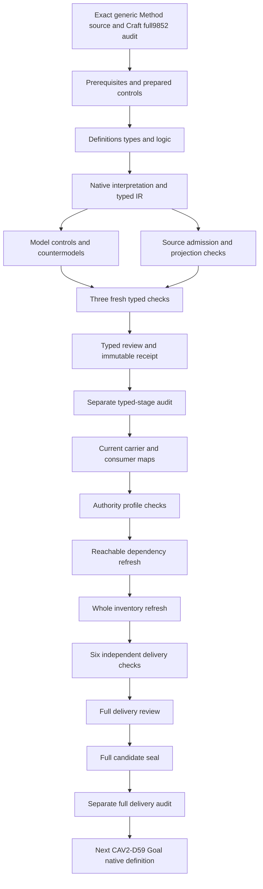

# Generic Method: full partial candidate delivery review

This full candidate delivery selects CAV2-D32 generic Method while retaining its exact C29 admitted Definition,all original planning/source scope and all9852immutable predecessor files. Definitions,types and logic were produced,freshly checked,frozen and separately audited before carrier observations. The full package now includes whole current carrier comparisons,qualified profile/map hypotheses,reachable dependencies and current106draft inventory,followed by six independent delivery replays. Every required producer has an actual successful terminal observation.

The source-owner translation acceptance,shared denotations,whole-definition proof and runtime/application permission remain pending. This is a full delivery of a partial typed candidate. The exact candidate seal and separate read-only full audit follow this review;their actual results are recorded in the prepared current-state evidence. Goal native authoring follows that separate full audit. No owner decision,canonical/private/live artifact,commit,push or publication is created by these checks.

## 1. Exact target and evidence boundary

This candidate selects CAV2-D32@1.0.0-candidate.1, Method, at source digest 82743cbbac7b9ad9f393c56a9efa90aae4acc0d6dff769ddb40fd9b5face1c39. CAL-DECISION-0029-CML07-SEMANTIC-FOUNDATION-V1 admits that exact Definition. Definition admission is distinct from accepting this translation, admitting a Method instance, selecting an application or granting permission to execute. The native interpretation remains candidate with source fidelity pending.

Craft Method's full candidate delivery is the immutable predecessor: 9852 sealed files and a separately captured successful read-only audit. Every predecessor hash was rechecked before native creation. A04, C01 and E02 prerequisite receipts retain their exact bindings. All 201 original source files remain current. The fixed episode scope remains 183 identities, 189 versions, 121 tasks, 511 planning edges, 797 work units and 36 frontiers.

The native author, builder, model and source producers have actual exit-zero observations. Prepared controls passed before native creation. Three separate fresh processes validate contract, model and source, with fresh model/source outputs matching their initial observations. A typed receipt and separate audit close this stage. Consumer analysis,profiles,dependency/inventory refresh and six fresh delivery checks now pass. The full seal and separate audit follow this review before Goal native authoring.

The current full review closes a broader evidence boundary than the typed receipt. It records184consumer checks,26exact selected meanings,six current contracts,30Definition probes with6acceptances,301wholecarrier probes with69acceptances and21freshly evaluated candidate T/I comparisons.32profile hypotheses and109map frames preserve34pending source-to-consumer obligations;all but their exact pending baselines are rejected. None becomes an accepted map or a source-owner approval by passing its software checks.

The native typed receipt and its seventeen input hashes remain immutable. Its audit's printed next text retains an inherited beforegenericMethod suffix;the exact context and receipt identify Goal CAV2-D59 after full generic Method delivery. That historical diagnostic is preserved rather than silently replacing a frozen checker or observation. Current full handoff and next-source evidence use the correct required order.

## 2. Formalization model and source accounting

The interpretation uses many-sorted first-order logic with equality. T contains necessary candidate declarations; I independently requests coverage populations. Actual-outcome predicates are separate query targets and do not enter the encoded primary theory. Satisfying an exact reference nomination or declaration therefore does not assert real repeatability, valid owner decisions, successful application or actual execution permission.

All 21 nonempty source units have complete character accounting: twelve encoded clauses, seven explanatory units and two deferred mappings. The normative statement selects seven primitive rules. The formal expression selects the eleven-coordinate specification rule. Repeatability's source condition selects field identifiability; admission/application separation selects the two record rules and their distinct-decision constraint. Source tests and identity boundaries select their corresponding guards.

Notation, plain-language explanation, the historical workspace reference and two domain examples remain explanatory. The authority-scope reference and candidate migration claim ceiling remain explicitly deferred. This accounting preserves every selected string without converting examples into normative requirements or pretending unresolved semantic mappings are complete. The source-precedence review and all 21 source-owner findings remain pending.

Source accounting and semantic fidelity are distinct. Complete excerpts,byte spans and hashes demonstrate that no selected source unit was dropped or silently rewritten. They do not demonstrate that every proposed sort,predicate,field reference or role relation has a reviewed real-world denotation. The two deferred units and21source-owner findings remain visible in the correspondence packet. The source's normative scientific voice retains precedence over explanatory examples.

Likewise,candidate T/I evidence and semantic dependency closure have separate purposes. The local theory is checked in a qualified signature. The dependency graph records declared semantic uses,available counterpart packets,missing counterparts and unresolved cycle classification. Passing those software checks neither establishes a common carrier model nor removes the need for complete edge review. The final episode must preserve that distinction across all remaining definitions.

## 3. Sorted signature and exact references

The signature contains eighteen sorts, one EMPTY token constant, 33 total functions and 107 predicates or relations, for 159 declarations. It distinguishes Method, scope, six plural collection specifications, residue rule, validation rule, recomposition rule, boundary, generic form, field reference, admission record, application record, decision and token. The 16 selector functions are separate from seventeen reference-handle functions.

Each required selector nominates a declared reference of the correct sort with a nonempty handle. Its binding relation is exact: a value is bound if and only if it equals that selector's nomination. Missing bindings, conflicting bindings, undeclared selected referents and empty selected handles fail. Total functions remain defined for unused arguments, while source-conditioned guards prevent unused results from fabricating records.

Actual contents and reference resolution remain separate from these necessary nomination conditions. A nonempty handle does not prove that the corresponding collection, rule or decision exists in an operational carrier. Distinct sorted roles also do not establish a common real-world carrier universe. Those correspondence maps require independent source-owner and consumer review.

The consumer comparison does not transplant carrier schema fields into the primary Method signature. Method Binding and Identity Graph retain their independently admitted schemas and complete semantic reference lists. The proposed Method selectors remain a formal vocabulary whose serialization and meaning maps require review. Rejected added camel-case selector fields demonstrate current closed interface shape;they do not prove that indirect specification references cannot represent these concepts.

A reference handle is treated as a necessary nonempty nomination. It is not a resolver result,owner identity proof or collection population. The exact field binding and applicability guards constrain the supplied interpretation without claiming those nominal entities exist as real carrier instances. The current source/consumer maps retain the gap between those sorted nominations and operational facts.

## 4. Eleven minimum Method fields

The source tuple is scope, inputs, actions, roles, gates, outputs, evidence, residue rule, validation rule, recomposition rule and boundary. Every selected Method has an exact typed nomination for each coordinate. The candidate also declares governed repeatable transformation. These requirements apply to unnamed generic specifications and named specializations alike.

Generic Method's tuple differs from Craft Method's eleven construction coordinates. Craft has product intent, domain meaning, system specification, realization selection, construction, conformance, operation, recovery/evolution, owner continuation and ledger state around its context. Generic Method includes actions, roles, gates and three rules. Their shared number of coordinates does not equate their forms or identities. CAV2-D20 remains a separately identified specialization example.

The tuple is a proposed specification structure rather than a workflow interpreter or complete lifecycle state machine. No action executes, gate opens, output appears or residue resolves because a specification has those references. The selected rules are present as typed coordinates; their real adequacy and behavior are independent query targets. Method identity cannot replace a permission decision.

Every selected Method has all eleven minimum coordinate nominations. Different typed roles do not imply that their real-world content must be disjoint. The complete artifact bindings acknowledge generic Method and its separately identified Craft specialization without equating the two eleven-field forms. Exact source identities and scoped bindings carry more information than the narrow registry summary lists,which must not be used as a replacement for their full binding surfaces.

## 5. Plural collection coordinates

Inputs, actions, roles, gates, outputs and evidence use collection-specification references. The source says those fields must be explicit, but does not prescribe collection cardinalities, element membership, ordering, uniqueness or nonempty contents. A required nonempty reference handle therefore does not force a nonempty collection. No element-carrier domains or invented cardinality axioms are added.

This choice avoids treating a plural set of actions as one action or a body of evidence as one evidence item. It also avoids rejecting specifications whose explicit input collection could be empty. Conversely, the opaque nominations do not prove that real collections are well formed, complete or compatible. Actual source-to-schema collection maps remain pending.

The source's separate role, gate and evidence meanings are selected as qualified dependencies. Their whole theories are not imported into T. Real-world collections may share contents across coordinates where a reviewed map permits it; the proposed sorted nominations do not establish or forbid that content overlap. This is an explicit denotation gap rather than an unstated assumption.

Neither of the two current complete-binding artifacts gives a direct verified collection element/cardinality map for the six plural coordinates. Method Binding refers to a Method;Identity Graph classifies a Method node and relationships. Both may support indirect interpretation,while the present comparison does not accept that bridge. Thus the source's plural structure is preserved without fabricating member sets or inferring empty/nonempty real collection contents from reference labels.

## 6. Transformation alternatives and repeatability

Applicability describes transformation of intent, evidence, state or residue. The candidate requires at least one declared alternative for every selected Method. Alternatives are inclusive: a Method can declare more than one. The supplied specifications cover intent/evidence and state/residue combinations. Neither exactly-one classification nor a requirement that every Method transform all four is imposed.

Governed repeatability remains a necessary declaration. The source's testable conditions concern identifiable reusable/specialized fields, explicit minimum coordinates, rules and lack of execution authority from identity. The theory expresses those conditions without inventing determinism over every possible application, identical results across contexts or an unlimited repetition theorem.

Actual governed repeatability and transformation fidelity have separate nonentailment queries. Their false targets in a satisfying supplied model demonstrate that declarations alone are insufficient. They do not prove a real Method cannot be repeatable or deny independently supported successful applications. Owner and consumer evidence must supply the missing semantic bridge.

Reusable operation would require application-level evidence beyond this candidate. No identity contract conformance certificate or projection parity result demonstrates successful repeated transformation. Source role labels,minimum fields and record presence remain distinct from actual behavior. The negative queries maintain that logical insufficiency while permitting independent evidence to support real repeatability or authorized applications.

## 7. Named specialization

A declared named Method conditionally nominates an exact generic form. That form has declared minimum coordinates, and an exact Method-to-form specialization relation is present. The Method still satisfies the eleven-field root rule. The theory does not replace its own scope or field references with a prior whole Method theory.

An unnamed generic Method leaves its unused specialization binding absent without fabricating a form record. A control also permits an empty unused form handle. Named specialization without its exact relation or minimum-form declaration fails. Actual specialization fidelity is a query conditioned on the Method being declared named, so its counterexample is source-relevant.

Specialization does not inherit execution authority. The candidate rejects that prohibited nomination and permits independently supported actual authority in a different predicate. Shared naming, a form reference or exact Definition admission therefore cannot stand in for an authorized application. Generic Method and Craft Method remain separately qualified meanings.

A generic Method reference and an opaque named Method reference both pass the selected Method Binding schema and isolated identity-collapse helper. Those checks do not resolve the referenced specification,verify specialization,accept its minimum form or prove authority inherited. Current C31binding admission remains exact evidence for its specific Craft binding. That admitted binding cannot be expanded into permission for arbitrary named Methods or applications.

## 8. Reusable and specialized field identifiability

For every selected Method, a field marked reusable or specialized must be a declared Field reference with a nonempty handle and a Method-to-field identifiable declaration. Missing identifiability for a reusable or specialized field, an undeclared marked field or an empty marked handle fails. The source does not specify a disjoint or exhaustive partition, so the model permits a field with both roles.

The supplied coverage also includes a declared field not classified for a selected Method. This population demonstrates the absence of an imposed exhaustive classification; it does not itself establish an additional operational field belonging to that Method. Real Method-field membership, field names and coordinate-to-field maps are not encoded by the standalone Field declaration. That limitation remains in the source-owner findings and downstream mapping obligations.

Thus explicit tuple coordinates and conditional field-role identifiability are different surfaces. The minimum eleven coordinates remain present even if no reusable/specialized role records are selected, while I then fails to supply the requested role examples. An unrelated unclassified field handle remains unused by the selected-role guard. Those cases do not waive identifiability for a field actually marked reusable or specialized.

The present field-role rule has a deliberately bounded interpretation. A reusable/specialized marker associates a field with a Method for the identifiability condition. A standalone globally declared field not so classified does not establish that Method's field membership. The full consumer report records the exact population formula and absence of an encoded unified membership relation. It does not rename that gap as completed semantic coverage. Field-name,coordinate-to-field and ownership maps remain among the34pending obligations.

## 9. Admission and application records

An admission record nominates its Method and decision, declares the admission decision role and supplies a decision-to-Method relation. An application record independently nominates its Method and decision, declares the application decision role and supplies its own relation. Each selected record requires exact fields and nonempty typed references.

The Method specification does not fabricate either record. An application can be selected without a matching selected admission record, and that situation is an explicit required population. This is a statement about the supplied declaration universe, not a claim that an unadmitted real Method may execute. The application record does not assert actual execution or valid permission.

Likewise, a Method's admitted Definition is not its instance admission, and a Method Binding is not automatically an executed application. Later C30/C31 type and carrier admissions must retain their exact scopes. Their real relation to these proposed record sorts remains a consumer-mapping question. The model does not infer an owner authorization from strings naming a decision or Method.

C29Definition admission,C30Artifact Type admission and C31carrier/identity-relation admission have different subjects and scoped effects. The current complete artifacts bind generic Method;the actual Method Binding instance refers to Craft Method. Neither structural acceptance of an opaque reference nor recognition of schema/identity-contract conformance performs the admission or application decision represented by these proposed record sorts. Valid owner/evidence/challenge references still need actual resolution and reviewed role maps.

## 10. Separate decisions and execution authority

Every selected admission decision reference differs from every selected application decision reference. The candidate applies separation across the selected roles, including records that nominate different Methods. Reuse of one decision reference among admission records within the same role is not forbidden. The chosen role-wide scope is explicit in a source-owner finding; real batching and owner semantics remain pending review.

The controls reject admission/application decision collapse for the same Method and for different Methods. They permit multiple same-role admission records using one decision nomination. No application counterpart or admission counterpart is invented merely to make the separation rule nonvacuous; I independently requests populated examples demonstrating it.

Method identity, named specialization and application identity cannot nominate inherited execution authority. Actual permission and actual authority may nevertheless be independently supported. The finite model deliberately includes such an independent authority case while retaining Methods without actual outcomes. This prevents necessary declaration boundaries from becoming a universal denial of legitimate authority.

The two isolated decision-collapse comparisons are stronger evidence about the separation primitive than a model with a missing role relation. The consumer checker first supplies the exact application-decision-to-Method relation for the collapsed reference. All six other primitive rules remain true,and only separate-decisions fails. One case collapses roles for the same Method;the second uses different Methods. Their actual qualified model hashes and per-primitive results are retained for reviewer inspection.

This validates the proposed declaration-level constraint rather than proving real decision identities differ or owner decisions are valid. The role-wide scope remains explicit and unaccepted. Real batching may preserve multiple independently scoped decisions within one interaction;the source/consumer mapping must explain which references denote which decisions. The candidate permits same-role reuse without silently equating admission and application authority.

## 11. Source, provenance and dependencies

The source checker passes 69 actual checks. It verifies the current C29 generic Method selection, exact authorization/manifest/validation/candidate bindings, Definition schema/generator bindings, source text, the local Definition upstream and source-query correspondence. It extracts only the three pure Definition renderer functions, renders twice and compares both outputs with the existing 3654-byte projection without mutating the source.

Both projections have digest fe419ca7e65733512ea3113d19aa204466fbc5fcb1c7c49fa69dd9dcabc4f090. The original external definitions path is absent. The relocated file supplies exact lines 2114–2180 at digest 28608be42869eaf5183bd5b4154d9bded38f1a17ad35c11072b9a49f1e4dc348. The full-file digest differs from the historical authoring digest; the selected scope still matches. No external private meaning or legacy authority is imported into T.

The immutable source body's candidate-unadmitted upstream label remains intact. Current C29 scoped source-use admission is separately observed. The candidate selects 21 complete direct semantic dependency identities. Missing canonical labels for scope, action, state, collections, generic form and field identification remain explicit. No synthetic canonical Definitions are invented to fill those labels.


Exact C29 CAV2-D32 generic Method is compared with26separately qualified current Definition meanings and six current identity contracts. The full comparison passes184checks,30Definitionprobes with6acceptances,301wholecarrier probes with69acceptances and21freshly evaluated candidate-only T/I models. No accepted semantic map,actual Method application,permission,repeatability or whole proof is inferred.

The current catalog has143admitted rows121current rows. No summary row directly lists generic Method. Complete immutable MethodBinding/v1 and IdentityGraph/v1 artifacts explicitly bind it,alongside other exact meanings omitted by their summaries. The narrower summary semantic-ref lists are preserved alongside complete artifact binding lists. No absence of generic Method use is inferred from the summary alone. No new schema or authority mapping is installed to reconcile them.

C29 positively admits generic Method and the semantic foundation. C30 admits six orthogonal identity Artifact Types and makes S3 evaluable without executing S3 at that boundary. C31 later admits six exact carriers and five identity graph relations,recognizes schema and identity-contract conformance PASS,and retains implementation/runtime not_evaluable and goal achievement not_proven. Candidate body labels remain immutable. The later scoped overlays remain positive evidence;they do not accept this formal translation or create generic Method runtime permission.

All26selected meanings retain exact admitted source bytes,Definition shape and reproducible pure projections. Each six-type package retains its exact C30artifact,schema and validation receipt. Valid fixtures and exact admitted C31carriers pass full schema checks and the isolated shared semantic_errors helper. Artifact/fixture and actual-carrier projections use independently bound helper families. Only pure projection/semantic functions execute;no package validator,writer,admission transaction,Method interpreter or live consumer runs.

Definition shape accepts hypothetical named-form authority,admission/application identity collapse,nonempty real collection inference from a handle,successful repetition from role labels and workflow-as-Method prose. Shape and pure rendering cannot accept those meanings. Generic Method's proposed tuple remains a specification:scope,inputs,actions,roles,gates,outputs,evidence,residue rule,validation rule,recomposition rule,boundary. Plural coordinates nominate collection specifications without invented member/cardinality constraints. Field identification and actual successful repetition require separate maps.

Method Binding's schema has method_ref,subject_ref,subject_kind,application_scope,owner,evidence and challenge coordinates. It does not directly expose any of the11proposed camel-case minimum selectors;added selectors fail closed root shape. This is an interface observation,not proof that no indirect Method specification could exist behind a reference. Setting method_ref to generic CAV2-D32 or an opaque named Method can pass both shape and the isolated identity guard. Those values do not resolve a Method or authorize its application.

Binding or subject identity collapse can pass schema but fail semantic_errors. Switched Product/Project kind and opaque owner/evidence/challenge strings can pass both without verifying subject classification or ownership. Identity Graph duplicate nodes,unresolved endpoints and wrong relation signatures can also pass whole schema while failing the semantic guard. Exact admitted real carriers pass the current checks. Their exact admission remains distinct from every hypothetical mutated fixture.

All six compared schemas reject added generic minimum selector fields,unreviewed form/field mapping fields and body self-promotion/authority effects. Some prose overclaims and unresolved nonempty references remain valid shape. The inspection therefore records the missing source-to-collection/form/field-membership/identification/decision/application bridge. Schema validity is not interpreted as full Method meaning or runtime truth.

Field-role markers in the candidate require a declared nonempty Field reference and identifiable relationship when marked reusable or specialized. Overlap is permitted;an exhaustive partition is not invented. The unclassified field population only provides a globally declared field unclassified relative to a selected Method. It does not establish an operational extra field owned by that Method or map its identity to one tuple coordinate. The source-owner review and consumer findings retain this membership gap explicitly.

Two decision-collapse comparisons strengthen logical isolation. Their application decisions collapse with a selected admission decision,but their exact decision-to-Method role relations remain populated. Every other primitive rule remains true,while separate-decisions alone is false. One case uses the same Method;the other uses different Methods,matching the candidate's explicitly proposed role-wide separation scope. Source-owner review may qualify that scope;real owner batching and validity are not inferred from different reference strings.

The21comparisons also retain positive unnamed/named,unused form,field overlap,inclusive transformation and same-role decision reuse cases. No selected records,no independent authority,no admission,no application and no field role examples can preserve T while failing coverage I. Negative named-form and field-identification cases fail their necessary guards. Population coverage and primary theory truth are separately computed for every supplied qualified model;source meanings and a common carrier denotation remain unaccepted.

The previously retained assembly/AST indentation error occurred before native creation and changed no theory,model or limits. This consumer comparison introduces no failed native or consumer producer. The frozen17typed inputs remain intact,with the audit's diagnostic next suffix retained as historical output;the authoritative receipt/context place Goal after full generic Method delivery. Profiles,reachable dependencies,current106draft inventory,six independent delivery replays,full review,seal and separate audit are the next required boundary.

- GMD-CONSUMER-FINDING-001: No current registry summary directly names generic Method CAV2-D32,but complete immutable current MethodBinding/v1 and IdentityGraph/v1 artifacts explicitly bind it. Preserve exact summary and complete binding scopes;absence from a summary does not erase real semantic use.

- GMD-CONSUMER-FINDING-002: C29 admits exact generic Method meaning;C30 admits six identity Artifact Types;C31 admits six carriers and five graph relations with schema/identity-contract PASS while implementation/runtime remain not_evaluable. Candidate body labels do not erase those separate positive overlays or accept this translation.

- GMD-CONSUMER-FINDING-003: Definition schema accepts hypothetical inherited-authority,admission/application collapse,collection-cardinality,role-label repeatability and workflow identity overclaims. Pure rendering and complete source accounting do not accept those meanings.

- GMD-CONSUMER-FINDING-004: MethodBinding whole schema and isolated semantic_errors differ:identity collapse can pass shape but fail the semantic helper,while generic/named Method refs,switched Product/Project kind and unresolved owner/evidence/challenge strings can pass both without actual subject or permission resolution.

- GMD-CONSUMER-FINDING-005: IdentityGraph whole schema can accept duplicated nodes,unresolved endpoints and incorrect relation signatures while the pure semantic helper rejects them. Its exact admitted graph is separate from a generic Method minimum-form or application denotation.

- GMD-CONSUMER-FINDING-006: None of the six compared identity schemas directly exposes the proposed eleven camel-case selectors;an added selector field is rejected. Indirect references may still describe a Method. Accepted collection contents/cardinality,form specialization,minimum-coordinate and rule-adequacy maps remain pending.

- GMD-CONSUMER-FINDING-007: Reusable/specialized role markers provide conditional reference identifiability and permit overlap. The globally declared unclassified field population does not prove additional Method-field membership;coordinate/field-membership and actual repeatability maps remain explicit gaps.

- GMD-CONSUMER-FINDING-008: Twenty-one freshly evaluated T/I comparisons include two decision-collapse models preserving exact role relations so only the separate-decisions primitive fails. This isolates the guard without proving real decision validity,owner acceptance,application permission,source fidelity,whole translation or whole proof.


## 12. Controls, countermodels and retained evidence

The suite evaluates 173 authored controls: 69 satisfy T, 96 fail T and eight malformed models are rejected structurally. Positive cases preserve unnamed unused specialization fields, overlapping field roles, inclusive transformation alternatives, same-role decision reuse and independently supported actual outcomes. Negative cases cover every required exact binding, selected handle, marked field, named form, transformation alternative, decision role and prohibited identity/authority nomination.

All 39 actual-outcome queries have a supplied interpretation satisfying both T and I, with the target false and the witness condition true. One query is conditioned on named specialization. Their targets cover repeatability, transformation, collection/scope fidelity, rule adequacy, field identification, decision validity, admission/application, permission, execution, validation, residue, recomposition, source fidelity and authority. No target is assumed in primary T. Forty-seven source-query obligation rows preserve exact selectors, excerpts and byte digests; accepted semantic mappings remain pending.

One actual source-checker assembly/AST parse error occurred before native creation. A generated rendering loop was indented incorrectly. The erroneous generated checker and an exact observation of the exit-one assembly failure are retained. The correction changed the loop indentation, with no source, theory, model or limit change. Prepared semantic controls and all native producers passed; the assembly failure is not relabeled as a failed semantic test or hidden from the receipt.

Three fresh typed-stage processes independently pass contract, model and source. Existing one-million-byte, 50000-node, 100000-step and 30-second limits are unchanged. The prepared maximum is 7572 evaluation steps. These bounded software observations do not establish common denotations, source fidelity, whole translation or whole proof.

Static-only snapshot reuse passes15adversarial differential checks. It preserves exact static bytes,delegates live repository/currentness verification and restores the original verifier. It does not reuse actual denotation evaluation or skip source correspondence. Every current draft receives a freshly evaluated supplied T/I witness. That is separate evidence for each qualified theory;the full delivery does not claim one common meaning-aligned model for all definitions.

Six independent processes replay contract,model,source,profile,dependency and whole inventory checks. Their terminal outputs and exact argv are captured;fresh noncontract output matches the initial producer observation. The original limits remain unchanged. Required source-owner mappings,accepted translation,common denotations and complete semantic edge denominators cannot be supplied by matching those outputs alone.

## 13. Detailed continuation DAG and completion scope



The machine-readable DAG records eighteen nodes and eighteen edges with completion criteria. It is a work-delivery dependency plan, distinct from the semantic dependency graph. Definitions, types and logic precede consumer and profile evidence. The typed receipt and its separate audit are required before the full candidate delivery sequence. Goal native creation waits for generic Method's full seal and separate audit.

The predecessor whole inventory has105partial drafts. Current inventory has106partial drafts, leaving 77 identities without native T; the current whole inventory refresh is now complete. All 9852 predecessor files and 201 sources remain unchanged. Accepted whole translations, whole-definition proofs and source-owner maps remain pending. The original unbounded goal stays active until all remaining definitions and original assurance requirements are completed and audited, followed by the requested complete review.

Exact pending source-owner findings:

- GMD-FINDING-001: Exact C29 generic Method Definition admission does not accept this translation,admit a Method instance,apply it or grant execution authority.
- GMD-FINDING-002: CAV2-D32 generic Method and CAV2-D20 Craft Method retain separate identities,eleven-field forms and qualified meanings.
- GMD-FINDING-003: The eleven minimum fields are explicit typed nominations,not an executed workflow,engine,pipeline or complete operational state machine.
- GMD-FINDING-004: Plural inputs,actions,roles,gates,outputs and evidence nominate collection specifications;no element/cardinality/nonempty-member or disjoint-content assumptions are invented.
- GMD-FINDING-005: Declared intent,evidence,state and residue transformation alternatives are inclusive;no exactly-one partition or every-Method-transforms-everything rule is imposed.
- GMD-FINDING-006: Governed repeatability is a necessary declaration;actual reusable operation,validation and successful outputs remain independent.
- GMD-FINDING-007: Named Methods nominate the minimum generic form and declared specialization;no actual specialization fidelity or inherited execution authority follows.
- GMD-FINDING-008: An unnamed generic Method leaves its unused specialization field unbound without a fabricated named Method or form record.
- GMD-FINDING-009: Reusable and specialized field references must be identifiable when selected;real field names,coordinate-to-field maps and content fidelity remain pending.
- GMD-FINDING-010: Reusable and specialized roles may overlap,and unclassified additional fields are not forbidden;the source does not require a disjoint exhaustive partition.
- GMD-FINDING-011: Admission and application records nominate their own Methods and decisions;actual owner validity,admission,application and permission remain separate.
- GMD-FINDING-012: Selected admission and application decision references are separated across the two roles;reuse within a role is not forbidden and actual batching/owner maps remain pending.
- GMD-FINDING-013: An application need not fabricate a selected admission record or claim execution,and a Method specification need not fabricate either record.
- GMD-FINDING-014: Residue,validation,recomposition and boundary rules are present as typed nominations;actual adequacy,continuity and conformance remain unproved.
- GMD-FINDING-015: Methods remain separate from one-off tasks,techniques,checklists,lifecycle labels,Products,Projects,Goals,workflows,engines,pipelines and authority grants.
- GMD-FINDING-016: The nonnormative example that a Method may use tools/workflows is explanatory;no universal tool prohibition is invented from it.
- GMD-FINDING-017: C29 positive semantic foundation effects and later C30/C31 type/carrier/identity conformance admissions retain separate scopes without accepting this formal translation.
- GMD-FINDING-018: Source-body candidate admission labels and historical chain evidence remain separate from current C29 exact scoped source-use admission.
- GMD-FINDING-019: Relocated external selected lines2114-2180 match their bound digest;wholefile drift and path relocation do not transfer private meaning or legacy authority.
- GMD-FINDING-020: Current Method Binding and related carrier meanings need separately accepted source-to-form,field,decision,role,evidence,residue,validation and application maps.
- GMD-FINDING-021: Complete source accounting and finite T/I witnesses do not establish common denotations,source fidelity,whole translation,whole proof or episode completion.
Goal's next-source preparation retains a provenance distinction needed for the next unit. Its canonical external Markdown selector is still lines4443–4521,but that interval no longer contains the selected Goal bytes in the relocated current file. The exact admitted excerpt is independently located at lines4773–4851 with the same f9589997351dcd40f5c37f970568aab3a09345c1b8ab6331860d5533d2c7a674 digest. The original selector is not rewritten. The observed relocation is bound by content identity,not inferred from a nearby heading alone.

The original legacy Goal JSON path is also absent,and the relocated file matches the admitted whole-file digest075458bb50e508d00a1124cb43c5952a013657df2e6046b8674f25c44dd350a2. Source-only preparation passes25checks,accounts21units and reproduces its3997byte Definition projection. No Goal record,achievement,permission or native theory is created by that preparation. Goal's source requires adequate evidence for every required success condition and an owner-recorded lifecycle transition;progress,PASS or an agent assertion cannot substitute for those conditions.

The full generic Method seal binds the complete current candidate file set,and the separate audit rechecks exact file-set equality and all prior hashes. Only that verified terminal boundary permits Goal native creation. The original episode remains open for77identities without native T and all other original assurance requirements. Its requested final review and completion audit must cover the full183identity scope,not the subset already available.


Actual whole-inventory and dependency observations:

```json
{
  "partial_drafts": 106,
  "without_native_T": 77,
  "counts": {
    "deferred_clauses": 1129,
    "encoded_clauses": 1103,
    "explanatory_clauses": 876,
    "mapped_clauses": 3108,
    "required_populations": 1391,
    "source_units": 2527,
    "unresolved_populations": 6729
  },
  "joint_nodes": 150,
  "joint_edges": 2652,
  "joint_missing": 44,
  "joint_cycles": 1,
  "reachable_nodes": 146,
  "reachable_edges": 2572,
  "reachable_packets": 103,
  "reachable_missing": 43,
  "source_owner_accepted_whole_translations": 0,
  "whole_definition_proofs": 0
}
```
