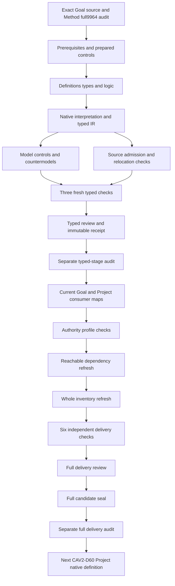

# Goal: full candidate delivery and formalization review

## 1. Exact target and completion boundary

This candidate selects CAV2-D59@1.0.0-candidate.1, Goal, at digest f43a539e5f0f4db26dab0df0cb30c523868c6fef3dbb3d061614a4d288c5ae19. CAL-DECISION-0029-CML07-SEMANTIC-FOUNDATION-V1 admits that exact Definition. This translation remains a separately authored partial typed candidate with source fidelity pending. Definition admission, Goal carrier admission, owner-recorded lifecycle change, adequate evidence and actual achievement remain different claims.

The immutable predecessor is generic Method's full candidate seal of 9964 files, with its actual separate audit exiting zero. All predecessor hashes and the A04, C01 and E02 prerequisite receipts are rechecked before authoring. All 201 original sources remain current. Original scope stays 183 identities, 189 versions, 121 tasks, 511 planning edges, 797 work units and 36 frontiers. A new Goal candidate does not complete that episode.

Native author, builder, model and source producers have actual successful terminal observations. The prepared full-source/model contract check passed before native creation. Three independent fresh typed-stage processes validate contract, model and source; a frozen receipt and separate read-only audit close this boundary. The full delivery now adds complete selected consumer inspection, qualified profiles, dependency and inventory refresh, six independent delivery replays and this review. Seal and separate audit must complete before Project native creation. The immutable typed review and receipt preserve their earlier stage scope.

## 2. Formalization model and complete source accounting

The theory uses many-sorted first-order logic with equality. T contains necessary declaration rules; I independently requests population coverage. Actual-outcome predicates are separate queries and are absent from the primary encoded clauses. Thus a reference to an owner or evidence item is not proof of valid authority, adequate real evidence or actual Goal achievement.

All 21 nonempty source units have complete character accounting: twelve encoded clauses, seven explanatory units and two deferred mappings. The normative statement selects seven primitive rules. The formal expression selects exact Goal fields, declared required-condition membership and conditional achievement. Source tests select explicit fields, owner-evidenced transitions and authority boundaries. The exact-one-Project source condition selects the single-valued binding rule.

Notation, plain-language explanation, historic workspace reference and domain examples remain explanatory. The authority-scope reference and candidate migration claim ceiling remain deferred. Every source span is retained without silently converting examples into normative obligations or asserting accepted meaning. Twenty-two source-owner findings remain unresolved, including real condition completeness, owner authority and lifecycle/achievement fidelity.

## 3. Sorted signature and exact references

The signature has sixteen sorts, two constants, 33 total functions and 93 predicates or relations, for 144 declarations. Sorts distinguish Goal, identity, Project, outcome, rationale, scope, exclusion collection, owner route, owner, success-condition collection, evidence requirements, lifecycle state, condition, evidence, transition and token. EMPTY is a token marker; ACHIEVED is a lifecycle-state reference constant.

Every required field nominates a declared reference of its specified sort with a nonempty handle. Each binding relation is exact: a value is bound if and only if it equals the selector nomination. Missing, conflicting and undeclared selected bindings fail. Total functions still have values for unused arguments, but conditional guards prevent unused achievement/current-transition fields from fabricating events.

The selected Goal and transition carriers have explicit applicability/in-scope equivalence. Outside objects do not inherit the selected scope's obligations. Sorted nominations and nonempty handles are necessary reference structure, not real reference resolution. Accepted source-to-carrier denotations remain separate. No canonical Goal record or source Definition is rewritten by these checks.

## 4. Ten minimum Goal fields

The source tuple contains identity, Project reference, outcome, rationale, scope, exclusions, owner route, success conditions, evidence requirements and lifecycle state. Every selected Goal supplies all ten exact typed nominations. The root rule also declares durable attributable outcome and desired future outcome. Outcome and rationale remain distinct from a plan, task, deadline or execution command.

Exclusions, success conditions and evidence requirements nominate collection specifications. The Definition requires those fields to be explicit but does not state minimum cardinalities for their contents. Nonempty reference handles therefore do not impose nonempty member collections. The candidate includes an empty declared condition collection as a separate coverage scenario while retaining evidence and owner prerequisites for declared achievement.

The ten-field Goal form differs from the eleven-field generic Method specification and Craft construction form. Goal cannot become its Project or Product, its evidence, the Method used to pursue it or an authority grant. Scope, purpose, ownership and actual attribution need reviewed mappings beyond the presence of correctly sorted labels. Their fidelity targets remain unassumed.

## 5. Exactly one Project and independent Goal identities

goalProject nominates one declared Project reference. Its exact binding relation permits only that Project value for each selected Goal. A second Project binding conflicts with the nomination and fails. The required population includes two distinct Goals sharing one Project, demonstrating that exactly one Project per Goal does not impose exactly one Goal per Project.

Goal identity and Project reference have different typed roles. The boundary rejects a nominated identity merge or permission from membership. It does not force a Goal owner to be the Project owner, and it does not claim real Project membership from a reference string. Actual membership, identity and attribution have independent query targets.

This preserves the positive source's single-Project contract while retaining parent-instance authority separation. The scoped Project and identity meanings are independently selected dependencies. Their whole theories are not imported into T. A common real-world carrier model and accepted membership map remain pending.

## 6. Declared required-condition membership

For each selected Goal and Condition reference, GoalRequiredConditionDeclared holds if and only if the condition belongs to the nominated success-condition collection. A required condition must be declared and have a nonempty handle. The rule rejects an omitted required-condition link or an added condition outside that declared collection.

This is exact closure of the supplied declared membership. It does not prove that the collection contains every real required condition. The candidate retains actual condition completeness as an independent target. An author could still nominate an incomplete real collection; source-owner review and the eventual consumer map must detect that gap rather than infer completeness from the field name.

Coverage requests both multiple-condition and empty declared collection cases. Those are I obligations rather than forced source cardinalities in T. The multiple-condition witness is important for evaluating universal coverage rather than only a single favorable example. Empty collection coverage does not automatically select achievement or create an owner transition.

## 7. Universal adequate-evidence support

Declared achievement requires adequate support for every declared required condition. For each such condition, at least one declared nonempty Evidence reference must have AdequateEvidenceDeclared, EvidenceSupportsConditionDeclared and EvidenceResolvedDeclared. The evidence rule also rejects any claimed adequate item for a required condition that lacks its supporting relationship or resolution declaration.

The baseline permits one evidence item to support two conditions and two evidence alternatives for one condition. No one-to-one assignment is invented. Removing one alternative can preserve T, because another still covers that condition, while I then loses its requested multiple-alternative example. Removing every alternative for one required condition fails the achieved-Goal guard. Passing some conditions cannot cover a missing required condition.

Evidence for a nonrequired condition may also exist. Owner transition evidence may differ from the evidence supporting success conditions. These are separately typed uses of evidence, and no global unique-evidence-per-Goal rule is imposed. Real adequacy, authenticity, completeness and acceptance still need source-to-consumer evidence; declaration labels do not prove them.

## 8. Goal owner and lifecycle transition records

The Goal owner route resolves to an exact typed owner nomination. Every selected transition nominates its Goal, owner, from state, to state and owner evidence. It declares a lifecycle change with distinct from/to states, agrees with the Goal's nominated owner, has an OwnerRecordsTransitionDeclared relation and resolves its evidence reference.

The proposed selected carrier describes actual changes rather than noop reaffirmation. This scope is explicit in a source-owner finding. The Definition's lifecycle-change test requires owner evidence, so the guard applies to selected historical changes as well as an achievement witness. It does not claim that an owner route is valid or that a real owner authorized the event.

The controls reject an unrecorded historical change, missing achievement-owner record, unresolved owner evidence, wrong owner/Goal or a noop selected state change. They preserve an independent actual authorization case without allowing an identity, transition label or evidence item to perform the owner decision. Actual owner-record and authorization fidelity remain queries.

## 9. Historical versus selected current state

Historical transitions need not have a destination equal to the Goal's current state. The baseline achieved Goal has an earlier planned-to-active record and a later active-to-achieved record. Requiring every historical destination to equal current state would erase the former record; the theory does not impose that restriction.

Only a Goal explicitly declaring a selected current transition must nominate an exact transition whose subject is that Goal and whose destination agrees with its current lifecycle-state reference. Pending Goals without this selection leave the unused field unbound. A control rejects selecting the historical active destination as the current transition of the declared achieved Goal.

The candidate does not prove historical order, event uniqueness, current-state reconstruction or real append-only storage. These are separate consumer and owner mappings. Correct declaration-level state agreement is necessary evidence structure, while actual lifecycle fidelity remains pending.

## 10. Achievement is an only-if guard

GoalAchievedDeclared is tied exactly to the nominated lifecycle state being ACHIEVED. A declared achieved Goal then requires universal declared condition evidence and an exact achievement transition for that Goal, by its nominated owner, to ACHIEVED, with an owner-recorded relationship. The selected transition rule supplies its owner evidence and distinct-state change prerequisites.

The rule is an implication rather than a sufficient-condition converse. An evidence-ready pending Goal remains pending without fabricating an achievement transition. Activity, progress, validation, a PASS receipt or an agent assertion does not select achievement. An empty declared condition collection likewise does not perform the owner transition or automatically choose the achieved state.

A nominal achieved state with satisfied necessary declarations still does not prove actual Goal achievement. Three query targets are conditioned specifically on declared achieved Goals: achievement, required evidence adequacy and owner authorization. Their satisfying countermodels preserve the source-relevant declared scenario while demonstrating that accepted real-world meaning and authority do not follow from these nominations alone.

## 11. Source, provenance and semantic dependencies

The source checker passes 69 actual checks. It verifies exact current C29 selection, authorization/manifest/validation/candidate bindings, schema/generator bindings, source statements, local Definition upstream and 43 selector-specific source-query obligation rows. It extracts only the three pure Definition rendering functions and reproduces the existing 3997-byte projection twice without source mutation. Both render digests equal ea24c3cb856e569a4dd4f2a1864b119c595256e8b28f85eb45de38fa6e0f2a2b.

The canonical legacy Markdown selector remains lines 4443–4521, which no longer matches the selected bytes at the relocated current file. The exact admitted 3176-byte excerpt is independently located at lines 4773–4851 and matches f9589997351dcd40f5c37f970568aab3a09345c1b8ab6331860d5533d2c7a674. The original selector is preserved alongside the observed location; neither nearby heading nor path similarity is substituted for content identity.

The original legacy Goal JSON path is absent. Its relocated file matches whole-file digest 075458bb50e508d00a1124cb43c5952a013657df2e6046b8674f25c44dd350a2. Source-body candidate admission labels remain immutable alongside C29's scoped source-use overlay. Twenty-four current semantic dependencies retain separate qualified identities. Missing condition, collection, owner-route and lifecycle-state/transition labels are explicit; no canonical Definition is fabricated for them. No private meaning or legacy authority is transferred by reading source bytes.

Goal's frozen definition,types and logic are compared with27exact current Definition meanings and six C30identity Artifact Types with six C31carriers. The full inspection passes191checks,30Definitionprobes with6acceptances,311carrier probes with74acceptances,and26fresh candidate-only T/I comparisons. This is a candidate comparison;source fidelity,owner acceptance,shared denotation and whole proof remain pending.

The registry has143admitted contracts and121current rows. Its summary directly binds Goal/v1. Complete current Goal/v1 and IdentityGraph/v1 artifacts both bind CAV2-D59. These exact qualified binding scopes remain separate from proposed operational maps. C29admits Goal meaning,C30admits the six types,and C31admits six carriers and five relations. C31recognizes schema and identity-contract PASS,implementation/runtime not_evaluable and Goalachievement not_proven. Immutable candidate body status does not erase those positive overlays or become a Goal lifecycle state.

The source requires ten coordinates:identity,Project,outcome,rationale,scope,exclusions,ownerroute,successconditions,evidencerequirements,lifecycle. Whole Goal/v1 schema has14properties but no direct project_ref,scope,exclusions,owner_route or lifecycle_state. Adding these or native camel-case selectors fails closed shape. Actual carrier also lacks them. This comparison does not prove external representations are absent;source-to-external membership,scope,lifecycle and owner maps require review.

Current IdentityGraph has one Project pursuing the Goal and resolved correctly typed endpoints. Two concrete actual-carrier mutations expose limits:adding a second resolved Project pursuing the same Goal passes both full schema and isolated semantic_errors;removing every pursues_goal edge also passes both. Adding a second Goal for the same Project passes,which agrees with the source. The helper checks identity uniqueness,endpoint existence and directional signatures,but the first two mutations show it does not check the source exactly-one-Project condition. Equating pursues_goal with ownership is itself an unaccepted map. Actual admitted graph remains valid under its admitted contract.

Goal success_conditions and evidence_requirements are unique nonempty arrays of nonempty strings. Empty or duplicate arrays fail schema. Opaque single-string replacements pass shape and helper without a per-condition evidence adequacy relation. Current four conditions and four evidence requirements are retained exactly. Their array lengths do not prove a bijection,required-condition completeness or satisfaction. All declared required conditions need at least one declared adequate,resolved supporting item in the candidate's achieved-only-if guard.

The carrier nominates role:craft-goal-owner as accountable owner and challenge route. Opaque replacements pass both checks. Those references do not resolve a principal,authorize an owner or record a lifecycle decision. No selected lifecycle transition or actual achievement is established. PASS and admission are evidence about specific contracts;they cannot perform the owner's achievement decision. The actual Goal claim ceiling explicitly preserves that distinction.

Definition schema accepts hypothetical PASS-achievement,one-condition sufficiency,two-Project ownership,evidence-as-decision and status/lifecycle collapse prose. Shape and pure rendering cannot judge those meanings. All27selected Definition projections are checked twice against exact bytes. All six type artifact and positive-fixture projections use their bound pure renderer;actual C31carrier projections use the separately bound carrier renderer. Package writers,whole package validators and live runtime consumers are not executed.

The26T/I comparisons retain exactly bound Goal fields,multiple Goals sharing a Project,multiple required conditions,evidence shared across conditions,and alternative evidence per condition. Removing one alternative preserves T but loses that explicit coverage population. Removing all alternatives for one required condition preserves the other six primitive rules and fails achievement-only-if alone. It directly tests universal coverage rather than relying on a missing unrelated field. Owner record removal and wrong transition coordinates report their own primitive failures independently.

Evidence readiness does not force achievement. A pending Goal with adequate evidence remains pending;unused achievement/current-transition bindings can be absent. Historical transition target need not equal current Goal state;only a selected current transition must agree. Goal deadline association does not turn a Goal into a deadline. Empty declared collections remain permitted by this partial theory,while the Goal/v1 prose arrays require nonempty entries;a reviewed population map must reconcile the representation scopes without silently strengthening the source.

Actual owner authorization,evidence adequacy,source fidelity and Goal achievement remain independent outcomes. The candidate only constrains declarations. Whole translation and proof are pending,semantic_ready is false,and the original formalization episode is active. The typed receipt's17inputs and5checker bindings,9964sealed ancestors and201source files remain unchanged. Profiles,reachable dependencies,current107-draft inventory and six actual fresh checks are now complete. Full seal and separate audit remain required before Project native creation.

- GOL-CONSUMER-FINDING-001: Registry summary directly binds Goal/v1,while complete current artifacts bind Goal/v1 and IdentityGraph/v1. Exact meanings and positive C29/C30/C31 admissions retain their separate scopes;this translation and achievement remain unaccepted.

- GOL-CONSUMER-FINDING-002: Goal/v1 whole closed schema and actual carrier omit direct project_ref,scope,exclusions,owner_route,lifecycle_state and transition records. Source ten-coordinate tuple needs reviewed external or successor representations;an absent direct field is not proof that no external representation exists.

- GOL-CONSUMER-FINDING-003: The admitted graph has one resolved Project->Goal pursues_goal relation. A fresh exact actual-carrier mutation with two resolved Projects pursuing that Goal passes whole schema and isolated semantic helper;removing that edge also passes. Direction and endpoint checks do not enforce exactly-one-Project Goal ownership,and pursues_goal-to-ownership equivalence is unreviewed.

- GOL-CONSUMER-FINDING-004: Goal success_conditions and evidence_requirements are nonempty unique string arrays. Empty or duplicate arrays fail shape,but opaque strings pass both schema and helper. These strings do not establish complete required-condition identities,actual supporting evidence,per-condition adequacy or universal success.

- GOL-CONSUMER-FINDING-005: Goal accountable_owner_ref and challenge_route nominate role:craft-goal-owner. Opaque replacement strings pass both checks;no selected principal resolution,owner authorization,recorded lifecycle transition or live achievement decision is inferred.

- GOL-CONSUMER-FINDING-006: Candidate-unadmitted body status is admission posture. Positive C31 carrier/relations and schema/identity-contract PASS coexist with Goal achievement not_proven and implementation/runtime not_evaluable;admission and lifecycle axes remain distinct.

- GOL-CONSUMER-FINDING-007: Definition schema accepts hypothetical PASS achievement,partial-evidence sufficiency,two-Project ownership,evidence decision and status/lifecycle collapse prose. Rendering verifies exact bytes,not semantic acceptance or source fidelity.

- GOL-CONSUMER-FINDING-008: Twenty-six fresh candidate-only T/I comparisons retain positive shared-Project,multiple-condition,shared/alternative-evidence,pending-ready and historical/current-state cases. Removing all adequate evidence for one required condition isolates the achievement-only-if primitive;owner/coordinate failures report each primitive independently.

- GOL-CONSUMER-FINDING-009: Evidence support and owner-recording declarations constrain nominal achieved labels only by necessary conditions. Evidence-ready pending Goals remain pending;actual achievement,condition completeness,owner authorization and required evidence adequacy are not consequences of declarations. Empty declared collections remain a candidate case while Goal/v1 requires nonempty prose arrays;the population mapping needs explicit review.

- GOL-CONSUMER-FINDING-010: None of the six identity schemas directly accepts the proposed ten camel-case native selectors. Their rejection is a representation comparison,not source inconsistency or evidence that indirect consumers cannot represent the contract. Accepted maps,shared denotation,whole translation and whole proof remain pending.

## 12. Controls, queries and claim limits

The prepared and native suites evaluate 181 authored controls: 61 satisfy T, 112 fail T and eight malformed denotations are rejected. Cases cover required-field absence/conflict, empty selected handles, Project double binding, missing declared condition links, unsupported adequacy, lack of all evidence alternatives, owner records, state-label mismatch, historical/current confusion and prohibited authority or automatic-achievement claims.

All 24 queries use a supplied interpretation satisfying both T and I with a false actual-outcome target and a true witness condition. They address identity/Project/outcome/scope fidelity, condition/evidence completeness, required adequacy, owner authorization, lifecycle/achievement, durability, external work permission and whole-source/proof claims. Actual predicates are not assumptions in T. Three queries retain declared-achieved source conditions.

Three independent fresh processes validate contract, model and source and retain actual exit-zero evidence with matching model/source outputs. Existing one-million-byte, 50000-node, 100000-step and 30-second limits remain unchanged; the prepared maximum is 21055 evaluation steps. No prepared semantic or native producer failure occurred in this Goal stage. Passing software checks, typed references and source accounting do not accept shared denotations, source fidelity, whole translation or whole proof.

The authority profile is a hypothetical correspondence frame rather than an owner ruling. It keeps every proposed field map qualified by this source, scope and candidate role. The baseline permits a complete pending map with no accepted references. Thirty-two mutations are rejected by the profile policy, covering missing source-role preservation, loss of declared-versus-actual separation, discarded findings, altered scope and unreviewed acceptance. These checks prevent the report from silently promoting its own hypotheses; they cannot adjudicate the real owner's authorization or source meaning.

Thirty-eight explicit map obligations cover the eighteen Goal, owner and transition selectors plus additional membership, condition, evidence, owner, lifecycle and admission distinctions. The finite frame suite contains one complete pending frame and one hundred twenty rejected frames. Every map is still proposed or recorded as residue. No source-owner signature, actual principal resolution, external state machine or evidence adequacy evaluator is substituted by a successful hypothetical frame. Keeping that difference visible matters because a shape-valid Goal can carry plausible prose without satisfying a single real success condition.

The static reuse check is bounded to identical immutable snapshot verifications. Fifteen adversarial differential checks preserve the original verifier and check cache boundaries. Live repository currentness remains delegated to the original verification path. Model evaluation and correspondence accounting still execute freshly for each selected theory. The cache cannot turn a prior witness into present truth, skip a source hash check or accept an owner map. Shared sealed validators remain unchanged. The dependency and inventory producers restore the original verifier and compare initial and final original static results.

Six separate processes now validate the interpretation contract, finite model controls, source bindings, authority profile, reachable dependency graph and whole current draft inventory. Each has an observed terminal exit of zero and empty standard error. The model, source, profile, dependency and inventory outputs exactly match their original completed producer observations. A second direct consumer replay also matches its first result. No output file's existence is counted as a successful process, and no observation timeout is interpreted as failure or used to restart a still-running producer.

The full review closes a candidate delivery boundary. Its evidence can support later source-owner decisions and more complete semantic maps. It cannot create those decisions. The candidate remains a partial translation with all findings unresolved, despite precise source accounting and independently evaluated denotations. A source clause that refers to real adequacy still requires an eventual map to how adequacy is judged, by whom, for which evidence and under what completeness criterion. Necessary declaration rules capture that obligation without fabricating its discharge.

## 13. Detailed continuation DAG and original scope

The machine-readable delivery DAG has eighteen nodes and eighteen edges with completion criteria. It is distinct from the semantic dependency graph. Definitions, types and logic precede consumer/profile evidence. The typed receipt and separate audit lead into full candidate delivery. Project native authoring waits for Goal's full seal and separate audit, rather than treating a partial Goal model or passing check as episode completion.

The current whole inventory has 107 partial drafts and 76 identities without native T. Every one of the 107 selected per-definition T/I witnesses was freshly evaluated. The predecessor seal remains the 106-draft Method boundary; this full candidate delivery adds Goal without retroactively changing that historical inventory. All 9964 predecessor files and 201 original sources remain unchanged. The original 121 tasks and 797 work units still require their complete acceptance audit, with source-owner and whole-proof gaps retained. The active unbounded objective remains the entire formalization episode and its complete explanatory review.

Exact pending source-owner findings:

- GOL-FINDING-001: Exact C29 Goal Definition admission and scoped source use do not accept this translation,instantiate or achieve a Goal or authorize work.
- GOL-FINDING-002: Ten Goal fields are explicit typed nominations;Goal,Project,Product,Method,Intent,plan,task,work pack,evidence,deadline and authority retain separate roles.
- GOL-FINDING-003: Exact Project binding is single-valued per selected Goal;multiple Goals for the same Project and independent Goal/Project owners are not prohibited.
- GOL-FINDING-004: Goal identity,outcome,rationale,scope,exclusions,owner route and collection references require accepted denotations beyond nonempty labels.
- GOL-FINDING-005: Declared required conditions are exactly the nominated collection membership;actual completeness of all real required conditions remains pending.
- GOL-FINDING-006: The source does not state minimum collection cardinalities;empty declared condition collections remain possible while nonempty/multiple-condition populations are requested independently.
- GOL-FINDING-007: Achievement implies adequate declared support for every declared required condition;one insufficient condition blocks the declared achieved state.
- GOL-FINDING-008: Evidence may support multiple conditions and multiple evidence items may support one condition;no one-to-one evidence assignment is invented.
- GOL-FINDING-009: Declared support,resolution and adequacy do not prove actual evidence truth,sufficiency,retention or owner acceptance.
- GOL-FINDING-010: Goal owner route resolves to a typed owner nomination;actual route validity and owner authorization remain independent.
- GOL-FINDING-011: Selected lifecycle-change records have distinct from/to state nominations,owner-recorded evidence and the Goal owner;no noop change is invented.
- GOL-FINDING-012: Historical transitions need not equal the current Goal state;only an explicitly selected current transition must agree with it.
- GOL-FINDING-013: A declared achieved Goal nominates an owner-recorded transition to achieved;pending Goals leave unused achievement/current-transition fields unbound.
- GOL-FINDING-014: Evidence readiness alone does not select achieved or fabricate a transition;the only-if guard is not a sufficient-condition converse.
- GOL-FINDING-015: Achieved state/reference classification is a declaration-level nomination,not actual Goal achievement or complete lifecycle fidelity.
- GOL-FINDING-016: Activity,progress,validation,PASS,evidence possession and agent assertions do not perform the Goal owner achievement decision.
- GOL-FINDING-017: Goal membership,identity and transition labels do not grant work/execution authority;independent owner authorization or external work permission remains possible.
- GOL-FINDING-018: Source-body candidate admission labels and historical chain evidence remain separate from C29 exact scoped source admission and later C30/C31 positive effects.
- GOL-FINDING-019: Legacy declared Goal Markdown lines4443-4521 differ at the relocated current file;exact selected bytes at4773-4851 preserve the admitted digest without rewriting the selector.
- GOL-FINDING-020: The legacy Goal whole JSON also moved and retains its bound digest;content identity does not transfer legacy/private authority or prove Goal achievement.
- GOL-FINDING-021: Goal/v1,Project/identity graph,assessment,evidence and lifecycle consumers need accepted Project,condition,owner,evidence and transition maps.
- GOL-FINDING-022: Complete source accounting and finite T/I models do not prove shared denotations,source fidelity,whole translation,whole proof or episode completion.

Current delivery evidence and original completion criteria:

The joint declared graph has 150 nodes and 2676 edges, 43 missing counterpart packets and 1 unclassified cycle. Goal's reachable selection has 146 nodes, 2596 edges, 42 missing packets and 104 selected existing packets. These are semantic dependency observations, not the eighteen-node work DAG. Edge completeness still requires independent review, and the cycle keeps its unresolved classification.

Current aggregate accounting contains 2548 source units, 3129 mapped clauses, 1115 encoded clauses, 883 explanatory clauses, 1131 deferred mappings, 1411 required populations and 6822 unresolved populations. Counts refer to separate qualified partial theories. Their individual witnesses do not share a proven common carrier or aligned denotation. Zero whole translations have source-owner acceptance, and zero whole-definition proofs are established.

The original scope remains one hundred eighty-three identities and one hundred eighty-nine versions backed by two hundred one source files. One hundred twenty-one planned tasks, five hundred eleven planning edges, seven hundred ninety-seven work units and thirty-six frontiers still require their original acceptance audit. The prior source-completion scout found outputs present for one hundred thirty-eight work units; that was presence accounting only. It did not check those units' acceptance criteria, owner decisions, semantic alignment or proof obligations. This Goal delivery does not convert file presence into completed work.

The original T obligations require normative clause accounting. O obligations require all selected obligations and reviewed classifications without weaker substitutes. E obligations require actual evaluation evidence or explicit unresolved status, including an included-closure witness and declared bounds. R obligations retain attributable owner decisions or pending owner review. J obligations retain scoped joint assurance or explicit unresolved dependencies. These requirements survive adding native drafts; completing the last draft alone will not finish the episode.

Project source-only preparation verifies twenty-one source units and a 4211-byte generated projection with twenty-five passing checks. The admitted Project tuple has eleven coordinates and at least one Goal. Proposed and active lifecycle states have separate Goal population conditions. Its durable identity survives plan, folder, tool and implementation changes, and coordination does not inherit authority. The exact legacy excerpt now occurs at lines 4852–4932, while declared lines 4522–4602 remain preserved. Project JSON and identity-decision JSON also retain exact hashes at observed relocated paths. No Project model or activation is created by that preparation.

The full candidate seal records every current assurance and implementation-candidate file by exact path and digest and preserves all 9964 predecessor bytes. Its separate read-only audit must independently observe terminal success and exact file-set equality. Only after that audit may Project's native types-and-logic stage begin. The original unbounded objective stays active. Actual Goal achievement remains not proven; source fidelity, accepted maps, whole translation, shared consistency and whole proof remain pending.

Initial consumer discovery was successful before its inherited generic-Method result label was corrected. Six original producer, report and capture files remain retained. A new ARE request initially paired a changed request identity with its predecessor receipt and received a binding mismatch; a fresh route and context passed before any repository effect. Exploratory schema and candidate-package reads each assumed a missing key and were corrected by inspecting actual structures. These observations changed no source, theory, model, schema or checker limit and are separate from semantic test failures. No Goal native, consumer, profile, reuse, dependency, inventory or fresh-check producer failed.
