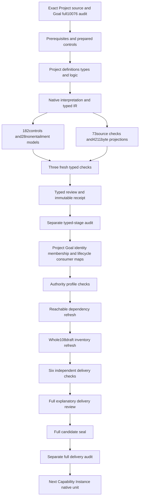

# Project: definitions, types and logic candidate review

## 1. Exact target and verified predecessor

The target is CAV2-D60@1.0.0-candidate.1, Project, selected at f342be625bee345590d9d1f4f20ff14f6005c8ec9ed9108f0cf70cd0ae05ca68. CAL-DECISION-0029-CML07-SEMANTIC-FOUNDATION-V1 admits that exact Definition. This newly authored interpretation remains a partial candidate. Admission of the meaning does not accept this translation, instantiate a Project, activate its lifecycle or authorize coordinated work.

The predecessor is Goal's full 10076-file seal and actual separate audit with exit code zero. Every predecessor file hash is rechecked before Project authoring. A04, C01 and E02 prerequisite receipts and the selected SWU's source, output and write scope are bound in the context. Native authoring waits for the complete prepared contract, source accounting, population, control and nonentailment check. Actual author, builder, model and source processes all finish successfully.

The original episode remains 183 identities, 189 versions and 201 source files, with 121 planned tasks, 511 planning edges, 797 work units and 36 frontiers. Goal's last sealed inventory has 107 partial drafts. Project adds the 108th working native interpretation; 75 identities still lack native T. That observation is separate from a refreshed whole inventory, accepted source fidelity, complete obligation review or whole proof.

## 2. Formalization model and source accounting

The model is many-sorted first-order logic with equality. Primary theory T contains necessary declarations. Coverage I requests separately selected examples. Actual identity, membership, lifecycle, owner authority, activation and fidelity are independent query targets. A supplied model satisfying T and I demonstrates consistency of the selected declarations and coverage; it does not establish accepted real-world denotations or whole-definition assurance.

All 21 nonempty source units are accounted for in full character ranges. Twelve clauses are encoded, seven explanatory units remain explanatory and two mappings are deferred. The scientific normative statement selects seven primitive rules. The formal tuple selects explicit fields, nonempty Goal references, state conditions and membership. The applicability and boundary statements preserve coordination identity and authority separation. The source tests require explicit purpose, routes, Goals, lifecycle and challenge route, distinct Product IDs and an explicit membership relation.

Notation, plain-language intuition, domain explanation, examples and the historical workspace reference are explanatory. The authority-scope reference and migration claim ceiling stay deferred. No example is promoted to a normative rule. Twenty-four source-owner findings retain missing denotations, cardinality/state mappings, membership-versus-ownership questions, identity continuity and authority limits. All owner acceptance references remain empty.

## 3. Sorts, constants and qualified symbols

The signature has 17 sorts, four constants, 33 total functions and 103 predicates or relations, giving 157 declarations. Sorts distinguish Project, identity, name, purpose, scope, exclusions collection, owner-routes collection, Goal collection, evidence index, purpose-connections collection, lifecycle state, challenge route, Goal, member, Product, change record and token. Constants EMPTY, PROPOSED, ACTIVE and DRAFT have declared sorts and required nonempty state handles where appropriate.

Seventeen coordinate functions nominate Project, Goal, Product counterpart and change fields. Sixteen further functions give nonempty reference handles. A field's exact binding relation holds if and only if its value equals that selector nomination. Missing, conflicting, undeclared or empty selected references fail. Total functions still have values for unused objects; applicability and reference-use conditions prevent those values from fabricating selected records.

Symbols are qualified by this Project source and candidate scope. In particular, its Goal state and membership functions do not merge with the prior Goal interpretation merely because the words look similar. Separately qualified dependency references retain exact source IDs and hashes. Actual common carriers and correspondence with those other theories remain pending. Twenty-four direct semantic dependencies are recorded without importing their whole theories.

## 4. Eleven minimum Project coordinates

The tuple requires identity, name, purpose, scope, exclusions, owner routes, Goal references, evidence index, purpose connections, lifecycle state and challenge route. Every selected Project nominates all eleven exact typed references. The root also declares a durable coordination identity and coordination toward its purpose. The name is not used as an identity substitute, and a changed name can preserve the same identity nomination.

Exclusions, owner routes, Goals and purpose connections are specifications or collections. The evidence index is an index specification. Explicit references to these objects do not establish their real contents, indexing correctness, route validity or connectivity. Only the Goal reference coordinate has an explicit source minimum cardinality. No minimum population for the other plural fields is silently introduced by their names or nonempty handles.

The Project is a coordination boundary. It is not its Product, a Goal, Method, project space, repository, directory, plan, work pack, session, team or authority envelope. Those distinct roles explain why grouping records does not transfer their semantics or authority. Positive owner authorization from another independently justified source remains possible; this tuple supplies no such authorization.

## 5. Nonempty Goal reference collection

For a selected Project and every Goal reference in the supplied carrier, ProjectGoalReferenceDeclared holds exactly when that reference is a member of the nominated Goal collection. At least one such Goal must exist. Each referenced Goal has a declared nonempty Goal reference, exact state and member nominations, a Goal-role member marker and Project coordination membership. This closure prevents an unrelated collection handle from standing in for required contents.

The empty-collection control keeps the collection reference and its nonempty handle while removing every actual declared member for a selected nonactive Project. T fails its independent minimum Goal requirement. The case is deliberately nonactive so failure cannot be attributed only to an active-state requirement. Another control omits the Project-to-Goal link while retaining collection membership; exact collection correspondence fails.

Multiple Goal references are permitted. Removing an additional draft Goal from an active Project can preserve T when its active Goal remains, while I loses the requested extra-draft and multiple-Goal example. This separates required source cardinality from richer test coverage. Real completeness, resolution, ownership and successful Goal pursuit are not proved by the declared collection.

## 6. Proposed and active lifecycle conditions

A Project whose nominated lifecycle state is PROPOSED must reference at least one Goal nominated as DRAFT or ACTIVE. A Project whose state is ACTIVE must reference at least one ACTIVE Goal. The guards are distinct: a proposed Project may use either alternative, while an active Project with only draft Goals fails. The baseline includes a proposed draft-Goal case and a separate proposed active-Goal case.

The conditions are necessary implications. A suitable Goal does not automatically activate a Project or create an owner decision. A nonactive Project can retain a nonactive Goal reference without being forced into proposed or active state. An active Project may also reference draft Goals as long as one active Goal is present. The controls preserve those positive cases instead of requiring every referenced Goal to have the same state as its Project.

These state labels are nominal classifications in the Project candidate. Source-owner maps must establish how they correspond to real Goal and Project lifecycles. The admitted carrier body's candidate-unadmitted status is an admission posture and does not become a lifecycle value. Activation, Goal-state fidelity and owner-authorization queries specifically retain a declared active Project scenario, avoiding an empty or irrelevant witness.

## 7. Explicit coordination membership and role examples

For every selected Project, ProjectMemberDeclared has an exact counterpart in ExplicitProjectMembershipRelationDeclared. A nominated member must be declared and have a nonempty handle. Referenced Goals use this explicit relation through their typed member nominations. Missing relation records, unsupported relation assertions, absent Goal-member membership and undeclared selected members fail the relevant guards.

Coverage includes related owner, evidence, decision, artifact, work and lifecycle members as well as Goals. These are role-tagged examples of the source's grouping description. The source does not prescribe an exhaustive exclusive partition of member roles. An evidence member may also be marked as an artifact without failing T. Member tags do not resolve a principal, validate evidence or accept an artifact's operational meaning.

The proposed relation describes coordination-reference membership. Its correspondence with Goal ownership remains unresolved. CAV2-D59's exactly-one-Project Goal ownership requires an accepted cross-definition map before the theories can support joint meaning claims. Neither Goal references nor the separately admitted identity graph's pursuit relation are silently made into an ownership or authority grant.

## 8. Project and Product identity separation

Every declared Product counterpart supplies an exact nonempty identity nomination and a nonempty Product reference. A selected Project's identity differs from each such declared Product identity. The baseline includes a Product counterpart so the separation test is populated. A control changes a Project identity to that Product identity and refreshes its exact binding records; T rejects the collapse itself rather than an unrelated missing binding.

The comparison concerns IDs in the declared shared identity-reference carrier. Different Project and Product sort labels alone would not establish this rule, so the identity nominations are compared explicitly. Accepted real identities, aliases, rename lineage and global uniqueness remain independent. No actual Product membership or purpose connection is created by this counterpart record.

Purpose connections nominate a separate specification. A Project can coordinate development of a Product without becoming that Product or inheriting its Method, feature or implementation authority. The source and current CML admission overlays maintain those distinctions. Their acceptance does not discharge the new interpretation's identity-fidelity and consumer-map obligations.

## 9. Identity through plan, task, folder, tool and implementation changes

Selected change records nominate a selected Project and exact before/after identity references. Each record has at least one of the five source-related change-kind tags: plan, task, folder, tool or implementation. Its before identity agrees with the Project identity nomination, and its after identity equals that before value. The baseline supplies one record for each kind, and I requests each kind independently.

Changing only the after identity fails continuity. Changing the before identity to another Project's value fails attribution. Changing the subject Project without changing its identity records also fails. These controls refresh exact binding relations before evaluating the semantic equality guard. They test the intended continuity rule rather than rely on an accidental field omission.

Kinds are inclusive: a plan change may also be marked as a task change. An untagged record does not satisfy this selected change scope. Outside unused change records may leave handles or bindings absent without forcing events into existence. Nominal identity preservation does not establish real persistence, historical ordering, migration completion, filesystem identity or valid owner action. Those outcomes remain separate queries.

## 10. Authority and identity-creation boundaries

Directory placement and membership do not create Project identity. Coordination does not acquire the authority of coordinated artifacts. Selected Project predicates that assert directory-created identity, membership-created identity, inherited artifact authority, membership-granted work permission, identity-granted execution or admission-triggered activation are forbidden. A member-specific authority-transfer claim is likewise forbidden for a member of a selected Project.

These constraints preserve the source's explicit non-effects. They do not assert that independently authorized work or Project creation can never happen. The baseline includes independent owner authorization for one nonactive Project, and controls may independently support actual outcomes without inserting a declaration that identity itself performs authorization. Required coverage and actual-outcome query conditions remain separately recorded.

The candidate changes no canonical Definition, Artifact Type, admitted carrier, private policy, live service, database, credentials, migration state or publication. No actual Project instance or lifecycle activation is created. Any future operational implementation needs a reviewed map and its own owner and effect authority. A passing interpretation check or a source hash receipt supplies neither.

## 11. Exact source, provenance and relocation evidence

The source checker passes 73 actual checks, including 47 selector-specific query obligations. It verifies exact current C29 selection, authorization/manifest/validation/candidate bindings, Definition schema and generator bindings, source statements, local Definition upstream and every obligation's excerpt, character range, digest and query identity. It extracts only the three pure Definition rendering functions and reproduces the existing 4211-byte projection twice without source mutation.

The admitted legacy selector remains lines 4522–4602. Those lines no longer contain the selected bytes in the relocated file. The exact 3660-byte Project excerpt is independently found at lines 4852–4932 and matches 3dc9faeecf91410b8b6a00aa8fd847d474031bd207e91743e72507dee6c526db. The declared selector is preserved with that observed location; content identity supplies the verification, while path or heading similarity alone would be insufficient.

The original legacy Project and identity-decision paths are absent. Their relocated whole files retain exact hashes a3c940af28ab9436549d35d5f93848c427695433704e8b6715d80b7b69f05485 and 1f2d01026865e031adba063de0dc1dfa081c49a931223aa4bc9f726d3397bceb. Three external source scopes and the prior actual audit captures are bound. Source-body candidate labels and scoped positive admissions coexist without transferring private, legacy or owner authority into the translation.

## 12. Controls, queries, fresh verification and remaining proof

The native suite evaluates 182 controls: 67 satisfy T, 107 fail T and eight malformed denotations are rejected. Positive cases cover proposed draft/active alternatives, additional draft Goals, nonactive Projects, unused records and overlapping roles or change kinds. Negative cases cover cardinality, state conditions, exact collection links, explicit membership, ID collapse, continuity, missing fields, conflicting fields, empty handles and authority overclaims.

All 28 nonentailment queries have supplied interpretations satisfying both T and I, with false actual-outcome targets and true source-relevant witness conditions. Three queries use declared-active-Project conditions. Actual predicates are absent from encoded T. This establishes the declared candidate's inability to entail real activation, fidelity, authority and proof from references alone; it does not establish that those real outcomes are false.

Three separate fresh processes validate contract, model and source with actual exit-zero captures and identical model/source output. Existing one-million-byte, 50000-node, 100000-step and 30-second limits remain unchanged. T is 197745 bytes; the prepared maximum is 24962 evaluation steps. One prepared harness assembly failure lacked the qualification helper and evaluated no model; nine original files are retained. Successful prepared imports were retained before native assembly, and a final assembled precheck passed before authoring. No theory or model was weakened to obtain success.

## 13. Continuation DAG and original-scope completion

The work DAG contains eighteen nodes and eighteen edges. Exact source and predecessor evidence lead into prepared controls, sorted interpretation, native builder, model/source evidence and three fresh checks. The typed review, immutable receipt and separate audit precede full consumer mapping, profile qualification, reachable dependencies, whole inventory refresh, six full-delivery replays, full review, seal and separate audit. The next Capability Instance native unit waits for that full Project audit.

The work DAG is separate from the semantic dependency graph. Twenty-four separately qualified dependencies and missing state/collection/change labels remain visible. Current whole inventory and joint consistency are not refreshed by a typed receipt alone. Individual witnesses do not supply a meaning-aligned common carrier, edge-completeness review or classification of existing dependency cycles.

The original T, O, E, R and J requirements remain in force: normative clause accounting, complete obligation selection and reviewed classifications, actual evaluation or explicit unresolved evidence, attributable owner decisions or pending owner review, and scoped joint assurance or explicit unresolved closure. The prior report that outputs existed for 138 work units was presence accounting, not acceptance. Creating every remaining native T alone will not complete the episode.

Definitions, types and logic stay first. Full candidate delivery must explain each formalization aspect and every material loss, validate its actual consumers and preserve all 10076 predecessor bytes and 201 sources. Source-owner acceptance, actual meaning maps, shared denotation, whole translation and whole proof remain pending. The unbounded original goal stays active.

Exact pending source-owner findings:

- PRJ-FINDING-001: Exact C29 Project Definition and scoped source admission do not accept this translation,instantiate or activate a Project or authorize coordinated work.
- PRJ-FINDING-002: Eleven Project fields nominate typed identities,scope,collections,index,connections,state and challenge route;actual contents and role meanings remain pending.
- PRJ-FINDING-003: Every selected Project has at least one declared Goal reference;empty Goal collections fail independently of Project lifecycle.
- PRJ-FINDING-004: Project Goal references are exactly nominated collection membership;all referenced Goals have typed state/member nominations and explicit coordination membership.
- PRJ-FINDING-005: Proposed Project requires a draft or active nominated Goal;active Project requires an active nominated Goal. These are necessary conditions,not automatic activation.
- PRJ-FINDING-006: A nonactive Project can retain nonactive Goal references;an active Project can also reference draft Goals while one active Goal exists.
- PRJ-FINDING-007: Goal draft/active labels are separately qualified Project-scope state nominations;the prior Goal whole theory and real lifecycle are not imported.
- PRJ-FINDING-008: Coordination Goal-reference membership is not automatically Goal ownership. CAV2-D59 one-Project ownership needs an accepted cross-definition map before joint assurance.
- PRJ-FINDING-009: Membership declarations have exact explicit relation counterparts and declared nonempty member references;actual membership fidelity remains independent.
- PRJ-FINDING-010: Owner,evidence,decision,artifact,work,lifecycle and Goal member-role tags provide scoped examples without inventing exhaustive or disjoint partitions.
- PRJ-FINDING-011: Owner-route collections,evidence index and purpose connections are explicit specifications;no unstated member cardinality or actual resolution is inferred.
- PRJ-FINDING-012: Project IDs differ from all nominated declared Product IDs;actual identity lineage,alias resolution and global uniqueness require accepted maps.
- PRJ-FINDING-013: Selected plan/task/folder/tool/implementation changes nominate a selected Project and preserve its declared identity before and after the change.
- PRJ-FINDING-014: Selected change kinds are inclusive;untagged changes are outside this selected change scope and do not fabricate a recognized change.
- PRJ-FINDING-015: Nominal before/after equality does not prove real persistence,history order,rename lineage or implementation migration.
- PRJ-FINDING-016: Directory placement,membership,admission and coordination labels do not create identity,activate lifecycle or inherit authority.
- PRJ-FINDING-017: Coordinated artifact membership does not transfer its authority;independent external authorization remains possible.
- PRJ-FINDING-018: Project is not Product,Goal,Method,project space,repository,directory,plan,work pack,session,team or authority envelope.
- PRJ-FINDING-019: Source-body candidate labels and current C29/C30/C31 positive overlays retain separate scopes;no actual Project activation is inferred.
- PRJ-FINDING-020: Legacy declared Project Markdown4522-4602 now differs;content-exact4852-4932 observation preserves provenance without rewriting selectors.
- PRJ-FINDING-021: Legacy Project and identity-decision JSON moved while retaining exact hashes;observed paths do not transfer private or legacy authority.
- PRJ-FINDING-022: Project/v1,Goal/v1,identity graph,evidence index,owner routes,purpose connections and lifecycle consumers need accepted field/member/state/identity maps.
- PRJ-FINDING-023: Source authority-scope and migration claim ceiling remain deferred;complete character accounting does not accept source fidelity.
- PRJ-FINDING-024: Independent partial T/I witnesses are not a shared denotation,whole translation,whole proof or completed original episode.

