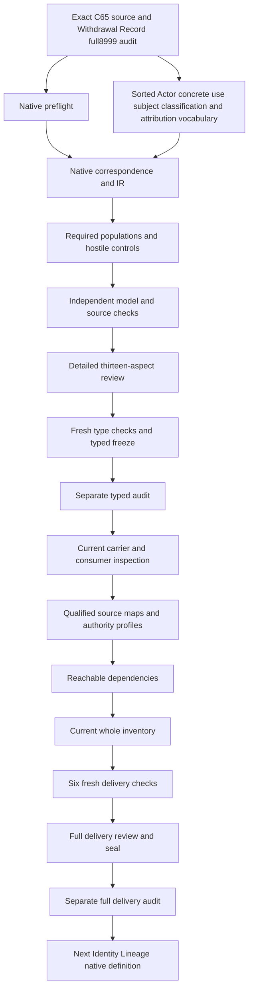

# Actor: complete candidate delivery review

Actor is formalized as an abstract governed participant identity. Concrete use requires an independently identified governed subject and exact Classification Scheme and Assignment references. Attribution names an exact activity while preserving each subject's identity,owner,lifecycle and authority. The candidate separates all these structures before considering any carrier implementation or activity execution. Classification does not supply agency,personhood,Principal,Team,Role,capability,ownership,permission,authority or successful action.

The native preflight followed Withdrawal Record's full8,999-file seal and separate actual audit0. Every prior sealed byte and all201sourcefiles remain hash verified. Current working native drafts number99among183identities,leaving84withoutT. The current full inventory now records99partialdrafts84missing;the preserved prior Withdrawal Record inventory remains98/85. Original scope is183identities189versions201sources and121tasks511planningedges797SWUs36frontiers. Owner-accepted whole translations and whole-definition proofs remain zero;source fidelity and shared meanings remain pending. The complete episode and its final review stay active.

## 1. Exact source and current admission

The selected source is cal.definition.actor@1.0.0-candidate.1, SHA dacc0380a33b9d307884b652a5eb7ee91a5ea6b1676c05ea520c80d976c240a3. Current admission is CAL-DECISION-0065-INTEGRATED-LAB-DEFINITION-MODEL-ADMISSION. This fixes which positive meaning the candidate interprets. C65 admits exact Definition bytes;it does not classify a concrete person or machine subject,admit a carrier,accept this translation or activate an operational model. Those are separate evidence and authority questions.

The source checker binds C65 decision,authorization,exact candidate,selected Definition digest and validation receipt. It separately checks the current183identity189versionsnapshot. Historical counts retained in an earlier decision do not become the current project denominator. A04/C01/E02 prerequisite receipts and the selected F05 work-unit output/write scope were checked before native creation. All prior files and current source identities remain preserved.

The source's review-only body and candidate-unadmitted upstream review remain unchanged under the current positive admission overlay. The local actor-model-review digest is exact evidence of historical design discussion;the integrated-model path is an observed consumer reference. Neither supplies an accepted operational classification or runtime fact. Parent meaning,source admission,carrier admission,instance authority and consumer activation are not collapsed into one status. The review records that distinction explicitly because otherwise a correctly admitted Definition could appear to authorize every object using its label.

## 2. Sorted vocabulary and qualified symbols

The signature has14nonempty sorts:ActorReference,ConcreteUseReference,AttributionReference,SubjectReference,IdentityReference,OwnerReference,LifecycleReference,AuthorityReference,ScopeReference,SchemeReference,AssignmentReference,ClassificationValueReference,ActivityReference and Token. EMPTY is one Token constant. Nineteen field selectors and thirteen reference-handle functions give32totalfunctions. There are136predicate/relation signatures and183declarations in total. These are proposed typed denotations rather than new canonical identities invented from descriptive names.

Separate carriers prevent a concrete use from being equated automatically with abstract Actor meaning or with the participating subject. Subject coordinates separately nominate identity,owner,lifecycle and authority. Scheme,Assignment,value and activity each have their own type. Each field has an exact BindingDeclared relation in addition to its total selector. A nonempty typed selector value alone cannot replace an explicit declaration or establish authenticated resolution.

Symbols are qualified by exact Definition version and candidate scope. Same-looking type names in another packet do not import that packet's theory or establish a shared domain. Selected references require declared targets,nonempty handles and exact relation/function agreement. Outside references remain well typed without automatically acquiring selected obligations. This makes missing,conflicting,undeclared and empty nominations observable while leaving real reference resolution and meaning acceptance pending. The finite signature describes the candidate's logical vocabulary;it does not enumerate all actual participants or grant permission to use them.

## 3. Governed participant identity genus

ActorApplicable is equivalent to ActorInScopeDeclared. A selected Actor has an exact nonempty scope reference and is declared a governed participant identity,an abstract participation classification,attributable and bounded. The source's formal governed-identity-or-record condition is represented as an inclusive disjunction:identity backed,record backed or both. Removing both alternatives fails. The interpretation of that abbreviated formal expression relative to the prose genus remains a source-owner finding.

Attributable means the meaning permits participation to be attributed to an independently governed subject. It is not a claim that an event happened,an agent acted or the participant succeeded. An abstract selected Actor root may have no concrete use or actual activity. The required population specifically demonstrates that case. Introducing a mandatory activity for every Actor would add an existence obligation that the positive source does not state.

No universal Actor carrier is required. The boundary is about avoiding a universal requirement,not forbidding every shared carrier that a separate governed design could choose. Concrete kinds may retain their own carriers. A participant identity is not equated to a Person,Agent,Principal,Team or Role. Actual kind predicates remain outside T and are separately queried. This keeps the genus broad enough to express heterogeneous participation without turning a shared classification into personhood,agency or inherited rights. The positive controls also allow independently supported actual authority while retaining the no-inference boundary.

## 4. Abstract membership,concrete use and participation

ConcreteUseReference provides an explicit layer between abstract Actor classification and the nominated subject. UseApplicable is equivalent to UseInScopeDeclared. A selected concrete use has exact actor,subject,Scheme and Assignment fields,recorded posture and a declared exact-classification resolution. Its Actor target must itself be selected. The nominated subject must be independently identified and governed by declaration rather than created by the act of classification.

Abstract membership does not force a use. Concrete use does not force an attribution. Attribution does force its selected concrete use because the exact attributionUse field has a selected-use guard. These implications are deliberately directional. Reversing them would require every abstract participant to have an event and every classification assignment to represent successful participation. Those stronger assertions do not come from the source.

The model distinguishes two subjects classified under one Actor meaning,and different Actors attributed to one activity. Neither pattern merges their identities. There is no global uniqueness rule making a Scheme or Assignment exclusive to every Actor meaning. Concrete kinds remain independently governed. The candidate supplies declared reference coherence,while the authenticity of a subject,real classification correctness and actual consumer denotation remain separate targets. A consumer will need accepted maps before interpreting a classification row as an operational participant. A complete set of reference labels is necessary structure and is insufficient evidence that such a participant actually took part.

## 5. Independently governed subject coordinates

SubjectReference is separate from IdentityReference,OwnerReference,LifecycleReference and AuthorityReference. A selected subject record has each coordinate declared,nonempty and exactly bound. SubjectIndependentlyIdentifiedDeclared and SubjectGovernedDeclared must also hold. These predicates keep the source's independence requirement visible;they do not certify a real identity registry or infer an authenticated owner from the existence of an owner token.

No ordering of the four coordinates is invented. Owner does not automatically imply permission,authority does not become a Role,and lifecycle is not reduced to successful action. No canonical Definition for an unavailable descriptive label is fabricated. Exact current dependency names are selected only where present in the captured current source inventory. Opaque typed coordinates preserve distinctions while their accepted meaning maps remain unresolved.

Each participating subject retains its own coordinates. A shared Actor classification can nominate different subjects with different identity,owner,lifecycle and authority values. Those subjects can participate in one shared activity without being collapsed into a single identity. Coordinate equality in a supplied model does not authenticate real identity continuity or prove that owner and authority state are historically unchanged. Source-owner and consumer acceptance must establish that correspondence. The model therefore records both necessary equality guards and separate actual preservation targets. Keeping those layers visible prevents a structurally coherent attribution from being described as proof of a real identity or authority history.

## 6. Exact Classification Scheme and Assignment

A concrete use nominates a separately recorded Scheme and Assignment. The Scheme has an exact nonempty scope field. The Assignment has exact actor,subject,Scheme and classification-value fields. SchemeRecordedDeclared and AssignmentRecordedDeclared must hold. Removing a recorded flag,field binding or selected target fails even when another reference carries the expected text label. This preserves the source's exact-classification requirement as necessary declarations.

Assignment nominations must agree with the use's actor,subject and Scheme. A classification value is separately declared an Actor classification value and nominates the same Actor meaning. These coherence equalities prevent a use from presenting one subject while its Assignment classifies another,or from presenting one Actor while the value identifies a different Actor. The negative controls independently change each nomination and require failure.

There is no global injectivity or exclusive one-Scheme-per-Actor rule. One Scheme may support several assignments and the same abstract Actor may classify different subjects. The source's exact reference requirement does not prove criterion correctness,authentic Scheme ownership or an actually resolved Assignment. UseActualSchemeAuthenticity,UseActualAssignmentAuthenticity,UseActualAssignmentCorrectness and UseActualClassificationMeaning remain independent targets. Their countermodels include selected uses and exact declarations rather than relying on the absence of concrete classification. Actual classifications need accepted Scheme/Assignment/value maps and relevant evidence,which are deferred to the consumer stage.

## 7. Scope and reference presence

Actor scope and Scheme scope use ScopeReference but remain separate nominations. No equality between them is imposed. The source does not say every Scheme has the identical scope token as every Actor it classifies. A Scheme may support a classification domain distinct from the bounded abstract participant meaning. A positive control changes Scheme scope while leaving exact coherent classification intact. Owners still need to accept the relevant scope correspondence.

Every selected field requires a nonempty handle and a declared target. Totality alone gives every finite-domain argument a well-sorted result;it does not establish reference presence in the intended real system. BindingDeclared relates exactly the nominated source object and target. Missing bindings,conflicting alternatives,undeclared selected targets and empty selected handles are separately rejected. An unused outside subject may have an empty handle without violating selected theory.

Those guards enforce the candidate's necessary declaration discipline. They do not authenticate a reference or certify that a named Scheme exists in a live registry. Reference-versus-referent questions remain explicit findings and consumer obligations. Subject,Scheme,Assignment,value and activity resolution cannot be supplied by a schema discriminator or a qualified symbol name. Keeping scope and presence separate also avoids promoting a finite domain into a complete universe of governed identities. The resulting model can show that a nomination is structurally exact while leaving real resolution,authority and consumer fidelity unsupported.

## 8. Exact activity attribution

AttributionApplicable is equivalent to AttributionInScopeDeclared. A selected attribution has exact use,before-subject,after-subject and activity fields,recorded posture and a declared exact activity name. Its before subject must equal the subject nominated by its concrete use. Both before and after subjects require the same independently identified governed record guards. The nominated activity is separately declared recorded.

Attribution is therefore more than an Actor label attached to an arbitrary event. It ties an exact selected use and its subject to an exact activity reference. A mismatched before subject fails even when the two subjects have equal coordinates. That equality preserves the source's subject nomination instead of permitting an unrelated reference to be silently substituted. Activity naming and activity occurrence remain separate;the candidate does not execute an activity or simulate success.

No actual actor interaction or telemetry is produced. ActivityReference does not by itself prove a real event occurred or that an attributed subject participated. AttributionActualActivityFidelity and AttributionActualAttributionCorrectness are independently queried on selected attribution scope. The same activity may have different participating Actors and subjects. One subject may have multiple participation records. No global cardinality collapses those cases. Accepted operational attribution requires mappings from the candidate references and recorded flags to exact activity and subject evidence,which remains outside the types-and-logic stage.

## 9. Identity,owner,lifecycle and authority preservation

For each selected attribution,the before and after subject identity,owner,lifecycle and authority coordinates must be equal. This is the candidate's explicit preservation condition. Changing any one coordinate while retaining all other declarations fails. The source's requirement to preserve every participating subject is not reduced to preservation of the abstract Actor label or Scheme reference. Each attribution checks its own exact subject coordinates.

Before and after subject references may differ when their four coordinates agree. This permits a versioned or separately recorded after reference without inventing global reference identity. A positive control also permits the same subject reference before and after. Neither pattern proves actual continuity. The meaning of coordinate equality,version correspondence and preserved owner/lifecycle/authority state requires source-owner and consumer review.

These are necessary declaration equalities,not a universal ban on independently governed subject changes elsewhere. Attribution cannot claim to transfer ownership or grant authority from Actor classification. The boundary excludes such inference declarations. Actual identity,owner,lifecycle and authority preservation remain independent outcomes. The countermodel contains selected attributions with equal declared coordinates while actual preservation is unsupported. This difference is essential:otherwise the candidate would appear to prove a real subject's unchanged authority by comparing two supplied opaque tokens. The consumer stage must retain this distinction when inspecting live-looking examples or schema fields.

## 10. Nonimplication and independent outcomes

Root boundaries exclude classification-derived agency,personhood,capability,ownership,permission,authority and successful action. They also exclude treating Actor meaning as Agent,Person,Principal,Team or Role. Parent meaning and Definition admission do not grant instance authority or accept translation. Carrier,instance,relation,policy,decision,runtime,publication,release,deployment and external-effect creation declarations are separately excluded.

Use boundaries exclude authenticating a subject from reference presence or a classification from a Scheme label. A declared Assignment cannot create authority. Attribution boundaries exclude identity merging,ownership/lifecycle transfer,authority grants and successful-action inference. All these exclusions apply to selected roots,uses or attributions respectively. Outside controls demonstrate that the theory is scoped rather than an unsupported universal restriction on every object.

Actual outcomes are not included as theory assumptions or globally forbidden facts. Positive controls supply each actual target independently and preserve T. A person may be an Actor,a machine Agent Instance may be an Actor,and either may have independent authority under other evidence. Classification alone supplies none of those facts. This respects legitimate overlap without equating kinds or reassigning their authority. No actual subject is classified,ownership changed,authority granted,activity executed or publication performed by this candidate. The distinction between invalid inference and independently established behavior remains a source-owner obligation rather than an operational certification.

## 11. Populations,finite witnesses and hostile controls

Eighteen required populations demonstrate selected and outside Actors,uses and attributions;identity-only,record-only and inclusive identity-and-record cases;abstract Actor without concrete use;independent authority;and each scope without actual outcomes. They also demonstrate the same Actor across different subjects,different subject references with preserved coordinates,the same subject reference before and after,and distinct Actors sharing one activity.

T and I are evaluated independently. Removing all selected roots,all concrete uses,all attributions or independent actual authority can preserve necessary theory while failing the requested demonstrations. Supplying every actual outcome in a scope also removes that scope's no-actual-outcomes population. These controls show that theory satisfiability and coverage of the episode's illustrative witnesses are different conclusions. Required populations are authored demonstrations,not a complete census of real participants.

The prepared and native suites contain244controls:98T-true,138T-false and eight malformed-input rejections. Necessary guards are tested separately from independent actual outcomes and outside behavior. Malformed domains,missing declarations,nontotal functions,wrong function ranges/arguments and wrong predicate tuples are rejected before semantic evaluation. Limits remain one million input bytes,fifty thousand qualified IR nodes,one hundred thousand steps and thirty seconds per check. The prepared maximum is16,144steps. Passing finite supplied models supports bounded consistency and guard behavior without accepting shared meanings,source fidelity or whole-definition proof.

## 12. Source accounting,queries and actual checks

All27nonempty source units have exact selector and complete-character correspondence. Nineteen clauses are encoded,six explanatory and two deferred. Ten primitive theory formulas cover genus,scope eligibility,concrete subject/classification,attribution,preservation and the three boundary scopes. Scientific notation,plain-language intuition and the Person/machine-Agent example remain explanatory. Authority-scope and retained candidate claim ceiling are deferred correspondence rather than hidden authority axioms.

Forty-five queries have supplied T-and-I countermodels:twenty-five on selected Actor roots,ten on selected concrete uses and ten on selected attributions. Targets and witness conditions use their own selected scopes. Missing optional classification or attribution cannot serve as their counterexample. None is an actual target assumption in T. Seventy-two exact source-query obligations bind selectors,character spans,clause hashes and query identifiers while retaining actual outcomes outside the necessary declaration guards.

The source checker verifies exact C65 bytes,authorization,candidate and validation,Definition schema/generator,local actor-model review,integrated-model consumer and two identical pure projections without source mutation. Its report and the three fresh contract/model/source checks provide actual terminal evidence. Projection reproducibility establishes exact rendering of selected bytes,not accepted semantic precedence or runtime accuracy. Historical review statements remain historical even when exact current Definition admission differs. The consumer stage will inspect correspondence separately,keeping every accepted-map count at zero until real owner acceptance is available.

## 13. Review findings,delivery dependencies and continuation

Twenty-two findings retain unresolved source interpretation,typed denotations,concrete classification maps,reference authenticity,scope,preservation,actual kinds and authority,consumer alignment and proof ceilings. No blocker-level user decision is required to produce this reversible candidate. Owner acceptance remains deferred and cannot be fabricated from the successful checks. No prepared or native producer failure occurred in this stage;each successful terminal capture remains separately bound.

An illustrative human subject and an ephemeral machine Agent Instance can share Actor classification while retaining different identity,owner,lifecycle and authority records. Their exact Scheme and Assignment references establish candidate classification coherence. Attribution to a shared activity preserves each subject's own four coordinates. The example does not infer agency from the Actor label or transfer the person's authority to the machine. A counterexample changes the machine after-subject authority coordinate and fails even if every Scheme,Assignment and activity field remains exact.

The seventeen-node,seventeen-edge work DAG is acyclic and distinct from the semantic dependency graph. Three fresh type-stage checks passed with actual exit zero,and the sixteen-input typed freeze and separate actual audit passed. Current carrier/consumer inspection,qualified profiles,reachable dependencies and the whole99draftinventory now have actual results. Six fresh delivery checks also passed. The full review is prepared for seal and separate audit,which require their own terminal evidence. Identity Lineage native creation follows the full Actor audit. Prior Withdrawal Record inventory98/85 and current Actor inventory99/84 remain separately preserved.

The original183identityscope remains immutable. No accepted whole translation,whole-definition proof,canonical/private/live/publication effect or semantic readiness is inferred. The episode-wide final review remains required after the full source scope is handled. This bounded packet cannot redefine completion around a successful subset or turn missing maps into implicit accepted premises.
- ACT-FINDING-001: Exact C65 positive Definition admission does not classify concrete subjects,admit carriers/relations/runtimes or accept this translation. Status: unresolved;owner review and accepted map references pending.

- ACT-FINDING-002: Actor is governed participant identity and abstract classification;candidate membership maps do not enumerate all real participants. Status: unresolved;owner review and accepted map references pending.

- ACT-FINDING-003: Actor,concrete use,attribution,subject,identity,owner,lifecycle,authority,scope,Scheme,Assignment,value and activity are proposed qualified types. Status: unresolved;owner review and accepted map references pending.

- ACT-FINDING-004: Governed identity-or-record is an inclusive declaration criterion;source genus/short-form correspondence needs owner interpretation. Status: unresolved;owner review and accepted map references pending.

- ACT-FINDING-005: No universal Actor carrier requirement is imposed;this is not a prohibition on an independently governed shared or specialized carrier. Status: unresolved;owner review and accepted map references pending.

- ACT-FINDING-006: Abstract selected Actor roots may have no concrete use or actual activity;attributability is distinct from successful participation. Status: unresolved;owner review and accepted map references pending.

- ACT-FINDING-007: Concrete uses nominate exact independently identified governed subjects;reference presence does not authenticate identity or governance. Status: unresolved;owner review and accepted map references pending.

- ACT-FINDING-008: Subject identity,owner,lifecycle and authority references are independent coordinates,not an implicit permission hierarchy. Status: unresolved;owner review and accepted map references pending.

- ACT-FINDING-009: Scheme and Assignment are separately recorded exact references;criterion correctness,ownership and actual resolution remain independent. Status: unresolved;owner review and accepted map references pending.

- ACT-FINDING-010: Assignment actor/subject/scheme/value nominations must agree with the concrete use;one nominee does not impose global scheme/assignment uniqueness. Status: unresolved;owner review and accepted map references pending.

- ACT-FINDING-011: An Actor classification value nominates its Actor meaning without proving real value semantics or consumer denotation. Status: unresolved;owner review and accepted map references pending.

- ACT-FINDING-012: Scheme scope remains distinct from Actor scope;no unsupported universal equality or global classification domain is invented. Status: unresolved;owner review and accepted map references pending.

- ACT-FINDING-013: Attribution selects a concrete use,exact activity,before subject and after subject;actual event occurrence and attribution fidelity remain independent. Status: unresolved;owner review and accepted map references pending.

- ACT-FINDING-014: Before subject matches the use subject while after references may differ if declared identity/owner/lifecycle/authority coordinates agree. Status: unresolved;owner review and accepted map references pending.

- ACT-FINDING-015: Preserved coordinate references do not prove real identity continuity,ownership,lifecycle or authority state. Status: unresolved;owner review and accepted map references pending.

- ACT-FINDING-016: A subject may participate in multiple activities and different subjects may share one activity without merging their identity or authority. Status: unresolved;owner review and accepted map references pending.

- ACT-FINDING-017: No Actor/Agent/Person/Principal/Team/Role/capability/ownership/permission/authority/success facts are inferred solely from classification. Status: unresolved;owner review and accepted map references pending.

- ACT-FINDING-018: Independent actual kinds and outcomes are permitted rather than universally denied by non-entailment boundaries. Status: unresolved;owner review and accepted map references pending.

- ACT-FINDING-019: Concrete-use and attribution actual targets are queried in their own selected scopes;absence of an optional use is not their counterexample. Status: unresolved;owner review and accepted map references pending.

- ACT-FINDING-020: Local actor-model-review and integrated-model consumer bytes remain candidate/review evidence,not current runtime or accepted operational maps. Status: unresolved;owner review and accepted map references pending.

- ACT-FINDING-021: Scope and candidate-body claim ceilings are accounted;no canonical/private/live/publication effect or concrete classification is performed. Status: unresolved;owner review and accepted map references pending.

- ACT-FINDING-022: Finite T/I witnesses and character accounting do not accept shared meanings,source fidelity,whole translation or whole-definition proof. Status: unresolved;owner review and accepted map references pending.

Actual native counts: {"countermodel_queries": 45, "declarations": 183, "deferred_clauses": 2, "direct_semantic_uses": 24, "encoded_clauses": 19, "explanatory_clauses": 6, "mapped_clauses": 27, "required_populations": 18, "source_units": 27, "unresolved_populations": 136}. Actual source checks: 101. Projection bytes: 5118.

Detailed carrier and consumer review observations

Exact current C65 Actor meaning has no directly bound current Actor contract. The review selects eight current contracts with their own independently bound meanings: Classification Scheme,Classification Assignment,Classification Value,Agent Instance,Person,Person Reference,Principal and Team. Definition/v2 binds Definition meaning. Absence of a universal Actor carrier fits the positive source boundary and does not automatically provide a concrete subject or attribution map.

Definitions,types and logic remain first. The sixteen typed inputs and separate typed audit were checked before consumer inspection. All8999priorsealedfiles201sourcebytes remain preserved. No package validator,carrier writer or native/live consumer was executed. Only three isolated pure Definition projection helpers were called. Hypothetical mutations are in-memory whole-fixture shape comparisons;they are neither admitted subjects nor real classifications.

Twenty-five separately qualified meanings,including Actor plus24directdependencies,passed exact source/Definition-shape/two-pure-projection checks. The121consumerchecks also bind143registryrows121currentrows,eight separate contracts and valid fixtures,the exact local review and integrated consumer,explicit classification payload fields and the absence of a joined example. No whole upstream theory or accepted meaning map is imported into primary Actor T.

Definition/v1 probes number54,with14shapeacceptances. Eight hypothetical normative prose overclaims are structurally accepted and reproducibly rendered:agency/personhood,classification-derived authority,universal-carrier requirements,reference authentication,ownership transfer,successful activity,preservation from equal tokens and effects from Definition admission. Schema acceptance demonstrates a structure/semantics distinction;it does not establish that an unexecuted full governance validator admitted those hypothetical claims.

Eight carriers received412whole-hypothetical-fixture schema probes,with86acceptances. Missing required root or payload fields,unsupported Actor typed fields and publication effects fail. Opaque owner/scope/challenge and many unresolved payload references remain structurally valid. Classification Scheme has axis/value/cardinality/compatibility/mapping fields. Assignment names subject and version,Scheme version,axis,value,basis,action,method,implementation,evidence,effective period and status. Value names a Scheme,axis,code,Definition,parent values and compatibility. Those shapes preserve their own record contracts while leaving criterion truth,actual resolution and Actor denotation unaccepted.

The candidate Classification Value fixture binds Agent meaning rather than Actor meaning. The Assignment subject differs from the Agent Instance fixture node;the Agent Instance classification-assignment label differs from the Assignment node;the Assignment value label differs from the Value node. All fixtures are separately shape-valid,but they are not an exact joined classification instance. Their labels cannot establish that the Agent Instance has actually been classified or attributed to an activity. Exact Actor use requires owner-reviewed maps rather than silent fixture rebinding.

Agent Instance fields preserve Session/start/termination,Profile,Implementation,capability and accountable Principal references. Shape-valid unresolved time or Session labels do not prove real ephemeral lifetime,accountability or agency. Person,Person Reference,Principal and Team retain separate identity and privacy/recognition/membership structures. None becomes an Actor-specific authority grant merely from inclusion in this comparison. Four-coordinate subject preservation is a proposed map obligation across independently governed carriers.

Sixteen Actor-only models were freshly independently evaluated. Abstract Actor without concrete use and concrete use without attribution preserve T while failing the required population demonstrations. Separate Scheme/Actor scopes,inclusive identity-or-record and same/versioned subject references are allowed. Independently grounded Actor/Use/Attribution outcomes remain possible. Wrong Assignment actor or Value Actor nominations and changed owner/authority coordinates fail necessary theory. These observations do not establish common denotations with the eight actual carrier schemas.

The exact actor-model-review contains historical statements that Actor/Agent definitions were not admitted. C65 now admits the Actor Definition;historical candidate wording is retained as source evidence rather than reported as current runtime truth. The integrated model keeps abstract Actor classification and permission independence visible. Its existence and exact bytes do not activate a consumer or prove operational attribution.

The next stage retains qualified source-map hypotheses,authority boundaries,eight unresolved findings,reachable dependencies and a current99draftwholeinventory with one fresh T/I witness per packet. Six actual fresh delivery checks,a complete thirteen-aspect full review,seal and separate audit follow. Identity Lineage native work requires the Actor full audit. Source fidelity,whole translation,whole proof and semantic readiness remain pending;owner-accepted maps remain zero.

- ACT-CONSUMER-FINDING-001: Exact C65 Actor Definition has no directly bound current Actor contract. Absence fits the no-universal-carrier requirement;it does not accept maps from eight independently governed classification and concrete-kind contracts. Status: unresolved;accepted map refs empty.

- ACT-CONSUMER-FINDING-002: Definition/v1 structural validation and pure projection accept normative prose that infers agency,personhood,ownership,permission,authority or success,requires a universal carrier,authenticates references or overclaims preservation. This is shape evidence,not a finding that an unexecuted full validator admitted those claims. Status: unresolved;accepted map refs empty.

- ACT-CONSUMER-FINDING-003: Scheme/Assignment/Value current contracts bind their own exact meanings. Assignment has subject/version,Scheme-version,value,basis,action,method,implementation,evidence,effective period and status;Value binds Agent in the fixture. Actor classification denotation and taxonomy correspondence remain unaccepted. Status: unresolved;accepted map refs empty.

- ACT-CONSUMER-FINDING-004: Eight whole candidate fixtures are separately shape-valid but their Assignment subject,AgentInstance classification assignment and Value node identifiers do not form one exact joined classification instance. Opaque or foreign references remain structurally valid;no runtime classification follows. Status: unresolved;accepted map refs empty.

- ACT-CONSUMER-FINDING-005: Person,PersonReference,Principal,Team and AgentInstance preserve distinct meaning and fields. An Actor use must preserve independent subject identity,owner,lifecycle and authority;schema fields and payload prose do not provide accepted four-coordinate reference maps. Status: unresolved;accepted map refs empty.

- ACT-CONSUMER-FINDING-006: AgentInstance session/start/termination and capability/principal references remain separate from abstract Actor. Hypothetical unresolved lifetime and classification references pass shape without proving ephemeral real behavior,accountability,agency or authority. Status: unresolved;accepted map refs empty.

- ACT-CONSUMER-FINDING-007: The exact local Actor/Agent review contains historical missing-admission statements while C65 now admits Actor Definition. Its downstream model remains review evidence,not current runtime truth or an accepted operational mapping. Integrated-model independence wording is observed without consumer activation. Status: unresolved;accepted map refs empty.

- ACT-CONSUMER-FINDING-008: Sixteen independent Actor-only T/I comparisons retain abstract-without-use,concrete-without-attribution,inclusive genus,separate scope,versioned preservation and independent actual authority. Accepted attribution/activity,classification,shared reference denotations and real subject preservation remain absent. Status: unresolved;accepted map refs empty.

Current whole-inventory and semantic dependency evidence

The native whole-inventory producer and fresh replay both recomputed exact source/core/IR/correspondence accounting for all99partialdrafts. Each packet has a freshly independently evaluated supplied T/I witness;none is treated as a source-owner accepted translation. Combined count is2324sourceunits2904mappedclauses974encoded814explanatory1116deferred1219requiredpopulations5671unresolvedpopulations. These denominators include Actor's27/27/19/6/2and18/136contribution without changing the original183identityscope. Per-packet consistency is separate from a common-carrier or shared-meaning model.

The joint graph has144nodes2491edges45missingcounterpartpackets and one unresolved cycle. Actor adds24authored direct semantic uses;all prior graph sources and edges are retained. The reachable Actor graph has142nodes2436edges97selectedexistingpackets45missingcounterparts and the same unresolved cycle. Reachability does not assemble every prior theory into Actor T. No missing interpretation is treated as a satisfiable accepted map,no cycle is arbitrarily classified recursive,and the edge denominator remains requires-independent-review. Source owners must still review semantic dependencies and common denotations.

Qualified mapping has32profiles31rejections and118finiteframes117rejections across37pendingmapobligations. The one passing profile/frame is a complete unaccepted hypothesis with empty owner-review and accepted-map references. It does not admit a carrier or classify a subject. Rejected cases expose missing/empty/invented acceptance,identity collapse,universal-carrier invention,authority transfer,shape-to-truth promotion,historical-review-to-runtime promotion and silent sibling merging. Eight consumer findings remain unresolved alongside all22sourcefindings.

Fifteen independently run static-reuse differential and adversarial checks passed. Only identical canonical static snapshot bytes may reuse prior static verification;live repository currentness still delegates the original checker. Model evaluation,source correspondence,IR compilation and graph compilation are not bypassed. The current inventory still evaluates every supplied witness. Shared sealed verifier modules remain unchanged. Checker limits remain one million bytes,fifty thousand nodes,one hundred thousand steps and thirty seconds;successful performance is not a reason to enlarge a semantic claim.

Identity Lineage is prepared only as the next exact source. C29currentIdentityLineage@1.0.0-candidate.1SHA32c15860fb0621edaf172efea9f1f5ab467763a5ca4454d0d2424e7783c499bf passed37source-onlychecks,26sourceunits and two identical4506-byte projections. Three embedded upstream source hashes are exact local Definition_v1,Product_v1 and chain0001bytes. The symbolic chain0002consumer is resolved through exact C29 selection;it is not a filename or an executed continuity instance. The Craft lineage candidate body and separate type-schema path are observed without accepted mapping or current runtime claims. No next-native interpretation or model exists before the full Actor audit.

Full delivery requires its own successful seal and separate exact-fileset audit after this review. Both must preserve8999priorsealedfiles201originalsourcebytes,all16frozen typed inputs and actual terminal captures. No original task,edge,SWU,frontier,Definition ID,source digest or unrelated tracked edit is rewritten. Owner acceptance,whole translation,mechanized whole-definition proof and semantic readiness remain pending. Goal status stays active until the complete original scope and the final episode-wide review have supporting evidence. Completing Actor's reversible candidate package does not complete the183identityepisode.
