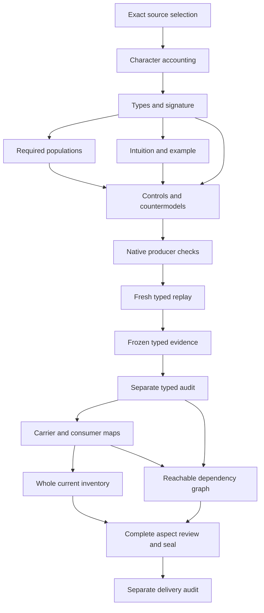

# Artifact Lifetime: full partial candidate delivery review

## 1. Exact source, current admission and retained lineage

The selected meaning is cal.definition.artifact-lifetime@1.0.0-candidate.1, with current local source digest c7f9bf9037bb22ac39cb4e1e5530dbca4a330fa6e231da343945d76ebef523bf. C53 admits this Definition meaning. Its source body still records candidate reconstruction and an unadmitted D52 source posture with a null admission reference. Those historical statements remain byte-identical. Current registry admission is a separate observation, rather than a reason to rewrite historical source text or to claim that this mathematical translation has been accepted.

The recorded D52 source use is CAL-SOURCE-FULL-DEFINITION-QUEUE-041. It binds the exact selected section digest 13901f51e52227f10c9dc9aab3d9977d2047127114a82c3aaf6dbdaf17fbf7c5 and lines 3729 through 3810, with the historical whole-file digest ecfbd64f334954809e83ffd5d4f9adfb759f39716de96c3ac1227d4ee869c6f8. Reading the local admission record does not reproduce those historical external bytes, authenticate the producer repository, or discharge source fidelity. Exact local schema and two pure projections support representation observations. The owner must still approve the correspondence from source words to sorts, functions, predicates, scoped assertions and populations. No operational authority is conferred by this candidate review.

## 2. Genus, intended lifespan and explanatory intuition

The genus is an intended-lifespan classification of a canonical artifact. Ephemeral describes a work product meant to be produced, consumed and retired. Perennial describes a standing reference meant to endure and be maintained. The selected assignment carries a declared intended-lifespan reference. It does not measure elapsed survival, promise actual retention, classify regenerability, or predict when an artifact will cease to exist. A reference can have an intended class while independently supplied actual outcomes are absent.

The plain-language document intuition is useful: a discovery can explore competing hypotheses, while a standing specification should maintain a coherent current position. A log can preserve earlier positions after they have been superseded. These explanations motivate the record-use distinction without replacing the normative guard. An assertion record is descriptive data, and its positive or negative sign is not the classical model's own truth assignment to a proposition. The candidate can therefore hold two opposed records without asserting logical P and logical not-P as simultaneously true. The explanatory voices remain explanatory source spans. Meaning acceptance, actual artifact existence and the adequacy of the intended-lifespan declaration remain separate review questions.

## 3. Sorts and independent classification axes

The signature uses eighteen nonempty sorts. LifetimeAssignment is separate from ArtifactReference, CanonicalKind, AuthorityKind, MaturityStatus and Durability. IntendedLifespanReference, OwnerReference and OwnerNoteReference carry declarations rather than authenticated people or measurements. PropositionReference and AssertionRecord separate the subject of a claim from the record that carries it. AssertionSign and AssertionUse distinguish polarity from endorsement posture. TimePoint, Context, SupersessionDeclarationReference and TemporalOrderReference make local history bindings explicit. Token supports descriptive nonempty handles.

Distinct sorts prevent a durability value from being substituted as an authority kind, a maturity value from being used as a lifespan, or an assertion record from being treated as a proposition's truth value. Nonempty carrier domains are structural requirements, not evidence of actual world inhabitation. Required witnesses additionally exhibit both lifespan classes sharing authority, maturity and fine-kind values. There is no function in this signature that derives effective durability from authority kind or maturity. A default attached to a kind is a separate declared value, with an explicit instance-override branch. The source's discovery and inventory example needs an accepted coarse/fine-kind correspondence; a label or a sorted domain alone cannot supply that mapping.

## 4. Total functions, selected facets and necessary guards

Each selected LifetimeAssignment binds one artifact reference, kind, authority classification, maturity value, effective durability, intended lifespan and responsible-owner reference. Total mathematical functions make these bindings unambiguous within a supplied denotation. Totality is not evidence that a deployed resolver, writer or classification service exists. Applicable and in-scope declarations must agree; selected facets must be explicit, declared and have nonempty handles. Canonical-artifact applicability is a separate declared qualification. The whole Artifact theory is not imported to obtain it.

Assertion records bind artifact, proposition, sign, use, time and context. Their guards apply to records explicitly selected into this candidate's assertion scope. Outside records remain outside those guards. Supersession declarations have separate artifact, old-record, new-record and order references. Unknown or unresolved selected values fail the corresponding declared-reference guards. The functions' codomains remain distinct, and malformed results are rejected before truth evaluation. No global artifact identity uniqueness, mandatory instance context field, authenticated chronology, or actual lookup completeness is invented. Even a complete structural assignment can leave the real meaning of its references unaccepted. The closed signature makes that ceiling inspectable rather than hiding it behind names.

## 5. Current vocabulary and future extension boundary

EPHEMERAL and PERENNIAL are distinct Durability constants. POSITIVE and NEGATIVE are distinct AssertionSign constants. LIVE, HISTORICAL and QUOTED are pairwise distinct AssertionUse constants. Declared members of each current vocabulary are exactly these recognized tags. Domain elements outside the declared vocabulary can exist in a mathematical carrier, but a selected lifespan or assertion field cannot use them to bypass the current guards. Collapsing recognized constants also fails the theory.

The source explicitly reserves a possible append-only or monotonic third durability value for a future owner-gated extension if the live-versus-temporal refinement proves insufficient. The candidate does not add that value now or treat an unresolved identifier as a valid present class. Such an extension would require a new qualified iteration, source selection, tag denotations, controls, populations and owner review. HISTORICAL record use is already a separate descriptive dimension; it must not be confused with the proposed future durability tag. This separation permits a perennial ledger to preserve superseded entries without claiming that the current lifespan vocabulary has changed. Vocabulary guards constrain declarations; they do not prove a storage engine is append-only or monotonic.

## 6. Kind default and exact owner-noted instance override

kindDefaultDurability maps a declared canonical kind to a current declared durability value. assignmentDurability carries the effective instance value. When they differ, the selected owner-note reference must be declared, nonempty and marked as an owner-noted override. Its subject must equal the selected artifact, its owner must equal the assignment's responsible-owner reference, and its chosen value must equal the effective durability. Changed subject, owner, selected value or missing note fails the necessary declaration guard.

When the values agree, the candidate imposes no mandatory override note. A default branch with no override declaration is a required nonvacuous witness. The normative applicability's default table names standing kinds and exploratory kinds, but an accepted enumeration or table implementation is not provided. That detailed default-table correspondence remains deferred. Declaring a note does not authenticate an owner, prove owner authority, demonstrate actual override acceptance, or establish that the intended lifespan will be fulfilled. The model witnesses an ephemeral override of a perennial kind default while preserving the shared fine kind, authority and maturity classifications. Actual owner authentication and override authority remain independent countermodel targets, and positive controls permit separately supported actual outcomes.

## 7. Artifact correspondence and the unresolved field bridge

ART-CONSUMER-FINDING-001 remains material to the next Definition. Artifact's frozen partial theory derives its durability projection from the selected fine kind. Artifact Lifetime explicitly treats per-kind durability as a default and permits an instance override with an owner note. Distinguishing coarse Evidence authority kinds from fine canonical kinds explains one example but does not settle the explicit instance exception. The current Lifetime candidate keeps its own qualified default and effective functions separate.

A possible bridge would map Artifact's field to a kind-derived default and Lifetime's field to effective instance durability. This is a proposal, not an accepted field identity or source-precedence Decision. No owner correspondence has established that those are the actual intended fields. The candidate therefore neither rewrites the sealed Artifact interpretation nor imports its fixed durability equation as a constraint on Lifetime's effective field. There is no accepted common-meaning model and no proved inconsistency under accepted denotations. Merely composing separately qualified symbols would not solve that issue. The owner review must identify exact fields, kinds, override precedence and affected consumers, then approve a bounded mapping or a new preserved candidate iteration.

## 8. Scoped live opposition and perennial consistency

The perennial guard rejects a pair of selected assertion records with the same artifact, proposition, time and context when one is positive, the other negative, and both are live. These exact scoping fields matter. Two records concerning different propositions, different times or different contexts do not constitute the selected simultaneous opposed pair. The rule quantifies over the supplied finite denotation's selected records; it does not discover every assertion in actual documents or prove a complete truth detector.

Ephemeral classification permits such a recorded opposition. It does not require every ephemeral assignment to contain contradictions. The required populations include an ephemeral instance with opposed live records and an ephemeral instance without them. Perennial quoted opposing claims remain permissible because quotation does not endorse both sides as current live positions. The sign and use tags describe records as data, so the mathematical model remains classical and consistent. A perennial live opposed pair is a failing authored model, while a quoted pair is a positive control. The distinction protects the source's exploration and standing-reference meanings without falsely treating a textual contradiction detector, a resolution workflow or actual logical truth as already implemented.

## 9. Temporal supersession, history and local order

A selected supersession declaration binds a distinct old and new assertion record to one exact artifact, proposition and context. The old record must have HISTORICAL use. The new record can be LIVE or HISTORICAL, allowing a replacement to be superseded later. Old and new times must differ, and the declared local order relation must bind those exact times and the selected order reference. A required perennial witness carries an old positive historical record and a new negative live record under that declared supersession.

The candidate does not turn this local declaration into a global total history order, transitivity theorem, authenticated clock, reliable event discovery, actual retirement, or effective resolution. An additional reverse local order declaration is structurally permitted because a global order theory has not been imported. That is an explicit loss, not a chronology guarantee. A quoted Decision can narrate opposed positions without constituting this operational supersession branch. Marking an old selected supersession record LIVE, changing its subject or context, collapsing old and new records, or omitting the declared order fails the necessary guards. Actual temporal currentness and effective supersession remain separate targets requiring independently accepted evidence.

## 10. Required populations, controls and non-entailment

Fourteen required populations keep the interpretation nonvacuous. They cover ephemeral and perennial assignments without actual outcomes, an outside assignment, a default branch without an override note, an owner-noted override, both classes sharing authority kind, both sharing maturity, and both sharing fine kind through the override. They also cover ephemeral live opposition, an ephemeral instance without opposition, a perennial quoted resolution, a perennial supersession history, and independently supported authority for each lifespan class.

The supplied controls are evaluated against both encoded T and required populations I. A model can satisfy T while failing I, which is reported explicitly rather than hidden as a semantic success. Positive independently supported outcome controls demonstrate that non-entailment is not denial. For each actual-outcome query, a supplied model must satisfy T and I, satisfy the declared witness condition and make the query target false. Malformed signature, sort, arity, totality, domain and duplicate-tuple models are rejected before evaluation. These are exact finite authored examples and countermodels. They establish neither actual world inhabitation nor a quantified whole-definition proof. Relevant actual targets include preservation, retention, logical truth, owner authentication, override authority, validation, authority and common-meaning consistency.

Actual native evidence: {"T_false": 62, "T_true": 36, "controls": 106, "countermodel_queries": 22, "countermodels": 22, "declarations": 113, "deferred_clauses": 10, "direct_semantic_uses": 33, "encoded_clauses": 6, "explanatory_clauses": 9, "malformed": 8, "mapped_clauses": 25, "required_populations": 14, "source_checks": 61, "source_units": 22, "unresolved_populations": 48}.

## 11. Complete character accounting, deferred meaning and failures

Every nonempty selected string leaf in voices, boundaries, applicability and claim ceiling is accounted through exact character spans. Encoded spans supply necessary typed declarations, current vocabulary, default/override guards and scoped assertion rules. Plain and domain intuition and notation remain explanatory. Detailed default enumeration, accepted classification denotations, actual lifespan, source precedence and consumer correspondence remain deferred. Source-query obligations bind exact excerpts and digests to queries that are not assumed in T. Complete character accounting is not equivalent to complete semantic translation.

Twenty LIFE-FINDING items retain those losses explicitly. The first native author preflight failed before creating the Lifetime unit because the source inspection's reference map was iterated as keys. Its exact script and terminal captures remain in durable preparation history. A prematurely requested build capture also failed because the native unit was absent; its child terminal was not recorded and is not invented. The corrected author consumes the reference-map values and preserves both histories as selected inputs. Artifact's earlier native-build and delivery-seal failures remain inside its immutable prior seal. Runtime recovery restored hash-bound Artifact preparation bytes and moved this episode's preparation and audit captures to durable paths. No failed attempt is relabeled as success.

## 12. Current carrier and consumer evidence, dependencies and delivery DAG

The current admitted-contract catalog has 143 rows and 121 current Artifact Types. None directly binds the selected Lifetime Definition meaning. The generic current Definition/v2 type separately binds Definition meaning. That observation identifies a correspondence gap; it does not demonstrate that related record structures cannot be represented through explicit references or that the selected Definition is unavailable.

The C12 semantic.artifact-lifetime prototype has an exact normalized contract: definition meaning, type.definition carrier and scope.shared-authority ownership. Its body remains prototype-scaffold with authority effect none. Its accepted D52 disposition is split into three distinct targets: semantic.artifact-lifetime, profile.retention and profile.semantic-consistency. C53's current source-use selection for this Lifetime version remains distinct from that three-way C12 normalization. Neither reading the semantic Definition nor accepting a generic schema imports or executes those two specialized profiles.

The C13 CAL-EVALUATION-DEFINITION-V1 record is an admitted generic Definition/v1 evaluation profile with seven checks, collect-all mode and PASS, FAIL and NOT_EVALUABLE tags. Its exact thirteen-required-field schema and two pure projections are observed. Its body retains candidate-unadmitted and authority-effect-none posture, separately from the C13 admission. It is not an accepted Lifetime retention mechanism, scoped live-contradiction detector, chronology checker or instance-override authorization profile. Two pure C12 prototype projections also match their selected bytes without changing their input.

Twenty-seven actual local catalog, source-binding, schema and pure-projection observations passed. Forty-four Definition shape probes include five acceptances. Thirty C13 profile shape probes include ten acceptances. Unresolved identifiers and semantically overclaimed prose can still pass generic shape, making the lack of meaning correspondence visible. Forty-seven authored qualification hypotheses include forty-five rejections. One hundred eight proposed-map frames include one hundred three rejections. Proposed accepted-map references remain hypothetical; no actual owner acceptance follows from a frame passing its structural guards.

Thirty-six source-to-carrier and consumer map obligations remain explicitly unaccepted. These include default and effective durability, exact owner-note binding, assertion sign and use, time and context, local order, supersession and orthogonality. No bound package validator, canonical or candidate carrier writer, native or live consumer was executed by this profile stage. No new authority or Typed Relation was created. Actual preservation, truth, chronology, owner authentication and override authority remain separate outcomes.

Lifetime declares two primary consumer labels: semantic.artifact and semantic.canonical-representation-invariant. The exact current C53 Definition sources for both labels were read, checked against Definition/v1 and rendered twice without modifying input. Their normalized statements identify those labels. Those are observations of Definition meanings, not executed APIs or live classifiers. They do not supply an accepted source-to-consumer map, a common-meaning denotation or a whole consumer theory.

LIFE-CONSUMER-FINDING-001 extends ART-CONSUMER-FINDING-001 to both observed consumer sources. Artifact and Canonical Representation Invariant each describe durability inherited from a canonical kind. Lifetime's applicability explicitly treats per-kind durability as a default with an owner-noted instance override. The exact paired excerpts and digests remain in the profile evidence. Fine versus coarse kind granularity alone does not settle the explicit instance exception. A proposed default/effective field bridge remains unaccepted, with source precedence and actual field identity awaiting the relevant owners.

The observations establish neither a contradiction under accepted meanings nor a consistent combined model. Qualified symbols can coexist mathematically while their real shared meaning is unresolved. The current Lifetime T deliberately models its own default and effective fields, and the separately frozen Artifact interpretation remains unchanged. Owner acceptance or a preserved new iteration is required before the bridge is presented as resolved.

The typed stage was frozen and separately audited before carrier and dependency work. Sixteen exact inputs remain intact. The selected theory has eighteen sorts, 113 declarations and fourteen required populations. Its 106 supplied controls, twenty-two countermodels, sixty-one local source checks and forty-two source-query obligations passed initial and fresh typed checks. Actual truth, lifespan, preservation, chronology, resolution and authority are not imported from those declarations. The retained author-preflight and premature capture failures remain distinct from the corrected successful native producers.

Static-only snapshot reuse passed fifteen adversarial differential checks. It reuses only verification of the identical serialized captured snapshot. Live repository currentness remains delegated to the original verifier; model and source-correspondence evaluation are not skipped. Shared sealed validators remain unchanged. Reachable and joint dependency graphs preserve prior edges and add Lifetime's thirty-three authored semantic uses. Missing counterpart packets, the declared edge denominator and semantic cycle classifications remain unresolved.

The new whole-inventory refresh freshly evaluates a supplied partial T/I model for each of eighty-three drafts. The original scope remains 183 current identities, 189 admitted versions and 201 source files. One hundred current identities still lack T drafts. Counts are checked against Artifact's immutable eighty-two-draft inventory. Individual witnesses establish no meaning-aligned combined model, owner fidelity, global consistency or episode completion. I04's historical exact eight-draft inventory remains unchanged.

The initial corrected native author, build, model, source, profile, reachable dependency and current inventory checks passed with actual zero exits. Six fresh read-only delivery checks then passed with zero exits and empty stderr. This complete aspect review precedes the full seal and separate delivery audit. The next native Surface unit follows that separate audit. The execution DAG below orders evidence production; it neither erases semantic cycles nor satisfies owner gates through ordering alone.

Next-source preparation binds six files for Artifact Surface Classification candidate.2. Nineteen exact local current/source lineage, schema, projection and policy observations passed, covering twenty-seven selected source string units and a 4,853-byte human projection. The source requires six package roles, a manifest canonical self-entry, one resolved admitted type for every canonical instance and exclusion of transient state from canonical dependencies. Its older candidate.1 body posture remains separate from the captured admitted-historical C53 overlay. No next native interpretation, model, actual package enumeration or consumer execution has occurred.

The first next-source inspection failed because the transient-dependency statement was checked in root boundaries instead of scientific-formal boundary_conditions. Its exact script and failed terminal capture remain in preparation-history/next-Surface-source-inspection-001. The corrected inspection uses the actual selector. It does not change the source, frozen typed inputs or any earlier seal. The proposed next logic preserves package-relative role uniqueness, type-resolution uniqueness, the self-entry and noncanonical roles, while leaving actual enumeration and multi-package canonical-subject scope for explicit owner review.

## 13. Owner review, claim ceiling and continuation

The source owner must decide whether the lifespan and record-use denotations preserve the intended meaning, whether local time and context scopes are adequate, and how the default table and owner-note override bind real instances. The Artifact/default/effective-durability bridge remains unresolved. An owner-approved map needs exact field identities and source precedence, rather than a generic shape acceptance or a sentence claiming alignment. Consumer owners must separately review the Artifact and canonical-representation meaning observations and any implemented behavior.

This candidate has authority effect none. Source fidelity, whole translation, semantic readiness and mechanized proof remain pending or false as appropriate. Current C53 admission of Definition meaning is not owner acceptance of this mathematical interpretation. There is no canonical, private or live writer, instance admission, publication, release, deployment or external effect. Full delivery still requires the next evidence stages identified in the DAG, and the remaining episode must continue beyond Lifetime. Artifact Surface Classification is the next absent definition in the current plan after this unit's full seal and separate audit. If owner review requires a changed formalization, preserve the current evidence and produce a new qualified iteration with a new DAG rather than mutating its sealed record.

Owner findings, all unresolved:

- LIFE-FINDING-001: Current C53 meaning admission is distinct from retained D52 reconstruction posture and owner acceptance of this translation.
- LIFE-FINDING-002: Intended-lifespan classification and canonical-artifact applicability need accepted denotations; no whole Artifact theory is imported.
- LIFE-FINDING-003: Ephemeral and perennial are exactly current declared tags, not actual survival-time measurements.
- LIFE-FINDING-004: Kind-default and effective-instance durability remain distinct and owner notes bind one exact subject,owner and chosen value.
- LIFE-FINDING-005: Owner-note declaration neither authenticates the owner nor establishes actual override authority.
- LIFE-FINDING-006: ART-CONSUMER-FINDING-001 remains unresolved: Artifact kind-derived durability and Lifetime effective override require an accepted field map; kind granularity alone does not settle it.
- LIFE-FINDING-007: Orthogonality is witnessed across shared authority,maturity and fine-kind values, not inferred from a correlated example table.
- LIFE-FINDING-008: Assertion records carry scoped signs and uses; opposed claims are data, not logical P and not-P both true.
- LIFE-FINDING-009: Perennial forbids a selected simultaneous live opposed pair for one artifact,proposition,time and context; no global truth detector is proved.
- LIFE-FINDING-010: Ephemeral live opposition is permitted, not required in every instance.
- LIFE-FINDING-011: Quoted decision narratives and historical record uses are distinct from current endorsement.
- LIFE-FINDING-012: Temporal supersession guards exact old/new subject,proposition,context and local declared order; chronology and retirement remain unverified.
- LIFE-FINDING-013: No global total or transitive history order is imported.
- LIFE-FINDING-014: Regenerability and maturity are independent source meanings; no actual regeneration is derived.
- LIFE-FINDING-015: Append-only or monotonic third durability tag is future owner-gated, not a current value.
- LIFE-FINDING-016: Default kind table enumeration and named example correspondence remain owner review items.
- LIFE-FINDING-017: Source identity,digests,schema and pure projections are representation observations, not complete logical or semantic discharge.
- LIFE-FINDING-018: Historical D52 external section and whole-file bytes and repository identity are not reproduced or authenticated.
- LIFE-FINDING-019: Carrier and Artifact or canonical-representation consumers require exact accepted mapping and separate dependencies.
- LIFE-FINDING-020: Finite supplied controls and countermodels do not prove owner fidelity,whole-definition semantics or shared meaning consistency.

Actual full-delivery evidence: {"counts": {"deferred_clauses": 1022, "encoded_clauses": 795, "explanatory_clauses": 672, "mapped_clauses": 2489, "required_populations": 993, "source_units": 1909, "unresolved_populations": 3965}, "cross_definition_owner_findings": 1, "frozen_typed_inputs": 16, "joint_graph_edges": 2114, "joint_graph_nodes": 136, "joint_missing_counterparts": 53, "local_graph_edges": 2080, "local_graph_nodes": 135, "missing_current_drafts": 100, "partial_drafts": 83, "prior_seal_files": 7167, "retained_author_preflight_failure": 1, "retained_next_source_inspection_failure": 1, "retained_premature_capture_failure": 1, "source_files_current": 201}.
