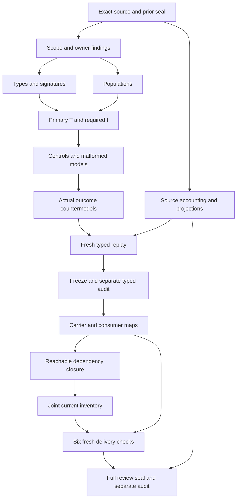

# Artifact Type Registry: candidate definitions, types and logic review

This review explains the exact candidate interpretation of cal.definition.artifact-type-registry@1.0.0-candidate.1. It follows Surface Classification's full 7,376-file candidate delivery and separate audit. The original episode still contains 183 current identities, 189 versions and 201 source files. This unit creates an eighty-fifth working interpretation, while the last sealed whole inventory has eighty-four partial drafts and ninety-nine missing current identities. Working files alone do not prove a fresh joint inventory or complete formalization.

## 1. Exact Definition, source selection and claim status

The current C53 meaning is selected at authority/definitions/candidates/0009-artifact-surface-foundation/definitions/artifact-type-registry/v1/definition.json. Its content digest is e554069c42d0ee17d4df65a0de2b0bba998933622aa9aba296671a01dd273e81. An Artifact Type Registry is a canonical reference index over immutable Artifact Type contracts and lifecycle-decision overlays. Each entry binds a type version to exact artifact, schema, discriminator, semantic Definitions, lifecycle state and decision evidence. The Registry references these subjects; its act of registration does not redefine or admit them.

Meaning admission, immutable source body posture, exact current registry selection and this candidate translation's review status are distinct. The source's C53 admission does not accept the authored formulas, populate their real denotations or issue authority to a consumer. The interpretation selects the normative scientific voice, accounts for explanatory and deferred spans and retains twenty owner findings. Source fidelity remains pending, semantic readiness false and whole Definition proof absent.

The native context binds exact preparation scripts and Surface's separately successful audit captures. Original prepared bytes remain retained even when a native encoding needs an equivalent repair. No canonical registry, source Definition, owner decision or live lifecycle state is mutated. The goal stays active after typed verification. The remainder of this review explains precisely which declared conditions are checked and which actual outcomes require separate evidence.

## 2. Types, declarations and notation

Sixteen nonempty sorts distinguish RegistryReference, EntryReference, ArtifactTypeReference, ArtifactTypeKey, ArtifactContractReference, SchemaDocumentReference, SchemaSelector, ContentDigest, DiscriminatorPath, DiscriminatorValue, DefinitionSetReference, DefinitionReference, OwnerDecisionReference, OverlayReference, LifecycleState and Token. These boundaries prevent a schema selector from being used as an owner decision, a digest from becoming a contract identity or a lifecycle tag from becoming authority. Source version and interpretation scope qualify every symbol before compilation and model evaluation.

Four constants name EMPTY and the current lifecycle vocabulary CANDIDATE, ADMITTED_CURRENT and ADMITTED_HISTORICAL. Twenty-eight total functions select entry facets, type keys and reference handles. Sixty-three predicate or relation signatures complete the 111 declarations. A total function is a mathematical selector over the supplied domain. It does not discover a canonical file, compute a digest, authenticate an owner or make an actual lifecycle decision. Explicit binding relations keep multiplicity visible instead of hiding contradictory declarations behind one nominated result.

ArtifactTypeKey is a versioned descriptive key, separate from ArtifactTypeReference. No global key injectivity is asserted: distinct references can share a descriptive key in a supplied control without the theory deciding whether that alias is correct. EntryReference is likewise distinct from the exact type version it indexes. Concrete strings, filesystem paths, schema null selectors and owner principal identities need accepted source correspondence. Their mathematical reference guards only require declared, nonempty local handles in selected scope.

## 3. Genus, selected scope and reference-index status

GENUS equates RegistryApplicable with RegistryInScopeDeclared. For an applicable registry it requires a nonempty handle and CanonicalReferenceIndexDeclared. Membership is RegistryMemberDeclared(registry,entry), which controls the entry obligations. The source's one exact machine registry is represented through the selected governance scope; the theory does not assert that the entire mathematical universe or every workspace contains exactly one Registry object.

A required outside registry keeps this restriction visible. Its handles and extra discriminator tuples can remain outside the selected requirements. A separately applicable registry has independently supplied authority. These branches distinguish a selected necessary guard from a claim that all registries are either authoritative or forbidden. Complete governed membership and actual canonical-registry legitimacy are independent outcomes, not consequences of a supplied finite domain or index marker.

The source characterizes registration as reference indexing rather than authority creation. A selected entry must be declared reference-only, have no declared canonical-carrier duplication and have neither RegistryDefinesTypeDeclared nor RegistryAdmitsTypeDeclared for its indexed type. These are scoped representation conditions. They do not inspect the real repository for duplicated bytes or establish that snapshots, evidence captures and generated copies are illegitimate canonical carriers. Owners must accept that denotation before an actual duplication detector can discharge it. Registry index completeness is explicitly left as a separate query.

## 4. Exact entry facets and unique declared bindings

For every selected registry member, ENTRY requires a declared nonempty entry reference and exact declared facet references for type, artifact contract, artifact digest, schema document, schema digest, schema selector, discriminator path, discriminator value, Definition set, owner decision, overlay and lifecycle state. It also requires the nominated type's descriptive key to be declared and nonempty. Guarding a digest reference does not assert that its bytes equal an actual computed digest.

RegistryEntryDeclared(registry,entry,type) holds exactly for the entry's nominated type. ArtifactBindingDeclared(entry,artifact,digest) holds exactly for the nominated artifact and digest pair. SchemaBindingDeclared has four arguments: entry, schema document, digest and selector. DiscriminatorBindingDeclared binds its exact path/value pair. DefinitionSetBindingDeclared and LifecycleOverlayDeclared supply similarly exact relations. The universal directions reject both missing tuples and additional conflicting tuples. A total selector alone would not rule out those contradictory declarations.

Within a selected registry, entries naming the same exact type reference must be the same entry. This candidate reading of a reference index is explicit and owner pending, particularly for alias references, entry reuse and different registry scopes. It does not imply global uniqueness of an Artifact Type package, unversioned identity or descriptive key. A digest-change control updates the selected function and binding coherently and passes necessary declarations while actual byte fidelity remains false. Changing only the selector fails. That contrast demonstrates the declaration boundary without authenticating the replacement digest.

## 5. Schemas, selectors and Definition-set membership

SchemaDocumentReference, ContentDigest and SchemaSelector are independent sorts. A shared bootstrap schema can be bound by exact document bytes plus a region selector; a whole-schema reference is also permitted. There is no rule that a valid type must move to a dedicated directory or that every selector requires a separate schema file. Required shared and whole selector witnesses preserve these branches. Their accepted mapping to actual JSON pointers, schema fragments and null whole-schema fields remains a consumer correspondence question.

A DefinitionSetReference names a declared set, whose members are explicitly recorded in DefinitionSetMemberDeclared. For each selected entry, EntryDefinitionMemberDeclared(entry,definition) is equivalent to membership in its nominated set. Each such member must be a declared nonempty Definition reference. Removing an entry membership while retaining the set member fails, as does adding a member to an entry whose nominated set is empty. Exact declared membership remains separate from actual member translation, semantic compatibility and completeness of a real contract's Definition dependencies.

The candidate deliberately permits empty Definition sets. Required populations include an empty set as well as a set with distinct members, so emptiness is not silently outlawed by a nonempty handle guard. Filling every selected set can leave T true while losing the required empty-set witness in I. This does not imply that every real registry is required to contain an empty-set contract; the population package is an authored nonvacuity witness whose source correspondence remains under owner review.

## 6. Lifecycle vocabulary and owner decision overlays

VOCABULARY makes the three current lifecycle constants distinct and equates LifecycleStateDeclared with exactly those tags. An unsupported fourth declared tag fails. POSTURE then equates CandidateEntryDeclared with the candidate state, AdmittedEntryDeclared with either admitted-current or admitted-historical, and CurrentEntryDeclared with admitted-current. A historical entry is admitted without being current. A candidate entry cannot become admitted merely because it participates in the index.

LifecycleOverlayDeclared(entry,overlay,decision,state) is exact for all three nominated values. CurrentDecisionOverlayDeclared(registry,entry,overlay) holds exactly for the nominated overlay when the selected entry is current. Missing or additional current-overlay tuples fail. A candidate entry given a current overlay also fails. A candidate can still carry a declared decision reference, such as an authoring or lifecycle decision, without that reference being treated as an admission effect. The source's exact decision binding is preserved while actual decision purpose, validity and authority remain independent.

The three combined posture tags are a current candidate vocabulary, not a full universal lifecycle calculus. A real decision overlay may separate admission, currentness, historical disposition, effective time and owner scope across fields. Owners must review that translation and potential future states. No embedded candidate status field is used as sufficient authority; no mathematical owner reference authenticates a principal. Actual type admission and actual currentness have their own countermodel targets even when all declared overlay conditions hold.

## 7. Historical visibility and successor declarations

HISTORY requires selected historical-admitted entries to have HistoricalVisibleDeclared(registry,entry). It also checks selected SuccessorOverlayDeclared(registry,old,new): both entries must be registered members, the old must be historical-admitted, the new admitted-current and the old visible. A required witness names distinct exact type references for the old and new versions. Removing historical visibility, choosing a candidate successor or treating a current entry as the historical predecessor fails a control.

This representation does not verify the time at which a successor became current, reconstruct owner decision history or authenticate retained contract bytes. A declared successor relation is not actual chronology. Nor does the candidate infer that any two distinct version references share one unversioned Artifact Type identity; that lineage correspondence needs accepted evidence. The source's historical-retention requirement is preserved as a necessary visibility condition and an independent actual-retention query.

An outside-registry successor tuple remains outside the selected rule. This demonstrates scoped evaluation rather than authorizing an invalid real transition. Historical versions are also distinct from candidate versions, even if an immutable package body still carries candidate language. The actual current catalog and lifecycle admission overlays must be inspected later. The source's historical example of twenty-five admitted type versions cannot substitute for those current counts or justify silently deleting superseded entries from an index.

## 8. Discriminator correspondence and at-most-one results

The discriminator relation takes registry, path, value and exact type reference. Its intended declared correspondence is: a current result exists exactly when a selected registered entry has current declared posture, matching path/value and that exact type. A second guard requires entries with equal path/value and current eligibility to name the same type. This is an at-most-one condition. It deliberately permits a discriminator to have zero admitted-current results and does not demand total resolution for every possible subject.

The evaluator-efficient encoding splits correspondence into two equivalent directions. Each selected current entry requires its nominated result tuple. Every selected declared result tuple must have a registered current witness with matching facets. Both directions retain the entire relation's declared domain and prevent an added candidate, historical or fabricated result from passing. The at-most-one guard remains explicit, so a total nomination cannot hide two conflicting eligible types. The rewrite changes expression structure without removing any source clause or model domain.

Matching here uses exact declared path/value equality. Concrete pointer traversal, type discriminator normalization, overlapping predicates and real subject documents are outside this partial interpretation. Shared or competing discriminator patterns require owner correspondence with Artifact Type Resolution. A finite result tuple is not resolver execution. The current theory neither infers actual type admission from registration nor grants currentness by evaluating a schema. Those outcomes remain independently falsifiable in the supplied countermodels.

## 9. Populations, T and I, and independent outcomes

T consists of the nine encoded source clauses built from seven primitive formulas. I contains twelve required populations. The witnesses include a selected registry with all twenty-four actual outcomes false, an outside registry, an independently authoritative registry, candidate/current/historical entries, shared and whole selectors, zero current discriminator matches, multiple Definition members, an empty Definition set and a visible historical predecessor with a current successor. Sixty-three signature populations remain unresolved.

The primary registry's actual outcomes are all false, while another applicable registry has independently supplied authority. Further positive controls set individual actual predicates true without changing the necessary entry and index guards. Thus the authored theory can coexist with independently supported outcomes; it does not grant them or prohibit them. Required populations and theory satisfaction are evaluated separately. A selected reference failure can violate T while witnesses remain inhabited, while loss of a shared-selector marker can preserve T and fail I.

These are supplied finite models. They do not prove that a real catalog instantiates the denotations, that every Registry needs each witness branch, or that the partial theories of Registry and Surface have a combined common-meaning model. Every population review reference is pending. Distinct source-qualified symbols and individually satisfiable models cannot substitute for accepted mappings between entry references, package roles, schema selectors, owner overlays and implementation fields.

## 10. Controls, structural rejection and equivalent repair

The prepared and corrected native suite retains 116 controls: thirty-five satisfy T, seventy-three fail T and eight malformed structures are rejected. Malformed cases distinguish an owner decision returned as a schema selector, missing signature symbols, a nontotal selector, an ill-sorted lifecycle constant, wrong schema-binding arity, duplicate membership tuples, an empty selector domain and a duplicate function tuple. Structural rejection is reported separately from a semantic false result.

The first native model producer returned actual exit code one with verifier-step-limit and produced no model report. Its successful preceding build, original builder, compiled interpretation, source correspondence, command captures and failure record are retained under preparation-history/model-step-limit-001. A primitive biconditional alone and a guarded discriminator alone did not reduce the complete repeated source-clause evaluation enough. Their preparation history remains visible; the isolated biconditional failure was observed in tool output without an invented standalone stderr capture.

The combined rewrite uses the supported native iff operator plus the equivalent forward-entry and guarded-reverse-result discriminator correspondence. The prepared combined check passed all 116 controls and all nine source clauses with unchanged domains and unchanged shared 100,000-step bound. Its maximum recorded evaluation was 92,975 steps. The native rebuild and model producer are separately captured. This repair makes the complete candidate executable within the existing bound; it does not weaken the source requirements, omit malformed cases, change shared verifier code or turn finite testing into a whole Definition proof.

## 11. Source accounting, projections and query bindings

All twenty-six nonempty source string-leaf units are accounted for: nine encoded clauses, nine explanatory clauses and eight deferred clauses. Eight distinct encoded source formula values reuse seven primitive formulas. Repeated scientific spans remain separately accounted for even where the same necessary formula appears more than once. There are no assumptions or assumption links. Source precedence review remains pending and all twenty owner findings retain unresolved status.

Thirty source-query bindings preserve exact selectors, excerpt ranges and digests. They connect necessary guards to independently checked actual targets, including digest fidelity, decision validity, type admission, historical retention, selector validity and resolution. An actual target is never inserted into T to make its own outcome appear proven. Twenty-four countermodels retain complete qualified structures, model digests, target-false results and witness conditions. Their evidence supports bounded nonentailment observations for the supplied models.

The source checker records forty-nine current local checks. It binds C53 source selection, registry admission, exact authorization and manifest digests, Definition schema and generator, two local admitted upstream sources, normative boundaries and all thirty source-query obligations. Two pure projections match the committed 3,936-byte source projection with SHA256 9801505a15386e29453fd8c96b8dd3b053beb3756ca07ade66fa438f599125d9. Neither a deterministic projection nor source-shape validation verifies an immutable contract's actual digest, owner overlay authority or semantic correspondence.

## 12. Consumer work, dependency DAG and remaining scope

The source declares Artifact Type Registry/v1 and Artifact Type Resolution@1.0.0-candidate.1 as primary consumers. This typed stage preserves those labels without claiming to execute a registry writer or resolver. Later inspection must distinguish exact declared historical labels from current admitted carrier and Definition versions, retain shared-schema selectors and compare actual catalog counts against the historical twenty-five-version example. Accepted source-to-carrier and consumer maps remain absent.

Twenty-nine direct semantic uses bind exact current Definition references. They include Artifact Type, Surface Classification, Resolution, Schema, Decision, authority, evidence, validation and invariants. Unavailable field labels such as schema-selector, discriminator and lifecycle-overlay are recorded without manufacturing new canonical Definition identities. The interpretation does not assemble whole prior Surface, Type, Decision or Resolver theories into T. Reachable dependency closure and a current eighty-five-draft joint inventory remain required before full delivery.

The execution DAG retains fifteen nodes and eighteen edges. Type and population decisions precede T and I, controls and source accounting feed fresh typed replay, and the separate frozen-stage audit precedes carrier work. Whole current inventory and six fresh delivery checks then feed the full review, seal and separate audit.

The manifest's next native priority after Registry full delivery is Artifact Type Request, followed by Artifact Type Resolution. Source-only plans and absent directories are not completed native units. Keep the full 183-identity episode and final comprehensive explanatory review in scope. The next delivery must freshly evaluate current bytes and existing models rather than reporting the older sealed eighty-four-draft inventory as a new eighty-five-draft result.

## 13. Owner findings, evidence ceiling and completion criteria

The twenty findings below remain unresolved routes to Definition, registry, contract, schema, lifecycle, decision, resolver and consumer owners. The correspondence packet binds their source selectors and descriptions. Resolving an owner choice requires explicit correspondence and review evidence; a passing finite model or convenience label cannot supply that acceptance.

- **REG-FINDING-001:** C53 source admission does not accept this Registry translation.
- **REG-FINDING-002:** One exact machine registry is scoped;no global singleton registry is asserted.
- **REG-FINDING-003:** Exact versioned type reference and descriptive key need correspondence;global key injectivity is not invented.
- **REG-FINDING-004:** Selected registry/version entry uniqueness is a necessary candidate reading requiring owner correspondence for aliases.
- **REG-FINDING-005:** Artifact and schema digest declarations do not verify actual bytes or authenticated contract identities.
- **REG-FINDING-006:** Shared and whole schema-selector references need accepted mappings to concrete selector syntax including null whole-schema representations.
- **REG-FINDING-007:** Definition-set membership is exact declared membership;actual Definition correspondence and set completeness remain independent.
- **REG-FINDING-008:** Owner-decision and lifecycle-overlay declarations do not authenticate owners,decision validity or admission effects.
- **REG-FINDING-009:** Candidate,current-admitted and historical-admitted tags stay distinct;future unsupported tags remain outside the recognized current vocabulary.
- **REG-FINDING-010:** Currentness comes from an exact declared decision overlay,not an embedded candidate status field.
- **REG-FINDING-011:** Registration does not admit or redefine entries;the index is declared reference-only without proving actual absence of duplicate carriers.
- **REG-FINDING-012:** Historical visibility and successor declarations do not authenticate chronology or prove actual retained historical bytes.
- **REG-FINDING-013:** At-most-one discriminator result permits zero matches and does not run a resolver.
- **REG-FINDING-014:** Discriminator matching uses exact declared path/value equality;overlapping patterns and concrete subject evaluation remain owner pending.
- **REG-FINDING-015:** One EntryReference carries fixed declared facets;sharing it across registries requires explicit scope correspondence.
- **REG-FINDING-016:** Required populations are authored candidate witnesses,not proof that every real registry must contain each witness branch.
- **REG-FINDING-017:** Source historical example of25type versions is not the current catalog denominator.
- **REG-FINDING-018:** Schema,projection and profile observations remain representation evidence rather than accepted semantic maps.
- **REG-FINDING-019:** ArtifactTypeRegistry/v1 and ArtifactTypeResolution consumer correspondence must be inspected separately.
- **REG-FINDING-020:** Finite T/I controls and actual-outcome countermodels do not establish a whole Definition or combined common-meaning consistency.

The typed evidence supports exact authored declarations, supplied finite structures, complete local source-span accounting and current source byte observations. It does not establish actual catalog completeness, canonical-registry legitimacy, immutable contract fidelity, shared-selector validity, decision authority, type admission, currentness, actual resolution, historical retention, conformance or combined semantic consistency. Owner-accepted whole translations remain zero and whole Definition proofs zero.

Local candidate delivery requires carrier and consumer observations, explicit accepted-map residues, reachable dependency reports, current joint inventory, six fresh terminal checks, a full explanatory review, a seal and its separate audit. Completion of the episode additionally requires the remaining Definitions and the requested complete final review under the original denominator. Pending fidelity cannot be relabeled as a whole proof, and a types-only freeze cannot be reported as a full Registry delivery. Prior seals, original preparation inputs, retained failures and unrelated working-tree changes remain preserved.
