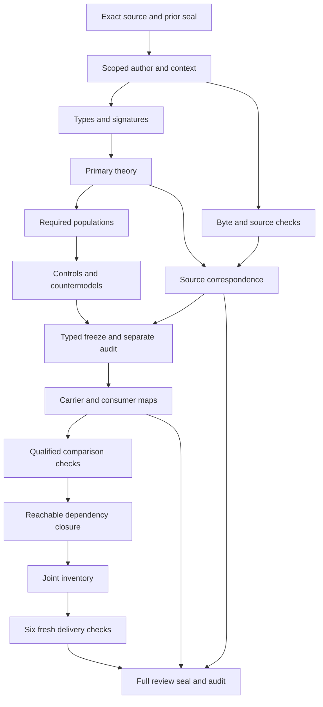

# Artifact Type Request: definitions, types and logic review

## 1. Exact target and verification boundary

The selected meaning is cal.definition.artifact-type-request@1.0.0-candidate.2, admitted-current by the captured C53 overlay. Its exact source digest is ba76127c0cc5c883c53ea2dc91a3618f2aa17bba921b04098c45b1ca2a11c912. This review explains an authored, partial, typed interpretation of that meaning. It creates no real Artifact Type Request, requested subject, usable Artifact Type, admission, registration or owner decision. Definition admission and acceptance of this translation remain separate claims.

Registry's actual separate full-delivery audit exited zero before Request's native author was run. The Request author preserved 7,509 prior candidate files and reverified all 201 captured source files. Native author, build, model and source producers each exited zero. The model checker evaluated all ten encoded source clauses, not just a simplified conjunction used for a convenient example. Owner source fidelity remains pending, semantic readiness false and mechanized whole-definition proof absent. The episode scope remains 183 current identities, 189 admitted versions and 201 source files.

## 2. Source authority and predecessor lineage

The scientific formal voice supplies normative meaning. The plain-language and domain voices explain it. Their Runtime Binding, Source Closure and Ontology Package examples cannot create a particular request or extend operational permissions. Every nonempty source string selected by the established source inventory policy has an exact character account. There are 27 source units and 27 mapped clauses: ten encoded, nine explanatory and eight deferred. Deferred source content remains visible rather than disappearing from the denominator.

C53's exact decision, authorization and manifest bindings are checked independently of the source's embedded candidate metadata. Three embedded upstream meanings have admitted-current bindings: Definition, Artifact Type and Validation. Request candidate.1 is different: its captured overlay is admitted-historical, while candidate.2 preserves candidate.1's embedded candidate-unadmitted posture and null source admission reference. Those are observations of different roles and times. Neither an embedded label nor a current registry lookup authenticates every historical execution.

The source checker verified all four local upstream byte bindings, the Definition schema and generator bindings, and two pure, deterministic projections without input mutation or a writer entrypoint. Both projections contain 4,642 bytes and have SHA256 d6199aa2c817c23234362113f080ff8d9bf0f25f7a3f0cde6ad0e5c31e748ef8. These checks establish representation fidelity for the selected local files; they do not establish accepted semantic correspondence or a live producer's current state.

## 3. Sorted signature and identity interpretation

RequestReference identifies the candidate intake record. SubjectIntentReference identifies the intended, not-yet-authored subject. ArtifactTypeReference identifies a proposed type reference or separate output candidate. These sorts cannot be equated directly in the typed logic. The source's Q != a and Q != T are therefore represented through three separately typed functions into IdentityKey: requestIdentity, subjectIdentity and typeIdentity. This makes the inequality well sorted and exposes its concrete correspondence for review.

The proposed type selector is a candidate modeling choice for the source's T notation. Its nonempty declared reference is an intent handle; it is not a claim that an exact contract already exists. The output candidate has an explicit relation and may differ from that proposal. No global identity-key injectivity, unique request identity, unique output candidate, filesystem identity rule or globally canonical namespace is asserted. A positive control permits two request references to share an identity key, preserving the unresolved alias policy.

All 139 declarations carry the exact source qualification and candidate scope. The 18 sorts have nonempty mathematical domains. Their inhabitation is a modeling requirement rather than a declaration that each corresponding real artifact exists. The two Token constants EMPTY and NONE are distinct: an absent reference and a declared lack of authority effect are different conditions. Total selectors provide nominated values, while explicit binding relations expose missing or conflicting values instead of concealing them in functions.

## 4. Candidate intake genus and declared content

RequestApplicable(q) is equivalent to RequestInScopeDeclared(q). Applicable requests require a nonempty request handle, a CandidateIntakeDeclared marker and nonempty mapped identity keys. The request identity differs from its intended subject and proposed type identities. Outside requests remain explicitly represented and are not forced through selected-request guards. Applicability is not inferred from a directory name, arbitrary metadata or a successful schema check.

Thirteen selectors nominate the subject intent, proposed type intent, bound registry, resolution observation, compatibility analysis, intended semantics, owner, package home, representation direction, validation purpose, discriminator path, discriminator value and dependency set. Each selected value must be declared with a nonempty handle. Each field has an explicit exact binding relation: for every value of its sorted domain, the binding holds if and only if that value is the selector's value. Adding a conflicting second binding fails even when the selector remains unchanged.

A declared owner field does not authenticate owner authority. A package-home field does not produce a canonical package. A validation-purpose field does not show that validation ran or passed. A representation direction does not prove projection fidelity. These descriptive sorts are proposed denotations and not new admitted Definition identities. Their concrete field maps remain owner review work.

## 5. Unresolved resolution and rejected exact reuse

Every selected request has an IntakeCreationDeclared marker, a resolution observation bound to its exact registry and subject intent, an UnresolvedResultDeclared marker, and a compatibility analysis bound to the same subject that declares rejection of exact reuse. The bound proposed discriminator must have no admitted-current match tuple for any ArtifactTypeReference. This is explicit absence in a relation, not merely an unresolved nomination function that could hide a conflicting match.

A negative control inserts one eligible current match while retaining all ordinary request fields and the unresolved observation; the theory rejects it. Other negative controls remove the resolution binding, remove the unresolved result, remove the compatibility subject binding, or remove rejected exact reuse. Changing only the nominated registry and its field binding also fails when the observation remains bound to the original registry. Matches in a different registry or under a different discriminator remain permissible.

This necessary declaration theory does not execute a resolver or compatibility analyzer. It does not prove that the search was complete, that every existing type was considered, that patterns were evaluated correctly, that observations are fresh, or that no admitted usable fit actually exists. Those actual outcome targets are separately typed predicates and remain outside the encoded theory. Concrete pattern matching and Registry v2's entry-versus-descriptor scope still need accepted maps.

## 6. Request effect and subject dependency separation

The selected request's declared authority effect is exactly NONE. ConsumedAsSubjectDeclared, AdmissionRequestDeclared, SelfRegistrationDeclared, SelfAdmissionDeclared and ConvenienceWideningDeclared must all be false for selected requests. For each dependency reference, SatisfiesSubjectDependencyDeclared(q,requestSubject(q),d) must be false. The request cannot stand in for its intended subject or satisfy a dependency that requires that subject.

This exclusion is deliberately scoped. A positive control permits a declaration involving an unrelated subject intent; the theory has no source-backed global ban on every possible dependency role of the intake record. The intake can still participate as evidence or a component of its own workflow. That permission is not a grant of subject authority or an accepted cross-definition composition. Carrier owners must map such roles explicitly.

The model contains an independent actual-authority observation in a separately identified context while every selected request retains NONE as its declared effect. RequestActualAuthority names an uninterpreted actual-outcome observation used to test nonderivation; it must not be mapped to an effect created by the request itself. The denotation of that predicate is pending. No countermodel or model population authorizes real authority, and no proof of a general impossibility of independently supported authority is claimed.

## 7. Subject authorship and exact type existence

The source says the intended subject remains unauthored until its exact type exists. The candidate represents the necessary guard SubjectAuthoredDeclared(requestSubject(q)) implies ExactTypeExistsDeclared(requestSubject(q)). A selected request with declared subject authorship and no exact-type-exists marker fails. Required populations include an unauthored subject and another subject with both declarations so the guard is exercised rather than checked only vacuously.

ExactTypeExistsDeclared is intentionally uninterpreted with respect to lifecycle state. The source sentence does not by itself decide whether existence means a candidate contract, an admitted usable type, a particular resolution state or another owner-approved contract boundary. Silently equating it with CandidateTypePostureDeclared or TypeAdmittedDeclared would hide that ambiguity. The candidate therefore retains it as an explicit owner mapping obligation.

Neither the guard nor the authored subject population creates an actual subject record. Actual subject authorship remains a separate target. The populations are mathematical witnesses designed to exercise the logical boundaries, not production fixtures or execution history. Resolving the exact-type-exists policy is required before any claim of whole source fidelity or operational subject creation can be accepted.

## 8. Draft components and exact dependency membership

A DraftComponentDeclared tuple for a selected request requires a declared nonempty ComponentReference, an AttachmentDeclared tuple, and absence of an AdmittedContractComponentDeclared marker for that component. This preserves draft schemas as attachments or declared request components. ComponentReference remains distinct from ArtifactTypeReference; the draft cannot silently become the requested subject or an admitted contract because it happens to be packaged with the intake.

The candidate uses AttachmentDeclared as its umbrella interpretation of attached or declared components. Owners must decide its precise correspondence to both source alternatives. Removing the attachment declaration or declaring the draft an admitted contract fails. An unrelated component's admission marker remains permitted, and removing all draft markers creates a required-population failure rather than a source-theory failure. Generic attachments without draft classification are not globally prohibited.

RequestDependencyMemberDeclared is equivalent to membership in the selected DependencySetReference. Every declared member has a nonempty declared dependency reference. Empty and populated dependency sets are both required authored witnesses. The source does not demand a nonempty dependency set, and exact declared membership is not proof of complete dependency discovery, availability or satisfaction. Adding an unbound member or omitting an exact member fails the declaration account.

## 9. Acceptance and a separately identified candidate output

For an applicable request, RequestAcceptedDeclared implies existence of at least one CandidateOutputDeclared tuple. Each declared output has a declared nonempty ArtifactTypeReference and identity key, differs in identity from the request and intended subject, has CandidateTypePostureDeclared, and lacks a TypeAdmittedDeclared marker. Acceptance does not turn the output into a usable admitted type.

A missing output, missing candidate posture, declared output admission, or output identity collapsed with the request or subject fails. A positive control permits two separately identified candidate outputs, because the source's existence obligation supplies no uniqueness theorem. The theory also does not require every accepted output to equal the nominated proposed type intent. Such equality would require a concrete accepted output mapping.

The accepted-request and candidate-output records in the model are declarations. Actual request acceptance, actual candidate generation, authenticated owner selection and actual type admission remain different propositions. The actual-candidate-creation query has a finite countermodel in which the declared acceptance and separate candidate output guards hold while actual creation is false. That establishes a limit of this authored theory, not a factual allegation about a real request.

## 10. Terminal alternatives and owner-treatment residue

A selected request declaring resolution, rejection or replacement must declare expiry or supersession. The disjunction is inclusive: either branch suffices, and both may coexist. Required populations exercise expiry without supersession and supersession without expiry. Negative controls reject terminal requests with neither branch. An additional expiry marker on an unterminated request remains permissible because the source does not supply a reverse characterization.

No clock, chronological ordering, authenticated replacement relation or actual expiration operation is invented. Source chronology and the mechanism of supersession remain review obligations. A terminal marker does not discharge subject admission or create output authority. Importing the whole Artifact Lifetime theory would require separate shared-denotation and dependency review, so this candidate uses only its scoped necessary declarations.

The retained residue requires owner selection before a real unresolved carrier receives Request treatment. OwnerTreatmentSelectedDeclared is present in the signature but is not assumed as an authenticated selection in T. Creating this Definition formalization is not creating a real intake or choosing that treatment for a carrier. This residue must be inspected with the operational carrier and consumers after the typed stage; actual owner selection remains one of the nonderivation targets.

## 11. Controls, populations and actual-outcome countermodels

The native checker independently evaluated 136 supplied controls against the compiled source-qualified interpretation. Thirty-eight satisfy T, ninety fail T as expected, and eight fail model structure before semantic evaluation. Structural cases cover wrong result sort, missing signature symbol, nontotal function, ill-sorted constant, wrong relation arity, duplicate predicate tuple, empty domain and duplicate function tuple. These are different evidence classes from a well-typed model in which a necessary guard is false.

Eleven required populations cover selected requests without actual outcomes, an outside request, independent actual authority, draft components, accepted separate candidate output, expiry and supersession alternatives, empty and populated dependency sets, unauthored subjects and the exact-type-exists guard. Eighty-five additional population obligations remain unresolved. These witnesses prevent central conditions from passing only because no relevant object was selected; they do not classify every real request population.

Twenty-four actual-outcome queries each retain a source-qualified target outside T and a true selected witness condition. The checker verifies T and all required populations while each target is false in its supplied countermodel. Targets include resolver execution, completeness, compatibility correctness, owner selection, subject authorship, candidate creation, expiry, chronology, dependency satisfaction, type admission, registration, conformance, validation, fidelity, authority and consumer alignment. Finite countermodels establish those particular nonentailment limits; they are not universal accepted proofs of the whole Definition.

## 12. Source account, review findings and continuation DAG

The source account preserves exact selectors, excerpts, digests, character spans and disposition for all 27 units. Actual-outcome obligations link their targets back to exact source clauses and never introduce targets as assumptions. There are no interpretation assumptions or hidden whole-prior-theory imports. Source precedence, dependency closure, owner review and semantic acceptance all remain pending.

Twenty named findings retain every candidate denotation and known loss. The finding table below is an owner-review queue, not evidence that the owner has accepted the proposed interpretation. Unavailable requested dependency labels remain descriptive sorts rather than fabricated canonical Definition identities. Current Registry's three unresolved consumer findings, including the seven operational-schema errors, retain their prior sealed evidence. Request does not erase or resolve them by adopting a convenient entry scope.

The following DAG separates source selection, typed declarations, logic, populations, controls, source correspondence, typed freeze, consumer maps, dependency closure, joint inventory, fresh delivery replay and final review. It is acyclic and contains fifteen nodes and eighteen edges. A candidate must pass a separate typed audit before consumer work. Full candidate delivery still requires current carrier/consumer observations, reachable dependency graph, joint inventory, six fresh terminal checks, complete delivery review, seal and separate delivery audit.

## 13. Remaining work and original completion criteria

This typed candidate is one unit in the original formalization episode. There are now 86 native T draft files, with the last full-delivery inventory still reporting 85 sealed partial drafts and 98 missing current identities. A fresh whole inventory has not yet evaluated the new Request draft, so those two observations must not be collapsed into an updated accepted denominator. Whole accepted translations and whole-definition proofs remain zero.

The next immediate work is to finish the typed review, perform the three fresh typed checks, freeze sixteen exact typed inputs and run a separate audit. After that, inspect the Artifact Type Request/v1 carrier and authority/artifact-type-requests intake path without executing a writer or creating a real request. Compare the carrier fields, owner selection treatment, accepted candidate output and lifecycle behavior with the source. Keep the current Registry v2 and current Resolution meaning separate from historical labels.

Then verify reachable dependencies and freshly evaluate every selected interpretation in the whole candidate inventory. Preserve every prior seal and every captured source byte, retain failed attempts visibly, and run the six actual delivery checks. Produce the full delivery explanation, seal its exact files and separately audit preservation and claim boundaries. Artifact Type Resolution follows Request in manifest order. The broader episode cannot be called complete while any required Definition, accepted source correspondence, dependency review, proof obligation or final aspect-by-aspect review remains missing.

Candidate review findings:

| Finding | Pending correspondence or limitation |
|---|---|
| REQ-FINDING-001 | C53 admission of Request meaning does not accept this candidate translation. |
| REQ-FINDING-002 | Request,subject intent and proposed type use distinct sorts with mapped common identity keys;distinct sort names alone do not establish identity inequality. |
| REQ-FINDING-003 | Proposed type reference is an intent handle,not an existing usable or admitted contract. |
| REQ-FINDING-004 | One request has exact necessary declared fields;accepted concrete carrier field maps remain pending. |
| REQ-FINDING-005 | Zero matches is explicit absence of admitted-current tuples in a bound registry;actual search completeness and pattern matching remain pending. |
| REQ-FINDING-006 | Unresolved observation and rejected-reuse analysis are exact declared bindings,not proof of real execution,fitness or freshness. |
| REQ-FINDING-007 | Candidate-only intake and none effect do not create an admission request,registration or usable subject. |
| REQ-FINDING-008 | No subject dependency satisfaction is scoped to this request and intended subject;legitimate intake evidence participation remains possible. |
| REQ-FINDING-009 | Exact type exists is deliberately uninterpreted pending owner resolution of candidate existence versus admitted usable type. |
| REQ-FINDING-010 | Draft components are attached proposals and not declared admitted contracts;generic attachment mappings remain pending. |
| REQ-FINDING-011 | Every accepted request has a separately identified candidate output;actual creation and owner acceptance remain independent. |
| REQ-FINDING-012 | Candidate output membership is explicit and may have multiple outputs;source does not establish a unique output. |
| REQ-FINDING-013 | Terminal expiry or supersession are inclusive alternatives without required chronology or authenticated replacement. |
| REQ-FINDING-014 | Declared dependency membership is exact and may be empty;actual dependency satisfaction remains independent. |
| REQ-FINDING-015 | Owner selection before real unresolved-carrier treatment is retained as residue,not assumed actual authorization. |
| REQ-FINDING-016 | Independent actual authority is an abstract externally supported context observation;the request still declares no authority effect. |
| REQ-FINDING-017 | Historical candidate.1 embedded candidate posture differs from admitted-historical overlay and is preserved. |
| REQ-FINDING-018 | Current Registry v2 descriptor scope and operational schema mismatches remain unresolved upstream findings. |
| REQ-FINDING-019 | Carrier schema,projection and generic Definition profile passes cannot accept whole semantic correspondence. |
| REQ-FINDING-020 | Finite controls and countermodels cannot prove accepted universal interpretation or whole common-meaning closure. |

Exact sorted signature:

| Symbol | Arguments | Result or role |
|---|---|---|
| EMPTY | constant | Token |
| NONE | constant | Token |
| requestSubject | RequestReference | SubjectIntentReference |
| requestProposedType | RequestReference | ArtifactTypeReference |
| requestRegistry | RequestReference | RegistryReference |
| requestResolution | RequestReference | ResolutionObservation |
| requestAnalysis | RequestReference | CompatibilityAnalysis |
| requestSemantics | RequestReference | IntendedSemantics |
| requestOwner | RequestReference | OwnerReference |
| requestHome | RequestReference | PackageHomeReference |
| requestRepresentation | RequestReference | RepresentationDirection |
| requestValidationPurpose | RequestReference | ValidationPurpose |
| requestDiscriminatorPath | RequestReference | DiscriminatorPath |
| requestDiscriminatorValue | RequestReference | DiscriminatorValue |
| requestDependencies | RequestReference | DependencySetReference |
| requestIdentity | RequestReference | IdentityKey |
| subjectIdentity | SubjectIntentReference | IdentityKey |
| typeIdentity | ArtifactTypeReference | IdentityKey |
| requestAuthorityEffect | RequestReference | Token |
| requestReferenceHandle | RequestReference | Token |
| subjectIntentReferenceHandle | SubjectIntentReference | Token |
| artifactTypeReferenceHandle | ArtifactTypeReference | Token |
| identityKeyHandle | IdentityKey | Token |
| registryReferenceHandle | RegistryReference | Token |
| resolutionObservationHandle | ResolutionObservation | Token |
| compatibilityAnalysisHandle | CompatibilityAnalysis | Token |
| intendedSemanticsHandle | IntendedSemantics | Token |
| ownerReferenceHandle | OwnerReference | Token |
| packageHomeReferenceHandle | PackageHomeReference | Token |
| representationDirectionHandle | RepresentationDirection | Token |
| validationPurposeHandle | ValidationPurpose | Token |
| discriminatorPathHandle | DiscriminatorPath | Token |
| discriminatorValueHandle | DiscriminatorValue | Token |
| dependencySetReferenceHandle | DependencySetReference | Token |
| dependencyReferenceHandle | DependencyReference | Token |
| componentReferenceHandle | ComponentReference | Token |
| RequestApplicable | RequestReference | declared predicate or relation; actual targets remain independent |
| RequestInScopeDeclared | RequestReference | declared predicate or relation; actual targets remain independent |
| CandidateIntakeDeclared | RequestReference | declared predicate or relation; actual targets remain independent |
| IntakeCreationDeclared | RequestReference | declared predicate or relation; actual targets remain independent |
| ConsumedAsSubjectDeclared | RequestReference | declared predicate or relation; actual targets remain independent |
| AdmissionRequestDeclared | RequestReference | declared predicate or relation; actual targets remain independent |
| SelfRegistrationDeclared | RequestReference | declared predicate or relation; actual targets remain independent |
| SelfAdmissionDeclared | RequestReference | declared predicate or relation; actual targets remain independent |
| ConvenienceWideningDeclared | RequestReference | declared predicate or relation; actual targets remain independent |
| OwnerTreatmentSelectedDeclared | RequestReference | declared predicate or relation; actual targets remain independent |
| RequestAcceptedDeclared | RequestReference | declared predicate or relation; actual targets remain independent |
| ResolvedDeclared | RequestReference | declared predicate or relation; actual targets remain independent |
| RejectedDeclared | RequestReference | declared predicate or relation; actual targets remain independent |
| ReplacedDeclared | RequestReference | declared predicate or relation; actual targets remain independent |
| ExpiredDeclared | RequestReference | declared predicate or relation; actual targets remain independent |
| SupersededDeclared | RequestReference | declared predicate or relation; actual targets remain independent |
| RequestActualResolverExecution | RequestReference | declared predicate or relation; actual targets remain independent |
| RequestActualResolutionCompleteness | RequestReference | declared predicate or relation; actual targets remain independent |
| RequestActualCompatibilityCorrectness | RequestReference | declared predicate or relation; actual targets remain independent |
| RequestActualSearchCompleteness | RequestReference | declared predicate or relation; actual targets remain independent |
| RequestActualOwnerSelection | RequestReference | declared predicate or relation; actual targets remain independent |
| RequestActualSubjectAuthorship | RequestReference | declared predicate or relation; actual targets remain independent |
| RequestActualComponentLegitimacy | RequestReference | declared predicate or relation; actual targets remain independent |
| RequestActualCandidateCreation | RequestReference | declared predicate or relation; actual targets remain independent |
| RequestActualExpiry | RequestReference | declared predicate or relation; actual targets remain independent |
| RequestActualSupersessionChronology | RequestReference | declared predicate or relation; actual targets remain independent |
| RequestActualDependencySatisfaction | RequestReference | declared predicate or relation; actual targets remain independent |
| RequestActualTypeAdmission | RequestReference | declared predicate or relation; actual targets remain independent |
| RequestActualRegistration | RequestReference | declared predicate or relation; actual targets remain independent |
| RequestActualConformance | RequestReference | declared predicate or relation; actual targets remain independent |
| RequestActualValidation | RequestReference | declared predicate or relation; actual targets remain independent |
| RequestActualOwnerFidelity | RequestReference | declared predicate or relation; actual targets remain independent |
| RequestActualAuthority | RequestReference | declared predicate or relation; actual targets remain independent |
| RequestActualPromotion | RequestReference | declared predicate or relation; actual targets remain independent |
| RequestActualAdoption | RequestReference | declared predicate or relation; actual targets remain independent |
| RequestActualPublication | RequestReference | declared predicate or relation; actual targets remain independent |
| RequestActualDeployment | RequestReference | declared predicate or relation; actual targets remain independent |
| RequestActualExternalEffect | RequestReference | declared predicate or relation; actual targets remain independent |
| RequestActualConsumerAlignment | RequestReference | declared predicate or relation; actual targets remain independent |
| RequestActualGlobalConsistency | RequestReference | declared predicate or relation; actual targets remain independent |
| SubjectIntentReferenceDeclared | SubjectIntentReference | declared predicate or relation; actual targets remain independent |
| ArtifactTypeReferenceDeclared | ArtifactTypeReference | declared predicate or relation; actual targets remain independent |
| IdentityKeyDeclared | IdentityKey | declared predicate or relation; actual targets remain independent |
| RegistryReferenceDeclared | RegistryReference | declared predicate or relation; actual targets remain independent |
| ResolutionObservationDeclared | ResolutionObservation | declared predicate or relation; actual targets remain independent |
| CompatibilityAnalysisDeclared | CompatibilityAnalysis | declared predicate or relation; actual targets remain independent |
| IntendedSemanticsDeclared | IntendedSemantics | declared predicate or relation; actual targets remain independent |
| OwnerReferenceDeclared | OwnerReference | declared predicate or relation; actual targets remain independent |
| PackageHomeReferenceDeclared | PackageHomeReference | declared predicate or relation; actual targets remain independent |
| RepresentationDirectionDeclared | RepresentationDirection | declared predicate or relation; actual targets remain independent |
| ValidationPurposeDeclared | ValidationPurpose | declared predicate or relation; actual targets remain independent |
| DiscriminatorPathDeclared | DiscriminatorPath | declared predicate or relation; actual targets remain independent |
| DiscriminatorValueDeclared | DiscriminatorValue | declared predicate or relation; actual targets remain independent |
| DependencySetReferenceDeclared | DependencySetReference | declared predicate or relation; actual targets remain independent |
| DependencyReferenceDeclared | DependencyReference | declared predicate or relation; actual targets remain independent |
| ComponentReferenceDeclared | ComponentReference | declared predicate or relation; actual targets remain independent |
| requestSubjectBindingDeclared | RequestReference, SubjectIntentReference | declared predicate or relation; actual targets remain independent |
| requestProposedTypeBindingDeclared | RequestReference, ArtifactTypeReference | declared predicate or relation; actual targets remain independent |
| requestRegistryBindingDeclared | RequestReference, RegistryReference | declared predicate or relation; actual targets remain independent |
| requestResolutionBindingDeclared | RequestReference, ResolutionObservation | declared predicate or relation; actual targets remain independent |
| requestAnalysisBindingDeclared | RequestReference, CompatibilityAnalysis | declared predicate or relation; actual targets remain independent |
| requestSemanticsBindingDeclared | RequestReference, IntendedSemantics | declared predicate or relation; actual targets remain independent |
| requestOwnerBindingDeclared | RequestReference, OwnerReference | declared predicate or relation; actual targets remain independent |
| requestHomeBindingDeclared | RequestReference, PackageHomeReference | declared predicate or relation; actual targets remain independent |
| requestRepresentationBindingDeclared | RequestReference, RepresentationDirection | declared predicate or relation; actual targets remain independent |
| requestValidationPurposeBindingDeclared | RequestReference, ValidationPurpose | declared predicate or relation; actual targets remain independent |
| requestDiscriminatorPathBindingDeclared | RequestReference, DiscriminatorPath | declared predicate or relation; actual targets remain independent |
| requestDiscriminatorValueBindingDeclared | RequestReference, DiscriminatorValue | declared predicate or relation; actual targets remain independent |
| requestDependenciesBindingDeclared | RequestReference, DependencySetReference | declared predicate or relation; actual targets remain independent |
| ResolutionBindingDeclared | ResolutionObservation, RegistryReference, SubjectIntentReference | declared predicate or relation; actual targets remain independent |
| UnresolvedResultDeclared | ResolutionObservation | declared predicate or relation; actual targets remain independent |
| CompatibilityBindingDeclared | CompatibilityAnalysis, SubjectIntentReference | declared predicate or relation; actual targets remain independent |
| ExactReuseRejectedDeclared | CompatibilityAnalysis | declared predicate or relation; actual targets remain independent |
| AdmittedCurrentMatchDeclared | RegistryReference, DiscriminatorPath, DiscriminatorValue, ArtifactTypeReference | declared predicate or relation; actual targets remain independent |
| DependencySetMemberDeclared | DependencySetReference, DependencyReference | declared predicate or relation; actual targets remain independent |
| RequestDependencyMemberDeclared | RequestReference, DependencyReference | declared predicate or relation; actual targets remain independent |
| SatisfiesSubjectDependencyDeclared | RequestReference, SubjectIntentReference, DependencyReference | declared predicate or relation; actual targets remain independent |
| SubjectAuthoredDeclared | SubjectIntentReference | declared predicate or relation; actual targets remain independent |
| ExactTypeExistsDeclared | SubjectIntentReference | declared predicate or relation; actual targets remain independent |
| DraftComponentDeclared | RequestReference, ComponentReference | declared predicate or relation; actual targets remain independent |
| AttachmentDeclared | RequestReference, ComponentReference | declared predicate or relation; actual targets remain independent |
| AdmittedContractComponentDeclared | ComponentReference | declared predicate or relation; actual targets remain independent |
| CandidateOutputDeclared | RequestReference, ArtifactTypeReference | declared predicate or relation; actual targets remain independent |
| CandidateTypePostureDeclared | ArtifactTypeReference | declared predicate or relation; actual targets remain independent |
| TypeAdmittedDeclared | ArtifactTypeReference | declared predicate or relation; actual targets remain independent |

Complete source clause account:

| Clause | Selector | Disposition | Exact source excerpt |
|---|---|---|---|
| REQ-001 | /boundaries/0 | deferred | Artifact Type Request is not requested artifact. |
| REQ-002 | /boundaries/1 | deferred | Artifact Type Request is not admission request. |
| REQ-003 | /boundaries/2 | deferred | Artifact Type Request is not Artifact Type registration. |
| REQ-004 | /claim_ceiling | deferred | This candidate defines unmatched-type intake semantics only. It does not authorize creation or use of a new subject artifact. |
| REQ-005 | /scope/applicability | encoded | Recording a non-authoritative request to define and test a genuinely new artifact kind after deterministic resolution finds no admitted fit. |
| REQ-006 | /scope/authority_scope_ref | deferred | scope:artifact-type-request |
| REQ-007 | /scope/exclusions/0 | deferred | Serving as the requested subject artifact. |
| REQ-008 | /scope/exclusions/1 | deferred | Self-registering or self-admitting a type. |
| REQ-009 | /scope/exclusions/2 | deferred | Widening an existing type by convenience. |
| REQ-010 | /voices/domain_context/examples/0 | explanatory | Request a Runtime Binding type after recording why Method Binding and implementation components do not fit. |
| REQ-011 | /voices/domain_context/examples/1 | explanatory | Do not relabel Ontology Package/v1 as admitted merely because its candidate package exists. |
| REQ-012 | /voices/domain_context/explanation | explanatory | A Runtime Binding or Source Closure that cannot resolve to an admitted type first receives an Artifact Type Request. The request can carry draft components but cannot stand in for the binding or closure. |
| REQ-013 | /voices/domain_context/workspace_ref | explanatory | /home/vrondelli/projects/CyberAlchemy-lab |
| REQ-014 | /voices/plain_language/explanation | explanatory | When no existing contract fits, write a typed request explaining the gap. Do not create the new kind of record first and hope to classify it later. |
| REQ-015 | /voices/scientific_formal/boundary_conditions/0 | encoded | The requested subject remains unauthored until its exact type exists. |
| REQ-016 | /voices/scientific_formal/boundary_conditions/1 | encoded | Draft schemas are attachments or declared request components, not admitted type contracts. |
| REQ-017 | /voices/scientific_formal/boundary_conditions/2 | encoded | The request expires or is superseded when resolved, rejected, or replaced. |
| REQ-018 | /voices/scientific_formal/formal_expression | encoded | create(Q,a) only if M_R(a)=empty and no_exact_fit(a); Q != a; Q != T; authority_effect(Q)=none; consumed_as_subject(Q)=false. |
| REQ-019 | /voices/scientific_formal/normative_statement | encoded | An Artifact Type Request Q is a candidate-only intake record created only after resolve_R(a) is unresolved and compatibility analysis rejects exact reuse. Q describes intended semantics, owner, package home, representation direction, validation purpose, proposed discriminator, and dependencies. Q is neither subject artifact a nor Artifact Type T, cannot satisfy a subject dependency, and has no authority effect. |
| REQ-020 | /voices/scientific_formal/notation/0/meaning | explanatory | One Artifact Type Request. |
| REQ-021 | /voices/scientific_formal/notation/0/symbol | explanatory | Q |
| REQ-022 | /voices/scientific_formal/notation/1/meaning | explanatory | The not-yet-authored subject kind being requested. |
| REQ-023 | /voices/scientific_formal/notation/1/symbol | explanatory | a |
| REQ-024 | /voices/scientific_formal/testable_conditions/0 | encoded | The proposed discriminator has zero admitted-current matches in the bound registry. |
| REQ-025 | /voices/scientific_formal/testable_conditions/1 | encoded | Every request includes an existing-type compatibility analysis. |
| REQ-026 | /voices/scientific_formal/testable_conditions/2 | encoded | Every request declares no authority effect and cannot satisfy subject dependencies. |
| REQ-027 | /voices/scientific_formal/testable_conditions/3 | encoded | Every accepted request produces a separately identified Artifact Type candidate. |

### Current full-delivery evidence following the frozen typed stage

The preceding sixteen-input typed review is preserved as its stage observation. The current whole inventory now contains86partial drafts and97missing current identities. Every one of the86supplied per-definition T/I witnesses was freshly evaluated. Counts are1,989source units,2,569mapped clauses,822encoded,699explanatory,1,048deferred,1,027required populations and4,151unresolved populations. The joint declared graph has139nodes,2,196edges,53missing counterparts and one unclassified cycle. Request's reachable graph has138nodes,2,162edges,85selected existing packets,53missing counterparts and one unclassified cycle. Its27direct semantic-use edges do not imply accepted shared denotations or semantic closure.

Initial qualified Request profile checks passed28profiles with27expected rejections and97finite frames with96expected rejections. Thirty source-map obligations remain proposed or explicitly deferred;accepted mapping references are empty. Consumer inspection passed27observations and33shape probes with4acceptances. The CONSUMER-REVIEW.md explains four unresolved findings: exact legacy25entry versus current143contract registry routing;missing direct closed-schema fields for several source obligations;absent operational intake directory;and retained candidate body posture versus C53/C70 admission overlays. The exact pure helper reports KeyError entries for raw v2 registry input. These are qualified observations,not a claim of current operational conformance.

Preparation retains one syntax failure before native unit creation: the original prepared GENUS expression lacked a closing parenthesis. Its script and actual-exit metadata remain byte-bound. Native author,build,model,source,carrier inspection,profile,static-reuse,dependency and inventory producers all exited0. No frozen input,shared validator or prior seal was changed to make them pass. Fifteen adversarial static-only-reuse checks passed;each individual model and correspondence check still ran. A final candidate seal is permitted only after all six independent fresh delivery checks actually exit0 with empty stderr and matching observations. A separate successful seal audit remains required before native Resolution creation.

Next Resolution source-only preparation passed23checks on28source units and two identical4,932byte Definition projections. It preserves the current candidate.2 meaning and candidate.1 historical source separately. LOGIC-PROPOSAL.md starts with sorted operation,carrier,registry,type,state,result and match-set interpretations,exact admitted-explicit/current-discriminator union,deduplication,three cardinality outcomes,and no authority effect. The six-file preparation manifest creates no next interpretation,model,result,resolver execution or real request. Resolution's native author is gated on this Request's full separate delivery audit.

Whole source fidelity,accepted type and consumer denotations,current registry and owner-treatment correspondence,dependency classification,whole-definition proofs and the complete episode review remain pending. The original183identity189version201source scope is preserved;goal active.

Unresolved consumer finding references (details in CONSUMER-REVIEW.md):

| Finding | Pending consumer correspondence |
|---|---|
| REQ-CONSUMER-FINDING-001 | Current carrier wrapper explicitly uses legacy25entry registry; exact pure helper rejects raw current143contract v2 registry with KeyError entries. |
| REQ-CONSUMER-FINDING-002 | Closed carrier has no direct fields for source dependency set,subject identity,proposed type identity,owner treatment selection or accepted candidate output. Exact field/component/external-state maps are required. |
| REQ-CONSUMER-FINDING-003 | Declared operational consumer authority/artifact-type-requests is absent; no operational intake execution or instantiation is established. |
| REQ-CONSUMER-FINDING-004 | Current carrier retains candidate-unadmitted body and unadmitted-Definition residue while current C53 meanings and C70 carrier overlay are admitted. Preserve historical body posture separately from current overlay and review consumer claim ceilings. |
