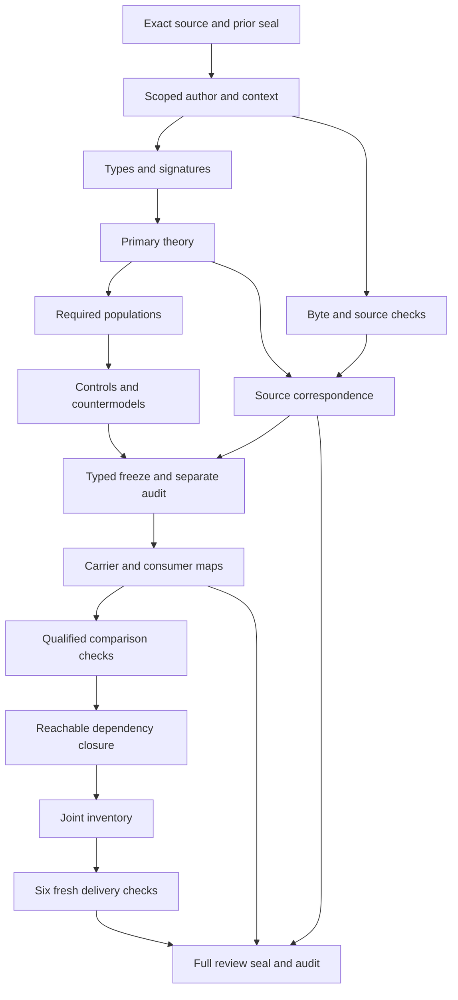

# Artifact Type Resolution: definitions, types and logic review

## 1. Exact target and candidate boundary

The selected Definition is cal.definition.artifact-type-resolution@1.0.0-candidate.2, current C53 source SHA2566320c77c9ef26129857008ed429969a3c43d3a2c9a7edb21c22900d5d47a9303. This document explains an authored partial typed interpretation. It establishes necessary declaration checks and particular finite countermodels. It does not accept whole source fidelity,create an actual resolution result,run a live resolver,validate the subject,admit a type or activate candidate product code.

Request's actual successful separate full audit preceded Resolution's native author. The author preserved7,611previous candidate files and reverified all201captured source files. Native author,build,model and source producers each exited0. All eleven encoded source clauses were evaluated in the native controls,including historical and conflicting evidence branches. The original episode scope remains183current identities,189admitted versions and201source files. Whole accepted translations and whole-definition proofs remain zero.

## 2. Normative voice,exact bytes and historical sources

The scientific formal voice is normative. Domain and plain-language voices explain registered schema_version lookup,unknown kinds and path independence. Those examples cannot define additional authority. Every selected nonempty string has an exact selector,excerpt,digest and character span in the source account. There are28source units and28mapped clauses:eleven encoded,nine explanatory and eight deferred. Deferred content remains in the denominator and owner-review queue.

The source checker verifies the exact current registry row,C53decision,authorization and manifest byte bindings. Definition,Artifact Type and Validation upstream sources have their exact admitted-current bindings checked. The predecessor Resolution candidate.1 is retained with its admitted-historical overlay while its embedded source reference remains candidate-unadmitted with a null admission reference. Historical body posture and current admission overlays are distinct evidence roles.

The Definition schema and generator digests are bound. Two pure deterministic projections reproduce the committed4,932bytes without input mutation. Both projection digests are5025d2b0f5dc732df130ed2e62fe0eb146a3d58d32ebd1330c3549ad6af4292c. No generator writer or live producer is executed. These54source checks establish exact local representation observations;they cannot authenticate every real registry entry or accept a semantic translation.

## 3. Sorted signature and qualified identities

Eleven nonempty sorts separate OperationReference,CarrierReference,RegistryReference,ArtifactTypeReference,LifecycleState,ResultReference,ResultKind,DiscriminatorPath,DiscriminatorValue,PathMetadata and Token. An operation binds an input carrier,an exact registry,a structured result and descriptive path metadata. A result is distinct from its selected type and from a Validation Receipt or Conformance finding. These are proposed denotations requiring concrete correspondence,not newly admitted canonical Definition identities.

Eight constants distinguish EMPTY,NONE,the three lifecycle tags CURRENT,HISTORICAL,CANDIDATE,and result kinds RESOLVED,UNRESOLVED,AMBIGUOUS. Each family is pairwise distinct. EMPTY marks a missing reference token;NONE records a declared lack of authority effect. Twenty-two total functions nominate input facets,registered state/discriminator facets,result fields and reference handles. Sixty predicates and relations complete the101declarations. Every symbol is qualified by exact source version and candidate scope.

Total nominees cannot conceal multiplicity. Explicit binding and match relations expose missing or conflicting tuples. Equality is sorted and compares exact ArtifactTypeReference identities,not descriptive keys,filenames or evidence-row labels. No global reference-alias policy,type-key injectivity,universal singleton registry or singleton resolver is asserted. Result fields nominated outside resolved outcomes are deliberately ignored rather than treated as fabricated real selections.

## 4. Operation genus and exact selected facets

ResolutionApplicable(o) is equivalent to OperationInScopeDeclared(o). A selected operation needs a nonempty handle and DeterministicOperationDeclared. Its carrier,registry,result and path metadata are declared with nonempty handles. Each nominated facet has an explicit relation equivalent to equality with its nominee across the corresponding domain. Missing bindings and conflicting extra bindings fail rather than being hidden in a selector function.

CanonicalMachineCarrierDeclared is required for the selected input. It is a necessary declaration,not proof that a physical file is canonical,owner-authorized,current or byte-faithful. Outside operations remain explicit and do not inherit selected-operation obligations. An outside operation can carry path evidence or a different nominal result without satisfying the selected theory.

The registry reference and the carrier reference remain independent. Movement metadata is not carrier identity. The same declared carrier and registry may be used by two operation references with different path metadata and distinct result records. This prevents a directory move from becoming a silent change of input type while leaving real byte-identity and owner-scope correspondence pending.

## 5. Registered state and discriminator declarations

For each registered type in a selected registry,the type,state,path and value have nonempty declared references. State and discriminator relations bind exactly to the registry/type nominees. A second conflicting state or discriminator tuple fails. Those declarations do not authenticate an owner admission decision or establish actual currentness.

The candidate interprets the source's exactly-one registration boundary as scoped current discriminator uniqueness:two registered-current types with equal declared discriminator path/value must have equal exact type references. Historical and current versions may share a discriminator. A coherent positive control preserves that sharing without asserting global all-version uniqueness. The owner must still accept the precise scope of this reading.

There is no exhaustive global lifecycle vocabulary. A registered type may carry an unknown declared state and remain ineligible for admitted matching. CURRENT,HISTORICAL and CANDIDATE retain their source distinctions;unknown state values are not silently treated as admitted. Current Registry/v2's resolved-duplicate descriptors still require an accepted entry-versus-descriptor map. This scoped Resolution theory does not import the entire prior Registry interpretation or erase its findings.

## 6. Eligible explicit and discriminator evidence

ExplicitMatchDeclared(o,t) holds exactly when the bound registry registers t,the selected carrier declares its exact reference,and the recorded state is CURRENT or HISTORICAL. An explicit historical reference is eligible and retains its historical state. An explicit candidate or unregistered reference is ineligible. Eligibility is declared source correspondence,not actual type admission or contract usability.

DiscriminatorMatchDeclared(o,t) holds exactly when the registry registers t,its recorded state is CURRENT,and some exact path/value pair is declared both by the registered discriminator and the carrier's discriminator fields. Historical discriminator-only evidence is ineligible. A nominated unresolved result cannot hide an eligible current discriminator tuple because the matching condition is bidirectional.

Concrete extraction remains pending:JSON pointer syntax,escaping,value equality,shared selectors,pattern overlap,registry completeness and authentic source bytes need accepted maps. The finite carrier-field relations are authored declarations. The source's examples of goal.json and project.json do not require a separate explicit artifact_type_ref field;registered schema_version evidence is its own route.

## 7. Exact union and evidence deduplication

MatchDeclared(o,t) is equivalent to ExplicitMatchDeclared(o,t) or DiscriminatorMatchDeclared(o,t). ResultMatchDeclared for the selected result is equivalent to that operation's match membership. Every eligible witness enters the union and every union member must have an eligible route. Adding an unwitnessed match or omitting an eligible match fails.

The union counts distinct ArtifactTypeReference identities. If explicit and discriminator evidence reach the same type,it appears once and the outcome is resolved. Two evidence routes are not automatically two matches. The required both-route population exercises this case. A duplicate relation tuple is malformed model structure rather than a legitimate second identity.

Conflicting evidence can select a historical type explicitly and a different current type by discriminator. The match union then has two distinct members and the result is ambiguous. Declared scope and evidence kind remain visible;the interpretation does not choose the nearest name,prefer a directory,ignore an explicit historical reference or silently drop one branch to make the result pass.

## 8. Three cardinality outcomes and recorded states

Zero matches means every type reference is absent from the match relation. Exactly one means some match exists and every matching reference equals it. Multiple means at least two distinct references match. The result-kind equalities are each equivalent to the corresponding condition. Thus an applicable operation cannot report resolved for zero or multiple identities,unresolved for a singleton,or ambiguous because one type was reached twice.

Every selected result carries the same registry reference as the operation,a declared recognized result kind,and authority effect NONE. A resolved result's nominated type must be a match and its nominated state must equal the registry's recorded state for that type. ResolvedTypeStateDeclared is an exact relation,including the selected historical state. It is empty for unresolved and ambiguous results.

Total nominated selected-type and selected-state functions remain mathematically defined for every ResultReference. Their values outside resolved outcomes are unconstrained by selected-field obligations and do not represent fabricated contracts. Positive controls change such unused nominees without turning the result into a successful lookup. Actual structured-result authenticity and registry identity fidelity remain independent targets.

## 9. Determinism and movement invariance

SameCanonicalInputDeclared(o,other) is equivalent,within selected operations,to equality of the nominated carrier and registry references. Such operations must agree on result kind,match membership,and resolved selected type/state where applicable. They need not share ResultReference identity. A missing relation for a moved carrier or a relation that merges different carriers fails.

The supplied model contains Current and Move operations with the same carrier and registry but different path metadata. Both have identical match sets and resolved selections. Changing only a result kind fails. A coherent metadata change that removes the distinct-path witness can preserve T while failing the required movement population;this separates declaration truth from coverage.

Real movement invariance requires an accepted map from unchanged canonical machine content and exact registry bytes to these identities. Arbitrary content edits are not covered. Path,filename,extension and nearest-name evidence declarations are each prohibited for selected operations. No actual filesystem move,live resolver invocation or global program determinism theorem is inferred from this finite witness.

## 10. No-effect and activation boundaries

Selected results cannot declare validation,conformance or admission effects. A candidate explicit reference cannot acquire an ExplicitMatchDeclared or ResolverAdmitsTypeDeclared tuple through this operation. Result authority effect is exactly NONE. Negative controls reject each prohibited effect and inference marker.

These boundaries do not prohibit independently supported validation or authority in a larger workflow. Actual-outcome predicates remain uninterpreted pending accepted denotations. The independent authority population is a separately identified context observation;it does not map to authority generated by resolution. ResolutionActualAuthority must not be silently interpreted as a resolution effect.

The source retains candidate product-code activation residue. Admission of this Definition,admission of an adjacent carrier contract,schema validity,a native PASS or an ARE receipt does not approve or activate the enclosing resolver product. No real output,type registration,admission,promotion,publication,deployment or live consumer effect is created by this formalization stage.

## 11. Controls,populations and nonentailment evidence

The native model checker evaluated119controls against all eleven compiled source clauses and all required populations. Thirty-six satisfy T,seventy-five fail T as expected,and eight are rejected as malformed structures. The structural cases distinguish wrong result sort,missing signature,nontotal function,ill-sorted constant,wrong arity,duplicate predicate tuple,empty domain and duplicate function tuple.

Thirteen required populations exercise selected operations without actual outcomes,an outside operation,independent authority,all three result kinds,historical explicit lookup,current discriminator lookup,both routes reaching one type,conflicting evidence,candidate explicit ineligibility,historical discriminator ineligibility,and movement metadata. Sixty additional population obligations remain unresolved. Authored witnesses exercise guards;they are not production histories or mandatory inventories of every real registry.

Twenty-four actual-outcome targets stay outside T. The checker independently validates a supplied model where T and all required populations hold,each queried universal target is false,and its selected witness condition is true. Targets cover execution,match correctness,completeness,registry fidelity,currentness,result authenticity,movement,type usability,validation,conformance,admission,activation,owner fidelity,authority and consumer alignment. These particular finite countermodels establish limits of the authored theory;they do not authenticate real outcomes or prove accepted whole Definition consistency.

The prepared preflight evaluated the exact eleven source clauses and all populations with a maximum76,004steps within the existing100,000step limit. The shared verifier limits and model domains were unchanged. Native producer checks independently repeat the compiled interpretation rather than trusting the preflight's intent. One retained prepared syntax failure occurred before native creation;all four native producer exit codes are zero.

## 12. Source obligations,review findings and DAG

Thirty-one source-query obligations bind exact selectors,excerpts,digests and character spans to actual-outcome queries. Necessary declaration guards can be encoded without inserting their actual targets as assumptions. There are no interpretation assumptions or hidden whole-prior-theory imports. Source precedence,shared denotations,dependency closure,owner fidelity and semantic readiness remain pending.

Twenty RES-FINDING references retain the scoped interpretations and known losses. Their statuses are unresolved. The full signature and complete source account below let a reviewer inspect every sort,function,relation and source disposition without reconstructing the chat. Descriptive labels absent from the canonical definitions registry remain proposed sorts rather than invented admitted Definition identities.

The acyclic fifteen-node,eighteen-edge DAG preserves types and logic first. Exact source and prior audit govern native authoring;the theory and witness populations feed controls and countermodels;source observations feed correspondence. Both meet at the typed freeze and separate audit. Only then should current carriers and consumers be compared. Reachable dependencies,joint inventory,fresh full checks and the full explanatory delivery review precede sealing and a separate delivery audit.

## 13. Remaining work and original completion scope

There are87native T files at this typed-stage observation. The last full-delivery inventory remains Request's86partial drafts and97missing identities. A fresh inventory has not yet evaluated Resolution,so file observation and full inventory are separate. No source-owner-accepted whole translation or whole-definition proof is established.

Next perform three fresh typed checks,freeze sixteen exact inputs and independently audit them. Then inspect exact current consumer routes,including tooling/validators/artifact_surface_candidate_2.py and Artifact Type Request/v1. Evaluate only selected pure functions on isolated fixtures;do not execute package-validation writers or a live resolver. Compare admitted explicit filtering,current discriminator selection,union deduplication,three result kinds,historical recorded state,registry identity and path invariance.

Retain Request's unaccepted legacy25entry versus current143contract route and absent intake observations. Verify reachable dependencies and freshly evaluate every existing per-definition witness in the whole inventory. Run six actual delivery checks,write the full aspect-by-aspect review,seal exact candidate bytes and independently audit preservation. Canonical Package Home follows Resolution in manifest order. The183identity189version201source objective remains active until all required definitions,source correspondence,logical obligations,dependency review and final explanation are complete.

Candidate review findings:

| Finding | Pending denotation or limitation |
|---|---|
| RES-FINDING-001 | C53 admission of Resolution meaning does not accept this translation. |
| RES-FINDING-002 | Operation,canonical carrier,registry,type and result identities require accepted denotations;descriptive paths are separate. |
| RES-FINDING-003 | CanonicalMachineCarrierDeclared does not establish real canonical authority or actual source bytes. |
| RES-FINDING-004 | Registered type facets are exact declared state and discriminator bindings,not authenticated admission records. |
| RES-FINDING-005 | Explicit evidence selects admitted-current or admitted-historical references;an embedded candidate body is not the effective overlay. |
| RES-FINDING-006 | Discriminator evidence selects admitted-current references only;historical discriminator matches stay ineligible. |
| RES-FINDING-007 | Exact match union counts distinct versioned type references,not evidence-row counts or descriptive keys. |
| RES-FINDING-008 | Explicit and discriminator evidence is bidirectional;actual extraction,JSON pointers and complete registry search remain pending. |
| RES-FINDING-009 | Registered-current discriminator uniqueness is a scoped candidate reading of the boundary;all-version uniqueness is not asserted. |
| RES-FINDING-010 | No exhaustive global lifecycle vocabulary is assumed;unknown registered states remain ineligible unless current or historical. |
| RES-FINDING-011 | Three result kinds reflect zero,one and at-least-two declared match identities;actual execution remains independent. |
| RES-FINDING-012 | Resolved historical lifecycle state must bind the selected recorded state,not automatically become current. |
| RES-FINDING-013 | Total nominated resolved fields are ignored outside resolved outcomes;no fabricated unresolved type or state is required. |
| RES-FINDING-014 | Determinism and movement invariance concern identical declared carrier and registry inputs;real byte identity and path movement require maps. |
| RES-FINDING-015 | Results are structured lookup declarations with no effect;validation,conformance and admission are separate operations. |
| RES-FINDING-016 | Candidate explicit references cannot be admitted by this operation;actual type usability is not derived. |
| RES-FINDING-017 | A separate independent authority observation does not grant an authority effect to resolution. |
| RES-FINDING-018 | Current Registry v2 descriptors and legacy entries consumer routes retain unaccepted mappings and prior findings. |
| RES-FINDING-019 | Historical candidate.1 source posture remains separate from admitted-historical overlay;product-code activation residue is retained. |
| RES-FINDING-020 | Finite models and countermodels do not establish accepted whole Definition fidelity or common-meaning closure. |

Exact sorted signature:

| Symbol | Arguments | Result or role |
|---|---|---|
| EMPTY | constant | Token |
| NONE | constant | Token |
| CURRENT | constant | LifecycleState |
| HISTORICAL | constant | LifecycleState |
| CANDIDATE | constant | LifecycleState |
| RESOLVED | constant | ResultKind |
| UNRESOLVED | constant | ResultKind |
| AMBIGUOUS | constant | ResultKind |
| operationCarrier | OperationReference | CarrierReference |
| operationRegistry | OperationReference | RegistryReference |
| operationResult | OperationReference | ResultReference |
| operationPath | OperationReference | PathMetadata |
| registryTypeState | RegistryReference, ArtifactTypeReference | LifecycleState |
| registryTypePath | RegistryReference, ArtifactTypeReference | DiscriminatorPath |
| registryTypeValue | RegistryReference, ArtifactTypeReference | DiscriminatorValue |
| resultRegistry | ResultReference | RegistryReference |
| resultKind | ResultReference | ResultKind |
| resultSelectedType | ResultReference | ArtifactTypeReference |
| resultSelectedState | ResultReference | LifecycleState |
| resultAuthorityEffect | ResultReference | Token |
| operationReferenceHandle | OperationReference | Token |
| carrierReferenceHandle | CarrierReference | Token |
| registryReferenceHandle | RegistryReference | Token |
| artifactTypeReferenceHandle | ArtifactTypeReference | Token |
| lifecycleStateHandle | LifecycleState | Token |
| resultReferenceHandle | ResultReference | Token |
| resultKindHandle | ResultKind | Token |
| discriminatorPathHandle | DiscriminatorPath | Token |
| discriminatorValueHandle | DiscriminatorValue | Token |
| pathMetadataHandle | PathMetadata | Token |
| ResolutionApplicable | OperationReference | declared predicate or relation;actual targets stay independent |
| OperationInScopeDeclared | OperationReference | declared predicate or relation;actual targets stay independent |
| DeterministicOperationDeclared | OperationReference | declared predicate or relation;actual targets stay independent |
| PathEvidenceDeclared | OperationReference | declared predicate or relation;actual targets stay independent |
| FilenameEvidenceDeclared | OperationReference | declared predicate or relation;actual targets stay independent |
| ExtensionEvidenceDeclared | OperationReference | declared predicate or relation;actual targets stay independent |
| NearestNameEvidenceDeclared | OperationReference | declared predicate or relation;actual targets stay independent |
| ResolutionActualResolverExecution | OperationReference | declared predicate or relation;actual targets stay independent |
| ResolutionActualMatchCorrectness | OperationReference | declared predicate or relation;actual targets stay independent |
| ResolutionActualSearchCompleteness | OperationReference | declared predicate or relation;actual targets stay independent |
| ResolutionActualRegistryFidelity | OperationReference | declared predicate or relation;actual targets stay independent |
| ResolutionActualCurrentness | OperationReference | declared predicate or relation;actual targets stay independent |
| ResolutionActualResultAuthenticity | OperationReference | declared predicate or relation;actual targets stay independent |
| ResolutionActualMovementInvariance | OperationReference | declared predicate or relation;actual targets stay independent |
| ResolutionActualTypeUsability | OperationReference | declared predicate or relation;actual targets stay independent |
| ResolutionActualValidation | OperationReference | declared predicate or relation;actual targets stay independent |
| ResolutionActualConformance | OperationReference | declared predicate or relation;actual targets stay independent |
| ResolutionActualTypeAdmission | OperationReference | declared predicate or relation;actual targets stay independent |
| ResolutionActualOwnerActivation | OperationReference | declared predicate or relation;actual targets stay independent |
| ResolutionActualOwnerFidelity | OperationReference | declared predicate or relation;actual targets stay independent |
| ResolutionActualAuthority | OperationReference | declared predicate or relation;actual targets stay independent |
| ResolutionActualPromotion | OperationReference | declared predicate or relation;actual targets stay independent |
| ResolutionActualAdoption | OperationReference | declared predicate or relation;actual targets stay independent |
| ResolutionActualPublication | OperationReference | declared predicate or relation;actual targets stay independent |
| ResolutionActualDeployment | OperationReference | declared predicate or relation;actual targets stay independent |
| ResolutionActualExternalEffect | OperationReference | declared predicate or relation;actual targets stay independent |
| ResolutionActualConsumerAlignment | OperationReference | declared predicate or relation;actual targets stay independent |
| ResolutionActualGlobalConsistency | OperationReference | declared predicate or relation;actual targets stay independent |
| ResolutionActualHistoricalStateAuthenticity | OperationReference | declared predicate or relation;actual targets stay independent |
| ResolutionActualExplicitReferenceFidelity | OperationReference | declared predicate or relation;actual targets stay independent |
| ResolutionActualDiscriminatorInterpretation | OperationReference | declared predicate or relation;actual targets stay independent |
| CarrierReferenceDeclared | CarrierReference | declared predicate or relation;actual targets stay independent |
| RegistryReferenceDeclared | RegistryReference | declared predicate or relation;actual targets stay independent |
| ArtifactTypeReferenceDeclared | ArtifactTypeReference | declared predicate or relation;actual targets stay independent |
| LifecycleStateDeclared | LifecycleState | declared predicate or relation;actual targets stay independent |
| ResultReferenceDeclared | ResultReference | declared predicate or relation;actual targets stay independent |
| ResultKindDeclared | ResultKind | declared predicate or relation;actual targets stay independent |
| DiscriminatorPathDeclared | DiscriminatorPath | declared predicate or relation;actual targets stay independent |
| DiscriminatorValueDeclared | DiscriminatorValue | declared predicate or relation;actual targets stay independent |
| PathMetadataDeclared | PathMetadata | declared predicate or relation;actual targets stay independent |
| operationCarrierBindingDeclared | OperationReference, CarrierReference | declared predicate or relation;actual targets stay independent |
| operationRegistryBindingDeclared | OperationReference, RegistryReference | declared predicate or relation;actual targets stay independent |
| operationResultBindingDeclared | OperationReference, ResultReference | declared predicate or relation;actual targets stay independent |
| operationPathBindingDeclared | OperationReference, PathMetadata | declared predicate or relation;actual targets stay independent |
| CanonicalMachineCarrierDeclared | CarrierReference | declared predicate or relation;actual targets stay independent |
| RegistryTypeRegisteredDeclared | RegistryReference, ArtifactTypeReference | declared predicate or relation;actual targets stay independent |
| RegistryTypeStateBindingDeclared | RegistryReference, ArtifactTypeReference, LifecycleState | declared predicate or relation;actual targets stay independent |
| RegistryDiscriminatorDeclared | RegistryReference, ArtifactTypeReference, DiscriminatorPath, DiscriminatorValue | declared predicate or relation;actual targets stay independent |
| CarrierExplicitTypeReferenceDeclared | CarrierReference, ArtifactTypeReference | declared predicate or relation;actual targets stay independent |
| CarrierDiscriminatorFieldDeclared | CarrierReference, DiscriminatorPath, DiscriminatorValue | declared predicate or relation;actual targets stay independent |
| ExplicitMatchDeclared | OperationReference, ArtifactTypeReference | declared predicate or relation;actual targets stay independent |
| DiscriminatorMatchDeclared | OperationReference, ArtifactTypeReference | declared predicate or relation;actual targets stay independent |
| MatchDeclared | OperationReference, ArtifactTypeReference | declared predicate or relation;actual targets stay independent |
| ResultMatchDeclared | ResultReference, ArtifactTypeReference | declared predicate or relation;actual targets stay independent |
| ResolvedTypeStateDeclared | ResultReference, ArtifactTypeReference, LifecycleState | declared predicate or relation;actual targets stay independent |
| SameCanonicalInputDeclared | OperationReference, OperationReference | declared predicate or relation;actual targets stay independent |
| ResolverAdmitsTypeDeclared | OperationReference, ArtifactTypeReference | declared predicate or relation;actual targets stay independent |
| ResultValidationEffectDeclared | ResultReference | declared predicate or relation;actual targets stay independent |
| ResultConformanceEffectDeclared | ResultReference | declared predicate or relation;actual targets stay independent |
| ResultAdmissionEffectDeclared | ResultReference | declared predicate or relation;actual targets stay independent |

Complete source clause account:

| Clause | Selector | Disposition | Exact source excerpt |
|---|---|---|---|
| RES-001 | /boundaries/0 | deferred | Resolution is not validation. |
| RES-002 | /boundaries/1 | deferred | Resolution is not conformance. |
| RES-003 | /boundaries/2 | deferred | Resolution cannot use directory placement. |
| RES-004 | /claim_ceiling | deferred | This candidate defines deterministic lookup semantics only. It does not establish repository conformance or make the candidate registry current. |
| RES-005 | /scope/applicability | encoded | Resolving a canonical machine carrier to exactly one admitted Artifact Type through explicit classification or a registry-declared discriminator. |
| RES-006 | /scope/authority_scope_ref | deferred | scope:artifact-type-resolution |
| RES-007 | /scope/exclusions/0 | deferred | Directory or filename inference. |
| RES-008 | /scope/exclusions/1 | deferred | Nearest-name matching. |
| RES-009 | /scope/exclusions/2 | deferred | Treating an unadmitted candidate type as usable. |
| RES-010 | /voices/domain_context/examples/0 | explanatory | cyberalchemy-lab-product-identity/v1 resolves to cal.artifact-type.product-identity/v1. |
| RES-011 | /voices/domain_context/examples/1 | explanatory | A new cyberalchemy-lab-runtime-binding/v1 discriminator remains unresolved until its type is admitted. |
| RES-012 | /voices/domain_context/explanation | explanatory | goal.json and project.json can resolve through their registered schema_version values even though their current instance schemas do not carry a separate artifact_type_ref field. |
| RES-013 | /voices/domain_context/workspace_ref | explanatory | /home/vrondelli/projects/CyberAlchemy-lab |
| RES-014 | /voices/plain_language/explanation | explanatory | One reusable operation reads the file and registry, reports one exact contract or a clear unresolved/ambiguous result, and never guesses from the path. |
| RES-015 | /voices/scientific_formal/boundary_conditions/0 | encoded | An explicit candidate type reference does not become admitted by resolution. |
| RES-016 | /voices/scientific_formal/boundary_conditions/1 | encoded | A schema_version may be a discriminator only when registered for exactly one type. |
| RES-017 | /voices/scientific_formal/boundary_conditions/2 | encoded | Successful resolution is not schema validation or admission. |
| RES-018 | /voices/scientific_formal/formal_expression | encoded | M_R(a)=explicit_matches_admitted_R(a) union discriminator_matches_current_R(a); resolve_R(a)={resolved(t,state_R(t)) if \|M\|=1, unresolved if \|M\|=0, ambiguous(M) if \|M\|>1}; authority_effect(resolve_R)=none. |
| RES-019 | /voices/scientific_formal/normative_statement | encoded | Artifact Type Resolution is an executable deterministic operation resolve_R(a) over one canonical machine carrier and one exact registry. An explicit exact reference may select an admitted-current or admitted-historical type; discriminator-only evidence selects admitted-current types. The operation returns resolved for exactly one match, unresolved for zero, and ambiguous for multiple distinct matches. Paths, filenames, extensions, and nearest-name similarity are excluded evidence. |
| RES-020 | /voices/scientific_formal/notation/0/meaning | explanatory | One candidate canonical machine carrier. |
| RES-021 | /voices/scientific_formal/notation/0/symbol | explanatory | a |
| RES-022 | /voices/scientific_formal/notation/1/meaning | explanatory | Resolution using exact registry R. |
| RES-023 | /voices/scientific_formal/notation/1/symbol | explanatory | resolve_R |
| RES-024 | /voices/scientific_formal/testable_conditions/0 | encoded | The reusable resolver accepts an artifact and exact registry and emits one structured result. |
| RES-025 | /voices/scientific_formal/testable_conditions/1 | encoded | Directory movement does not change the match set. |
| RES-026 | /voices/scientific_formal/testable_conditions/2 | encoded | Unknown discriminators return unresolved and conflicting evidence returns ambiguous. |
| RES-027 | /voices/scientific_formal/testable_conditions/3 | encoded | An exact explicit historical reference resolves with its recorded historical lifecycle state while discriminator-only lookup selects current entries. |
| RES-028 | /voices/scientific_formal/testable_conditions/4 | encoded | Every result carries the exact registry identity and no authority effect. |

Typed-stage helper preparation also exited1 after native creation and before a freeze: a text replacement matched a nested for-expression instead of its intended assertion line. The original preparation script and actual exit metadata are retained in preparation-history/types-stage-preparation-001. No native interpretation,model,source input or existing seal was modified,and no typed freeze or audit ran in that failed preparation. The replay helper created before the error is preserved. Both preparation failures remain visible;the four native definition producers remain successful.
