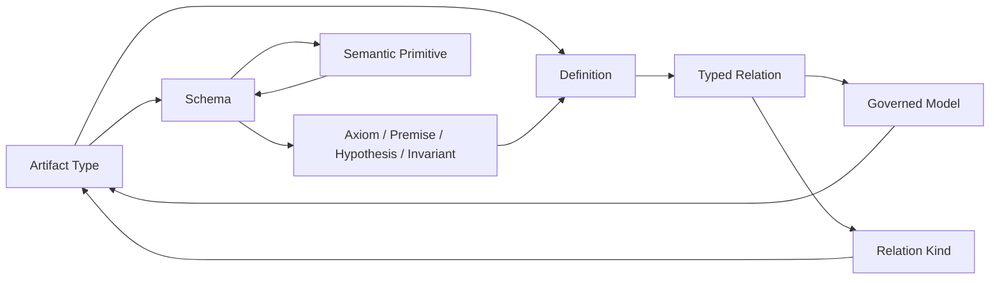

# Artifact Type: definition, types and logical-contract review

This is a partial candidate translation of the current admitted source `cal.definition.artifact-type@1.0.0-candidate.1`, bound to source SHA-256 `90c61c2fa5a5f1d5d0a96d8e6c1f4b1f902e8ad57d85ef1e315e549470abb69f`. It is not an owner-accepted whole translation, whole-definition proof, registration, admission or activation. It continues the user's definition/type/logical priority under F04-T; A04, C01 and E02 were rechecked before creating the absent output.

The source remains at `authority/definitions/candidates/0007-cml07-semantic-closure/definitions/artifact-type/v1/definition.json`. Nothing in its normative text, historical candidate wording, registry or admission records was rewritten. Its registry admission establishes which source version is selected; it does not certify this agent's interpretation of that version.

## 1. Meaning and definitional form

An Artifact Type is a versioned contract for one artifact kind. It operationalizes separately defined subject meaning through a representation, projection and validation contract. The Definition supplying subject meaning, the machine Schema, a validator execution, a generated human page, an artifact instance, an admission decision and an authority grant retain different roles.

The selected translation is an axiomatic specification of necessary properties. It deliberately contains no `ArtifactType(t) iff ...` membership test. Satisfying its component predicates is not sufficient to identify an actual Artifact Type or grant it a lifecycle state. The source contains examples and non-entailment statements as well as positive constraints, so a single artifact classification cannot determine every clause's logical role.

The complete source inventory contains 26 nonempty string units. Every character of those units maps into 30 clause spans: 12 encoded, 9 explanatory and 9 deferred. Deferred clauses retain their excerpts, selectors and reasons. Complete character accounting means that difficult content remains visible; it does not mean that all content has been translated or independently accepted.

## 2. Signature, carrier types and identity

The signature has 56 declarations: 13 nonempty sorts, 11 total functions and 32 predicates/relations. The sorts distinguish Contract, ArtifactKind, DefinitionRef, MachineSchema, Direction, ProjectionContract, ValidationContract, OwnerRoute, LifecyclePosture, ClaimCeiling, VersionLabel, Identity and Instance.

Contract component functions select a contract identity, version, artifact kind, machine schema, canonical direction, projection, validation, owner, lifecycle and claim ceiling. Instance identity has a separate selector. Function totality is a requirement of this mathematical structure; it is not a claim that a live resolver, generator or external service always succeeds. Actual schema digests, file names, Definition references and principals still need reviewed representation maps.

One Artifact Type binds its selected artifact kind, and all kind bindings for that type must equal that selected kind. This is uniqueness per contract, not an injective map from every contract version to a different subject kind. A successor version may govern the same artifact kind.

Type and instance identities use the **same Identity carrier**. For every selected Artifact Type and ArtifactInstance, the two selected identities must differ. This is an actual local inequality condition rather than a distinction obtained by assigning objects to unrelated nominal sorts. The model rejects a type/instance identity collapse. The intended canonical subject/identity mappings and the scope of “every instance” remain owner-review questions; this local condition does not prove the whole repository's identity integrity.

## 3. Core clauses and contract components

An Artifact Type must be versioned, govern one selected kind and bind at least one semantic Definition. Its selected schema must have ClosedSchema and PinnedSchema status; its direction, projection, validation rules, owner route, lifecycle posture and claim ceiling must have their respective declared statuses.

These are semantic predicates whose interpretations are explicit in each mathematical model. Naming `DeterministicProjection` does not prove arbitrary generator determinism. Naming `ClosedSchema` does not inspect every possible JSON representation or resolve every external schema reference. The read-only carrier checks below supply stronger evidence for the exact selected files, while general transformation and representation meaning remain deferred.

The source's formal tuple supplies the typed component view. Its normative binding sentence supplies the required semantic binding and component constraints. Exact direction, generator, owner and inspectability conditions receive explicit deferred obligations where a status tag would otherwise overstate operational evidence.

## 4. Registration roles and logical strength

Three different predicates are retained: Registered, ValidNewRegistration and NewRegistration. Historical registration is not silently reclassified as a registration authored under a successor policy.

The formal expression states a necessary nonempty-binding condition for ValidNewRegistration. Its translation does not add reference resolvability to that expression. The separate testable condition states that every NewRegistration has a resolvable semantic Definition binding. It therefore receives its own NewRegistration condition. No equivalence between those predicates, or between validity and registration, is assumed.

This distinction was corrected during review. The previous unsealed slice had combined the two conditions; its code, reports and passing replays are retained under `attempt-002-before-registration-role-separation`. The final model controls permit a formal valid-registration tag with a nonempty unresolved binding, and reject a testable new-registration tag without a resolvable bound Definition. A reviewed bridge between the two source roles is still needed for a full translation.

The bounded synthetic profile below chooses stricter operational requirements, including resolvability and exact schema/projection declarations. Those profile requirements are not retroactively added to the logical theory or the admitted v1 contracts.

## 5. Admission and absence of authority shortcuts

An admitted Artifact Type must have admitted Definitions for every bound semantic reference. Candidate bindings are allowed before admission. An admitted Definition alone is not sufficient to admit its consuming Type, and a record's historical candidate wording does not override an independently selected admission overlay.

Eleven target propositions remain outside the theory. Seven test whether ArtifactType implies registration, admission, authority, subject-meaning definition, validation PASS, conformance or runtime activation. Three test Registered→AdmittedType, ValidationPassed→ConformanceEstablished and SelfDescribed→AdmittedType. The last tests whether admitted bound meanings imply Type admission. Each has an independently evaluated finite countermodel satisfying the selected theory and its required populations, while falsifying the target.

These witnesses establish non-entailment for this partial theory. They do not authenticate an owner, prove the truth of all external source meaning, exhaust all models or demonstrate arbitrary runtime safety. A target is never inserted into the premise set to produce a passing result.

## 6. Populations, assumptions and finite denotation

There are 12 required populations: ArtifactType, VersionedContract, OneArtifactKind, eight component statuses and the semantic binding. Their existential obligations are tied to a hypothetical Artifact Type and its selected components. A witness that satisfies all selected clauses and populations prevents a vacuous consistency demonstration.

Nineteen role/outcome/reference populations plus NewRegistration remain unresolved, giving 20 unresolved populations. Actual registration, owner admission, artifact existence, conformance and runtime outcomes are not created to fill these obligations. There are no selected assumptions, assumption links or owner-approved exemptions.

The independent denotation evaluator checks 45 authored controls, including missing components, absent/extra kind bindings, multiple meanings, successor kinds, candidate/admitted meaning gates, the separated registration roles, common-identity collapse, independent outcomes, vacuous ArtifactType extension and malformed model structures. Four malformed structures exercise sort, totality, arity and duplicate-tuple rejection. The empty ArtifactType model satisfies guarded theory clauses but fails required inhabitation; that failure is retained.

These are supplied finite structures evaluated against the typed IR. They are not native-provider model enumeration, an unbounded satisfiability proof or a common-carrier model of all eleven Definitions.

## 7. Bounded registration profile and actual carrier evidence

The synthetic profile checks eleven closed descriptor fields: exact type/version/kind, semantic references, schema, direction, projection, rules, owner, lifecycle and ceiling. Its declared catalogs are synthetic fixtures. Candidate references permit authoring; all references must be admitted-current to pass the requested admission **necessary condition**, which still creates no admission act.

The final 24 controls include 3 accepted and 21 rejected cases. Rejections cover empty/missing/duplicate/bare/unresolved bindings, one unqualified binding among several, historical admission, wrong schema digest, open representation, malformed schema reference, reverse/editable canonical direction, missing component fields, invalid version type, non-Boolean determinism declarations and an implicit-admission extra field. The earlier 22-control profile is preserved under `attempt-001-before-malformed-reference-controls`.

Read-only inspection covers exact v1, v2 and v3 Artifact Type descriptors and schemas. Twenty-two actual checks establish selected schema/digest validity, exact admission overlay bytes, v3 selection, v2→v1 and v3→v2 predecessor references, current Definition source bindings, bounded self-registration and projection parity. Five actual hostile fixtures—one v2 and four v3—are rejected by their selected schemas.

The selected registry records v1/v2 as admitted-historical and v3 as admitted-current. All three immutable descriptors retain embedded candidate wording. The v2 semantic binding also retains candidate wording while the selected Definition registry records admission. These observations describe distinct evidence layers; they do not rewrite a descriptor, perform an admission or authenticate the human principal who made the recorded decision.

The actual v1 descriptor declares **9 registrations**. The v2 policy text says “eight registrations,” so that historical number cannot be used as a verified current denominator. Exact predecessor preservation is verified, while reconciliation of that prose remains part of ATY-REGISTRATION-004/ATY-ADMISSION-005. No v1 binding is retrofitted to satisfy v2 or v3 requirements.

Pure renderer calls reproduce v2 and v3 human projections twice without mutating the input. The v3 self-witness projection also matches. This proves parity for those selected inputs, not universal determinism, complete human-view invertibility, or source fidelity. Canonical receipt-writing validators and generators were inspected but not executed; all new output belongs to this candidate unit.

## 8. Dependencies and the changed joint-review boundary

Eight authored direct uses bind Definition, Schema, Artifact, Validation, Authority, IdentityCarrier, ProjectionSpecification and Conformance. These links express semantic use, not proof that the meanings already agree. Independently reviewed dependency completeness and cross-carrier alignment are still missing.

The reachable declared graph now has **41 nodes, 79 edges and 30 missing counterpart packets**. All 11 available drafts fall into one strongly connected component with 32 internal edges. ArtifactType's Definition/Schema links connect the previous three components through their existing reverse dependencies. The root graph and eleven-root inventory graph now have the same reachable declared closure.

This diagram shows representative connecting edges, not the whole 79-edge graph. The complete edge inventory is in `dependency-graph.json`. A strongly connected dependency component is not automatically a forbidden value cycle, a valid recursive definition, an inconsistency or a least fixed point. No cycle policy has been selected; each recursive/coupling interpretation needs separate review. Independently supplied witnesses for private theories do not establish consistency after shared meanings are aligned.

## 9. Episode progress, review obligations and next work

The exact inventory now contains 11 partial drafts, with 172 current definition identities still lacking per-definition T drafts. It accounts for 248 source units and 387 clauses: 125 encoded, 90 explanatory and 172 deferred. There are 101 required and 143 unresolved populations. All 11 selected theories have a supplied independently evaluated T/I witness; none has an owner-accepted whole translation or whole-definition proof.

Six recorded findings need attributable owner decisions: subject-meaning reference resolution; actual component embedding; shared identity scope; registration role/legacy policy; descriptor/admission interpretation; and dependency completeness/joint semantics. Such decisions cannot be replaced by this agent's receipt, successful schema validation or a graph count. Source fidelity, whole translation, full obligation generation and joint evidence therefore remain pending.

All six terminal fresh replays passed. An initial delivery audit was started before the combined fresh command report existed and refused to seal; `attempt-003-delivery-before-fresh-report` records that failure. The same harness completed without restart, and the audit is repeated after its terminal report. No delivery outputs or canonical records were written by the failed attempt.

The current I04 CLI report still binds its older eight-draft manifest. That exact report remains valid; a later scoped reporting update is required before selecting this larger delivery through that report path. The per-definition inventory here does not modify sealed I04 code or misrepresent its coverage.

The next definition priority is **F04-T.cal.definition.identity-carrier**, to develop the canonical subject/identity counterpart demanded by this slice. The I05 workflow rehearsal remains independently ready but follows the user's definition/type priority. The full episode remains active over all 183 current definitions and 189 admitted source versions. Partial drafts and bounded checks do not replace the remaining translations, dependency/alignment review, formal obligations, complete theory work or final episode-wide explanation.
