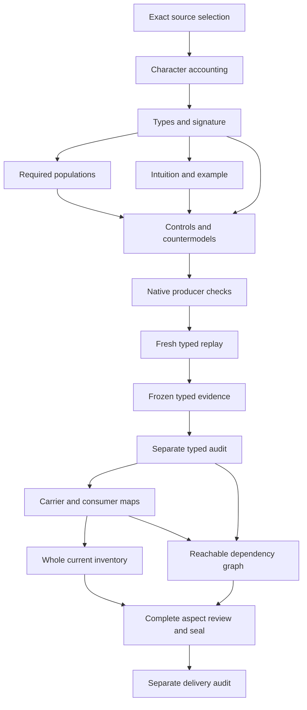

# Artifact: typed candidate review

## 1. Exact source, normalized identity and admission boundary

This unit selects cal.definition.artifact@1.0.0-candidate.1, SHA-256 554dda3aec8fb66fdfd2a910d90defa56235705e482fa24184f31957a2b1d785. The current C53 full-Definition-queue Decision admits its exact Definition meaning. Its source remains the L1 semantic-repeatability reconstruction document. The source's historical candidate claim ceiling, domain explanation and candidate-unadmitted D51 source posture remain retained input text. Current source admission and historical reconstruction prose are observed separately; neither silently rewrites the other or accepts this mathematical translation.

The recorded D51 source-use admission selects lines 3522 through 3727 at section digest 3e9d50b1154b58b938c164725ac8fabed16914538dda579cf89c671c13c5becc. Its historical whole-file digest is ecfbd64f334954809e83ffd5d4f9adfb759f39716de96c3ac1227d4ee869c6f8. The source-use record targets both Artifact and Canonical Representation Invariant. Those are separate identities and purposes despite shared lineage. This run does not reproduce that external historical range or whole file and does not authenticate an external repository or actor.

Receipt's full delivery was sealed at 7,054 files and separately audited before Artifact's native unit was created. Every earlier seal remains preserved. The source snapshot still has 183 current identities, 189 admitted versions and 201 source files. Artifact adds a working eighty-second partial draft. It does not create an instance admission, alter canonical Definition bytes, accept an owner translation, execute an artifact producer or confer actual authority.

## 2. Genus, canonical qualification and explanatory voices

The genus is an identity-bearing, typed, versioned record produced or maintained for a declared purpose. Its canonical machine representation, generated human projection, ownership, provenance, lifecycle posture and validation surface are explicit. The proposed interpretation retains necessary declarations for those facets. It adds an explicit declared relation among the machine representation, human projection and generator rather than allowing unrelated references to stand in for a generated projection. Actual generation and canonical representation correctness remain independent targets.

Canonical qualification applies to an instance with an enumerated canonical kind, an exact owner-admitted allowed process-origin declaration and an honestly stated assurance level. It is distinct from the kind enumeration itself. It is also distinct from the authoritative-version sense of canonical source. The normalized definition target, its semantic owner and its Definition carrier concern the meaning document; they are not a rule that every instance is itself a Definition record or inherits that meaning document's authority.

The scientific-formal voice supplies the selected guards and source biconditional. Plain-language and domain-context intuition remain explanatory, including historical reconstruction claims. Source testable conditions check Definition identity, selected source digest currency, Definition/v1 shape and regenerated human projection. Passing those representation observations does not establish allowed producer eligibility, responsible owner admission, actual assurance mechanisms, process execution, correctness or authority. The semantic requirements continue to have explicit owner findings.

## 3. Sorts and separation of axes

There are twenty-nine distinct descriptive sorts. Artifact is separate from ArtifactIdentity, ArtifactTypeReference, ArtifactVersion and PurposeReference. MachineRepresentationReference, HumanProjectionReference and GeneratorReference retain the representation and projection axes. OwnerReference, ProvenanceReference, LifecyclePosture and ValidationSurfaceReference retain the governance and evidence facets. Context is an unresolved descriptive carrier; no mandatory instance-context field has been invented from the definition's normalized scope metadata.

CanonicalKind, AuthorityKind and Durability are separate carriers. ProducerReference, ProcessReference, ProcessVersionReference and OriginStatementReference describe exact origin declarations. OriginAssurance carries the three support-level tags. IntegrityReceiptReference, VerifierReference and IntegrityMechanismReference describe L1 support. ActorReference, IdentityPolicyReference and ExternalSignatureReference describe L2 support. Digest and Token have separate sorts, so a digest, assurance tag, actor, kind, owner or reference handle cannot be substituted merely because implementations may serialize them as strings.

These mathematical carriers do not create missing canonical Definition identities for canonical kind, producer, origin assurance or signature. Current canonical dependencies are selected by their exact version and digest. Unavailable descriptive labels remain explicit in context and review. Scope qualifications and reference predicates are proposed denotations, not accepted owner maps. Keeping type boundaries prevents accidental equality while leaving real reference resolution and meaning correspondence independently reviewable.

## 4. Signature, record facets and generated projection

The signature has 166 declarations: twenty-nine sorts, four constants, sixty-nine total functions and sixty-four predicates or relations. EMPTY belongs to Token. DECLARED, INTEGRITY_BOUND and ACTOR_ATTESTED belong to OriginAssurance and are required to be distinct. Total scalar functions select one declared value for each record facet; that mathematical totality does not establish global identifier uniqueness, dereferenceability, artifact existence or actual operational availability.

Selected Artifact applicability agrees with its in-scope declaration. Selected records require explicit facets and nonempty declared references for identity, type, version, purpose, machine representation, human projection, generator, owner, provenance, lifecycle and validation surface. They also require a declared canonical machine representation and an exact declared machine/human/generator relation. The paired generation-map controls show that changing the human reference without the matching relation fails, while a different explicitly mapped human reference can satisfy the guards.

Reference declarations and nonempty handles remain narrower than accepted record semantics. They do not validate arbitrary instance schemas, authenticate owners, reconstruct provenance, establish a current lifecycle, execute a generator or prove projection correctness. A caller cannot infer those outcomes from a reference-shaped value or from Definition/v1 shape acceptance. The source's real representation and generation obligations are retained as independently reviewable targets rather than asserted as facts of every supplied model.

## 5. Kind membership and scoped inclusion

A canonical declaration requires declared membership of the selected kind in the canonical-kind enumeration. Authority-kind membership is represented on a separate sort with an explicit embedding into CanonicalKind. Every declared authority-kind member has a declared canonical-kind image. The embedding is injective on declared members, preserving distinct member identities. Outside-member values are not silently brought into the same identity policy or inclusion claim.

A required population contains two declared authority kinds with distinct images. Another required population contains a canonical kind outside the declared authority-kind image. These are nonvacuous mathematical witnesses for the source's inclusion and proper distinction. The negative control collapsing two declared authority-kind images fails. A control allowing an outside authority-kind value to share an image passes because the injectivity guard is explicitly scoped.

This declared embedding is not an accepted actual canonical-kind table, a proof of current enumeration completeness or a shared-carrier set identity. The source table must still come from a current owner-approved source. Mathematical kinds, coarse authority classifications and whether a particular instance has earned authority remain different axes. An accepted mapping to actual kind identities and classification rules is a later owner and carrier correspondence obligation.

## 6. Exact process origin and set-valued allowed producers

Each selected canonical record binds one exact producer, process, process version and origin-statement reference. The statement's producer/process/version projections agree with the instance projections. The selected tuple must occur in the declared allowed-origin relation for that same kind. The kind has a current-owner-approved-origin-set declaration; the producer must be eligible and must not be marked candidate-only. Unresolved or candidate-only producers cannot satisfy the selected canonical qualification.

Allowed origins remain set-valued. One kind can permit more than one producer tuple, and separate instances can select different permitted producers. A required population and positive control demonstrate that case. Total instance projections retain one exact tuple per selected record without imposing one globally unique producer, one common statement identity, a collection order, or an implicit latest process version. A changed producer, process, version or statement binding fails the relevant selected guards.

These exact declarations do not show that the named process ran or that the origin statement is true. The legacy process-born alias cannot become observed execution without separate governed evidence. Owner admission and current-approved-set predicates require accepted denotations and responsible-owner correspondence. A current C53 admission of Definition meaning cannot supply instance origin admission or authorize a producer. Those meaning, eligibility and execution distinctions remain visible in the source findings.

## 7. Kind-derived authority classification and durability

Selected canonical records carry authority-kind and durability values derived from their selected kind. Their instance projections must equal the kind's projections and remain declared, nonempty values. A record cannot choose a different authority classification or durability while retaining a canonical declaration. Negative controls change each derived value and fail the exact equality guard. Ordinary and outside records do not silently inherit extra canonical qualification obligations.

A coarse authority-kind classification is not earned instance authority. Fine canonical kinds can roll up to a coarse authority kind without each instance becoming authoritative. The distinct kind embedding and derived-classification functions retain those two relationships separately. Source references to CAV2-D49 and CAV2-D52 provide lineage and conceptual context; their complete theories and real tables are not imported through a string or alias.

Durability is also distinct from actual storage integrity, persistence, retention, currentness and lifecycle behavior. Artifact Lifetime is a canonical direct dependency and the next native priority. Its accepted operational denotations and consumer correspondence remain separate work. Passing a typed durability projection does not prove storage survived, an append-only history was maintained, or an artifact's whole lifetime semantics have already been formalized.

## 8. Three assurance tags and declared support branches

OriginAssurance has three recognized declared values. DECLARED records an exact origin statement by an owner or source. Under the source's current review-mode posture, this level can be sufficient for owner admission; the record must still be described honestly as owner-declared. The model does not force mechanical verification before every declared canonical record can satisfy its necessary guards.

INTEGRITY_BOUND additionally requires a declared integrity receipt. That receipt binds the selected artifact and origin statement, the exact artifact-state and statement digest projections, and declared verifier and integrity-mechanism references. Missing support, wrong artifact, wrong statement, changed digest, or unresolved verifier/mechanism references fail. This is a necessary declared support structure. It does not establish a real L1 verifier result, digest algorithm, collision resistance, authenticated bytes or accepted mechanism semantics.

ACTOR_ATTESTED additionally requires actor, identity-policy and external-signature references, a declared attestation relation, and exact signature bindings to the selected artifact, origin statement, actor and policy. Missing or mismatched support fails. The source identifies this level as future rather than a currently available result. Hypothetical declared L2 support in a finite model does not claim an actual current attestation, verified external signature or authenticated actor. A mere defined tag cannot discharge those actual operational and evidential requirements.

## 9. Authority independence and actual outcome targets

Canonical declaration does not force actual authority. A required canonical witness has every actual target false. Another canonical witness has independently supported authority, and a separate noncanonical typed record also has independent authority. These show both directions of the source's independence claim without interpreting independence as a ban on authority or importing the complete prior Authority theory into this unit.

Twenty-one targets remain outside T: canonical representation, human projection generation, process execution, origin truth, integrity verification, actor authentication, signature verification, correctness, validation, trust, discharge, authority, promotion, adoption, publication, deployment, external effect, owner fidelity, consumer alignment, global consistency and byte resolution. For each target, a supplied model satisfies the selected partial theory and required populations while the target implication is false.

The positive independent-support controls permit actual outcomes alongside the declarations. Countermodels establish local non-entailment; they do not prove universal impossibility, deny separately supported outcomes, authenticate an external system or count as a whole Definition proof. A support label, exact reference equality, source admission or successful structural check cannot create admission, promotion or external effects. Actual evidence, authority decisions and accepted carrier maps remain responsible-owner work.

## 10. Required populations and actual controls

Eleven required populations make the selected theory nonvacuous. They cover a canonical record without actual outcomes, an ordinary noncanonical record, an outside record, canonical and noncanonical records with independent authority, each of the three hypothetical assurance branches without actual outcomes, multiple allowed producers, two declared authority kinds with distinct images, and a canonical kind outside the authority-kind image.

The current native run evaluated 114 authored controls: thirty-one satisfy T, seventy-five violate selected T guards, and eight are rejected as malformed models. Negative cases cover missing record declarations, empty handles, changed applicability, missing owner-origin admission, nonmember kinds, stale approved-set declarations, ineligible or candidate-only producers, disallowed or mismatched origin tuples, divergent derived fields, collapsed assurance tags, missing support, and changed L1/L2 bindings. Outside-scope and independently supported cases remain distinct from failures.

Malformed cases exercise missing signature symbols, partial total functions, ill-sorted constants, wrong relation arity, duplicate predicate tuples, empty sort domains, duplicate function tuples and a durability value used as an authority-kind function result. These are type and model-structure checks. The count of passing controls does not prove complete cases, accepted source denotations, actual execution, empirical assurance or shared-meaning consistency with other definitions.

## 11. Source accounting, precedence and retained failure

The complete account has twenty-four source units and thirty-two mapped character spans: eight encoded, nine explanatory and fifteen deferred. There are sixty-four unresolved populations. Six primitive theory templates combine into six distinct encoded formula values. Scope and formal-expression excerpts retain necessary declaration guards; explanatory voices retain intuition. Deferred material explicitly keeps actual assurance mechanisms, normalized-target interpretation, historical claims, exclusions and unaccepted meanings visible.

Seventy-one source checks passed, including fifty-two exact source/query obligation bindings. The exact Definition shape, current registry selection, C53 authorization and manifest, recorded D51 use and source postures were checked. Two pure source renders preserved the input and matched 11,222 projection bytes at digest dc599d859fc7767ab6d527914930810c4fa0f71f9e021d5f4eee62d6662701b2. The C53 historical admission counts and zero consumer activations remain historical observations; they do not turn into a current full-project inventory or an actual instance validation result.

The first native build failed with actual exit one because source_selection was an object instead of the required current tag. Its exact builder and terminal captures remain in retained-attempts/build-001. It created no typed outputs or frozen receipt and changed no prior seal. The corrected builder also assigns the two-authority-kind required population to AuthorityKind rather than Artifact. The corrected build, model and source producers all exited zero. This retained failure is not erased, mislabeled as a timeout or claimed to have succeeded.

## 12. Dependencies, stage obligations and execution DAG

Thirty-six exact canonical dependencies retain Definition, Artifact Type, Contract, Source, Provenance, Artifact Lifetime, Canonical Representation Invariant, Evaluation, evidence, Review, measurements, Validation, Receipt, Conformance, authority, decisions, policy, roles, contexts, identities, invariants, event histories and typed relations. A reference does not import its complete theory or accept a common denotation. Missing counterparts and semantic cycles must remain explicit when reachable and joint graphs are later compiled.

Receipt is the last sealed eighty-first partial draft. Artifact has a working eighty-second T file; its whole inventory refresh and carrier/consumer observations have not yet been performed. The native type and logic work precedes those delivery steps. The next required sequence is a fresh contract/model/source replay, frozen typed receipt and separate typed audit, current carrier and proposed consumer maps, reachable dependency and inventory refresh, six full delivery checks, complete delivery review, seal and separate audit. Artifact Lifetime follows that final audit.

The execution DAG below is acyclic. Its arrows describe work prerequisites, not semantic proof. The semantic dependency graph can retain cycles without making the execution plan cyclic. The complete episode still requires all authorized definitions and later assurance tasks; a local partial Artifact witness does not redefine the requested final state.

## 13. Owner decisions and continuation

Owner review must accept or revise actual kind identities, classification and durability maps, current allowed-origin sets, responsible-owner admission, eligible producer/process/version resolution, exact origin statements, machine/projection/generator correspondence, digest interpretation, L1 mechanism bindings, L2 identity-policy/signature bindings and present operational assurance availability. It must also resolve normalized target meaning, sibling separation and Artifact Lifetime consumer correspondence.

The candidate remains partial. Source fidelity, whole translation acceptance and whole Definition proof are pending. Character accounting proves selected text coverage rather than semantic fidelity. Typed models demonstrate necessary declared structure and non-entailment; they do not authenticate actors, establish real execution, discover all allowed producers or deliver an accepted artifact schema. No owner principal, acceptance Decision, external signature or empirical result is fabricated to close a finding.

Preserve Receipt's 7,054-file seal, the retained failed Artifact build and all corrected current evidence. Complete fresh typed replay and a separately audited frozen receipt before current carrier/profile and inventory work. Six fresh delivery checks precede the complete review, seal and separate audit. Native Artifact Lifetime follows that audit. The complete formalization episode remains active across its original scope.

Actual native evidence: {"T_false": 75, "T_true": 31, "controls": 114, "counts": {"countermodel_queries": 21, "declarations": 166, "deferred_clauses": 15, "direct_semantic_uses": 36, "encoded_clauses": 8, "explanatory_clauses": 9, "mapped_clauses": 32, "required_populations": 11, "source_units": 24, "unresolved_populations": 64}, "malformed": 8, "prior_seal_files": 7054, "retained_failed_native_builds": 1, "source": {"definition_id": "cal.definition.artifact", "path": "evidence/migrations/cyberalchemy-v2-to-lab/candidates/0004-artifact-reconstruction-pipeline/layers/l1-semantic-repeatability/definitions/artifact/v1/definition.json", "sha256": "554dda3aec8fb66fdfd2a910d90defa56235705e482fa24184f31957a2b1d785", "version_ref": "cal.definition.artifact@1.0.0-candidate.1"}, "source_checks": 71, "source_query_obligations": 52}.

- ART-FINDING-001: Current C53 meaning admission is distinct from retained reconstruction/source postures and owner acceptance of this translation.
- ART-FINDING-002: Normalized identity and split sibling relations need explicit accepted meaning maps.
- ART-FINDING-003: Artifact facets and canonical machine/generated projection bindings are descriptive necessary declarations without real generation,representation correctness or silently created canonical identities;Context is a nonmandatory unresolved descriptive carrier.
- ART-FINDING-004: One exact kind and origin tuple is selected;allowed origins are set-valued rather than globally unique.
- ART-FINDING-005: Declared owner origin admission,current approved-set membership and eligible producer denotations remain unaccepted.
- ART-FINDING-006: The separate kind embedding preserves declared inclusion and scoped injectivity without proving an accepted cross-carrier set identity.
- ART-FINDING-007: Kind-derived authority and durability mappings need accepted enumeration and classification correspondence.
- ART-FINDING-008: Three distinct assurance tags are interpreted through necessary declared support bindings,not actual mechanism success.
- ART-FINDING-009: DECLARED can suffice for owner admission without a fabricated mechanical verification result.
- ART-FINDING-010: Integrity support binds selected artifact-state and origin-statement digests and verifier/mechanism references.
- ART-FINDING-011: L2 actor,identity policy,external signature and exact tuple bindings do not authenticate the actor or verify a signature.
- ART-FINDING-012: Actor-attested is a future defined level;declared hypothetical support does not claim a current operational result.
- ART-FINDING-013: No assurance declaration proves execution,origin truth,correctness,validation,trust or authority.
- ART-FINDING-014: Canonical and independently supported authoritative statuses may coexist;neither status implies the other.
- ART-FINDING-015: Canonical representation,canonical source authority and canonical-kind enumeration remain different meanings.
- ART-FINDING-016: Inherited coarse classification is not an instance admission or earned authority.
- ART-FINDING-017: Source testable conditions are representation observations rather than complete process-origin semantics.
- ART-FINDING-018: Historical D51 external bytes and repository identity are not reproduced or authenticated here.
- ART-FINDING-019: Current carriers,artifact-lifetime consumer correspondence and shared-meaning closure require separate checks.
- ART-FINDING-020: Finite local witnesses and countermodels are neither source-owner fidelity nor a whole Definition proof.
