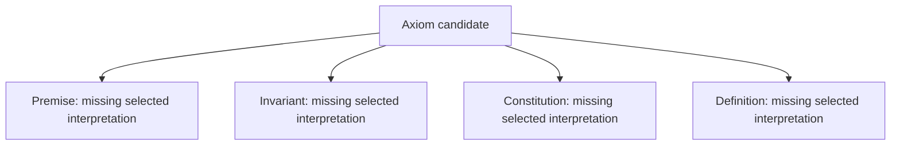

# Axiom: definition, types and logical formalization review

This is the first per-definition draft in the foundations family. It advances the Axiom source into explicit, source-qualified static logic while retaining every unresolved obligation. It is a candidate necessary-condition theory, not an owner-accepted whole-definition translation. The formalization episode still covers all 183 current definitions.

The exact source is `cal.definition.axiom@1.0.0-candidate.1`, SHA-256 `fdafe8a39a52749278574bcdc570f41c8a282e7a6e44071fd595fcfcd181a0c4`. The source has 22 meaning-bearing text units. This draft splits them into 43 exact clauses: 13 encoded static clauses, 11 explanatory clauses and 19 deferred clauses. All source characters in the declared inventory are accounted for. Character accounting establishes neither natural-language equivalence nor owner fidelity.

## Definition form and meaning layer

The subject of this definition is a proposition held as foundational in a system context. The record that defines the term “Axiom” is a different object. Its normalization identity, owner scope, type classification, source relations, registry provenance and generated representation are record obligations, not properties making the proposition true.

The source’s opening normalized-definition scaffold is consequently retained as a deferred record obligation. The target-specific proposition conditions receive an axiomatic-implicit interpretation: they state necessary conditions on a proposition classified as an Axiom. The draft does not turn the artifact’s title into a selected logical axiom. It also does not claim a complete biconditional classifier; unresolved source aspects prevent that stronger interpretation.

Plain-language explanations and discovery-order descriptions provide intuition. They remain explanatory, even where they appear inside the scientific/formal display. Testable machine-record conditions and admission exclusions are separately retained obligations. No explanatory example, inherited scaffold paragraph, or empirical statement is adopted as a premise.

## Types and carrier meanings

| Sort | Intended candidate carrier | What the type alone establishes |
|---|---|---|
| Proposition | Statements described by the source, with their truth posture evaluated in a context | A nominal carrier and valid argument positions; no truth or Axiom membership |
| SystemContext | Selected reasoning settings within which commitment and derivation posture are described | Context identity; no authorization or automatic transfer between contexts |
| DownstreamItem | Distinct hypothetical consequences attributed to a proposition | Item identity; no valid real derivation, governed rule adoption, or canonical sibling classification |

Every symbol is qualified by exact source identity/version, scope and local name. Three sorts and sixteen predicate/relation symbols give nineteen declarations. The independent model controls use one proposition, one initial context and two downstream items. Two controls add a second context. These finite carriers describe synthetic examples, not the size of the actual domain.

Predicates such as Foundational and WorldDomainSubject describe a proposition. TakenAsGiven, InternallyDerived, HeldTrue, HighVeracityPosture, SystemBehaviorConstraint and LowVeracityBet describe a proposition in a context. Grounds relates a proposition, a downstream item and a context. Downstream kinds are primitive candidate tags whose connection to the exact Premise, Invariant and Constitution sources remains pending.

## Core logical conditions

For a proposition `p` and context `s`, the static core includes:

```text
Axiom(p,s) implies
  Foundational(p) and TakenAsGiven(p,s) and
  not InternallyDerived(p,s) and
  HeldTrue(p,s) and HighVeracityPosture(p,s) and Family(p,s).

Axiom(p,s) implies
  WorldDomainSubject(p) and not SystemBehaviorConstraint(p,s).

Axiom(p,s) implies not LowVeracityBet(p,s).
```

These statements are universally quantified over the declared carriers. They use typed applications, conjunction, implication and negation. The source’s repeated normative/display/boundary conditions remain separately linked clauses; duplicate source presentation is not counted as additional independent evidence.

The formal language supports the required first-order quantifiers and equality. No temporal, modal, probabilistic, deontic or fixed-point construct is silently reduced to an unsupported static operator. The Axiom label is not itself proof that these conditions hold: a labelled object missing any required condition falsifies the candidate theory in the corresponding synthetic control.

## Commitment, veracity and actual truth

HeldTrue and HighVeracityPosture are distinct descriptive posture predicates. ActualWorldTruth is separately declared and unconstrained by the selected theory. High conviction or confident action on a working bet is not sufficient to satisfy high-veracity posture. A proposition’s recorded belief posture also supplies no empirical truth evidence.

The model controls change ActualWorldTruth from false to true while retaining the same held-true/high-veracity posture. Both synthetic assignments satisfy the static core. This demonstrates what the encoding leaves independent; it does not establish that a real-world Axiom is false, or resolve whether the source owner intends an objective-truth requirement.

Finding AXI-TRUTH-002 requires confirmation of the posture-versus-world-truth reading. The source’s “foundational truth” language and its taken-as-given notation are preserved for that decision. The interpretation has zero selected assumptions and zero assumption links. No proposition represented by an Axiom is inserted into the reasoning theory as a true formula.

## Family and downstream identity

The candidate family condition requires two distinct grounded items, each of a permitted kind. Every item grounded by that proposition/context must belong to at least one permitted kind:

```text
Family(p,s) includes
  exists i,j: i != j and Grounds(p,i,s) and Grounds(p,j,s)
              and PermittedKind(i) and PermittedKind(j),
  and forall k: Grounds(p,k,s) implies PermittedKind(k).

PermittedKind(k) = PremiseItem(k) or InvariantItem(k)
                   or ConstitutionRuleItem(k).
```

The source explicitly excludes a proposition grounding only one downstream item and excludes an inert proposition grounding none. Distinct identity therefore matters: duplicate references, or two kind labels on the same item, do not supply a second consequence.

Finding AXI-FAMILY-001 remains unresolved because “a family of premises, invariants, and constitution rules” might require representation of every named kind. The current candidate chooses at least two distinct items from the permitted kinds. A dedicated positive control permits an empty ConstitutionRuleItem extension, making that choice visible. It is a candidate reading rather than an approved interpretation.

## Boundaries and enforcement

The core excludes a system-behavior constraint and a low-veracity bet from the classified Axiom posture. These local conditions are not full alias, subtype or disjointness theorems involving the canonical Invariant and Premise interpretations. The difference between a Definition artifact and an Axiom proposition also cannot be proved by nominal sort separation alone.

The source’s no-self-enforcement sentence receives a static constraint on AxiomSelfEnforces and ItemSelfEnforces. A synthetic assignment declaring self-enforcement contradicts that condition. This does not prove anything about actual executors, validators or owner authority. The adjacent statements about Constitution authorization, selected enforcement surfaces and real effects remain deferred.

The scope test “can the system make it false?” needs a causal or modal account. It is not established by a negative SystemBehaviorConstraint flag. Finding AXI-DYNAMICS-004 retains that distinction along with actual revision and governed enforcement semantics.

## Change and recursive dependency impact

The source states that revising an Axiom forces reconsideration of everything built on it. Proving that claim requires exact changes, dependency reachability, the meaning of reconsideration obligations, and their connection to operational transitions. The draft retains the entire source span as deferred.

A primitive flag claiming reconsideration would be easier to type-check but would not establish the intended change behavior. Likewise, the justification chain from Axiom through Invariant to Constitution is retained without claiming that arbitrary item tags instantiate the real chain. The discovery direction is an explanation of how a reason is found, not a rule that assumes the discovered reason is true.

## Explicit semantic dependencies and their DAG

Four direct comparison dependencies are authored from exact source clauses and bound to current sibling source versions. They are not inferred from family numbering, directory names or incidental textual proximity. The compiled dependency view contains five nodes and four semantic-use edges:



All four dependency packets remain absent from this selected closure. Their full signatures, meanings, transitive uses and cross-carrier relations are not imported. The edge denominator still requires independent review; graph compilation and SCC ordering do not establish semantic completeness. Findings AXI-LAYER-003 and AXI-DYNAMICS-004 also require source-owner decisions on layer separation and specialized semantics.

## Populations and non-vacuity

Three selected required populations ask for a hypothetical classified Axiom/context pair, a Foundational proposition and a WorldDomainSubject proposition. The Axiom necessary conditions imply the latter two when a classified object exists. An empty Axiom extension satisfies its universal implications vacuously but fails its required population. The verification checks theory truth and population truth separately.

Four auxiliary population policies remain unresolved: PremiseItem, InvariantItem, ConstitutionRuleItem and ActualWorldTruth. Requiring every unary attribute to be inhabited would invent a stronger family/truth policy; treating them as exempt would invent owner acceptance. Both possibilities remain explicit pending decisions. This prevents the draft from being passed into a whole-theory regression as if its population policy were complete.

## Actual verification and evidence strength

Twenty-two controls were executed against the exact source-qualified IR using E03’s independent denotation evaluator. They include positive posture assignments with both values of ActualWorldTruth; missing foundational, given, held-true, high-veracity and world-subject conditions; prohibited internal derivation, low-veracity bet, system-behavior subject and self-enforcement; zero/one/untyped consequences; two labels on one item; empty Axiom population; context transfer; ill-sorted grounding and duplicate tuples.

The supplied models are deliberately authored synthetic structures. The report identifies them as independently evaluated authored models. It claims no finite-provider search, native provider witness, exhaustive absence, unbounded theorem, or mechanically checked proof. Exact model, interpretation, correspondence, IR, checker and runtime bindings are retained. The failed initial fixture run is preserved: deleting Foundational violated both the theory and its required population, contrary to the fixture’s first expectation.

Structural envelope validation passes. IR regeneration and full character accounting pass. The typed semantic checks and graph replay are separately recorded. All 201 source/registry/provenance files and all 620 previous sealed candidate files remain current and preserved.

## Review disposition and remaining work

The draft is reviewable and the static checks pass. F01-T acceptance remains partial: nineteen clauses, four population policies, four direct dependency interpretations, source fidelity and stronger logic obligations are unresolved. This agent review is not source-owner acceptance or semantic admission. Owner-accepted whole translations and whole-definition proofs remain zero.

Axiom’s findings can be reviewed without blocking independent drafts for Definition, Governed Model, Hypothesis, Invariant, Premise, Schema and Semantic Primitive. The entire 183-definition objective stays active. The next work remains the foundations family, followed by explicit semantic closure, population/relationship policy, specialized profiles where required, proof evidence and a final review of the combined scope.
