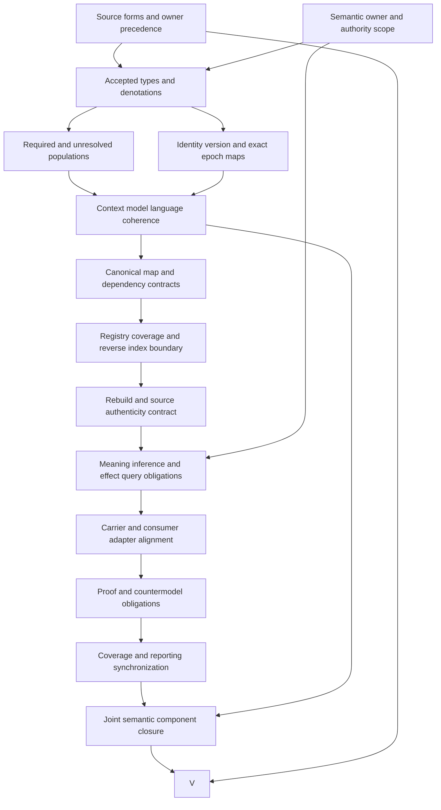

# Bounded Context: definitions-first formalization review and completion DAG

This is a partial candidate interpretation of the current Bounded Context definition. It advances the definitions, types, logical semantics and population obligations requested for the formalization episode. It does not complete the source-owner translation, establish actual domain-model consistency, or satisfy the whole-family gates. The episode continues to cover 183 current definition identities, 189 admitted versions and 201 captured source files. This unit brings the working inventory to 57 partial drafts, leaving 126 current identities without a per-definition draft. Whole-definition source-owner acceptance and whole-definition proofs remain zero.

## 1. Exact source identity, admission and evidence authority

The selected source is `cal.definition.bounded-context@2.0.0-candidate.1`, admitted through C26, the reference-normalization Definition promotion. Its exact source SHA-256 is `6ee155d2e7427e33357e55e56bc5228c2b584ea435bb9dc516ddb66385f590c0`. Its version-one predecessor remains separately admitted historical evidence. The revision matters: the current meaning assigns canonical cross-context membership and relationship direction to Context Maps, and removes canonical membership backreferences from contexts. Reading only the earlier definition would miss this change and produce an incorrect ownership theory.

The [source checks](source-checks.json) bind the live current lookup, exact registry entry, C26 admission row, candidate-manifest bytes, recorded definition-owner token and owner-registry bytes. Two pure renders reproduce the selected human projection byte for byte: 6,260 bytes with SHA-256 `9c5c61eb1c42a5fd60fd5f1a11db922469817a98994de32692e76e4e27add252`. These observations establish which recorded source was selected. They cannot establish that this candidate interpretation faithfully captures all its meaning.

Four embedded references bind historical C17 admission records, selectors and digests. Their underlying private external source bodies were neither read nor recovered. Matching those records does not provide an independent reading of historical intent, nor permission to infer missing content. The candidate retains this evidence boundary explicitly. **BCT-FINDING-012** therefore remains open for the source owner: accept source precedence and interpretation fidelity using sufficient authorized evidence, without collapsing recorded source admission into logical translation acceptance. Owner roles for models, languages, maps and consumers may need independent input on their own denotations.

## 2. Definition forms, source roles and complete correspondence

The [correspondence packet](correspondence.json) inventories 28 nonempty source units and splits them into 42 mapped spans. Twenty-four spans are encoded, nine are explanatory, and nine remain deferred. Complete character accounting means every inventoried source character has a recorded disposition. It does not mean every source obligation is translated. A deferred normative boundary remains an outstanding obligation even when its characters are accounted for, and explanatory examples do not become axioms merely because they use the same terminology.

The formalization uses three definition forms. Genus and differentia characterize a versioned, owner-scoped semantic boundary with consistency intent. Axiomatic or implicit definitions constrain its metadata, uniqueness, ownership and relations. Operational clauses describe selected-registry reverse lookup and rebuilding. These forms serve different purposes: a structural tuple describes fields; a uniqueness condition constrains their interpretation; a generation equation requires an executable model and declared input universe. Treating them as interchangeable would hide missing proof obligations.

The 24 encoded spans contain 11 distinct formula values assembled from ten primitive theory templates. Repeated source clauses preserve their own selectors rather than inflating the number of independent logical assumptions. The [clause analysis](clause-analysis.json) records this distinction and identifies unavailable exact dependency labels. Plain-language, domain-context and notation passages explain the intended reading but do not override the scientific-formal voice automatically. The owner has not accepted a precedence resolution.

**BCT-FINDING-001** covers the proposed genus sufficiency and consistency-intent reading. **BCT-FINDING-002** covers metadata denotations and source-carrier maps. Both require explicit acceptance before a complete translation can be claimed. The proposed formal model is usable for checking candidate coherence while these decisions remain deferred.

## 3. Types, functions, relations and exact namespaces

The [interpretation](t.json) declares 104 symbols: two nonempty sorts, one constant, 18 total functions, 70 unary predicates and 13 binary relations. The sorts are `Entity` and `Token`. `EMPTY` is a distinguished token. Entity-valued functions refer to the declared model, language, semantic owner, challenge route, typed relationship endpoints and kind, and reverse-index context and registry. Token-valued functions carry identity, version, scope, exclusions, contracts, lifecycle, evidence and model/language context identity.

The [compiled typed IR](static-ir.json) qualifies these symbols by exact source version and candidate scope. A predicate with a familiar spelling in a different definition is not silently the same predicate. No contextual source, historical theory, carrier validator or consumer is imported into this primary theory through name similarity. Independent alignment maps are required to compose them. This is especially important for Context, Coordination Context, Governed Model and Ubiquitous Language, whose neighboring concepts overlap without being interchangeable.

Total functions express one declared reference per candidate context, not exactly one actual implementation, domain interpretation or operational principal. A nonempty token records explicit metadata but does not inspect the set, policy, lifecycle or evidence behind it. Scope and exclusions therefore need typed collection semantics in a fuller model; owner and challenge references need a resolver and authority interpretation. The candidate intentionally exposes these losses rather than inventing missing primitive definitions.

**BCT-FINDING-002** and **BCT-FINDING-004** cover this distinction. The next typing work must define accepted carriers and referents, token versus collection meanings, version-address maps, totality and definedness policies, and identity preservation across adapters. The current type checks catch structural and sorting failures; they do not establish those downstream meanings.

## 4. Genus, semantic ownership and intended consistency

The genus formula makes `BoundedContext(c)` equivalent to four candidate markers: versioned, owner-scoped, semantic boundary and consistency intended. This provides an explicit proposed characterization and allows controls to check both directions. A context cannot lose a required marker while remaining a context, and an entity with all four markers cannot be omitted from the context predicate. The source-owner acceptance needed to justify the reverse implication remains open.

Consistency intended is deliberately distinct from `ActualInternalConsistency`. The source states an intention that one declared domain model and one Ubiquitous Language remain internally consistent within an explicit scope and exclusions. Establishing that intention does not prove satisfiability of every governed domain rule, consistency of a combined model-language theory, completeness of expression bindings, agreement among users or conformance of real consumers. These are separate queries with independent proof surfaces.

The proposed semantic owner is an entity with an owner-role marker, reached through a total function. That declaration does not validate a principal, membership, role assignment, authorization interval or authority boundary. Similarly, challenge-route existence is represented structurally; actual usability is unresolved. All such actual outcomes can remain false in a model that satisfies the candidate theory and its required populations.

**BCT-FINDING-001** concerns the exact genus reading, while **BCT-FINDING-004** requires accepted model-language and ownership maps. The completion task should preserve the source's modest consistency claim and add an explicit obligation for any stronger theorem. Conflating an intention marker with an established consistency theorem would make the formalization circular: the conclusion would already be assumed in the definition.

## 5. Identity, version uniqueness and metadata coherence

For each candidate context, identity, version, scope, exclusions, contracts, lifecycle and evidence tokens must differ from `EMPTY`. Its referenced model, language, owner and challenge route must carry their respective role markers. The declared model and language must each map back to the context's identity token. The context entity must differ from its language entity. These conditions establish local coherence of an authored interpretation without pretending to resolve actual external records.

The uniqueness formula states that two context entities with equal identity and version tokens are equal. It permits two distinct revisions of the same identity when version tokens differ. The supplied model contains that population explicitly, and a control changing the distinct revision to the same version fails the theory. Actual registry uniqueness requires a selected registry universe and its completeness rules; equality in the supplied finite universe cannot prove uniqueness across every repository or live registry.

An actual inspection of six Governance and Ontology Lifecycle context records found unique selected identity-version pairs. Version-two folder epochs carry semantic version `1.1.0-candidate.1`; normalized version-three folder epochs carry `2.0.0-candidate.1`. A folder suffix is consequently not an automatically interchangeable semantic-version token. No collision was established in this selected record set, and the candidate does not claim one.

**BCT-FINDING-003** requires the owner to accept uniqueness scope, record-revision meaning and the epoch-address map. **BCT-FINDING-004** covers model/language identity coherence. Their completion must include exact positive and collision cases, declared registry boundaries and historical revision preservation. Existing candidate tokens remain opaque until the accepted map explains what equality of those tokens means in actual carriers.

## 6. Context boundaries and canonical ownership separation

The source distinguishes a semantic boundary from a folder, module, package, Product, capability, Coordination Context, Project, Goal, team, deployment unit, database and authority grant. The candidate encodes those exclusions as incompatible role predicates for an entity classified as Bounded Context. This is a proposed logical exclusion, not a claim that a repository folder cannot contain a context artifact or that a product cannot have contexts. Physical containment remains separate from semantic identity.

A context also cannot carry the candidate markers `ContextOwnsMapMembership` or `ContextOwnsRelationshipDirection`. For every context and map entity, the canonical-context-backreference relation must be false. The theory therefore rejects attempted canonical context-local ownership even if other metadata is coherent. Tests cover each exclusion and both ownership markers independently, including explicit canonical backreference insertion.

The current closed carrier schema excludes `context_map_refs`, `map_membership` and `canonical_reverse_membership_index`. Its closure rejects an additional equivalent field as well. These are representation observations. They do not establish actual canonical write enforcement, prove that an arbitrary consumer honors the boundary, or retroactively invalidate historically admitted context records that used an earlier contract. Meaning revision, type succession, instance normalization and consumer cutover are separate events.

**BCT-FINDING-005** requires explicit source-to-carrier ownership mapping and canonical enforcement evidence. Exact primitive definitions for Project, Goal and Capability are unavailable in the selected current inventory; neighboring Project State, Capability Instance and Product Capability definitions remain separate semantic uses. The candidate does not substitute those meanings for the missing primitive labels. This preserves the scope exclusions without hiding gaps in their accepted interpretation.

## 7. Map-owned membership and typed directional dependencies

For a candidate Context Map, endpoint membership is canonical: `MapMember(m,c)` is equivalent to `CanonicalEndpoint(m,c)`, and every canonical endpoint must be a Bounded Context entity. A map owns its endpoint membership and relationship direction through explicit markers. The map formula defines membership inside this selected model; an actual endpoint reference still needs exact identity/version resolution and a separately accepted map-authority model.

A relationship belonging to a map must have a typed-relationship role, a declared relationship kind, Bounded Context source and target endpoints, and both endpoints in that same map. A cross-context dependency from `c` to `d` additionally requires distinct context entities and a relationship whose source is exactly `c` and target exactly `d`. The existential witness prevents deriving a dependency from mere contact or a map with unrelated endpoints. The supplied model demonstrates one directed dependency; reversing it without a reverse relationship is rejected.

The candidate requires distinct endpoints for dependencies but does not universally prohibit every reflexive typed relationship. The selected older CTX07 map checker additionally rejects reflexive map direction and requires its declared endpoint set to equal the set used by relationships. These are different constraints on separately qualified surfaces. Adopting them into the primary theory requires explicit alignment; their presence in executable code is not source-owner acceptance of additional axioms.

**BCT-FINDING-006** concerns exact endpoint, membership, relationship-kind and canonical-map meanings. **BCT-FINDING-007** concerns directed dependency resolution. Their completion requires positive and negative endpoint/version cases, relation-kind interpretation and authority boundaries. The currently observed map continues to name exact version-two context epochs; normalized version-three contexts do not replace those endpoints implicitly.

## 8. Reverse membership, selected registries and rebuilding

A reverse index is a derived projection for one context and one selected map registry. It has no independent canonical ownership and cannot amend a map when a lookup entry is absent. Its lookup membership is equivalent to the conjunction of map role, membership in the selected registry and canonical map membership for the selected context. This explains why an index can omit a canonically valid map: the map may fall outside that index's declared registry universe.

The supplied model contains a present lookup and a second index using a registry that omits the same canonical map. Both satisfy the theory, while canonical membership remains true. An index that omits a map inside its own selected registry fails. So does an index that includes a map outside that registry. The distinction places the burden on declared registry coverage rather than allowing a convenience lookup to rewrite source authority.

A recomputed-index relation requires equal context, equal registry and equal membership, with both indexes properly declared. This is a logical comparison guard. Universal reproducibility of the real helper additionally requires deterministic input selection, current authenticated records, version-address interpretation, output ordering and consumer semantics. Two equal outputs for supplied inputs establish only a bounded observation.

**BCT-FINDING-008** covers registry coverage, currentness and input authenticity. **BCT-FINDING-009** covers rebuild interpretation and consumer contracts. The existing helper sorts input maps and output memberships, but accepts caller-supplied digests and hardcodes `/v2` references. Those observed gaps must be resolved by an accepted adapter or separate change before a stronger exact-version or authenticated-index claim is possible. This unit changes neither helper nor canonical records.

## 9. Logical nonentailment, assumptions and required populations

The exact source boundary reads: “Shared spelling across contexts does not imply shared meaning.” It is retained as a [source query obligation](source-query-obligation.json), outside the assumed theory. Its associated target asks whether shared spelling forces shared meaning; an independently checked supplied countermodel satisfies the candidate theory and required populations while making that target false. This gives a bounded logical demonstration without presupposing the desired conclusion as a source axiom.

A second query asks whether containment or imports force a cross-context dependency. It likewise remains false in a supplied model containing both convenience relations without a corresponding dependency. Eleven inference markers are forbidden for contexts, including inference of identity from a folder, meaning from spelling, dependency from containment or imports, admission, authority, migration, publication, release, deployment and external effect. Actual-outcome predicates remain independent of those marker prohibitions.

There are 28 countermodel queries: 26 actual-outcome targets and the two relationship/meaning targets. All have independently evaluated witnesses. The interpretation and correspondence packet contain no added assumptions or assumption links. No proof certificate or whole-definition theorem follows from this collection of authored models.

Twelve required populations prevent selected obligations from being silently vacuous: contexts without actual outcomes, distinct revisions, directed dependency, canonical membership, present and absent reverse lookup, recomputation, spelling without meaning, containment and imports without dependency, and no canonical context backreference. Eighty-one populations remain unresolved. **BCT-FINDING-010** covers nonentailment and prohibited convenience inferences. Acceptance must review quantifiers, relation directions, witness scope and the remaining populations explicitly, preserving the separation between required inhabited examples and universal theory constraints.

## 10. Finite models, qualified profiles and frame controls

The [model evidence](model-controls.json) contains 120 actual controls over a fixed supplied carrier of 19 entities and 11 tokens. Thirty-nine controls satisfy the candidate theory; 74 violate it; seven malformed denotations are rejected before logical evaluation. Controls exercise genus implications, every required metadata token, referent roles, identity coherence, duplicate identity-version keys, canonical ownership, endpoint membership, typed dependency direction, index registry membership and recomputation. Structural failures include non-total functions, sorting errors, wrong arity, duplicate tuples and an empty entity domain.

The finite carrier was fixed before control execution. Failed controls were not made successful by shrinking domains or removing required populations. Several positive controls deliberately expose the logical claim ceiling: opaque version and metadata tokens can satisfy the candidate theory; actual-outcome predicates can be independently true or false; shared meaning may be asserted separately. Population-removal controls distinguish theory satisfaction from required-witness satisfaction, preventing universal formulas from being mistaken for existence proofs.

The [profile evidence](authority-profile-checks.json) adds 27 explicitly hypothetical qualification profiles, of which 25 reject use, and 13 hypothetical frame controls, of which 11 reject. Their envelopes test identity, version, model, language, scope, owner, revision, source epoch and registry agreement. Frame checks distinguish rebuilding from a changed selected registry and reject source changes, canonical ownership claims and authority transfer.

These profile outcomes are calculations over authored hypotheses. They are not observations of a live resolver or consumer. Actual source and carrier checks are recorded separately. **BCT-FINDING-011** requires accepted mappings between these surfaces and real execution semantics. A finite model verifies selected clauses on supplied denotations; it cannot by itself prove universal consistency, source fidelity or completeness of every possible context.

## 11. Current carriers, context epochs and executable rule gaps

The current artifact-type registry contains 143 rows, including 121 admitted-current contracts. The selected current binding is Bounded Context/v3 through C70; its normalized v2 predecessor is historical through C27. The retained descriptor and fixture bodies remain candidate-unadmitted with no authority effect. Registry admission overlays and retained body posture are both recorded. The v3 schema discriminator retains a v2 classification value, so matching the folder or discriminator number to a classification number is not a valid automatic migration rule.

Twenty-five bounded catalog and representation checks pass. Thirty-one schema probes produce 12 acceptances; both hostile fixtures reject. The schema permits unresolved nonempty model, language, owner and challenge-route strings, empty contracts and evidence lists, an unverified lifecycle token and a same-string context/language reference. It rejects missing required fields, canonical backreferences, empty scope exclusions and additional undeclared fields. A schema-valid claim-ceiling string can still overclaim actual consistency. These observations demonstrate the difference between representation validity and semantic resolution.

Nine extracted CTX07 context controls show a narrower semantic check: context and language strings must differ, and three canonical backreference fields must be absent. Five controls accept; unresolved owners or models remain unverified. Nine extracted index controls reproduce the fixture, preserve inputs, demonstrate ordering independence, and expose fixed `/v2` map-reference collapse across two versions, trusted caller digests and unresolved endpoints. No package validator, generator writer, live consumer or adapter runs.

Six selected context epochs preserve unique identity-version keys. C25 selects exact old version-two context bytes; it does not select normalized version-three records or the observed version-two map. Normalized contexts pass the predecessor normalized schema and fail the current v3 discriminator. Their language base identities match, but exact language backreferences name context/v2 while normalized context addresses are /v3. The observed map likewise names /v2 endpoints. **BCT-FINDING-011** and **BCT-FINDING-012** require explicit compatibility, normalization and consumer decisions. Source admission does not silently amend any of these records.

## 12. Dependency closure and the detailed completion DAG

The candidate declares 34 direct semantic uses with exact qualified source versions. The local transitive graph has 119 nodes and 1,258 edges, with 62 missing counterpart packets. Its declared strongly connected component has 57 members and 830 internal edges. The current joint graph is separately captured for all 57 draft roots. Declared cycles are unresolved semantic-review obligations, not a reason to remove edges or claim that the dependency graph is already acyclic. An execution DAG organizes the work required to classify and discharge them.

The original foundations-first plan remains unchanged: 121 tasks, 511 dependency edges, 797 SWUs and 36 frontiers. Its whole-family completion gates remain pending. The following 15-node, 18-edge DAG specializes the Bounded Context completion work. Each node describes a reviewable artifact or obligation, and dependency direction states what must be ready before the downstream result can be accepted.

| Node | Required result and completion evidence |
| --- | --- |
| S | Accept exact C26 source selection, forms, source precedence, deferred spans and historical-evidence boundaries; close source-owner findings or retain justified explicit residue. |
| A | Resolve semantic-owner principal, role, scope and challenge-route meaning; retain separated model, language, map and consumer authorities. |
| T | Accept carriers, function totality, token/set meanings, predicate denotations and qualified namespace maps. |
| P | Discharge 12 required witnesses and review all 81 unresolved populations; justify any exemption through accepted evidence. |
| I | Define identity/version uniqueness universe, historical revision maps and exact folder-epoch/semantic-version/reference relationships. |
| C | Accept one model and language declaration, reciprocal identity and compatible epochs; state precisely what consistency is intended and what is actually proved. |
| B | Establish map-owned endpoint membership, typed direction, exact dependency witnesses and canonical context backreference prohibition. |
| H | Select the canonical map universe, coverage/currentness rules and noncanonical reverse-lookup semantics; explain omissions without map amendment. |
| R | Authenticate exact map inputs, resolve fixed-reference behavior, define deterministic rebuild guarantees and independent source-preservation checks. |
| E | Review spelling, containment and import nonentailment targets and actual-outcome/effect queries with their scoped witnesses. |
| Q | Accept source-to-carrier, historical-to-current and consumer maps, including retained v2 classifications and normalized context/language/map epoch compatibility. |
| D | Produce proof obligations and independently replayed evidence for accepted theory, populations, algorithms and adapters; preserve countermodels and failure records. |
| F | Synchronize complete coverage, source-fidelity decisions, receipts and reporting without replacing unresolved fields with inferred acceptance. |
| J | Review all qualified edges and the 57-member component using accepted common semantics and classified recursion; independent per-draft models are insufficient. |
| V | Complete the whole-definition review with accepted source fidelity, denotations, algorithm contracts, dependency closure and honest proof limits. |

Candidate drafting can proceed while owner acceptance remains deferred. The DAG schedules acceptance dependencies separately so that implementation details cannot quietly settle meaning questions. Completing this unit does not satisfy V or any whole-family gate. The next per-definition priority is `F02-T.cal.definition.contract`, the earliest missing definition-theory unit in the existing ordered manifest after this draft. Contract semantics will support several outstanding boundary and consumer obligations without promoting the current Bounded Context candidate.

## 13. Reproducibility, preservation and remaining episode work

The [context pack](context.json) fixes the selected SWU, prerequisites, sources, scope, nonblocking choices and deferred meaning decisions. A04 supplies the closed interpretation/correspondence contract, C01 the typed IR, and E02 capture and preservation boundaries. Their existing receipts and hashes remain unchanged. Mutation stays within this candidate unit. All 4,518 prior candidate files and 201 captured source files are rechecked, together with exact selected source, carrier, decision, context, language, map and helper bytes.

The unit retains actual failed authoring attempts. The initial preflight requested unavailable exact primitive labels before creation; selected neighboring dependency records were corrected without treating them as equivalent primitives. A repair shell command used an unavailable `python` alias and failed before editing the source. The original population-expression syntax failure was then replayed and archived, and all twelve obligations were retained in its repair. These failures are preserved alongside successful producer logs; they are not counted as successful validation.

Six independent fresh terminal checks cover contract validation, model controls, source checks, profiles, dependency compilation and the whole current inventory. Fresh reports must match their successful producer outputs, reach terminal exit zero, and have empty stderr. The [receipt](receipt.json), [coverage row](coverage-row.json), [episode status](episode-status.json) and [delivery manifest](delivery-manifest.json) are created only after that evidence exists. A separate read-only audit then verifies the sealed file set, exact hashes and partial-claim boundaries. These checks establish reproducibility of the bounded candidate evidence, not a universal domain theorem.

The episode remains active with 57 partial drafts and 126 missing current drafts. All twelve BCT findings remain unresolved source-owner obligations. No source-owner whole translation, whole-definition proof, actual model-language consistency theorem, complete registry assurance, accepted consumer adapter or joint semantic closure is claimed. Definitions, types and logic continue first; runtime integration and stronger effect claims depend on accepted semantics. A complete final episode review still requires every current identity, preserved historical version, dependency obligation, required population, adapter and justified proof boundary to be accounted for under the original plan.
