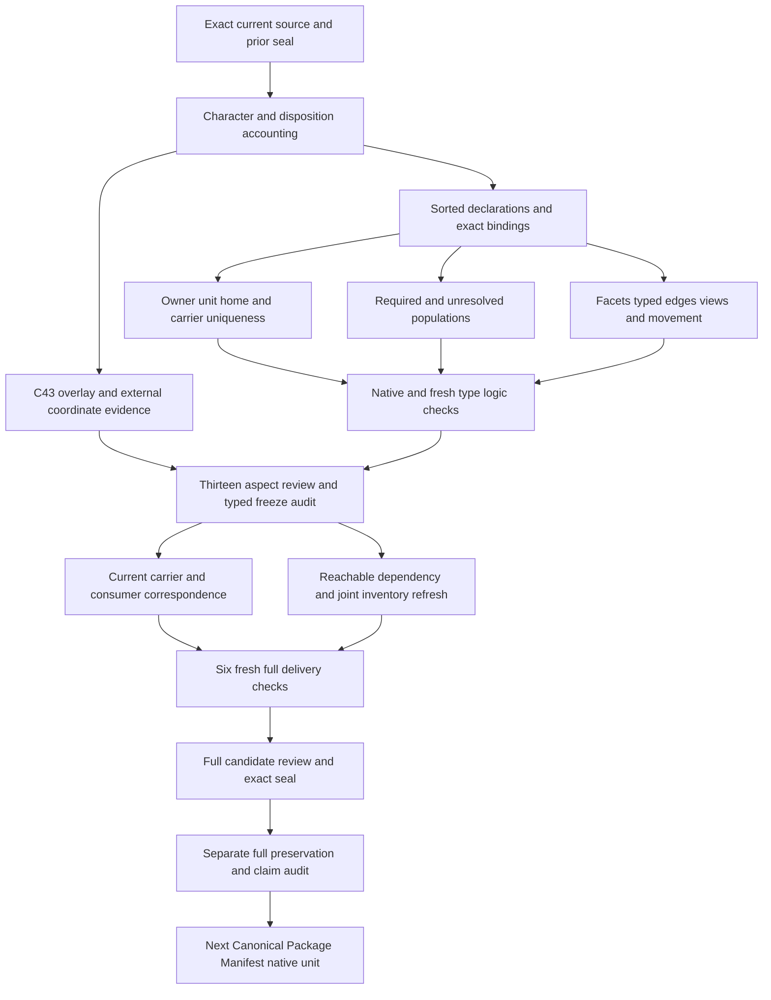

# Canonical Package Home: definitions, types and logic review

## 1. Exact target and formalization boundary

The selected Definition is cal.definition.canonical-package-home@1.0.0-candidate.1, current source SHA256c810597968723991449fe78458254679cc6dc87b2b81e54e16a9aa599c59f8ca, admitted under C43. This review explains an authored partial typed interpretation and its supplied finite models. It does not accept whole source fidelity,select an actual canonical home,move files,migrate Registry Context,enforce a Capability Instance successor,or establish operational conformance. A source Definition's admission is separate from acceptance of this formalization and from an instance owner's home-selection decision.

Resolution's actual successful full separate audit preceded native CPH creation. The native author preserved7,715prior candidate files and verified all201captured source files. Author,build,model and source producers actually exited0. Preparation retained two exit1checks before native creation:unsupported form tags,and inconsistent manifest predicate case. The originals,stdout,stderr and actual-exit records remain byte-bound. The corrected exact precheck passed all12selected source clauses,17required populations and104controls,with maximum45,775steps under the unchanged100,000step guard. No verifier limit was increased,domain reduced or clause dropped to obtain a pass.

The working tree now has88native per-definition T files;the last sealed whole inventory still contains87partial drafts. A fresh whole-inventory refresh remains pending. The original episode scope is183current identities,189admitted source versions and201source files. Source-owner accepted whole translations and whole-definition proofs remain zero. This stage adds exact declared type/logic evidence toward the complete episode;it cannot establish completion of that original scope.

## 2. Source voices,accounting and currentness

The scientific formal voice is normative. Plain-language workshop intuition and the Registry Context directory examples explain cohesion while retaining separate capability,context,product,runtime and evidence identities. They are explanatory source material,not additional admission or filesystem authority. Every selected nonempty string has an exact selector,excerpt,digest and character span. All34source units are accounted once:12encoded,12explanatory and10deferred. Deferred boundaries and claim-ceiling text remain visible in the correspondence and denominator,with proposed meaning maps and source-precedence review unresolved.

Native source checks verify the exact current registry row,C43decision,authorization,manifest Definition selection and the five-selection source-admission overlay. The typed stage additionally binds the manifest's current digest to C43's exact selection digest. Definition,Bounded Context and Capability Instance local upstream files retain their admitted-current references. The Definition schema and generator digests are checked;three pure generator functions reproduce the two identical7,305byte projections without mutating input or invoking a writer. Both projection digests are2c1bf38cf098ff428b4bb418d43b867e35f3aa3416a86f6c7ad2dc08e2522a70.

There are67native source checks and35source-linked query obligations. Those obligations bind exact source excerpts to separate actual-outcome queries and never insert those query targets into T. Source equality,current lookup,valid schema and reproducible projections are representation evidence. They do not prove actual package ownership,canonical source selection,complete manifests,consumer behavior or whole translation fidelity. Exact source bytes and the normative/explanatory voice distinction remain fixed throughout this stage.

## 3. Sorted signature and reference interpretation

Seventeen nonempty sorts separate AggregateReference,HomeReference,CarrierReference,OwnerReference,UnitReference,RecoveryBoundaryReference,ManifestReference,FacetReference,FacetKind,SemanticIdentity,AuthorityScope,TypedRelationReference,GlobalViewReference,LocationReference,ContextReference,MovementReference and Token. An owner-local aggregate,a governed artifact tree,a canonical carrier,a facet and a global view are different proposed reference roles. Physical location is separate from semantic identity,context membership and authority scope. Recovery boundary is represented separately from change unit so any proposed correspondence can be reviewed explicitly.

Nine constants distinguish EMPTY,NONE and seven named facet kinds:capability,bounded context,product,DomainSpec,implementation,evidence and projection. The facet-kind constants are pairwise distinct;EMPTY and NONE are distinct. Fifty-five total functions and95predicate/relation signatures complete176declarations. Every symbol is qualified by exact source version and candidate scope. These sorts and field names do not create canonical Definition identities or authenticate a carrier merely by naming it.

Total functions nominate values even outside the selected scope. Guarded relation equivalences expose missing or conflicting bindings and extra home candidates. Reference handles ensure selected references are declared and nonempty;they do not assert global handle injectivity,alias normalization or authentic identity. Explicit inequalities operate on the proposed SemanticIdentity and AuthorityScope denotations. Concrete key equality,aliases,semantic owner scope and authority interpretation remain owner pending. The unresolved population denominator includes all95signatures rather than treating declaration names as proof of real inhabitation.

## 4. Aggregate genus and exact nominations

HomeApplicable(a) is equivalent to AggregateInScopeDeclared(a). A selected aggregate requires a nonempty aggregate handle and exact nominations for home,owner,unit,recovery,manifest,location,semantic identity,context,authority scope and none effect. Each nomination has an explicit binding relation equivalent to equality with the nominated value. Missing bindings and conflicting extra values fail the theory. Outside aggregate references do not inherit selected aggregate obligations.

The selected home,owner,unit,recovery and manifest references must be declared and nonempty. The aggregate's location is descriptive metadata. There is no path-to-owner,filename-to-identity or directory-to-context inference. A package can be physically cohesive without merging the identities and authorities of its constituent facets. Declaration checks remain necessary candidate conditions;they do not authenticate the real lifecycle owner or infer a home from the existence of a matching folder.

NONE records the interpretation's declared lack of authority effect. An independently supported actual-authority observation is allowed for another selected aggregate while that aggregate's package-home declarations still grant none. Thus no-authority-effect does not mean independently justified authority can never exist. The selected/no-actual-outcome witness is a separate aggregate,used to demonstrate nonentailment of actual selection,ownership,migration and conformance from the necessary declarations alone.

## 5. Owner/unit biconditional and aggregate-home uniqueness

For each selected aggregate,the nominated home is in the declared governed-home candidate domain. Its owner and unit equal the aggregate's owner and unit. HomeForAggregateDeclared(a,h) is equivalent both to matching owner/unit within that declared candidate domain and to equality with aggregateHome(a). These relation equivalences expose every candidate that qualifies;the nominated selector cannot hide a second same-owner same-unit governed home.

The eligible-home domain is an explicit candidate interpretation. The source says unique governed artifact tree selected by explicit lifecycle-owner and unit-of-change declarations. It does not establish that every arbitrary directory with equal textual owner/unit fields is a selectable governed home. A positive control changes an outside tree's owner/unit fields to match the aggregate without bringing that tree into the selected candidate domain. A negative control admits that tree into the governed candidate domain without reporting the resulting second eligible home;the exact biconditional then fails.

This exposes the source-domain ambiguity rather than silently solving it. The lifecycle owner must accept what constitutes a governed candidate,how the owner binding is authenticated,and how actual home selection is represented. The theory also binds declared unit recovery and home recovery to the aggregate's recovery boundary. That coupling is a proposed reading of an aggregate whose sources change and recover as one declared unit. It does not prove operational rollback cohesion or automatically identify every unit of change with a recovery boundary.

## 6. Canonical carrier uniqueness and aggregate cohesion

Every selected canonical carrier has a declared aggregate and home. Its home equals its aggregate's nominated home. CanonicalAtDeclared(c,h) is equivalent to equality with the carrier's nominated home across the complete HomeReference domain for that selected carrier. This supplies existence through its nominee and uniqueness through the exact relation,while exposing a missing tuple or an extra second-home tuple. CarrierInAggregateDeclared binds selected carrier membership to the nominated aggregate within selected aggregate scope.

Per-carrier unique-home quantification and aggregate-wide home cohesion are separate obligations. A function can nominate one home while a relation contains two;that negative control fails. A carrier can nominate a home that differs from its aggregate's home;that also fails. Conversely the selected fixture with two owner-local aggregates and two distinct canonical carriers satisfies each aggregate's own home and carrier alignment. The source's aggregate and carrier quantification are preserved without treating a global catalog as the carrier's second home.

Actual canonical-machine-source correctness remains a query. No physical file becomes canonical because it appears under a nominated directory or because a selected relation is called CanonicalAtDeclared. Concrete carrier identities,aggregate membership,manifest source roots,canonical machine representation,source authenticity and version currentness require accepted field and lifecycle maps. Outside carrier relations can remain independently declared without collapsing outside references into the selected aggregate's uniqueness requirement.

## 7. Manifest fields and change/recovery separation

The aggregate nominates a manifest whose aggregate,owner and unit functions equal the selected aggregate's explicit values. Each manifest field has an exact binding relation. A missing field relation or an incorrect aggregate,owner or unit nomination fails. This encodes the source condition that the package manifest names the owner-local aggregate,lifecycle owner and unit of change explicitly. It does not prove that an operational manifest is complete,accepted,correctly typed or byte-faithful.

Separate selected aggregates with different owners,change units or recovery boundaries require different homes. Owner/unit equality in the home biconditional and explicit recovery coupling make that separation visible. The theory includes direct separation rather than relying on a selector's shape to imply it. A model with distinct units sharing a recovery boundary could still satisfy home separation through the distinct change units;the model does not globally equate UnitReference and RecoveryBoundaryReference sorts.

The independent recovery reading needs owner review. A selected aggregate's unit-to-recovery nomination is exact within this scope,but real recovery procedures,transaction boundaries,rollback evidence and operational coupling are not encoded as facts. Shared global presentation cannot merge two owner-local lifecycle or recovery units. The accepted manifest,unit and recovery representations must eventually show why each declaration corresponds to the correct owner-local aggregate instead of relying on the words owner or unit in a field name.

## 8. Facet kinds,identity,authority and typed edges

Each selected facet belongs to a selected aggregate,shares its declared home,owner and change unit,and has explicit semantic identity,authority scope,context,kind and typed-relation nominations. FacetMemberDeclared is exact for that nominated aggregate. FacetKindBindingDeclared is exact for the kind. The nominated typed relation identifies that facet and its aggregate,and FacetAggregateEdgeDeclared exposes the corresponding edge. Missing edges,wrong target aggregates or inconsistent nominations fail.

Distinct selected facets within one aggregate have distinct SemanticIdentity and AuthorityScope values. A facet identity also differs from its aggregate's identity. These are proposed readings of the source's distinct facet identities and authorities. The theory does not infer distinction merely from sort names,globally exhaust all facet kinds,or impose global key injectivity across independent aggregates. A future declared facet kind is permitted by T even though the seven-kind population fixture then lacks one required witness. A positive control reuses a facet identity across independent aggregates;it makes the scoped uniqueness ceiling explicit for owner review.

The supplied fixture witnesses all seven named facet kinds and explicit facet-to-aggregate typed edges. That chosen edge shape does not accept a relation schema,relation taxonomy,direction policy or completeness rule for real consumers. Likewise the distinct authority-scope reading needs an accepted map to actual semantic owners and authority domains. Colocation itself cannot grant context membership or shared authority. Independently supported actual authority is represented separately from any package-home inference;the theory does not make a global claim about every possible authority relationship.

## 9. Global views,nonduplication and path exclusions

Selected global views may reference or generate projections of selected canonical carriers. The candidate forbids ViewContainsCanonicalCopyDeclared(view,c) for selected views and selected carriers. Reference-only and generated-projection fixtures satisfy this rule. A view with an added canonical-copy declaration fails. No requirement forces every global view to reference every carrier;the source permits references and projections while excluding rival canonical copies.

An index reference is not itself CanonicalAtDeclared. The sorted view and home roles keep these proposed relations separate while preserving the source's nonimplication. Physical byte-copy detection,generated projection freshness,index completeness,actual registry behavior and canonical-source provenance remain pending. The carrier uniqueness rule concerns canonical home declarations;the view-copy rule concerns global presentation. One cannot replace the other or establish operational nonduplication merely by selecting a different reference type.

Eight exclusion predicates prevent path owner,identity and context inference,classification-root inference,colocation context or authority inference,home-selection authority grants,and actual home selection attributed to this Definition. Every exclusion has a hostile control. These scoped declaration exclusions and qualified nonentailment queries do not assert that independently justified identities,contexts or authorities can never coincide. A classified artifact's semantic category remains distinct from the lifecycle owner's home-selection decision.

## 10. Movement and explicit decision declarations

A selected movement reference binds an aggregate and exact before/after identity,context,authority and location fields. Before identity,context,authority and location equal the selected aggregate's nominations. MovementAggregateBindingDeclared and the remaining movement-field binding relations expose missing or conflicting evidence. Locations can differ across the same package movement without being substituted for carrier identity or context membership.

When neither SemanticDecisionDeclared nor AuthorityDecisionDeclared holds,the after identity,context and authority equal their before values. Each prohibited change has a coherent negative fixture whose field binding is refreshed,so failure comes from movement invariance rather than an unrelated stale tuple. Decision-gated changes are positive fixtures;their existence makes the source's explicit semantic-or-authority decision exception visible. An outside movement does not inherit selected movement obligations.

DecisionDeclared predicates are candidate declarations. They do not authenticate a principal,prove that the decision scope covers every changed field,or establish authorization for a filesystem move. Their accepted mapping must address decision identity,evidence,scope and actual authority. No file was moved by these fixture evaluations. Full byte equality of location-bearing manifests or projections is not claimed under movement;semantic identity,context and authority projections are the source's invariant targets.

## 11. Source lineage and admission overlays

C43 admits the one CPH Definition and five exact external selections for their stated use. It does not admit those external Definitions as Lab authority,select Registry Context's package home,activate a Capability Instance successor,establish conformance or authorize a migration. Current Definition and source-admission overlays are distinct from retained embedded candidate postures and stale residue text. The formalization preserves both roles rather than rewriting old candidate bodies into current authority claims.

All five selected external byte identities can be recovered by exact SHA256 from the current local external file. D22 remains at1305–1395and D42at2790–2872. D64nowoccurs5172–5421,D66at5688–5813and D67at5814–5941,each330lines later than its authored selector. The whole external file digest differs from its authoring record. Native source evidence binds the current whole file and recovered ranges,then separately records whether each original line range still selects those exact bytes. Two do;three do not.

Matching selected content is not accepted currentness of the old coordinate selectors. No admission record,source Definition,legacy file or coordinate mapping was changed. Current consumer labels migration:registry-context and Capability Instance/successor remain declared targets requiring present implementation and ownership evidence. DomainSpec is represented as a facet kind;the snapshot has no standalone current domainspec Definition identity,so the missing label remains explicit rather than fabricating a dependency or importing another definition as equivalent.

## 12. Finite evidence,nonentailment and unresolved findings

The104native controls contain39T-true models,57T-false models and8malformed-model rejections. Every control evaluates all12encoded source clauses and17required populations through the existing sorted evaluator. Positive witnesses cover selected and outside aggregates,independent homes,carrier/manifest alignment,seven facet kinds,typed edges,reference/projection views,no-decision movement,decision-gated movement and independently supported authority. Population failures remain separate from theory failures.

Twenty-eight actual-outcome queries retain targets outside T and valid supplied countermodels. They cover executable home selection,owner authenticity,owner/unit/recovery correctness,canonical-carrier correctness,source currentness,manifest completeness,facet identity and authority,typed-relation fidelity,index behavior,movement invariance,context membership,migration,successor enforcement,owner fidelity,authority,validation,conformance,consumer alignment,global consistency,promotion,publication,deployment and external effects. A finite countermodel demonstrates nonentailment for the qualified partial theory;it is not a mechanized whole-definition proof,global impossibility result or accepted source map.

The interpretation has30direct declared semantic uses,without importing the whole prior theories. Required population count is17;unresolved signature-population count95. Source-precedence conflicts remain20unresolved findings. Exact accounting,passing finite controls and a syntactically acyclic review plan do not classify semantic-use cycles,establish necessary dependency edges or prove a shared-denotation joint model. Consumer mapping,reachable graph,current whole inventory and full delivery verification follow this frozen typed stage.

- **CPH-FINDING-001**: Exact current C43 source and five admitted-for-use external selections are selected;whole formalization fidelity is still owner pending. Status unresolved;route role:definition-owner with lifecycle-owner,package-manifest,canonical-carrier,facet,index,migration and consumer owners.
- **CPH-FINDING-002**: The owner/unit biconditional is scoped to declared governed home candidates;the accepted eligibility domain and authentic owner selection remain pending. Status unresolved;route role:definition-owner with lifecycle-owner,package-manifest,canonical-carrier,facet,index,migration and consumer owners.
- **CPH-FINDING-003**: Unique aggregate home and unique canonical home per carrier are separate declared obligations;accepted membership and canonical-source maps remain pending. Status unresolved;route role:definition-owner with lifecycle-owner,package-manifest,canonical-carrier,facet,index,migration and consumer owners.
- **CPH-FINDING-004**: Explicit unit-to-recovery binding is a candidate reading of change and recovery as one declared unit;independent change and recovery boundaries need accepted maps. Status unresolved;route role:definition-owner with lifecycle-owner,package-manifest,canonical-carrier,facet,index,migration and consumer owners.
- **CPH-FINDING-005**: Total nominee functions expose exact relation bindings;they are not actual owner selections,canonical carriers or complete manifests. Status unresolved;route role:definition-owner with lifecycle-owner,package-manifest,canonical-carrier,facet,index,migration and consumer owners.
- **CPH-FINDING-006**: Reference sorts do not prove semantic inequality;explicit facet identity inequalities are scoped to distinct selected facets within one aggregate. Status unresolved;route role:definition-owner with lifecycle-owner,package-manifest,canonical-carrier,facet,index,migration and consumer owners.
- **CPH-FINDING-007**: Distinct facet authority-scope references are a candidate reading of authorities remaining distinct;shared independent authority and concrete owner scopes remain pending. Status unresolved;route role:definition-owner with lifecycle-owner,package-manifest,canonical-carrier,facet,index,migration and consumer owners.
- **CPH-FINDING-008**: Facet-to-aggregate typed edges preserve explicit relations;accepted edge kinds,directions,cardinality and schema correspondence are not established. Status unresolved;route role:definition-owner with lifecycle-owner,package-manifest,canonical-carrier,facet,index,migration and consumer owners.
- **CPH-FINDING-009**: All seven named facet kinds are witnessed in the model;the theory does not globally exhaust every possible facet kind. Status unresolved;route role:definition-owner with lifecycle-owner,package-manifest,canonical-carrier,facet,index,migration and consumer owners.
- **CPH-FINDING-010**: Global views prohibit declared canonical copies of selected carriers;byte duplicate detection,projection freshness and operational index behavior remain pending. Status unresolved;route role:definition-owner with lifecycle-owner,package-manifest,canonical-carrier,facet,index,migration and consumer owners.
- **CPH-FINDING-011**: Directory metadata does not infer owner,identity,context or authority;canonical package home is not a universal layout or deployment unit. Status unresolved;route role:definition-owner with lifecycle-owner,package-manifest,canonical-carrier,facet,index,migration and consumer owners.
- **CPH-FINDING-012**: Movement preserves identity,context and authority absent either explicit decision declaration;authenticity,scope and authorization of decision declarations remain pending. Status unresolved;route role:definition-owner with lifecycle-owner,package-manifest,canonical-carrier,facet,index,migration and consumer owners.
- **CPH-FINDING-013**: Nonimplication formulas retain qualified countermodels and declaration exclusions;they do not ban independently justified equalities or authority observations globally. Status unresolved;route role:definition-owner with lifecycle-owner,package-manifest,canonical-carrier,facet,index,migration and consumer owners.
- **CPH-FINDING-014**: The current external file preserves five exact content identities but three authored line ranges drifted;recovered bytes are not accepted coordinate equivalence. Status unresolved;route role:definition-owner with lifecycle-owner,package-manifest,canonical-carrier,facet,index,migration and consumer owners.
- **CPH-FINDING-015**: C43 source/Definition admission overlays are distinct from embedded candidate body posture and stale source-admission residue. Status unresolved;route role:definition-owner with lifecycle-owner,package-manifest,canonical-carrier,facet,index,migration and consumer owners.
- **CPH-FINDING-016**: Capability Instance successor and Registry Context migration consumer labels do not establish implemented enforcement,selected home or migration. Status unresolved;route role:definition-owner with lifecycle-owner,package-manifest,canonical-carrier,facet,index,migration and consumer owners.
- **CPH-FINDING-017**: DomainSpec has no standalone current Definition identity in this snapshot;its facet-kind denotation remains owner pending rather than invented dependency authority. Status unresolved;route role:definition-owner with lifecycle-owner,package-manifest,canonical-carrier,facet,index,migration and consumer owners.
- **CPH-FINDING-018**: No whole prior Authority,Bounded Context,Capability,Artifact,Provenance or canonical-representation theory is imported. Status unresolved;route role:definition-owner with lifecycle-owner,package-manifest,canonical-carrier,facet,index,migration and consumer owners.
- **CPH-FINDING-019**: Declared semantic-use dependencies and unresolved cycles do not establish shared denotations,semantic closure or joint consistency. Status unresolved;route role:definition-owner with lifecycle-owner,package-manifest,canonical-carrier,facet,index,migration and consumer owners.
- **CPH-FINDING-020**: No canonical home,type successor,filesystem move,product activation,publication or deployment is performed by this candidate interpretation. Status unresolved;route role:definition-owner with lifecycle-owner,package-manifest,canonical-carrier,facet,index,migration and consumer owners.

## 13. Detailed review DAG and next gates

The following15node18edge DAG orders evidence and review work. It is a work dependency plan,not a claim that the declared semantic-use graph is acyclic or closed. Native author,build,model and source evidence have passed;the three fresh typed checks precede freezing16inputs and a separate typed-stage audit. Consumer and carrier maps must be inspected after that audit,with qualified observations separated from accepted maps. Reachable dependencies and a joint current inventory must then be refreshed without changing prior seals or bypassing individual witness evaluations.

The delivery review must incorporate actual consumer observations,unresolved mapping findings,current dependency selections,joint inventory and retained attempts. Six fresh independent checks must actually terminate0with matching observations and empty stderr before the full candidate seal. A separate full delivery audit is the gate for next native creation. Until then the latest full inventory remains87drafts while88working T files exist;the remaining95identities without a T file are a working-tree observation,not a refreshed whole-inventory completion claim.

After this CPH full delivery,Canonical Package Manifest is next in the original foundations-first SWU order. Its source-only preparation should start with exact manifest type fields,aggregate/owner/unit bindings,canonical source versus generated view roles,and no authority inference. No next interpretation,manifest instance,canonical package selection or migration is created by this review. The complete episode still requires all183identities and its original189version201source scope,owner-fidelity decisions,dependency disposition,proof obligations and the requested final complete review. The goal remains active.
