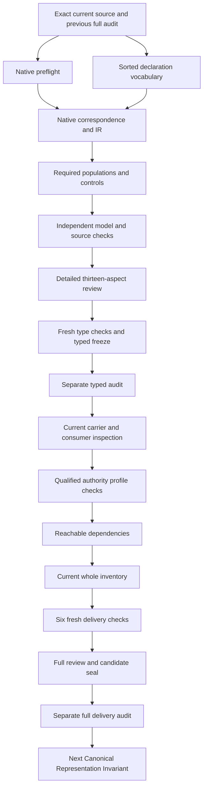

# Canonical Package Manifest: type and logic review

This is the project-owned, source-bound candidate interpretation of `cal.definition.canonical-package-manifest@1.0.0-candidate.2`, admitted as a Definition under C53. It is a partial formalization with source fidelity pending, semantic readiness false, no accepted whole translation and no whole-definition proof. The Definition admission, the executable manifest carrier admission under C70, this candidate interpretation, and a real package manifest are four distinct things. Successful checks on this candidate do not select a real package home or grant lifecycle authority.

The preceding Canonical Package Home full delivery sealed 7,817 candidate files and passed a separate actual audit. Native creation of this unit checked that audit, its empty stderr, all previous sealed bytes, the exact source snapshot, the original work unit and a prepared finite-model check. There are now 89 working native interpretation files against the fixed 183-identity episode, leaving 94 identities without a native interpretation. The last sealed whole inventory still contains 88 drafts and 95 missing identities. The current whole inventory, consumer inspection, dependency review and full delivery remain to be completed before the next definition is created. Original scope remains 183 identities, 189 versions and 201 captured source files.

## 1. Source selection, authority and version boundaries

The selected current source has SHA-256 `2837753f9bbcf00e62edc7ebae07de9724e4eafbcd834d73ba2550ec5e2ba641`. Its historical candidate.1 predecessor has SHA-256 `0b0ffa8eb2851bae34e2bf75070baab968a6f97816453b67b8bd7aa501b8359d`. Both remain byte-bound selections with different version references. The successor's embedded source metadata still describes its predecessor as candidate-unadmitted with no admission reference. The current snapshot describes that predecessor as admitted-historical. These observations are retained independently; the formalization does not rewrite historical body metadata to imitate its current decision overlay.

The source checker binds C53's decision, authorization, admission bundle and source-admission overlay, verifies exact authorization and manifest digests, and checks that the selected Definition version appears in the bundle. It also checks exact local upstream Definition, Canonical Package Home and Artifact Type source identities and their admission references. C53 reports no consumer activations. Neither that Definition admission nor these inspections admits a translation, validates a real manifest or activates a migration. Normative source is the scientific/formal voice. Plain-language explanations, examples and notation are explanatory source selections, with unresolved precedence findings retained for owner review.

## 2. Sorts, symbols and the interpretation's objects

The vocabulary contains 20 nonempty sorts, 12 constants, 61 total functions and 89 predicate/relation signatures, for 182 declarations. A ManifestReference identifies a selected declaration package. HomeReference, AggregateReference, OwnerReference, UnitReference and RecoveryReference name its explicit governed boundaries. SurfaceReference denotes a governed surface; EntryReference denotes a row that classifies that surface in a manifest. The two are distinct sorts because duplicate rows must remain observable even when they name the same surface.

SurfaceRole, TypeReference, CarrierReference, ResultReference and RegistryReference separate role assignment, type selection, canonical representation, structured resolution result and registry evidence. NestedReference, RelationReference and DirectoryReference separate a nested lifecycle, an explicit parent relation and physical directory correspondence. SemanticIdentity, ChangeReference and PathToken record artifact identity, a membership/location change and a path representation. Token supports absence, declared count and nonempty-reference markers. Sort separation prevents ill-sorted terms but does not establish authentic owner identities, physical directories or cross-definition equality maps. All such denotations remain separately reviewable obligations.

Every function is total over its finite model domain. Outside objects therefore have function values even when the source clauses do not apply to them. Applicability guards control those clauses; a total nominee alone does not imply currentness, admission or real-world existence. Explicit relations expose alternative rows and results rather than relying on the existence of one function value as a uniqueness argument.

## 3. Genus, tuple fields and applicable manifests

The source names `M=(home,aggregate,owner,unit,members,nested)`. The candidate represents selected manifests through ManifestApplicable and ManifestInScopeDeclared, with an exact equivalence between those declarations. It binds each selected manifest's home, aggregate, owner, unit, recovery, self-surface and effect through both a total function and a complete singleton binding relation. Every reference must be explicitly declared and have a nonempty handle. The effect token must be NONE.

This creates a precise necessary declaration shape. A missing or conflicting tuple binding fails the theory even if the total function still nominates a plausible value. The recovery and self-surface nominees support source boundaries and self-classification rather than asserting that those extra fields must occur in the current carrier schema. Their eventual representation may require a sibling contract or accepted mapping. The finite model has a main manifest, an independently governed child manifest and an outside manifest. This makes selected scope concrete without treating every possible manifest reference as a currently selected source. Actual ownership, home selection, validation and authority are separate predicates and remain absent from the theory's assumptions.

## 4. Home, ownership, change unit and recovery separation

For each selected manifest, the nominated home's owner, unit, recovery and aggregate must equal the corresponding manifest nominees. Selected manifests with different lifecycle owners or recovery references must have different home references. The positive model therefore gives parent and child distinct homes, owners, units, recovery boundaries and aggregates. Mismatched home fields fail independently. This preserves the source rule that files with different lifecycle owners or recovery boundaries require separate package homes.

The candidate does not import the entire Canonical Package Home theory or assert that owner/unit equality globally determines a physical directory. An exact home field is still a declared reference. The theory cannot authenticate the lifecycle owner, measure recovery independence or prove that a location currently contains all canonical source carriers. Those actual claims have separate query targets. Likewise, colocating references in a review or global index would not merge their ownership or recovery boundaries. The source's package-home boundary is preserved as a condition on selected declarations, while accepted physical-home correspondence remains pending.

## 5. Governed surfaces, entry rows and exact cardinality

For every selected manifest and every surface in its finite surface universe, GovernedDeclared(surface, manifestHome) holds exactly when a corresponding manifest entry exists. EntryForDeclared is then equivalent to an explicitly selected entry with exactly that manifest and surface. Every selected entry must belong to a selected manifest, refer to a declared surface, and align the surface's home, owner and recovery with the manifest fields. This establishes declaration completeness relative to the explicit governed-surface relation.

Within one manifest, two selected entry rows that name the same surface or the same path must be the same entry reference. That condition exposes a duplicate row even when its nominee functions still select one path or surface. The negative models include an unwitnessed governed surface, a missing entry relation, a duplicate surface row and two distinct surfaces assigned the same path. Distinct manifests may use the same self-entry path token; uniqueness is scoped to the containing manifest rather than asserted globally.

The finite governed universe is explicit and has nine surface references. Satisfaction does not prove that an actual directory tree contains no additional governed files. That claim needs an accepted source/consumer map and a governed completeness check. Conversely, transient and fixture surfaces need explicit roles; their directory names do not exclude them from governance by themselves. This interpretation records the declaration obligations without running a filesystem scan or creating any new manifest instance.

## 6. The self-entry and canonical manifest classification

Each selected manifest must have a SelfEntryDeclared witness. The relation identifies an entry that names the manifest's exact self-surface and uses the PACKAGE_SELF path token, representing `package.json`. Any selected entry in that manifest with that path must name the same self-surface. Combined with membership uniqueness, this ensures one self-entry, not merely at least one. Its role is CANONICAL, its exact type reference is MANIFEST_TYPE and its declared resolution count is ONE.

The self-entry's path, the manifest reference, the self-surface reference, the canonical carrier reference and the artifact's semantic identity remain separate. The required filename is part of this specific self-classification rule. It does not permit inferring an arbitrary artifact's type from a familiar extension or directory. Negative controls alter the self relation, path, role, type and count individually. A real `package.json` carrier is not authored or admitted by these finite witnesses. Authentic self-carrier existence and exact current type resolution remain separate actual outcomes.

## 7. Surface roles and non-carrier type claims

CANONICAL, COMPONENT, PROJECTION, EVIDENCE, FIXTURE and TRANSIENT are pairwise distinct SurfaceRole constants. Each selected entry has exactly one EntryRoleDeclared tuple, equal to its nominated role. Every entry's surface is declared canonical exactly when that role is CANONICAL. Noncanonical entries use NO_TYPE for their canonical type-claim field, and their corresponding surface type nominee also uses that absence token. This distinguishes absence of a canonical type claim from a statement that the represented content has no semantics at all.

The six named role constants are not a globally exhaustive role universe. A future role is allowed by the theory when its noncanonical type claim remains absent; the corresponding authored population requirement fails because the test model no longer witnesses COMPONENT. This distinction keeps theory satisfaction and witness coverage separate. It also avoids equating these surface roles with Canonical Package Home's seven semantic facet kinds. A generated projection can be a surface role without supplying a complete equality map to the CPH projection facet. The current carrier's closed schema and exact role vocabulary remain separate consumer evidence awaiting explicit correspondence.

## 8. Declared admitted resolution versus resolver execution

A selected canonical entry must have one exact AdmittedResolutionDeclared tuple for its surface, naming its result nominee. The result must be declared admitted, name the surface's exact canonical carrier, select the entry's exact type and reference a declared registry. The carrier's semantic identity must equal the surface identity, and its type must equal the entry and result type. The type cannot be NO_TYPE. The declared count token is ONE, but that token is not used as evidence that a resolver computed a successful cardinality.

The universal result relation makes an additional result visible. A canonical-count-one control that adds a second result fails even though the original count and selector are unchanged. Other controls remove the result relation, remove admission, substitute an input carrier, change the result type, reference an undeclared registry or mismatch carrier identity/type. These are declaration consistency failures. Authentication of admitted state, active registry currentness, actual resolution execution and semantic type fidelity remain distinct query targets.

CPH's consumer inspection observed that the current C70 schema and pure manifest helper can accept an unregistered canonical type string alongside a declared count of one. This prior observation is bound in the context, not converted into an accepted model-to-schema map. The resolution theory here therefore preserves stronger necessary declaration structure while leaving concrete enforcement and representation gaps unresolved for the next consumer review.

## 9. Independent nested lifecycles and parent relations

Each selected nested reference has an exact parent manifest and a typed relation reference. The relation's parent and child endpoints must match those nominees, and the complete NestedParentDeclared relation exposes missing or alternative parent tuples. If IndependentLifecycleDeclared holds, the nested package must have its own selected manifest, distinct from the parent, with exactly the matching OwnManifestDeclared tuple. This models both parts of the source implication: an independent lifecycle has its own manifest and an explicit parent relation.

The child manifest is subject to its own genus, home, membership, self-entry and resolution declarations. It is not a second entry that silently inherits the parent's lifecycle. Controls remove the child's own-manifest relation, reuse the parent as the child manifest, remove the parent relation or substitute the relation child endpoint. The model also permits no independent-child witness while satisfying the theory, which deliberately fails the required population check.

A declared manifest reference is not proof that a child carrier exists on disk. Nor does an opaque typed relation reference prove a registered relation kind, direction contract or authorized parent/instance authority transfer. The current carrier's `independent_lifecycle` boolean and manifest reference need explicit accepted mappings to these obligations. The candidate retains those limits rather than inventing a migrated child package or importing an authority theory.

## 10. Nearest declared package and directory facets

For a selected directory declared to have no own manifest, DirectoryNearest nominates a selected manifest. NearestPackageDeclared is exactly that nomination, and DirectoryFacetOfDeclared is equivalent to the nearest-package relation. The negative controls omit nearestness, introduce a conflicting facet assignment or nominate an outside package. This gives a checkable declaration reading of the source boundary that an unmanifested directory remains a facet of the nearest declared package.

The candidate does not derive nearestness from path strings, physical containment, folder names or a package scanner. Actual directory ancestry and the absence of an own manifest require a concrete correspondence map. Without it, the nominated nearest manifest is a necessary declaration whose real-world fidelity remains pending. That limitation is explicit because a nearestness label must not become a substitute for evidence. The exclusion clauses prohibit directory-based membership, nesting and type inference for selected manifests. Directory structure can support a separately governed physical-containment interpretation, but it does not itself select semantic identity, context membership or lifecycle authority in this candidate.

## 11. Membership changes, identity and type preservation

Each selected ChangeReference binds an exact surface, before/after semantic identities, before/after type references and before/after path tokens. Before identity and type must equal that surface's nominees. After identity and type must equal their corresponding before values. Every field also has an exact singleton binding relation, so a changed nominee cannot hide an inconsistent relation. Physical paths may differ, and the positive witness records a path change while identity and type stay fixed.

This implements the source boundary that manifest membership cannot change Artifact identity or type. It does not require byte equality between an old and new manifest, because membership rows or locations may legitimately change. It also does not model a separately authorized semantic successor as mere membership movement. Such a successor needs its own source-governed decision and version correspondence; that extension remains pending. Controls coherently change after identity or type and then fail preservation, distinguish a stale before binding from a semantic change, and allow an unchanged path while failing only the required changed-path population.

## 12. Source accounting, finite evidence and unresolved findings

All 27 nonempty source-string units are accounted for: 10 encoded clauses, nine explanatory clauses and eight deferred clauses. Encoded spans include the normative and formal statements, applicability, three scientific boundaries and four testable conditions. Explanation, examples and notation remain explanatory. Other boundary/exclusion/claim-ceiling text remains deferred with exact excerpt hashes and query obligations; it is not silently counted as proved. Nine primitive formula templates produce the selected source-clause formulas. The correspondence packet records no assumptions and retains all 19 unresolved source/interpretation findings.

The prepared check evaluates 102 authored controls with the unchanged 100,000-step budget. Its maximum observed use is 31,977 steps. The native independent verifier repeats the controls and evaluates 28 qualified nonentailment queries. Each query has a theory-and-population witness in which a selected manifest lacks every actual outcome. The target is false in that supplied model. This shows the target is not entailed by this declaration theory; it does not prove the target is false in a real deployment or establish the whole source translation.

There are 15 required populations and 89 unresolved signature populations. Required populations include selected/outside manifests, self and additional canonical entries, all six roles, an independent child, an unmanifested directory, a changed-path membership event, independent homes and authority independently observed on the child. The authority observation is permitted without any grant from manifest validation. One failed prepared check is retained byte-for-byte: malformed function outputs expected an outdated error name. Corrected controls use the verifier's actual structure-error codes. No native producer failure is concealed.

## 13. Delivery DAG, consumer obligations and continuation

The diagram is the remaining work DAG for this candidate, not a claim that the repository's semantic dependency graph is acyclic. Dependencies remain explicit semantic-use selections with qualified version identities. Shared denotations, joint consistency and existing semantic cycles require separate inspection. No whole prior theory is imported to manufacture closure.

Consumer continuation must inspect the current C70 Canonical Package Manifest/v1 artifact, schema, projections and pure helper against these exact declarations. It must retain arbitrary owner/unit/root references, unregistered type/count-one acceptance, closed-schema field gaps, candidate body versus decision-overlay posture and the pending Registry Context migration route. No consumer mapping is accepted by copying CPH's prior observations. Actual self carrier, governed completeness, current admitted resolution, child carrier existence, relation kinds and nearest physical-package correspondence require distinct evidence obligations.

Typed-stage freeze and its separate audit preserve the source-bound interpretation and this review. They do not close the full work unit or refresh the whole inventory. Full delivery requires actual terminal results from the six fresh checks, current dependency/inventory outputs, consumer findings, a complete delivery review, candidate seal and separate full audit. Only after that audit may the next native Canonical Representation Invariant be created. Source owner acceptance, all whole-definition proofs, semantic readiness and publication remain outside the observed candidate evidence.

### Source findings retained for owner correspondence

- CPM-FINDING-001: Current C53 candidate.2 source is selected;historical candidate.1 body and admission overlay remain separate.
- CPM-FINDING-002: Tuple fields have exact declaration relations;authentic owner,unit,aggregate and canonical-home denotations remain pending.
- CPM-FINDING-003: Governed surface membership is relation-complete in the supplied finite universe;actual governed file completeness remains pending.
- CPM-FINDING-004: Surface and entry identity differ;within-manifest duplicate surfaces or paths are rejected without imposing global entry identity injectivity.
- CPM-FINDING-005: Self-entry package.json is an exact path token,not an arbitrary filesystem type or authority inference.
- CPM-FINDING-006: Six role constants are pairwise distinct but not globally exhaustive;CPH semantic facet kinds are not equated to surface roles.
- CPM-FINDING-007: One declared admitted-resolution relation exposes extra results;declared schema count1 is not actual resolver execution or admission.
- CPM-FINDING-008: Carrier,result,type and registry references are separate;result state and binding authenticity require accepted current-registry correspondence.
- CPM-FINDING-009: Non-carrier entry type NO_TYPE is absence of a canonical type claim,not proof that every component lacks all possible semantics.
- CPM-FINDING-010: Independent child has its own selected manifest and exact parent relation;actual child carrier existence and relation kind fidelity remain pending.
- CPM-FINDING-011: Owner or recovery difference requires different homes;the owner/unit/recovery-to-physical-home correspondence is pending.
- CPM-FINDING-012: Nearest-package relations are exact declarations;physical ancestry,nearestness and actual absent own manifests remain pending.
- CPM-FINDING-013: Membership changes preserve exact declared artifact identity and type;semantic changes require an independent source-governed decision model.
- CPM-FINDING-014: Manifest membership does not establish context membership,approval,migration or lifecycle authority.
- CPM-FINDING-015: Current C70 Manifest schema and pure helper observations remain qualified with five inherited unresolved CPH consumer findings.
- CPM-FINDING-016: Historical embedded candidate posture is preserved separately from current C53 Definition and C70 carrier admission overlays.
- CPM-FINDING-017: No whole prior CPH,Artifact,ArtifactType,Resolution,Authority or Parent-Instance theory is imported.
- CPM-FINDING-018: Semantic-use dependencies,cycles,shared denotations,source precedence and whole-definition source fidelity remain pending.
- CPM-FINDING-019: No actual manifest instance,home selection,directory move,Registry Context migration,successor activation,publication or deployment is performed.

Actual native model/source results: 102 controls, 28 qualified countermodels, 56 source checks and two exact 4847-byte source projections. Source-query obligations: 31. All producer exit codes must be observed before this review is frozen.
