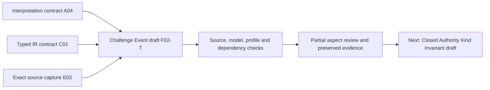

# Challenge Event: partial formalization and aspect review

This candidate follows the definitions, definition forms, types, and logic priority. It represents an eligible attributable recorded contestation with one exact subject revision and one exact Challenge Contract, equality of payload values at recorded states, and contextual separation from the challenged subject and decision objects. It also inspects the current dedicated carrier and four stored controlled candidate record revisions. Source-owner accepted meaning, actual eligibility and gates, byte/version/state denotation, universal temporal enforcement, and whole-definition proof remain pending. The formalization episode is active.

Primary evidence: [interpretation](t.json), [source correspondence](correspondence.json), [typed IR](static-ir.json), [model controls](model-controls.json), [source checks](source-checks.json), [qualification/carrier/stored-candidate observations](authority-profile-checks.json), [dependency graph](dependency-graph.json), and [current inventory](current-inventory.json). Closeout evidence: [receipt](receipt.json), [coverage row](coverage-row.json), [episode status](episode-status.json), and [delivery manifest](delivery-manifest.json).

## 1. Selected source, objects, and admission

The selected source is `cal.definition.challenge-event@1.0.0-candidate.1`, at `authority/definitions/candidates/0013-integrated-lab-definition-model/definitions/challenge-event/v1/definition.json`, SHA-256 `1a89a66594c972e1ef6adbf0aacbd92ba0ec974de8aa708aff131747634188e7`. Decision 0065 admits those source bytes in the current registry. The source retains its historical candidate-only claim ceiling. Effective registry admission and embedded historical provenance are observed separately; neither supplies source-owner acceptance of this formal translation.

The Definition, event record revision, business challenge identity, subject, subject revision, Challenge Contract, challenger, evidence, response projection, contradiction Finding, resolution, Decision, and effect are distinct roles. Equal reference strings, shared business node IDs, or identical field values do not prove these objects identical. The plain/domain example about `challenge:77`, `OL-07@v2`, and `CC-03` is explanatory text, not an observed challenge or successful owner gate.

## 2. Forms, source precedence, and complete accounting

The genus sentence defines an immutable attributable record of an eligible challenger's contestation of one exact subject revision under one exact Contract with stated grounds and evidence. The candidate uses **genus/differentia** together with **axiomatic implicit constraints** for exact targets and recorded-state payload equality. Its reading as an equivalence, rather than only a necessary implication, requires owner review. Source wording alone does not establish the exact semantic qualification predicates.

Three exact occurrences of the genus sentence are encoded: normative statement, first scientific boundary condition, and applicability. Four exact occurrences of the contextual noncollapse sentence receive the same formula. One printed positive implication receives the necessary-predicate formula. The result is eight encoded spans and three unique primary formulas; the compound genus formula contains characterization, uniqueness, and immutability conjuncts. Duplicate voices do not become independent rules.

All 21 source units are accounted for by 24 spans: eight encoded, six explanatory, ten deferred. Source boundaries, applicability/exclusions, notation, and claim ceiling retain exact character coverage. The printed `=/=> authority_effect(x)` is a nonentailment claim outside the primary theory. It is not converted into a universal prohibition on every independently supplied authority or effect.

Eight unresolved findings cover precedence, exactness, immutability, eligibility, contextual noncollapse, response/decision separation, carrier alignment, and dependency closure. No accepted source-precedence decision, authenticated owner, or reviewed identity/byte/version map is invented.

## 3. Types, symbols, and denotation

The signature has 51 declarations: three nonempty sorts (`Entity`, `Token`, `State`), one `EMPTY` Token constant, ten total functions, 27 unary predicates, and ten relations. Four Entity-to-Entity functions select subject revision, Contract, challenger, and the revision's parent subject; `initialRecordState` selects a State; `recordPayloadValue` maps Entity × State to Token; four Entity-to-Token functions select grounds, evidence, scope, and label values.

The selected functions are a representation choice, not a proof that source strings resolve to exact world entities. `EligibleToContest(p,r,c)` qualifies a selected challenger against a selected revision and Contract. `RecordedContestation(e,p)` records attribution; binary `ContestsRevision` and `UnderContract` relations carry target uniqueness. Relations and functions are qualified by exact source version and candidate scope, without asserting common meaning with another definition's qualified symbols.

Grounds and evidence predicates mean **stated**, while their selected Token values are nonempty. They do not mean true grounds, authenticated evidence, accepted evidence coverage, or a valid adjudication. Nonempty opaque Tokens can alias grounds, evidence, scope, and label values. `GovernedIdentityOrRecord` and `BoundedScope` remain opaque printed predicates; `BoundedScope(e)` does not constrain `scopeValue(e)` without an accepted connecting formula. A supplied control with an empty scope Token still satisfies this partial theory.

## 4. Primary logical semantics

Readable shorthand for the three unique formulas is:

```text
GenusConstraints :=
  ∀e. Event(e) ↔ QualifiedRecordedContestation(e)
  ∧ ∀e. Event(e) →
       ∀x. (ContestsRevision(e,x) → x = selectedRevision(e))
         ∧ (UnderContract(e,x) → x = selectedContract(e))
  ∧ ∀e. Event(e) → RecordedAt(e, initialRecordState(e))
       ∧ ∀t. RecordedAt(e,t) →
           payload(e,t) = payload(e,initialRecordState(e))

∀e. Event(e) → GovernedIdentityOrRecord(e) ∧ BoundedScope(e)

∀e. Event(e) → e ≠ selectedRevision(e)
  ∧ e ≠ parentSubject(selectedRevision(e))
  ∧ ¬ContradictionFinding(e) ∧ ¬Resolution(e)
  ∧ ¬Decision(e) ∧ ¬AutomaticLifecycleTransition(e)
```

`QualifiedRecordedContestation` is notation in this review for the actual conjunction in the typed AST: ImmutableRecord, AttributableRecord, exact selected revision/Contract, ChallengeContract on the selected Contract, selected-context eligibility, recorded selected attribution, selected target relations, GroundsStated/EvidenceStated, and nonempty selected ground/evidence values. It is not an additional imported predicate or proof obligation already discharged.

Selected target relations exist and are unique **within each event**. Two distinct events may target the same subject revision and Contract. Other recorded challengers are not forbidden: the source requires an eligible attributable challenger but does not explicitly make all attribution singleton. The supplied witness records two challengers for one event, including its selected eligible challenger.

The second formula has no converse. Having the two printed necessary properties does not suffice for an Event. The third is contextual: an Event cannot be its own selected challenged subject/revision, and cannot be classified as the selected finding/resolution/Decision/automatic-transition roles. An Event can be a different Event's challenged subject. The candidate therefore avoids a global prohibition on challenging Event records.

## 5. Immutability, state coverage, and revision identity

Payload equality is required at each modeled **recorded** state, including the selected initial state. This constrains exact candidate values, rather than merely attaching the ImmutableRecord label. Removing the initial recorded-state relation, or changing payload at a recorded state, fails the theory.

Three gaps remain explicit. First, a payload change at an unrecorded state satisfies the theory: the recorded-state guard does not establish complete trace coverage. Second, `initialRecordState` is a function name with no temporal ordering axiom; a control selecting the fixture's `after` State still satisfies the theory. Third, equality of payload Tokens is not byte equality unless a reviewed denotation connects Tokens to canonical bytes and record revisions. A hash equality likewise requires its own interpretation and collision/serialization assumptions before it can carry semantic proof claims.

The carrier's business `node_id` is not itself an exact record-version identity. The stored candidate has four versions under one node ID and preserves all four indexed byte digests. Treating every response postimage as the original immutable revision would create a tension with the source definition. Treating each postimage as a distinct exact record revision, or keeping response in a separate projection, is a candidate resolution that still needs the source owner's identity/version map.

## 6. Populations and independent witnesses

Ten required populations supply: an inhabited Event class; exact recorded contestation; Event without actual standing/authority; raw declared fields without an Event; printed necessary predicates without an Event; distinct same-selected-value Events; immutable payload with changing response projection; an Event serving as another Event's subject; an unresolved Event; and separate Decision plus subject effect.

These populations prevent vacuous satisfaction and test the selected distinctions. They are supplied hypothetical witnesses, not claims of observed eligibility, adjudication, subject mutation, or accepted owner decisions. Thirty-six populations remain unresolved. No primary-theory assumptions, exemptions, authenticated principal populations, or owner accepted population reviews are introduced.

Theory satisfaction and satisfaction of the full rich population set are evaluated separately. Some alternative models satisfy the theory but omit a selected informative witness; this is reported as a population failure, without silently changing the theory into an existence claim for all those objects.

## 7. Finite logic controls and nonentailment

The 58 controls contain 51 well-formed models: 23 satisfy and 28 fail the primary theory. Seven malformed models reject for a non-total payload function, ill-sorted function result, ill-sorted EMPTY constant, wrong eligibility arity, duplicate contestation tuple, empty State domain, or duplicate function tuple. The model evaluator checks total typed tables and tuple structure independently of formula truth.

Negative semantic controls remove characterization markers, exact revision/Contract qualification, selected eligibility, attribution, relations, or stated/nonempty grounds/evidence. They test reverse genus equivalence, extra subject revisions or Contracts, initial-state existence, recorded payload changes, own-subject/revision collapse, and forbidden selected roles. Positive alternatives expose unrecorded-state and temporal-order gaps, multiple recorded challengers, other-Event targets, independent response/resolution and subject effects, opaque value aliasing, and missing response projections.

Twenty queries outside the theory have supplied countermodels satisfying both theory and required populations. They refute automatic inference to nine standing/authority/admission/truth/proof/owner/runtime/effect/enforcement outcomes, authenticated challenger, truth of grounds, evidence acceptance, identity with Contract, raw-field sufficiency, reverse printed necessities, identity from field equality, singleton challengers, global unchallengeability, universal resolution, and a challenged-subject effect.

The event's noncollapse to Decision does not prohibit a separate Decision about it. A control adds an independent owner decision effect on the challenged subject while preserving the theory. Conversely, filing alone does not entail such an effect. Finite countermodels do not establish universal causal prevention, complete model enumeration, arbitrary trace immutability, or a whole-definition mechanized proof.

## 8. Stronger qualification hypotheses and finite frames

Thirty-nine hypothetical qualification profiles include 19 rejections. Nine selected context axes are event revision, business event ID, subject, subject revision, Contract, Contract revision, challenger, scope, and recorded time. Ten support axes cover record-revision identity, original bytes, recorded-state coverage, attribution, challenger eligibility, subject/Contract revision identity, stated grounds/evidence, and source fidelity.

All support is explicitly `hyp:` evidence. Matching labels are not authentication. Qualification requires the selected context to match, independent support, eligibility, and the original exact record revision. Same revision plus changed payload rejects. A new revision may carry a changed payload if the original is retained; it does not retroactively identify the new revision with the selected original.

A separate hypothetical disposition requires decision, exact event and subject revisions, scope, owner, gate, and a challenge-disposition effect. Its context must match. It is not an automatic subject reversal. Sixteen finite history frames include 11 rejections and preserve original bytes, business context, original subject/Contract revisions, and history. A successor must use a separate exact revision; a disposition must have a separate gate/decision hypothesis. These are bounded authored frames, with no universal temporal proof or actual runtime execution.

## 9. Exact source verification

Fourteen actual source checks cover bound Definition/v1 schema and generator digests, valid source shape, two identical renders and recorded projection parity, exact proposed/current registry and index entries, admission decision 0065, selected identity, duplicate genus/noncollapse accounting, and nonentailment targets excluded from assumptions. Both renders match 4,659 recorded bytes, SHA-256 `6747094634dd0e58c7c3278d113482735f988c1ba190d6dd2479e04902bb6a57`.

This proves the inspected byte bindings and render observations. It does not prove generic determinism, choose accepted genus equivalence, accept a temporal or exact-version map, or give this candidate source fidelity. Receipt-writing package validators are not invoked.

## 10. Dedicated carrier and shape gaps

The Type registry has 143 rows, including 121 admitted-current; the Kind registry has 41 current entries. A dedicated admitted-current `cal.artifact-type.challenge-event/v1` carrier binds the exact selected Definition path, version, and digest. Six carriers are inspected: Event, ChallengeContract, Decision/v2, Finding, EvidenceSet, and TypedRelation/v3. Five related carrier groups supply 24 negative fixtures, all rejected. Fifteen related probes include five accepted unresolved owner/scope references, without real reference resolution.

Eighteen dedicated Event probes accept sixteen shapes. Accepted cases include unresolved strings in all eight selected string payload fields, empty evidence at both levels, duplicate residue labels, a malformed time label, an unknown response state, a resolved label without a resolution Decision, an unversioned Contract reference, inconsistent subject/revision references, and changed evidence/response under the same node ID. Duplicate payload evidence rejects. Adding a top-level instance `version_ref` also rejects because it is absent from this closed record schema.

Accepted shape does not prove stated evidence content, real time, exact version, subject/Contract resolution, eligibility, immutability, or successful disposition. The fixture's payload subject reference differs literally from its embedded challenges counterpart. Its Contract reference also differs from the separately selected Contract fixture ID. Those observations are retained; the review does not silently join the fixtures or assert a semantic invalidity verdict without reviewed reference maps.

## 11. Embedded roles, global relations, and qualifiers

Independent embedded enums admit six relation kinds × two directions × 100 counterpart kinds: all 1,200 combinations pass the selected Event schema. The carrier declares 112 role tuples, so 1,088 accepted combinations are outside that declared set. The 112 declared tuples match the selected current Kind endpoint roles. Embedded fields, allowed endpoint roles, and actual admitted global Typed Relations remain separate evidence surfaces.

Seven selected Kind/TR comparisons have these pair counts: challenges 100/100, governed-by 29/23, evidence-bears-on 72/72, produces 19/19, declares-effect-on 21/21, successor-of 100/100, scopes-authority-over 3/2. The 141 selected probes accept 134 and reject seven, retaining six governed-by gaps and one AuthorityBoundary-to-DecisionScope gap. These broader gaps are not evidence that Event-to-Contract governance is missing.

Two positive shape probes deliberately supply unresolved or wrong endpoint-version qualifier labels for challenges and declares-effect-on. Accepted nonempty strings do not authenticate `challenged_version_ref`, `exact_target_version_ref`, endpoint versions, or Contract context. Kind forbidden-inference lists separately exclude suspension/reversal/contradiction-proof/authority from challenges, effect execution from declared effects, truth from evidence, and automatic supersession from successor relations. No relation is created or admitted by these checks.

## 12. Stored controlled candidate versions and joins

The inspected existing workflow receipt contains 54 indexed records, including four Event records and 26 Typed Relations. The four Event versions share `challenge-event:lab-W05:historical-builder-contract` as business node ID, while `@candidate.1` through `@candidate.4` have distinct exact byte digests. They carry submitted, eligible, responded, and resolved-for-revision response labels. Every selected Event/relation digest matches its index row and passes its inspected current schema. This is a fresh read of stored evidence, not a fresh execution of that workflow.

Three indexed successor relations link versions 2→1, 3→2, and 4→3 with `candidate-contest-state-only` succession effect. Six filing fields remain stable: Contract, challenger, subject, subject version, ground, and submitted time. The evidence list also remains stable across all four stored records. Response state changes; the last revision adds a resolution Decision reference. The capability to append response evidence observed in service code is distinct from this stored trace, which does not exercise it.

The exact indexed Contract is `challenge-contract:lab-W05:controlled-builder-contest@candidate.1`, and the exact indexed subject is `implementation:lab-W05:historical-builder@candidate.1`. All four revisions use those same literal references, and both referenced records' digests match the index. Its Contract's controlled protocol reference is fixture context, without a claim of independently admitted Policy meaning or real eligibility authentication.

The stored summary says controlled=true, actual_owner_outcome=null, authority_effect=none, canonical_effects_applied=0, and retry_dispatched=false. A stored resolved label is not an actual owner decision or live gate success. No whole pipeline currentness, runtime replay, source migration, challenge admission, or canonical subject effect is claimed.

## 13. Static service inspection and the immutable-record question

AST/source inspection covers ChallengeService submit/eligible/respond/_transition/resolve and EvidenceService put/get. The services are not imported or executed. The inspected `_transition` changes the parsed response value and supplies a new version to EvidenceService; `put` rejects an existing exact node-ID/version key and writes a new path exclusively. `get` verifies the stored byte digest and parses a fresh object. These source patterns support a candidate explanation of distinct retained record versions rather than overwriting original stored bytes, but do not prove all runtime paths correct.

The inspected resolution path requires a ControlledGate and distinct Decision, Effect, DecisionScope, and AuthorityClaim context. It records fixture-only outcome with no actual owner result and checks preservation of the challenged subject's bytes. Exact target/scope and authorization in this fixture remain separate from real gate authentication. A response successor may refer to the preceding challenge revision; a reviewed version/target map is needed before equating that disposition with a current or original revision.

The coherent candidate distinction is between business challenge identity, exact immutable filing/record revision, successor response records, and separate disposition/subject effects. Whether all successor postimages are Challenge Events under the same accepted definition is unresolved. Neither schema acceptance nor preserved bytes accepts that semantic classification automatically.

## 14. Dependencies and the execution DAG

Thirty-six authored semantic uses cover Definition, Contract/Policy, principal/reference/role, authority boundaries/surfaces, Decision/scope/effect/gate/Finding, evidence/residue, histories, canonical representation and identity, classification axes, typed relations/Kinds, schemas/artifacts/context, validation and receipts. Nine exact comparison sources remain qualified and separate; no comparison clause is inherited into the Event theory without accepted meaning alignment.

The joint semantic-use graph has 93 nodes and 617 declared edges, with 57 missing counterpart packets. One unresolved component has 36 members and 374 internal edges. That cyclic semantic graph is distinct from the acyclic work-plan DAG: declaring mutually dependent terms is not a proof of shared meaning or permission to run closure tasks early.

The bounded execution order is:



This diagram explains the present work sequence, not semantic closure or a substituted whole-project DAG. Owner-reviewed source correspondence, exact denotation, independently reviewed edges, cycle classification, and required counterpart packets remain explicit later obligations. Foundations-first definition/form/type/logic work remains ahead of implementation expansion.

## 15. Failure retention, fresh replay, and preservation

The [failed profile attempt](attempts/001-catalog-count-and-stored-evidence/attempt.json) preserves its checker and actual exit-1 logs. It expected 25 negative fixtures instead of the selected 24 and assumed evidence changed in the stored response trace. The corrected checker records stable stored evidence and actual selected fixture count. The primary theory and canonical source bytes were unchanged.

Six fresh read-only checks cover the interpretation contract, models, source, profiles/carriers/stored records, dependency selection, and current inventory. [Actual command results](fresh-command-results.json) retain terminal exit codes and stdout/stderr. The closing audit rehashes selected inputs, archived failure, all predecessor candidate files, outputs, and the sealed candidate file set. It verifies all 201 captured source files and preserves all 3,103 predecessor files. Unrelated dirty work and I04's historical eight-draft selected report remain preserved.

## 16. Episode status and next priority

There are 36 partial drafts for 183 current identities and 189 admitted source versions, leaving 147 current identities without a per-definition draft. Aggregate correspondence accounts for 827 source units and 1,105 spans: 258 encoded, 299 explanatory, 548 deferred. There are 304 required and 926 unresolved populations, zero source-owner accepted whole translations, and zero whole-definition proofs.

The next definition priority is `F02-T.cal.definition.closed-authority-kind-invariant`. This review explains the full aspect set for the Event candidate, including its limits. The complete formalization episode and consolidated final review still require remaining definition work and the accepted alignment/closure evidence; those outcomes are not claimed by sealing this partial draft.
