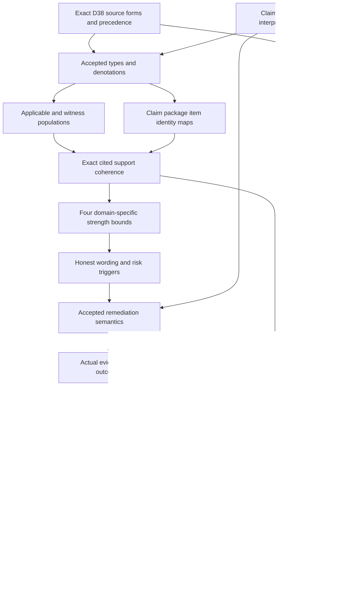

# Claim-Support Compatibility: types and logic review

Candidate delivery review. Author,builder,model,source,profile,dependency and inventory producers are recorded beside this review. Six independent fresh checks have terminal-zero results;finalization and the separate sealed-file audit determine delivery completion. This packet grants no authority and supplies no source-owner acceptance, actual truth, governing permission or whole-definition proof.

## 1. Source and normalized identity

The current selected version is cal.definition.claim-support-compatibility-invariant@1.0.0-candidate.1, SHA73e97225d896fa5ba9157ec860b3ef7b9c36da01b3089943f9d2b5f87558f2f1. C53 supplies the current admission overlay. The retained reconstruction body remains historically candidate-unadmitted. D38 Claim-Proof Bound is selected by exact source-use digest de58dbca26577af6e991dca7f30a1b7dc41069c147532289777284d0d8b7d39a. Local bytes can establish this selection while the absent producer checkout and repository identity remain unauthenticated. CSI-FINDING-001 retains source precedence and normalized identity questions; CSI-FINDING-010 retains source-owner fidelity and closure.

The normalized invariant is not a mathematical proof object or a single evidence item. C53 admits the exact Definition meaning and selected source use, while the reconstruction body still describes its historical candidate origin. The prototype reclassifies D38 rather than merging every legacy meaning into a current carrier. Recorded authorization is evidence of the selected admission envelope, not acceptance of this agent’s proposed claim/interpreter denotations. A source-owner verdict must name the exact translated ranges, resolve precedence and accept remaining losses. It cannot be inferred from a digest match or successful generation command.

## 2. Exact source forms and coverage

Twenty-two source units map to 26 spans: six encoded, nine explanatory and eleven deferred. Six unique encoded formula values compose twelve primitive templates. The encoded spans characterize normalized invariant identity, applicable claim/type/context/interpreter maps, cited support and included item coherence, four declared strength comparisons, honest wording, weak-support remediation, absent-support defaults and plural support boundaries. Plain language and domain context remain explanatory. Artifact identity/digest/schema/projection tests remain observations. Complete character accounting would document every selected string range; it would not imply that every source meaning has been translated or accepted.

Character accounting checks exact source selectors,offsets,excerpt hashes and complete nonempty-string coverage across the selected voices,boundaries,scope and claim ceiling. Deferred and explanatory ranges remain in the denominator. The six encoded source formula values reuse twelve primitive templates;template count is a construction fact rather than twelve separately translated source statements. Artifact tests are measured observations,while the outer support boundary supplies an independently queried conclusion outside T. This distinction keeps a desired epistemic result from being introduced as its own assumption and makes incomplete semantic coverage visible.

## 3. Types first

There are 104 declarations: nine sorts, six constants, thirty total functions,57 unary predicates,one binary and one four-argument relation. Twenty-nine populations are required and59 remain unresolved. Nine sorts keep Invariant, Claim, ClaimType, Context, Interpreter, SupportPackage, SupportItem, Strength and Token separate. A claim is not its citation or support package. A package is not an included item. A strength value is not a truth value, permission, lifecycle state or execution result. The registry lacks current definitions literally named Claim, Claim Ceiling, Witness, Premise Assignment, Proof, Publication or Dependency. Candidate sorts preserve those descriptive mapping obligations without inventing versioned source identities.

The first-order fragment uses equality and total sorted functions. It has no probabilistic semantics,numeric arithmetic,temporal execution logic,modal certainty or hidden subtyping. All nine model domains are nonempty,and required populations make supported,unsupported,risky and outside-scope cases concrete. Total maps give every supplied object a value,including absent-support placeholders. Applicable guards prevent those placeholders from being treated as cited packages. Strength and Token are separate sorts: a reference token cannot be substituted as a confidence value,and neither sort is a permission or a truth bit.

## 4. Applicability and interpreter selection

ClaimApplicable is characterized through declared wording-in-scope and claim-type selection. Applicable claims bind a normalized invariant, context and declared interpreter. Interpreter context/type agree exactly with the claim, and its handle is nonempty. Eligible interpreter kinds are domain, validator, research standard, owner decision or constitution. These kinds can overlap. A named interpreter is not automatically accepted or competent for actual governing use. CSI-FINDING-002 and CSI-FINDING-003 retain the population and interpretation maps.

An interpreter is selected for the exact claim type and context. A validator’s evidence standard cannot be substituted for a research standard merely because their labels resemble one another. The five eligible interpreter kinds are source alternatives,so the model permits overlaps without asserting that every real interpreter is competent for every claim type. Interpretation references remain candidate declarations rather than independently accepted evaluation procedures. The selected source has no exhaustive claim taxonomy;scope selection and interpreter competence therefore remain explicit owner obligations instead of universal facts about all statements.

## 5. Four distinct strength dimensions

Asserted strength, authority effect, validation status and publication posture have separately typed Claim-to-Strength and Package-to-Strength maps. AllowedStrength is an Interpreter/ClaimType-indexed four-argument relation. The proposed theory does not impose numerical arithmetic, a total order, transitivity, antisymmetry or one universal certainty scale. It does not equate a validation result with release authority. Owner acceptance must supply the relevant domain relation and each dimension's meaning. CSI-FINDING-004 retains these separate maps.

AllowedStrength takes an Interpreter,ClaimType,asserted Strength and support Strength. It is a relation whose meaning is left for the relevant domain contract. No axiom requires reflexivity,transitivity,antisymmetry,numerical comparability or a total ranking;adding those properties would require justified denotations and acceptance. The four dimensions are checked independently even when their baseline values coincide. A failed authority-effect comparison cannot be repaired merely by citing a successful validation-status comparison. Each dimension requires a separately accepted translation into the relevant domain relation before actual governing readiness is reported.

## 6. Support presence and package coherence

ClaimHasSupport agrees with a citation declaration and declaration of the exact selected package. An applicable supported claim needs matching package context, claim type and interpreter, a nonempty package handle and an included item witness. Presence is distinct from adequate support. Total functions still give absent-support claims placeholder package values, without declaring those placeholders to be cited support. These guards prevent a shared name or wrong-context package from substituting for the selected evidence. CSI-FINDING-005 retains citation, package and adequacy obligations.

Citing a declared package establishes only declared support presence. The package must match the exact claim’s type,context and interpreter rather than importing another assessment’s evidence. Its nonempty handle and included-item witness provide structural coherence,not authenticity,availability,sufficiency or truth. When support is absent,the model uses an undeclared placeholder package whose maps remain total. This preserves a well-formed finite interpretation without making absence indistinguishable from actual cited evidence. A later consumer adapter must resolve package references and their scope rather than treating a nonempty string as proof.

## 7. Plural support and included items

Every included item used by an applicable supported claim has matching type/context, a nonempty handle and an eligible support kind. Source citation, validation run, witness, owner decision, accepted premise and formal proof remain eligible alternatives, with overlap allowed. The invariant excludes a formal-proof-only role and a maximal-certainty requirement. Required witnesses exercise each alternative without forcing every actual package to contain all six. CSI-FINDING-006 retains accepted item meanings and evidence treatment. An accepted premise does not become an unrecorded assumption in T.

SupportItemIncluded relates a package to its selected items. Included items have explicit type/context bindings,handles and eligible kind declarations. Kind eligibility does not establish that a citation is authoritative,a validation run is current,a witness is valid,an owner decision governs this effect,or a premise has actually been accepted. In particular,the AcceptedPremiseSupport predicate never adds an assumption to the theory. The finite examples exercise all six kinds;the universal package rule requires an eligible included item rather than all six kinds in every package. Actual evidence treatment remains independently reviewable.

## 8. Declared comparison and honest wording

WithinDeclaredSupportBound requires cited support and all four domain-interpreted comparisons. CompatibleClaim requires support, the bound and HonestWordingDeclared. A partial or private supported claim may have a modest declared bound and honest wording,while still requiring risk treatment. Compatibility and risk are therefore distinct predicates. These labels do not assert actual truth, adequate evidence, admitted authority, passed validation or authorized publication. Finite countermodels retain all proposed clauses while those actual targets are false. Actual epistemic standards must be accepted separately. A consumer cannot treat a compatible label as a governing clearance merely because a schema accepts it.

CompatibleClaim is a candidate declaration characterization,not a certificate that the statement is true or ready to govern work. It agrees with cited support,the four declared comparisons and honest wording. A compatible bounded claim can also be risky because its source package is partial,private,indirect or disputed. The separate risk rule still requires treatment. Conversely,a claim exceeding any dimension’s bound cannot retain WithinDeclaredSupportBound merely because another dimension is modest. These distinctions prevent a single green label from collapsing epistemic strength,evidence quality,publication posture and actual authority.

## 9. Absent and weak support

Absent support requires candidate or hypothesis wording declarations. Partial, private, indirect, disputed and weaker support remain separate predicates. RiskyClaim also includes supported claims that exceed the declared bound. A risky applicable claim needs at least one explicit downgrade, hypothesis/candidate qualification, residue flag, gate route or governing block, together with a nonempty treatment reference. The alternatives are not mutually exclusive. CSI-FINDING-007 retains defaults; CSI-FINDING-008 retains weak-support treatment. A gate route alone cannot replace the absent-support default wording obligation.

The weak-support predicates are not mutually exclusive and do not automatically mean falsehood. A private package might support a modest internal hypothesis while requiring public qualification or a governing block. Absence is stronger than a named weak package:the formal source additionally defaults its wording to candidate or hypothesis. Residue or gate routing alone does not meet that default. The treatment disjunction requires an explicit declaration and a nonempty treatment reference,but it does not assume all alternatives are equally adequate in every domain. Adequacy and actual completed treatment remain owner and consumer work.

## 10. Actual remediation and outcome boundaries

The proposed guards test declared responsibility. DowngradeDeclared does not demonstrate that wording changed. GateRouteDeclared does not demonstrate gate clearance. GoverningBlockDeclared does not prove that a live consumer blocks work. Actual truth, authority, support adequacy, publication, validation, gate clearance, governing authorization, remediation execution, consumer alignment and global consistency remain external query targets. CSI-FINDING-009 retains these operational maps. No target is imported as an assumption, and no actual premise is silently accepted from its named support kind.

Actual outcome predicates can vary independently of the declared guards. The supplied baseline satisfies T and all required populations while every external outcome is false. Positive controls can turn actual predicates on without the theory manufacturing an outcome or a mathematical theorem. Countermodels therefore establish non-entailment for this selected qualified fragment;they do not assert that real truth,authority or sufficient support is unattainable. A later actual result needs its own scope,evidence,authority contracts and verified execution. Neither this declaration theory nor its source admission supplies those prerequisites automatically.

## 11. Verification surface

Eighty source-bound,qualified finite controls were independently evaluated:25 satisfy T,48 falsify T,and seven are malformed-model rejections. All17 actual-outcome targets have supplied T/I countermodels. Baseline domains have one Invariant,nine Claims,two ClaimTypes,two Contexts,six Interpreters,eight SupportPackages,six SupportItems,three Strength values and eight Tokens. Cases distinguish type/context substitution,missing citation/items,per-dimension overclaim,unsupported comparison,missing honesty,absent-support defaults and risk without treatment. Positive cases permit kind/treatment overlap,outside-scope mappings and domain relations that are not numeric total orders. Removing every formal-proof-kind declaration can satisfy T while failing the selected formal-proof witness population,so the witness policy does not silently become a universal package requirement.

Eighteen actual source checks bind C53,current registry/manifest/recorded authorization and exact admitted local D38 source use. The local section is2,434bytes. Two pure renders match the exact6,383byte projection,SHA309d7cf08318467e2d3ef2fde5748b62848cfa96067a9f7197c5efb4553f29c3. Producer checkout/currentness and accepted repository identity remain unauthenticated. The exact whole-source boundary supplies Claim-not-ActualTruth outside T. Source testable conditions and the retained historical claim ceiling remain observation-measurement clauses. No support item,premise or actual outcome is silently imported as an assumption.

Twenty-four qualified semantic uses and twelve separate comparison sources expose dependency/owner work without composing those sibling theories into T. Scratch prevalidation of the same planned primitive models was retained in the Root-Axis preparation before this packet existed;the qualified current-source checks are separately executed here. There were no failed author,build,model or source attempts. Fresh contract/model/source replay must complete before the typed-stage receipt is recorded;full six-check delivery remains separate.

Thirty qualified binding profiles retain metadata,claim type/context/interpreter,four strength dimensions,package/items and treatment;28 reject changed bindings or unsupported epistemic/authority inferences. Seventy-two finite claim/support/treatment frames include25 accepted cases and47 rejections. These are authored hypotheses with actual execution,truth,authority and remediation verification explicitly false. Seventeen separate actual observations inspect143catalog rows,121admitted-current rows,the exact D38 prototype and current/historical Definition contracts. They find no current type bound directly to this invariant and no generic admitted invariant carrier. The prototype remains scaffold,authority none and without an admitted execution schema.

Thirty executed Definition/v1 probes have five acceptances. Missing required fields and extra strength/package/item/remediation fields are rejected,but unresolved identifiers and overclaimed normative prose remain shape-valid. Generic Definition/v2 separately binds the current Definition meaning. Schema acceptance does not resolve a claim’s support or establish actual truth. No package validator,materialization writer,live consumer,registry mutation or actual governing outcome is created by these observations.

## 12. Completion DAG

Types, populations and interpretation precede actual truth and execution claims. Individual finite witnesses do not establish common-carrier consistency across the dependency graph. Source-owner acceptance and whole-definition proof remain separate downstream work products.

The DAG edges identify required work products rather than declaring every node complete. Source/context review precedes accepted sorts and denotations. Population and identity maps can then proceed independently into exact cited-support coherence. Domain-specific bound interpretation precedes honesty and risk treatment. Actual evidence/outcomes and consumer correspondence precede proof or execution verdicts. Coverage synchronization and common accepted meanings are separate prerequisites for a whole-definition verdict. Counting individual finite models cannot settle shared meanings in a cyclic dependency component or substitute for a source-owner fidelity decision.

## 13. Preservation and continuation

Root-Axis's full six-check replay and separate sealed-file audit passed before this packet was created. This unit preserves all5,330Root-Axis seal files and201selected source files. Preflight verified output absence,the exact current source,SWU write scope and A04/C01/E02 prerequisites. Author,build,model,source,profile,dependency and inventory producers passed. Contract,model,source,profile,dependency and inventory each have independently recorded fresh terminal-zero results with empty stderr. Frozen typed-stage REVIEW.md and CONTINUATION.md remain exact receipt inputs rather than being rewritten after later results.

The refreshed inventory records 66 partial drafts and 117 current identities without a draft packet. It has 1502 source units,2020 mapped spans,635 encoded,526 explanatory and 859 deferred clauses,743 required and 2895 unresolved populations. Every current draft has one independently evaluated supplied T/I model witness. The full source denominator remains183currentidentities189admittedversions201selectedsourcefiles.

The local declared graph has 123nodes,1532edges and 58missing counterpart packets. The joint graph has 124nodes,1566edges,58missing packets and unresolved cycle components of sizes [65]. Its edge delta adds exactly24declared Claim-Support uses. Prior joint source identities remain preserved;any new reachable source identities are separately recorded rather than silently merged. No cycle classification,common-carrier consistency or semantic closure is accepted.

Source-owner-accepted whole translations and whole-definition proofs remain zero. A candidate seal records preservation and bounded verification;it cannot change those counts. No failed author,build,model,source or profile attempt is concealed. The initial inventory process returned143 after writing complete provisional reports and stdout. Its exact checker,logs,reports and note are retained under attempts/001-inventory-terminated. The termination cause is unknown. The initial exit is not counted as success;the replacement producer and independent full replay provide actual later terminal results. The detailed receipt and separate delivery audit remain the exact seal evidence. The historical eight-draft I04 inventory is preserved and requires its own scoped reporting update before any change to that report is claimed.

Continue F03-T.cal.definition.conformance,then Drift Assessment. Conformance binds exact subject/contract digests,scope,profile,evidence and owner;it separates schema,identity,implementation and runtime scopes. Drift Assessment compares declared and observed values at an exact time without inferring cause,severity,failure or correction authority from mismatch alone. Their inspected requirements are retained in NEXT-UNIT-NOTES.md. Preserve all121tasks511edges797SWUs36frontiers and the original complete definition scope. Independent typed drafts can proceed while family owner,fidelity,common-denotation,proof,replay and whole-review gates remain unsatisfied until their actual evidence exists.
