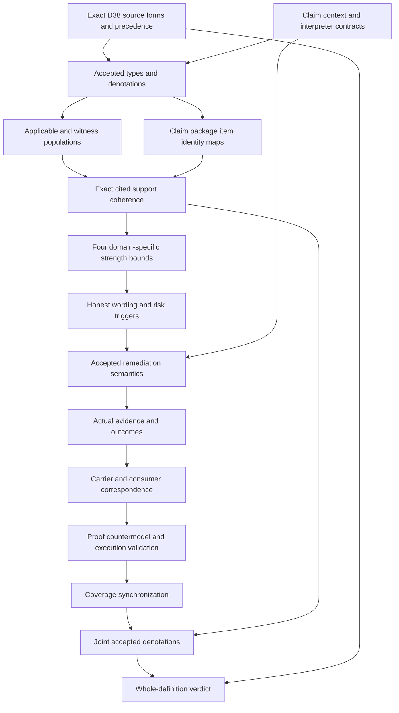

# Claim-Support Compatibility: types and logic review

Types-and-logic candidate stage. Author, builder, model and source producers exited zero. Carrier/profile, dependency/current inventory, full replay and sealed delivery remain pending. This packet grants no authority and supplies no source-owner acceptance, actual truth, governing permission or whole-definition proof.

## 1. Source and normalized identity

The current selected version is cal.definition.claim-support-compatibility-invariant@1.0.0-candidate.1, SHA73e97225d896fa5ba9157ec860b3ef7b9c36da01b3089943f9d2b5f87558f2f1. C53 supplies the current admission overlay. The retained reconstruction body remains historically candidate-unadmitted. D38 Claim-Proof Bound is selected by exact source-use digest de58dbca26577af6e991dca7f30a1b7dc41069c147532289777284d0d8b7d39a. Local bytes can establish this selection while the absent producer checkout and repository identity remain unauthenticated. CSI-FINDING-001 retains source precedence and normalized identity questions; CSI-FINDING-010 retains source-owner fidelity and closure.

## 2. Exact source forms and coverage

Twenty-two source units map to 26 spans: six encoded, nine explanatory and eleven deferred. Six unique encoded formula values compose twelve primitive templates. The encoded spans characterize normalized invariant identity, applicable claim/type/context/interpreter maps, cited support and included item coherence, four declared strength comparisons, honest wording, weak-support remediation, absent-support defaults and plural support boundaries. Plain language and domain context remain explanatory. Artifact identity/digest/schema/projection tests remain observations. Complete character accounting would document every selected string range; it would not imply that every source meaning has been translated or accepted.

## 3. Types first

There are 104 declarations: nine sorts, six constants, thirty total functions,57 unary predicates,one binary and one four-argument relation. Twenty-nine populations are required and59 remain unresolved. Nine sorts keep Invariant, Claim, ClaimType, Context, Interpreter, SupportPackage, SupportItem, Strength and Token separate. A claim is not its citation or support package. A package is not an included item. A strength value is not a truth value, permission, lifecycle state or execution result. The registry lacks current definitions literally named Claim, Claim Ceiling, Witness, Premise Assignment, Proof, Publication or Dependency. Candidate sorts preserve those descriptive mapping obligations without inventing versioned source identities.

## 4. Applicability and interpreter selection

ClaimApplicable is characterized through declared wording-in-scope and claim-type selection. Applicable claims bind a normalized invariant, context and declared interpreter. Interpreter context/type agree exactly with the claim, and its handle is nonempty. Eligible interpreter kinds are domain, validator, research standard, owner decision or constitution. These kinds can overlap. A named interpreter is not automatically accepted or competent for actual governing use. CSI-FINDING-002 and CSI-FINDING-003 retain the population and interpretation maps.

## 5. Four distinct strength dimensions

Asserted strength, authority effect, validation status and publication posture have separately typed Claim-to-Strength and Package-to-Strength maps. AllowedStrength is an Interpreter/ClaimType-indexed four-argument relation. The proposed theory does not impose numerical arithmetic, a total order, transitivity, antisymmetry or one universal certainty scale. It does not equate a validation result with release authority. Owner acceptance must supply the relevant domain relation and each dimension's meaning. CSI-FINDING-004 retains these separate maps.

## 6. Support presence and package coherence

ClaimHasSupport agrees with a citation declaration and declaration of the exact selected package. An applicable supported claim needs matching package context, claim type and interpreter, a nonempty package handle and an included item witness. Presence is distinct from adequate support. Total functions still give absent-support claims placeholder package values, without declaring those placeholders to be cited support. These guards prevent a shared name or wrong-context package from substituting for the selected evidence. CSI-FINDING-005 retains citation, package and adequacy obligations.

## 7. Plural support and included items

Every included item used by an applicable supported claim has matching type/context, a nonempty handle and an eligible support kind. Source citation, validation run, witness, owner decision, accepted premise and formal proof remain eligible alternatives, with overlap allowed. The invariant excludes a formal-proof-only role and a maximal-certainty requirement. Required witnesses exercise each alternative without forcing every actual package to contain all six. CSI-FINDING-006 retains accepted item meanings and evidence treatment. An accepted premise does not become an unrecorded assumption in T.

## 8. Declared comparison and honest wording

WithinDeclaredSupportBound requires cited support and all four domain-interpreted comparisons. CompatibleClaim requires support, the bound and HonestWordingDeclared. A partial or private supported claim may have a modest declared bound and honest wording,while still requiring risk treatment. Compatibility and risk are therefore distinct predicates. These labels do not assert actual truth, adequate evidence, admitted authority, passed validation or authorized publication. Finite countermodels retain all proposed clauses while those actual targets are false. Actual epistemic standards must be accepted separately. A consumer cannot treat a compatible label as a governing clearance merely because a schema accepts it.

## 9. Absent and weak support

Absent support requires candidate or hypothesis wording declarations. Partial, private, indirect, disputed and weaker support remain separate predicates. RiskyClaim also includes supported claims that exceed the declared bound. A risky applicable claim needs at least one explicit downgrade, hypothesis/candidate qualification, residue flag, gate route or governing block, together with a nonempty treatment reference. The alternatives are not mutually exclusive. CSI-FINDING-007 retains defaults; CSI-FINDING-008 retains weak-support treatment. A gate route alone cannot replace the absent-support default wording obligation.

## 10. Actual remediation and outcome boundaries

The proposed guards test declared responsibility. DowngradeDeclared does not demonstrate that wording changed. GateRouteDeclared does not demonstrate gate clearance. GoverningBlockDeclared does not prove that a live consumer blocks work. Actual truth, authority, support adequacy, publication, validation, gate clearance, governing authorization, remediation execution, consumer alignment and global consistency remain external query targets. CSI-FINDING-009 retains these operational maps. No target is imported as an assumption, and no actual premise is silently accepted from its named support kind.

## 11. Verification surface

Eighty source-bound,qualified finite controls were independently evaluated:25 satisfy T,48 falsify T,and seven are malformed-model rejections. All17 actual-outcome targets have supplied T/I countermodels. Baseline domains have one Invariant,nine Claims,two ClaimTypes,two Contexts,six Interpreters,eight SupportPackages,six SupportItems,three Strength values and eight Tokens. Cases distinguish type/context substitution,missing citation/items,per-dimension overclaim,unsupported comparison,missing honesty,absent-support defaults and risk without treatment. Positive cases permit kind/treatment overlap,outside-scope mappings and domain relations that are not numeric total orders. Removing every formal-proof-kind declaration can satisfy T while failing the selected formal-proof witness population,so the witness policy does not silently become a universal package requirement.

Eighteen actual source checks bind C53,current registry/manifest/recorded authorization and exact admitted local D38 source use. The local section is2,434bytes. Two pure renders match the exact6,383byte projection,SHA309d7cf08318467e2d3ef2fde5748b62848cfa96067a9f7197c5efb4553f29c3. Producer checkout/currentness and accepted repository identity remain unauthenticated. The exact whole-source boundary supplies Claim-not-ActualTruth outside T. Source testable conditions and the retained historical claim ceiling remain observation-measurement clauses. No support item,premise or actual outcome is silently imported as an assumption.

Twenty-four qualified semantic uses and twelve separate comparison sources expose dependency/owner work without composing those sibling theories into T. Scratch prevalidation of the same planned primitive models was retained in the Root-Axis preparation before this packet existed;the qualified current-source checks are separately executed here. There were no failed author,build,model or source attempts. Fresh contract/model/source replay must complete before the typed-stage receipt is recorded;full six-check delivery remains separate.

## 12. Completion DAG

Types, populations and interpretation precede actual truth and execution claims. Individual finite witnesses do not establish common-carrier consistency across the dependency graph. Source-owner acceptance and whole-definition proof remain separate downstream work products.

## 13. Preservation and continuation

Root-Axis's six-check replay and separate sealed-file audit passed,preserving5,330candidate files and201selected source files. This unit's preflight verified output absence,current source,exact SWU and A04/C01/E02 receipt bindings. Author,build,model and source producers exited zero. The full episode remains183currentidentities189admittedversions201selectedsourcefiles. This is the66th typed draft file on disk;the last sealed inventory remains65partial drafts and118missing packets. A fresh66-draft inventory has not been produced. There are now117currentidentities without a draft file on disk,but this is an observed file count rather than a source-owner translation verdict.

Carrier/profile and schema/role observations,reachable dependency graph,current joint inventory,full six-check replay,finalization/seal and separate delivery audit remain pending for Claim-Support. Source-owner-accepted whole translations and whole-definition proofs remain zero. The next missing definition after delivery is F03-T.cal.definition.conformance,followed by Drift Assessment. Keep all121tasks511edges797SWUs36frontiers and the original complete definition scope. Family source-owner,common-denotation,proof,replay and whole-review gates remain unsatisfied until their required evidence exists. Continue independent types-and-logic candidates without inventing those gate outcomes.
