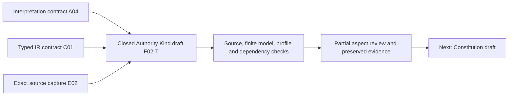

# Closed Authority Kind Invariant: partial formalization and aspect review

This candidate continues the definitions, forms, types, and logical semantics priority. It models scoped authority-kind membership, normative denial for unlisted kinds, routing through a listed kind's own ladder/owner, and necessary owner-gated addition conditions at registered successor states. It separately verifies exact source-use admission, historical review-mode context, and selected current carrier shapes. Accepted closed-world membership and permission denotation, actual owner/table amendments, universal temporal/runtime enforcement, shared meaning, and whole-definition proof remain pending. The episode is active.

Evidence: [interpretation](t.json), [source correspondence](correspondence.json), [typed IR](static-ir.json), [model controls](model-controls.json), [source checks](source-checks.json), [qualification/carrier/context observations](authority-profile-checks.json), [dependency graph](dependency-graph.json), [current inventory](current-inventory.json), and [actual fresh command results](fresh-command-results.json). Closeout: [receipt](receipt.json), [coverage row](coverage-row.json), [episode status](episode-status.json), and [delivery manifest](delivery-manifest.json).

## 1. Source identity, admission, and exact source use

The selected source is `cal.definition.closed-authority-kind-invariant@1.0.0-candidate.1`, from `evidence/migrations/cyberalchemy-v2-to-lab/candidates/0004-artifact-reconstruction-pipeline/layers/l1-semantic-repeatability/definitions/closed-authority-kind-invariant/v1/definition.json`, SHA-256 `067721443c09705f2482ebaf50092a5d3e0dea5284820f5842b7faf9e8f05ba8`. Current registry decision 0053 admits those exact Definition bytes. The source retains historical candidate-only reconstruction and embedded source posture; effective source admission is observed separately.

The selected [D49 source section](legacy-source-section.md) is 3,253 bytes, SHA-256 `9cf4a46ecbcb51df0e3248681ccb2cb83b7a98fe8be82999d4be0f96638f5037`. Recorded source admission `CAL-SOURCE-FULL-DEFINITION-QUEUE-037` permits that exact section for this single Definition target. The selected local definitions file also matches its recorded whole-file admission digest. This verifies exact selected local bytes and permitted source use; it does not authenticate the declared producer repository/root or accept this formal interpretation.

The reconstruction producer's declared definitions file is absent at the inspected path. Source testable-condition coverage therefore remains partial for declared live source currentness. No producer configuration or source location is silently rewritten. The full contextual Model and review decision are separately pinned local files and are not admitted into primary theory by the section's source-use admission.

## 2. Objects and scope boundaries

The source focuses on the enumeration of authority **kinds**, rather than the admission/promotion of each artifact instance. A listed kind still routes through its own owner and lifecycle ladder. Naming or promoting the invariant does not enact the table, authenticate an owner amendment, promote every instance, or create deterministic enforcement.

Several uses of “kind” remain distinct: the historical authority-kind names; current carrier `semantic_kind`; the machine record's `authority_kind` classification; global Relation Kind identities; and TypedRelation endpoint kinds. Directory names and source wrappers are also separate from these fields. A mapping between vocabularies must be reviewed before substituting one enumeration for another.

The normalized wrapper names `semantic.closed-authority-kind-invariant`, `scope.shared-authority`, and `type.invariant`, and requires preserved classification/source relations without merging targets. Those preservation and denotation obligations remain explicitly deferred in correspondence. The machine record classifies itself as a Definition/v1 with semantic_kind `definition` and authority_kind `semantic-authority`; the wrapper's `type.invariant` text does not automatically replace that carrier or turn Invariant into a separately enumerated authority kind.

## 3. Definition forms and complete correspondence

The definition uses **axiomatic implicit constraints** and an **operational** case distinction. The operational form here specifies normative branches and amendment obligations; it is not a claim of executable enforcement. This is a specific invariant condition, rather than a genus equivalence that would classify every possible invariant or authority table.

Six source spans are encoded as four unique formulas. The normative closed-enumeration sentence and the printed `CAKE: Kinds is closed` receive the same scoped closure-marker formula. The normative unknown-kind block/permission sentence and the printed unknown-kind branch receive the same default-deny formula. The printed known-kind branch receives the own-ladder/owner routing formula. The normative owner-gated addition clause receives the registered-addition formula.

All 22 source units are accounted by 33 spans: six encoded, nine explanatory, eighteen deferred. Formatting, the normalized wrapper, boundary details, historical context, testable conditions, applicability/exclusions, and claim ceiling retain explicit dispositions and complete character accounting. Explanatory text is not treated as observed owner action. Eight findings cover precedence, enumeration, permission, addition, state history, instance authority, enactment, and closure.

## 4. Typed signature and representation

There are 38 declarations: seven nonempty sorts (`Artifact`, `Kind`, `Enumeration`, `State`, `Decision`, `Owner`, `Token`), one `EMPTY` Token constant, four total functions, seven unary predicates, and nineteen relations. `kindOfArtifact` maps an Artifact to one selected Kind. Three functions map Kind × Enumeration × State to lifecycle, owner-route, and kind-label Tokens.

The candidate represents a selected artifact revision/classification; its atemporal kind function does not model arbitrary reclassification histories. `AuthorityKindEnumeration` selects tables within scope. `Member(k,e,s)` expresses modeled membership in table e at state s. `RegisteredSuccessorState(e,s,u)` identifies selected transitions. Addition qualification uses exact table/state/kind-bound `AmendsKind` and an `AuthorizedOwnerDecision` with a typed Owner.

All symbols are namespaced by exact source version and candidate scope. Nonempty typed domains and total function tables establish representation structure, not accepted real-world meanings. Lifecycle and owner-route Tokens can alias; an Owner-sort value is not linked to a route Token by an accepted principal/route map. A nonempty route is not an authenticated owner gate. Kind-label Tokens do not determine membership automatically.

## 5. Four primary formulas

Readable shorthand for the exact typed AST is:

```text
∀e. AuthorityKindEnumeration(e) → ∀s. ClosedEnumeration(e,s)

∀e,s,a. AuthorityKindEnumeration(e) ∧ Member(kindOfArtifact(a),e,s)
        → GovernedByOwnLadderOwner(a,e,s)

∀e,s,a. AuthorityKindEnumeration(e) ∧ ¬Member(kindOfArtifact(a),e,s)
        → Blocked(a,e,s) ∧ ¬MayAcquireAuthority(a,e,s)
          ∧ ¬MayExerciseAuthority(a,e,s)

∀e,s,u,k.
  AuthorityKindEnumeration(e) ∧ RegisteredSuccessorState(e,s,u)
  ∧ ¬Member(k,e,s) ∧ Member(k,e,u)
  → DeclaredLifecycle(k,e,u) ∧ DeclaredOwnerRoute(k,e,u)
    ∧ lifecycleValue(k,e,u) ≠ EMPTY ∧ ownerRouteValue(k,e,u) ≠ EMPTY
    ∧ ∃d,o. AmendsKind(d,k,e,s,u)
              ∧ AuthorizedOwnerDecision(d,o,e,s,u)
```

The unknown-kind branch explicitly encodes normative block and permission denial. The known-kind branch expresses routing through the kind's own governance. It supplies no converse, grant, automatic permission, or automatic unblocking. A listed artifact can remain blocked under its own ladder.

The closure predicate remains opaque: its truth is a selected invariant obligation, not an extensional proof that a world table is finite, complete, immutable, or contains exactly the historical nine names. The supplied finite membership tables have classical true/false denotations. A missing real lookup, unresolved classification, or incomplete registry is not automatically justified negative membership evidence. A reviewed closed-world membership/negative-evidence map is required to apply that interpretation to actual records.

The amendment rule is necessary, not sufficient. An approved proposal or qualified owner record without an applied membership change does not become a new listed kind. Once membership is added, the kind's instances still follow their own ladder; they do not acquire authority merely because the table entry exists.

## 6. Normative permission and actual behavior

`MayAcquireAuthority` and `MayExerciseAuthority` represent modeled normative permissibility. `ActualAuthorityAcquired` and `ActualAuthorityExercised` are separate outcome relations. The primary theory does not equate them. A supplied model includes actual acquisition/exercise at a normatively blocked context and still satisfies this partial normative theory. It represents a possible violating world, not an observed incident or an authorized operation.

That distinction is essential to the claim ceiling: a policy prohibition does not itself prove an enforcement mechanism prevents all violations. Deterministic runtime enforcement needs evidence linking classification, complete table membership, permission checks, owner amendments, state/version histories, and all relevant acquisition/exercise paths. This unit supplies no implementation or universal runtime theorem.

Likewise, independently supplied table admission, artifact admission, owner-gate outcome, review-mode enactment, runtime activation, or external effect can be represented without being generated by kind membership. No actual grant, kind amendment, relation, deployment, or service activation is performed by the candidate checks.

## 7. State history, addition coverage, and non-sufficiency

Registered successor edges supply the selected history relation. They are not a complete time order. A self-edge with equal source/target State is not prohibited; because membership cannot both be absent and present in that same modeled state, it does not trigger an addition obligation. The theory does not prove distinct State values name distinct real revisions or cover every relevant transition.

A model removes successor registration while retaining different state membership. It satisfies the theory because the addition guard no longer applies. This exposes a history-coverage gap rather than proving such a real table edit authorized. Another model removes an existing kind, adjusts the unknown-kind normative denial, and satisfies the addition-only rule. Removal governance, arbitrary amendments, override rules, and causal/temporal enforcement remain outside the selected source translation.

The source's “until an owner amends Kinds” is interpreted through membership and a necessary registered-addition qualification, not a complete temporal logic theorem. A reviewed decision-to-applied-amendment relation, immutable table revision identity, owner authorization, and transition coverage are still needed. Existing listed-kind routing is also opaque: an existing kind may lack a nonempty lifecycle field in this model while the routing predicate is true. That connecting denotation is deferred rather than filled with inferred rules.

## 8. Populations, nonvacuity, and assumptions

Eleven required populations provide informative supplied witnesses: an authority-kind table; an unknown normatively denied kind; a known governed artifact without an actual grant; a listed kind that remains blocked; a registered owner-gated addition; a raw kind label outside membership; an approved proposal without applied membership; another enumeration outside global default deny; distinct artifacts sharing a kind; Definition promotion without table enactment; and a newly listed kind without automatic permission/grant.

Twenty-five populations remain unresolved. No primary-theory assumptions, exemptions, accepted owner/principal populations, source-fidelity decisions, or real membership-negative evidence are fabricated. A nonempty Kind or Enumeration sort does not itself populate the selected authority-table predicate; the required witness separately prevents that vacuity.

Universal theory constraints and existential population witnesses are evaluated independently. Removing a required block for one unknown artifact fails the universal theory while another denied artifact can still satisfy the population witness. Adding review enactment to the one supplied promoted-table context preserves the theory but removes the selected promotion-without-enactment witness. Those results are reported separately.

## 9. Independent finite controls and query evidence

The 45 controls contain 38 well-formed models: 23 satisfy and fifteen fail the primary theory. Seven malformed models reject for a non-total kind function, ill-sorted result, ill-sorted EMPTY constant, wrong membership arity, duplicate owner-decision tuple, empty Kind domain, or duplicate function tuple.

Semantic negative controls cover missing block, forbidden unknown-kind permission, missing closed marker, absent own-ladder/owner routing, missing lifecycle/route/amendment/authorization, empty selected addition values, and wrong table/kind/state-bound owner qualification. Positive alternatives expose actual-vs-norm separation, unregistered changes, removal policy gaps, route/Owner linkage, Token aliasing, unused kind labels, opaque existing-kind lifecycle routing, separately supplied review/enforcement outcomes, and non-authority enumeration scope.

Sixteen query targets remain outside the theory. Supplied countermodels refute automatic actual authority/grants, permission or unblocking from membership; table admission, source-owner acceptance, or runtime activation from closure; review enactment/deterministic enforcement from Definition promotion; membership from raw labels or approved proposals; artifact identity from shared kind; and universal runtime prevention from normative denial.

Countermodels satisfy both primary theory and required populations, including the selected violating-world countermodel for the two runtime-prevention queries. These are bounded supplied denotations checked independently. No exhaustive enumeration, completeness theorem, accepted whole-definition translation, or universal temporal/closed-world/runtime proof is claimed.

## 10. Stronger hypotheses and finite history frames

Forty-nine hypothetical profiles include 26 rejections. Nine exact context axes are kind, table, table revision, scope, before/after states, owner, owner route, and lifecycle. Ten support axes cover classification/kind identity, exact table revision, complete membership and negative evidence, owner authentication/authorization, lifecycle/route mapping, state-history coverage, and source fidelity.

These are explicit `hyp:` markers, not authenticated evidence. The selected nine historical names are a profile-specific membership hypothesis. A qualified unknown kind is normatively blocked; a qualified known kind routes through its own ladder/owner without automatic permission. Applied addition requires a separate exact-context owner/gate hypothesis. A proposal without applied addition remains unknown. Permission for a listed kind needs independently qualified instance context under this stronger hypothetical profile.

Wrong exact context, missing support, wrong-owner amendment context, unknown-kind permission, absent owner decision, and actual-fact flags reject. Fourteen finite history frames include ten rejections. Inspection, Definition promotion, and projection preserve the table; an explicit fresh-kind addition uses a new table revision, retains the original, preserves scope/table identity, and requires owner/lifecycle/route support. No automatic instance grant or actual transition is generated. These finite frames do not prove every table history or source-owner accepted enforcement semantics.

## 11. Historical catch-all context and deferred decisions

The exact [legacy Model context](legacy-model-context.md) contains nine named authority kinds plus a default-deny catch-all. The names are Definition, Constitution, Discipline, Decision, Spec, Runtime contract, Projection, Evidence, and Residue. The catch-all routes additions through decision-gate and constitution-governance.

The exact [historical review decision](legacy-review-decision-context.md), dated 2026-06-23, records review-mode enactment of that catch-all. It explicitly leaves the deterministic kind-enumeration validator pending. Separate elevation of Axiom and Invariant to authority kinds was rejected/deferred there; the document says the invariant definitions govern as the existing Definition kind, and OQ-2 remains open in that recorded context.

These observations preserve what the inspected files say. They do not establish the present global state of the legacy project, infer a new owner decision from this episode, authenticate actual table enforcement, or silently add Axiom/Invariant as kinds. The historical table/decision is not imported as a closed enumeration axiom in primary theory.

## 12. Current carriers, shape evidence, and classification drift

The inspected Type registry contains 143 rows, 121 admitted-current. No selected admitted-current dedicated Closed Authority Kind Invariant or authority-kind-enumeration carrier has a direct Definition binding. This is a bounded catalog absence, not proof that the invariant lacks every possible representation.

Seven related carriers are inspected: Constitution, Decision/v2, Policy/v2, AuthorityClaim, AuthorityBoundary, TypedRelation/v3, and generic Definition/v2. Twenty-nine selected hostile fixtures reject. Twenty related schema probes accept five unresolved owner/scope references and reject unknown selected-carrier kind, authority-effect grant, and unrecognized top-level authority-kind fields. Rejecting those object fields is not a global authority-kind catch-all enforcement proof.

Twenty lifecycle probes, four postures for each of five endpoint carriers, all pass shape validation. Candidate, active, historical, and retired labels are valid shapes; this does not prove actual posture transitions, grants, owner decisions, or runtime activation. Related declared generators/validators/root digests and two exact artifact/fixture renders are checked for the five endpoint carriers. Receipt-writing package validators are not invoked.

The admitted selected Definition/v1 passes its historical exact source schema but fails current generic Definition/v2 on four constant bindings: `classification/artifact_type_ref`, `schema_ref`, `schema_version`, and `source_direction/generator_ref`. The full errors are retained. This observes contract evolution; it neither migrates source bytes nor invalidates their exact admission. Current generic Definition/v2's classification fixes semantic_kind to `definition`, authority_kind to `semantic-authority`, and artifact_type_ref to Definition/v2. Those fields are not a substitute for the source wrapper or historical authority-kind membership.

## 13. Four vocabularies and conditional endpoint closure

| Inspected vocabulary | Count | What it describes |
| --- | ---: | --- |
| Historical named authority kinds | 9 | Legacy governance families; catch-all is an additional row |
| Current carrier semantic kinds | 120 | Distinct semantic_kind values among 121 admitted-current Type rows |
| Current Relation Kinds | 41 | Global connection contracts |
| Current conditioned TR endpoint kinds | 104 | Union of exact kind constants in current TypedRelation conditional pair branches |

The TypedRelation base source-kind field is a nonempty string excluding `*`; it does not contain one finite endpoint enum. Conditional pair branches constrain combinations for the selected Relation Kind. The 104-kind union is therefore a bounded schema observation, not a declaration that every kind can connect to every other kind or become an authority kind. Embedded endpoint enums used by other carriers can have different counts.

No accepted mapping equates these four vocabularies. Schema shape, allowed endpoint pairs, authority-table membership, authenticated owner routes, actual instance authority, and runtime enforcement each need their own evidence and denotation.

## 14. Dependencies, cyclic semantics, and acyclic work order

Thirty-three authored semantic uses cover Definition/Invariant, authority Model/promotion/lifetime, artifact/type/classification, relation vocabularies, policy/constitution/Decision/gate, boundaries/surfaces/claims/responsibility/roles/principal references, identity/canonical representation/histories, schema/validation/receipts/context. Nine comparison sources remain separately qualified. Missing counterparts and accepted common meaning are not inferred from matching labels or namespaced signatures.

The joint declared semantic graph has 93 nodes and 650 edges, 56 missing counterpart packets, and one unclassified component with 37 members and 398 internal edges. Every declared edge still requires independent completeness/alignment review. The semantic cycle is distinct from the acyclic execution DAG. The present work sequence is:



This diagram explains the bounded current task sequence. The complete foundations-first work plan still contains separate source fidelity, denotation, population, counterpart, cycle-classification, common-meaning, proof, and consolidated-review obligations. Individual green controls and declared cycles do not discharge those obligations.

## 15. Failed attempts, recovery, fresh replay, and preservation

Five attempts are retained with exact scripts/logs/output bytes: [helper-order failure](attempts/001-builder-helper-order/attempt.json), [malformed review packet](attempts/002-review-packet-schema/attempt.json), [population expectation mismatch](attempts/003-independent-population-expectations/attempt.json), [conditional endpoint vocabulary lookup](attempts/004-conditioned-endpoint-vocabulary/attempt.json), and [four current Definition bindings](attempts/005-four-current-definition-bindings/attempt.json).

The helper-order repair corrected builder declaration order. The review-packet repair added required example/loss/status fields; its archived primary interpretation bytes equal the final primary interpretation bytes. The [population diagnostic](population-expectation-diagnostic.json) preserves independent T/I outcomes before expectation repair. The last two fixes corrected carrier inspection expectations: the conditioned vocabulary is not one enum, and four source-v1/current-v2 binding errors must be retained. None changed primary theory or canonical source bytes.

Six fresh read-only checks cover the interpretation contract, finite supplied models, exact source and source use, profiles/carriers/context, dependency selection, and all current draft inventory witnesses. Actual commands and terminal stdout/stderr are retained. The closing audit rehashes selected sources/context, checkers, outputs, archived failures, all 3,165 predecessor files, and the sealed candidate file set, and verifies all 201 captured source files. Unrelated dirty work and I04's historical eight-draft selected report remain preserved.

## 16. Episode status and remaining work

There are 37 partial drafts for 183 current identities and 189 admitted source versions. There are 146 current identities without per-definition drafts. Aggregate correspondence accounts for 849 source units and 1,138 spans: 264 encoded, 308 explanatory, 566 deferred; 315 required and 951 unresolved populations. Source-owner accepted whole translations and whole-definition proofs remain zero.

The next priority is `F02-T.cal.definition.constitution`. Definition forms, types, logical constraints, denotation, nonvacuity, source correspondence, and meaning-aligned closure remain ahead of implementation expansion. This review explains every aspect of the present partial candidate and its limits; the complete episode and consolidated final aspect review remain active work.
