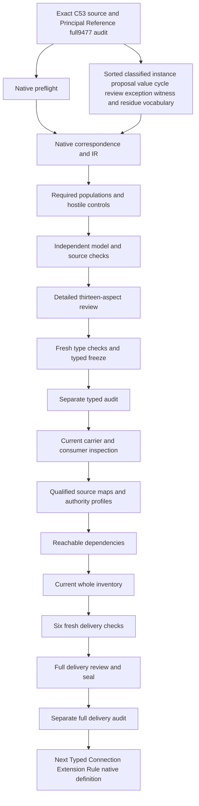

# Constraint Cycle Safety Invariant: definitions,types and logic review

The candidate separates a classified canonical Invariant instance from a proposed relation,edge type or ontology movement. A proposal that constrains values and effectively permits cycles triggers a governance stop,blocked promotion and required review. Declared influence or promotion approval under that watch requires an exact recorded exception with owner,source evidence,constraint semantics,review,witness and typed residue. Harmless non-value cycles and acyclic value constraints remain possible. No cycle detector,constraint solver,contextuality theorem or actual edge promotion is executed.

Principal Reference's full9,477-file candidate seal and separate actual audit0 precede native creation. All prior sealed bytes and201sourcefiles remain hash verified. Working native drafts now number103among183currentidentities,leaving80withoutT. The last completed whole inventory remains102partialdrafts81missing until this unit's full delivery. Original183identities189versions201sourcefiles and121tasks511planningedges797SWUs36frontiers stay fixed. Accepted whole translations and whole-definition proofs remain zero. Source fidelity and semantic readiness remain pending;the complete original episode and final aspect review stay active.

## 1. Exact source,C53 and upstream provenance

The positive source is cal.definition.constraint-cycle-safety-invariant@1.0.0-candidate.1,SHA bf829b78c06764c34db536edd838cce4683716935ca0ec5bd9742f8d66e573fb. Its current admission overlay is CAL-DECISION-0053-FULL-DEFINITION-QUEUE-ADMISSION. Exact selection fixes the meaning being interpreted. The candidate does not substitute a graph algorithm,another invariant,a contextuality paper or a nearby ontology rule for that source.

C53 admits exact Definition versions and source selections for Definition use. The checker binds its authorization,manifest,validation receipt and source-admission postimage. The selected CAV2-D28 section is admitted-for-definition-use with digest cbd6a16d26453637583e12ac19761b5ccf1c8cc2b2dc1c32644bf357c1355660. Current selected bytes and source-line selection match that admission. The containing upstream file also matches its recorded admission digest. Its3,167selected bytes are checked without copying private upstream content into candidate normative meaning.

The source body retains a reconstructed-candidate ceiling and an embedded candidate-unadmitted source posture. Current C53 overlays are checked separately rather than rewriting that historical body. Definition/source-use admission does not accept this translation or promote live edges,carriers,profiles,relations,consumers or runtimes. Private routing references remain path/hash metadata. Evidence of exact origin and currentness is useful for review,but it does not settle source precedence,denotation equivalence or operational authority.

## 2. Sorted signature and qualified nominations

Eighteen nonempty sorts distinguish InvariantInstanceReference,NormalizedIdentityReference,ScopeReference,ArtifactTypeReference,SourceReference,SourceRelationReference,ProposalReference,ProposalKindReference,OwnerReference,ExceptionReference,EvidenceReference,ConstraintSemanticsReference,ReviewReference,WitnessReference,ResidueReference,ValidatorReference,ReviewerReference and Token. Five constants include EMPTY and exact proposed normalized identity,shared scope,invariant type and CAV2-D28 source coordinates. These descriptive types are qualified by the selected source and candidate scope;their names do not create canonical identities.

Twenty-four semantic selectors and seventeen reference-handle functions make41totalfunctions. There are140predicate/relation signatures and204declarations. Selected fields require declared membership,nonempty handles and an exact BindingDeclared relation agreeing with the nominated selector. Total functions return a well-sorted value even outside selected scope;totality is not proof that a real referenced object exists or is authenticated.

The candidate keeps owner,scope,evidence,constraint semantics,review,witness and residue in different sorts. A validator is not a reviewer;both can provide declared witness alternatives without becoming an actual validated exception. ConstraintSemanticsReference is a nomination rather than a constraint-language interpreter. Similarly,a ResidueReference is not a measured or accepted residue merely because its handle is nonempty. Owners must accept the intended source-to-carrier maps before those declarations can support operational conclusions.

## 3. Classified canonical Invariant instances

InstanceApplicable agrees with InstanceInScopeDeclared. A selected canonical instance is declared governed and nominates exact normalized identity,shared scope,invariant type and source relation. Those coordinates equal the proposed constants for semantic.constraint-cycle-safety-invariant,scope.shared-authority,type.invariant and its bound CAV2-D28 origin. SourceRelationReference separately nominates the normalized identity and upstream source and retains a declared accepted-source-relation flag.

This preserves the positive normalization wrapper without collapsing it into a live ontology edge. Wrong normalized identity,scope,type,source-relation identity or source target fails even when handles remain nonempty. A silent sibling merge is independently excluded. The exact identity clause and the substantive guard clause occupy separate spans of the normative source;the normalization scaffold cannot erase the source-semantic basis by receiving one general genus label.

These declarations are proposed canonical-instance correspondence. They do not create a real canonical instance,prove that its classification is valid or execute source admission. Actual IdentityFidelity,ClassificationFidelity and SourceRelationFidelity remain separately queried outcomes. A supplied model can satisfy the necessary wrapper while those real outcomes remain unsupported. Outside-scope instance records are not forced to adopt this invariant's identity,classification or source relation,and no globally unique instance or representation cardinality is invented.

## 4. Proposed relation,edge type and ontology movement

ProposalApplicable agrees with ProposalInScopeDeclared. A selected proposal is declared governed and has exact owner,scope and kind nominations. It belongs by declaration to relation,edge-type or ontology-movement applicability. These three alternatives are inclusive. The source's any-proposal language does not require them to be globally disjoint or to exhaust every ontology object.

A proposal can nominate a kind without proving the real semantics of that kind. Necessary kind membership and the independent kind reference need accepted correspondence. The model permits overlapping proposal roles and separately rejects a selected record with none of them. Exact owner and scope bindings are checked structurally. An owner token does not authenticate a schema owner or grant permission to change ontology,validation or implementation.

Instance and proposal scopes remain distinct. The normalized invariant's shared-authority scope does not force every proposed relation to share that token. Multiple selected proposals can use the same owner,scope or witness where exact declaration coherence holds;global injectivity is not assumed. An outside proposal can have independent declarations without triggering this selected theory. This makes applicability visible and prevents an unselected record from supplying a vacuous success or a misleading counterexample for a watched proposal.

## 5. Five value-constraining coordinates

ProposalValueConstrainingDeclared agrees with the inclusive disjunction of constraints on Value,Label,AuthorityState,SchemaField and ValidationOutcome. These five axes reflect the positive source's listed coordinates. A value-constraining flag without any axis fails,and an axis without the aggregate flag also fails. Multiple axes can hold together,so an edge that affects both a label and validation outcome is not rejected merely for crossing those coordinates.

The flags are necessary declarations of a proposed effect. They do not execute a value constraint or decide whether a real relation influences another artifact. ActualValueConstraintClassification remains an independent target. The source-owner mapping must explain how indirect effects,derived values,state transitions and validation consequences count as value constraints in the relevant ontology context.

A relation that merely loops through the graph without constraining these coordinates remains non-value-constraining in the supplied interpretation. This does not prove that every real looping relation is harmless. It preserves the source's explicit boundary against a blanket ban while retaining actual classification as a review obligation. A future consumer must name its classification evidence and scope rather than infer safety from an edge-family name. The five-axis interpretation and its completeness remain explicit candidate findings.

## 6. Cycle permission and explicit acyclicity

The candidate distinguishes declared cycle permission from an explicit acyclicity constraint. ProposalEffectiveCyclePermittedDeclared agrees with declared cycle permission and absence of explicit acyclicity. This is the proposed correspondence for the normative source's phrase about participation in a cycle without an explicit acyclicity constraint. Actual graph cycles,cycle-permission fidelity and acyclicity enforcement remain independent outcomes.

The formal expression uses cycle_permitted as one watch predicate. The candidate interprets that predicate as effective permission rather than ignoring an explicit acyclicity constraint. This distinction is retained as a source-precedence finding;it is not silently asserted as accepted canonical meaning. An acyclicity declaration cannot certify a graph merely by its name. Accepted consumers must identify what enforces or reviews the constraint and how that evidence binds the proposal.

Positive controls retain a value-constraining proposal with nominal cycle permission plus explicit acyclicity,whose effective permission is false. They also retain value constraints without cycle permission and cyclic non-value proposals. Negative controls reject an effective-cycle flag on the explicitly acyclic case or an omitted effective-cycle flag where cycle permission exists without acyclicity. These checks validate declared coherence under the candidate interpretation without running a graph traversal or proving that all operational paths are acyclic.

## 7. Watch trigger,governance stop and review need

ProposalWatchTriggeredDeclared agrees exactly with value-constraining and effective-cycle-permitted declarations. A watched proposal must retain GovernanceStopped,PromotionBlocked and ReviewRequired declarations. A proposal with only one risk coordinate does not automatically trigger the watch. A watch flag without both properties fails,as does a proposal with both properties and no watch flag.

A risky proposal can remain pending. It does not need an exception,evidence record,review,witness or residue merely to record that promotion is blocked. The unused total exception selector may remain unbound or have an empty outside handle. This preserves a meaningful stopped state rather than fabricating a completed review to make every modeled proposal look valid. The required populations explicitly demonstrate both pending watched proposals and watched proposals with recorded reviewed exceptions.

Stop,block and review-required declarations remain present after an exception is recorded. They are proposed historical gate records rather than proof of a permanently active prohibition. Exact timing and lifecycle correspondence remain unresolved. ActualGovernanceStop,ActualPromotionBlocked and ActualReviewComplete are queried on watched scope. A harmless proposal cannot provide their countermodel by being outside the danger condition. Actual enforcement and review completion require independent evidence;the typed flags do not supply it.

## 8. Recorded owner exception and exact coordinates

When ProposalExceptionPresentDeclared holds,the selected proposal nominates an exact declared ExceptionReference. The exception has exact proposal,owner,scope,evidence,constraint-semantics,review,witness and residue fields. It is declared recorded and an explicit owner decision. Its proposal matches the selected proposal,and its owner and scope match that proposal's nominations. This guards against attaching another proposal's exception or an unrelated owner's review merely because labels resemble each other.

SourceEvidencePresentDeclared and ConstraintSemanticsNamedDeclared preserve the formal expression's required exception coordinates. Their actual adequacy remains independent. A nonempty evidence handle is not a proof of source support,and a semantics handle is not an executed satisfiability procedure. Exact matching is necessary declaration coherence,not a guarantee that the nominated objects have the intended real meanings.

The exception is optional for pending risky proposals and may remain absent on harmless proposals. No universal one-exception-per-owner or globally unique witness rule is invented. If an exception is declared present,all required coordinates apply even when no influence approval is claimed. This keeps incomplete exceptions visible instead of treating approval absence as permission to omit their source-defined structure. ActualSourceEvidenceAdequacy,ConstraintSemanticsFidelity and OwnerAcceptance remain independently queried on watched recorded-exception scope.

## 9. Satisfiability or obstruction review

The selected exception's ReviewReference nominates exact proposal,scope and witness fields. Its proposal and scope agree with the selected proposal,and its witness agrees with the exception witness. The review is declared recorded and names a validator or reviewer that will catch the relevant failure. It records a satisfiability review or an obstruction review,with inclusive alternatives. Neither alternative may be missing when the exception is present.

A satisfiability review does not assert that the constraint system is satisfiable. An obstruction review does not assert that no obstruction exists. Both can be recorded together without collapsing their meanings. Positive populations demonstrate satisfiability-only,obstruction-only and both-review cases. A review can identify failure and leave residue;review structure alone cannot approve a real authority transition or implementation consequence.

The candidate does not implement a gluing construction,spectral-presheaf checker or mathematical contextuality theorem. The source's contextuality-obstruction language names a governance review obligation. Owners must decide the relevant constraint semantics,what satisfiability or obstruction evidence is sufficient,and how a failed review changes promotion posture. ActualReviewAdequacy,ConstraintSatisfiability and NoObstruction remain independent targets. The bounded finite theory cannot replace that substantive review by evaluating a Recorded flag.

## 10. Witness alternatives and typed residue

WitnessReference is separately declared recorded. It can nominate a validator witness,a reviewer witness or both. Validator and reviewer fields are guarded only when their corresponding alternatives are declared present. The unused validator binding on a reviewer-only witness,and the unused reviewer binding on a validator-only witness,may remain absent. Empty outside handles remain permitted where no selected guard applies.

Neither a validator handle nor a reviewer handle authenticates the witness or proves that it catches the constraint failure. ActualWitnessValidity remains separate. The proposed distinction prevents unused alternatives from fabricating review machinery while preserving the source's validator-or-reviewer wording. An accepted operational map must identify the witness artifact,its scope,its review surface and its connection to the exact exception.

The exception also nominates a typed residue. ResidueReference has an exact ArtifactTypeReference nomination and a declared typed-residue flag. OwnerAcceptsRemainingResidueDeclared links the selected proposal owner to that exact residue. Additional declared owner/residue acceptance relations are not forbidden,so the source does not become a global ownership cardinality rule. ActualTypedResidueFidelity and ActualOwnerAcceptance remain independent. No real owner decision is issued or acceptance reference invented by evaluating those necessary declarations.

## 11. Influence guard and non-inference boundaries

A watched proposal with declared influence approval or promotion approval requires the recorded exception and completed-review declaration. A pending risky proposal cannot acquire either approval merely from its value and cycle labels. Controls add influence or promotion approval to the pending-risk case and require theory failure. Missing review completion,evidence,semantics,witness,residue or owner acceptance also fails an exception-present proposal.

The theory does not require every harmless proposal to gain approval. Separate governance may still restrict it. Positive controls permit harmless cyclic non-value influence and harmless acyclic-value promotion without inventing actual authority. The source's no-blanket-ban boundaries are preserved through those witnesses. Approved flags remain declared gate outcomes with unresolved timing maps;they do not execute live promotion or prove that review preceded every real effect.

Excluded inference/effect declarations prevent the guard from becoming a contextuality theorem,spectral-presheaf checker,universal edge ban,live-edge-family promoter or source of actual authority. Exception labels cannot prove satisfiability,witness labels cannot prove obstruction absence,and residue labels cannot prove actual owner acceptance. Independently supported actual outcomes remain possible. Positive controls add them without changing the necessary theory. This is independence,not a universal denial of safe loops,legitimate reviewed exceptions or separately authorized effects.

## 12. Source account,controls and countermodels

All22nonempty source units have complete character correspondence across23spans. The normative statement is split into normalization wrapper and source-semantic guard basis. Thirteen spans are encoded,nine explanatory and one deferred. Twelve primitive formulas and ten unique encoded formula values retain the classified instance,proposal,watch,stop,exception,influence,record tests and boundaries. Notation,domain examples and plain intuition remain explanatory;the reconstructed candidate ceiling remains explicit residue.

The native suite passes274controls:111T-true,155T-false and eight malformed-model rejections. Twenty-seven required populations independently demonstrate selected/outside records,each proposal/value coordinate,harmless/risky cases,optional pending exceptions,review/witness alternatives and independent authority. T and I are evaluated separately. A coherent theory can lack an episode's required demonstrations;nonempty populations can also coexist with a failed necessary guard.

Thirty-five queries have supplied T/I countermodels. Five proposal targets are conditioned on watched scope,and eight exception targets require watched recorded-exception scope. Forty-five source-query obligations bind exact selectors,spans,hashes and targets without putting actual outcomes in primary T. Prepared maximum18,558steps stays below unchanged100,000steps,30seconds,1,000,000inputbytes and50,000nodes limits. Native T occupies237,670bytes. Source checking passes71checks and two identical6,905byte projections. These observations establish bounded consistency and traceability,not whole source fidelity,shared meaning or proof.

## 13. Review,evidence retention and continuation DAG

The prepared full contract,source spans,populations,hostile controls and countermodels passed before native creation. The native author,builder,model and source producers each have actual exit0. Three fresh independent contract/model/source checks also pass. Exact A04/C01/E02 prerequisites,SWU input/output/write scope and prior full seal are bound. No receipt was treated as a completed producer before actual terminal evidence existed.

One initial ARE effect payload lacked the required method field and was blocked structurally. The exact request/result is retained;the corrected request passes with authority_effect none. It is a technical payload error,not source-owner approval or a native producer failure. Schema inspection before the first build also found that correspondence findings needed description/selectors/status/owner_route fields. The successful prebuild author stage and original context/builder/captures are retained. The metadata fields were corrected without changing any formula,model or checker limit.

An example watched edge records value constraints and effective cycle permission,stops promotion,and names exact owner,evidence,semantics,review,witness and residue before declared influence approval. It can satisfy T/I without real safety or owner acceptance. A counterexample adds influence approval to a pending watched edge without an exception;the influence guard fails despite well-formed handles. Another counterexample reports an effective cycle on an explicitly acyclic proposal;classification coherence fails without evaluating an actual graph.

The seventeen-node,seventeen-edge work DAG is acyclic and distinct from unclassified semantic dependency cycles. Sixteen typed inputs are frozen and separately audited before current carrier/consumer mapping,profiles,reachable dependencies,current whole inventory,sixfreshchecks,full review,seal and separate audit. Typed Connection Extension Rule native creation follows this unit's full separate delivery audit. Working103/80 and last completed whole inventory102/81 remain distinct until the full refresh.

Twenty-two direct meanings remain separately qualified;their whole theories and authority are not imported. All9,477priorsealedfiles201sources and original183/189/201plus121/511/797/36scope stay preserved. Source-owner acceptance,shared denotations,operational maps,source fidelity,whole translations and whole proofs remain pending. Semantic readinessfalse;goalactive. The full original episode and final aspect-by-aspect review remain required;this bounded typed packet cannot redefine completion around a verified subset.
- CCS-FINDING-001: Exact C53 source/admission overlay does not promote edge families,grant authority,accept formal translation or prove contextuality. Status: unresolved;owner review and accepted map references pending.

- CCS-FINDING-002: Canonical Invariant instance and proposed relation/edge/movement are separate sorted carriers;no instance or proposal created by source admission. Status: unresolved;owner review and accepted map references pending.

- CCS-FINDING-003: Normalized identity,shared scope,invariant type and accepted CAV2-D28 source relations are proposed classification nominations;no silent sibling merge. Status: unresolved;owner review and accepted map references pending.

- CCS-FINDING-004: Five value-constraining axes are inclusive;their actual meanings and completeness need owner-reviewed source maps. Status: unresolved;owner review and accepted map references pending.

- CCS-FINDING-005: Effective cycle permission is proposed as declared permission without an explicit acyclicity constraint;actual graph cycles and enforcement remain independent. Status: unresolved;owner review and accepted map references pending.

- CCS-FINDING-006: Watch trigger is exact value-constraining plus effective cycle permission;this interpretation of formal/normative wording needs precedence review. Status: unresolved;owner review and accepted map references pending.

- CCS-FINDING-007: Watch-triggered proposals remain stopped,blocked and review-required even after a recorded exception;historical stop versus later permission timing needs an accepted map. Status: unresolved;owner review and accepted map references pending.

- CCS-FINDING-008: Pending risky proposals need no fabricated exception,evidence,review,witness or residue;unused total fields do not assert those records exist. Status: unresolved;owner review and accepted map references pending.

- CCS-FINDING-009: Only declared influence/promotion approval under the watch requires the exact exception and completed review;harmless proposals are not granted actual permission. Status: unresolved;owner review and accepted map references pending.

- CCS-FINDING-010: Exception requires exact proposal,owner,scope,evidence,semantics,review,witness and residue fields;no globally unique exception or owner is assumed. Status: unresolved;owner review and accepted map references pending.

- CCS-FINDING-011: Exception owner/proposal/scope and review proposal/scope/witness coherence are proposed necessary correspondence,not real authorization. Status: unresolved;owner review and accepted map references pending.

- CCS-FINDING-012: Satisfiability review or obstruction review is inclusive;review does not imply a satisfiable constraint system or absence of obstruction. Status: unresolved;owner review and accepted map references pending.

- CCS-FINDING-013: Validator witness or reviewer witness is inclusive with conditional fields;unused alternatives do not fabricate a validator or reviewer. Status: unresolved;owner review and accepted map references pending.

- CCS-FINDING-014: Typed residue and declared owner acceptance preserve required review coordinates;actual residue adequacy and owner acceptance remain independent. Status: unresolved;owner review and accepted map references pending.

- CCS-FINDING-015: No constraint-system solver,cycle detector,spectral-presheaf checker,contextuality theorem or actual edge promotion is executed. Status: unresolved;owner review and accepted map references pending.

- CCS-FINDING-016: Non-value cyclic proposals and acyclic value constraints remain permitted by the guard;separate governance may still restrict them. Status: unresolved;owner review and accepted map references pending.

- CCS-FINDING-017: Instance source-digest,schema-valid and exact-projection declarations are distinct from actual source checks and actual semantic fidelity. Status: unresolved;owner review and accepted map references pending.

- CCS-FINDING-018: Exact upstream section bytes and C53 source-use admission are evidence only;private routing content/meaning is not copied into primary T. Status: unresolved;owner review and accepted map references pending.

- CCS-FINDING-019: Scientific watch/exception logic and plain-language prove-safe phrasing require source-owner precedence;plain intuition is not a theorem. Status: unresolved;owner review and accepted map references pending.

- CCS-FINDING-020: Historical normalization scaffold/candidate ceiling remains visible under C53 current overlay;it is not permission for canonical mutation. Status: unresolved;owner review and accepted map references pending.

- CCS-FINDING-021: All dependencies remain separately qualified;no whole theories,common denotation model or accepted consumer map is imported. Status: unresolved;owner review and accepted map references pending.

- CCS-FINDING-022: Complete character accounting and supplied finite T/I controls do not establish whole translation,source fidelity or whole-definition proof. Status: unresolved;owner review and accepted map references pending.

Actual native counts: {"countermodel_queries": 35, "declarations": 204, "deferred_clauses": 1, "direct_semantic_uses": 22, "encoded_clauses": 13, "explanatory_clauses": 9, "mapped_clauses": 23, "required_populations": 27, "source_units": 22, "unresolved_populations": 140}. Source checks: 71. Projection SHA: 06b85fdc8ae65c91c3a3cf161e71adf61b0070b7ea1851aad84b11be88cc6acc.
