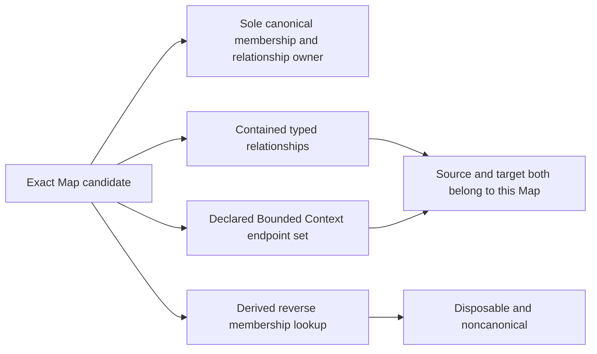

# Context Map formalization review

Context Map now has a partial typed candidate for its genus, Map and Relationship tuple declarations, canonical ownership, same-map endpoint closure, abstract reverse membership, backreference/index authority boundaries and normative regeneration. Actual owner approval, exact endpoint/version resolution, integration contracts and live index behavior remain pending. This is a candidate agent self-review, not independent review or source-owner approval of the translation.

The selected unit is **F06-T.cal.definition.context-map**. A04, C01 and E02 supply bounded software prerequisite receipts. [Context selection](context.json) retains the exact source, scope, decisions and preservation preflight. The next unit is **F06-T.cal.definition.context-migration-manifest**. Definitions, types and logic remain first.

## Source identity, admission and history

The source is **cal.definition.context-map@2.0.0-candidate.1**, SHA-256 `677ff95db15b30a80e2d59673286142337c3a513e52fd27dd033fe710f8de050`. Current registry admission is C26, the CTX06 reference-normalization promotion. Historical Context Map/v1 remains a separately captured source version. Its theory is not silently assembled into this candidate.

[Thirteen source checks](source-checks.json) verify the exact Definition/v1 representation, current schema/generator bindings, deterministic projection, current registry and C26 promotion row/candidate binding, C17 source-admission record and all four source testable-condition correspondences. Two renders reproduce the same 5,713-byte existing projection with SHA-256 `73c49c76c9c753f3ce58123eb315aa36355abb9349a9df5125e6521963a6331c`.

The source cites one historical C17 selection, **CAV2-D29**, selected SHA-256 `f47b8ae8dcbfcc97d624871a5aab03cbf3ffdea2b341046a0bba1edbb59740be`. Recorded admission permits evidence use for listed CTX00 concepts including Context Map. This unit verifies the recorded selector/digest/decision bindings; it does not rehash current external D29 bytes or authenticate a live producer. Exact source admission is separate from acceptance of this newly authored interpretation.

The source's retained candidate claim ceiling says it does not itself supersede v1 or admit this version. The later current registry/decision supplies its admission state. Retained source metadata and decision overlays remain distinct, without rewriting the historical source.

## Definition forms and source accounting

[Correspondence](correspondence.json) accounts for all characters in the selected voices, boundaries, scope and claim-ceiling string leaves: **27 units, 40 mapped spans: 16 encoded, nine explanatory, 15 deferred**. Accounting for unresolved text does not make it formalized or approved.

| Definition form | Encoded spans | Contribution |
| --- | ---: | --- |
| Genus differentia | 1 | Versioned, owner-approved exact endpoint and typed directional relationship set |
| Axiomatic implicit | 12 | Tuple declarations, qualified relationship requirements, canonical ownership, closure and authority boundaries |
| Axiomatic implicit plus operational | 3 | Derived reverse lookup, disposable lookup state and regeneration requirements |

There are **14 distinct encoded formula values** and **14 main primitive templates**. Some source formulas combine templates; ownership and relationship requirement spans repeat. Counts do not establish logical independence. No finite direction, relationship-kind or lifecycle taxonomy is supplied by this source, so none is invented as a definition form.

The genus uses an explicit candidate biconditional, treating four qualifiers as necessary and sufficient. Owner approval, exact versions and typed relationship meaning remain opaque qualification markers pending owner review. Plain-language explanation, notation and Governance/Ontology Lifecycle examples remain explanatory. Fifteen spans retain scope, integration-pattern, import/proximity, classification and actual-effects meaning for review. All eight findings are pending; no assumptions, exemptions or accepted review decisions are fabricated.

## Typed signature and field boundaries

[Interpretation](t.json) and [compiled IR](static-ir.json) contain **79 declarations**: three nonempty sorts, 18 constants, four total functions, 41 unary predicates and 13 relations. The sorts are Entity, Field and Token. Functions are fieldValue, mapIdValue, sourceEndpoint and targetEndpoint. Endpoint functions return Entity; field values and map IDs return Token. Exact source/version/scope identities qualify the symbols.

Map fields are id, version, context_refs, relationships, owner_refs, lifecycle, evidence_refs and drift_route. Relationship fields are source_context_version, target_context_version, direction, relationship_kind, contract_refs, translation_refs, information_boundary, authority_boundary and owners.

The candidate declares all eight Map and nine Relationship fields. It does not yet bridge opaque field Tokens to actual arrays, map IDs, endpoint-function results, resolved versions, approved owners or real contracts. Relationship direction, kind, information boundary, authority boundary and owners must have values different from EMPTY. This is a presence constraint, not authenticated meaning.

Supplied controls retain empty Map owner/version/evidence/lifecycle/drift Tokens alongside the abstract genus markers; contract/translation Tokens may be empty; a direction Token can be an arbitrary other value. Field constants and mapIdValue results can alias because no accepted general unique-names or actual identity bridge is present. These limits are explicit rather than replaced by label-based semantics.

**Eleven required populations** provide supplied Map/Relationship witnesses, an empty map, an unused declared endpoint, a reflexive relationship, raw fields without the Map genus, a noncanonical backreference without membership, an abstract reverse hit, a map without actual outcomes, proximity without a relationship and an import without verified direction. The reverse-hit population directly requires an abstract hit; absence of actual rebuild is established separately in supplied outcome countermodels. **52 unresolved populations** retain unknown actual denotations.

## Canonical membership and relationship closure

The Map solely owns its canonical membership and relationships. In the candidate, both owner relations point to the map identity itself, and any alternative canonical owner must equal that map. This represents record ownership; it does not authenticate human owners or grant authority.

Every relationship contained by a Map is typed as Relationship. Every declared map endpoint is a qualified Bounded Context endpoint. Both sourceEndpoint and targetEndpoint of every contained relationship must occur in **that same map's** membership set. Relationship qualification requires declared source/target roles, integration/translation contracts, information/authority limits, owners, evidence/drift handling, change coordination and explicit endpoint identity/version markers.

The diagram summarizes candidate constraints and derivation; it is not an executed architecture or accepted actual record map.

The generic source does not explicitly supply a two-distinct-endpoint minimum, universal nonreflexivity, exact equality between declared endpoints and used endpoints, or unique relationship-ID rules. The partial theory therefore permits empty maps, unused endpoints and reflexive relationships, with explicit witnesses. The historical carrier validator adds stricter rules. These are separate review obligations, not silently imported source axioms or proof that the intended generic meaning is fully captured.

Bounded Context is not silently replaced with the current Product/Project/Goal Context definition. Typed Relation artifacts, embedded map relationship records and the map itself also retain distinct identities and meaning-alignment obligations.

## Reverse lookup, admission selection and backreferences

The abstract reverse-index formula is an exact biconditional: an endpoint/index-ID pair exists if and only if some candidate Map contains the endpoint and has that mapIdValue. It reflects the printed `{m.id | c in m.context_refs}` expression. It is neither an actual registry read nor a generated file.

The source's notation instead describes a lookup over **admitted Context Maps**, while the formula omits that admission filter. This candidate exposes the precedence issue: its abstract Map predicate is not an admitted-map selection policy. Actual input admission, exact map-version identity and mapIdValue-to-versioned-reference maps remain pending.

Canonical endpoint backreferences are prohibited in the scoped candidate. Noncanonical observations may exist; they cannot establish, amend or revoke membership. A supplied endpoint backreference can name a map without that endpoint becoming a member. Generated-index override of canonical membership is separately prohibited.

Maps require disposable reverse lookup and deterministic rebuild. Those markers do not execute deletion/rebuild, validate exact input files or prove a universal temporal property. The abstract lookup's finite correctness is separate from the historical generator's string/reference behavior and from any live projection.

## Role boundaries and nonentailment

A Context Map is distinct from a Relationship entity, a Bounded Context endpoint, directory tree, dependency scan, import graph, ontology relation set, runtime topology, authority transfer and evidence of context agreement. Source proximity/imports do not choose integration patterns or justify direction/authority limits.

[Nineteen queries](query-policy.json) target claims outside the primary theory. Their [retained countermodels](model-controls.json) satisfy the supplied theory and population conditions while falsifying actual map creation, owner/endpoint resolution, pattern selection, admission, authority transfer, agreement, index rebuilding/determinism, migration, runtime effect, stable release, direction verification and authority-boundary verification. Other queries distinguish proximity from an actual relationship, raw fields from the Map genus, backreference from membership, and imports from direction/authority-boundary verification.

Positive controls allow independently established outcomes and actual relationships to coexist with this Map theory. Failure of entailment does not make independently justified outcomes impossible.

## Current carrier and historical validation scope

The selected registry has **143 rows, 121 admitted current rows**. The exact current carrier is **cal.artifact-type.context-map/v3**, bound to this Definition/v2 source and digest. Carrier v1 and v2 are separately retained historical contracts. The current carrier descriptor still records candidate-unadmitted; C70 registry state records admitted-current. The fixture is candidate-only.

The current instance discriminator is `cyberalchemy-lab-context-map/v3`, while its schema and fixture retain **cal.artifact-type.context-map/v2** in classification. Changing classification to v3 fails the selected schema. Schema version, Definition version, classification type reference, retained descriptor posture and registry admission are separate observations.

[Carrier/profile evidence](authority-profile-checks.json) records 16 catalog checks, two rejected hostile fixtures and **31 schema probes: ten accepted, 21 rejected**. Exact pure artifact/fixture projections reproduce retained bytes. No whole Map/Relationship/endpoint/owner/index field map is approved.

| Selected probe | Current v3 schema | Separate historical endpoint helper | Implication |
| --- | --- | --- | --- |
| Source endpoint outside context_refs | Accepts | Fails closure | Schema does not establish same-map endpoint membership |
| Reflexive relationship | Accepts | Fails nonreflexivity | Historical rule is stronger than this generic candidate |
| Extra unused declared endpoint | Accepts | Fails endpoint-set exactness | Membership-set shape does not imply every endpoint is used |
| Duplicate relationship ID/object | Accepts | Fails unique IDs | Relationship array shape does not provide identity uniqueness |
| Empty relationships or fewer than two endpoints | Rejects | Separate set checks | Carrier adds minimum sizes absent from this partial generic theory |
| Unknown direction such as target-to-source | Rejects | Direction field not checked by helper | Schema fixes source-to-target; source has no closed direction taxonomy |
| Empty contract, translation or evidence lists | Accepts | No qualification check | Required field existence is not authenticated contract/evidence meaning |
| Unresolved kind, owner or contract strings | Accepts | Endpoint-only checks can pass | Shape does not resolve owners, contracts or selected patterns |
| Relationship evidence/drift/change-coordination fields | Rejects added fields | Not mapped by helper | Source qualifications need an accepted carrier map |
| Explicit Map lifecycle field | Rejects added field | Not mapped by helper | Mapping tuple lifecycle to candidate status is unaccepted |
| Same map ID/version with changed endpoints | Accepts shape | Can fail closure | A single schema does not enforce version history or semantic continuity |

The historical CTX07 **pure semantic_invariants function** is extracted and evaluated independently. It checks endpoint closure, nonreflexivity, unique relationship IDs and exact equality of used/declared endpoint sets. It does not resolve Bounded Context versions, owners, contracts or approval.

The current `artifact_type_successor.py` package validator is inspected statically. Its candidate/schema/binding/fixture/relation-surface/projection checks do not call the historical endpoint helper or membership-index builder. **It was not executed**; its entry point writes a package receipt outside this unit. Direct probes and pure helper results do not report complete current-package acceptance of modified records.

The source's historical Definition/v1 representation fails the current generic Definition/v2 schema on four bindings: artifact type, schema reference, schema version and generator reference. No migration or invalidation of exact source admission follows.

## Historical index mechanism observations

The bound historical `ctx07_artifact.py` pure index builder reproduces its existing historical fixture projection exactly on two runs. Its output is noncanonical with authority_effect none. Six additional retained mechanism probes establish bounded behavior without creating a live index:

- A current v3 fixture still yields map references ending in fixed **/v2**. The builder formats context_map_id with this suffix rather than using the supplied version or current carrier discriminator.
- Two supplied versions of the same map ID produce the same lookup map reference. Generated-from entries retain distinct paths/digests, but reverse memberships lose that version distinction.
- Distinct map identities give equal output under input reversal. The function sorts keys and membership references.
- Two conflicting inputs with the same ID, version and path retain an input-order tie: reversing those inputs changes generated-from ordering. Identical ordered inputs remain deterministic. An accepted unique-input policy is needed before broad order-independence claims.
- A caller-supplied all-zero digest is copied into output. The pure builder does not read or authenticate the referenced file, nor select admitted inputs.
- Empty inputs generate an empty lookup. This is function behavior, not proof of a correctly selected live map registry.

These observations do not deny deterministic regeneration for a valid, exact, ordered input set. They expose missing accepted input identity/admission/currentness and version-qualified lookup semantics. The historical mechanism is not silently promoted into a current v3 runtime contract.

## Verification, recovery and remaining episode

The model producer checks **96 authored controls: 30 theory-satisfying, 59 theory-failing and seven malformed models rejected**. It retains exact supplied structures/digests, total-function/sort/arity/duplicate checks and all population/countermodel evaluations. This is bounded finite evidence, not an exhaustive search or whole mechanized proof.

There are **29 hypothetical qualification profiles**, 26 rejected, across 12 context axes and eight support axes. Qualified use requires exact matching contexts, owner/version/contract/pattern/input support, canonical map ownership, same-map endpoints and current map/index hypotheses. These supports do not authenticate actual records. **Fourteen finite frames**, ten rejected, separate retained canonical versions from disposable/stale indexes, reject index/backreference authority and same-version content changes under their hypotheses, and permit a retained prior version with a new version and matching lookup. No live transition or universal temporal proof is claimed.

One actual profile producer failure is retained in [the attempt record](attempts/001-independent-profile-context-query/attempt.json). Context and query dictionaries shared an object, so a mismatched-query mutation also changed its context and failed the expected-rejection assertion. The query is now copied independently. The archived script/logs preserve the actual exit code and absent-report outcome. All mismatch controls remain; the primary theory and canonical state were unchanged. No evaluator budget increase or replacement model concealed the failure.

[Six fresh terminal replays](fresh-command-results.json) run contract, model, source, profile, dependency and current inventory checks without producer write mode. [Receipt](receipt.json), [coverage row](coverage-row.json) and [episode status](episode-status.json) retain partial status. [The delivery manifest](delivery-manifest.json) seals exact candidate/predecessor evidence, excluding caches and its own self-reference. The delivery audit is read-only.

The execution DAG remains **121 tasks, 511 edges, 797 SWUs and 36 acyclic frontiers**. The semantic dependency graph is separate: **108 nodes, 808 declared edges, 66 missing counterpart packets**, with one unclassified **42-member component containing 499 internal edges**. Twenty-five exact semantic uses are authored. A declared use is not an accepted mapping, and semantic cycles do not make the execution plan cyclic or establish closure.

[Current inventory](current-inventory.json) freshly evaluates one independent theory/population witness per **42 partial drafts**. Aggregates are 964 source units, 1,333 mapped spans, 327 encoded, 350 explanatory, 656 deferred, 373 required and 1,199 unresolved populations. These witnesses do not prove one shared meaning-aligned interpretation.

Whole scope remains **183 current identities and 189 admitted source versions**, with **141 current identities without per-definition candidates**, **zero accepted whole translations** and **zero whole-definition proofs**. All 3,544 predecessor files and 201 captured source/provenance files are preserved. The older I04 eight-draft report remains exact and needs a separately scoped update. Canonical definitions, unrelated dirty work and private/live state are unchanged.

The goal remains active. Context Migration Manifest is next; remaining candidates, accepted meaning/closure work, applicable proof obligations and a complete final explanation across the full scope are still required.
