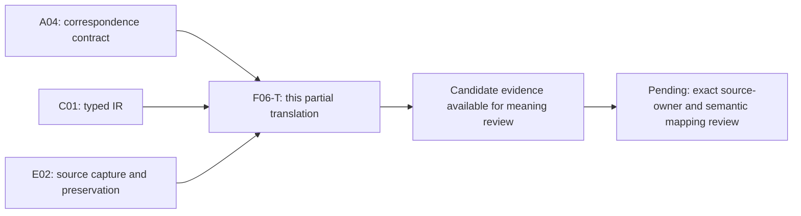

# Context Migration Manifest — formalization review

This is a **partial, exact-source candidate**, with source fidelity and owner acceptance pending. It defines the structure and constraints of a proposed migration plan; it establishes no actual source admission, migration authorization, migration result, publication, deployment or permission to delete predecessor bytes. The formalization episode remains active. Its current inventory is 43 partial drafts across 183 current definition identities, with 140 identities still lacking a per-definition draft; none has an accepted whole translation or whole-definition proof.

The native work unit is `F06-T.cal.definition.context-migration-manifest`, in the F06 context family. [Context and scope](context.json) pins the source, snapshot, native DAG and SWU manifest. A04, C01 and E02 prerequisite receipts support bounded correspondence, typed IR and capture software claims. Their PASS results do not accept the meaning of this definition. Only this isolated candidate directory is writable in this unit.

## Exact source and admission axes

The selected source is `cal.definition.context-migration-manifest@1.0.0-candidate.1`, at `authority/definitions/candidates/0001-definition-and-ctx00-v1/definitions/context-migration-manifest/v1/definition.json`, SHA-256 `bcfadcf568fe77a4e410e96ca86ba76f34bf8fdefdff2dfeb8cd12ac67022beb`. It is the admitted-current registry selection under C18, although its stored source metadata retains historical candidate wording. These are distinct facts. The source renders twice to the exact stored 3,914-byte projection, SHA-256 `3021ac2c0036fe52d793ccb64c659721ebb8683d897dff93990c605bf48b94b5`.

[Source checks](source-checks.json) verify 13 observations: exact identity and schema/generator bindings; both generated projections and input preservation; current registry and C18 selected definition/candidate bindings; C17 source-admission record binding; the recorded D29 selector; no comparison imports or invented owner fidelity; and coverage of all three source testable statements. D29's recorded selected digest is checked against the captured admission records and decision. The external historical section is not rehashed now. Consequently, historical admission metadata does not become a claim about current external bytes or actual selected migration files.

## Definition forms and source correspondence

[Correspondence](correspondence.json) accounts for every character in the 20 selected nonempty source string units: 22 spans, of which 11 are encoded, six explanatory and five deferred. The 11 encoded spans contain nine unique formula values assembled from 14 primitive formula templates. Repeated no-inference formulas remain associated with their separate source clauses; repeated occurrences do not count as distinct mathematical obligations.

The normative statement combines **genus and differentia** with axiomatic restrictions: a manifest is an immutable, bounded candidate plan with exact selections, explicit dispositions, proposed destinations, order, pre/postimages, validation, gates, rollback, exclusions and residue. The candidate treats the conjunction of nine opaque qualification predicates as an iff definition. This direction is reviewable; the source owner has not accepted it. An entity that merely declares all the fields is not forced to satisfy this genus.

Eight encoded spans use an **axiomatic or implicit** form. They constrain field declarations, source/destination binding, non-inference and role separation. Two spans also use an **operational** form for order/validation coverage and pre-execution rollback/exclusions requirements. These describe candidate requirements; they do not execute an algorithm or establish that an operation has succeeded. All encoded clauses have the role `definition`. Plain-language, domain and notation passages have the role `explanation-example`; deferred spans keep unresolved form and role labels. The carrier's seven-valued disposition enum is observed independently, not adopted as an owner-approved finite-enumeration definition in the primary theory.

## Types, signatures and interpretation

[Interpretation](t.json) and [typed IR](static-ir.json) declare 82 symbols in one exact-source-qualified scope:

| Element | Count | Meaning and limit |
|---|---:|---|
| Nonempty sorts | 3 | Entity, Field, Token; record meanings are not yet accepted |
| Constants | 15 | EMPTY and fourteen named field constants; distinct field identities are not assumed |
| Total functions | 6 | Field value, source selector/digest, destination ID/path and disposition source |
| Unary predicates | 48 | Manifest/genus markers, typed roles, requirements, inference flags and independent actual outcomes |
| Binary relations | 8 | Field declarations, selections, dispositions, destinations, selected items, order positions, validation coverage and glob observations |
| Ternary relations | 2 | Manifest-scoped precedence and declared dependency edges |

Every function receives a full, well-sorted finite Cartesian graph when evaluated. Typechecking checks variable binding, arity, sorts and symbol qualification. It does not prove that a Token is a resolved repository, a cryptographic digest, an authorized owner, a usable rollback route or actual destination bytes. EMPTY is an opaque constant; no unique-name convention is assumed for the field constants. Explicit controls preserve that limitation rather than silently enforcing canonical strings.

The fourteen declared fields are `id`, `source_repository`, `source_selections`, `dispositions`, `destination_candidates`, `dependency_order`, `preimages`, `expected_postimages`, `validation_obligations`, `owner_gates`, `rollback_boundary`, `exclusions`, `residue` and `lifecycle`. All must be declared for a manifest. Most field values remain opaque: declaring preimages, owner gates or lifecycle does not populate or verify them. No whole JSON-to-logic field map has been accepted.

## Fourteen logical aspects

1. **Genus.** Manifest iff the nine qualification predicates. These predicates describe candidate planning; they do not authenticate immutable storage or a real bounded migration scope.
2. **Field declaration.** Each manifest declares all fourteen named fields. This is a membership requirement, not equality with a closed concrete JSON object or a proof of meaningful values.
3. **Source binding.** Every selected source has a source-selection role and selector/digest binding marker, with non-EMPTY selector and digest Tokens. Grammar, selector resolution and byte hashing remain separate obligations.
4. **Disposition coverage.** Every selected source has at least one contained disposition whose total source function points to it. This is existential coverage; it does not require exactly one disposition.
5. **Disposition closure.** Each contained disposition has the appropriate role and names a source selected by that same manifest. Taxonomy, disposition consistency and destination linkage remain deferred.
6. **Destination binding.** Every proposed destination has a candidate role and explicit ID/path marker, with non-EMPTY ID and path Tokens. A proposed destination creates no admitted identity or file.
7. **Selected-item domain.** The candidate defines a selected item as a selected source or proposed destination. This union is a substantive meaning choice requiring review, particularly because the current fixture's order lists only its source.
8. **Item coverage.** Each selected item has an order-position marker and validation-coverage marker. These abstract relations do not identify concrete obligation checks or prove that those checks passed.
9. **Precedence.** `Before(manifest,a,b)` is irreflexive, transitive and limited to selected endpoints. It is a strict partial order. Independent items need not be comparable. Cycles contradict the candidate requirements. No list linearization or topological-sort theorem is claimed.
10. **Declared dependency order.** Every declared dependency edge has selected endpoints and is respected by precedence. Completeness against all real dependencies is not inferred from completeness against the declared relation.
11. **Glob inference boundary.** Source and destination glob-inference flags are false for manifests. A literal glob-looking Token remains possible: selector grammar and whether a real selection was inferred from a glob need an accepted interpretation.
12. **Execution and admission inference boundary.** A manifest has no declared execution authority and does not infer source admission, migration authorization, migrated state or deletion permission. Independently justified actual facts can coexist with a manifest; forbidding an inference does not prohibit those independently established facts.
13. **Pre-execution requirements.** Rollback and exclusions must be declared as required before execution, with non-EMPTY field Tokens. This is normative sequencing, not proof of actual rollback availability, predecessor preservation or a passed owner gate.
14. **Role separation.** A manifest is not itself a source admission, execution authorization, file-copy command, lineage proof, migration receipt, context admission, publication or deployment. Each needs its own exact source, evidence and authority boundaries.

The primary logic uses first-order quantifiers and equality. There are no theorem-target assumptions, accepted exemptions, source-owner reviews or accepted precedence resolutions. Eight findings in [clause analysis](clause-analysis.json) retain the unresolved genus, field/value, disposition/cardinality, selected-item/order, completeness, inference, temporal and dependency meanings.

## Populations, finite models and countermodels

Ten required populations prevent relevant abstract cases from being vacuous: a manifest, selected source, proposed destination, empty manifest, covered source/disposition pair, independent selected items, raw fields without the genus, manifest without actual outcomes, rollback requirement without actual availability, and a glob observation that is not a selected item. Another 57 signature populations remain unresolved. These are supplied finite interpretation witnesses, not discovered repository or operator populations.

[Model evidence](model-controls.json) evaluates 101 supplied structures: 29 satisfy the partial theory, 65 violate a candidate clause, and seven are rejected as malformed structures. Controls exercise both genus directions, all fourteen field declarations, selector/digest and destination typing/value constraints, disposition coverage/closure, selected-item equivalence, order/validation coverage, precedence cycles/transitivity/endpoints, declared dependencies, inference prohibitions, pre-execution requirements and role separation. The malformed controls cover nontotal functions, sort errors, wrong arity, duplicate tuples and an empty sort. The evaluator's existing resource limits remain unchanged.

Positive limitations are intentional evidence: the generic theory permits an empty manifest, independent incomparable items, more than one disposition per source, opaque digest Tokens, literal glob-looking selectors without inference flags, field-constant aliases, and empty opaque preimage/gate/lifecycle field values. The concrete carrier restricts some cardinalities more strongly. That discrepancy requires a reviewed field map and applicability decision before a whole translation can be claimed.

[Query policy](query-policy.json) contains 18 targets outside the theory. Fifteen ask whether manifest existence establishes actual admission, authorization, migration, deletion permission, immutability, rollback, pre/postimage verification, dependency completeness, completed validation, a passed owner gate, destination selection, publication, deployment or external effect. Two test whether observing a glob establishes source or destination selection. One tests whether raw fields establish the manifest genus. Each supplied T/I-satisfying countermodel makes its target false and its witness condition true. These establish bounded nonentailment under the authored partial interpretation, not source fidelity or a universal full-definition theorem.

## Current carrier, schema and historical helper

[Carrier/profile evidence](authority-profile-checks.json) examines all 143 type-registry rows and 121 admitted-current rows. One dedicated current contract, `cal.artifact-type.context-migration-manifest/v2`, binds this exact definition/path/digest. Its descriptor retains `candidate-unadmitted`, its fixture classification retains `/v1`, and its instance discriminator is `/v2`. Registry admission, stored candidate wording, fixture classification and schema version are separate axes.

Twelve catalog/source observations pass, including exact descriptor/schema, predecessor, generator/validator and root bindings, positive fixture shape, two exact pure descriptor and instance renders, input preservation, historical helper checks, two hostile fixture rejections, current validator static inspection and the historical Definition shape comparison. The receipt-writing current package validator is inspected, not executed. The historical `semantic_invariants` function is extracted and run as a pure helper; it is not represented as a current package check.

Forty-eight supplied schema probes produce 26 acceptances and 22 rejections. Schema rejects true execution authority, false immutable marker, missing/empty required data, unknown disposition, invalid digest shape, duplicate order entries, direct lifecycle/residue or execution-result fields, changed classification/discriminator and actual authority/admitted status literals. It accepts unselected disposition sources, an uncovered selected source, duplicate selected source identities and duplicate dispositions. The historical helper separately rejects the first three through source uniqueness and source/disposition set equality; it accepts duplicate dispositions because its comparison is by set, not multiplicity.

Schema also accepts missing/null/unresolved disposition destinations, no proposed destinations, order entries unrelated to selected items, omission of the proposed destination, generic unrelated validation obligations, unrelated pre/postimage paths, zero digests, literal glob selectors, whitespace in meaningful fields, unresolved repository/owner/type references, and changed same-ID/same-version plan data. These demonstrate shape limits; no source bytes, gate, order completeness or history are verified by those probes. The seven disposition literals—preserve, revise, split, collapse, reclassify, drop and withdraw—each remain subject to false execution authority. Even a `drop` label does not authorize deletion.

Possible locators include source `id` to carrier `migration_manifest_id`, source repository to `source_repository_ref`, residue to base `residue_refs`, and lifecycle to base `status`. These are possible bridges, not accepted semantic equivalences. The concrete source's Definition/v1 shape fails the current generic Definition/v2 shape in four binding fields; no source migration or invalidation of its exact historical admission is inferred.

## Qualification, immutable history and authority

Forty hypothetical profiles vary thirteen exact-plan context axes and twelve support axes. Thirty-six are rejected; stale-plan and stale-input profiles remain unusable, while duplicate dispositions can satisfy set coverage. The base query and context are independent copies, so mismatched queries are actually tested. Supports are hypothetical inputs, not evaluated owner decisions or hash checks.

Twenty-five finite history frames include 22 rejections. They test same-version mutation of identity and each declared immutable-plan aspect, retention of old plans and source bytes, separately qualified execution gates, pre-execution rollback/exclusions declarations and no manifest-inferred effect. A new version with old bytes retained can satisfy the hypothetical frame. A separate gate can support a hypothetical request without turning the manifest into its authorizer. No frame establishes a real migration or a universal temporal/immutability proof.

## Dependency graph and native DAG

The solid edges into this unit are its native task prerequisites. The outgoing edges describe review sequencing; they do not claim that a native review task or source-owner decision is already complete. The next Context Profile unit is the selected definition priority, not an invented dependency on this partial draft.

Twenty-one exact authored semantic-use dependencies are selected. Seven comparison sources remain separately qualified: Context, Bounded Context, Context Map, Context Lineage Record, Identity Lineage, Validation Receipt and Authority Claim. No comparison is assembled into primary T and none imports accepted meaning. Exact current identities named workflow, workflow-step and workflow-run are absent; their missing labels remain explicit rather than substituting a superficially related definition.

[Local dependency graph](dependency-graph.json) and [current joint graph](current-dependency-graph.json) have 108 nodes, 829 edges and 65 missing counterpart packets. One unresolved component has 43 members and 511 internal edges. The edge denominator still requires independent review, and the cycle classification remains unresolved. This semantic-use graph can be cyclic; it is distinct from the acyclic [native task dependency plan](../../../foundations-first-v1/dag.json), with exact definition units in the [SWU manifest](../../../foundations-first-v1/swu-manifest.json). This bounded F06-T unit depends on A04/C01/E02 software prerequisites. Family ownership/closure gates require the full specified definition translations and their review prerequisites, not merely a larger number of partial drafts.

The fresh [current inventory](current-inventory.json) independently checks one supplied T/I model for every one of the 43 drafts, with their exact qualified sources and correspondence. Aggregate accounting is 984 source units, 1,355 spans, 338 encoded, 356 explanatory, 661 deferred, 383 required populations and 1,256 unresolved populations. That does not establish a shared-carrier or meaning-aligned joint model. I04's sealed historical eight-draft report remains preserved and needs a separately scoped reporting update.

## Recovery, preservation and continuation

The first build reached an unavailable exact workflow comparison and exited with StopIteration after partial output creation. [Archived attempt](attempts/001-unavailable-exact-workflow-comparison/attempt.json) retains the actual script, logs, partial reports, exit status and hashes. The correction removes only the unavailable comparison selector; it preserves its explicit missing-dependency finding, the same theory bytes and all controls. No canonical source or prior sealed candidate changed.

Six [fresh terminal checks](fresh-command-results.json) replay the interpretation contract, model evaluator, exact source checks, carrier/profile observations, dependency selection and current inventory. [Receipt](receipt.json), [coverage row](coverage-row.json), [episode status](episode-status.json) and [delivery manifest](delivery-manifest.json) retain the exact completion boundary and prior preservation evidence. All 201 captured source files and 3,606 prior sealed candidate files are preserved. Candidate self-review is not source-owner acceptance.

The next definitions-first SWU is `F06-T.cal.definition.context-profile`. This manifest candidate remains pending for actual value maps, disposition/cardinality decisions, selected-item domain and order/validation mappings, byte authentication, source precedence, gate/rollback/immutable-epoch semantics and joint semantic closure. No implementation, source admission, migration execution or whole-episode completion is established.
