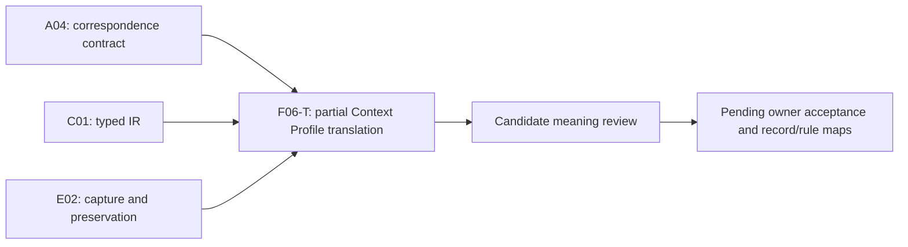

# Context Profile — formalization review

This is a **partial exact-source candidate** for reusable construction and resolution policy. It establishes no actual Context identity, resolved source set, current inputs, conformance verdict, successor authorization or authority effect. Source fidelity, source precedence and owner acceptance remain pending. The formalization episode remains active: 44 partial drafts across 183 current definition identities and 189 admitted source versions, with 139 identities still lacking a per-definition draft. Accepted whole translations and whole-definition proofs remain zero.

[Session context](context.json) records the native unit `F06-T.cal.definition.context-profile`, its exact write scope and A04/C01/E02 prerequisite receipts. These support bounded correspondence, typed IR and preservation software claims; they do not accept this definition's meaning. The previous goal turn made verified progress by sealing Context Migration Manifest. This unit changes only its isolated candidate directory.

## Selected definition, provenance and admission

The current source is `cal.definition.context-profile@1.0.0-candidate.1`, path `authority/definitions/candidates/0014-definition-specialization-resolution/definitions/context-profile/v1/definition.json`, SHA-256 `4b8ef4c933df08cfc3f7e15a80f635d5ea5fe5adbe77b33364a309cf6ed199d6`. The live registry selects it as admitted-current under C66. Stored candidate wording and residue remain preserved; they are distinct from current registry admission. Source admission also differs from acceptance of this formal translation.

Fifteen [source checks](source-checks.json) verify exact source identity, Definition/v1 schema and generator bindings, two exact generated projections and unchanged render input, the current registry entry and recorded C66 selected row, the captured C66 decision digest, its exact admitted resolution overlay, the candidate definition row, current local candidate whole-file provenance, no inherited upstream source admission, the pure hostile Profile/Context-collapse helper, no comparison import or owner fidelity, and representation of all three source testables.

Both projections reproduce the stored 4,771-byte source projection, SHA-256 `cc70effcd623f7ce63338d0961c4b6727694f48d099ecbe2304c8112cce9a791`. The upstream local candidate `authority/artifact-types/candidates/0005-remaining-18-complete-model/model.json` is rehashed against the recorded whole-file digest `9e80895df1887113cfc407de6ed4d11f6cd37d4ac10857389ee060e1139c9f36`. Its source-admission posture remains candidate-unadmitted with a null source-admission reference. Rehashing that candidate proves current bytes for this selected local input; it does not admit the upstream source.

The candidate's `hostile` function is extracted by AST and executed alone. Its exact supplied `subject` rejects `is_context_instance: true` for a context-profile, while a false marker yields no hostile finding. The receipt-writing full candidate validator is not executed. These observations cover this one separation rule, not all seven candidate definitions or the entire specialization-resolution pack.

## Definition forms and source accounting

[Correspondence](correspondence.json) accounts for every character in 23 selected nonempty source string units. The 25 spans consist of 15 encoded, six explanatory and four deferred spans. Encoded occurrences contain ten unique formula values assembled from ten primitive templates. Duplicate source boundary statements retain their own correspondence; repetition is not counted as independent mathematical content.

The normative statement uses **genus and differentia**, with axiomatic restrictions: a Profile is a reusable versioned policy contract constraining purpose-bound Context construction and resolution. Eleven qualification predicates represent the policy dimensions. The candidate encodes their conjunction as an iff definition; that reverse direction is a meaning choice awaiting source-owner review.

Twelve encoded spans have **axiomatic or implicit** form. They specify governed/bounded qualification, declared fields, exact conformance, policy/instance separation, owner/version data and no inference. Two repeated revision-boundary spans also have **operational** form: prior Context meaning must be preserved with explicit succession. They state requirements and do not execute a resolution or succession algorithm. All encoded clauses have role `definition`; plain-language, domain and notation material is `explanation-example`. Deferred spans retain unresolved forms and roles.

The example allowing one Product, an optional Project and a 24-hour freshness ceiling remains explanatory. It is not a global closed anchor taxonomy, cardinality axiom or universal freshness policy. The carrier's four lifecycle literals are separately observed schema constraints, not an owner-approved finite-enumeration definition inserted into primary T.

## Types and representation

[Interpretation](t.json) and [typed IR](static-ir.json) contain 78 exact-source-qualified declarations:

| Element | Count | Interpretation and limit |
|---|---:|---|
| Nonempty sorts | 3 | Entity, Field and Token; actual records remain unmapped |
| Constants | 12 | EMPTY and eleven named field constants; unique names are not assumed |
| Total functions | 3 | Field value, Profile version and Context/Profile conformance version |
| Unary predicates | 53 | Profile/policy qualifiers, roles, payload/inference flags, normative requirements and independent actual outcomes |
| Binary relations | 7 | Field declaration, conformance claim, exact-version naming, governing Contexts, revision, silent reinterpretation and allowed anchor kinds |

Total functions have full, well-sorted finite Cartesian tables in supplied models. Their sorts and arity are checked independently. A Token is not automatically a valid policy rule, qualified owner, version reference, resolved source or freshness evaluation. EMPTY is an opaque constant, and field constants may alias unless an accepted field map adds distinctness.

The eleven fields are `version`, `allowed_anchor_kinds`, `cardinalities`, `identity_rules`, `source_constraints`, `freshness`, `exclusions`, `succession`, `owner`, `lifecycle` and `challenge_route`. Their combined source basis is the normative policy dimensions, explicit own-version/owner/lifecycle/challenge boundary and testable declaration requirement. This union is a candidate meaning choice. It is not an accepted whole-record map.

Version, owner, lifecycle and challenge values must be non-EMPTY. The `profileVersion` function must equal the version field's value. Policy fields otherwise remain opaque. Consequently, declaring a freshness or cardinality field does not supply or enforce the rule. A marker stating that a Profile constrains construction is also separate from actual successful validation.

## Ten logical aspects

1. **Genus.** Profile iff eleven reusable-policy qualifiers. These include construction, resolution, anchor-kind, cardinality, identity, source, freshness, exclusion, succession and challenge policy. Their actual denotations and the iff direction remain pending.
2. **Declaration.** Every Profile declares eleven fields. This does not establish a closed JSON representation, nonempty policy values or executable rules.
3. **Governed and bounded.** The source's explicit implication is encoded: every Profile is governed and bounded. Actual governance decisions and bounded scopes are not authenticated by the predicates.
4. **Role separation.** A Profile is not a Context instance, Product/Project/Goal anchor, purpose-bound Context identity, resolved source selection, consumer view, carrier/instance/relation admission, runtime/consumer activation, publication or deployment.
5. **Payload separation.** Six flags forbid carrying actual Product, Project, Goal, purpose-bound Context identity, resolved-source or consumer-view payload in a Profile. An allowed anchor-kind Token such as product remains a policy value; it does not become a Product anchor.
6. **Own fields and version.** Version, owner, lifecycle and challenge route are non-EMPTY. `profileVersion` equals the declared version value. This is an internal candidate bridge, not proof that a concrete record resolves to an exact admitted Profile version.
7. **Exact conformance.** A Context claiming conformance has the Context-instance role, names a Profile, names its exact version and has a conformance-version value equal to that Profile's version. The candidate also limits that Context's conformance relation to one Profile entity. This is a substantive scope choice: one exact Profile per Context versus one exact version per individual conformance claim needs review.
8. **Context governance.** A Profile's governed subjects are purpose-bound Contexts with their own relevance boundary. Governing does not imply a conformance claim. A Profile may govern several Contexts, or none; the source's permission is not turned into a universal multiplicity requirement.
9. **No inference.** Profile existence does not infer Context identity, resolved source set, Context creation, current inputs or authority effect. Independently justified actual facts may coexist with the Profile. No-inference requirements do not prohibit those separately established facts.
10. **Revision preservation.** A revision relates two Profiles and requires preservation of prior Context meaning and explicit succession. It cannot silently reinterpret Contexts in the declared old governance relation. Actual retained records, all real governed subjects, authorization and temporal transition semantics remain unproved.

The logic is first-order with equality. There are no theorem-target assumptions, accepted population exemptions, accepted source precedence decisions or source-owner review references. Eight findings in [clause analysis](clause-analysis.json) retain the pending genus, record/value map, conformance scope, governing/conformance distinction, payload/inference boundary, opaque policy rules, temporal meaning and source/dependency closure questions.

## Populations, controls and nonentailment

Ten required populations exercise nonvacuous supplied cases: a Profile, a claiming Context, one Profile governing two different Contexts, an unused Profile, a revision, raw fields without the genus, a Profile without actual outcomes, a governed Context without conformance, an allowed kind without instance payload and a succession requirement without actual authorization. Fifty-nine additional signature populations remain unresolved. These are authored finite witnesses rather than discovered operational populations.

[Model controls](model-controls.json) evaluate 101 structures: 26 satisfy the partial theory, 68 violate its clauses and seven are structurally malformed. Controls cover both genus directions, eleven declarations, governed/bounded constraints, fourteen forbidden roles, six payload flags, five inference flags, own fields, version equality, exact conformance and its scope, purpose-bound governance, revision typing and normative requirements, and silent reinterpretation. Structural rejections cover nontotal functions, sort mistakes, incorrect arity, duplicate tuples and empty sorts. The verifier's existing resource limits are unchanged.

Positive limitation controls deliberately retain an unused Profile, governing without conformance, an allowed Product kind without a Product anchor, a revision with the same version value, silent-reinterpretation markers outside the declared old governance relation, opaque empty policy values, unresolved owner Tokens, field aliases and extra field declarations. The generic revision formula does not itself prove every material revision requires a distinct version. Exact policy/version/history mapping is needed before that stronger claim is warranted.

[Query policy](query-policy.json) keeps twelve targets outside T. Ten ask whether Profile existence establishes actual Context creation, current inputs, resolved sources, Context identity, qualified ownership, validated conformance, authorized succession, publication, deployment or authority effect. The other two test whether raw declarations establish the Profile genus, and whether governing establishes conformance. Each supplied T/I-satisfying countermodel makes its target false and its witness condition true. This is bounded nonentailment evidence under the authored interpretation; it is not source fidelity or a universal full-definition proof.

## Carrier and schema findings

[Carrier evidence](authority-profile-checks.json) examines 143 registry rows and 121 admitted-current rows. One dedicated current carrier, `cal.artifact-type.context-profile/v1`, binds the exact C66 definition/path/digest. Its stored descriptor has `candidate-unadmitted` and version `1.0.0-candidate.3`; its schema reference is `cal.schema.context-profile-review-candidate/v2`. Its fixture uses `kind: context-profile`, lifecycle `active` and status `candidate-unadmitted`. Registry admission, stored candidate status, descriptor version, schema reference, instance kind and fixture lifecycle remain distinct axes.

Twelve catalog observations pass: exact current binding and descriptor/schema hashes, generator/validator/root hashes, valid positive fixture shape, two exact descriptor and instance renders, unchanged inputs, closed record shape, absence of explicit version/cardinality/identity-rule fields, rejection of four hostile fixtures, static inspection of the bound generic validator, and the source Definition shape comparison. The receipt-writing carrier validator is not executed. Its inspected code performs generic binding/schema/projection/fixture checks; it contains no Profile-specific policy/reference/freshness/succession graph evaluation. Descriptor language about graph consistency is not evidence that these meanings were checked.

Fifty-three probes produce 17 schema acceptances and 36 rejections. Schema requires non-whitespace strings, nonempty bounded unique policy lists, valid lifecycle literals, candidate status, no authority effect and the context-profile kind. It rejects extra version, cardinality and identity-rule fields, Context payload fields, inferred-authority fields, duplicates, whitespace values and lists over 100 items.

It nevertheless accepts unknown context/source kind strings, incompatible anchor-field names, negative-time freshness text, arbitrary no-succession policy text, unresolved owner/challenge/scope references, self or unknown successor references, case-distinct kind spellings, opaque node IDs without a version, changed same-ID policy without a version field, and an active fixture with candidate status. These are shape observations. No policy is parsed or executed, no referenced owner or successor is resolved, no time is evaluated, and no existing Context history is compared.

The whole record-to-logic map remains unaccepted. In particular, `version`, `cardinalities` and `identity_rules` have no explicit carrier fields. Encoding a version in node_id is possible vocabulary but not enforced by this schema. `allowed_context_kinds` and `required_anchor_fields` are possible locators for permitted anchor rules; their actual correspondence is pending. Other possible locators include allowed source kinds, freshness policy, exclusion policy, successor rule/refs, owner ref/route, lifecycle state and challenge route. These labels do not establish semantic equivalence.

The selected Definition/v1 record fails current generic Definition/v2 shape at four binding fields: classification artifact type, schema ref, schema version and generator ref. No migration of the source or invalidation of its exact historical admission is inferred from that version mismatch.

## Qualified policy and prior Context history

Thirty-six hypothetical profiles vary fifteen context axes and ten support axes. Thirty-three are rejected. Stale Profile and stale input cases remain unusable even without structural rejection. The query context is an independent copy, so mismatch controls are meaningful. Hypothetical supports name the missing identity/version resolution, owner qualification, rule maps, source/freshness checks, consumer contracts, preservation and succession authorization; the controls do not claim those supports are actual verified facts.

Twenty finite history frames include eighteen rejections. They test changes to policy and identity within the same version, missing explicit succession, loss of old Profile or resolution bytes, changed meaning for an existing Context, inferred effects and unverified actual transitions. A hypothetical new explicit successor can preserve the old Context resolution. These supplied finite frames are separate from the weaker generic revision formula and do not establish universal temporal safety or an actual succession.

## Dependency graph and execution DAG

Edges into the unit are its native task prerequisites. Outgoing edges describe review sequencing and do not claim completed native review tasks. The full [native task DAG](../../../foundations-first-v1/dag.json) and [SWU manifest](../../../foundations-first-v1/swu-manifest.json) remain pinned. Context Request is the next selected priority; no dependency on this partial draft is invented.

Twenty-five exact semantic-use dependencies are authored. Six comparison sources remain separately qualified: Context, Context Request, Context View, Bounded Context, Context Migration Manifest and Constitution. No comparison meaning is assembled into T. The exact label definition-governance is absent from the current snapshot; that missing label is explicit and no similarly named model is substituted.

The [local dependency graph](dependency-graph.json) and [joint current graph](current-dependency-graph.json) contain 109 nodes, 854 edges and 65 missing counterpart packets. One unresolved component has 44 members and 524 internal edges. Semantic-use cycles require independent classification; they do not make the native execution plan cyclic. The newly reachable Derived Refresh counterpart is still missing, offsetting the newly drafted Profile packet and leaving the missing-packet count at 65. Family closure requires the full specified translations and their review dependencies, not the number of partial drafts.

[Current inventory](current-inventory.json) freshly evaluates one exact-qualified supplied T/I model for each of the 44 partial drafts. Aggregate accounting is 1,007 source units, 1,380 spans, 353 encoded, 362 explanatory, 665 deferred, 393 required populations and 1,315 unresolved populations. This does not establish a shared-carrier or meaning-aligned combined model. I04's historical eight-draft selected report is preserved and requires a separate scoped reporting update.

## Recovery, preservation and continuation

An initial source-check attempt read the hostile fixture under scenario even though its actual key is subject. The real KeyError, script, logs, exit status and hashes are retained in the [archived attempt](attempts/001-source-fixture-subject-key/attempt.json). The correction changes only the two fixture-key accesses. It retains the same negative and positive controls, the exact theory hash and all canonical/prior bytes. The first attempt produced no source-check report.

Six [fresh terminal checks](fresh-command-results.json) replay the interpretation contract, finite model checks, exact source observations, carrier/profile checks, dependency compilation and full draft inventory. [Receipt](receipt.json), [coverage](coverage-row.json), [episode status](episode-status.json) and [delivery manifest](delivery-manifest.json) preserve the exact partial boundary. All 201 captured source files and 3,675 prior candidate files remain unchanged. Candidate self-review is not source-owner acceptance.

The next definitions-first unit is `F06-T.cal.definition.context-request`. Context Profile remains pending for actual policy/rule/cardinality/identity/source/freshness/owner/version/conformance/succession/history maps, source precedence and shared closure. Implementation, downstream activation, whole-definition proof and whole-episode completion are not established.
