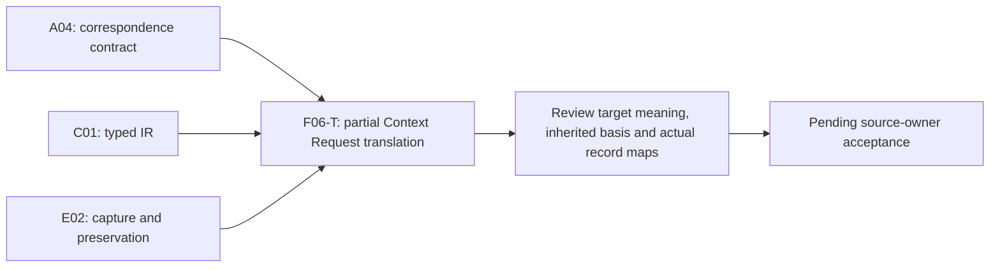

# Context Request — formalization review

This is a **partial exact-source candidate** for a bounded, attributable resolution request. It establishes no actual resolution authorization, current inputs, completed View, consumer understanding, budget/freshness compliance, Context nonmutation or source authority. Source fidelity, source precedence and owner acceptance remain pending. The full formalization episode remains active: 45 partial drafts across 183 current definition identities and 189 admitted source versions, with 138 identities still lacking a per-definition draft. Accepted whole translations and whole-definition proofs remain zero.

[Session context](context.json) records `F06-T.cal.definition.context-request`, its isolated write scope and A04/C01/E02 prerequisite receipts. Their PASS results support bounded correspondence, typed IR and preservation software claims, rather than acceptance of this definition's meaning. The previous goal turn made verified progress by sealing Context Profile. This unit writes only its candidate directory and reads one exact local legacy source copy without modifying it.

## Source precedence: Request versus inherited Context

The selected source is `cal.definition.context-request@1.0.0-candidate.1`, at `evidence/migrations/cyberalchemy-v2-to-lab/candidates/0004-artifact-reconstruction-pipeline/layers/l1-semantic-repeatability/definitions/context-request/v1/definition.json`, SHA-256 `9e0364f581e5a5323bc2f6c12306386b3bd0936527192b575f4629e81fb4a0b4`. Its Request-specific normative paragraph describes a bounded attributable request to resolve a declared Context for named consumers and uses under exact selectors, freshness, exclusions and output constraints, without Context mutation or source authority.

The same source's formal-expression block describes **Context**, including Product/Project/Goal anchors, kind and lifecycle enumerations, consumer counts and successor requirements. Its normative text also retains a long Context-semantic basis; aliases include Context, governed context and work context. Several inherited boundary and applicability passages describe Context rather than Request. These facts are source-precedence concerns, not evidence that a Request is a Context or must itself have Product/Project/Goal fields.

This candidate encodes the Request-specific paragraph and separate normalized-definition metadata. It accounts for the entire inherited Context formal block and basis without applying those formulas to Request T. The source owner has not approved that precedence choice. The three admitted D66 siblings—Context, Context Request and Context View—remain exact, separately qualified identities. No comparison is merged into T, and no mandatory Profile selection is inferred merely because Context Profile is a nearby policy concept.

## Source admission, currentness and projection

Fifteen [source observations](source-checks.json) verify exact source identity, Definition/v1 schema and generator bindings, two identical renders and exact stored projection, local D66 section digest and full-file admission bytes, captured C53 decision and source-admission record bindings, selected definition-use admission and live definition registry selection, the historical candidate-registry row, no comparison import or target assumption, three distinct D66 siblings, and exclusion of inherited Context/testable obligations from Request T.

Both renders reproduce the 9,628-byte projection, SHA-256 `ad71029d02fcdccf9752b0155f8eb3e0edc6bcf538aa441834f0b9742c09c1da`. The [selected D66 section](legacy-source-section.md) is 5,542 bytes, digest `cef43970ffab0e22afdb90fc5436cbe17da9d35cc570320285cdbb6dfd2ef06d`. It is extracted from `/home/vlad_/projects/cyberAlchemy-v2/authority/definitions/DEFINITIONS.md` using the exact bound `markdown_h2_section` function, executed alone rather than running its reconstruction writer. Full local-file bytes also match the source-use admission's recorded admission-time file hash.

C53 currently admits the exact definition and exact D66 use for three selected definition versions. Stored source metadata still says candidate-unadmitted with a null source-admission reference; that historical wording remains preserved, separately from the overlay and current registry state. It does not invalidate the current selection or accept this formal interpretation.

The declared producer path under `/home/vlad_/projects/domainspec-core/cyberAlchemy-v2/authority/definitions/DEFINITIONS.md` is absent. The selected local copy is exact, but its repository identity and authenticated live producer currentness are not established. Producer configuration is not changed. Consequently, the source testable requiring current selected-section digests receives a partial currentness verdict, not a broad live-source PASS.

The four source testables concern this definition artifact: stable candidate identity, current source-section digest, Definition/v1 schema validity and exact generated projection. They are handled by actual observations and explicitly deferred in T. They are not logical assumptions that manufacture artifact validity or live source currentness.

## Definition forms and correspondence

[Correspondence](correspondence.json) accounts for every character in 24 selected nonempty source string units. The 27 spans comprise six encoded, nine explanatory and twelve deferred spans. Six encoded occurrences contain four unique formula values assembled from eleven primitive templates. Repeated sibling/effect boundaries preserve their distinct source occurrences without multiplying the mathematical obligation count.

Five encoded spans use **axiomatic or implicit** form. They cover normalized metadata, canonical-definition preservation, sibling separation and effect exclusions. The Request-specific paragraph combines **genus and differentia**, axiomatic constraints and **operational** requirements: the kind of request, its typed/nonempty inputs and restrictions on what it can cause. This does not implement a resolver or accept runtime behavior. All encoded clauses have role `definition`; plain-language/domain/notation material has role `explanation-example`. Deferred inherited text and artifact-validation obligations retain unresolved forms and roles.

The candidate treats nine opaque Request qualifiers as an iff genus. Both the iff direction and the accompanying derived field/reference/cardinality requirements are reviewable meaning choices. The copied Context kind/lifecycle enums are not adopted as a finite-enumeration definition of Request. Carrier-only timestamp and budget rules are observed separately from source meaning.

## Types and representation

[Interpretation](t.json) and [typed IR](static-ir.json) contain 78 exact-source-qualified declarations:

| Element | Count | Meaning and limit |
|---|---:|---|
| Nonempty sorts | 3 | Entity, Field and Token; concrete records and values remain unmapped |
| Constants | 11 | EMPTY, normalized Request-definition ID and nine field constants; distinct field names are not assumed |
| Total functions | 3 | Field value, normalized definition ID and requested Context |
| Unary predicates | 54 | Fifty Entity predicates and four Token input-role predicates |
| Binary relations | 7 | Field declarations, declared Context target, consumers, intended uses, selectors, output constraints and exclusions |

Every total function has a full, well-sorted finite Cartesian table in supplied models. Typechecking validates symbol qualification, variables, arity and sorts. It does not resolve a Context or consumer reference, parse a selector, evaluate freshness, authenticate an owner or execute an output constraint. Tokens are opaque, including the normalized-ID constant. Unique field names and a concrete serialization bridge require accepted mappings.

Nine candidate fields are derived from Request meaning and attribution: `context_ref`, `consumer_refs`, `intended_uses`, `selectors`, `freshness_requirement`, `exclusions`, `output_constraints`, `owner_ref` and `scope_ref`. All must be declared. Owner, scope and freshness values must be non-EMPTY, but their actual meaning remains pending. The fields' opaque values are not equated with their separate typed relations; a whole record map has not been accepted.

The current carrier additionally requires `context_version_ref`, budget, requested-at, owner route, challenge route and claim ceiling. These are independent carrier constraints, not silently imported source axioms. Profile and purpose fields are not carried. The inherited Context tuple remains separately accounted source material.

## Eleven logical aspects

1. **Normalized definition metadata.** A normalized-definition target has the Context-resolution scope marker, Definition-carrier marker and the normalized Request target ID. These apply to separately scoped definition metadata, not automatically to every Request instance.
2. **Canonical metadata preservation.** A canonical-definition instance preserves that normalized classification and exact D66 relation and does not silently merge sibling identity. Actual classification, relation admission and whole record maps remain pending; the concrete Request carrier is a distinct contract.
3. **Request genus.** Request iff nine bounded/attributable resolution-policy qualifiers, including declared Context, named consumers, intended uses, exact selectors, freshness, exclusions and output constraints. A qualification predicate does not prove a rule has been implemented or satisfied.
4. **Field declarations.** Each Request declares the nine candidate fields. This does not close a JSON object or authenticate its references and values.
5. **One declared Context.** A Request's total requestedContext function denotes a typed Context. Its declared-target relation holds exactly for that function value. This candidate chooses one target, with no invented Product/Project/Goal structure on the Request itself.
6. **Reference/input typing.** Consumer references have a consumer role. Intended-use, selector, output and exclusion Tokens have their respective input roles. These are abstract type constraints, not reference resolution or semantic parsing.
7. **Nonempty input coverage.** Each Request has at least one consumer, use, selector and output constraint. Input Tokens cannot equal EMPTY. Exclusions may be empty, although the exclusions field is declared. Many consumers are allowed; uniqueness and complete intended-use coverage remain separate.
8. **Attribution and freshness declarations.** Owner, scope and freshness values are non-EMPTY. This does not qualify the principal, authorize resolution or establish an actual freshness check.
9. **No Request-caused mutation or source authority.** MutatesContext and GrantsSourceAuthority are false for Requests. This states a causal boundary; it does not prove that Context bytes stayed unchanged or prohibit an independent qualified owner from changing Context/source state.
10. **No effect inference.** Request existence does not infer source authority, authority effect, execution permission, admission, activation, publication, release, deployment or external effects. Independently established actual outcomes can coexist with the Request.
11. **Sibling separation.** A Request is not a Context, Context View or DDD Bounded Context and does not import sibling meaning without an explicit reference. Shared source lineage does not merge identity or validation purpose; an explicit reference is not an accepted shared meaning map.

The logic is first-order with equality. There are no theorem-target assumptions, accepted population exemptions, owner reviews or source-precedence decisions. Eight findings in [clause analysis](clause-analysis.json) retain the inherited-versus-target precedence, metadata/instance classification, derived-field/reference scope, attribution, opaque rules, causal preservation, recorded-source-use/currentness and actual artifact/dependency obligations.

## Populations, finite controls and countermodels

Ten required populations exercise a Request, canonical definition metadata, typed Context target, named consumer, use/selector/output inputs, both empty and explicit exclusions, raw fields without Request genus, a Request without actual outcomes and two distinct Requests sharing one Context. Fifty-nine other signature populations remain unresolved. These are authored finite witnesses rather than discovered consumers, owners or live requests.

[Model evidence](model-controls.json) evaluates 100 supplied structures: 33 satisfy the partial theory, 60 violate clauses and seven are structurally malformed. Controls cover both genus directions, nine fields, normalized/canonical metadata, one typed Context target, consumer/input roles and nonempty coverage, attribution, Request effects and sibling separation. Structural rejections include nontotal functions, sort errors, arity errors, duplicate tuples and empty sorts. Existing verifier resource limits remain unchanged.

Positive limits deliberately retain empty exclusions, multiple consumers, a glob-looking Token marked exact without a parser, opaque freshness, empty opaque field values while their separate relations have members, noncanonical metadata with unconstrained sibling markers, normalized-ID values on non-target entities, field-constant aliases and extra field declarations. These demonstrate where the abstract theory needs a concrete accepted interpretation and stronger independent validation.

Nineteen [query targets](query-policy.json) remain outside T. Seventeen ask whether Request existence establishes actual resolution authorization, View creation, current inputs, source truth/authority/admission, Context nonmutation, consumer understanding/use, freshness/output/budget satisfaction, execution permission, publication, release, deployment or external effects. Two test raw fields implying Request genus and a Request implying the normalized-definition object. Each supplied T/I-satisfying countermodel makes its target false and witness condition true. This is bounded nonentailment under the candidate interpretation, not source fidelity or a universal whole-definition theorem.

## Current carrier and executable observations

[Carrier evidence](authority-profile-checks.json) examines 143 type-registry rows and 121 admitted-current rows. One dedicated current contract, `cal.artifact-type.context-request/v1`, binds the exact C53 definition/path/digest. Its descriptor retains candidate status and version `1.0.0-candidate.2`; its schema reference is `cal.schema.context-request-review-candidate/v2`. Its fixture has context-request kind and candidate-unadmitted status. Registry admission, descriptor version, schema reference and fixture status remain separate axes.

Twelve catalog observations pass: exact current binding, descriptor/schema hashes, generator/validator/root hashes, positive fixture shape, two exact descriptor and instance renders, unchanged inputs, closed schema, timestamp/budget shape constraints, four hostile fixture rejections, bound generic-validator static inspection and the historical Definition shape comparison. The receipt-writing package validator is inspected, not executed. Its generic checks do not resolve Request Context/consumer references, selectors, freshness, budgets, dates or output behavior. Descriptor wording about target graph checks does not establish those Request meanings.

Fifty-nine schema probes yield 17 acceptances and 42 rejections. Schema rejects empty required input lists, whitespace identities and policy strings, duplicate list items, nonpositive/fractional/boolean/null budgets, missing/extra budget fields, unsupported timestamp spellings, extra Profile/purpose/Context-anchor/effect fields, over-100 selector lists, changed kind, admitted status and authority effect. Exclusions may be empty.

It accepts mismatched Context reference and version identity, a short digest-looking version suffix, unresolved references and owners, literal glob selectors, case-distinct strings, arbitrary or negative-time freshness text, permission-sounding output and fixture claim text, a one-item/one-byte budget with three selectors, extremely large positive budgets, impossible calendar/clock dates, year zero, future dates and same-request-ID changes to Context selection. UTC timestamps are checked by a fixed digit-shape regex, not calendar validity or actual age; offset and fractional-second spellings are rejected even though they can represent time elsewhere.

The stored fixture says that the request authorizes resolution only. That claim is retained as untrusted fixture wording with authority effect none; no permission is authenticated. Passing shape, a named owner role or request wording does not prove actual authorization. The generic theory allows separately justified actual resolution authorization to coexist without deriving it from Request existence.

Possible field locators are recorded, but no whole Request-to-carrier map is accepted. Exact Context-version resolution, selector grammar, budgets, timestamp semantics and application of freshness/exclusions/output constraints require independent evidence. The selected Definition/v1 record fails current generic Definition/v2 shape in four binding fields; no source migration or invalidation of its exact admission is inferred.

## Qualified resolution and finite history

Thirty-eight hypothetical profiles vary fourteen context axes and twelve support axes; 35 are rejected. Stale Request and stale input cases remain unusable. Query and context are independent copies. Hypothetical supports include identity/version resolution, attribution, consumers, selector/source checks, freshness, exclusions, output/budget evaluation, separate authorization and Context/source-authority preservation. These supports are not actual resolved inputs or owner decisions.

Eighteen finite history frames include twelve rejections. They compare Context identity/version/anchors/purpose, source authority, Request selectors, source epochs and qualified resolution requirements. New Request selectors or source epochs can preserve Context; independently qualified Context or source-owner changes can coexist with a Request. Request-caused changes and Request-inferred Views are rejected. A hypothetical resolution requires separate authorization, freshness and budget checks. These frames add explicit hypotheses outside the generic T; they establish neither real resolution nor universal temporal preservation.

## Dependency graph and native execution DAG

Edges into this unit are its native prerequisites; outgoing edges describe review sequencing rather than completed native review tasks. The full [native task DAG](../../../foundations-first-v1/dag.json) and [SWU manifest](../../../foundations-first-v1/swu-manifest.json) remain pinned. Context View is the next selected priority; no dependency on this partial draft is invented.

Twenty-five exact semantic uses are authored. Eight comparisons remain separately qualified: Context, Context Profile, Context View, Bounded Context, Context Migration Manifest, Source, Authority Claim and Constitution. Their source definitions and selected prior evidence remain preserved without becoming accepted shared meaning.

The [local dependency graph](dependency-graph.json) and [joint current graph](current-dependency-graph.json) have 109 nodes, 879 edges and 64 missing counterpart packets. One unresolved component has 45 members and 539 internal edges. Its cycle classification and edge denominator require independent review. This semantic-use graph differs from the acyclic native execution plan. Family closure requires all specified translations and review obligations, not merely more partial drafts.

[Current inventory](current-inventory.json) freshly evaluates one exact-qualified supplied T/I model per draft. Aggregate accounting is 1,031 source units, 1,407 spans, 359 encoded, 371 explanatory, 677 deferred, 403 required populations and 1,374 unresolved populations. This does not establish a shared-carrier or meaning-aligned combined model. I04's historical eight-draft selected report remains intact and needs a separate scoped reporting update.

## Delivery and continuation

Six [fresh terminal checks](fresh-command-results.json) replay interpretation contract, finite models, exact source observations, carrier/profile evidence, dependencies and current draft inventory. [Receipt](receipt.json), [coverage row](coverage-row.json), [episode status](episode-status.json) and [delivery manifest](delivery-manifest.json) preserve the exact partial boundary. All 201 captured source files, 3,737 prior candidate files and the selected local legacy source remain unchanged. This unit's producer checks completed without a failed attempt. Candidate self-review is not source-owner acceptance.

The next definitions-first SWU is `F06-T.cal.definition.context-view`. Context Request remains pending for source precedence, inherited/target/metadata/instance boundaries, concrete record/reference/rule/time/budget/authorization/resolution/preservation meanings and shared closure. Implementation, downstream activation, accepted whole translation, whole proof and whole-episode completion are not established.
