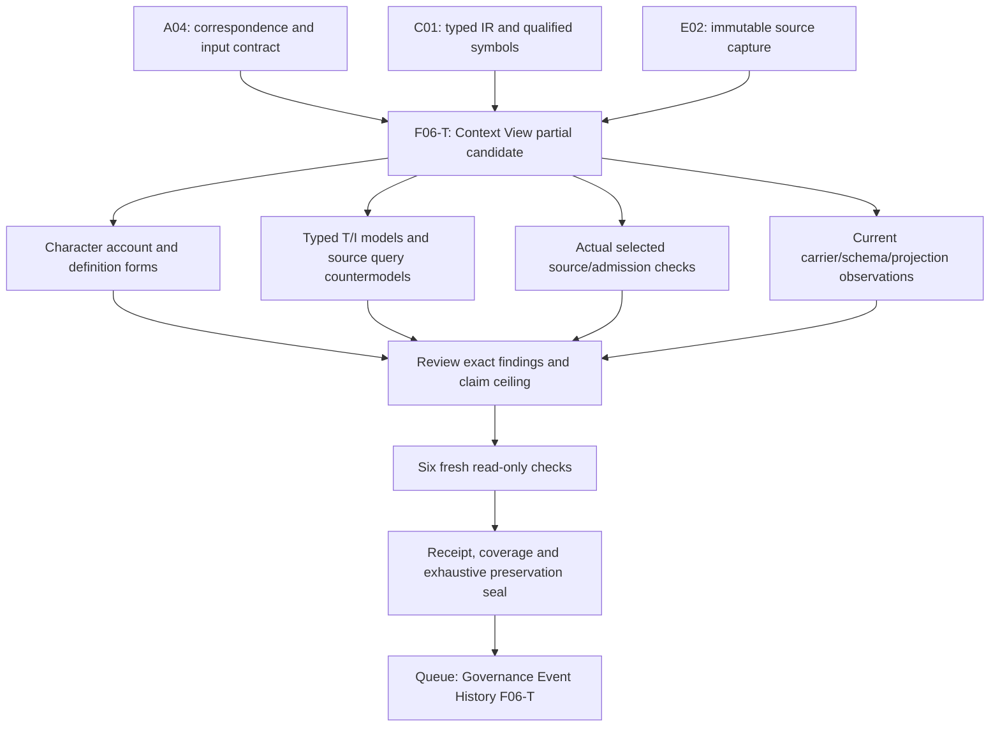

# Context View — bounded formalization candidate

This is a partial, source-bound candidate for `cal.definition.context-view@1.0.0-candidate.1`, SWU `F06-T.cal.definition.context-view`. It follows the user's priority: definitions, definition forms, types, logic and other formalization aspects before implementation. It supplies an inspectable theory and independent finite evidence. Source-owner fidelity, whole-definition translation, whole-definition proof and shared meaning closure remain pending. No authority effect is created.

The positive source calls a Context View an immutable, digest-bound projection produced by resolving one Context Request against one exact Context identity and source epoch. It records included and excluded material, lineage, limitations and expiry or refresh conditions without becoming Context itself. The candidate follows that View-specific paragraph while preserving inherited Context-only text as unresolved correspondence. It treats immutability, new-View retention and stale-use behavior as requirements; it does not claim actual resolver execution or frozen storage.

## Source and correspondence

[The source-bound interpretation](t.json), [character correspondence](correspondence.json), [independently checked account](correspondence-check.json), [typed IR](static-ir.json) and [denominator](denominator.json) cover 24 nonempty source string units through 31 exact spans: 7 encoded, 9 explanatory and 15 deferred. Every in-policy character is accounted for. That accounting establishes coverage of selected text, not that every sentence has an accepted logical translation. Alias and metadata scope concerns are separately retained in the findings; the correspondence inventory policy does not count all top-level metadata as source voice units.

The selected definition SHA-256 is `0dc6fb05c40d51d0ae746f1177797766861b353844167771c4fb6a793996a7d2`. The current registry admits the source through C53. The embedded source and reconstruction registry preserve historical candidate posture. Those statuses describe different records and times; no source admission is retracted or silently promoted.

The copied source-semantic basis describes Context anchors, Product/Project/Goal kinds, lifecycle, cards and successor conditions. Those statements are not View rules merely because they appear in the View file. The scientific formal block is likewise Context-oriented. Context, Context Request and Context View remain three distinct qualified identities; the common D66 source-use admission does not equate them. Plain-language frozen-answer intuition and reconstructed-origin explanations are explanatory spans, not independent proofs.

One formal source line does belong to the View boundary:

```text
current(ContextView) =/=> current(Context)
```

[The source query obligation](source-query-obligation.json) records its selector, exact character interval, excerpt digest and deferred clause. [The query policy](query-policy.json) places the target outside T. A supplied model satisfies the selected T and required populations while a View is marked current and its Context is not. That is an independently evaluated countermodel for this candidate theory. It is neither an assumed implication nor a claim that the full source theory has been proven equivalent.

## Definition forms and theory

Five encoded occurrences use axiomatic/implicit form. The positive paragraph uses genus–differentia, axiomatic/implicit and operational forms together. The stale-consumer-use span uses axiomatic/implicit and operational forms. These are forms of source clauses, not artifact lifecycle states or runtime object types. Seven encoded occurrences have five unique formula values, assembled from thirteen primitive templates. Repeated sibling-boundary clauses retain separate correspondence but do not increase the number of distinct constraints.

| Template | Candidate meaning | Limit requiring accepted denotation |
| --- | --- | --- |
| Normalized metadata | A normalized Definition target has the View identity token, Context-resolution scope and Definition carrier marker. | Applies to Definition metadata, not every runtime View. |
| Canonical metadata | A canonical Definition instance is a normalized target, preserves the exact D66 relation and avoids silent sibling identity merge. | Canonical classification/source maps require owner acceptance; noncanonical targets are not silently given this rule. |
| Genus | View is equivalent to the conjunction of seven named projection, resolution, exact-binding, material and annotation qualifiers. | Biconditional strength and qualifier meanings remain pending; markers do not execute resolution. |
| Field declaration | Every View declares nine derived field names. | Name constants may alias and field declarations do not enforce a closed record or meaningful values. |
| Exact bindings | Functions name one Request, Context and epoch; Request's Context equals View's Context. Projection digest is nonempty and equals its derived field value. | Totality gives one function result, not actual reference resolution, authenticated epoch or byte digest. |
| Included material | Included records have an included role, source role, digest marker, selected-epoch relation and nonempty selector/digest tokens. | No selector parser, source retrieval, hash recomputation or uniqueness of epoch marker is supplied. |
| Excluded material | Excluded records have an excluded role, source role and nonempty reason token. | Excluded records need not have an included digest or selector. |
| Material disjointness | The same record cannot be both included and excluded by one View. | Distinct records may share a source; accepted selector granularity and record identity are unresolved. |
| Annotations | Every View has lineage and limitation annotations, and expiry or refresh annotations; all annotation tokens have roles and are nonempty. | Inclusive “or” permits both. Annotation text does not prove lineage, complete limitations, clock evaluation or refresh execution. |
| Immutability | View requires immutable projection behavior; changed bindings require a new View and retention of the prior View. | These are obligations, not successful storage or actual new-View creation. |
| Stale use | A consumer using a View has a consumer role; stale use requires re-resolution and excludes silent stale reuse. | Staleness is a supplied marker, not a derived time verdict. No actual consumer history is validated. |
| Effect ceiling | View does not itself infer authority, admission, activation, publication, release, deployment or external effect. | Separate authorized actions may exist independently. |
| Sibling separation | A View does not take Context, Request or bounded-Context roles or silently import sibling meaning. | Related identities still need accepted typed correspondence. |

The proposed nine fields are `request_ref`, `context_ref`, `source_epoch`, `included_material`, `excluded_material`, `lineage_refs`, `limitations`, `expiry_or_refresh` and `projection_digest`. This is a derived semantic tuple, not an accepted schema-field mapping. In particular, whole-projection digest is distinct from per-material digest.

## Types, carriers, populations and logic

There are 101 declarations: 3 nonempty sorts (`Entity`, `Field`, `Token`), 11 constants, 11 total functions, 61 unary predicates and 15 binary relations. Function and relation signatures are checked in the exact source/version/scope namespace. Total functions have complete Cartesian tables in the finite models. Structure checks reject missing function entries, ill-sorted results/constants, wrong arity, duplicate tuples and empty sorts. Distinct sorts do not establish semantic disjointness of roles within Entity. The theory separately excludes sibling roles for Views.

The supported logic is classical many-sorted first-order logic with equality. There are no modal, temporal, probabilistic, higher-order or hash algorithms hidden in the formulas. Change and use requirements are ordinary predicates/relations on supplied entities, and finite history frames separately illustrate intended transitions. Their finite success is not a universal temporal proof.

Fourteen required populations make the supplied evidence explicit: a View, canonical Definition instance, included/excluded material, an empty-material View, expiry-only and refresh-only Views, Views sharing Context with different epochs, raw fields without View, View without actual outcomes, current View without current Context, current View with noncurrent source, stale use with re-resolution requirement, and changed bindings without an actually created new View. Seventy-two remaining population obligations are unresolved. No population is exempted or accepted through a fabricated owner review.

A base model contains 16 Entity elements, 10 Field elements and 14 Token elements. Three Views share one Context, with two Requests and two epochs. One View includes and excludes distinct material records from the same source; another has no material records. Annotation and digest tokens are typed but opaque. These supplied carriers make the candidate consistency witness non-vacuous. They are not samples collected from live resolver traffic.

The independent model checker evaluates 102 controls: 29 satisfy T, 66 violate T and seven malformed structures are rejected. Twenty-four separately evaluated nonentailment targets remain outside T: eighteen actual outcomes; current-View/current-Context; three included-source currentness/truth/authority targets; raw-fields/View; and View/normalized-Definition-object. The finite engine retains its existing 100000-step and 30-second per-model limits. No checking budget or domain was reduced or expanded to hide a failure.

The following permissive cases are deliberate evidence of the current theory's limits: an empty-material View; expiry and refresh together; a literal glob selector token; an opaque projection digest; one included record marked at two epochs; same source in distinct included/excluded records; field-name constant aliasing; and silent reuse when the stale-use guard is absent. These require owner interpretation and accepted maps before stronger claims.

## Actual source and current artifact carrier

[The source checks](source-checks.json) perform sixteen read-only observations: selected identity and Definition/v1 schema/generator bindings, two identical pure renders, existing projection equality, exact D66 extraction, local file/admission hashes, C53 decision/admission binding, current registry selection, historical reconstruction selection, sibling separation and exact source query retention. The selected generated projection is 9595 bytes, SHA-256 `cabb5c8ffa4abd8210bfa7fa32677388bfa1d78a99fc4b6c0232543496d16c23`.

The extracted D66 section is 5542 bytes with SHA-256 `cef43970ffab0e22afdb90fc5436cbe17da9d35cc570320285cdbb6dfd2ef06d`. The selected local file matches the recorded source-admission bytes and the admitted three-target use. The reconstruction producer declares a different file under `domainspec-core/cyberAlchemy-v2`; that file is absent. Producer/root authentication and live canonical currentness remain unestablished. Of the four source testable conditions, selected identity, selected Definition/v1 shape and exact projection pass within scope; source-section currentness is partial. These observations are not assumptions in T.

[Carrier/profile evidence](authority-profile-checks.json) selects the sole current direct binding `cal.artifact-type.context-view/v1`, among 143 registry rows and 121 admitted-current rows. Its exact semantic binding is the selected source. The registry state is admitted-current; the retained descriptor is `1.0.0-candidate.2`, `candidate-unadmitted`, using `cal.schema.context-view-review-candidate/v2`. Descriptor posture, carrier admission and semantic source version are independent axes.

Twelve catalog observations check exact descriptor/schema/generator/validator/root digests, fixture shape, deterministic artifact/fixture projections, preserved render inputs, schema closure, timestamp lexical rules, four hostile fixtures, generic validator scope and historical Definition shape. The shared package validator is inspected as source, not executed: it writes receipts. Its generic checks do not establish actual View reference resolution, source epochs, selected bytes, hashes, whole projection digest or cross-field time semantics. The selected Definition/v1 record fails four current Definition/v2 shape constraints; no migration or admission invalidation is performed.

Fifty-nine schema mutations are actually checked against the bound schema: seventeen accept and forty-two reject. Accepted examples expose gaps:

- Context identity/version mismatch, unresolved Request, opaque epoch and unresolved lineage without a Request link.
- All-zero but correctly shaped material digest, literal glob selector, duplicate included/excluded records and distinct included/excluded records sharing a source.
- Expiry before or equal to generation, impossible calendar/clock values, future timestamp, and changed bindings/digest under the same View identity.
- Opaque limitations and permission-sounding claim text while `authority_effect` remains `none`.

Rejected examples establish shape boundaries: empty included material, lineage or limitations; whitespace names; duplicate lineage/limitation strings; malformed or absent included digests; missing/empty excluded reasons; more than 100 material records; offset/fraction/lowercase-z timestamps; admitted status/effect; and extra whole projection digest, immutable, current or refresh-condition fields. Schema acceptance is not source truth, authenticated digest, actual expiry, owner approval or authority.

Three central mapping tensions remain:

1. The generic theory permits an empty-material View. The schema requires at least one included record. A constrained carrier profile may be appropriate, but its condition is not silently adopted into the general definition.
2. The definition permits expiry **or** refresh conditions. The schema requires `expires_at` and forbids a refresh-only extra field. Calendar validity and timestamp ordering are also unchecked.
3. The theory names a whole-projection digest. The instance schema carries material hashes but no explicit whole-projection digest. It also does not compare previous records, prohibit same-ID changed bytes or validate immutable storage.

The positive fixture's material hash consists of repeated `a` characters. Its lineage and identity strings remain fixture declarations; their values are not authenticated as a live resolution receipt, actual selected source digest or frozen projection history.

Thirty-five qualified hypothetical profiles exercise thirteen exact axes and twelve required support hypotheses; thirty-two reject, one allows use under the stated hypotheses and two with stale View or changed bindings deny reuse. Nineteen finite history frames exercise same-identity mutation, new identity with prior retention, stale-use re-resolution and actual-claim rejection; fourteen reject. These examples are supplied policy witnesses. No real View, refresh, frozen storage or external effect is created.

## Dependencies and owner review

Twenty-five direct semantic uses bind exact current definition versions. [The declared dependency graph](dependency-graph.json) preserves unresolved counterparts and cycle classification. [Current inventory](current-inventory.json) independently reevaluates one supplied T/I witness for each partial draft; that does not make the models share accepted meanings or a common carrier. The joint declared graph contains 109 nodes and 904 edges, with 63 missing counterpart packets and one unresolved 46-member component with 556 internal edges. Selected View-root and whole-inventory-root graph bindings differ, while their declared nodes/edges/cycles agree. Aggregate draft accounting is 1055 source units, 1438 spans (366 encoded, 380 explanatory, 692 deferred), 417 required populations and 1446 unresolved populations. No predecessor theory or external D66 theory is silently imported into View T.

Eight pending findings in correspondence group the review work: source precedence and genus strength; normalized metadata/runtime classification; actual field and Request/Context/epoch maps; whole projection digest; included/excluded granularity and empty-material constraints; lineage/limitations/expiry-or-refresh meanings; normative immutability/new-View/stale-use versus actual transitions; and source testables/currentness query/exact local provenance/shared dependency closure. Source-owner decisions, principals and review refs remain absent. Agent self-review does not supply owner acceptance.

## Detailed dependency plan

The native write SWU depends on A04 (closed correspondence/input contract), C01 (typed IR and exact namespaces) and E02 (snapshot capture/preservation). Those prerequisite receipts pass bounded software criteria, with source fidelity still pending. This local work follows that native dependency graph:



The final queue arrow describes this episode's selected review order; it does not assert a new native prerequisite edge. Owner acceptance and dependency cycle classification remain open work after candidate evidence. Family closure, S02/A06 and downstream proof/implementation gates must use their actual whole-scope criteria. A partial View receipt does not satisfy them.

| Work | Input and output | Reviewable exit condition |
| --- | --- | --- |
| Select source/scope | Exact current source, snapshot, SWU, prerequisite receipts, prior seal → context | 201 captured sources and 3796 prior candidate files remain exact; no unrelated mutation. |
| Formalize meaning | Exact text → clauses, forms, typed declarations, populations and eight findings | All 24 units/31 spans accounted for, deferred material explicit, targets outside T. |
| Verify finite logic | Qualified IR → independent controls/countermodels | 102 expected controls, seven malformed structures rejected, 24 valid target-false witnesses; no whole proof claim. |
| Compare actual artifacts | Bound source and current carrier → actual source/schema/render observations | Sixteen source checks, twelve catalog checks, 59 schema probes and four hostile fixtures; declared producer currentness remains partial. |
| Test temporal hypotheses | Supplied profiles/frames → guarded policy observations | 35 profiles/19 frames retain actual execution and universal proof flags false. |
| Reconcile dependencies | Exact current packets → declared graph and current inventory | All 46 partial drafts have independently checked supplied witnesses; missing counterparts/cycles remain unresolved. |
| Deliver | Six fresh terminal results → review, receipt, coverage, status and seal | Each actual check passes; sealed files, original sources and prior artifacts remain exact; goal remains active. |
| Continue scope | Next F06-T Governance Event History → separate definition candidate | Keep definition/type/logic priority and full 183-identity scope; retain final whole-episode review obligation. |

## Delivery and whole episode status

The evidence is finalized only after the six fresh terminal checks recorded in [fresh command results](fresh-command-results.json): contract, model, source, profile, dependencies and current inventory. [Receipt](receipt.json), [coverage row](coverage-row.json), [episode status](episode-status.json) and [delivery manifest](delivery-manifest.json) preserve the exact candidate result. The read-only delivery audit checks the sealed files and partial claim boundary. No canonical source, private/live state, prior evidence, unrelated Git changes, implementation or publication is modified.

Coverage advances to **46 partial candidates out of 183 current identities**, with **137 identities still lacking a per-definition draft**. The admitted denominator remains **189 versions**. There are **zero source-owner-accepted whole translations and zero whole-definition proofs**. I04 retains its historical exact eight-draft selected report; a separate scoped reporting update is required. The next definition priority is **F06-T.cal.definition.governance-event-history**. The complete formalization episode and final review explaining every formalization aspect remain active work.
