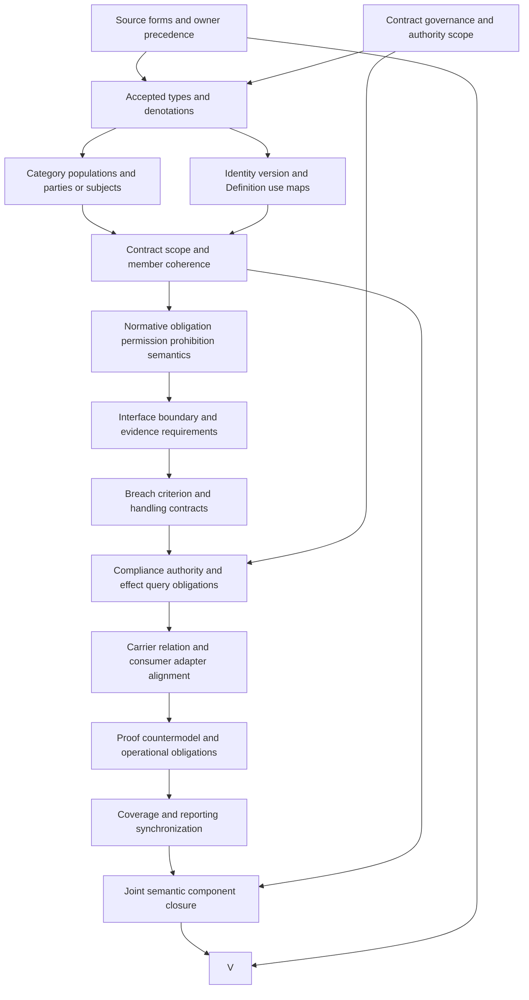

# Contract: definitions-first formalization review and completion DAG

This is a partial candidate interpretation of `cal.definition.contract@1.0.0-candidate.1`. It advances the requested priority of definitions, types and logical semantics. It does not establish compliance, permission grants, normative consistency, source-owner fidelity or complete translation. The formalization episode retains 183 current identities, 189 admitted source versions and 201 captured source files. The working inventory now contains 58 partial drafts, with 125 current identities still missing a per-definition draft. Source-owner whole-translation acceptance and whole-definition proofs remain zero.

## 1. Exact source selection and admission boundaries

The selected Contract Definition has SHA-256 `dd82c21d332c43d2d9fec50c61b33fa9b9e8751cf8763040cc8da25f680e1008`. C65 records admission of this exact immutable candidate and its current lookup selection. The source retains the original candidate language in its body. The formalization records both the admission overlay and retained body posture; it does not rewrite the source to make its historical statements look current. Definition admission identifies the selected meaning artifact, while acceptance of this new interpretation remains a separate decision.

The [source checks](source-checks.json) bind the exact live registry entry, C65 admission row, authorization-record bytes, candidate manifest, Definition/v1 schema, generator and source projection. Two pure renders reproduce the existing 4,476-byte projection, with SHA-256 `dc3cfa2fdb94aac7b7558a01b1e5fc9949671308e1ad72657545a298a97e0bda`. Their equality proves a bounded rendering observation and input preservation, not completeness of the mathematical translation.

The sole embedded historical source refers to the local integrated-model review as a whole file. Its current bytes match the recorded digest `1c92c720e176027597db09579276f9ea6e1d13b3d52bda233f9b0c4543dcb5eb`. Its embedded admission posture remains candidate-unadmitted, with no source-admission decision reference. The matching document is contextual evidence; it is not imported into the primary theory or authenticated as an independent authority by the matching hash.

**CTR-FINDING-012** remains open for exact source precedence, interpretation fidelity and common adapter acceptance. Its closure requires the source owner to review the translated and deferred obligations explicitly. Hash equality and a recorded Definition admission cannot serve as substitutes for that review or establish actual contract compliance.

## 2. Definition forms, statement roles and correspondence

The [correspondence packet](correspondence.json) inventories 21 source units and accounts for their characters through 25 mapped spans. Fifteen spans are encoded, six are explanatory and four are deferred. All normative text has a recorded disposition, including the authority nonentailment target. Complete character accounting is a traceability result. It does not turn a deferred clause into an accepted translation, nor make an explanatory example a normative assumption.

The candidate combines genus and differentia with an axiomatic or implicit specification. Genus markers identify a versioned governed statement with bounded scope. The specification constrains typed member categories and the proposed parties-or-subjects reading. A limited operational reading appears in exact-Definition-use guards. These guards describe admissible declared use; they do not execute a resolver, enforce a contract or perform breach handling.

The 15 encoded spans contain six distinct formula values assembled from nine primitive templates. Repeated statements retain separate selectors but do not count as independent axioms. Definitions introduce or characterize vocabulary; constraints restrict candidate models; query targets remain obligations to examine; actual observations retain their methods and scope. The selected source's artifact type, `definition`, does not by itself identify the logical role of every clause inside it.

**CTR-FINDING-001** concerns genus sufficiency and the governed identity-or-record interpretation. **CTR-FINDING-003** concerns the reading of the source's enumerated member categories as required populations. Neither is owner-accepted. A full translation must justify the cardinality and optionality of each category, explain the examples without introducing unintended restrictions, and preserve any still-unresolved source meaning with explicit residue.

## 3. Typed signature, namespaces and denotations

The [interpretation](t.json) declares 76 symbols: two nonempty sorts, two constants, five total functions, 57 unary predicates and ten binary relations. `Entity` represents candidate contracts, scopes, uses and declared members. `Token` represents version and Definition-reference tokens. `EMPTY` and `SELECTED_DEFINITION` are distinct declared constants in the supplied model. Functions map contracts to scope and version, and uses to a contract, scope and Definition token.

Nine membership relations connect a contract to an obligation, permission, prohibition, interface, boundary, evidence requirement, breach-handling declaration, party or subject. Each relation has a corresponding typed role. The tenth binary relation, `AdmittedSuccessorOf`, takes token arguments and represents a declared successor relationship to the selected Definition token. Sorting prevents a token from being used as a member entity without an explicit representation map, and prevents an entity from silently becoming a Definition token.

The [typed IR](static-ir.json) qualifies every symbol by exact source version and candidate scope. A Contract obligation is not automatically the same denotation as an Invariant, a Policy requirement or a typed-relation validator rule merely because they use related words. The independently selected comparison sources remain separate. Composition needs accepted carrier and identity maps rather than global unification by printed names.

**CTR-FINDING-002** covers the version and scope representation. Total functions express one declared reference per candidate entity, not actual resolution, availability or authority. A nonempty version token is not a semantic-version proof. Role markers are proposed types, not authenticated governance facts. A complete model must state token equality, function definedness, collection semantics, identity preservation and how each abstract denotation maps to an actual record.

## 4. Genus and governed identity-or-record

The proposed genus makes `Contract(c)` equivalent to three markers: `Versioned`, `GovernedStatement` and `BoundedScope`. Candidate metadata requires a nonempty contract-version token and a scope entity with the scope role. The explicit formal expression additionally requires a governed identity or a governed record. That disjunction is inclusive: one contract may be represented under both candidate markers. Neither marker proves an operational principal, role assignment, authorizing decision or current lifecycle.

The model distinguishes three issues that are often conflated. A source introduces the meaning of Contract. A governed statement records requirements under an identity or record. An operational system must determine what authority and evidence govern that record's use. The candidate formalizes the first two at an abstract level; actual governance resolution remains outside the primary theory. It does not derive operational authority merely because a statement is called governed.

The candidate does not introduce a global identity-version uniqueness theorem for Contract, because the selected source supplies no such explicit theorem. Existing record identity and revision semantics may impose their own rules, but those rules require separate alignment. This avoids importing a neighboring definition's uniqueness condition simply because the previous unit used one.

**CTR-FINDING-001** requires acceptance of both directions of the genus equivalence and of the identity-or-record disjunction. **CTR-FINDING-002** requires the version, record and scope denotations. Their completion should include real positive and negative cases, exact source-to-record maps, historical version handling and a clear separation between declared governance posture and independently established authority.

## 5. Obligations, permissions and prohibitions

The source names obligations, permissions and prohibitions as distinct content responsibilities. The candidate models each through a membership relation and role guard. If a contract declares an obligation member, that member must have the obligation role; the same pattern applies to permissions and prohibitions. Proposed coverage requires at least one declared member in each category. This is an owner-reviewable reading of the source enumeration, not a claim that every possible real contract must use every category.

Declared membership does not provide the semantics of obligation satisfaction, permission grants or prohibition enforcement. The theory has independent actual-outcome predicates for those facts, and the supplied base model makes all of them false while satisfying the candidate theory and required populations. This is deliberate: a requirement statement does not become a proof of its own satisfaction. A declared permission does not authenticate a principal's grant, and a prohibition does not show that all prohibited behavior was prevented.

The static fragment also does not reject an entity merely because it carries multiple normative roles. A positive control uses one member under both permission and prohibition roles. Determining whether that produces a contradiction requires action identity, scope, timing, parties, authority, exceptions and a chosen normative semantics. Declaring all role overlap inconsistent would add an unaccepted restriction and could misclassify conditional requirements.

**CTR-FINDING-005** therefore requires an explicit semantic extension for normative reasoning. The extension must distinguish required behavior from observed behavior, define conflict and precedence rules, and state the evidence needed for grants and enforcement. **CTR-FINDING-003** separately requires acceptance of category cardinality and optionality. Typed static structure alone establishes neither normative consistency nor compliance.

## 6. Interfaces, boundaries and evidence requirements

Interfaces, boundaries and evidence requirements are represented as three separate membership categories with corresponding role guards. They help make the source's distinct responsibilities reviewable. An interface declaration describes an interaction obligation; a boundary declaration scopes or separates permitted behavior; an evidence requirement describes what must support a claim. These candidate descriptions do not establish actual interface conformance, boundary enforcement or evidence sufficiency.

The candidate keeps evidence requirements separate from compliance evidence. A requirement can say which evidence is needed without supplying that evidence, authenticating its source or proving its adequacy. Conversely, an evidence reference in a carrier is not necessarily a typed requirement member. A common map must explain the relationship rather than equating those two fields through a shared word.

The actual Contract/v1 carrier has no explicit `interface_refs`, `boundary_refs` or `evidence_requirement_refs` fields in its closed payload. Its `scope_ref`, evidence list or neighboring records may participate in a fuller interpretation, but the current unit does not choose those maps automatically. Schema probes show that adding such fields directly is rejected. This is a representation gap to resolve, not proof that the Contract Definition is impossible or that the carrier should be modified without a reviewed design.

**CTR-FINDING-006** covers these denotations and mappings. Its completion needs accepted interface and boundary semantics, evidence requirement versus evidence-set distinctions, collection membership and applicability rules, and concrete carrier/consumer adapters. The formalization must retain each named responsibility even when the current representation lacks a direct field, and must avoid declaring an undocumented text field sufficient merely to make a compatibility check pass.

## 7. Parties or subjects and population policy

The selected source says “parties or subjects.” The candidate proposes an inclusive disjunction: each Contract has at least one party member or at least one subject member, and it may have both. The fixed supplied model contains three concrete examples: a parties-only contract, a subjects-only contract and a contract with both. Role guards check every member independently. This makes the proposed reading observable and allows explicit counterexamples when both populations are absent.

The current carrier instead requires both `party_refs` and `subject_refs`, and gives each a minimum length of one. A parties-only or subjects-only representation cannot pass that schema without adding extra content. Whether that stricter representation is an accepted carrier profile, a narrowing requiring explicit qualification or an incompatibility requiring revision remains a design question. A successful fixture containing both cannot settle it.

The candidate's combined example does not impose a universal requirement that every contract contain both. Likewise, the parties-only and subjects-only examples are required witnesses for this selected interpretation, not claims about exhaustive real-world contract classes. Population-removal controls preserve theory satisfaction while failing those chosen witness requirements, making the distinction between universal constraints and explicit existence obligations visible.

**CTR-FINDING-004** requires the source owner to accept the disjunction, role meanings and source-to-carrier relation. The review must distinguish parties from subjects, determine whether one entity can occupy both roles, and justify population cardinality and optionality under the declared scope. It must also specify how consumer profiles preserve the source meaning when a representation imposes stronger structural requirements.

## 8. Breach handling and contract boundaries

Breach handling is a declared member category in the candidate model. Its existence records a proposed handling responsibility without asserting that a breach occurred, was detected correctly or was handled successfully. The current payload contains a nonempty `breach_route` string. A route label may participate in a handling declaration, but it does not establish invocation, authority, availability, response quality, compensation or liveness.

Exact current primitive definitions for Breach and Challenge Route are unavailable in the selected inventory. The initial preflight exposed those missing labels before the unit was created. Their obligations remain explicit in the theory and review; no neighboring definition was substituted as an equivalent primitive. A separately selected Challenge Contract provides contextual material under its own meaning, which still requires an independent alignment map.

The source also states that Contract is neither its implementation, compliance evidence, Policy issuer nor proof that obligations were satisfied. Four role exclusions encode that proposed boundary for both contract entities and declared uses. These exclusions do not prevent an implementation or evidence artifact from referring to a contract; they prevent collapsing the meanings in the selected interpretation. An actual identity-separation theorem across all carriers remains unresolved.

**CTR-FINDING-007** concerns breach and handling semantics; **CTR-FINDING-008** concerns the excluded roles. Their completion requires a breach criterion, scope and timing, responsible authority, evidence standard, handling contract and relevant transition/trace guarantees. It also requires a source-owner-approved account of Policy issuer versus Policy content and of contract evidence versus the statement whose compliance it evaluates.

## 9. Definition-use guards and logical nonentailment

A declared Contract use must refer to a candidate Contract and name either the selected Definition token or a token declared as its admitted successor. It must use the same scope entity as its referenced contract and remain outside the four collapsed roles. Tests reject an unknown Definition token, a missing or reversed successor marker, a noncontract target and a scope mismatch even when both scope entities individually have valid roles.

These guards formalize source test conditions at the declaration level. They do not run an actual resolver, validate a real successor admission or prove that a consumer honors the scope. `AdmittedSuccessorOf` is a candidate relation whose actual denotation still needs evidence. Its name is not sufficient to establish admission. Actual resolver and consumer maps remain separate obligations under **CTR-FINDING-009**.

The exact formal source target `Contract(x) =/=> authority_effect(x).` is retained outside T as a [source query obligation](source-query-obligation.json). The candidate evaluates 26 actual-outcome targets, including authority, admission, satisfaction, grants, enforcement, breach execution, identity equivalence and external effects. Independently checked supplied countermodels satisfy the theory and required populations while making every corresponding universal target false. The conclusion is not added to the assumptions to prove itself.

Ten inference markers are forbidden for contracts and uses. Their prohibition is a candidate constraint, not a proof of actual consumer enforcement. The source supplies no extra assumptions, and the interpretation contains no assumption links. **CTR-FINDING-010** requires acceptance of the source target, its denotation and the scoped evidence strength. Countermodels support the selected static nonentailment observations; they do not establish universal compliance or a complete formalization of every authority effect.

## 10. Finite models, profiles and frame checks

The [model controls](model-controls.json) use a fixed carrier of 18 entities and seven tokens. They contain 115 actual controls: 40 satisfy the candidate theory, 68 violate it and seven malformed denotations are structurally rejected. Controls cover every genus marker, version/scope guards, governed identity-or-record, all member-role guards, category coverage, parties-or-subjects, exact and successor Definition uses, role collapse and prohibited inferences. Structural controls cover totality, sorting, arity, duplicate tuples and an empty token domain.

The fixed carrier and 16 required populations were retained across execution. Failed controls were not repaired by shrinking domains or deleting obligations. Theory satisfaction and required-population satisfaction are evaluated separately. Positive controls explicitly show that opaque version tokens, multiple members, overlapping normative roles and an independently declared actual outcome may be consistent with the candidate theory. Those results expose its claim ceiling rather than pretending that opaque tokens are resolved actual semantics.

The [profile evidence](authority-profile-checks.json) adds 27 hypothetical qualification profiles, of which 25 reject use, and 17 hypothetical frame checks, of which 14 reject. Their envelopes test contract identity, version, parties, subjects, scope, owner, revision, source epoch and breach route. Frames preserve the source envelope, allow independently evidenced grant hypotheses, and reject permission-to-grant inference, evidence or implementation collapse, breach-execution inference and unsupported effects.

These are calculations over authored hypotheses. They are not runtime observations. **CTR-FINDING-011** requires accepted mappings to actual carrier, normative and consumer semantics. A supplied finite model proves that its own interpreted clauses hold under the declared evaluation, while leaving source fidelity, universality and domain compliance pending. It is neither a proof certificate nor whole-definition acceptance.

## 11. Actual carrier, relation surface and compatibility gaps

The actual type registry has 143 rows and 121 admitted-current contracts. Contract/v1 is selected through C70 and binds the exact C65 Definition. Its retained descriptor body remains candidate-unadmitted, its fixture lifecycle is candidate, and both retain authority effect none. The candidate records these distinct postures instead of treating a body label or a registry overlay as the meaning of every other status.

Twenty-one selected catalog and representation checks pass. Fifty-five schema probes produce 16 acceptances; all five hostile fixtures reject. The closed schema has 14 required root fields and six required payload fields. Five payload lists are nonempty and unique, and breach handling is represented by a string route. The schema lacks an explicit instance-version field and the interface, boundary and evidence-requirement fields named by the source. It permits unresolved reference strings, empty evidence, an active lifecycle label and unsupported compliance-claim text. Such shape validity does not prove the corresponding facts.

The extracted pure `expected_roles` function reproduces four declared roles across three relation kinds. The relation schema accepts all 12 Cartesian combinations of relation kind, source/target direction and counterpart kind, while only four are role-eligible. The package-validator source contains a separate exact role-subset check, so schema acceptance alone is weaker than the declared validation contract. The package validator was not executed because it writes a receipt; only its selected pure role-calculation function and pure renderers were executed.

**CTR-FINDING-011** requires a common source/carrier/consumer map for these gaps, including the parties-or-subjects difference, missing version and content fields, exact relation eligibility and lifecycle meaning. Current Definition/v2 shape validation also exposes four metadata differences in the retained Definition/v1 source. That observation does not invalidate its exact source admission or authorize a silent migration.

## 12. Dependency closure and the detailed completion DAG

The candidate declares 29 exact semantic uses. Comparison sources include Definition, Governed Model, Policy, Challenge Contract, Evidence, Typed Relation, Capability Instance and Bounded Context. Their source versions remain independently qualified; no comparison theory is assembled into primary T. The [local dependency graph](dependency-graph.json) and [joint graph](current-dependency-graph.json) retain declared dependencies and unclassified semantic cycles. A missing counterpart or a cycle is an obligation to review, not permission to remove an inconvenient edge.

The original foundations-first plan remains unchanged: 121 tasks, 511 dependency edges, 797 SWUs and 36 frontiers. Its whole-family gates remain pending. The following execution DAG has 15 nodes and 18 edges. It schedules the work necessary to complete the Contract interpretation while preserving the larger episode. The execution graph is acyclic; the semantic dependency graph may contain unresolved strongly connected components that require a separate joint interpretation.

| Node | Required completion artifact and evidence |
| --- | --- |
| S | Exact source selection, clause forms, complete correspondence, source precedence and source-owner disposition for all twelve CTR findings. |
| A | Governed identity/record authority, operational owner scope, issuer separation and independent admission/effect boundaries. |
| T | Accepted carriers, function totality, version and Definition tokens, member-role denotations and qualified namespace maps. |
| P | Review 16 required populations and all 66 unresolved populations; accept cardinality/optionality and inclusive parties-or-subjects semantics. |
| I | Exact identity/revision/version maps, Definition resolution, successor-admission evidence and historical preservation rules. |
| C | Accepted scope applicability, excluded-role interpretation and member coherence without inferred actual compliance. |
| B | Explicit normative semantic extension, obligation satisfaction, permission grants, prohibition enforcement, conflict and exception rules. |
| H | Typed interfaces, boundary conditions and evidence requirements, with independent conformance and sufficiency evidence. |
| R | Breach detection criterion, evidence, owner route, authorized handling, transition/frame conditions and any required liveness proof. |
| E | Exact authority, compliance, success, identity-equivalence and external-effect targets with reviewed assumptions and countermodels. |
| Q | Common carrier and consumer adapters resolving missing fields, stronger party/subject cardinality and exact relation-role eligibility. |
| D | Independently replayed proof/check evidence for accepted clauses, populations, algorithms and adapters at their required strength. |
| F | Complete coverage, justified residue, source-fidelity decisions, receipts and updated reporting with no fabricated acceptance. |
| J | Accepted common semantics for every qualified dependency edge and classified recursive component; separate per-draft models are insufficient. |
| V | Complete Contract review covering accepted meaning, logic, typing, normative/operational extensions, adapters, joint closure and proof limits. |

Independent candidate drafting can proceed while owner decisions remain deferred. Acceptance follows the dependencies shown here, and cannot be inferred from generated files or green schema checks. V and the whole-family gates are not complete. The next per-definition priority is `F02-T.cal.definition.effect`, the next missing definition-theory unit in the existing manifest. Effect semantics will provide another exact source-bound responsibility for the remaining authority and runtime boundaries.

## 13. Reproducibility, preservation and remaining episode work

The [context pack](context.json) records the selected SWU, source bindings, A04/C01/E02 prerequisites, write scope, assumptions and nonblocking interpretation choices. It preserves all 4,591 prior candidate files and 201 captured source files. The work adds only this candidate unit. Definition admission, canonical records, type registries, live services, private external sources and unrelated work are not changed. The selected local integrated-review bytes are observed as contextual evidence under an explicit claim ceiling.

Two failed authoring attempts are retained. The first preflight requested unavailable Breach and Challenge Route primitive labels and failed before unit creation. The corrected dependency selection keeps those obligations explicit without substituting neighboring meanings. A later helper failed because the attempt directory's parent did not exist, and the follow-up builder failed because the helper had not created it. The exact helper and logs are retained; correcting directory creation did not remove clauses, shrink populations or change the intended theory.

Six fresh terminal checks cover the closed interpretation contract, model controls, source observations, qualification profiles, declared dependency compilation and the whole current inventory. Their outputs must reproduce the successful producer reports, reach exit zero and have empty stderr. The [receipt](receipt.json), [coverage row](coverage-row.json), [episode status](episode-status.json) and [delivery manifest](delivery-manifest.json) are created only after that evidence exists. A separate read-only audit then verifies the exact sealed file set and preservation hashes. No source-owner approval or universal theorem is simulated by those checks.

The episode remains active with 58 partial drafts and 125 current identities still missing drafts. All twelve CTR source-owner findings remain unresolved, and whole-definition acceptance and proof counts remain zero. Completing the requested episode still requires full source correspondence and justified residue across all current identities, preserved historical versions, accepted denotations and semantic extensions, dependency closure, actual adapters, independently replayed evidence and a complete final review of every formalization aspect. The definitions-first priority continues; carrier integration and actual effect claims depend on accepted meaning and appropriate evidence.
