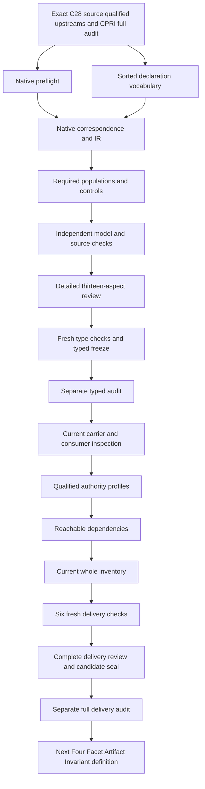

# Derived Refresh: types and logic review

This source-bound candidate interprets `cal.definition.derived-refresh@1.0.0-candidate.1`. It records necessary declarations for unchanged canonical input, exact generator bindings, noncanonical projection output, repeated-render parity, validation receipts and a separate tooling workflow. Source fidelity remains pending, semantic readiness is false, and neither a whole translation nor a whole-definition proof is accepted. The model is useful because it exposes conflations before implementation. Its declared reference functions do not execute a generator, calculate a digest, authenticate a receipt, adopt tooling or grant authority.

The preceding Canonical Representation Invariant full delivery sealed 8,024 candidate files and passed a separate actual audit. Native creation preserved those files, verified all 201 source files and matched the original work unit. There are now 91 native interpretation files against 183 current identities, with 92 still missing. The most recent complete inventory remains 90 partial drafts until the next whole inventory refresh. This stage preserves that distinction rather than presenting a working file count as completed episode coverage.

## 1. Exact source identity and admission overlay

The source SHA-256 is `f017c0403a46551ec8abfef4de24507a0ed42cc1b38acd54ec242683b89af171`. C28, `CAL-DECISION-0028-CRAFT-FOUNDATION-V1`, supplies the admitted-current Definition overlay. The checker binds the decision, exact authorization, selection token, manifest and bundle validation receipt. It verifies the admitted Definition path, version and digest. C28 records zero accepted implementation bindings and zero created bounded contexts. Therefore admission of the Definition does not establish that this candidate interpretation has been accepted, or that an operational refresh workflow exists.

The body remains candidate-authored and retains its own claim ceiling and residue. An admission overlay does not rewrite that body or clear a missing receipt contract. The embedded Definition candidate.1 and Bounded Context v2 candidate.1 references are selected by exact qualified version from current and historical snapshot entries. Their content digests are checked independently, and current versus historical posture is retained. Replacing either with the latest current identity would silently alter the source evidence. No external private source is introduced for this definition, and no admission decision or source file is changed.

## 2. Sorts, declarations and subject boundaries

The interpretation has 22 nonempty sorts, five constants, 88 total functions and 122 predicate or relation signatures, totaling 237 declarations. RefreshReference carries the modeled operation; InputReference carries the canonical input; GeneratorReference and GeneratorBindingReference separate a generator from its selected binding. ProjectionReference, ByteStateReference and DigestReference distinguish a resulting artifact reference, its declared content state and its digest reference. SemanticIdentity, VersionReference and TypeReference distinguish meaning, version and classification.

ValidationReceiptReference, ValidationContractReference and ParityResultReference give validation and parity separate typed carriers. ToolingChangeReference and ToolingWorkflowReference separate a generator change from its governing workflow. OwnerReference, SourceReference and ScopeReference identify responsible ownership, selected sources and applicability. EpochReference, RevisionReference and DecisionReference represent independent events whose creation cannot be attributed to a selected refresh. Token contains EMPTY, NONE, GENERATED_ONLY, MATCH and opaque nonempty handle values.

Nonempty sorts are supplied-model requirements, not assertions that a real generator, receipt, owner or decision exists. Total functions nominate fields; exact binding relations constrain all tuples over the supplied carrier domains. Opaque handles require nonempty declared references without authenticating their targets. Every symbol is qualified by source version and candidate scope. Same spelling in another theory is insufficient to establish shared denotation, and no whole prior theory is imported into this one.

## 3. Applicability and complete exact bindings

RefreshApplicable is equivalent to RefreshInScopeDeclared. Every selected refresh binds fifteen fields: input and input digest, generator and binding, generator identity and digest, output and output digest, parity, receipt, contract, owner, source, scope and effect. The scope equals CURRENT_SCOPE and the effect equals NONE. Its source is declared current and owner-approved. Each nominated reference is declared and nonempty, while every corresponding relation is equivalent to equality with that nominee over the supplied target domain.

This makes hidden alternatives observable. A selector returning one receipt is insufficient if the declared receipt relation contains a second incompatible value. Missing and conflicting tuples fail even when the nominated function remains total and well typed. The same exactness pattern covers five generator-binding fields, ten receipt fields, six parity fields and five tooling-change fields. Selected objects receive these obligations; outside references remain available to check that the theory has not accidentally prohibited unrelated work globally.

Scope completeness and owner fidelity remain open. The finite domain contains authored references, not an enumeration of every real repository refresh. Exactness over that domain therefore does not establish a complete operational record. A later consumer bridge must identify the actual selection rule, carrier values and authoritative current source that make these declared references meaningful.

## 4. Unchanged input bytes and digest equality

The input is declared canonical. Its before-state equals its after-state, its before-digest equals its after-digest, and the refresh records that input digest. Both digest references equal the declared stateDigest function for their corresponding byte-state references. The input source matches the refresh source. Meaning, type, version, byte states and digest references are independently declared and nonempty.

Byte-state equality is a separate obligation from digest equality. stateDigest is deliberately not declared injective: two distinct supplied states may have the same digest reference. The hostile control changes the input after-state to another state while coherently giving that state the original digest. The theory still fails because the state equality fails. This captures the source boundary that changed canonical machine bytes are outside Derived Refresh, even when digest labels happen to agree.

The model does not compute cryptographic digests or inspect real byte buffers. ByteStateReference equality itself still needs an accepted correspondence to actual content equality. InputBytesPreserved and InputDigestComputed remain separate outcome queries. Passing their declaration guards is useful structural evidence, but it cannot replace authentic capture of the input before and after a real execution, a defined digest algorithm and a verified content comparison.

## 5. Exact generator identity, version and code binding

The selected generator binding has exact generator, identity, digest, version and source fields. They match the refresh generator reference, generator semantic identity, code digest, generator version and refresh source. The code digest also equals the declared digest of the generator code-state reference. The generator code state and output type are declared and nonempty. This prevents a binding that names one generator but records another version or digest from satisfying the theory.

Two selected generators share a semantic identity while having different references, versions, code states and digests. They render different declared output states from the same unchanged canonical input. This demonstrates why generator change is a tooling matter even when canonical machine input has not changed. It does not force a semantic epoch or representation revision merely because output formatting differs between generator versions.

GeneratorBindingAuthenticity and GeneratorAdoption remain separate queries. The exact binding is a declaration map, not proof that the actual executable bytes match the named digest, that a current generator registry accepted the version, or that an owner authorized its use. Authentic executable selection, dependency pinning and adoption evidence belong to a subsequent implementation and governance bridge with its own concrete verification surface.

## 6. Generation relation and complete declared results

The nominated output must appear in GenerationDeclared for the selected generator and input. Its declared content state equals generatedState(generator,input), a total function of that pair. Every declared generated result for the same pair must also satisfy the projection structure and content-state equality. The theory therefore checks more than the nominated output: adding a hidden extra result with the wrong state fails even if the primary output remains unchanged.

Distinct ProjectionReference values may denote the same declared ByteStateReference. The main output and repeated output in the baseline have separate references but equal content states and digest references. Output-reference uniqueness is not imposed as a substitute for byte-identical repeated renders. The repeated-result population makes this distinction explicit, while its exact interpretation against the source equation remains an owner-review finding.

generatedState is a declared result function, not an invocation of the real Definition generator or any refresh renderer. Totality supplies a value for every finite pair, including unselected pairs; it does not prove termination or operational determinism. GeneratorExecution, Determinism, OutputCorrectness and ProjectionFreshness remain independent queries. The real execution universe, omitted run records and source-to-content correspondence must be established separately.

## 7. Noncanonical projection and meaning preservation

Every selected generated output is declared a projection, is not declared canonical and does not define canonical meaning. Its input and generator fields match the selected refresh. Its declared state and digest match generation, its meaning reference matches input meaning, its type matches generator output type, its authority effect equals NONE and its policy equals GENERATED_ONLY. These are separate obligations so that a correct state label cannot hide the wrong source, classification, policy or effect.

The hostile controls independently change projection input, generator, state, digest, meaning, type, effect and policy. Each fails. Claiming the selected output canonical or declaring that it defines canonical meaning also fails. The output is allowed to have a different type from the machine input, as a Markdown view can differ from a JSON source while referring to the same meaning.

Meaning-reference equality is not a proof that actual rendered prose preserves meaning. The correspondence from an output's bytes to its interpretation may be incomplete or wrong. SemanticPreservation and NoAuthorityEffect are therefore separate outcome targets. The source boundary that generated output cannot redefine canonical meaning remains a substantive obligation for the eventual renderer and consumer bridge, not a claim discharged by assigning matching opaque reference labels.

## 8. Repeated-render parity and computed evidence

Parity binds one refresh, first output, second output, first digest, second digest and a result token. The first output is the nominated refresh output. The second belongs to the same declared generation relation and satisfies the full projection structure. Their content states are equal; the parity digests match the output digests and each other; the result token is MATCH. Exact binding relations prevent a second conflicting parity value from being hidden behind a selector.

The baseline uses distinct output references for repeated renders. A coherent control makes the repeated output reference identical to the first for both refreshes. The primary theory still holds, while the required distinct-reference witness fails. This demonstrates the difference between a logical guard and the explicit inhabitation policy used to exercise it. Missing the second generation tuple, recording another generator's output or recording mismatched digests causes theory failure.

ParityComputation is unassumed. A MATCH token can describe an intended or supplied result without proving that two actual invocations occurred. Authentic parity evidence must bind the exact input capture, generator executable, two runs, their byte outputs and the computation or comparison used. The local model only checks that the supplied declaration record is coherent with its own selected references.

## 9. Validation contract and exact receipt structure

A selected validation receipt binds refresh, input, generator, output, contract, input digest, generator digest, output digest, parity and authority effect. Every endpoint and digest matches the refresh fields, and the contract source matches the refresh source. The receipt is declared valid. ValidationDeclared is equivalent, for the selected refresh and every supplied output/contract/receipt combination, to the exact nominated tuple. Hidden extra validation tuples and missing nominated tuples are visible failures.

The model intentionally separates a ValidationContractReference from a ValidationReceiptReference. A contract defines an expected validation surface; a receipt records the claimed application of that surface to a particular input and output. Neither reference authenticates the other. Wrong receipt endpoints, digest references, parity or effect fail the local theory even when their values remain inside the correct sorts.

Validation, ReceiptAuthenticity and ValidationContractAuthenticity are actual outcome queries. The source residue explicitly says the derived-refresh receipt contract is not yet authored. This interpretation supplies a typed candidate record shape for review; it does not invent a canonical receipt schema or a successful validator execution. Projection validation is evidence rather than approval, and an apparently valid record cannot grant tooling adoption, semantic revision or execution authority.

## 10. Refresh effects and independent governed events

No selected refresh creates a Semantic Epoch, Representation Revision or Governance Decision. CreatedEpochDeclared, CreatedRevisionDeclared and CreatedDecisionDeclared have no tuples for selected refreshes over their supplied event domains. Refresh and projection effects equal NONE. These statements are scoped to the refresh: they do not prohibit preexisting epochs, revisions or decisions, nor independently governed events outside refresh applicability.

The baseline contains existing epoch, revision and decision references and an outside refresh-like subject with an epoch creation tuple. Independent outside revision and decision creation controls also satisfy the primary theory. Adding any of those creation tuples to the selected main refresh fails. This prevents a global absence claim from replacing the source's narrower statement about what this operation creates.

The thirteen excluded inference predicates also prevent refresh declarations from implying approval, tooling authorization, generator adoption, semantic epochs, representation revisions, authentic receipt verification, computed parity, digest-based byte proof, rendering authority, schema-based formalization or publication. Independent actual outcomes remain permitted. The countermodels demonstrate nonentailment from the declarations, not real-world absence of independently supported authorization or decisions.

## 11. Separate tooling change and authorization

A selected tooling change binds distinct before and after generators, a workflow, an owner and a source. The workflow owner and source match the change fields, and the source is declared current and owner-approved. SeparateToolingWorkflowDeclared exactly matches the nominated workflow. Missing, conflicting or hidden workflow bindings fail; so do an unchanged generator reference, mismatched owner or mismatched source.

This workflow is separate from the selected refresh record. The baseline includes a tooling change from the main generator to the updated generator while both refreshes use unchanged input. The updated refresh also has an independently supplied ActualToolingAuthorization predicate. The main refresh has all actual outcomes false. Thus the theory permits independently supported tooling authorization while showing that a refresh declaration does not entail it.

The declared tooling workflow is not an authorization decision, a generator adoption event or an executed deployment. Its selection completeness remains owner-pending: a real generator change must be identified by the eventual carrier and connected to the proper governing workflow. ToolingAuthorization, GeneratorAdoption, Approval, Adoption, Promotion, Publication, Migration and Deployment remain separate queries. No real tooling decision or adoption is performed by creating this candidate evidence.

## 12. Source accounting, controls and retained failure

All 28 selected source-string units are exactly accounted: fifteen encoded clauses, eleven explanatory clauses and two deferred clauses. The normative statement retains all ten primitive formulas. Compact formal-expression and applicability guards are composed with it across selected clauses, avoiding repeated qualification expansion. Necessary boundaries and tests remain encoded. Twenty-two source and interpretation findings, 122 unresolved signature populations and eleven required populations stay explicit.

The verifier evaluates 203 authored controls: 36 satisfy the primary theory, 159 fail it and eight reject malformed model structures. The prepared evaluation observes at most 16,487 steps under the unchanged 100,000-step limit. Twenty-eight qualified nonentailment queries each use a freshly evaluated theory-and-population model in which the actual outcome target is false and the all-outcomes-false refresh witness is true. Fifty concrete source checks verify exact source, admission overlay, qualified upstream bytes, two identical 4,376-byte Definition projections and 28 source-query obligations.

The first native model attempt terminated with exit code one because the qualified IR exceeded the existing 50,000-node bound at 52,152 nodes. The whole failed native tree, original prepared producers and command captures were retained with exact file hashes. Reducing duplicate clause expansion produced a 44,216-node IR; the ten primitive normative formulas, all fifteen encoded spans, required populations and control set remain. The checker node, step and time limits were not raised. Current author, build, model and source producers all terminated zero, and the failed attempt remains part of the evidence rather than being overwritten. A subsequent fresh contract replay terminated with code two because indented input JSON was 1,272,040 bytes against the unchanged 1,000,000-byte input limit; the attempted typed freeze terminated one. Their captures, original model evidence and original input were retained under attempt002. Compaction produced 321,145 bytes with exactly equal parsed JSON values; the bound serialization-recovery record preserves both digests, the packer identity and the equality check. Model evidence was regenerated against the compact input bytes, with the logic and all control expectations unchanged. Neither native failure nor fresh-check failure is concealed.

## 13. Delivery DAG and episode continuation

This graph describes candidate delivery work, not the semantic dependency graph. Twenty-two qualified current identities supply related Definition, Artifact, representation invariant, projection, epoch, revision, decision, validation, receipt, provenance, source, schema, type, context, conformance, policy, authority, role and separation context. Missing generator, refresh-receipt, parity and tooling-workflow identities remain explicit labels, and GovernanceDecision is not silently invented from Decision.

The typed freeze binds sixteen inputs after three fresh checks, followed by an independent audit. Full delivery still requires current carrier/consumer observations, explicit unaccepted correspondence obligations, qualified profiles, static-only reuse checks, reachable dependencies, fresh evaluation of every supplied per-definition witness, six fresh checks, a complete review, an immutable seal and a separate full audit. Four Facet Artifact Invariant may receive a native theory only after this full audit succeeds.

The original episode remains 183 identities, 189 versions, 201 sources, 121 tasks, 511 planning edges, 797 small work units and 36 frontiers. This local stage does not shrink that objective. Accepted whole translations and whole proofs remain zero. The final episode review must explain definitions, types, logical guards, inhabitation, source correspondence, authority, consumers, dependencies and unresolved proof obligations across the entire scope.

### Unresolved source and interpretation findings

- DR-FINDING-001: Exact admitted-current C28 candidate.1 is selected;its candidate-authored body and Definition admission do not accept this translation.
- DR-FINDING-002: Normative complete guards and compact formal/applicability guards are composed across selected clauses to avoid repeated IR expansion;source precedence and whole meaning fidelity remain pending.
- DR-FINDING-003: Applicability selects purported Derived Refresh declarations;outside events may change canonical state or create independently governed revisions and decisions.
- DR-FINDING-004: Input byte-state equality and digest equality are distinct declarations;no hash computation,collision resistance or actual unchanged bytes is proved.
- DR-FINDING-005: Exact generator reference,identity,version,code-state and digest bindings are exposed;authentic current generator and actual adoption remain separate.
- DR-FINDING-006: DeterministicGenerate denotes a declared byte-state result function;it does not execute a renderer or establish actual deterministic behavior.
- DR-FINDING-007: Repeated output references may differ while their declared byte-state and digest agree;source output equality requires an accepted content/reference correspondence.
- DR-FINDING-008: Every declared generated result for a selected generator/input pair is constrained;actual output universe and omitted-run completeness remain pending.
- DR-FINDING-009: Generated output is declared noncanonical,generated-only and effect none;real projection classification and semantic preservation remain separate.
- DR-FINDING-010: Projection meaning equality records a source meaning reference map;it is not proof that rendered prose cannot alter actual interpretation.
- DR-FINDING-011: Parity links exact first/second outputs,digests and MATCH posture;actual computation and authentic parity evidence remain queries.
- DR-FINDING-012: Validation receipt binds refresh,input,generator,output,contract,digests,parity and effect;declared validity does not authenticate or run a validator.
- DR-FINDING-013: No selected refresh creates an epoch,revision or governance decision;existing independent objects and outside creations remain permitted.
- DR-FINDING-014: Generator changes have an exact separate declared tooling workflow and owner/source bindings;actual tooling authorization or adoption is not inferred.
- DR-FINDING-015: Different generator versions may render different outputs from unchanged input;this is not by itself a semantic epoch or machine representation revision.
- DR-FINDING-016: Source tests are necessary declaration guards with separate actual query obligations;real digest,parity,projection and validation computations remain unassumed.
- DR-FINDING-017: Embedded Definition candidate.1 and Bounded Context v2 references remain separately qualified exact versions,including current/historical posture.
- DR-FINDING-018: Definition,Context,index,reverse-map,generator and validator consumer correspondence is unaccepted;source labels do not establish live consumer execution.
- DR-FINDING-019: Derived-refresh receipt contract and source-owner admission residue remain explicit;no missing actual receipt is invented to pass checks.
- DR-FINDING-020: No whole prior CanonicalRepresentation,Artifact,Epoch,Revision,Decision,Validation,Provenance or Context theory is imported.
- DR-FINDING-021: Shared denotations,dependency cycles,source precedence,owner acceptance and whole-definition proof remain pending across the original episode.
- DR-FINDING-022: No actual projection refresh,canonical machine change,generator adoption,tooling decision,migration,publication or external effect is performed.
