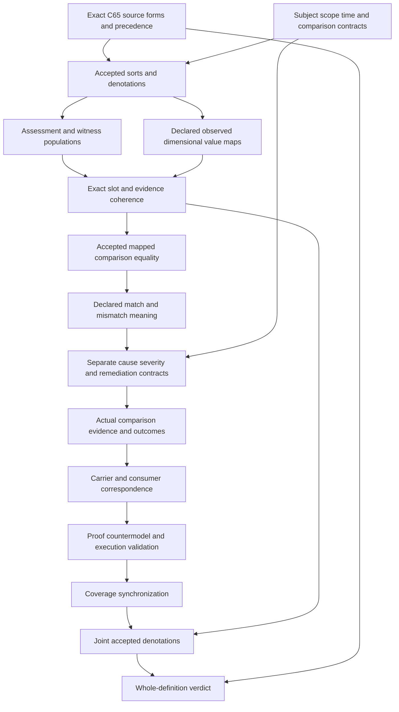

# Drift Assessment: types and logic review

Candidate delivery review. Author,builder,model,source,profile,dependency and inventory producers returned zero. All six independent read-only checks have terminal-zero results and empty stderr. Finalization and the separate sealed-file audit determine delivery completion. This packet grants no authority,source-owner acceptance,actual comparison validity or whole-definition proof.

## 1. Current source and historical source role

The current selected version is cal.definition.drift-assessment@1.0.0-candidate.1,SHAcf7809fb1928398ad77c3a43fef2f7d57ea8ae075c9c4e4fb0386e18c55aa707. C65 admits that exact Definition meaning and current registry selection. Candidate0013 retains its historical candidate-authored-owner-review-open body and authority effect none. C65's authorization binds the exact candidate and all sixty selected Definition digests. Its historical173current/179version registry postimage is not this episode's current183/189denominator.

The exact local learning-model review whole file is available at SHAe2fe199f3affffdc272d37bf59749b202884ea0e8fa8b48357e867c0962e2bf9. Both candidate and Definition source references retain candidate-unadmitted posture and null source admission. Exact byte recovery does not turn C65 Definition admission into a separate whole-source admission or owner acceptance of this proposed translation. The older table describes expected-versus-observed comparisons across five dimensions;the admitted Definition adds behavior and states declared-versus-observed,evidence bounds and exact time explicitly. DRIFT-FINDING-001 retains source precedence and fidelity.

## 2. Forms and source coverage

Twenty-one nonempty source units map to23exact spans:four encoded,six explanatory and thirteen deferred. Character accounting preserves every selected selector,offset,excerpt and digest. Four primitive templates appear through two unique encoded source formula values. The scientific normative statement is split at its first sentence:the evidence-bounded comparison characterization is encoded,while the mismatch-to-outcome boundary remains a deferred independent query obligation. The formal expression is similarly split between its necessary identity/scope guard and non-entailment of authority effect.

The first scientific boundary and applicability statement reuse the comparison guards. Plain-language,domain and notation ranges remain explanatory. Source testable conditions and claim ceiling remain observation-measurement clauses. Deferred ranges remain part of the denominator rather than disappearing from reported coverage. Complete string/character accounting is not a complete accepted semantic translation. Twenty-one exact source-query bindings retain five mismatch conclusions at four source ranges plus the formal authority boundary outside T.

## 3. Types before conclusions

There are82declarations:eleven sorts,seven constants,28total functions,33unary predicates and three binary relations. Sorts are Assessment,Subject,Scope,Time,Dimension,ComparisonSlot,Value,EvidenceSet,Evidence,Owner and Token. EMPTY is a Token constant;six dimension constants belong to Dimension. Twelve populations are required and36predicate/relation populations remain unresolved. The logic is sorted first-order with equality,without numerical severity,arithmetic,probability,temporal execution or causal inference.

An assessment is not its subject,evidence,owner or scope. A comparison slot is not its declared or observed value. A Time is not a timestamp reference Token or currentness verdict. A Dimension is not a lifecycle state or authority level. Literal current definitions named Comparison,Mismatch,Time and Version are absent. The proposed sorted carriers retain explicit interpretation obligations instead of inventing admitted source identities. DRIFT-FINDING-003 and DRIFT-FINDING-004 retain identity and type maps.

## 4. Declared assessment and bounded record

DriftAssessment is characterized as AssessmentRecordDeclared and ComparisonDeclared. This represents a candidate declared comparison record,not an actual verified mismatch or a failure verdict. Each selected assessment requires GovernedIdentityOrRecord,a declared Subject,bounded Scope,exact declared Time,Owner and EvidenceSet. Assessment,subject,scope,time,owner and evidence-set handles are nonempty. Separate total functions select each object. DRIFT-FINDING-002 retains the declared-versus-actual meaning of this relation.

Total functions still assign maps to objects outside the selected assessment population. Applicable guards prevent those placeholder maps from governing comparisons. A supplied outside record can change its unused slot time without producing a verdict. GovernedIdentityOrRecord is a source-required declaration guard,not a hidden proof that a principal has authority or that a current admitted instance exists. Real identity,ownership and bounded scope need separately accepted contracts and resolved artifacts.

## 5. Six comparison dimensions

Version,condition,binding,meaning,behavior and currentness have separate eligible Dimension constants. Each included comparison slot selects one Dimension,and both its declared and observed Value map to that exact Dimension. Nonempty value handles provide structural references without proving what the values mean. The model does not replace all six source dimensions with the carrier's two version-ref fields. DRIFT-FINDING-005 retains domain equality,dimension granularity and value denotations.

The baseline has examples for all six dimensions,including a matched condition and mismatches in other dimensions. An extra later comparison uses the same subject at a different declared time. Explicit populated examples do not require every real assessment to compare all six dimensions. No universal numerical distance,severity order,version ordering or semantic-equivalence algorithm is imposed. Distinct mapped Value objects can share a reference label;equal handle text alone does not collapse their denotations or supply identity authority.

## 6. Exact subject,scope and time

The selected EvidenceSet agrees exactly with its assessment's Subject,Scope and Time. Every included slot selects that exact assessment and agrees with its subject,scope and time. Its handle and both value handles are nonempty. Wrong-subject,wrong-scope and wrong-time substitutions falsify the proposed guard theory even if a copied label appears plausible. DRIFT-FINDING-006 retains accepted temporal and contextual maps.

ExactTimeDeclared is not an authenticated epoch,a clock source,a duration or a currentness proof. The theory does not parse an ISO timestamp or infer ordering from strings. It has no refresh operation or live producer lookup. A real comparison must resolve the source/time policy and comparison interval through accepted domain semantics. The required same-subject/different-time witness shows that the model can keep temporal selections separate;it does not prove that either time corresponds to a real observation.

## 7. Included slots and evidence bounds

Every selected assessment has an included ComparisonSlot. Every included slot has explicit declaration,subject/scope/time agreement,eligible dimension and declared/observed values. An included Evidence witness belongs to the assessment's selected EvidenceSet,bears on that slot,and matches the selected subject,scope and time. Its handle is nonempty. SlotIncluded,EvidenceMember and EvidenceBearsOnSlot are distinct binary relations.

Additional unrelated evidence cannot replace the selected matching witness. Removing membership,bearing-on relation,the evidence handle or subject/scope/time agreement falsifies T. An extra wrongly bound slot is also rejected. DRIFT-FINDING-007 retains accepted membership,reference resolution and actual adequate evidence. A declared included witness is not a verified source,measurement or causal explanation. The source's evidence-bounded responsibility needs a real evidence standard before actual drift validity or governing readiness can be reported.

## 8. Mismatch and mapped-value equality

For an included slot,MismatchDeclared is characterized by inequality of its selected declared and observed Value objects. Equal mapped values cannot retain a mismatch label,and unequal mapped values cannot silently lose that label in this proposed fragment. This is candidate mapped-value equality rather than a theorem about real semantic equivalence or measured behavior. DRIFT-FINDING-008 records equality,granularity and mismatch validity obligations.

ActualMismatchValidity remains an external target. The baseline satisfies all selected guards and required populations while this actual predicate is false. A matched comparison is still a DriftAssessment:the source describes assessment of a comparison rather than requiring every assessment to find drift. Removing the only matched example can leave T true while failing the explicit matched-witness requirement. That difference keeps witness policy separate from a universal assertion about actual drift records.

## 9. Cause,severity,failure and correction authority

Mismatch alone does not entail ActualCause,ActualSeverity,ActualFailure,ActualCorrectionAuthority or ActualRequiredRemediation. Each conclusion has a supplied T/I countermodel with a declared mismatch and the actual conclusion false. DRIFT-FINDING-009 retains these separate assessments and their evidence. The theory never infers that a discrepancy is critical,that an operation failed,that a fix is mandatory or that an actor may perform it.

Separate supported real-world conclusions may coexist with a comparison. Positive controls can turn an actual predicate on independently without T creating that outcome. Non-entailment is not a universal denial that cause,failure or authorized remediation could ever be established. Such a result needs its own exact subject,scope,evidence and authority contracts. This preserves a useful comparison record while preventing one mismatch flag from silently authorizing a downstream action.

## 10. Actual effects,consumer meaning and source fidelity

Twenty-one actual-outcome predicates cover mismatch validity,cause,severity,failure,correction authority,required remediation,identity equivalence,conformance,currentness authentication,evidence adequacy,semantic truth,admission,authority,success,publication,deployment,runtime execution,external effect,consumer alignment,owner fidelity and whole scope coverage. Six mismatch-specific queries supplement the21assessment-to-outcome queries. Every target stays outside T,and no query is introduced as an assumption.

A local hash match,nonempty handle or model inhabitant does not establish current consumer behavior. Admission of a meaning or carrier cannot discharge owner acceptance of this translation. DRIFT-FINDING-010 retains carrier correspondence,accepted common denotations,source-owner fidelity and whole proof. The proposed theory has no implicit source admission,principal grant,publication operation or execution mechanism. Source/shape observations and logical truth evaluation remain separate claims with separate evidence.

## 11. Executed bounded evidence and remaining carrier work

Seventy-four qualified,source-bound finite controls were evaluated:28satisfy T,39falsify T,and seven are malformed-model rejections. All27independent query targets have supplied T/I countermodels. Baseline domains contain eight Assessments,two Subjects,two Scopes,three Times,six Dimensions,eight ComparisonSlots,twelve Values,eight EvidenceSets,eight Evidence items,two Owners and three Tokens. Controls reject omitted declarations,wrong tuple maps,missing slots,wrong value dimensions,empty references,unsupported comparisons and mismatched equality labels. Required-population controls distinguish missing matched,currentness-dimension and later-time examples from violations of the universal guard theory.

Forty actual source observations bind C65,current registry,exact authorization,candidate0013 and the retained whole learning-model review file. Two pure renders match the exact4,543byte Definition projection,SHAbd171f53a693f7433fc3c90bd80f41aba06ec6b776fa0fad47cde6e1e06e810b. Thirty-three qualified dependency identities exist,and twelve comparison sources are kept separate rather than composed into this primary T.

The prior Conformance preparation retained scratch primitive controls and bounded C70 schema/pure-role observations. A direct admitted Drift Assessment/v1 carrier exists and binds this current Definition. Its body remains historically candidate-unadmitted/none. Scratch probes observed132schema-valid relation combinations,of which12belong to the exact declared role surface and120do not. Empty evidence arrays,whitespace comparison time and overclaimed cause/severity or authority labels can satisfy shape. These preparation observations are distinct from this packet's pending current carrier/profile check and do not prove semantic alignment. The canonical package validator writes a receipt and has not been executed here;any future bounded execution needs explicit candidate capture of that writer. Pure AST role observation remains available without invoking the writer.

Twenty-nine qualified binding profiles retain identity,kind,carrier,source,subject,scope,time,dimension,declared and observed values,evidence membership,assessment owner and relation roles. Twenty-seven reject changed bindings or unsupported downstream inferences. Fifty-five finite comparison frames have44rejections and11acceptances. These authored hypotheses include all six dimensions,matched assessments,plural slots,unrelated evidence alongside a valid witness,and objects outside selected assessment scope. They reject wrong subject/scope/time maps,missing declarations or handles,mislabeled inequality,unmapped dimensions and absent matching evidence. Actual execution,drift validity,cause,severity and authority verification remain false.

Eighteen actual catalog/source/shape observations inspect143contract rows and121admitted-current rows. The current Drift Assessment/v1 carrier is admitted under C70 and directly binds this exact current C65 Definition. Its retained body still says candidate-unadmitted with authority effect none. Those historical bytes are not rewritten to imitate the current admission overlay. Generic Definition/v2 separately binds current Definition@1. The Drift carrier's closed schema requires14root and9payload fields;its schema and artifact digests match the current registry and its selected Definition binding. A direct carrier exists here,unlike Conformance's direct-carrier gap.

Thirty executed Definition/v1 probes have five acceptances. Forty-seven direct Drift carrier probes have fourteen acceptances. Missing root/payload fields,extra implicit authority fields,a governing authority effect,collapsed neighboring kind and empty relation array are rejected. Unresolved subject/version/time labels,empty mismatch/evidence arrays,whitespace comparison time,an active lifecycle label and overclaimed cause,severity or claim ceiling can remain shape-valid. Such acceptance establishes a property of the selected representation. It does not resolve evidence,prove currentness,authenticate a time,or accept a causal assessment or correction authority. The current type's admission likewise cannot create an admitted instance from a hypothetical payload.

The pure AST-extracted roles_for function computes the exact role surface from the bound relation model. All132enum-product relation combinations satisfy the selected schema,while12belong to the declared role surface and120do not. The full denominator is retained rather than reporting only the valid fixture or one handpicked invalid case. Shape validity is therefore insufficient for role membership. A prospective consumer must perform the exact role check and resolve the referenced Typed Relation identity under its separate contract. This observation does not admit a relation or demonstrate any live consumer's behavior.

Two pure artifact renders match the bound ARTIFACT.md projection,and two pure fixture renders match the selected RECORD.md projection. The original pure generator bytes are bound to the artifact's recorded digest. No canonical package validator,carrier receipt writer,instance writer,native or live consumer,new authority or governing outcome executes. The source-level Definition renderer and these pure carrier projection functions are distinct checks;successful generation cannot discharge semantic owner or execution obligations.

The remaining owner decisions must accept how real subjects,scopes,times and dimensional values map into these sorts. They must specify comparison equality and granularity,evidence membership and bearing-on semantics,which temporal references are adequate,and which independent standards establish an actual cause,severity or failure. A general endorsement of the word drift cannot satisfy those exact contracts. Every review must name the selected source/interpretation versions,scope,known losses and residue. The source-owner verdict must resolve current C65 meaning versus the historical learning-model source while preserving the separate admission boundaries. Carrier and consumer owners must also establish correspondence without importing shape-valid placeholder labels as actual proof.

A supplied model establishes inhabitation of this qualified finite fragment when both T and the required populations hold. It does not establish common meanings across the dependency graph. Removing a matched or later-time example can leave the universal guards true while failing the explicit witness policy. Countermodels to actual-outcome queries establish non-entailment for this fragment rather than ruling out separately supported real-world outcomes. Those distinctions remain part of the completion DAG and eventual episode review.

## 12. Completion DAG

Fifteen nodes and eighteen directed edges describe the remaining work products. Source/context precede accepted types. Populations and exact value maps precede evidence coherence,comparison equality and mismatch interpretation. Actual downstream conclusions and carrier/consumer correspondence precede proof or execution verdicts. Coverage synchronization and accepted common meanings precede a whole-definition verdict. This acyclic planning graph is distinct from the unresolved cycles in the semantic dependency graph.

## 13. Preservation and continuation

Conformance's six-check replay,finalizer and separate audit passed before this packet was created. This unit preserves all5,544files from its seal and201selected source files. Preflight verified exact current source,output absence,SWU write scope and A04/C01/E02 receipt bindings. Author,build,model,source,profile,dependency and inventory producers have actual terminal-zero results. Contract,model,source,profile,dependency and inventory each have a separately recorded fresh terminal-zero replay with empty stderr. Frozen typed-stage REVIEW.md and CONTINUATION.md stay exact receipt inputs rather than being rewritten after later outcomes.

The current inventory has68partial drafts and115missing current identities. It records1553source units,2073mapped spans,645encoded,545explanatory and883deferred clauses,765required and2978unresolved populations. Each draft has one independently evaluated supplied T/I witness. The local declared graph has129nodes,1593edges and62missing counterpart packets. The joint graph has130nodes,1627edges and62missing counterparts. Unresolved cycle component sizes are[67]. Its edge delta adds exactly33declared Drift Assessment uses. Prior source identities stay preserved,and newly reachable identities enlarge the missing denominator where their packets are absent.

The complete scope remains183currentidentities189admittedversions201sources121tasks511edges797SWUs36frontiers. Source-owner-accepted whole translations and whole-definition proofs remain zero. No semantic cycle classification,accepted common-carrier consistency or joint closure is inferred from supplied individual models. Candidate sealing records bounded verification and preservation;it does not convert an earlier partial translation into owner acceptance. Receipt and separate audit are the exact delivery evidence. The historical eight-draft I04 inventory stays unchanged and requires its own scoped reporting update. No failed producer attempt is concealed;actual terminal results are recorded separately from planned or scratch checks.

Continue F03-T.cal.definition.evaluation,then Evidence and EvidenceSet,with types and logic first. Evaluation applies an exact current profile to exact subject and input state,collects every declared outcome,and preserves causal NOT_EVALUABLE blockers without creating authority. C13's exact admitted evaluation-profile record is separate from its retained candidate body and the current C29 Evaluation Definition. Independent typed work can proceed while owner fidelity,accepted joint meanings,whole proof and the final episode review remain incomplete. Keep the original full goal intact and preserve unrelated dirty,canonical,private and runtime state.
