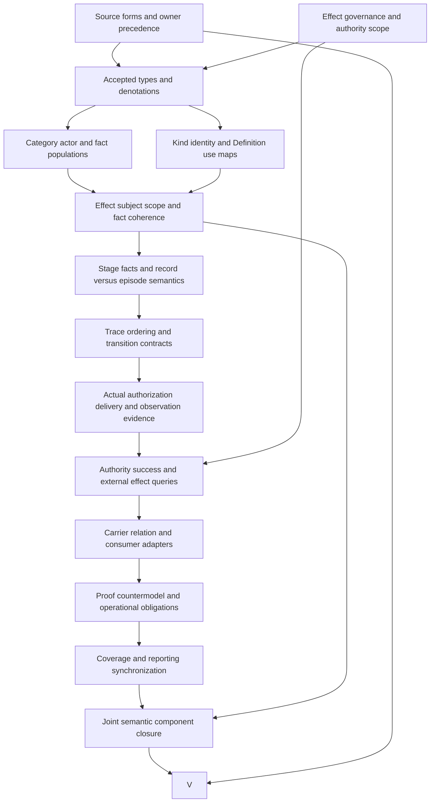

# Effect: definitions-first formalization review and completion DAG

This is a partial candidate interpretation of `cal.definition.effect@1.0.0-candidate.1`. It advances the requested priority of definitions, types and logical semantics. It distinguishes declared effects from actual changes and separates declaration, authorization, attempt, delivery and observation. Source-owner acceptance, actual stage evidence, temporal semantics and whole-definition proof remain pending. The episode retains 183 current identities, 189 admitted source versions and 201 captured source files. This unit brings the working inventory to 59 partial drafts, leaving 124 current identities without a per-definition draft. Whole-translation acceptance and whole-definition proofs remain zero.

## 1. Exact source, versions and admission boundaries

The selected Effect Definition has SHA-256 `f6d1e16142583a10b039890409b494338b5879cac63da31cab75d633667a08c1`. C65 admits this exact immutable candidate and selects it through the current Definition registry. Its retained body still contains its historical candidate posture. The interpretation records the registry overlay and source body separately; it does not rewrite historical bytes or treat Definition admission as acceptance of this new mathematical interpretation.

The [source checks](source-checks.json) bind the live registry row, C65 admission entry, authorization-record bytes, selected manifest, Definition/v1 schema and projection inputs. Fourteen selected observations pass. Two pure renders reproduce the existing 4,415-byte source projection, with digest `927fe16488a1ff6c0ab96e8864b9a8fd7368f44dc43abb9cfe7c8e3c700c087c`. Rendering equality establishes reproducibility under these inputs; it does not establish the truth or completeness of the proposed semantics.

The embedded contextual source is the integrated-model review as a whole file. Current local bytes match its historical digest `1c92c720e176027597db09579276f9ea6e1d13b3d52bda233f9b0c4543dcb5eb`. Its embedded source-admission posture remains candidate-unadmitted with no admission decision reference. Matching bytes make the comparison available for review without importing the document into primary T or giving it authority over an admitted Definition.

**EFT-FINDING-012** requires source-owner disposition of precedence, interpretation fidelity and common adapter acceptance. Exact hashes and admission records support source selection, while the owner must still decide whether the translated, explanatory and deferred obligations preserve the selected meaning. No actual authorization or delivery follows from the admission of the term Effect.

## 2. Definition forms and complete correspondence

The [correspondence packet](correspondence.json) inventories 21 source units and accounts for their characters through 25 mapped spans. Fifteen spans are encoded, six explanatory and four deferred. Complete character accounting means each source statement has a recorded disposition. It does not erase deferred meaning or make an illustrative example a new universal requirement. The authority nonentailment target remains an explicit query obligation outside T.

The interpretation combines genus and differentia with an axiomatic specification. Genus markers characterize a declared change under bounded scope. Change categories distinguish state, rights, obligations, external conditions and interpretations. Additional clauses constrain kind metadata, governed identity or record, actor links, scoped fact records and exact Definition use. These are proposed static denotations. An operational extension would separately define traces, authorizing transitions, evidence and actual outcomes.

The 15 encoded spans contain six distinct formula values assembled from ten primitive templates. Repeated source formulations retain their own selectors and accountability while sharing a formula value. The source artifact being a Definition does not make each of its clauses a definition in the logical sense: characterization, constraint, example, query and use condition need separate roles and evidence ceilings.

**EFT-FINDING-001** concerns genus sufficiency and the category disjunction. **EFT-FINDING-006** concerns proposed fact granularity. A full translation must justify both directions of every characterization, preserve the source's distinction between facts and outcomes, and state the residue wherever the selected static fragment cannot represent the intended semantics. Source-owner review remains pending for all twelve findings.

## 3. Typed signature and qualified denotations

The [interpretation](t.json) declares 81 symbols: two sorts, two constants, nine total functions, 63 unary predicates and five binary relations. `Entity` contains candidate effects, metadata, actors, fact records and uses. `Token` contains kind identities and Definition-reference tokens. The constants `EMPTY` and `SELECTED_DEFINITION` have distinct declared denotations in the supplied model. Nonempty token guards constrain a representation without proving real resolution or identity.

Seven functions take entity arguments: effect kind, subject and scope; fact effect and scope; and use effect and scope. Two functions map kind metadata or a declared use to a token. Four binary relations connect actors to effects by intention, authorization, recording or observation. The fifth is the token-level `AdmittedSuccessorOf` relation. Sorting rejects entity/token substitution and ill-shaped relation tuples before evaluating theory truth.

The [typed IR](static-ir.json) qualifies symbols by exact source version and candidate scope. `ActionRole` in this packet is a proposed local denotation; it is not silently equated with the independently qualified Agent Action Definition. The same discipline applies to Decision, Authority, Contract, state changes and evidence. Shared terminology does not establish equal carriers, identities, meanings or authority.

**EFT-FINDING-002** covers kind, subject and scope functions and their roles. **EFT-FINDING-004** covers actor denotations. Actual maps need definedness, identity and version rules, accepted source-to-carrier representations and independent authority evidence. Totality in a finite mathematical model establishes a total declared function on that model's domain; it does not prove a production resolver is total, available or authorized.

## 4. Genus, change categories and governance

The candidate makes `Effect(e)` equivalent to declared change, bounded scope and at least one of five category markers: governed state, rights, obligations, external condition or interpretation change. The category connective is an inclusive disjunction. An effect may carry more than one category; the theory does not require every effect to change all five categories or reject a mixed classification merely because two categories overlap.

These markers describe a declared change. Actual changed-state and changed-rights predicates remain independent targets. A record can declare an intended change while no corresponding actual change has occurred. Defining Effect through actual delivery would erase the source's distinction between declaration, authorization, attempt, delivery and observation and could prevent representation of failed or unexecuted intentions.

The formal source requires a governed identity or governed record together with bounded scope. The candidate uses an inclusive identity-or-record disjunction. Either proposed marker suffices, and both can hold together. Neither authenticates a governance principal, rights issuer, lifecycle transition, relation admission or evidence sufficiency. Actual governance and authority require separately accepted maps and checks.

**EFT-FINDING-001** requires acceptance of the genus equivalence and category interpretation. **EFT-FINDING-003** requires acceptance of governed identity-or-record. Exact primitive Definitions for Governed State, Rights, Obligations, External Condition and Interpretation are unavailable in the selected inventory. Their local roles retain obligations for review without claiming equivalent neighboring meanings or deleting distinctions to make closure easier.

## 5. Exact kind, subject and scope metadata

Each candidate Effect maps to an entity carrying the Effect Kind role, whose kind-identity token must be nonempty. It also maps to a subject-role entity and a scope-role entity. This gives the proposed effect declaration a definite kind and bounded referents inside the supplied interpretation. It does not establish a real kind registry, admitted version, resolver result or interpretation of the kind's actual state transition.

An exact kind in the source needs more than a nonempty label in an artifact. The current carrier's `effect_kind` is an unconstrained nonempty string. Distinct labels could denote the same intended transition, and an apparently plausible label could name no registered kind. The candidate therefore keeps kind resolution, subject resolution and scope resolution as separate actual-outcome targets rather than deriving them from metadata shape.

Scope equality is entity equality under the candidate denotation. It checks coherence between an effect, a fact record and a declared use. It does not prove that the actual scope includes all relevant principals, resources, versions, jurisdictions or runtime boundaries. Opaque reference strings require a reviewed resolver and identity map before they can substantiate real scope compatibility.

**EFT-FINDING-002** requires the exact kind, subject and scope denotations. **EFT-FINDING-011** requires their actual carrier and consumer adapters. Effect Kind is an unavailable exact primitive in this inventory. The completion design must preserve the source's exactness requirement while documenting versions, kind identity, permissible transitions and the evidence standard for interpreting a declared result as an actual change.

## 6. Decision or Action and four actor links

Every candidate Effect must have an actor carrying Decision or Action role that links to it through intention, authorization, recording or observation. Both disjunctions are inclusive. A single actor can carry both roles, and it may connect through multiple verbs. Conversely, each actor link requires its target to be an Effect and its source to carry at least one allowed actor role.

The four links represent declared relationships in this static interpretation. An `ActorAuthorizes` tuple is not independently verified authorization, and an `ActorObserves` tuple is not a validated observation. Conflating a tuple name with an actual evidentiary result would introduce exactly the authority and success inferences the source excludes. Actor provenance, authority boundary and evidence remain unresolved semantic obligations.

Action is not an exact current primitive available in the selected inventory. Agent Action is a separate qualified comparison source and remains distinct. The current Effect/v1 carrier's relation surface permits only a Decision counterpart, so it provides no accepted direct representation for every Action case allowed by the Definition. This is an explicit mapping question for owner and carrier review.

**EFT-FINDING-004** covers actor role meanings and the Decision-or-Action disjunction. **EFT-FINDING-005** covers verb links and their actual provenance. Completion must distinguish a decision that authorizes a change, an action that attempts it, a record that describes it and evidence that observes it. The candidate does not collapse those responsibilities through a convenient shared reference.

## 7. Five scoped facts and record-level independence

Five predicates classify candidate fact records: declared, authorized, attempted, delivered and observed. Each classification requires an Effect Fact role. Every such fact refers to an Effect, carries a scope role and uses the same scope entity as its referenced effect. This proposes an explicit carrier for each fact classification while retaining the source's statement that these are separate facts.

Separation is not modeled as mutual exclusion. The supplied model contains five singleton stage records and one record carrying all five classifications. Overlap is permitted because the source does not prescribe unique records or a disjoint stage encoding. The candidate also does not impose temporal ordering, prerequisite transitions or a universal implication from delivery to authorization.

Twenty directional query targets ask whether one stage classification on a qualified fact record entails another classification on that same record. All remain outside T. Supplied countermodels show the stronger same-record target fails under the candidate theory and required populations. This observation is explicitly local to one record; an authorization could exist on a different record in the same episode.

**EFT-FINDING-006** requires acceptance of fact identity, scope and granularity. **EFT-FINDING-007** requires review of the twenty targets and overlap allowance. Record-level countermodels do not prove whole-effect or whole-episode independence, absence of an authorization event elsewhere, temporal reorderability, or independence of actual delivery from actual authorization. Those stronger claims require trace semantics, event identity, temporal relations and accepted operational assumptions.

## 8. Declared changes versus actual outcomes

The interpretation keeps 27 actual-outcome predicates outside its defining theory. They cover actual stage evidence, changed state or rights, resolved metadata, governance, successor admission, temporal order, owner acceptance and effects such as authority, deployment or external change. A base model satisfies candidate T and all required populations with every actual-outcome predicate false. The resulting observations expose the gap between declared structure and actual accomplishment.

Fourteen inference markers are forbidden on candidate effects, fact records and uses. These include admission, authority, success, identity equivalence, relation and runtime effects, plus stage-transition inference and convenient promotion from declaration to authorization, authorization to delivery, or attempt to observation. Their exclusion constrains the candidate markers; it is not evidence that an actual consumer enforces the same separation.

The explanatory example says an admit effect changes a Definition's lifecycle when the authorized registry postimage is written and validated. It remains explanatory. The example points to concrete operational obligations: an exact preimage/postimage, authority scope, write atomicity, validation and evidence. The unit does not execute a registry change, claim a lifecycle transition or import the example as a universal transition rule.

**EFT-FINDING-008** covers actual outcomes and provenance. **EFT-FINDING-010** covers authority nonentailment and inference boundaries. A completed operational extension must identify which evidence establishes each fact, distinguish attempted from delivered behavior, account for failures and partial writes, and state any required safety or liveness properties. Static classification and evidence-reference strings cannot discharge those obligations.

## 9. Exact Definition use and logical query discipline

A declared Effect use must refer to a candidate Effect and name either the selected Definition token or a token declared as its admitted successor. Its scope must match the referenced effect. The model rejects unknown Definition tokens, missing or reversed successor markers, non-Effect targets and scope mismatch. Each check exercises a declared use condition rather than running an actual Definition resolver.

`AdmittedSuccessorOf` is a token relation in the candidate model. Its printed name does not authenticate a real admission. Accepted successor use needs exact version selection, admission evidence, historical preservation and a consumer map. Actual successor admission verification remains one of the independent targets. **EFT-FINDING-009** retains these obligations without treating the abstract relation as operational evidence.

The source target `Effect(x) =/=> authority_effect(x).` is retained in the [source query obligation](source-query-obligation.json). It remains outside T, so the conclusion is not assumed to demonstrate itself. The [query policy](query-policy.json) records 47 external targets: 27 actual-outcome implications and 20 directional same-record stage implications. Each supplied countermodel is evaluated against T and required populations and checks that the target is false under its stated witness condition.

**EFT-FINDING-010** requires acceptance of target denotations, source fidelity and evidence strength. The interpretation has no imported assumptions or assumption links. Countermodels support nonentailment for this selected partial semantics. They cannot establish a stronger claim under unreviewed temporal, deontic, consumer or joint semantics, and their local qualifiers remain essential to a faithful report.

## 10. Finite models, population policy and hypothetical frames

The [model controls](model-controls.json) use 21 Entity denotations and six Token denotations. There are 134 actual controls: 46 satisfy T, 81 violate T and seven malformed models are structurally rejected. Controls cover genus and categories, kind/subject/scope metadata, governed identity-or-record, actor roles and links, fact scope, all five stage guards, exact Definition use and fourteen prohibited inference markers across three kinds of subject.

The interpretation has 43 required populations and 67 unresolved populations. Required witnesses include each change category, both governance alternatives, both actor alternatives, each verb, every stage, twenty directional stage witnesses, all-stage overlap and exact/successor uses. Theory satisfaction and population satisfaction are evaluated separately. Removing a singleton stage witness can preserve T while failing a chosen existence obligation; that distinction is part of the evidence.

The [profile evidence](authority-profile-checks.json) contains 27 hypothetical qualification profiles, of which 25 reject, and 21 hypothetical frame checks, of which 16 reject. Five positive frames exercise declaration alone, attempt alone and independently evidenced authorization, delivery or observation hypotheses. Rejections cover changed source envelopes, unsupported requested outcomes and prohibited authority, identity or stage inferences.

These frames evaluate authored hypotheses, not actual executions. **EFT-FINDING-011** requires mapping them to real consumers and evidence. Finite results substantiate the stated calculations over declared carriers and denotations. They do not constitute enumeration of all possible models, source-owner fidelity, a universal theorem, runtime enforcement or whole-definition proof. Domains and obligations remain fixed through execution, and malformed controls are reported separately from semantic rejection.

## 11. Actual Effect carrier and compatibility gaps

The actual type registry contains 143 rows and 121 admitted-current type contracts. Effect/v1 is selected through C70 and binds the exact C65 Definition. Its retained descriptor body remains candidate-unadmitted, its valid fixture lifecycle is candidate, and authority effect remains none. The selected schema has 14 required root fields and five required payload fields: kind, subject, intended state, effective condition and verification references.

Twenty-one selected catalog and representation observations pass. Fifty-five schema probes yield 17 acceptances, and all five hostile fixtures reject. Kind, subject, intended state and effective condition are nonempty strings; verification references form a nonempty unique list. The schema accepts unresolved strings, arbitrary kind labels, an uninterpreted condition, empty evidence and overclaimed delivery text. Shape validity therefore does not establish kind resolution, condition evaluation or actual delivery.

The closed payload has no explicit declaration, authorization, attempt, delivery or observation records, and rejects added stage fields. A completed adapter must explain whether other records supply those facts, how their identities and scopes align and which evidence validates them. The pure renderers preserve the supplied fixture and metadata without creating materialized artifacts. Their execution does not evaluate the purported effective condition.

The extracted pure `expected_roles` function yields one eligible triple: `relation.declares-effect-on`, target direction, Decision counterpart. The schema permits that same single combination. Action and Agent Action counterparts reject. The package validator contains a separate exact role-subset check and writes a receipt; its full writer was not executed. **EFT-FINDING-011** covers this source/carrier Action gap and missing stage maps. Four current Definition/v2 shape differences in the retained Definition/v1 source do not invalidate its exact C65 admission or authorize a migration.

## 12. Dependency closure and detailed completion DAG

The candidate declares 31 exact semantic uses. Eight independently qualified comparisons include Definition, Governed Model, Decision, Agent Action, Contract, Authority, Typed Relation and Project State. No comparison is assembled into primary T. The [local graph](dependency-graph.json) and [joint graph](current-dependency-graph.json) each contain 119 nodes and 1,318 declared edges, with 60 missing counterpart packets. One unclassified recursive component contains 59 members and 873 internal edges. These are declared dependency observations, not accepted common semantics.

The original foundations-first plan remains intact: 121 tasks, 511 edges, 797 SWUs and 36 frontiers. Its whole-family gates remain pending. The execution DAG below schedules 15 completion nodes through 18 edges. It is acyclic even though semantic dependencies contain unresolved recursion. Owner acceptance, trace semantics and common maps belong in completion artifacts; another separate finite model cannot discharge them.

| Node | Completion artifact and required evidence |
| --- | --- |
| S | Exact source selection, definition forms, complete correspondence and owner dispositions for all twelve EFT findings. |
| A | Accepted governance, actor authority, owner scope and independent admission/effect boundaries. |
| T | Accepted carriers, role denotations, totality, token equality and qualified source maps. |
| P | Disposition of 43 required and 67 unresolved populations, inclusive categories and actor roles, and witness coverage. |
| I | Exact kind registry and versions, subject identity, Definition resolver and independently evidenced successor admission. |
| C | Accepted effect/subject/scope coherence, fact identity and use applicability without inferred actual outcomes. |
| B | Explicit record, event and episode granularity; overlap semantics and correctly scoped stage nonentailment targets. |
| H | Trace identity, temporal order, prerequisites, permitted transitions, failures and any required safety/liveness contract. |
| R | Separate actual authorization, attempt, delivery and observation evidence, including atomicity and provenance where needed. |
| E | Reviewed authority, success, identity-equivalence and external-change targets with explicit assumptions and countermodels. |
| Q | Actual kind/condition/stage adapters, Action compatibility, exact relation roles and consumer enforcement maps. |
| D | Independently replayed evidence at the required strength for accepted static, operational and adapter obligations. |
| F | Full coverage, justified residue, fidelity decisions, receipts and synchronized reporting without fabricated acceptance. |
| J | Accepted common semantics for every dependency edge and classified recursive component. |
| V | Complete Effect review explaining definition forms, typing, logic, stage/trace semantics, actual maps and proof limits. |

Independent candidate drafting continues while source-owner decisions remain deferred. Acceptance follows these dependencies. The next existing manifest priority is `F02-T.cal.definition.exact-publication-authorization-invariant`. V and the whole-family gates remain unfinished; this DAG makes the remaining work reviewable without promoting a draft to accepted meaning.

## 13. Reproducibility, preservation and episode completion

The [context pack](context.json) records the selected SWU, exact sources, A04/C01/E02 prerequisite receipts, write scope and nonblocking interpretation choices. All 4,662 prior candidate files and 201 captured source files remain hash-bound. This unit adds candidate interpretation and evidence files under its scoped output directory. It preserves the original source admissions, type registry, earlier attempts and unrelated workspace state.

No failed authoring attempt occurred in this unit before the initial review. Successful author, build and producer logs are retained. Any later failed finalizer or replay is retained before repair, and does not become successful evidence by changing a reported status. Corrections must preserve source obligations and fixed model domains; an unavailable exact primitive remains a visible semantic obligation rather than a reason to substitute a neighbor or claim owner acceptance.

Six fresh terminal checks cover the interpretation contract, models, source observations, qualification profiles, declared dependencies and whole current inventory. Successful replay requires actual exit zero, empty stderr and exact output agreement with the producer evidence. The [receipt](receipt.json), [coverage row](coverage-row.json), [episode status](episode-status.json) and [delivery manifest](delivery-manifest.json) follow that evidence. A separate read-only audit checks the sealed file set and preservation hashes.

The aggregate inventory records 1,345 source units, 1,814 mapped spans, 573 encoded spans, 464 explanatory spans, 777 deferred spans, 610 required populations and 2,362 unresolved populations. These are partial interpretation counts across 59 independently qualified drafts. They do not establish a combined model or joint consistency. The episode remains active with 124 current identities missing drafts, all twelve EFT findings pending, and zero owner-accepted whole translations or whole-definition proofs. Completion still requires full coverage, preserved history, accepted meanings and adapters, classified recursion, appropriate proof evidence and a final explanation of every formalization aspect.
