# Evaluation: typed candidate review

## 1. Status and exact scope

This is a typed candidate translation of the current Evaluation Definition, cal.definition.evaluation@1.0.0-candidate.1. Its selected source is the exact C29-admitted JSON, digest 7ca1fc6de116223f93d026856c7780320d600b79e454c0b4ef957bd03dd24a7b. The original episode scope remains 183 current identities, 189 admitted source versions, 201 selected source files, 121 tasks, 511 task edges, 797 smallest work units and 36 frontiers. Nothing in this packet reduces that denominator to the examples that happened to receive models first.

Drift Assessment's 5,626-file delivery was sealed and separately audited before this unit was created. Preflight verified that the Evaluation output was absent, all selected source bytes were current, all prior sealed candidate files were preserved, and the unit had exactly the declared A04, C01 and E02 prerequisite receipts and write scope. Evaluation is the next definition in the existing priority manifest. Evidence and EvidenceSet follow it. Parent-Instance Authority Separation, Policy, Root-Axis, Claim-Support and Conformance stay preserved.

Author, builder, model, source, profile, dependency and inventory producers returned zero with empty stderr. Contract, model, source, profile, dependency and inventory each have an independently recorded fresh terminal-zero replay. The typed-stage receipt remains an exact historical stage input. Finalization and separate sealed-file audit supply the final preservation and partial-claim evidence. This remains a candidate delivery with source-owner acceptance and whole-definition proof pending.

## 2. Formalization model and definition form

The working formalization model is a source-qualified, many-sorted first-order interpretation with equality. Every local symbol is qualified by exact Definition identity, source version and interpretation scope. A canonical static intermediate representation checks types and formula structure before a separate denotation evaluator checks supplied finite models. The correspondence packet accounts for every selected source character and records encoded, explanatory and deferred dispositions. Queries about actual outcomes are separate from the selected theory T.

Evaluation is proposed as a declared run record and profile application. The genus biconditional identifies the selected Evaluation predicate with those two declarations. This deliberately represents a record of an application rather than silently claiming that a computer executed its checks. The source describes an evidence-producing process; accepted correspondence between that process and these record predicates remains an explicit owner finding. Actual execution and actual evidence production therefore appear among independent non-entailment targets.

The normative statement and formal expression contribute the complete record constraints. Exact/current bindings, collect-all dependent outcomes and coverage boundaries supply further guards. Outer boundaries constrain the declared Validation, Conformance-determination and Authority-decision roles. The scope exclusion concerning effectful work provides a necessary explicit-profile inclusion guard. Plain-language explanations, domain examples and notation remain explanatory. Testable source conditions remain observations, although their structural counterparts are independently encoded where supported by normative clauses. None of those dispositions establishes source fidelity by itself.

## 3. Types, signatures and identity separation

Twelve independent sorts retain EvaluationRun, Profile, Subject, InputState, Check, OutcomeSet, Outcome, OutcomeStatus, EvidenceSet, Evidence, Blocker and Token. There are four constants, twenty-six total functions, thirty-seven unary predicates, five binary relations and one ternary dependency relation. The signature therefore has eighty-five declarations. Sorts have nonempty carriers; this domain policy does not require every object to be an Evaluation or every profile to declare a check.

The EMPTY token and three status constants distinguish absence labels from PASS, FAIL and NOT_EVALUABLE. The status values are pairwise distinct. Functions map each run to its selected profile, subject, input and outcome set, and map outcomes to their run, check, status and evidence set. Other functions expose handles, declared digests and blocker causes or upstream checks. These functions are total on supplied domains; guards constrain their meaning only where an object participates in the selected application.

A shared printable handle does not collapse profiles, subjects or inputs. Neither nonempty tokens nor equality of mapped digest tokens authenticate a real file hash, currentness, identity or owner. No global injectivity assumption is imported. Literal current Definition identities for EvaluationRun, Check, Outcome, InputState, Profile or CausalBlocker are absent and are not invented. Their descriptive carriers require accepted mapping decisions. Existing Definition, Contract, Evidence, Authority and related identities are selected as qualified dependencies without identifying their carriers with this interpretation's sorts.

## 4. Exact bindings and profile coverage

Every selected Evaluation declares its profile and that profile's currentness, its subject's currentness, its input state's currentness and its outcome set. Recorded profile, subject and input digests must equal the corresponding selected object's mapped digest. Run, profile, subject, input and outcome-set handles and all three mapped digests must be nonempty. Wrong or empty bindings are rejected in finite controls. This expresses exact declared association while leaving actual authentication outside T.

Every included outcome must belong to the selected run. Its check must be declared by that run's profile and must lie within that profile's declared coverage. Outcome, check and evidence-set handles are nonempty, and the evidence set is declared. The status must be one of the three exact source values. An included evidence member needs a nonempty handle, but adequacy, truth, resolution and actual production are independent obligations. No sufficient-evidence or minimum member-count claim is imported from another Definition.

Declared coverage is a bound, not proof that the selected profile is comprehensive or suitable. A complete result set relative to an inadequate profile remains inadequate for a broader question. The actual CoverageCompleteness query therefore stays external. Owner review must accept how checks are enumerated, how profile versions select that enumeration, and how actual subject and input bytes bind to the recorded digests. A currentness predicate and a string beginning with digest are declarations rather than authenticated provenance.

## 5. Collect-all logic and result statuses

For every check declared by a selected profile, there must be an included outcome for that check. Every other included outcome for that same check must equal that outcome. Together with the outcome coverage guards, this yields exactly one included outcome per declared check, no omitted checks, no undeclared additional checks, and no duplicate outcomes for one check. This is the proposed set interpretation of the source's complete collect-all outcome set. An owner must still accept its correspondence to actual check IDs and output records.

PASS, FAIL and NOT_EVALUABLE form the allowed status alternatives for included outcomes. Unknown status values are possible in the larger status carrier but rejected when used by a selected outcome. A PASS label does not establish correctness, successful execution, conformance, semantic truth or admission. FAIL records a declared result rather than a universal conclusion about the subject. NOT_EVALUABLE preserves a check that could not be evaluated; it cannot be replaced by omission or a fabricated PASS.

An empty declared profile check set is not forbidden by this source fragment. Such a run can satisfy universal record guards while failing this packet's required example populations, which include all three statuses. That distinction prevents witness policy from becoming an unsupported universal source axiom. The current carrier imposes its own nonempty outcomes array, and a prospective adapter must state how empty-profile source cases are represented or excluded rather than quietly treating carrier shape as the Definition itself.

## 6. Causal blockers and dependency preservation

Every included NOT_EVALUABLE outcome must have an included blocker. Included blockers must be declared and have nonempty handles and cause references. These are structural causal references, not proof that a stated cause is correct. A missing, empty or undeclared blocker is rejected. An external blocker may be recorded independently of any declared check dependency; this preserves a blocked check whose actual prerequisite is outside the selected check set.

ProfileDependencyDeclared is a ternary relation from profile to dependent and prerequisite checks. For a selected run, both endpoints must be checks declared by that profile. When an included prerequisite outcome is FAIL or NOT_EVALUABLE, the dependent outcome must be NOT_EVALUABLE and must include a declared dependency blocker whose upstream check equals the recorded prerequisite. The dependent remains in the collect-all result set. A successful prerequisite does not force its dependent to pass; the dependent can fail for a different reason or have an external blocker.

No acyclicity axiom is added to the selected Definition. A finite example with a declared PASS cycle can satisfy this record fragment. That observation does not validate cyclic execution or classify cycles in the joint definition graph. The admitted Definition evaluation profile contains one blocked_by value that is a check ID and five external blocker descriptions. Those descriptions cannot automatically become executable check nodes. Accepted dependency resolution, causal sufficiency, execution order and treatment of cycles require explicit owner decisions.

## 7. Validation, conformance, effects and authority

A selected run that declares a Validation role must use a declared validation profile. This is a necessary condition, not a biconditional: a validation profile does not force every application to claim Validation. The Conformance-determination and Authority-decision roles are excluded from the selected Evaluation record. Those role constraints express source classification boundaries without denying that a separately authorized downstream owner may use Evaluation evidence.

A run that declares effectful execution must have explicit effect inclusion declared in its selected profile. This is a necessary scope guard. It does not authorize any effect, execute any code or establish that an effect happened. EffectfulExecutionDeclared and ActualEffectfulExecution are independent predicates. Actual Admission, AdmissionAcceptance, Authority, Conformance, Validation, Success, Publication, Deployment and ExternalEffect remain separate targets rather than consequences of a result label or profile declaration.

Twenty actual-outcome queries ask whether T entails those outcomes, actual execution and correctness, evidence production or adequacy, semantic truth, authenticated currentness, comprehensive coverage, accepted consumer alignment, owner fidelity or whole-scope coverage. Their targets are not axioms. Supplied models keep each target false while satisfying the declared Evaluation theory and witness policy. These countermodels establish non-entailment for the selected fragment. They do not assert that independently supported real outcomes are impossible, nor do they substitute for an actual authorization or assessment.

The run-level ActualAdmission, ActualConformance and related queries are proposed abstractions for conclusions about the selected subject and application. Their real denotations and correspondence to subject-level source language require owner acceptance. A countermodel refutes entailment of the typed query in this fragment; it does not resolve those real mappings or deny separately supported subject conclusions.

## 8. Source correspondence and precedence

The source inventory contains twenty-eight units and thirty-one mapped spans. Eleven spans are encoded, eleven are explanatory and nine are deferred. The eleven encoded spans use six distinct formula values assembled from eight primitive theory templates. Every source character is accounted for, including the normative authority tail, formal non-admission tail, exclusions and claim ceiling. Complete accounting means that a reader can see what was translated and what remains open; it does not mean that every source meaning has been proved.

Four exact source-query obligations bind the normative authority tail to ActualAuthority, the formal non-admission tail to ActualAdmission, the subject-conformance exclusion to ActualConformance, and the human admission/acceptance exclusion to ActualAdmissionAcceptance. Each records its exact selector, offsets, excerpt digest, clause and external query. These clauses remain deferred, and the actual-outcome targets remain outside T. They are not lost behind an attractive genus statement or converted into assumed proofs.

C29 admits the current Evaluation Definition. C13 separately admits the exact Definition evaluation-profile record. The selected older D38 source reference retains its historical candidate-unadmitted posture. Owner review must reconcile the selected scientific/formal voice with these source roles and known losses. The comparison selection includes ten independently qualified neighboring sources, but none is silently composed into T. Each of the twenty-eight declared semantic uses requires independent review, and none establishes shared denotations or accepted cycle closure.

## 9. Model controls and non-entailment evidence

The planned finite controls were evaluated in scratch before native authoring; that scratch report explicitly states that it did not create the actual unit or establish actual execution or authority. Native controls use a separately qualified canonical model and the independent denotation evaluator. Their actual producer report records the observed results. The control family has eighty-two authored cases: thirty satisfy T, forty-five violate T and seven have malformed model structure. Eleven required populations and twenty external queries are checked independently.

Controls cover exact digest mismatches, missing declarations and handles, unknown or collapsed statuses, wrong run association, omitted checks, duplicated outcomes, coverage gaps, empty blocker causes and wrong dependency provenance. They also check failed prerequisites mislabeled as dependent PASS or FAIL, invalid role classification and effects without profile inclusion. Structurally malformed models include incomplete total functions, ill-sorted constants or results, wrong relation arity, duplicate tuples and empty sort domains.

Positive controls preserve empty evidence membership, objects outside selected scope, independent actual outcomes, successful prerequisites followed by failures, validation profiles without a forced role and a declared PASS dependency cycle. Three cases satisfy T while failing required witness policy, showing that universal logic and example inhabitation are different questions. All twenty query countermodels must satisfy both T and required populations. Model hashes, qualified declarations, checker code, input files and runtime bindings are recorded; no finite supplied model is presented as a universal theorem or an owner-accepted whole translation.

## 10. Exact source and projection observations

Thirty-eight actual source checks passed. The selected Definition satisfies its historical Definition/v1 schema, binds exact schema and generator bytes, and renders twice to the same 3,757-byte human projection. Both renders match the preserved source projection with SHA-256 2b7f5c34662369a9dfe7adfe59b4d35f623849991dc80d23abc99710c9ae4442. The pure renderer preserves its input. These are byte and representation observations, not execution of the modeled Evaluation or proof of its semantics.

C29's exact decision, authorization, selection manifest, source-admission record and candidate selection are checked. The first source reference binds current Definition@1. C13's decision binds the exact admitted CAL-EVALUATION-DEFINITION-V1 profile record, foundation manifest and validation receipt. The profile's retained body still says candidate-unadmitted with authority effect none; the current exact admission overlay is separate. Its closed schema, seven unique checks, three statuses, collect-all mode, one check-ID blocker and five external blocker descriptions are observed. Its admission rule explicitly leaves PASS as evidence.

The exact older D38 selector digest is recovered as a 2,435-byte, sixty-three-line range at lines 2509–2571 in a later local file. That later whole-file digest differs from the recorded older authoring file. Recovering this exact range does not recover the older whole file or authenticate the producer repository, source currentness or meaning. No D56 or D65 selector is claimed as an Evaluation source, and no live producer configuration is changed.

## 11. Carrier correspondence and owner findings

The current Evaluation/v1 type is admitted under C70 and directly binds this exact C29 Definition. Its retained carrier body remains candidate-unadmitted with authority effect none. Eighteen actual catalog and binding checks observe 143 registered contracts and 121 admitted-current rows, the historical Definition/v1 source schema, separate current Definition/v2 meaning, exact artifact/schema bytes, current discriminator, four orthogonality rules and two neighboring kinds. Admission of the type is separate from the retained historical body, an admitted instance, a resolved Typed Relation or accepted formal consumer correspondence.

Thirty-two qualified binding profiles have thirty rejections. They retain run identity, kind, carrier and source, exact profile/subject/input bindings, three digest maps, declared checks, coverage, dependencies, evidence, outcome set and relation roles. Sixty-nine finite comparison frames have fifty-nine rejections and ten acceptances. The accepted hypotheses include all three statuses, causal blockers, explicit profile effects, qualified Validation, empty evidence membership, a passed prerequisite with a failing dependent, an empty profile and a declared PASS self-cycle. Rejections preserve exact bindings, one outcome per declared check, coverage, status enumeration, causal blockers and independent role boundaries. These are finite authored hypotheses, not proof of actual execution, causal adequacy or a universally sound dependency planner.

Thirty executed historical Definition/v1 shape probes have five acceptances. Fifty-three direct carrier probes have fifteen acceptances. The carrier requires fourteen root fields, four payload fields and four fields per outcome. It rejects omitted or extra fields, empty outcome strings, empty per-outcome evidence and empty outcome or relation arrays. It accepts unknown and whitespace result strings, NOT_EVALUABLE with blocker none, duplicated complete outcomes, contradictory statuses for one check, unresolved profile/subject/input/check/cause references, an active lifecycle label and an overclaimed claim ceiling. Empty root evidence_refs are accepted even though per-outcome evidence_refs must be nonempty. An added profile_digest field is rejected by the closed payload. These observed properties demonstrate why shape alone cannot enforce exact profile/subject/input digests, collect-all enumeration, unique checks, declared coverage or actual causal provenance.

The bound endpoint-carrier validator declares its relation-model location in an exact AST assignment. Only its pure expected_roles function executes. The selected model contains the three declared relation.evaluates/source counterpart roles: capability-realization-binding, product-capability and product-thesis. Every one of the three schema enum-product combinations matches that declared role surface. There is no schema-versus-role Cartesian gap in this carrier. The full product denominator is retained, and the result does not admit a Typed Relation or resolve its counterpart identity. The location binding is extracted from the validator source; it is not invented as a relation_model_binding field in the artifact.

Two pure artifact renders match ARTIFACT.md and two pure fixture renders match RECORD.md. Their generator bytes are exact, and source/fixture input preservation is observed. No bound package validator, canonical or candidate carrier writer, native or live consumer, new authority, new relation or actual evaluation execution runs. The package validator can write a canonical receipt, so its pure function and schema observations are separated from that writer. Projection parity remains a byte observation rather than evidence that a profile was applied correctly or that the carrier and formal sorts have accepted shared meanings.

The source-level fragment permits empty evidence membership and an empty declared profile check set, while the carrier requires nonempty per-outcome evidence_refs and outcomes. A prospective adapter must either represent those cases under a declared restricted scope or record the unmapped residue. It must resolve actual digests and check identities, preserve complete status and dependency information, and distinguish causal references from verified causes. Carrier shape, current type admission and a validation fixture cannot stand in for that accepted correspondence.

The twelve owner findings below keep these gaps explicit. Acceptance must name exact source and interpretation versions, meaning maps, scope, losses, residue and review basis. A type admission, schema pass, projection match or general approval of the term Evaluation cannot discharge all twelve findings. No owner verdict, source-precedence resolution or consumer alignment is fabricated to make the candidate appear complete.

- **EVALUATION-FINDING-001** — Current C29 Definition,C13 exact admitted evaluation-profile record,retained candidate source bodies and candidate formal translation have distinct admission and fidelity boundaries.

- **EVALUATION-FINDING-002** — EvaluationRun denotes a declared profile application and outcome record;actual execution,evidence production and check correctness need separate support.

- **EVALUATION-FINDING-003** — Exact current profile,subject,input state and digest equality are candidate declared maps,not authenticated currentness or accepted hash/identity denotations.

- **EVALUATION-FINDING-004** — Exactly one included outcome per declared check is the proposed collect-all set interpretation;no source literal current Check,Outcome,InputState,Profile or CausalBlocker Definition identity is invented.

- **EVALUATION-FINDING-005** — Declared profile coverage constrains selected outcomes;coverage completeness and check adequacy remain independent actual questions.

- **EVALUATION-FINDING-006** — PASS,FAIL and NOT_EVALUABLE are pairwise distinct declared status values;PASS is not conformance,admission,authority or evidence truth.

- **EVALUATION-FINDING-007** — Evidence collections may be empty in this source-level fragment;the current carrier requires nonempty evidence_refs and therefore needs a separate partial correspondence decision.

- **EVALUATION-FINDING-008** — A NOT_EVALUABLE outcome must include a nonempty declared causal blocker;causal labels do not establish actual cause or adequate dependency provenance.

- **EVALUATION-FINDING-009** — A declared failed or NOT_EVALUABLE prerequisite makes its dependent outcome NOT_EVALUABLE with that upstream check retained;PASS does not force dependent PASS. Profile blocked_by descriptions are not automatically executable Check identities.

- **EVALUATION-FINDING-010** — No dependency acyclicity axiom is imported;cycles with declared PASS labels can satisfy this record fragment without establishing valid execution or accepted joint closure.

- **EVALUATION-FINDING-011** — Validation requires a validation profile,conformance determination and authority-decision roles stay excluded,and explicit profile effect inclusion is only a necessary declaration,not execution authority.

- **EVALUATION-FINDING-012** — Current C70 direct carrier admits result strings beyond the three source values and does not enforce exact digests,unique check IDs,collect-all coverage or causal blocker resolution. Shape/projection and accepted owner/consumer correspondence remain separate.

## 12. Dependency DAG and completion obligations

The completion graph separates the formal core from delivery and semantic acceptance. Source selection and admission provenance precede the typed signature. Types and formulas precede populations, correspondence, finite controls and query countermodels. Exact carrier bindings precede shape/role/projection observations. Owner review and accepted evidence or consumer maps remain explicit prerequisites for faithful whole-definition closure. Shared meanings and joint dependency obligations must be resolved before the original episode can receive its final review.

```mermaid
flowchart TD
 S[Exact source selection] --> A[Admission provenance]
 A --> T[Types and signatures]
 T --> P[Typed formulas]
 P --> I[Required populations]
 P --> C[Source correspondence]
 T --> B[Carrier bindings]
 B --> H[Shape roles and projections]
 H --> R[Owner source review]
 H --> E[Accepted evidence and consumer maps]
 P --> Q[Countermodels to actual outcomes]
 R --> D[Faithful definition closure]
 E --> D
 Q --> D
 C --> F[Whole-definition proof obligations]
 D --> F
 F --> J[Accepted shared meanings and joint graph]
 J --> V[Complete episode review]
 I --> V
```

The graph has fifteen nodes and eighteen edges and is acyclic as a completion plan. That property does not classify cycles in the semantic dependency graph. Individual candidate models cannot establish that all selected Definitions share compatible meanings. Missing counterpart packets, open semantic-use edges and unresolved strongly connected components must retain their full denominator. Delivery receipts record bounded checks; only explicit owner acceptance and the required whole proofs can close the semantic gates. Types and logic remain the first executable lane for each next Definition.

## 13. Preservation and continuation

Drift Assessment's full delivery and separate audit passed before Evaluation authoring. All 5,626 files from that seal and all 201 selected source files remain exact. Evaluation author, builder, model, source, profile, dependency and inventory command-result records have actual exit 0 and empty stderr. The fresh six-check replay separately records actual exit 0 for contract, model, source, profile, dependency and inventory. Their read-only output bytes match the initial producer reports. Frozen typed-stage REVIEW.md and CONTINUATION.md remain receipt inputs and are not rewritten to imitate later results.

The refreshed current inventory has 69 partial drafts and 114 missing current identities. Its aggregate counts are 1581 source units, 2104 mapped spans, 656 encoded clauses, 556 explanatory clauses, 892 deferred clauses, 776 required populations and 3021 unresolved populations. Every current draft has one independently evaluated supplied T/I witness; no shared-meaning consistency is inferred.

The local declared graph has 129 nodes, 1621 edges and 61 missing counterpart packets. The joint graph has 130 nodes, 1655 edges and 61 missing counterparts. Its unresolved cycle component sizes are [68]. Evaluation adds exactly twenty-eight declared semantic-use edges. Previously selected source identities are preserved. The semantic edge denominator remains requires-independent-review, and none of these graph checks proves accepted cycle classification, actual execution order or joint semantic closure.

The original scope remains 183 current identities, 189 admitted versions, 201 sources, 121 tasks, 511 edges, 797 SWUs and 36 frontiers. Source-owner-accepted whole translations and whole-definition proofs remain zero. The historical I04 eight-draft inventory is preserved and requires its own scoped reporting update. Receipt and separate audit record this bounded delivery rather than claiming complete episode formalization.

Continue F03-T.cal.definition.evidence, then EvidenceSet and the unchanged priority manifest, with exact source provenance, types and logical constraints first. The eventual episode review must explain each formalization aspect, account for unresolved residue and distinguish supplied finite models from accepted whole-source meaning and proof. Preserve canonical sources, private/live state, unrelated dirty work and prior seals. The full goal remains active.
