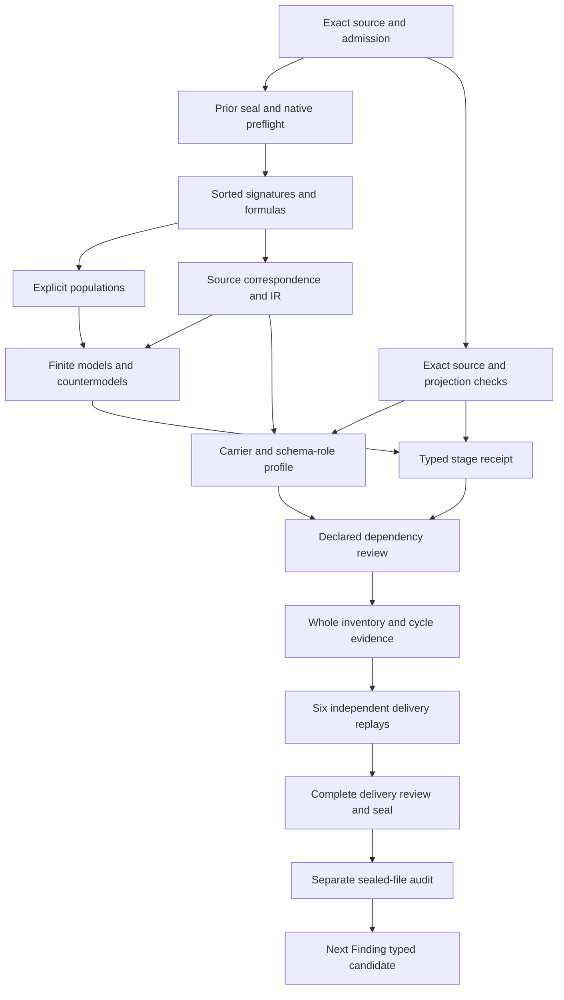

# Evidence Set: types and logical formalization review

## 1. Meaning selected and stage boundary

This review concerns the exact current cal.definition.evidence-set@1.0.0-candidate.1 Definition, selected under C53. Its source SHA is 26f072c0292c4b7349726061f7df218ef1ce883c08888d33e375d4cbe1dd7148. Evidence Set retains the normalized Research lineage and denotes a bounded, provenance-preserving aggregate of supporting evidence, counterevidence, limitations, freshness and applicability for one declared question or claim. It must remain separate from any Finding or owner decision. The richer source also requires Project and Goal links, sources, observations, method, investigation times and owner and challenge routes. A reference list does not preserve that meaning on its own.

Native author, builder, model, source, profile, dependency and inventory producers each completed with actual exit zero and empty stderr. Independent contract, model and source replays first qualified the frozen typed stage. The six separate full-delivery replays now each have observed terminal-zero results with empty stderr and byte-matched producer output. Finalization and the separate sealed-file audit determine this candidate package delivery. Source-owner fidelity,accepted carrier correspondence and whole-definition proof remain pending;the complete episode remains active.

## 2. Sources, decisions and normalized context

C53 current Definition admission and its exact D61 source-use admission are separately bound to the decision, authorization, manifest and source admission bytes. D61 is split across Evidence Set, Finding, Research Inquiry and Research Run. All four selected target references must remain visible. The shared Research source does not merge their identities, validation purposes or instance behavior. Current C53 admission also does not silently rewrite the retained Definition source_refs, whose historical candidate-unadmitted posture and null embedded source admission reference remain intact.

C12 accepts the exact CAL-NORMALIZE-01 model as a migration planning selection. Its authority effect is definition-migration-planning-selection-only. The bound normalization and validation receipt hashes are checked, including the D61 split into four semantic and four carrier targets. The separately retained Evidence Set prototype remains prototype-scaffold with authority effect none. Its normalized concept, carrier and owner-scope classification match the accepted planning model. These observations establish the selected reconstruction context; they do not admit this logical translation or grant execution authority.

The tuple semantic.evidence-set, definition, type.definition and scope.knowledge-development belongs to a separate DefinitionContext carrier. A selected aggregate references that context and preserves its declared accepted source relation and D61 lineage. It is not thereby a canonical Definition instance in the sense of carrying Definition authority. The proposed representation of this classification is an explicit owner-review issue: the normalized record and the semantic aggregate must not be confused merely because both use the same term or directory.

## 3. Type system and symbol discipline

The candidate uses twenty nonempty sorted carriers: Aggregate, DefinitionContext, Topic, Question, Claim, Scope, Project, Goal, SourceMaterial, Observation, Method, EvidenceItem, Limitation, FreshnessCondition, ApplicabilityCondition, Finding, SiblingTarget, Route, Time and Token. Distinct sorts prevent a Finding from being substituted for an aggregate, a Project for a Goal, or a Question for a Claim through a shared printed label. A concrete integration still needs reviewed identity maps between these descriptive carriers and actual repository records.

Six Token constants identify the empty handle and the selected normalized concept, kind, carrier, owner scope and D61 source lineage. Forty-three total functions declare exact context, topic, scope, Project, method, freshness, applicability, created and updated times, route and member-handle mappings. Eighty-four predicates and relations describe the selected genus, structural declarations, collection membership, role exclusions, conditional sibling references and independent actual outcomes. Their scope is the qualified Evidence Set interpretation. Qualified symbols cannot silently import the meaning of a separately selected Evidence or Finding interpretation.

There are no current cal.definition.goal or cal.definition.project rows in the selected registry. They remain descriptive sorts, and their accepted identity mappings are unresolved. Claim, Question, Topic, Method, temporal conditions and routes likewise must not be assigned nonexistent current Definition identities. The initial scratch builder failed while resolving proposed absent Goal and Project dependencies; the corrected preparation retains those sorts and removes invented semantic-use edges. No native unit was created by that failed scratch attempt.

## 4. Genus and topic constraints

The declared EvidenceSet genus is equivalent to an AggregateRecordDeclared together with BoundedInvestigationDeclared. This defines the selected carrier under an explicit candidate interpretation. It does not claim that an actual investigation took place or that every repository object called Research satisfies this theory. The source's attributable and ephemeral character is represented through necessary declared structural properties of selected aggregates, rather than through an unverified process history.

Each selected aggregate has one total aggregateTopic mapping. Its Topic must be declared, with QuestionTopicDeclared or ClaimTopicDeclared. A Question topic requires a declared nonempty mapped Question; a Claim topic requires a declared nonempty mapped Claim. The theory does not assert that those topic classes are exclusive. Both labels may coexist if each declared mapping is qualified. Such coexistence does not equate the Question and Claim sorts or assert an accepted conversion from Research.question into a claim.

The source formal expression uses Research.question, whereas the target-specific statement allows one question or claim. That is a visible projection issue, not a reason to erase either source aspect. Topic is the proposed mediating carrier. Exact topic equality on associated evidence and Finding records is a bounded declaration guard. Reviewed question/claim denotations, scope inclusion and actual investigation-purpose equivalence remain separate obligations. The source owner must assess whether this proposed mediation preserves the intended one-question boundary.

## 5. Structure, investigation and membership

A selected aggregate must retain attributable and ephemeral declarations; separate supporting, counterevidence, source, observation, limitation and Finding-reference collection declarations; and nonempty declared mappings for scope, Project, method, freshness, applicability, created time, updated time, owner route and challenge route. It must link at least one declared Goal with a nonempty handle. The model includes a plural Goal witness so that the one-or-more source requirement is not reduced to a single fixed Goal field.

Collection presence and member presence are different obligations. Requiring a source field does not universally require a populated source member set at every point in an investigation. This theory permits selected aggregates with empty support, counterevidence, observation, limitation or Finding member sets when their collection declarations remain present. Separate required populations provide examples of every membership relation. Owner review must decide whether a concrete lifecycle state requires additional members. No such state machine or hidden completeness policy is introduced here.

For each included SourceMaterial, a declared object, nonempty handle and nonempty provenance reference are necessary. Included Observations require declared objects, nonempty handles and origin references. These guards preserve attributable structure. They do not retrieve external material, authenticate observation origin, verify a benchmark run or demonstrate that competing explanations were adequately investigated. Method, owner and challenge routes are retained as explicit typed references; their actual adequacy, authorized principals and operational availability remain unresolved.

## 6. Supporting evidence, counterevidence and limits

SupportingEvidenceIncluded and CounterevidenceIncluded are separate Aggregate-to-EvidenceItem relations. Every included item must be declared, have a nonempty handle and provenance reference, and map exactly to the selected aggregate's Topic and Scope. That exact association is a candidate bound; broader applicability or nested scopes require a separately accepted map. It prevents silently using an item attached to a different question or scope as if it qualified the selected investigation.

An EvidenceItem may occur in both the supporting and counterevidence relations. The source requires preserving both aspects, but does not justify a universally disjoint partition of actual evidential force. The finite controls therefore permit overlap and do not force every item into an exhaustive force classification. Whether an observation supports one part of an answer while challenging another remains a semantic question for a scoped assessment. This aggregate theory does not absorb the independent Evidence theory as a new axiom set.

Included Limitations require declared objects and nonempty handles. FreshnessCondition and ApplicabilityCondition are explicit typed aggregate mappings with declaration and handle checks. They record claimed conditions, not authenticated time or demonstrated epistemic adequacy. The theory does not specify an expiration duration, evidence weighting, sufficient coverage threshold, applicability algorithm or probability model. Each of those would require additional source evidence, denotations and a scoped reviewer decision rather than inference from a field name.

## 7. Findings and authority separation

Finding is a separate sort. Each referenced Finding must be declared, have a nonempty handle, map to the selected Topic and declare FindingDerivesFrom that exact aggregate. The source equality Findings.question = Research.question is represented through the mediating Topic mapping, with the Question/Claim projection loss retained. The derives-from declaration preserves direction. It does not mean that a synthesized conclusion is true, accepted, current or sufficient for a decision.

Research.outcome is absent: selected aggregates exclude OutcomeFieldPresent. They also exclude roles treating the aggregate as a Goal, Project, experiment, Finding, owner decision, canonical Definition, specification, product claim, proof by aggregate existence, execution authority, authority by promotion, Research Inquiry or Research Run. These role predicates are guards inside a supplied candidate model. They are not a universal proof that arbitrary concrete artifacts have distinct identities or that downstream code enforces the separation.

PromotionDeclared may coexist with an Evidence Set record. ActualAuthority remains independent and is not implied by that promotion. A dedicated Promotion-not-ActualAuthority countermodel preserves a promoted declared record with no actual grant. This distinguishes a claim ceiling from denial of all legitimate authority: a separately admitted owner decision may establish authority in a concrete case. It simply cannot be inferred from collection, normalized classification, Finding references or promotion declarations alone.

## 8. Sibling references, time and lifecycle

Shared D61 lineage preserves separate sibling targets. A declared sibling meaning assignment requires an ExplicitSiblingReferenceDeclared and a nonempty SiblingTarget handle. The condition is necessary for the declared assignment; the presence of a reference is not sufficient for actual sibling meaning adoption, identity equivalence or accepted Typed Relations. The candidate contains a positive explicit-reference witness and negative controls for absent references and empty sibling handles. Concrete directional consumer maps remain review obligations.

Created and last_updated remain independent Time references. Both require declaration and nonempty handles. There is no ordering axiom, arithmetic, freshness interval or assertion that update time must equal creation time. A reversed declared timestamp mapping can remain structurally valid because this source does not provide a temporal ordering calculus. The example populations include distinct created and updated references without interpreting their labels as authenticated chronological facts.

EphemeralRecordDeclared preserves the source's record-at-a-time characterization. It does not introduce retention durations, deletion effects, canonical-store migration, activation semantics or external operations. A lifecycle extension must state its new source support and exact effect scope. The current formalization keeps persistence, investigation currentness and operational transition behavior outside T. It does not use the word canonical in the legacy source to promote this candidate or to replace the actual current admission records.

## 9. Formula selection and complete source account

All nonempty source strings under voices, boundaries, scope and claim ceiling are inventoried with selector, character offset and excerpt digest. The correspondence packet covers every character, including headings, separators, actual-outcome exclusions and retained historical claim ceilings. Eleven encoded spans carry explicit formulas; nine explanatory spans retain intuition and notation; fourteen spans remain deferred. Repeated boundaries remain separately accounted rather than discarded as editorial duplication. Character completeness does not establish semantic equivalence.

The primitive theory has twelve formulas for genus, classification, topic, aggregate structure, Goals, source members, observations, evidence items, limitations, separate Findings, excluded roles and conditional sibling references. Encoded source spans may contain conjunctions of those templates. The count of encoded spans is therefore distinct from the number of primitive formulas and distinct formula values. Source testable conditions remain observations. Historical candidate and admission statements are observed through exact current records rather than silently turned into theory axioms.

There are no assumptions or assumption links. Thirty-seven independently qualified current Definition references are declared semantic-use dependencies. They are not assembled into the primary T, and their presence does not establish a common carrier interpretation or accepted joint consistency. Fifteen source-precedence findings remain unresolved with no reviewer reference. Every population review_ref remains null. Those fields ensure that a successful local model check cannot masquerade as the missing source-owner review or whole-definition acceptance.

## 10. Models, queries and actual observations

The independent evaluator checks 132 authored finite controls against the qualified formulas and required populations. Forty-three satisfy T, eighty-two violate T and seven are rejected for malformed model structure. Positive controls include independent actual-outcome labels, shared printed handles across separate sorts, overlapping evidence roles, empty optional memberships, topic variants, explicit sibling references and independent temporal mappings. Negative controls target missing required declarations, empty mapped handles, wrong context constants, missing Goals, mismatched topic/scope/derivation, collapsed roles and the prohibited outcome field.

Required populations are kept separate from T. Fifteen explicit examples witness selected and outside aggregates, question and claim topics, plural Goals, promotion without actual authority, explicit sibling assignment, independent times and each collection membership. Controls can satisfy T while failing the example population policy. This demonstrates the difference between a structural definition constraint and an agreed sample set. A populated supplied model is evidence about that model, not a proof that the repository supplies every required concrete witness.

Twenty-nine countermodel queries remain outside T. Twenty-eight concern independent actual outcomes, including Finding truth, conclusion, decision, proof, adequacy, freshness authentication, applicability adequacy, source acceptance, identity equivalence, sibling adoption, admission, activation, authority, Definition/specification/product claims, experiment execution, success, publication, release, deployment, runtime execution, external effects, consumer alignment, owner fidelity and whole-scope coverage. The additional query concerns authority by promotion. Each has a supplied T/I countermodel with a false target and true witness condition. No mechanized whole-definition proof is claimed.

## 11. Source and carrier evidence limits

The source checker validates the selected Definition/v1 representation and executes its exact bound pure renderer twice, preserving input bytes and reproducing the checked-in projection. It checks C53 current selection, exact authorization and manifest hashes, candidate registry identity, admitted source use and the retained historical posture. It executes only the pure markdown_h2_section extractor from the bound reconstruction author and recovers the exact local D61 H2 section: 2,840 bytes at ace1c0c50ec2ecf0e2a6df9d9a855cb30f6ad4f763ae2a4589da4ea586e5b4fb. The selected local whole-file hash matches the source-use admission.

These observations do not authenticate the separately declared live producer repository or its currentness. The four source testable conditions remain bounded checks for identity, selected source bytes, representation validity and projection parity. C12 planning selection and prototype lineage are also checked, while their authority boundaries remain explicit. Fourteen exact source-query obligations link deferred actual-conclusion, decision, Definition, specification, product-claim, admission, activation, publication, release, deployment, external-effect, Finding-truth and authority fragments to queries outside T.

The actual carrier checker observes 143 catalog rows and 121 admitted-current contracts,including the exact C70 Evidence Set/v1 type binding the current C53 Definition. The retained type body remains candidate-unadmitted with authority effect none. Generic current Definition/v2 binds its own Definition meaning;historical Definition/v1 remains observed as the selected source representation. Eighteen actual catalog,binding,shape,role and projection checks passed. Neither the retained body nor the overlay is rewritten or silently substituted for translation-owner acceptance.

Forty-three qualified profiles have forty-one rejections. Their axes preserve identity,kind,carrier,source,normalized Definition context,topic,Question/Claim projection,scope,Project,Goals,sources,observations,method,support/counter members,limitations,freshness,applicability,Finding refs,times,routes,sibling references and relation roles. Forbidden inferences include aggregate as Finding or decision,classification as Definition authority,promotion as a grant,handles as authentication,coverage text as adequacy,mandatory nonempty members,exclusive evidence force,automatic Question/Claim equality,temporal order,ephemeral deletion rules,sibling reference adoption,carrier admission as instance admission and C12/C53/C70 as owner fidelity. These are authored bounded hypotheses rather than actual investigations or authorizations.

Seventy-three finite source-to-carrier mapping frames have sixty-eight rejections and five acceptances. They retain nineteen explicit map obligations,each with proposed correspondence or visible residue. A claimed full alignment requires all declared accepted-map references,an owner-review reference and a claim-scope reference. A hypothetical frame with such reference strings does not establish that real accepted maps exist. Changed qualification,lost source fields,missing accepted maps,unreferenced sibling assignments,collapsed source roles,invalid relation roles and actual-outcome claims are rejected. The direct carrier/consumer correspondence remains pending with no acceptance reference.

Thirty historical Definition probes have five acceptances,and seventy-two direct Evidence Set carrier probes have eighteen acceptances. Missing root and payload fields,empty or duplicate source/item/limitation members,undeclared rich payload fields,implicit authority and neighboring kinds are rejected. Unresolved references,whitespace member labels,overclaimed coverage text,empty root evidence,active lifecycle labels,overclaimed claim ceilings,unresolved counterparts and duplicate relation entries can remain shape-valid. These observations separate schema behavior from actual attributable investigation,source currentness,Finding truth,adequacy or authority.

The carrier payload consists of source_refs,item_refs,coverage_statement and limitations. Thirteen proposed explicit richer fields are absent and rejected as extras:question_ref,claim_ref,project_ref,goal_refs,observation_refs,method_ref,counterevidence_refs,freshness_ref,applicability_ref,findings_refs,created,last_updated and owner_route. Root scope and challenge-route fields and eligible relation references provide partial representation surfaces. Whether any root field or reference correctly preserves a richer source obligation still requires accepted correspondence. The four-field schema cannot be declared a full Research implementation solely because it binds this Definition.

The exact pure expected_roles function from the bound endpoint carrier validator is executed against its declared relation-model path. Four role records allow eight products:Evidence Set derives-from experiment-run or research-run as source;finding derives-from Evidence Set as the target endpoint;evidence-bears-on authority-claim,finding,hypothesis or identity-claim as source;and member-of project as source. The schema Cartesian product permits forty-two enum combinations,of which thirty-four are outside that exact role surface. Schema membership therefore cannot substitute for the separately declared direction-and-counterpart eligibility check or admit a Typed Relation.

Two exact pure renders of the carrier artifact and two of its positive fixture reproduce the checked-in projections and preserve the supplied fixture. The checker executes no package validator,canonical or candidate carrier writer,native or live consumer,new authority or new relation. No actual investigation,Finding truth,adequacy,owner fidelity or governing effect is created. Subsequent concrete integration must preserve the complete rich-source mapping or retain explicitly accepted residue,not merely pass the shape schema.

## 12. Dependency DAG and completion obligations

The following DAG orders the remaining work by the evidence it needs. Source selection and prior-seal audit precede native type and formula construction. Source correspondence, finite models and actual source observations then qualify the stage. Carrier/profile review, dependency review and whole inventory evidence depend on those typed inputs. Six independent delivery checks precede full review, seal and separate audit. The same order applies to Finding after this Evidence Set package is complete.

The acyclic execution plan does not classify semantic dependency cycles. The refreshed local graph has 131 qualified nodes,1692 declared edges and 61 missing counterpart packets. The joint graph has 132 nodes,1726 edges and 61 missing counterpart packets. Its unresolved cycle component has [70] members and [1273] internal edges. Every edge denominator remains requires-independent-review. Neither graph construction nor successful supplied models classifies those cycles or proves a common-meaning joint model.

The actual refreshed inventory has 71 partial drafts and 112 missing current identities. It accounts for 1633 source units,2170 mapped spans,678 encoded,576 explanatory and 916 deferred clauses,802 required and 3152 unresolved populations. One supplied T/I model is independently evaluated for each selected draft. Qualified source identities and every earlier edge remain retained;Evidence Set adds thirty-seven declared semantic uses. Source-owner-accepted whole translations and whole-definition proofs remain zero.

## 13. Failed preparation,preservation and continuation

All seven native producers and the six independent full-delivery checks have actual terminal-zero results and empty error logs. Native Evidence Set has no retained failed producer attempts. The earlier scratch builder attempt that proposed absent Goal and Project Definition dependencies remains preserved inside Evidence's preceding seal,with observed exit one and no native next-unit creation. The corrected preparation keeps those descriptive sorts and removes invented dependencies. This failure is not promoted to a successful native producer or erased from the lineage.

All5,833earliersealedfiles and201selectedsourcefiles remain exact preservation obligations. The sixteen frozen typed-stage inputs,including REVIEW.md and CONTINUATION.md,remain unchanged rather than being rewritten to incorporate later results. This separate delivery review records the actual carrier,dependency,inventory and replay evidence. The finalizer checks the exact source,theory,populations,models,queries,source mappings,profiles,graph delta,failed preparation,review and DAG before writing the candidate receipt. A separate read-only audit verifies the seal and exact current file set before any new Finding unit is created.

The original scope remains183currentidentities189admittedversions201sourcefiles121tasks511planningedges797SWUs and36frontiers. Seventy-one partial typed drafts leave112currentidentities without their per-definition T. The preserved historical I04 inventory still represents its exact selected eight drafts and requires a separately scoped reporting update. Typed draft and delivery success do not replace complete owner source fidelity,accepted carrier and consumer maps,whole proofs,cycle classification or the final complete episode review.

Continue F03-T.cal.definition.finding after the full delivery audit. Finding is an evidence-bounded attributable conclusion from one or more Research Runs or Evidence Sets,with claim wording within support,explicit limitations and challenge route. Its bound D61 Research source must be retained in a separate referenced ResearchContext. Research.outcome absence and Research-not-Finding boundaries apply there rather than erasing Finding's conclusion genus. Keep Finding and Research actual-outcome queries separately typed and outside T. Its current C70 flat carrier uses23requiredrootfields,a support assessment,Finding state and revision history rather than the Evidence Set endpoint payload/role schema. Those stronger and additional representation constraints need their own accepted correspondence.

The seventeen pending findings in the next preparation concern that separate Finding unit;the fifteen current Evidence Set findings below remain ownerpending. Preserve every prior seal,canonical authorities,private/live state and unrelated dirty work. No source fidelity,semantic readiness,publication,deployment or runtime authority follows from these candidate receipts. The full goal remains active until the original formalization episode and its final aspect-by-aspect review are actually complete and verified.

- **EVIDENCE-SET-FINDING-001** — Current C53 Definition/source-use admission,C12 accepted normalization,retained prototype scaffold and C70 current carrier admission remain separate from owner fidelity of this interpretation.

- **EVIDENCE-SET-FINDING-002** — The normalized semantic.evidence-set/type.definition/scope.knowledge-development classification belongs to DefinitionContext,not a claim that each aggregate record itself becomes a canonical Definition.

- **EVIDENCE-SET-FINDING-003** — EvidenceSet denotes a declared bounded attributable research aggregate,not a generic ref list,actual performed investigation or accepted epistemic result.

- **EVIDENCE-SET-FINDING-004** — Target question-or-claim topics and source Research.question need accepted Question/Claim/Topic projection;neither exclusive topic subkinds nor a silent conversion of Claim into Question is imported.

- **EVIDENCE-SET-FINDING-005** — Source Research project and one-or-more Goal links,method,sources,observations,owner/challenge routes,created and last_updated refs remain represented alongside target freshness/applicability/counterevidence;the current registry has no cal.definition.goal or cal.definition.project,so those carriers are descriptive and their accepted identity maps remain unresolved.

- **EVIDENCE-SET-FINDING-006** — Required collection fields do not require every selected aggregate to have nonempty supporting,counter,source,observation,limitation or finding members;example witnesses are separate.

- **EVIDENCE-SET-FINDING-007** — Support and counterevidence can overlap and are mapped to the selected topic/scope as a candidate declared guard;accepted scope inclusion and actual adequacy need review.

- **EVIDENCE-SET-FINDING-008** — Provenance/origin,freshness,applicability,time,method and route handles do not authenticate actual source bytes,currentness,adequacy,owner authority or challengeability.

- **EVIDENCE-SET-FINDING-009** — Referenced Findings retain a separate sort,exact mapped topic and declared derives-from edge;actual synthesis and truth are not created by the aggregate.

- **EVIDENCE-SET-FINDING-010** — Research.outcome absence and exclusion of Goal,Project,experiment,finding,decision,Definition,specification,product-claim,proof,execution-authority and sibling Inquiry/Run roles are declared non-collapse guards requiring concrete identity maps.

- **EVIDENCE-SET-FINDING-011** — Promotion declarations cannot establish actual authority;separately supported real conclusions remain possible without being entailed by T.

- **EVIDENCE-SET-FINDING-012** — Created/updated refs are independent and un-ordered;ephemeral record declarations do not invent retention periods,deletion effects or lifecycle state machines.

- **EVIDENCE-SET-FINDING-013** — Source D61 split lineage does not merge semantic.finding,semantic.research-inquiry or semantic.research-run;declared sibling meaning assignments require an explicit nonempty sibling reference,but actual adoption,Typed Relations and consumer maps remain separate.

- **EVIDENCE-SET-FINDING-014** — The C70 Evidence Set carrier has a narrower source/item/coverage/limitations payload;question/claim,method,Goal links,counterevidence,freshness,applicability,investigation times and separate Findings need accepted correspondence or explicit residue.

- **EVIDENCE-SET-FINDING-015** — Selected local exact D61 H2 bytes and current source-use admission do not authenticate the separately declared live producer repository or resolve all source-precedence and whole-proof obligations.

