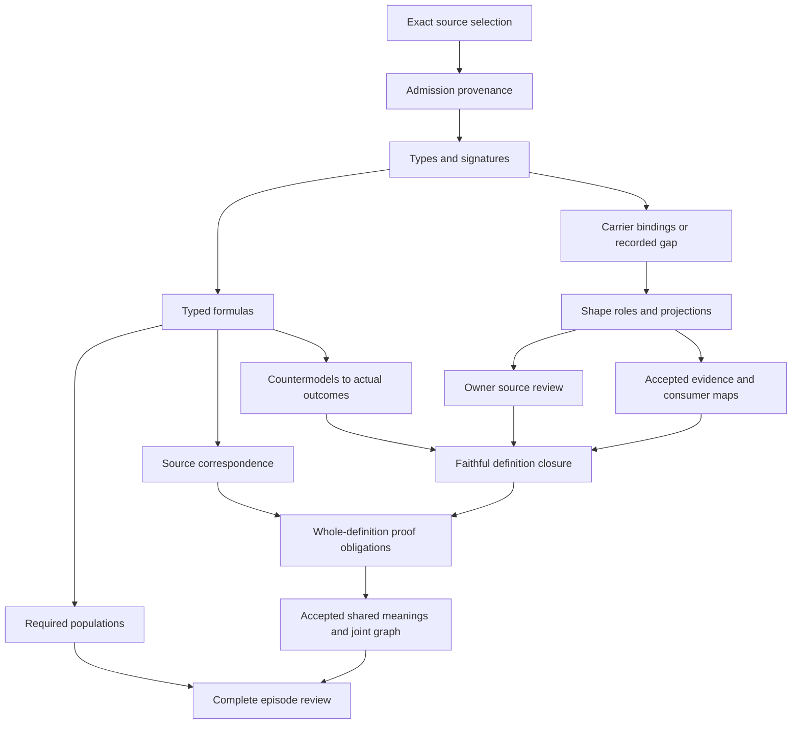

# Evidence: typed candidate review

## 1. Candidate status and original scope

This packet is a typed candidate translation of cal.definition.evidence@1.0.0-candidate.1, the current C29-admitted Evidence Definition. Its exact selected JSON digest is 748f0817911993a064c33f4cb59dcc69c8c2a9b061545fa0a56e8ccca8363da6. Corrected native author, builder, model, source, profile, dependency and inventory producers completed with exit zero and empty stderr. Each of the six independent read-only delivery checks has a separate terminal-zero replay. Finalization and the separate sealed-file audit determine delivery completion. Source-owner acceptance and whole-definition proof remain pending.

The original formalization scope remains 183 current Definition identities, 189 admitted source versions, 201 selected sources, 121 tasks, 511 task edges, 797 smallest work units and 36 frontiers. Evaluation's 5,722-file delivery was sealed and separately audited before Evidence was created. Every prior candidate file and selected source remains a preservation obligation. Parent-Instance Authority Separation and the subsequent Policy, Root-Axis, Claim-Support, Conformance, Drift Assessment and Evaluation packets stay intact.

Evidence is the next definition in the existing priority manifest. EvidenceSet follows it. The current working output count is seventy per-definition drafts, while the last sealed whole inventory has sixty-nine. A draft count is not a count of accepted whole translations or whole-definition proofs; both acceptance and proof counts remain zero. The goal stays active, and the eventual complete episode review must retain all missing definitions and semantic obligations.

## 2. Formalization model and source-qualified meaning

The formalization model remains a many-sorted first-order interpretation with equality, exact source qualification, a canonical static intermediate representation and independent finite denotation evaluation. Symbols are qualified by selected Definition identity, version and interpretation scope. Source correspondence records encoded, explanatory and deferred spans. Required populations are separate from universal theory constraints. Actual proof, truth, sufficiency, provenance, currentness and authority targets remain external queries.

The proposed genus identifies Evidence with a declared observation-or-record and a declared provenance binding. Further guards retain inspectability, one explicit claim, subject, scope, observed-time reference, currentness condition and content reference. Those declarations represent the source-level record structure. They are not actual observation, source inspection, content authentication or adequate support. Accepted correspondence between those predicates and real records requires semantic owner review.

Scientific/formal normative clauses supply the primary constraints. Applicability and boundaries contribute scoped force, currentness and role guards. The formal tuple contributes declared record fields, while its non-proof fragment remains a separate query obligation. Its three-place supports notation stays deferred as an explicit projection-mapping issue. Plain-language intuition, domain examples and notation are explanatory. The three source test conditions remain observations, with structural counterparts separately encoded where supported by normative clauses. This prevents source examples or artifact tests from silently becoming proof axioms.

## 3. Types, signatures and distinct identities

Ten independent sorts retain EvidenceRecord, Claim, Subject, Scope, Provenance, Time, CurrentnessCondition, Content, Assessment and Token. The signature contains one EMPTY token constant, twenty-four total functions, forty-two unary predicates, two binary relations and three four-place relations. There are eighty-two declarations. Each sort has a nonempty carrier, but that domain policy does not make every record Evidence or require every record to declare actual evidential force.

Functions map each evidence record to its claim, subject, scope, provenance, time, currentness condition and content. Additional functions expose independent handles and provenance origin references. A Claim has subject, scope and currentness maps. An Assessment has its selected evidence, claim, subject, scope and handle. Every total function is supplied over its declared finite carrier. Guards constrain the selected associations without inventing universal injectivity or requiring printed handles to distinguish every real identity.

The literal current Claim and EvidenceAssessment Definition identities are absent from the inspected current snapshot. Claim and Assessment are descriptive sorts; no missing Definition source references are fabricated. Provenance and Observation do have current C53 identities and remain independently qualified dependencies. Shared printable labels across sorts cannot collapse an EvidenceRecord into its Claim. Concrete artifact identity alignment still requires accepted mappings. Sorting and nonempty labels provide structural separation rather than authority, semantic equivalence or authenticated real-world denotations.

## 4. Record, provenance and bounded association

Every selected Evidence record declares inspectability, an explicit claim, a subject, a scope, inspectable provenance, a time, a currentness condition and inspectable content. Its selected claim's mapped subject and scope must equal the record's subject and scope. Evidence, claim, subject, scope, provenance, origin, time, currentness and content handles must be nonempty. Missing declarations, empty handles and subject/scope mismatches are rejected by finite controls.

This equality is a proposed bounded-association convention. It is not a complete algebra of real claim scopes or a proof that every broader claim can be reduced to one exact scope identity. Owner review must accept the chosen claim, subject and scope maps and explain any narrower or broader applicability residue. A record that cannot resolve its real subject, origin or applicability is not made usable by copying a nonempty reference string into these functions.

ProvenanceInspectableDeclared and ContentInspectableDeclared do not establish actual inspection or origin authentication. Time remains a descriptive reference without an ordering or authenticated epoch. CurrentnessCondition is independently sorted and mapped, not inferred from time text, lifecycle labels or a successful projection. ActualProvenanceAuthentication and ActualCurrentnessAuthentication remain separate query targets. Keeping these boundaries explicit makes the candidate useful for checking declared structure while preserving the source-owner and evidence-owner work needed to interpret real observations.

## 5. Scoped support, weakening and unevaluability

SupportDeclared, WeakeningDeclared and UnevaluableDeclared each relate an EvidenceRecord, Claim, Subject and Scope. Whenever one of those force relations is declared for a selected Evidence record, its claim, subject and scope must equal that record's selected maps. A force tuple with another claim, subject or scope is rejected. The source's normative four-place support relation is therefore retained without pretending that a generic evidence label can support arbitrary claims.

The three declarations are optional. T does not force every record into an exhaustive status partition, and it does not make those relations mutually exclusive. A record can preserve different declared aspects of support or challenge without the candidate choosing an actual result. Required populations supply examples of each force relation as a witness policy. That policy shows that the proposed carriers can represent these cases; it does not turn optional source capability into a universal actual-force verdict.

The formal expression uses supports(E,C,Q), while the normative statement uses support(E,C,S,Q). The candidate does not silently identify these signatures. Its exact three-place formal tail remains deferred, with a known-loss finding requesting an accepted projection correspondence. ActualSupport, ActualWeakening and ActualUnevaluability remain independent predicates. A declared force tuple, inspectable content reference or large collection of records cannot establish that the mapped evidential force is correct, sufficient, current or adequate.

## 6. Currentness and stale or mismatched records

SilentCurrentSupportDeclared is a binary relation from EvidenceRecord to Claim. For selected Evidence, such a declaration requires the selected explicit claim, a declared current claim, matching mapped currentness conditions, no StaleDeclared or MismatchDeclared label, and the corresponding bounded SupportDeclared tuple. Wrong claim association, missing current-claim declaration, mismatched conditions, stale or mismatch labels and absent bounded support are rejected.

A stale or mismatched record can still be Evidence. Its history, provenance and content can remain inspectable and relevant to a different scoped question. A positive control retains a stale record with declared historical support while leaving silent current support absent. This source fragment does not import a blanket axiom that stale evidence is invalid or cannot participate in any assessment. It encodes the narrower boundary against silently treating stale or mismatched material as support for the current claim.

Actual currentness, accepted applicability, explicit disclosure and assessment standards remain open. The relation name is a proposed record-level abstraction for unqualified current support; its real mapping needs owner acceptance. Equality of CurrentnessCondition values is not a proof that time or content is current. No temporal arithmetic, freshness duration, severity hierarchy or independently accepted currentness profile is invented. These decisions belong to the exact source and evidence owners, not to a total function with a convenient label.

## 7. Assessment, classification and authority boundaries

Evidence excludes ClaimItselfRole and ProofByExistenceRole. These declared role guards keep a record from replacing the claim it bears on or treating bare record existence as proof. Separate sorting alone does not establish accepted concrete artifact identity; the role guards supplement the chosen representation while keeping identity mapping as an owner obligation. ActualProof is unconstrained by a record's mere existence and is queried independently.

Declared Decision, Authority, Admission or Conformance roles require an included Assessment. Every included Assessment must be declared applicable, refer to the exact selected Evidence record, claim, subject and scope, and have a nonempty handle. A governing role without an included applicable assessment, a wrong assessment map or an empty assessment handle is rejected. These are necessary declared qualification conditions. They are not an actual owner verdict, permission, grant or conformance decision.

An assessment-qualified Conformance role supplies one required example, and independent positive controls add the other declared roles to the same qualified case. Those examples do not establish actual governing outcomes. The source says that Evidence, decisions and authority remain separate and that collection, existence or volume cannot create sufficiency or authority. Accepted assessment standards, reviewer identity, current authority and actual results remain outside T. A later owner can supply separate support without requiring this theory to deny all possible real proofs or decisions.

## 8. Complete source account and query obligations

The selected source inventory has twenty-eight units and thirty-two mapped spans. Eleven spans are encoded, eleven explanatory and ten deferred. The encoded spans use six distinct formula values assembled from six primitive theory templates. Character accounting is complete. Every selected source string is represented, including actual-outcome boundaries, scope exclusions, formal notation residue and the claim ceiling. Complete correspondence accounting exposes losses and deferrals; it does not certify faithful whole-source meaning.

Eleven exact source-query obligations retain the normative collection/existence/volume tail for ActualSufficiency and ActualAuthority, the formal non-proof fragment for ActualProof, the automatic proof/truth/acceptance/admission/authority exclusion for its five targets, the bare-existence proof boundary, and the claim ceiling for actual evidence adequacy and decision authority. Every obligation binds its source identity, selector, character offsets, exact excerpt digest, clause and external query. None is selected as an actual-outcome axiom.

These queries use proposed record-level abstractions for conclusions about the selected claim, evidence and assessment. Real correspondence to claim truth, set adequacy or owner authority must be accepted separately. The twelve independently selected comparison sources are not assembled into primary T. Thirty-four declared semantic-use dependencies select only existing source identities. Shared meanings, counterpart packets, source precedence and cycle classification remain independent obligations. The old D38 and D65 source roles cannot be upgraded merely because the current Evidence Definition is admitted.

## 9. Native finite controls and required populations

The native model producer passed eighty-eight authored controls. Thirty-three satisfy T, forty-eight violate T and seven are rejected for malformed model structure. Eleven required populations are evaluated separately. Twenty-one non-entailment queries have explicit supplied countermodels satisfying both T and the witness policy. Native model hashes, source-qualified declarations, input bytes, checker code and runtime bindings are recorded in the model report.

Negative controls cover absent genus or inspectability declarations, missing selected claim/subject/scope/provenance/time/currentness/content declarations, empty handles, wrong claim maps and out-of-bound force tuples. They also cover silent current support with stale or mismatch labels, wrong currentness conditions or missing support, role collapse, governing roles without an assessment, and wrong or empty assessment maps. Malformed controls detect incomplete total functions, wrong result sorts, wrong constant sorts, incorrect support relation arity, duplicate tuples and empty provenance domains.

Positive controls preserve shared printed handles, stale historical support, mismatched records, overlapping declared force relations, independent actual outcomes and separately assessment-qualified roles. Three cases satisfy T but fail required populations when weakening, silent-current-support or assessment-qualified examples are removed. This makes witness policy visibly distinct from universal semantics. The twenty-one external countermodels establish non-entailment in this exact fragment; they are not universal proofs, actual truth assessments, accepted owner fidelity or evidence that independently supported real conclusions are impossible.

## 10. Observed source bytes and legacy recovery

Thirty-eight actual source checks passed. The current Evidence Definition satisfies its selected historical Definition/v1 schema and binds exact schema and generator bytes. Two pure renders match the preserved 3,948-byte human projection with SHA-256 687769b2d331728f6f77a2dd96aae4cdd421e8f31b5229f41cfb04f6a6073290. The renderer preserves its source input. Projection parity is an exact representation observation, not actual support, proof, truth or provenance authentication.

C29's selected decision, authorization, manifest, candidate and source-admission bindings are checked. The first source reference binds exact current Definition@1 under C18. Older D38 and D65 references retain historical candidate-unadmitted postures and null embedded source-admission refs, separately from the current decision's exact selector-use overlays. Owner source fidelity still requires review. None of these records turns this agent's proposed interpretation into an accepted whole translation.

The exact D38 sixty-three-line selector is recovered as 2,435 bytes at lines 2509–2571 in a later local file. The selected older 199-line D65 window is not recovered by the bounded fixed-window search. The later whole-file digest differs from the older authoring digest. Recovering D38 does not recover the older whole file, D65 or authenticated producer identity and currentness. The Claim-Support H2 D38 selection is a distinct digest and cannot replace this selector. No live producer configuration or canonical source is changed.

## 11. Carrier gap and owner findings

Twenty-three actual catalog and schema-binding checks observe 143 registered contracts and 121 admitted-current rows. No admitted-current type directly binds this exact Evidence Definition. Generic current Definition/v2 binds the independently selected current Definition meaning. Historical Definition/v1 remains represented, and the selected Evidence JSON satisfies its historical source representation. This is a direct carrier gap, not permission to substitute a convenient schema or an evidence-producing neighboring type.

The current evaluation-profile/v1 contract is admitted under C13 with no Evidence semantic binding. Its exact foundation schema selector is checked. C13 separately admits the exact CAL-EVALUATION-DEFINITION-V1 profile record, digest 8d77ba1a649cff55e51fc55cbbad17fed59a4f19e0be0638a5b18bf2ba4d04a9, with its manifest and receipt bindings. The retained profile body remains candidate-unadmitted with authority effect none. Seven unique checks, collect-all mode, three result statuses and the rule that PASS remains evidence are observed. This comparison is not an embedded Evidence source reference, actual Evidence instance admission, or owner acceptance of this formal translation. The admitted Evaluation/v1 carrier binds its own current Evaluation Definition rather than Evidence.

Thirty-four qualified profiles have thirty-two rejections. Their axes retain identity, kind, carrier, source, claim, subject, scope, provenance, origin reference, observed time, currentness condition, content, collection, force, assessment and relation roles. Forbidden inferences include existence as proof, volume as sufficiency, labels as authenticated currentness or provenance, stale records as universally invalid, a mandatory force partition, an accepted support projection, assessment labels as authority, neighboring profile or type admission as Evidence admission, and unrecovered legacy bytes as verified. These authored hypotheses do not execute a runtime or establish actual proof, truth, adequacy or authority.

Seventy-eight finite evidence frames have sixty-four rejections and fourteen acceptances. Accepted cases retain optional force declarations, support/weakening/unevaluability, overlapping forces, qualified silent current support, stale historical support, mismatched records, assessment-qualified roles and objects outside selected record scope. Rejections preserve exact bindings, required declarations and handles, bounded force tuples, currentness qualification and included applicable assessments. These procedural frames are qualified finite comparisons; they do not establish a universally correct evidence assessor, scope algebra, temporal model or governing decision procedure.

Fifty-three executed shape probes have ten acceptances: thirty historical Definition/v1 probes with five acceptances, and twenty-three foundation evaluation-profile probes with five acceptances. Missing required fields and undeclared instance fields are rejected. Unresolved Definition IDs, terms and owners and overclaimed normative text can remain shape-valid. Unresolved profile owner references, overclaimed claim ceilings and admission rules, and an overclaimed check purpose can also remain shape-valid. Such acceptance establishes representation behavior, not actual Evidence support, truth, provenance, sufficiency or authority. No admitted Evidence tuple schema or accepted generic-carrier correspondence is invented.

This profile checker executes no bound evaluation runner, generator module, materialization writer, native or live consumer, new relation or new authority. The source checker separately executed its bound pure Definition renderer; its exact projection observations remain distinct. No package validator or actual assessment process runs here. A prospective carrier and consumer mapping must preserve real claim, subject, scope, provenance, time, currentness, content and assessment semantics under an explicit reviewed scope. It must also retain the formal support-projection residue and avoid treating shape-valid references as adequate support.

The thirteen findings below retain source precedence, unrecovered D65, descriptive carrier maps, exact scope equality, genus abstraction, optional force declarations, formal support projection, provenance/currentness labels, stale historical support, concrete identity, necessary assessment roles, actual non-entailment and the direct carrier gap. They remain unresolved with source_fidelity pending and no review_ref. A general endorsement of Evidence or schema validity cannot discharge them. Every accepted whole-definition or joint claim requires its own exact review and proof surface.

- **EVIDENCE-FINDING-001** — Current C29 Evidence Definition,retained historical D38/D65 source postures and owner fidelity of this translation remain separate;D65 exact older window and whole authoring file need qualified recovery evidence.

- **EVIDENCE-FINDING-002** — Evidence denotes a declared inspectable provenance-bound observation/record;actual inspection,origin authentication,support,weakening and evidence adequacy remain independent.

- **EVIDENCE-FINDING-003** — Claim,Time,CurrentnessCondition,Content and Assessment are descriptive carriers;no absent literal current Definition identities are invented.

- **EVIDENCE-FINDING-004** — Exact claim/subject/scope equality is a proposed bounded-association guard requiring accepted denotations and scope inclusion decisions,not a universal real-world scope algebra.

- **EVIDENCE-FINDING-005** — Observation and record are represented by one declared genus carrier;accepted subkind maps and actual evidence existence remain unresolved.

- **EVIDENCE-FINDING-006** — Support,weakening and unevaluability declarations are optional and scoped;they are not forced into an exclusive or exhaustive actual-force partition.

- **EVIDENCE-FINDING-007** — The four-place normative support relation and three-place formal supports notation require accepted projection correspondence;the latter is not silently merged as an extra axiom.

- **EVIDENCE-FINDING-008** — Nonempty provenance,content,time and currentness handles do not authenticate source bytes,epoch ordering,current conditions,origin or actual inspectability.

- **EVIDENCE-FINDING-009** — Silent current support requires mapped currentness agreement and no stale/mismatch declaration;stale evidence can remain a record and a separately assessed historical support declaration. No blanket stale-evidence invalidity axiom is imported.

- **EVIDENCE-FINDING-010** — Evidence is independently sorted from Claim and excludes ClaimItselfRole and ProofByExistenceRole;cross-artifact concrete identity maps and actual proof still need independent acceptance.

- **EVIDENCE-FINDING-011** — Declared Decision/Authority/Admission/Conformance roles need an included exact applicable-assessment record as a necessary condition;such labels and an assessment declaration do not create an actual governing outcome.

- **EVIDENCE-FINDING-012** — Existence,collection and volume do not establish sufficiency,proof,truth,acceptance,admission or authority;separately supported actual outcomes may coexist without being entailed by T.

- **EVIDENCE-FINDING-013** — No admitted-current Artifact Type directly binds this exact Evidence Definition in the inspected catalog;generic Definition shape and other evidence-producing carriers cannot be substituted as its accepted instance contract.

## 12. Completion DAG and types-first order

The completion DAG separates source selection, provenance, types, formulas, populations, correspondence, finite controls, carrier observations, owner review, accepted evidence and consumer maps, whole proof, shared meanings and the eventual episode review. Types and logic precede later implementation or governing work. The graph is a plan for completion, not an assertion that all semantic gates are satisfied.

Fifteen nodes and eighteen edges form an acyclic completion plan. This does not classify cycles in the source dependency graph or establish compatible shared denotations. The current whole inventory and joint graph still need a refresh after Evidence. Every missing counterpart and unresolved semantic-use edge must retain its denominator. Finite individual models cannot establish a joint common-carrier consistency claim. Delivery checks and preservation seals remain bounded evidence, while semantic owner acceptance and whole proofs remain distinct completion requirements.

## 13. Failed attempts, preservation and continuation

Two actual failed attempts remain retained under attempts/. Wrong copied SWU preflight exited one before creating Evidence; the premature missing-builder invocation exited two. Exact command results, stdout, stderr, original planned author and runner bytes remain hashed. The corrected native author and subsequent build, model, source, profile, dependency and inventory producers all completed with actual exit zero. The erroneous planned author remains immutable within Evaluation's earlier seal. No failed report is promoted to a successful producer.

Contract, model, source, profile, dependency and inventory each have a separately recorded terminal-zero fresh replay with empty stderr. Read-only producer output bytes match their recorded originals. All 5,722 earlier sealed files and all 201 selected source files remain preservation obligations. Frozen typed-stage REVIEW.md and CONTINUATION.md remain exact stage receipt inputs rather than being rewritten after later outcomes. Finalization and the separate seal audit supply the exact candidate-delivery evidence.

The refreshed whole inventory has 70 partial drafts and 113 missing current identities. It records 1609 source units, 2136 mapped spans, 667 encoded, 567 explanatory and 902 deferred clauses, 787 required and 3068 unresolved populations. Every draft has one independently evaluated supplied T/I witness. This does not establish common meanings or accepted joint consistency.

The local graph has 129 nodes, 1655 edges and 60 missing counterpart packets. The joint graph has 130 nodes, 1689 edges and 60 missing counterparts. Its unclassified cycle component sizes are [69]. Evidence adds exactly thirty-four declared semantic-use edges while preserving earlier selected source identities. Every edge still requires independent semantic review. No cycle classification or shared-meaning closure follows from graph construction or individual supplied models.

The original scope remains 183 current identities, 189 admitted versions, 201 sources, 121 tasks, 511 edges, 797 SWUs and 36 frontiers. Source-owner-accepted whole translations and whole-definition proofs remain zero. The historical I04 eight-draft inventory remains preserved and requires a separately scoped reporting update. Complete source fidelity, accepted carrier/consumer mappings, whole proofs and the final episode review remain open.

Continue F03-T.cal.definition.evidence-set after the delivery audit. Its actual current meaning includes a normalized bounded research aggregate with supporting evidence, counterevidence, limitations, freshness, applicability, a declared question or claim, project and goal links, source and method references, separate findings, owner and challenge routes and retained investigation times. A list of Evidence refs alone cannot cover that source. Preserve the C53 source/Definition admission and retained prototype/C12 normalization boundaries, then begin with separate types and explicit logical constraints. Keep canonical, private/live and unrelated dirty state and every prior seal intact. The full goal remains active.
