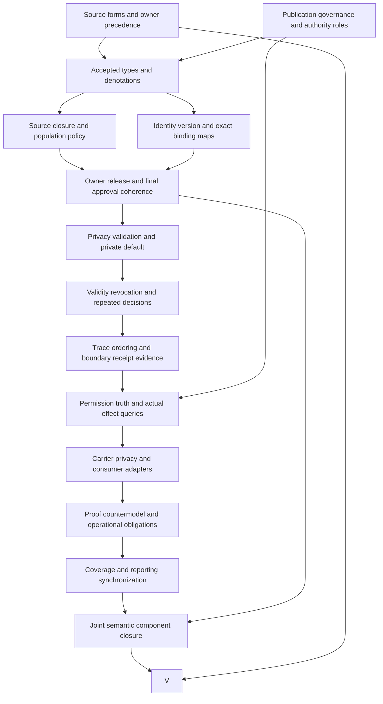

# Exact Publication Authorization Invariant: formalization review and completion DAG

This is a partial candidate interpretation of `cal.definition.exact-publication-authorization-invariant@1.0.0-candidate.1`. It advances definitions, types and logical semantics before operational integration. The model separates owner release of exact source slices, publisher approval of exact final output, and an optional publication receipt. Declared permission does not establish actual publication, truth or privacy validation execution. The episode retains 183 current identities, 189 admitted versions and 201 captured source files. This unit brings the inventory to 60 partial drafts, leaving 123 current identities without drafts. Whole-translation acceptance and whole-definition proofs remain zero.

## 1. Exact source selection and C53 admission

The selected Definition has SHA-256 `24378c6653c419fdb2a079ebb164fbb3f4e38d8ba1b6828f6cb49b4aafae1822`. C53 selects this exact reconstructed version through its admission manifest and current registry overlay. Its retained source body still describes the reconstruction candidate and records a candidate-unadmitted source reference with a null admission reference. Those historical bytes are preserved; current admission is established through the separately bound decision and source-use records.

The [source checks](source-checks.json) perform twenty bounded observations. They bind the registry, C53 decision, authorization bytes, manifest selection, source admission, candidate registry, Definition/v1 contract and pure renderer. Two renders reproduce the existing 8,114-byte projection with digest `1f6754d8afdda646b6a18e26c7827865e57cc704f23fd105155d2b59a6c3b7d3`. Equality of generated projections establishes a reproducible source observation, not mathematical completeness or owner acceptance of the interpretation.

The exact D57 section in a selected local legacy copy has 5,925 bytes and digest `1234325bacabe593f4924bd9cf55562ea4ffc52909d70686da270def84e5ffd9`. Its containing file matches the recorded admission digest. The declared producer location is absent, and repository identity or live producer currentness is not authenticated. Only the existing bounded section-extractor function is executed; the reconstruction writer is not run.

**EPAI-FINDING-012** retains source precedence, live currentness, interpretation fidelity and joint closure obligations. C53 admits source use and Definition meaning artifacts, while actual publication remains separately governed. The local D57 section supplies contextual detail under an explicit claim ceiling. It does not establish present permission to publish this candidate or authorize changes to the source repository.

## 2. Definition forms and source correspondence

The [correspondence packet](correspondence.json) inventories 22 source units and accounts for their characters through 41 spans. Fifteen spans are encoded, nine explanatory and seventeen deferred. Deferred spans include lexical delimiters and headers, the exact nonentailment targets, the authority-scope reference and observational test conditions. Span counts measure accountability under the selected inventory policy; they are not a count of independent substantive rules or accepted theorems.

The candidate combines normalized genus and differentia with an axiomatic specification and a declared operational reading. Classification characterizes the normalized invariant by identity, kind, carrier, owner scope and source. Permission clauses characterize publishability under source releases, privacy pass and matching final approval. Operational prose motivates exact-binding invalidation and repeated decisions, while temporal execution itself remains outside the static fragment.

Repeated normative and formal statements retain separate selectors while sharing formulas. Fifteen encoded spans contain seven distinct formula values assembled from eleven primitive templates. Definition roles, explanatory examples, query targets and observational conditions remain distinct. The package being an admitted Definition does not make every statement inside it an axiom or turn an example into permission.

**EPAI-FINDING-001** requires acceptance of normalized classification semantics. **EPAI-FINDING-002** requires acceptance of the request representation and exact-binding denotations. Complete character accounting does not settle either finding. A full translation must justify the representations, preserve the source's two separate decision responsibilities and explicitly discharge or retain each operational and observational residue.

## 3. Typed carriers, signature and namespaces

The [interpretation](t.json) uses nine nonempty sorts: Invariant, Request, Output, Source, Release, Approval, Receipt, Principal and Token. Release and Approval occupy different sorts, making their decision responsibilities explicit. A Request reifies an output, audience, channel and binding context. This is a candidate representation of the source's publishability relation, not an accepted equivalence between every real request record and a mathematical tuple.

The signature has 129 declarations: nine sorts, six constants, 42 total functions and 72 predicates or relations. Four relations express source contribution, release applicability, exact approval applicability and approval references to releases. The remaining predicates classify normalized invariants, authority roles, decision status, permission, privacy, receipts, prohibited inferences and independent actual outcomes.

Tokens represent exact identity, classification, source epoch, slice, claims, policies, generator, bytes, digest, audience and channel bindings. Token equality checks declared equality. It does not compute hashes, verify byte length, resolve source objects or authenticate a principal. Total functions establish a complete denotation on each supplied finite domain, not total availability of real resolvers or decision services.

The [typed IR](static-ir.json) qualifies all symbols by exact Definition version and candidate scope. A Principal, Decision, Invariant, Effect or Generated Output from an independently selected comparison source is not automatically the same denotation. **EPAI-FINDING-002** requires accepted carriers, token meanings, request tuple equality, extensionality, definedness and source-to-record maps before those qualified meanings can be composed.

## 4. Normalized identity and classification axes

The proposed normalized characterization fixes the invariant's identity, semantic kind, carrier handle, owner scope and D57 source token. It also requires preservation of classification and source relations and a marker forbidding silent target merging. These are independent axes. The printed handle `type.invariant` is represented as a token; it is not an admitted Artifact Type contract selected by the current registry.

The source Definition itself is carried by Definition/v1 and has semantic kind Definition in its artifact classification. Its normalized subject is an invariant. Confusing those levels would make a statement about an invariant appear to be an instance of an admitted invariant carrier. The candidate therefore keeps source artifact classification separate from the normalized subject characterization.

The existing normalized target scaffold records a split of D57, an independent normalized identity and a prototype carrier handle. It remains a prototype scaffold with authority effect none. Neither the split nor shared source bytes establishes identity equivalence with a neighboring target, universal classification authority or an operational publication mechanism.

**EPAI-FINDING-001** requires owner acceptance of the characterization and nonmerge markers. **EPAI-FINDING-011** requires an actual carrier map. Completion needs exact instance identity, qualified classifications, accepted source relations and a clear distinction between a normalized scaffold, an admitted Definition, an admitted carrier and an independently authorized publication decision.

## 5. Every contributing source and owner release

For each contributing source, the candidate requires a separately declared valid release decision that matches the request's slice, claims, audience, channel, policies, source-set token and publishing principal. Its declared owner must equal the contributing source's owner and carry the source-owner role. The release also binds the source epoch, allowing a changed source version to invalidate the old declared applicability.

The first decision releases a candidate source slice for private preparation and review. It deliberately has no output-byte or output-digest binding. Adding final bytes to the first decision would turn permission to prepare into approval of unknown future output and erase the source's second decision. The supplied models show owner releases can apply to a generated draft while publishability remains false.

The coverage quantifier ranges over declared contributing sources. If the contribution relation is empty, its universal requirement is vacuously true. A positive control exposes this logical property rather than silently adding a nonempty-source rule unsupported by the selected statement. Actual source completeness remains essential: an omitted source could hide a required owner decision even when the declared relation passes.

**EPAI-FINDING-003** covers owner-qualified releases, source closure and completeness. **EPAI-FINDING-004** covers separation from exact final-output approval. Completion requires exact source objects and slices, owner authority, allowed and forbidden surfaces, claims, policies, audience, channel, publisher, validity and revocation evidence. The candidate's matching tokens and validity predicates are reviewable declarations, not verified permissions.

## 6. Exact final-output approval and binding equality

The second decision is represented by a separate Approval denotation. A declared valid approval requires an approval decision, an approve marker, no refusal marker and no revocation marker. It binds the output, publisher, slice, claims, audience, channel, policies, source set, generator, byte token, digest token and privacy-receipt token. An exact applicability relation additionally requires generation, privacy pass and referenced releases covering every contributing source.

The candidate checks those equalities against the current Request. A changed output digest, bytes, generator, source binding or destination context makes the previous approval inapplicable. The model does not repair such a mismatch by changing the reported decision status, substituting a similar output or treating a template approval as authorization of future bytes.

The D57 contextual schema describes additional record fields, including output length, limitation notice, target, validity conditions and revocation route. Its documentary tuple is retained as context. It is not silently promoted to an admitted machine schema or imported wholesale into primary T. The candidate's Token representation also does not compute a cryptographic digest or a numeric byte length.

**EPAI-FINDING-004** requires accepted final-output and generation-input maps. **EPAI-FINDING-002** covers token exactness and tuple equality. A complete implementation must bind real bytes and their digest, identify all generation inputs and referenced decisions, preserve limitations and target details, and authenticate the publisher's exact decision. Equality of declared tokens alone cannot discharge those obligations.

## 7. Publishability, privacy validation and private default

The proposed permission characterization makes a Request publishable when all declared contributing sources have matching valid releases, privacy pass holds and a matching exact output approval exists. Its approval applicability also requires generation. This represents the source's prerequisite relationship under declared static meanings. It does not execute private generation or establish that privacy validation occurred before approval.

Privacy pass is a predicate separate from a general validation marker. A successful generator or validator cannot supply owner releases or exact final-output approval. The model contains a generated and validated draft whose permission remains absent. It also contains a publishable request with all actual authorization, privacy-execution and publication predicates false, showing the distinction between the declared interpretation and actual evidence.

Absent declared permission implies PrivateDefault. The converse is not imposed: a publishable candidate may remain private. Permission does not compel publication, change classification automatically or withdraw privacy merely because prerequisites have been declared. This preserves the source's private preparation and review stage without inventing an automatic disclosure transition.

**EPAI-FINDING-005** covers permission and privacy denotations. **EPAI-FINDING-008** covers private default and retained classification. Completion requires an accepted privacy validator, exact policy set, authentic validation receipt, declared validation scope and independent evidence for real permission. Actual boundary crossing and its resulting state require a separately governed operational extension.

## 8. Authority roles and tool assignments

Source owners and the publishing principal have separate roles and responsibilities. The candidate requires source-owner and publisher roles where decision records name them. It does not require these roles to belong to different people. A positive supplied model uses one principal for both responsibilities while preserving separate release and output-approval decisions and their distinct bindings.

A generator or validator principal cannot carry an owner or publisher role in the candidate model without the corresponding explicit assignment marker. This gives the source's exception a visible representation: a tool may participate under a separately assigned role, while being a tool alone is insufficient. The marker is still a declaration; real assignment authority and decision provenance remain unresolved.

The model forbids convenience inference from tool identity to owner or publisher authority. It also keeps classification authority, authority transfer, deployment and truth independent from publication permission. An exact output approval does not establish universal authority over the source owners' meanings or permit a projection to reinterpret their classifications.

**EPAI-FINDING-007** requires role and assignment semantics. Completion needs exact principal identity, role ownership, scope, validity, delegation and evidence for each responsibility. The separately qualified Principal, Person, Role Assignment and Authority Definitions provide contextual obligations. Their accepted common denotations cannot be assumed from shared names, successful rendering or a permissive artifact schema.

## 9. Validity, revocation and applicable repeated decisions

Declared release validity and approval validity are distinct predicates. A revoked release cannot retain its declared-valid marker, and a revoked or refused approval cannot remain declared valid. Exact matching ties each decision to the current binding context. Source epoch changes, missing contributing-source releases, withdrawn decisions or mismatched approval references remove declared permission in the reclassified supplied models.

Different changes affect different responsibilities. Changing final bytes or the generator invalidates the exact output approval, while the owner release may still apply to the same candidate source slice. Changing audience, channel, claims, policies, sources or publisher can invalidate both responsibilities. The source calls for applicable decisions to be repeated; the candidate does not replace that rule with a blanket claim that every change always requires every decision.

The static model does not express temporal order, concurrent writes, expiration times, revocation propagation, cached permission invalidation or publication after a race. Declared currentness markers do not prove that consumers observe fresh decisions. These remain trace and implementation obligations, including any safety or liveness property required by the real publishing system.

**EPAI-FINDING-006** covers invalidation and repetition. Its completion requires an accepted change taxonomy, exact decision dependency sets, time and trace semantics, revocation routes and tests or proofs for stale-decision rejection. The candidate's exact matching is useful evidence for a proposed static interpretation, while leaving actual freshness and end-to-end enforcement pending.

## 10. Optional receipt and external query obligations

The source's publication-authorization package permits an optional publication receipt. The candidate represents receipt attachment independently from permission: a publishable request need not have a receipt, and a request with a receipt marker can still lack permission. The source's complete package and receipt tuples need fuller accepted record maps; the current static fragment captures this optionality without claiming whole-record equivalence.

A receipt records an observed boundary crossing under the contextual D57 meaning. It does not supply missing permission or make a published claim true. Here receipt classification and attachment are declared markers. Actual observed results, destination, time, publisher and authorization references require independent receipt evidence and an accepted operational map.

The [source query obligations](source-query-obligation.json) retain generated, validated and promoted nonentailment targets outside T. The [query policy](query-policy.json) contains 34 external targets: 25 actual-outcome implications, six generation/validation/promotion/proof/discharge/adoption implications, and three owner-release or receipt implications. Each is checked with a supplied model satisfying T and required populations while making its target false.

**EPAI-FINDING-009** covers receipt semantics and package representation. **EPAI-FINDING-010** covers nonentailment and claim boundaries. Fourteen inference markers are forbidden, while actual outcomes remain independent. These calculations support the selected candidate semantics; they do not prove equivalent results under unreviewed temporal, privacy, owner or consumer meanings.

## 11. Finite controls, profiles and actual carrier observations

The [model evidence](model-controls.json) contains 130 controls: 53 satisfy T, 70 violate T and seven malformed models are structurally rejected. The fixed domains contain one invariant, two requests, two outputs, two sources, two releases, two approvals, two receipts, four principals and 21 tokens. Eighteen required populations and 72 unresolved populations distinguish supplied existence witnesses from universal constraints and unaccepted denotations.

Controls exercise every normalized axis, release and approval token, changed request binding, source owner, validity/revocation condition, contributing-source coverage, privacy and generation prerequisite, role assignment, private default and receipt boundary. Reclassification controls preserve domains and clauses while removing permission after changes. The empty contribution relation exposes vacuous coverage; it is not reported as verified real source completeness.

The [profile evidence](authority-profile-checks.json) contains 27 hypothetical qualification profiles, of which 25 reject, and 21 hypothetical frames, of which 16 reject. Fourteen actual catalog observations establish the selected prototype posture and absence of an admitted direct carrier. The current type registry has 143 rows and 121 admitted-current contracts; none binds this exact Definition, and no admitted generic invariant carrier is selected.

Thirty probes exercise Definition/v1 shape, with five acceptances. They validate a Definition artifact, not publication authorization. The schema accepts unresolved identity/owner strings and overclaimed normative text while rejecting added publication fields. **EPAI-FINDING-011** retains the absent carrier, privacy, owner and consumer maps. Hypothetical frames and shape checks cannot establish actual publication or whole-definition proof.

## 12. Dependency closure and detailed completion DAG

The candidate declares 34 exact semantic uses. Eight comparisons retain independently qualified Definition, Invariant, Authority, Authority Boundary, Decision, Principal, Generated Output and Effect meanings. No comparison theory is assembled into primary T. The [local graph](dependency-graph.json) and [joint graph](current-dependency-graph.json) retain declared dependencies, missing counterpart packets and unresolved recursive components without inventing common denotations.

The original foundations-first plan remains unchanged: 121 tasks, 511 edges, 797 SWUs and 36 frontiers. Its whole-family gates remain pending. The execution DAG below has 15 nodes and 18 edges. It starts with source and governance, proceeds through accepted types and exact bindings, then reaches privacy, temporal enforcement, adapters, evidence and joint closure.

| Node | Completion artifact and required evidence |
| --- | --- |
| S | Exact source correspondence, source precedence, live currentness disposition and all twelve EPAI owner findings. |
| A | Accepted source-owner and publisher responsibilities, principal qualifications and independently assigned tool roles. |
| T | Accepted request, source, release, approval, receipt and token carriers; tuple equality and totality rules. |
| P | Complete contributing-source selection, vacuous-case policy, 18 required populations and 72 unresolved populations. |
| I | Exact identities, versions, byte/digest/length maps, input/source closure, destination and claim bindings. |
| C | Owner release versus final-output approval semantics and exact cross-decision references. |
| B | Accepted privacy policies, validator and receipt semantics, private preparation and retained privacy classification. |
| H | Validity conditions, revocation routes and the exact applicable-repeat rule for every binding change. |
| R | Temporal and concurrent trace guarantees plus independently evidenced boundary crossings and receipt content. |
| E | Correctly scoped permission, truth, authority, receipt and actual-outcome targets with explicit assumptions. |
| Q | An admitted carrier where required, exact schema and privacy/consumer maps with appropriate hostile cases. |
| D | Independent replay or proof evidence at the strength required by each accepted static and operational obligation. |
| F | Full coverage, justified residue, fidelity dispositions, receipts and synchronized reporting. |
| J | Accepted common semantics for each dependency edge and classified recursive component. |
| V | Complete review explaining source forms, typing, logic, privacy, authority, trace semantics, adapters and proof limits. |

Independent drafting can proceed while source-owner decisions remain deferred. Acceptance follows these dependencies and cannot be inferred from generated files. The next missing definition-theory priority in the existing manifest is `F02-T.cal.definition.gate`. V and the whole-family gates remain unfinished.

## 13. Reproducibility, preservation and remaining episode work

The [context pack](context.json) binds the selected SWU, source inputs, local D57 copy, A04/C01/E02 prerequisite receipts, write scope and nonblocking interpretation choice. It preserves all 4,787 prior candidate files and 201 captured source files. The local legacy source is read-only and separately hash-bound. This candidate does not publish, commit, migrate sources, change admission records or execute a live consumer.

The authoring, model, source, profile, dependency and inventory producer logs are retained. Six fresh terminal checks must reach exit zero, have empty stderr and reproduce the corresponding evidence before the package is sealed. The [receipt](receipt.json), [coverage row](coverage-row.json), [episode status](episode-status.json) and [delivery manifest](delivery-manifest.json) record bounded results. A separate read-only audit verifies the sealed set and preservation hashes.

The aggregate inventory now has 1,367 source units, 1,855 mapped spans, 588 encoded spans, 473 explanatory spans, 794 deferred spans, 628 required populations and 2,434 unresolved populations. These counts cover 60 independently qualified partial drafts. They do not establish a common combined model, source-owner fidelity or a whole-definition theorem.

The episode remains active with 123 current identities missing drafts, twelve EPAI findings pending and zero accepted whole translations or whole-definition proofs. Completion requires full current and historical scope, accepted denotations, justified residue, actual adapters, classified joint recursion, appropriate independently replayed evidence and a final review explaining every formalization aspect. Definitions and logical semantics remain the first priority, with operational publication evidence dependent on their accepted meaning.
