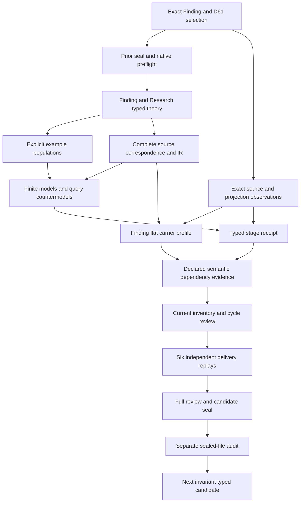

# Finding: types and logical formalization review

## 1. Exact target and current stage

This review selects cal.definition.finding@1.0.0-candidate.1 under the current C53 decision. Its source digest is bf994ee8ec8731e4f09db9b427bda4ab4925407c1bec7ecddd971e53a0554400. The target-specific meaning is an evidence-bounded,attributable conclusion derived from one or more Research Runs or Evidence Sets. Claim wording must not exceed its support,and limitations and the challenge route remain explicit. A Finding is not automatically a governing decision or policy. The source also retains a complete Research context from D61;that investigation cannot be silently equated with the Finding conclusion.

All seven native author,builder,model,source,profile,dependency and inventory producers have actual terminal-zero results and empty stderr. The initial source producer failed its copied normalized-target criterion;the exact original attempt remains preserved. The three independent typed-stage checks qualified the frozen stage,and the six independent full-delivery checks now have actual terminal-zero results,empty stderr and byte-matched original output. Finalization and a separate sealed-file audit determine candidate package delivery. This is a partial interpretation:source-owner fidelity,accepted carrier correspondence and whole-definition proof remain pending. The complete episode and its final review remain active.

## 2. Source lineage and admission boundaries

C53 exact current Definition and D61 source-use admission are bound to their decision,authorization,manifest and source selection bytes. The selected local Research H2 section is2,840bytes at ace1c0c50ec2ecf0e2a6df9d9a855cb30f6ad4f763ae2a4589da4ea586e5b4fb. The source admission retains four separate target definitions:Evidence Set,Finding,Research Inquiry and Research Run. A shared D61 section does not merge their meanings or instance identities. The retained Finding source_ref body remains historically candidate-unadmitted with a null embedded source admission reference despite its current C53 overlay.

C12 separately selects the exact CAL-NORMALIZE-01 model and defaults as a definition-migration planning baseline. Its bound normalization and validation receipt hashes are checked. The accepted D61 migration disposition is split across four semantic and four carrier targets. The retained semantic-finding prototype remains prototype-scaffold with authority effect none;its normalized classification matches the accepted planning model. C12 planning selection,C53 Definition/source-use admission and current C70 carrier admission do not replace acceptance of this translation by its source owner.

A distinct DefinitionContext carries semantic.finding,definition,type.definition,scope.knowledge-development and CAV2-D61 lineage. Each selected Finding maps to that declared context,which has a nonempty handle and declared accepted source relation. This preserves reconstruction classification without treating the Finding conclusion itself as a canonical Definition or authority grant. The source owner still needs to accept the concrete normalized-context and instance-role correspondence,including the retained historical source posture and current admission evidence.

## 3. Sorted carriers and qualified symbols

Nineteen nonempty sorts distinguish Finding,DefinitionContext,DerivationBasis,ResearchContext,Question,Scope,Project,Goal,SourceMaterial,Observation,Method,EvidenceItem,Limitation,Route,Time,ClaimWording,SupportBound,SiblingTarget and Token. These typed domains prevent a Finding from replacing Research,a claim phrase from replacing its support bound,or a Goal from replacing a Project. Printed handles may coincide across sorts without becoming typed identity equality. Concrete cross-artifact identity maps remain independent owner-review obligations.

Six Token constants represent the empty handle and exact normalized concept,kind,carrier,owner scope and source lineage. Forty-one total functions retain the Finding context,question,scope,wording,support bound and challenge route;each derivation basis's Research context;and the Research question,scope,Project,method,times and routes. The remaining functions retain explicit nonempty handles,source provenance and observation-origin references. One hundred nine predicates and relations describe declared structure,derivation,Research membership,role separation,sibling references and independent actual outcomes.

Every symbol is qualified by the exact Finding source and interpretation scope. Separately selected Evidence,Evidence Set,Research Run and authority definitions are dependency references rather than axiom sets silently assembled into this T. There are no current Goal or Project Definition identities in the inspected registry;they remain descriptive sorts. ResearchContext,DerivationBasis,ClaimWording and SupportBound also must not acquire invented Definition IDs merely because the model needs them. Their accepted denotations and identity maps remain explicit residue.

## 4. Finding genus and wording bound

FindingSelected is equivalent to a ConclusionRecordDeclared together with EvidenceBoundedConclusionDeclared. Selected Findings require AttributableFindingDeclared,FindingLimitationsDeclared,a declared Question and Scope,a declared ClaimWording and SupportBound,and a declared nonempty challenge route. Finding,question,scope,wording,bound and route handles are checked. These predicates describe the supplied candidate interpretation;they do not assert that an actual conclusion is correct or that an investigation occurred.

WordingWithinSupportDeclared relates separately typed ClaimWording and SupportBound objects. It is a necessary declaration for each selected Finding. The source wording does not justify inventing a lexicographic order on opaque strings,an evidence-volume threshold,a probability score or a universal sufficiency test. Actual wording adequacy and support adequacy therefore remain separate predicates and countermodel targets outside T. A nonempty rationale or support-state label cannot be substituted for the missing accepted comparison semantics.

An owner-reviewed support comparison must explain what propositions the wording commits to,what the selected evidence supports,under which question/scope/currentness conditions,and which limitations constrain the claim. This candidate retains those boundaries rather than constructing an ungrounded automatic assessor. The proposed WordingWithinSupport relation and its concrete carrier implementation need source-owner acceptance. A model satisfying the declaration relation is evidence about its typed structure,not proof of real-world epistemic sufficiency.

## 5. Derivation bases and Research correspondence

Each selected Finding must include at least one DerivationBasis. Every included basis is declared,has a nonempty handle,and is labeled ResearchRunBasisDeclared or EvidenceSetBasisDeclared. The source allows derivation from one or more Runs or Sets. The theory therefore does not universally require both categories,nor assert that the basis subkind predicates are exclusive. Accepted concrete Run and Set references and their directional maps are separate obligations;this descriptive basis carrier does not collapse their actual identities.

The basisResearchContext function maps every included basis to a selected ResearchContext. FindingDerivesFromResearch and the inverse ResearchFindingReference must both be declared for that exact pair. Finding question and scope equal the mapped Research question and scope. Question equality retains the explicit source Findings.question = Research.question. Exact Scope equality is a proposed bounded association requiring acceptance;broader scope inclusion is not silently supplied. Multiple bases may map to different Research contexts that retain the same declared question and scope.

ResearchContextSelected is exactly the set of contexts referenced by selected Findings through included bases. This qualified selection limits where Research structural constraints apply. It does not claim to enumerate every real investigation or every object called Research. A declared derivation edge and nonempty reference do not authenticate actual experiment execution,source provenance or conclusion acceptance. The finite models retain plural derivation and one-category examples to keep the source's one-or-more boundary distinct from a carrier's stronger field requirements.

## 6. Complete referenced Research structure

A selected Research context requires declared bounded investigation,attribution and ephemeral record character. It preserves question,scope,Project,method,created and updated times,owner route and challenge route,with declarations and nonempty handles. At least one declared Goal must be linked;the example population includes plural Goals. Sources,observations,supporting evidence,counterevidence,limitations and Finding references retain separate collection declarations. These constraints preserve the full bound Research source rather than discarding it because the target is Finding.

Included SourceMaterial requires declaration,nonempty handle and provenance reference. Included Observations require declaration,nonempty handle and origin reference. Included supporting and counterevidence items require declaration,nonempty handle and provenance reference. Support and counterevidence membership may overlap. Neither a complete force partition nor exclusive evidential categories are asserted. Method,Project,Goals and routes remain explicit typed objects rather than being hidden inside a support-assessment text field.

Collection declaration and populated membership are distinguished. The source's retained tuple provides fields,while actual lifecycle requirements may determine when additional members must exist. The theory permits empty optional Research member sets when their collection declarations remain present. Example populations supply source,observation,support,counterevidence and limitation members without turning each witness into a universal cardinality rule. The one-or-more derivation and Goal requirements are separately enforced,so this choice does not erase explicit source cardinalities.

## 7. Separate Finding references and challengeability

Each ResearchFindingReference from a selected Research context points to a selected Finding,with exact question equality,a nonempty Finding handle and a declared FindingDerivesFromResearch edge. This preserves both the identity and direction of the source's Findings derives_from Research statement. It does not treat the Research evidence aggregate itself as a Finding. The target conclusion genus and the source investigation genus remain separately typed even when their printed handles or source lineage match.

Finding and Research limitations use separate membership relations over Limitation objects. Every included limitation is declared and has a nonempty handle. The Finding challenge route is explicit;Research retains both owner and challenge routes. These declarations do not prove practical challengeability,authorized principals,review responsiveness or correct limitations. The distinction matters for concrete integration:a field carrying a route string can be valid while its endpoint,ownership or review procedure remains unresolved.

Actual truth of a referenced Finding has its own source-linked countermodel query. A Research record can preserve a Finding reference and all declared derivation/question maps while ActualFindingTruth remains false. This prevents the source reader from inheriting synthesis as established fact merely through a reference. A separately supported actual Finding may still be true. The theory does not deny legitimate conclusions;it leaves the required support,acceptance and source semantics outside unqualified structural inference.

## 8. Research outcome absence and non-collapse

ResearchOutcomeFieldPresent is false on selected Research contexts. Research-specific role guards exclude Goal,Project,experiment,Finding,owner decision,canonical Definition,proof by existence,execution authority and authority by promotion. These are Research boundaries. Applying Research-not-Finding to the Finding target would contradict its stated conclusion genus and erase the requested formalization. The model therefore records them only on ResearchContext and explicitly retains that separation as an owner-review finding.

Finding-specific role guards exclude treating the conclusion as the aggregate,Research context,Research Run,Evidence Set,Goal,Project,experiment,decision,policy,Definition,specification,product claim,proof by Finding existence,execution authority,authority by promotion or Research Inquiry. Such declared guards do not establish universal concrete identity inequality. Source precedence and integration must confirm that a downstream object does not silently play a prohibited role or import authority from its classification or support label.

Finding actual outcomes and Research actual outcomes are independently sorted. The Research source's prohibition on silently turning an aggregate into a conclusion,decision,Definition,specification or product claim is mapped to ResearchActual outcome queries. It is not misread as a prohibition on Finding being a declared conclusion. Finding promotion and Research promotion each have a separate authority countermodel query. Their declarations can coexist with records without granting actual authority or excluding independently admitted governing decisions.

## 9. Sibling meanings,time and lifecycle

The D61 split preserves separate Evidence Set,Finding,Research Inquiry and Research Run meanings. A declared Finding sibling-meaning assignment requires an explicit nonempty SiblingTarget reference. This necessary reference guard does not establish actual meaning adoption,identity equivalence or an admitted Typed Relation. Concrete mappings must retain the sibling target's independent validation purpose,source selection and owner route. The model includes both a valid explicit-reference witness and negative missing-reference and empty-handle controls.

Research created and updated refs are independent Time objects with declarations and nonempty handles. No temporal order,retention duration or arithmetic is invented. Reversed declared labels can remain structurally valid because the source does not specify an ordered temporal calculus. EphemeralRecordDeclared preserves record-at-a-time character without introducing deletion behavior or migration operations. Neither time strings nor provenance strings authenticate the separately declared live producer or actual currentness.

The Finding carrier adds its own created/updated timestamps,Finding state,support state,successor references and revision history. Those fields are inspected separately from the bound Research tuple. Their regexes,enums and superseded-successor condition do not become source axioms automatically. An accepted lifecycle correspondence must explain which Finding event changes a record,which owner decision a revision cites and which currentness claim is justified. That implementation and consumer mapping remain pending at this typed stage.

## 10. Source account and logical compilation

All nonempty source strings under voices,boundaries,scope and claim ceiling are inventoried with selector,character offsets and excerpt digests. Twenty-four source units become thirty-four mapped spans:eleven encoded,nine explanatory and fourteen deferred. Repeated Research and sibling boundaries remain separately accounted. Complete character coverage is an accounting result;it does not establish equivalence between prose and the proposed typed theory. Historical admission text and current selection evidence remain explicit rather than being rewritten as axioms.

The theory has fourteen primitive formulas for Finding genus,classification,Finding structure,derivation,Research selection and structure,Goals,sources,observations,evidence,limitations,Finding refs,role separation and conditional sibling references. The eleven encoded source spans contain nine distinct formula values,including conjunctions of the primitives and source-specific Research-only role guards. Source testable conditions remain observation obligations. The formal Research tuple is represented through separate context functions and references rather than being used as an alternative Finding definition.

There are no assumptions or assumption links. Thirty-seven separately qualified current Definition dependencies retain source,Research,Run/Set,evidence,assessment,identity and authority meanings without composing them into primary T. Twenty-one required populations supply explicit selected/outside,Run/Set/plural derivation,wording bound,Research and Finding membership,Goal,time,sibling and promotion examples. One hundred nine predicate/relation populations remain unresolved. Seventeen owner findings retain null review references and pending source fidelity;no stage check supplies that missing acceptance.

## 11. Finite models,queries and source observations

The independent evaluator checks151authored finite controls:47satisfyT,97violateT and7malformedmodels are rejected. Positive controls preserve separate Finding and Research identities,independent actual-outcome labels,overlapping evidence membership,nonexclusive declared basis subkinds,empty optional members,independent time refs and objects outside selected scope. Negative controls target context classification,required declarations and handles,derivation cardinality,basis qualification,Question/Scope mismatch,missing Research/Finding links,wording bounds,Research structure,prohibited roles and conditional sibling references.

T and its required example population policy remain distinct. Controls can satisfy T while failing plural derivation,promotion,counterevidence or explicit sibling examples. Thirty-eight qualified query targets have supplied T/I countermodels with false targets and true witness conditions. They distinguish Finding actual support/wording adequacy,truth,acceptance,governing outcomes and runtime effects from Research actual promoted conclusions and authority. The source-linked reference query prevents automatic truth inheritance from Research Finding refs. No whole-definition mechanized proof or actual outcome verification is claimed.

The native source checker observes exact Definition/v1 schema validity,current C53 selection,authorization/manifest/source-use bindings,candidate registry identity,historical source posture,C12 planning/prototype classification and every source-query excerpt. Two pure renders reproduce the human Definition projection without changing the source. Only the pure bound H2 extractor recovers D61 from the selected local whole file,whose hash matches the admitted source-use record. This proves selected local bytes and projection behavior,not authenticated live producer identity,currentness or accepted semantic translation.

## 12. Qualified flat-carrier observations and dependency DAG

The actual Finding checker observes143catalogrows121admitted-current contracts and the exact C70 Finding/v1 type binding the C53 Finding Definition. Its retained artifact body remains candidate-unadmitted with authority effect none. Current generic Definition/v2 binds its own Definition meaning;historical Definition/v1 remains the selected source representation. Eighteen actual checks bind catalog selection,Definition meaning,artifact/schema digests,generator and validator sources,flat shape and pure projections. Neither overlay admission nor the retained body is silently promoted to semantic translation acceptance.

Thirty-four qualification profiles have32rejections. Sixteen axes preserve Finding identity,kind,source,normalized Definition context,question,scope,wording,support bound,derivation basis,separate Research context,limitations,owner/challenge,siblings,carrier,lifecycle and revision. Forbidden conclusions include Finding-as-Research,the Research-not-Finding boundary erasing the Finding conclusion genus,classification-as-Definition-authority,promotion-as-grant,declared wording pairs as actual adequacy,handles as authenticated provenance,Run-or-Set becoming universally both,Finding references proving truth,Research outcome fields being silently allowed,type admission as instance admission,schema states proving truth,revision handles proving owner review,chronological order and C12/C53/C70 as translation fidelity. A finite hypothesis guard is not a real-world investigation or universal semantic proof.

Sixty-nine finite map frames have64rejections and5acceptances. Twenty source obligations require proposed correspondence or explicit residue:question,scope,wording,support bound,Run-or-Set derivation,separate Research context,Project,Goals,sources,observations,method,support and counter items,limitations,Finding references,Research outcome absence,times,routes,siblings and Definition context. Claimed full alignment requires an accepted-map reference for every obligation,owner review and claim scope. Synthetic reference strings in a hypothetical frame are not evidence of actual accepted maps. Changed qualification,lost obligation,missing accepted-map reference,collapsed source roles,unreferenced sibling assignment,the both-basis strengthening,imported carrier lifecycle and actual-outcome claims are rejected. Carrier and consumer alignment remain unaccepted.

Thirty historical Definition shape probes have5acceptances. One hundred seventeen direct Finding carrier probes have26acceptances. The actual carrier is closed and flat with23requiredrootfields,21ofwhich the artifact calls required semantic fields;status and authority_effect account for the other two. It has neither payload nor relation_refs and the artifact declares no relation_roles. The four retained hostile fixtures are rejected. Missing fields,blank strings,duplicate or excessive reference members,implicit extra fields,wrong kind or authority effect,missing support-assessment fields,invalid support-state and superseded-without-successor are rejected. These results do not invent an endpoint role observer or a relation-model binding absent from this artifact.

The schema requires nonempty research_run_refs and evidence_set_refs,evidence_refs and limitations. The source permits one-or-more ResearchRuns OR EvidenceSets,nonexclusively. Run-only and Set-only shape probes therefore fail the carrier while source models permit either basis. This is a concrete stronger representation requirement,not proof of source equivalence. The carrier adds inquiry_ref,concrete support-state/rationale,Finding lifecycle,successors and revision history. It omits explicit flat Project,Goals and method fields,whose extra-field probes fail;referenced Research context may carry them only through an accepted correspondence. No speculative consumer map is treated as accepted merely because references have strings.

The five Finding states and five support states yield25shape-valid products when superseded has a successor. Current with contradicted support remains accepted as a shape. Whether that combination is a useful contested record,an error or a legitimate lifecycle state requires independent owner policy;schema acceptance establishes none of those conclusions. A supported label does not prove adequacy and a current label does not authenticate freshness. Overclaimed statement and ceiling text can be shape-valid. The actual source wording/support relation remains declared,with truth and adequacy outside T.

Timestamps are checked by a digit pattern rather than authenticated chronology or calendar validation. Impossible calendar components and reversed created/updated order are shape-valid. Revision records require revision_id,rationale,decision_ref and a nullable predecessor. Unresolved decision handles,duplicate revisions and a self-predecessor remain accepted. These are actual schema limitations observed by probes,not source-authorized cyclic history or accepted review. The required successor on a superseded record does not prove that the successor exists,is distinct,has accepted provenance or carries the correct revision semantics.

Two pure artifact renders and two pure fixture renders reproduce checked-in projections while preserving the supplied fixture. The bound package validator source is hash-checked but its receipt-writing function is not executed. No carrier writer,native or live consumer,new relation or authority is created. Direct field validation,pure projections,qualified mapping hypotheses and source theory remain separate evidence surfaces.

The execution DAG requires source and prior-seal preflight before signature and formulas,then correspondence,populations,finite controls and source observations. The frozen typed receipt precedes closure evidence. Actual flat-carrier inspection and whole inventory evidence qualify six independent delivery checks,followed by this review,candidate seal and separate read-only audit. Interface Claim-Support Compatibility Invariant must wait for that actual audit before creating its new unit.

The local declared graph has 131 qualified nodes,1729 edges and 60 missing counterpart packets. The joint graph has 132 nodes,1763 edges and 60 missing counterpart packets. Its unresolved components have [71] members and [1298] internal edges. Every edge denominator still requires independent review. The acyclic work DAG does not classify semantic cycles or prove a joint shared-meaning model.

The refreshed inventory observes 72 partial typed drafts and 111 missing current identities. Counts are 1657 source units,2204 mapped spans,689 encoded,585 explanatory,930 deferred clauses,823 required and 3261 unresolved populations. Every supplied draft has a freshly evaluated T/I witness. Finding contributes37declaredsemanticuses;the earlier qualified sources and edges remain retained. Whole-owner-accepted translations and whole-definition proofs remain zero.

The new process-local static snapshot reuse validates the snapshot with the original resolver before and after work. Only equal canonical serialized bytes can reuse that static result;different or unserializable inputs delegate to the original. Returned proof objects are deep copies. Live repository checks always delegate and are never reused. The original verifier is restored before the final revalidation or on body failure. Fifteen adversarial and differential checks observed exact original fault behavior,mutation rejection,result isolation,live delegation,IR equivalence and restoration. The sealed shared verifier files are unchanged;source correspondence,IR compilation,graph logic and all per-definition model evaluations still run independently.

The inventory report records 2 original static checks,216 equal-byte reuses,2 live delegations and zero live reuses. The dependency report records 2 original static checks,71 equal-byte reuses,1 live delegations and zero live reuses. These counters describe static validation reuse,not skipped semantics or a new proof. Fresh replay must reproduce the complete deterministic reports and actual terminal output.

## 13. Preservation,owner findings and continuation

The frozen typed receipt retains all16stageinputs,four successful producer command results and three independent terminal-zero replays. Its full_delivery_sealed flag remains false as a historical stage boundary even after later candidate delivery. This separate review records later evidence without changing those inputs. All5,958previoussealedfiles and201selectedsourcefiles remain current preservation obligations. The retained initial source failure has actual exit one,successful_producer false and no produced source report;its original expected semantic.evidence-set criterion is preserved and the corrected current semantic.finding criterion is independently checked.

All seven successful native producers and six full-delivery checks are actual observed terminal results. Their empty stderr,exact commands and output comparisons are audited alongside the candidate source,typed signature,complete character account,query obligations,populations,models,qualified profiles,source observations,graph delta,inventory count and original static verifier restoration. The manifest uses globally sorted paths. The separate read-only audit checks the exact sealed current set before the next unit can appear. Delivery success remains a verified partial candidate package,not accepted whole translation.

The original episode scope remains183currentidentities189admittedversions201sourcefiles121tasks511planningedges797SWUs and36frontiers. Seventy-two partial typed drafts leave111currentidentities without their per-definition T. Immutable historical I04 still records its selected eight drafts and requires a separately scoped reporting update. Source-owner fidelity,accepted carrier and consumer maps,whole proofs,cycle classification and the final complete episode review remain required. No source precedence finding or population review is silently resolved by the receipt.

Continue F03-T.cal.definition.interface-claim-support-compatibility-invariant after the Finding delivery audit. Start with its exact C53 Definition and D47 source,qualified types and logical guards. Preserve five claim classes,claim/evidence compatibility,proxy limits,owner route and residue. Distinguish browser observations from cognitive,attention,perception,trust,comprehension,delight and real-user success claims. Keep actual calibrated fixtures,owner approval,support adequacy and downgrade/route/block execution outside mere reference declarations or model labels. The source's cross-reference to D38 must be explicit correspondence rather than silently imported accepted semantics.

The seventeen pending owner findings below remain visible and unresolved. Preserve canonical authorities,private/live state,unrelated dirty work and earlier seals. Candidate tests create no publication,deployment or runtime authority. The full goal stays active until the whole original episode and its final aspect-by-aspect explanation are actually complete and verified.

- **FINDING-FINDING-001** — C53 current Finding Definition/source-use admission,C12 accepted normalization planning,retained prototype scaffold and C70 flat Finding carrier remain separate from translation-owner fidelity.

- **FINDING-FINDING-002** — Normalized semantic.finding/type.definition/scope.knowledge-development belongs to DefinitionContext,not a grant of canonical Definition or decision authority to a Finding record.

- **FINDING-FINDING-003** — Finding denotes a declared evidence-bounded attributable conclusion;bound Research investigation is preserved in separate referenced ResearchContext rather than making Finding itself Research or an aggregate.

- **FINDING-FINDING-004** — A Finding derives from one-or-more explicit ResearchRun or EvidenceSet bases;those descriptive basis labels and ResearchContext maps require accepted concrete Run/Set identities and directional correspondence.

- **FINDING-FINDING-005** — Finding question equals each referenced ResearchContext question;the source target does not independently supply this field,so the accepted target/source Question and Scope projection remains pending.

- **FINDING-FINDING-006** — Claim wording not exceeding support is a declared WordingWithinSupport relation between separately typed Wording and SupportBound;no opaque-string order or actual adequacy theorem is invented.

- **FINDING-FINDING-007** — ResearchContext preserves Project,one-or-more Goals,method,sources/observations,support/counterevidence,limitations,Finding references,created/updated and owner/challenge routes. There are no current Goal/Project Definition identities.

- **FINDING-FINDING-008** — Research.outcome absence,Research-not-Finding and the source exclusions of silently promoted aggregate conclusions apply to ResearchContext. Separate ResearchActualOutcome queries preserve those exact source boundaries without erasing the Finding target conclusion genus.

- **FINDING-FINDING-009** — Finding and referenced Research Context limitations and explicit challenge routes preserve declaration structure without proving practical challengeability or owner authority.

- **FINDING-FINDING-010** — Source/provenance,wording/support,Question/Scope,temporal and route handles do not authenticate actual investigation,source currentness,origin,adequacy,truth or acceptance.

- **FINDING-FINDING-011** — Required collection declarations do not force every ResearchContext membership or Finding limitations collection nonempty;the source target requires one-or-more derivation bases and those are independently enforced.

- **FINDING-FINDING-012** — Research supporting and counterevidence membership may overlap;Finding truth and claimed support-state labels remain independent outcomes.

- **FINDING-FINDING-013** — Finding and Research Context exclude aggregate/decision/Definition/policy/proof/execution roles as applicable;promotion declarations do not establish actual authority and actual independently supported outcomes are not denied.

- **FINDING-FINDING-014** — D61 split source does not merge Finding,EvidenceSet,ResearchInquiry or ResearchRun identities;declared sibling assignments need explicit nonempty sibling refs,but actual adoption and Typed Relations remain separate.

- **FINDING-FINDING-015** — Created/updated research refs are independent and un-ordered;ephemeral Research declarations do not introduce retention/deletion behavior or the richer flat carrier revision lifecycle as source axioms.

- **FINDING-FINDING-016** — Current Finding carrier requires Run refs and Set refs simultaneously,concrete support assessment and lifecycle/revision fields. Full source correspondence,universal mandatory support interpretation and accepted consumer mappings remain unresolved.

- **FINDING-FINDING-017** — Exact selected local D61 H2 recovery and source-use admission do not authenticate live producer repository identity/currentness or establish source-owner fidelity and whole-definition proof.

Earlier sealed files preserved by this native unit: **5958**. Actual source observations: **39**; exact projection: **6683 bytes** at **660c7dd53bb34fc18b23b65cbd6669a1eecaaa52c84d68dfbf78fc0226b6bad1**.
