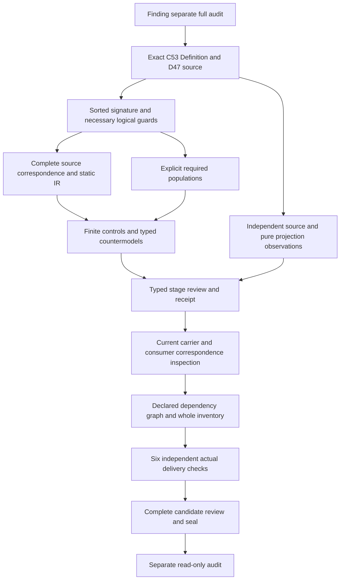

# Interface Claim-Support Compatibility Invariant: next typed candidate

This is preparation for F03-T.cal.definition.interface-claim-support-compatibility-invariant. No next native unit,interpretation,source-owner acceptance,carrier admission or proof is created by this document. Finding must pass its full sealed-file audit first. Types and logic precede carrier inspection.

The selected current Definition is cal.definition.interface-claim-support-compatibility-invariant@1.0.0-candidate.1,admitted by C53,at evidence/migrations/cyberalchemy-v2-to-lab/candidates/0004-artifact-reconstruction-pipeline/layers/l1-semantic-repeatability/definitions/interface-claim-support-compatibility-invariant/v1/definition.json. Its digest is59775ceff8eff5c7683b8c2513b669a0b20b3b38a5f93c124e62d2fd28c4ced7. Its normalized context is semantic.interface-claim-support-compatibility-invariant,type.invariant,invariant,scope.ux-ui. The retained source body and C12 planning scaffold remain separate from the current C53 admission overlay and translation-owner fidelity.

The exact bound extractor selects D47 from the local whole-file copy /home/vlad_/projects/cyberAlchemy-v2/authority/definitions/DEFINITIONS.md. The whole-file digest isecfbd64f334954809e83ffd5d4f9adfb759f39716de96c3ac1227d4ee869c6f8. It strips trailing section whitespace and adds exactly one newline. The section is3,068bytes atf8d187d383d536b6e4271808161e7d103173380b89f3774692faefff76b37e2b,matching the selected Definition and C53 source-use admission CAL-SOURCE-FULL-DEFINITION-QUEUE-035. That admission has exactly one target. A naive raw H2 slice includes an extra trailing newline and has a different digest;native verification must use the bound extractor. Exact selected local bytes do not authenticate the separately declared live producer repository or its currentness.

Proposed sorts are Invariant,InterfaceClaim,ClaimClass,EvidenceKind,ProxyLimit,OwnerRoute,Residue,Context and Token. Each sort remains separate;an Invariant is neither an interface claim nor its evidence kind. Proposed total functions retain claim-to-invariant and the five IEB tuple projections:claimClass,evidenceKind,proxyLimit,ownerRoute,residue. Context and explicit identity handles qualify the tuple. Normalized invariant identity,kind,carrier,scope and D47 source-lineage tokens are separate functions. Empty handles fail selected declaration guards;nonempty strings do not prove external reference resolution.

ClaimClass has declared HardGate,SoftFlag,ScreenshotReview,HumanStudy and NotAutomatable labels. Applicable claims must select a class with at least one of those labels. The source says at minimum one of five;it does not provide an accepted universal exhaustive taxonomy,ordering,exclusive label algebra or numeric UX score. Preserve that uncertainty rather than importing the flat schema of another artifact or identifying hard gates with every deterministic claim. Any single-valued projection and label overlap policy remain explicit candidate correspondence decisions.

Class/evidence matching should be a typed relation ClassEvidenceMatches(ClaimClass,EvidenceKind,Context),qualified by context. ProxyLimitStatesUnproven(ProxyLimit) is a declared necessary condition. The source says a claim is valid only when the class matches evidence and the proxy limit states what remains unproven. Preserve this as ValidClaimDeclared implies matching and declared limit;do not silently replace the necessary condition by an iff or infer actual validity from matching references. Actual compatibility,adequate disclosure and truthful evidence need owner-reviewed denotations.

Browser-supported direct topics retain page load,accessibility tree,keyboard,layout,interaction,screenshot,trace,console/network and DOM measurement as distinct labels. The source says automation may directly support these claims;it does not make every browser observation truthful,adequate,complete or automatically classed as a hard gate. Human topics retain cognitive,attention,perception,trust,comprehension,delight and real-user success. A browser can prepare evidence for them. Preparation must not silently become deterministic authority.

For an applicable human-topic claim using browser evidence,a declared deterministic-authority posture requires both declared calibrated fixtures and declared owner approval. Either missing declaration rejects that posture. Declaration and reference guards alone still do not prove real calibration,actual approval,causal human outcomes or governing authorization. Calibrated fixtures and approval are necessary conditions,not a sufficient authority-creation rule. The actual authority prohibition and its concrete enforcement remain deferred source obligations with explicit typed queries.

WeakerEvidenceDeclared requires at least one DowngradeDeclared,RouteDeclared or BlockDeclared response plus an explicit treatment reference. The comparison remains context-qualified and declared;no universal numeric strength order is imported. The D38 cross-reference must be preserved as a separate current qualified dependency and source correspondence obligation. It does not automatically import the earlier Claim-Support theory,its owner fidelity,its treatment taxonomy or an executed governing block into the D47 primary theory. Treatments can coexist unless an accepted owner rule requires exclusivity.

The invariant excludes ValidatorImplementationRole,CompleteAccessibilityAuditRole,UserResearchRole and UniversalUXScoreRole. A declared dense-expert blocking posture requires a declared false-positive calibration;the source does not license arbitrary blocking or prove actual false-positive rates. Actual blocking,fixture execution,accessibility compliance,human-study results and dense-expert usability remain outside declaration-level T. Source operational examples specify applicability,not evidence that these activities already ran.

Required populations should include an invariant with no actual outcomes,an outside-scope claim,one declaration witness for each five class labels,a valid-declared matched tuple without actual truth or authority,a matched tuple that is not declared valid,each weaker-evidence treatment,each direct browser topic,each human topic with preparation without authority,and a human deterministic-posture declaration with both fixture and approval declarations. Model universes may contain overlapping labels;tests must exercise that candidate policy without claiming owner acceptance. A dense-expert declared blocker with false-positive calibration demonstrates only the necessary guard.

Finite controls must reject malformed models,missing tuple handles,wrong normalized identity,unclassified selected claims,valid-declared mismatches,unstated proxy limits,missing owner/residue,weak-evidence claims without treatment,missing treatment handle,human deterministic posture missing either fixture or approval,and dense-expert blocking without false-positive calibration. Controls should accept outside-scope records,matched-but-not-valid records,plural treatments,label overlap,separate direct topics,preparation without authority and independent actual outcome predicates. Countermodels should retain T and required populations while falsifying actual truth,adequacy,human understanding,calibration,owner approval,authority,complete audit,executed remediation,consumer alignment and source-owner fidelity. Do not turn successful finite controls into a whole proof.

Every nonempty source string leaf must enter the character account. Split normalized classification,browser/direct and browser/human passages,IEB tuple and necessary validity,weak-evidence response,operational scope and boundaries with exact excerpt hashes. Keep plain/domain intuition explanatory. Artifact test conditions remain separate schema/source/projection observations. Source queries must retain exact original excerpts and typed targets outside T. All precedence losses require visible owner findings with null acceptance references.

The work DAG is acyclic;semantic dependency cycles retain independent review. Whole episode scope remains183currentidentities189admittedversions201sourcefiles121tasks511planningedges797SWUs36frontiers. This preparation reduces none of those obligations and does not resolve owner fidelity,whole proof,carrier alignment,cycle classification or the final complete episode review.
