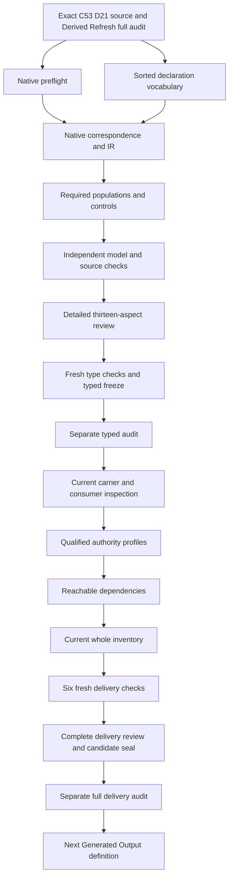

# Four-Facet Artifact Invariant: full candidate delivery review

This full candidate packet retains the separately audited sixteen-input typed stage and its unchanged thirteen-aspect review. It adds current carrier/consumer inspection,profiles,dependencies,whole inventory,six fresh checks and exact preservation evidence. Separate full sealing and audit remain required before the next native unit. This candidate interpretation selects `cal.definition.four-facet-artifact-invariant@1.0.0-candidate.1`. It formalizes four required facets, explicit binding/creation/residue alternatives, declared continuation and machine-check fields, and conditional promotion-effect records. It has source fidelity pending, semantic readiness false, no accepted whole translation and no whole-definition proof. Its finite models expose incomplete declarations and unsupported inference. They do not execute governed actions, create real facet surfaces, authorize continuation, validate artifacts or grant promotion.

The prior Derived Refresh full delivery preserved 8,148 candidate files and passed a separate actual audit before native creation. The preflight verified those exact bytes, all 201 source files, the original work unit and prepared controls. There are now 92 native candidate interpretations against 183 current identities, leaving 91 without native T files. The fresh current inventory records all 92 partial drafts and freshly evaluates one supplied T/I witness for each. This full candidate delivery still distinguishes verified partial drafts from accepted whole translations.

## 1. Exact source, admission and normalization

The selected Definition digest is `0950ccce0030dbd4fe8eab26ca6955ab0df1acae5e22dbb50a34e3e3a81c7af7`. C53, the full-definition queue admission, supplies its admitted-current overlay. The source checker verifies the exact decision, authorization, manifest, source-admission record and Definition selection. C53 records zero consumer activations. Admission of the Definition therefore does not accept this translation or activate a four-facet runtime.

The bound D21 Four-Facet Action Method selection is 5,680 bytes, with digest `a2415da3e46575c762f7464d63f0d23725549edc45621dc49819619d45196fba`, at admitted lines 1186 through 1303. The current external whole-file digest remains `ecfbd64f334954809e83ffd5d4f9adfb759f39716de96c3ac1227d4ee869c6f8`. The Definition's embedded source still says candidate-unadmitted and has a null source-admission reference, while the later C53 record admits the exact selection for Definition use. Both postures are retained. The normalized invariant scaffold remains a prototype with authority effect none, and its accepted source relations are not silently converted into acceptance of this candidate theory.

## 2. Sorted vocabulary and opaque denotations

The vocabulary has 21 nonempty sorts, 24 constants, 78 total functions and 136 predicate/relation signatures, totaling 259 declarations. ActionReference identifies a governed-action candidate; InvariantReference identifies its governing invariant. BindingReference is a facet record, FacetTag identifies one of the four required slots, and SurfaceReference names a bound or created surface. ClassificationReference and CatalogReference separate an assignment from its owning classification vocabulary. SchemaReference names the structural description. HumanViewReference and MachineViewReference keep continuation and checking views distinct.

ResidueReference, ReasonReference, OwnerRouteReference and EvidenceReference give missing-facet records, reasons, responsible routes and supporting evidence separate carriers. ActionEffect and PromotionEffect are distinct sorts, so a continue/defer/block declaration cannot accidentally stand for a promotion disposition. SourceReference, ScopeReference, SemanticIdentity and TypeReference keep source, applicability, identity and classification separate. Token contains explicit empty/none markers, record modes and opaque nonempty descriptions.

A nonempty supplied domain is a model representation requirement, not evidence that an owner, catalog, view or action exists. Total functions nominate fields and handles identify declared nonempty references. Binding relations make missing or conflicting values observable. Symbols are qualified by the exact source version and candidate scope. Shared names across prior theories do not establish shared meanings, and no whole prior theory is imported.

## 3. Applicability and governing invariant identity

ActionApplicable is equivalent to ActionInScopeDeclared. Each selected action has exact invariant, owner-route, source, scope, identity, type and effect bindings. Its scope is CURRENT_SCOPE, its effect is NONE, and its source is declared current and owner-approved. These are declarations for the candidate record; actual governed-action selection and source authority remain separate query targets.

The governing invariant reference equals TARGET_INVARIANT. Its exact identity, scope, type and source bindings equal INVARIANT_ID, SHARED_SCOPE, INVARIANT_TYPE and D21_SOURCE. INVARIANT_ID, METHOD_ID and SIBLING_ID are distinct constants. This keeps the normalized invariant target separate from primitive method wording and other targets rather than merging identities because they share a source lineage. The action's own identity and type are independent fields.

Outside actions remain available to test scope. A prohibited authority inference on an outside subject does not change the selected theory. Actual scope completeness and the correspondence between a governed action and this invariant remain owner-review matters. The theory does not enumerate every repository action or prove that every load-bearing operation has been captured.

## 4. Four required tags and residue as a record

RequiredFacetDeclared is equivalent to membership in the four distinct tags K, S, H and M. They denote classification/taxonomy, schema, human continuation and machine-checkable state. The model also includes an outside tag, which is not required. Adding it to the required relation fails. This makes the number and meaning of the required slots explicit rather than relying on a prose heading or a selector's return value.

The source tuple has five components because R records typed residue for missing facets. R is not a fifth required facet. ResidueReference therefore remains a separate sort linked to an action and one of the four tags. A missing schema can be carried as schema-tagged residue without creating a fifth-slot obligation or pretending a schema surface already exists.

The distinction matters for exploration. The method forbids silent absence but does not require four complete surfaces before work begins. All four slots may be represented by residue with reasons, owners, evidence and effects. Whether actual work may proceed depends on the independently governed effect and permission semantics, not on counting a residue record as a completed implementation.

## 5. Binding coverage, additional records and overlap

Every selected action and required tag has a nominated declared binding record. BindingRecordForDeclared must include that record, and every additional record for the same action/tag must have complete typed action, facet, mode and source fields. The source does not say each facet has exactly one record. Additional complete records are permitted, while a hidden record with the wrong action, tag or source fails.

Each record nominates bound, created or residue mode. Its nominated alternative must be explicitly declared. Additional coherent alternatives may coexist: the baseline has a record with both an existing-bound and created-surface declaration. Those links use the same nominated surface and satisfy their respective conditions. The method is not translated into an unsupported exclusive-choice axiom.

The baseline also has two records for the machine facet, one carrying residue and another binding a surface. Removing the additional complete record leaves the primary theory true but makes the required multiple-record witness false. Removing the nominated schema record makes theory coverage fail even when its total selector still returns a reference. Nomination, coverage, cardinality and inhabitation are separate obligations. Their accepted source-to-record correspondence remains pending.

## 6. Existing and created surface declarations

Every declared existing-bound or created-surface link for a selected record matches its nominated surface. The surface has declared nonempty owner-route and source bindings, and its source matches the record's source. An existing-bound surface is declared governed. A created surface binds a creator equal to the selected action, with SurfaceCreatedByDeclared equivalent over the supplied action domain to that exact creator.

The hostile controls add hidden surfaces, remove governed posture, change a creator and add a second creator tuple. Each fails. These checks make endpoint and creator coherence visible rather than treating a total surface selector as sufficient evidence. Additional complete binding records remain permitted; hidden incompatible alternatives within a selected record do not.

SurfaceExistence, SurfaceCreation and BindingAuthenticity remain actual query targets. The declared creation relation does not run an action, write a file or prove that the nominated state was produced by that action. The current source and creator maps are candidate correspondences. Actual surface selection, lifecycle, producer execution and owner-approved governance require separate evidence and accepted interpretation.

## 7. Classification and schema facets

A classification-tagged surface binds a ClassificationReference. That record states a kind identity, an owning catalog and a source; its catalog's source also matches the binding source. This distinguishes a kind assignment from the vocabulary that owns it. Classification does not imply ontology membership, promotion or actual source fidelity. ClassificationFidelity and CatalogCurrentness remain independent actual outcomes.

A schema-tagged surface binds a SchemaReference with a nonempty shape description and source. The source permits structural shape, field set, relation shape or validation surface. The candidate therefore uses a declared description rather than requiring all four descriptions simultaneously. An empty description fails; a nonempty opaque description is still not proof that the actual schema is correct or adequate.

The generic Schema meaning and Arcanum's non-normative ancestor remain separate source concerns. No real schema is created, no validator is executed and no schema evolution is accepted here. Actual structural correctness, field completeness, relation typing and authority coupling remain owner-reviewed correspondence obligations. A perfect-schema prerequisite before exploration is explicitly excluded.

## 8. Human continuation view

A human-tagged surface binds a HumanViewReference. It contains exact purpose, status, trust-boundary, blockers, residue, next-owner-route, evidence and source fields. Token-valued descriptions must be nonempty. NONE is allowed to explicitly state no blockers or residue; EMPTY is not an adequate declaration. Owner-route and evidence references are declared, nonempty and typed separately.

The controls remove exact field bindings, add conflicting values and set purpose, status, trust, blockers or residue descriptions to EMPTY. They fail. These are record-completeness checks, not assessments of writing quality or usability. A fully populated view can still be confusing, misleading or stale, so HumanContinuationUsability, OwnerRouteResolution and EvidenceAuthenticity remain independent queries.

Readability does not make a view canonical. The theory excludes HumanReadableIsCanonicalDeclared for selected actions. A human continuation view may explain purpose and route without becoming the machine source of truth, a permission grant or an accepted authority artifact. Its exact content-to-field correspondence and relationship to actual human continuation remain unaccepted.

## 9. Machine-checkable view and named checks

A machine-tagged surface binds a MachineViewReference. Exact fields describe identifier, kind, schema, classification, source of truth, validator/proof handle, projection status, residue and named checks. References are typed and nonempty, and token descriptions must not be EMPTY. Its source of truth matches the selected binding source.

The baseline's additional machine-facet binding ensures these obligations are exercised even though its nominated machine record carries residue. Removing the extra binding may leave the theory true while losing the explicit multiple-record witness; the original baseline still checks the machine fields nonvacuously. Empty proof-handle, projection, residue or named-check descriptions fail.

MachineParsing, NamedCheckExecution and ProofHandleAuthenticity are independent actual outcomes. A proof handle is not a proof, a parseable description is not successful execution, and a machine-checkable view is not authority. The named-check description identifies the intended verification surface; the candidate does not claim proof beyond those checks or run them against a real governed action. Missing operational correspondence remains explicit.

## 10. Typed residue, reason, owner and action effect

Every declared residue link matches the record's nominated ResidueReference. The residue has exact action, facet, reason, owner-route, evidence, action-effect and source fields. Its action and tag match the selected binding record, and its source matches the record source. Its reason contains a nonempty detail and a missing/impossible/deferred kind. Its action effect is continue, defer or block.

The controls omit residue links, add a hidden incompatible residue, change the action or facet, change the source, use an unknown action-effect value and empty the reason detail. Each fails. These checks prevent a generic residue label from concealing which facet is missing, why, who should address it or what the declared disposition is.

ResidueCompleteness, ResidueReasonFidelity, EvidenceAuthenticity and ActionEffectAuthorization remain actual queries. Declared continue does not grant execution authority. Declared block or defer can coexist with four-facet completeness because the method's completeness is distinct from downstream permission. Effect aggregation and precedence among several residue records are not invented; they require independently governed semantics and owner acceptance.

## 11. Conditional promotion effect and independent outcomes

If a selected action asks for promotion, every declared residue also has an exact nonempty PromotionEffect binding distinct from NO_PROMOTION_EFFECT. PromotionEffect is a separate sort from ActionEffect. The source does not define its full vocabulary, so the model does not invent a promote/defer/block promotion policy or derive permission from the record.

The baseline mixed action asks for promotion and carries an explicit promotion-effect record on its residue. Missing that field relation or replacing it with the no-effect marker fails. A control removes the promotion request; the primary theory remains true while the required promotion-request witness fails. Asking, recording an effect and obtaining authorization are different facts.

Thirty actual-outcome predicates remain unassumed. The mixed action has independently supplied actual authority, while the all-residue action has all actual outcomes false. The declaration theory therefore permits independent support without entailing authority, promotion, validation, proof, trust, adoption, publication or deployment. Eighteen forbidden inference predicates prevent classification, readability, checkability, residue or Definition admission from silently granting these outcomes.

## 12. Source accounting and finite verification

All 22 selected source-string units have exact correspondence: seven encoded clauses, nine explanatory clauses and six deferred clauses. The normative statement includes all twelve primitive formulas. The compact formal expression carries binding, residue, conditional promotion and satisfaction rules. Applicability carries binding coverage and satisfaction; boundaries carry exclusions; the sibling-target exclusion carries invariant identity. Five unique selected formula values avoid unnecessary duplication while preserving the complete normative guard set.

Fourteen required populations exercise selected/outside actions, bound/created/residue alternatives, all-residue exploration, continue/defer/block effects, promotion requests, multiple records, overlap and independent authority. The 136 signature populations remain unresolved. The verifier evaluates 226 supplied controls: 39 satisfy the primary theory, 179 fail it and eight reject malformed model structures. The prepared evaluation observes at most 43,631 steps under the unchanged 100,000-step limit. The native input is 236,327 bytes and its qualified IR has 29,150 nodes, within the unchanged byte and tree limits.

Thirty qualified nonentailment queries each have a freshly evaluated theory-and-population model with false actual-outcome target and true all-outcomes-false action witness. Forty-eight concrete source checks cover exact admission/source identity, the D21 selection, two byte-identical 9,551-byte projections and 22 source-query obligations. Two preparation failures are retained: exact declaration-schema field mismatch and an accidental duplicate conflict-control tuple. Both were corrected before native creation. Current author, build, model and source producers terminate zero; no native failure or raised checker limit is concealed.

## 13. Detailed delivery DAG and remaining episode work

Twenty qualified current Definition identities provide Artifact, representation, Schema, schema-evolution, residue, coupling, authority, validation, projection, classification, source, provenance and separation context. General GovernedAction, CraftMethod, facet-binding, continuation-view, machine-view and promotion-effect labels have no silently invented canonical identities. Related identities are not whole-theory imports, and shared denotation remains owner-pending.

The graph is a work dependency DAG. It is separate from the semantic-use graph, whose missing counterparts and cycles must retain their own review status. After three fresh type checks, the typed freeze binds sixteen inputs and receives a separate audit. Full delivery then requires current carrier/consumer observations, explicit unaccepted correspondence obligations, qualified profiles, static-only reuse checks, reachable dependencies, current whole inventory, six fresh checks, a complete delivery review, a candidate seal and a separate full audit. Generated Output may receive a native theory only after that actual audit succeeds.

The original episode remains 183 identities, 189 versions, 201 source files, 121 tasks, 511 planning edges, 797 work units and 36 frontiers. This candidate does not reduce that objective to the existing drafts. The eventual complete review must explain every formalization aspect across the whole scope, including definitions, sorts, clauses, inhabitation, source correspondence, authority, consumers, dependencies and proof obligations. Accepted whole translations and whole-definition proofs remain zero.

### Unresolved source and interpretation findings

- FFA-FINDING-001: Exact C53 admitted-current Definition candidate.1,D21 admitted-for-use selection and candidate-authored body/scaffold are separate;Definition admission does not accept this translation.
- FFA-FINDING-002: Normalized invariant target and primitive action-method source wording are composed explicitly;whole meaning correspondence and source precedence remain pending.
- FFA-FINDING-003: Applicability selects purported governed actions;actual selection completeness and load-bearing meaning remain separate queries.
- FFA-FINDING-004: Four distinct required facet tags are classification,schema,human and machine;typed residue is a separate record,not a fifth required facet.
- FFA-FINDING-005: Each facet has a nominated declared binding but additional complete binding records are permitted;source set/completeness and reference aliases require accepted maps.
- FFA-FINDING-006: A record nominates bound,created or residue mode;additional coherent bound/created/residue alternatives may coexist. Mode/alternative correspondence and exact field representation remain owner pending.
- FFA-FINDING-007: Existing governed surfaces and surfaces created by the action are declarations with exact source/owner/creator links;real surface existence,governance and creation are unassumed.
- FFA-FINDING-008: Classification binds kind and its owning catalog;classification is not ontology membership,promotion or actual fidelity.
- FFA-FINDING-009: Schema shape is an opaque nonempty description of structural/field/relation/validation surface;no unsupported requirement that every alternative schema description exist simultaneously.
- FFA-FINDING-010: Human purpose,status,trust,blockers,residue,next route and evidence are declared fields;NONE may explicitly record no blockers/residue,and usability is not proved.
- FFA-FINDING-011: Machine identifiers,kind,schema,classification,source,validator/proof handle,projection,residue and named-check description are declared;actual parsing/checks and proof authenticity are separate.
- FFA-FINDING-012: Typed residue links missing/impossible/deferred facet,reason,owner route,evidence and continue/defer/block effect;true reason,authentic evidence and effect authorization remain queries.
- FFA-FINDING-013: Conditional promotion requests require explicit nonempty promotion-effect records on each declared residue;promotion-effect vocabulary and authority are not invented.
- FFA-FINDING-014: Four-facet completeness can coexist with block or defer residue;effect aggregation and downstream permission require independent governed semantics.
- FFA-FINDING-015: Exploratory actions with all facets carried as residue may satisfy the method;perfect schemas and one required file format are not imposed.
- FFA-FINDING-016: Named machine-check descriptions bound the intended checks;the candidate does not execute a validator or establish proof beyond that surface.
- FFA-FINDING-017: Source tests for identity,digest,schema and pure regenerated projection remain concrete checks with unassumed semantic query obligations.
- FFA-FINDING-018: Four Artifact,representation,Schema and schema-evolution consumer labels do not accept carrier or consumer maps;canonicalness,authority and promotion stay independent.
- FFA-FINDING-019: No whole prior Artifact,Representation,Schema,Residue,Craft,Authority,Decision or validation theory is imported into the primary theory.
- FFA-FINDING-020: D21 whole-file/current section coordinates are exact observations;embedded source metadata and earlier observation roots are preserved without owner equivalence acceptance.
- FFA-FINDING-021: Shared denotations,dependency cycles,source-owner acceptance and whole-definition proof remain pending across the original183identity episode.
- FFA-FINDING-022: No actual governed action,surface creation,facet adoption,validation,proof,canonical instance,promotion,publication or external effect is performed.

### Current full delivery observations

The reachable graph has 140 nodes, 2306 edges, 49 missing counterpart packets and 1 unresolved cycle. The joint graph has 141 nodes, 2340 edges, 49 missing counterpart packets and 1 unresolved cycle. Every prior joint edge is preserved; this definition contributes twenty direct semantic-use edges. Edge completeness still requires independent review, and no common-carrier or shared-meaning model is claimed.

The inventory has 92 partial drafts and 91 missing current drafts. Its exact aggregate counts are 1092 deferred clauses, 882 encoded clauses, 758 explanatory clauses, 2732 mapped clauses, 1111 required populations, 2152 source units, 4781 unresolved populations. All 201 original source bytes remain current. All 8,148 previously sealed candidate files retain their recorded hashes. Original planning scope remains 121 tasks, 511 planning edges, 797 work units and 36 frontiers. The count is evidence of candidate preparation,not source-owner acceptance or whole proof.

Six independent fresh commands terminate zero with empty stderr: interpretation contract,models,source,profiles,reachable dependencies and current inventory. The current 226 controls include eight malformed-model rejections. Profiles include 32 cases with 31 rejections and 85 mapping frames with 84 rejections. Fifteen differential/adversarial static-reuse checks preserve live verification and model evaluation. Checker byte,tree,step andtimeout limits remain unchanged. Two retained preparation failures remain linked;no native producer or typed freeze failed. These are exact current observations,not evidence that earlier unrelated episode attempts never failed.

### Four-Facet Artifact Invariant: carrier and consumer correspondence

The separate typed-stage audit passed before these observations. This inspection passes 32 exact-source/catalog/projection checks, 41 Definition probes with 10 schema acceptances, 18 current Schema probes with four acceptances, and three supplied F4-only model comparisons. No source-to-carrier or consumer map is accepted. Source fidelity remains pending, semantic readiness false, accepted whole translations zero and whole-definition proofs zero.

The exact C53 admitted-current invariant Definition, shared-authority invariant normalization, and D21 admitted-for-definition-use action-method selection are preserved separately. The Definition's candidate-authored body still says it is not admitted; the later registry overlay is retained without rewriting that body or interpreting admission as translation acceptance. The normalization scaffold remains a prototype, not a real action, facet instance or promoted authority. Its source relationships do not establish an accepted bridge from the primitive action method to every statement in this normalized invariant theory.

The current Artifact Type registry has 143 contract rows, 121 admitted-current. No current contract directly binds this Four-Facet Definition, or the current Invariant or Residue Definition versions. Generic Definition/v2 binds Definition meaning only. Current Schema/v1 binds current Schema meaning under C70. Absence of a direct binding is a catalog observation; it does not mean the concepts are absent from the repository or deny independently supported instances. An accepted correspondence must name its exact source, carrier version, scope, field mapping, owner and claim ceiling.

Six exact current meanings were inspected: Four-Facet Artifact Invariant, Artifact, Canonical Representation Invariant, Schema, Schema Evolution Invariant and Residue. Each selected Definition passes its own v1 JSON schema. Two isolated pure projections equal the checked-in DEFINITION.md bytes without mutating their inputs. Only the pure esc/bullets/render function AST nodes execute. Neither a carrier writer nor a live consumer entry point runs. Shape validity and deterministic rendering are bounded observations; they do not execute the method or import the six theories into F4.

The Definition schema rejects ten proposed facet-operation root fields. Missing required Definition fields fail. Nonempty unresolved definition/owner/term references, empty source/consumer lists and four unsupported membership/canonicalness/proof/promotion statements remain shape-valid. These probes show why a successful Definition projection cannot establish that an actual governed action binds all facets, names an authentic owner, checks the stated machine obligations or has effect authority. A prose field is preserved as prose, including an incorrect statement deliberately placed there as a hypothetical adversarial fixture.

Current Schema/v1 has a closed payload containing schema_ref, dialect, subject_kind_ref, content_digest and conformance_profile_ref. All five are nonempty strings. It requires a relation to an implementation or successor schema, and fixes authority_effect to none. The schema rejects missing payload fields, empty relation lists, promotion as the authority effect, and seven proposed facet/view/residue/effect payload extensions. Opaque refs, an uncomputed content digest and unsupported four-facet/promotion claim text remain shape-valid. There is no direct operational four-facet contract inside this Schema carrier.

A generic Schema carrier can be a candidate for part of the S facet only after an exact correspondence is reviewed. It cannot silently become the K/H/M facets or a complete residue record. A schema may express structural shape, field sets, relation shape or a validation surface; the source does not demand every alternative simultaneously. The candidate's schemaShape description is opaque and nonempty. Its meaning, correctness, completeness, dialect interpretation, digest computation and validator results remain independent evidence obligations.

The four primary consumer labels resolve exactly to current Artifact, Canonical Representation Invariant, Schema and Schema Evolution Invariant Definitions. These are semantic source selections, not directory existence checks or actual consumer execution. They establish the labels' current denotations, while selector completeness, reverse maps, lifecycle selection, coupling to actual artifacts and shared meanings remain unaccepted. The local F4 comparison models do not import those upstream theories or prove their joint consistency.

The first comparison retains mixed bound/created/residue declarations, an additional complete machine binding and an all-residue exploratory action. It satisfies both the selected theory T and all required witness populations I. The second removes the extra machine binding record; the nominated machine residue still covers that facet, so T stays true, while the required multiple-binding witness is false. The third selects only the all-residue exploratory action; T remains true with explicit block/defer/continue residue effects, while I is false because several mixed-surface witnesses are unavailable. T satisfaction, populated demonstration cases and actual permission are separate questions.

Typed residue is not a fifth required facet. It states the missing/impossible/deferred facet, reason, owner route, evidence and continue/defer/block action effect. Promotion requests require a separately typed explicit promotion effect. The candidate invents no promotion vocabulary or authorization rule. Four-facet completeness can coexist with a block/defer residue declaration; it cannot by itself justify downstream continuation or promotion. Actual reasons, authentic evidence, route resolution and effect authority must be mapped and reviewed separately.

Human continuation fields contain purpose, status, trust boundary, blockers, residue, next route and evidence. NONE explicitly records no blocker/residue and is distinct from silent EMPTY. Machine fields name identifiers, kind, schema, classification, source, validator/proof handle, projection status, residue and named checks. Nonempty descriptions and refs remain insufficient evidence of usability, parsing, execution or proof authenticity. Machine-checkability reaches only its named checks and does not grant authority or prove everything expressed in a document.

### FFA-CONSUMER-FINDING-001

Exact C53 Definition admission,shared-scope invariant normalization and admitted-for-definition-use D21 action method have distinct roles. No current contract directly binds FourFacet,Invariant or Residue Definition and no translation acceptance is fabricated. Status: unresolved; accepted map references: none.

### FFA-CONSUMER-FINDING-002

Definition schema rejects facet-operation fields but accepts unsupported membership,canonicalness,machine-proof and promotion claims as text;pure projections preserve that text without enforcing the method. Status: unresolved; accepted map references: none.

### FFA-CONSUMER-FINDING-003

Current C70 Schema/v1 payload contains five opaque schema/dialect/kind/digest/profile refs,not four facet or typed-residue records. Shape-valid uncomputed digests and overclaim text supply no accepted bridge to actual schema correctness or FourFacet. Status: unresolved; accepted map references: none.

### FFA-CONSUMER-FINDING-004

Typed residue is not a fifth facet. Missing/impossible/deferred reasons,owner routes,evidence,continue/defer/block action effects and conditional promotion effects require exact governed carrier and authorization maps;four-facet completeness can coexist with block/defer. Status: unresolved; accepted map references: none.

### FFA-CONSUMER-FINDING-005

Nominated and additional binding records,overlapping bound/created alternatives,all-residue exploration,NONE view descriptions and opaque named-check/proof handles remain candidate representation choices. Supplied models distinguish theory satisfaction from required witness populations and actual execution. Status: unresolved; accepted map references: none.

### FFA-CONSUMER-FINDING-006

Four exact semantic consumer labels resolve to current Definition sources but do not establish consumer selection completeness,shared coupling,reverse maps,view usability,validator execution or accepted authority correspondence. Status: unresolved; accepted map references: none.

The next correspondence work must propose exact maps or retain explicit residue for every field, vocabulary, scope and interpretation choice. Review must decide the normalized invariant/action-method composition, nomination and multiple-binding semantics, overlapping alternatives, view description meaning, conditional effect vocabulary and consumer completeness. Each decision needs a source-owner record and an appropriate validation surface. Additional finite controls can expose inconsistencies, but cannot manufacture that acceptance.

The consumer work DAG is source/currentness → typed freeze and separate audit → exact catalog/shape/source observations → three comparison models → qualified map obligations → dependency/inventory refresh → six fresh checks → full candidate review/seal → separate delivery audit. Whole translation acceptance, shared consistency and whole proof stay downstream. Generated Output native creation remains gated by the full F4 candidate audit. The original 183-identity episode remains active.

### Next source and remaining closure

Generated Output source-only preparation passes 18 checks, accounts 21 source units and compares two pure 4,410-byte projections. It preserves C65 admission separate from the candidate-authored body and candidate-unadmitted review-source metadata. Native Generated Output T/models remain absent until the full F4 seal and separate actual audit pass. Its formalization must retain the explicit Artifact Type exception for canonical status, exact canonical inputs and governed generator version, reproducibility, lineage and parity, while leaving actual execution,digest computation,contract authenticity and authority independent. Projection Specification and Representation Revision follow in the existing queue.

Full candidate verification cannot close source precedence,source-owner translation acceptance,current carrier/consumer maps,shared consistency,cycle interpretation or whole proof. The original episode goal remains active across 183 identities. The eventual episode-wide review must explain each formalization aspect and audit every original requirement. This packet is one concrete, preserved and tested partial translation in that continuation.
