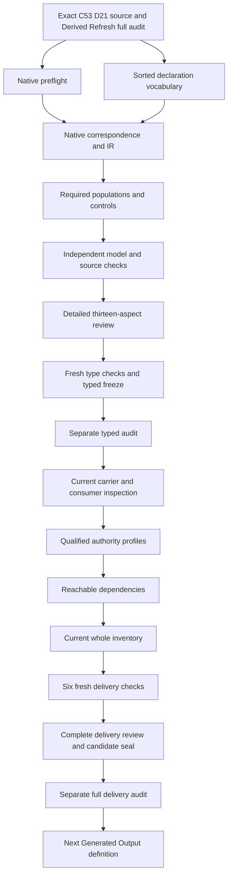

# Four-Facet Artifact Invariant: types and logic review

This candidate interpretation selects `cal.definition.four-facet-artifact-invariant@1.0.0-candidate.1`. It formalizes four required facets, explicit binding/creation/residue alternatives, declared continuation and machine-check fields, and conditional promotion-effect records. It has source fidelity pending, semantic readiness false, no accepted whole translation and no whole-definition proof. Its finite models expose incomplete declarations and unsupported inference. They do not execute governed actions, create real facet surfaces, authorize continuation, validate artifacts or grant promotion.

The prior Derived Refresh full delivery preserved 8,148 candidate files and passed a separate actual audit before native creation. The preflight verified those exact bytes, all 201 source files, the original work unit and prepared controls. There are now 92 native candidate interpretations against 183 current identities, leaving 91 without native T files. The latest complete whole inventory still records 91 partial drafts until the current inventory refresh. This typed stage preserves the distinction between a newly authored candidate and complete delivery evidence.

## 1. Exact source, admission and normalization

The selected Definition digest is `0950ccce0030dbd4fe8eab26ca6955ab0df1acae5e22dbb50a34e3e3a81c7af7`. C53, the full-definition queue admission, supplies its admitted-current overlay. The source checker verifies the exact decision, authorization, manifest, source-admission record and Definition selection. C53 records zero consumer activations. Admission of the Definition therefore does not accept this translation or activate a four-facet runtime.

The bound D21 Four-Facet Action Method selection is 5,680 bytes, with digest `a2415da3e46575c762f7464d63f0d23725549edc45621dc49819619d45196fba`, at admitted lines 1186 through 1303. The current external whole-file digest remains `ecfbd64f334954809e83ffd5d4f9adfb759f39716de96c3ac1227d4ee869c6f8`. The Definition's embedded source still says candidate-unadmitted and has a null source-admission reference, while the later C53 record admits the exact selection for Definition use. Both postures are retained. The normalized invariant scaffold remains a prototype with authority effect none, and its accepted source relations are not silently converted into acceptance of this candidate theory.

## 2. Sorted vocabulary and opaque denotations

The vocabulary has 21 nonempty sorts, 24 constants, 78 total functions and 136 predicate/relation signatures, totaling 259 declarations. ActionReference identifies a governed-action candidate; InvariantReference identifies its governing invariant. BindingReference is a facet record, FacetTag identifies one of the four required slots, and SurfaceReference names a bound or created surface. ClassificationReference and CatalogReference separate an assignment from its owning classification vocabulary. SchemaReference names the structural description. HumanViewReference and MachineViewReference keep continuation and checking views distinct.

ResidueReference, ReasonReference, OwnerRouteReference and EvidenceReference give missing-facet records, reasons, responsible routes and supporting evidence separate carriers. ActionEffect and PromotionEffect are distinct sorts, so a continue/defer/block declaration cannot accidentally stand for a promotion disposition. SourceReference, ScopeReference, SemanticIdentity and TypeReference keep source, applicability, identity and classification separate. Token contains explicit empty/none markers, record modes and opaque nonempty descriptions.

A nonempty supplied domain is a model representation requirement, not evidence that an owner, catalog, view or action exists. Total functions nominate fields and handles identify declared nonempty references. Binding relations make missing or conflicting values observable. Symbols are qualified by the exact source version and candidate scope. Shared names across prior theories do not establish shared meanings, and no whole prior theory is imported.

## 3. Applicability and governing invariant identity

ActionApplicable is equivalent to ActionInScopeDeclared. Each selected action has exact invariant, owner-route, source, scope, identity, type and effect bindings. Its scope is CURRENT_SCOPE, its effect is NONE, and its source is declared current and owner-approved. These are declarations for the candidate record; actual governed-action selection and source authority remain separate query targets.

The governing invariant reference equals TARGET_INVARIANT. Its exact identity, scope, type and source bindings equal INVARIANT_ID, SHARED_SCOPE, INVARIANT_TYPE and D21_SOURCE. INVARIANT_ID, METHOD_ID and SIBLING_ID are distinct constants. This keeps the normalized invariant target separate from primitive method wording and other targets rather than merging identities because they share a source lineage. The action's own identity and type are independent fields.

Outside actions remain available to test scope. A prohibited authority inference on an outside subject does not change the selected theory. Actual scope completeness and the correspondence between a governed action and this invariant remain owner-review matters. The theory does not enumerate every repository action or prove that every load-bearing operation has been captured.

## 4. Four required tags and residue as a record

RequiredFacetDeclared is equivalent to membership in the four distinct tags K, S, H and M. They denote classification/taxonomy, schema, human continuation and machine-checkable state. The model also includes an outside tag, which is not required. Adding it to the required relation fails. This makes the number and meaning of the required slots explicit rather than relying on a prose heading or a selector's return value.

The source tuple has five components because R records typed residue for missing facets. R is not a fifth required facet. ResidueReference therefore remains a separate sort linked to an action and one of the four tags. A missing schema can be carried as schema-tagged residue without creating a fifth-slot obligation or pretending a schema surface already exists.

The distinction matters for exploration. The method forbids silent absence but does not require four complete surfaces before work begins. All four slots may be represented by residue with reasons, owners, evidence and effects. Whether actual work may proceed depends on the independently governed effect and permission semantics, not on counting a residue record as a completed implementation.

## 5. Binding coverage, additional records and overlap

Every selected action and required tag has a nominated declared binding record. BindingRecordForDeclared must include that record, and every additional record for the same action/tag must have complete typed action, facet, mode and source fields. The source does not say each facet has exactly one record. Additional complete records are permitted, while a hidden record with the wrong action, tag or source fails.

Each record nominates bound, created or residue mode. Its nominated alternative must be explicitly declared. Additional coherent alternatives may coexist: the baseline has a record with both an existing-bound and created-surface declaration. Those links use the same nominated surface and satisfy their respective conditions. The method is not translated into an unsupported exclusive-choice axiom.

The baseline also has two records for the machine facet, one carrying residue and another binding a surface. Removing the additional complete record leaves the primary theory true but makes the required multiple-record witness false. Removing the nominated schema record makes theory coverage fail even when its total selector still returns a reference. Nomination, coverage, cardinality and inhabitation are separate obligations. Their accepted source-to-record correspondence remains pending.

## 6. Existing and created surface declarations

Every declared existing-bound or created-surface link for a selected record matches its nominated surface. The surface has declared nonempty owner-route and source bindings, and its source matches the record's source. An existing-bound surface is declared governed. A created surface binds a creator equal to the selected action, with SurfaceCreatedByDeclared equivalent over the supplied action domain to that exact creator.

The hostile controls add hidden surfaces, remove governed posture, change a creator and add a second creator tuple. Each fails. These checks make endpoint and creator coherence visible rather than treating a total surface selector as sufficient evidence. Additional complete binding records remain permitted; hidden incompatible alternatives within a selected record do not.

SurfaceExistence, SurfaceCreation and BindingAuthenticity remain actual query targets. The declared creation relation does not run an action, write a file or prove that the nominated state was produced by that action. The current source and creator maps are candidate correspondences. Actual surface selection, lifecycle, producer execution and owner-approved governance require separate evidence and accepted interpretation.

## 7. Classification and schema facets

A classification-tagged surface binds a ClassificationReference. That record states a kind identity, an owning catalog and a source; its catalog's source also matches the binding source. This distinguishes a kind assignment from the vocabulary that owns it. Classification does not imply ontology membership, promotion or actual source fidelity. ClassificationFidelity and CatalogCurrentness remain independent actual outcomes.

A schema-tagged surface binds a SchemaReference with a nonempty shape description and source. The source permits structural shape, field set, relation shape or validation surface. The candidate therefore uses a declared description rather than requiring all four descriptions simultaneously. An empty description fails; a nonempty opaque description is still not proof that the actual schema is correct or adequate.

The generic Schema meaning and Arcanum's non-normative ancestor remain separate source concerns. No real schema is created, no validator is executed and no schema evolution is accepted here. Actual structural correctness, field completeness, relation typing and authority coupling remain owner-reviewed correspondence obligations. A perfect-schema prerequisite before exploration is explicitly excluded.

## 8. Human continuation view

A human-tagged surface binds a HumanViewReference. It contains exact purpose, status, trust-boundary, blockers, residue, next-owner-route, evidence and source fields. Token-valued descriptions must be nonempty. NONE is allowed to explicitly state no blockers or residue; EMPTY is not an adequate declaration. Owner-route and evidence references are declared, nonempty and typed separately.

The controls remove exact field bindings, add conflicting values and set purpose, status, trust, blockers or residue descriptions to EMPTY. They fail. These are record-completeness checks, not assessments of writing quality or usability. A fully populated view can still be confusing, misleading or stale, so HumanContinuationUsability, OwnerRouteResolution and EvidenceAuthenticity remain independent queries.

Readability does not make a view canonical. The theory excludes HumanReadableIsCanonicalDeclared for selected actions. A human continuation view may explain purpose and route without becoming the machine source of truth, a permission grant or an accepted authority artifact. Its exact content-to-field correspondence and relationship to actual human continuation remain unaccepted.

## 9. Machine-checkable view and named checks

A machine-tagged surface binds a MachineViewReference. Exact fields describe identifier, kind, schema, classification, source of truth, validator/proof handle, projection status, residue and named checks. References are typed and nonempty, and token descriptions must not be EMPTY. Its source of truth matches the selected binding source.

The baseline's additional machine-facet binding ensures these obligations are exercised even though its nominated machine record carries residue. Removing the extra binding may leave the theory true while losing the explicit multiple-record witness; the original baseline still checks the machine fields nonvacuously. Empty proof-handle, projection, residue or named-check descriptions fail.

MachineParsing, NamedCheckExecution and ProofHandleAuthenticity are independent actual outcomes. A proof handle is not a proof, a parseable description is not successful execution, and a machine-checkable view is not authority. The named-check description identifies the intended verification surface; the candidate does not claim proof beyond those checks or run them against a real governed action. Missing operational correspondence remains explicit.

## 10. Typed residue, reason, owner and action effect

Every declared residue link matches the record's nominated ResidueReference. The residue has exact action, facet, reason, owner-route, evidence, action-effect and source fields. Its action and tag match the selected binding record, and its source matches the record source. Its reason contains a nonempty detail and a missing/impossible/deferred kind. Its action effect is continue, defer or block.

The controls omit residue links, add a hidden incompatible residue, change the action or facet, change the source, use an unknown action-effect value and empty the reason detail. Each fails. These checks prevent a generic residue label from concealing which facet is missing, why, who should address it or what the declared disposition is.

ResidueCompleteness, ResidueReasonFidelity, EvidenceAuthenticity and ActionEffectAuthorization remain actual queries. Declared continue does not grant execution authority. Declared block or defer can coexist with four-facet completeness because the method's completeness is distinct from downstream permission. Effect aggregation and precedence among several residue records are not invented; they require independently governed semantics and owner acceptance.

## 11. Conditional promotion effect and independent outcomes

If a selected action asks for promotion, every declared residue also has an exact nonempty PromotionEffect binding distinct from NO_PROMOTION_EFFECT. PromotionEffect is a separate sort from ActionEffect. The source does not define its full vocabulary, so the model does not invent a promote/defer/block promotion policy or derive permission from the record.

The baseline mixed action asks for promotion and carries an explicit promotion-effect record on its residue. Missing that field relation or replacing it with the no-effect marker fails. A control removes the promotion request; the primary theory remains true while the required promotion-request witness fails. Asking, recording an effect and obtaining authorization are different facts.

Thirty actual-outcome predicates remain unassumed. The mixed action has independently supplied actual authority, while the all-residue action has all actual outcomes false. The declaration theory therefore permits independent support without entailing authority, promotion, validation, proof, trust, adoption, publication or deployment. Eighteen forbidden inference predicates prevent classification, readability, checkability, residue or Definition admission from silently granting these outcomes.

## 12. Source accounting and finite verification

All 22 selected source-string units have exact correspondence: seven encoded clauses, nine explanatory clauses and six deferred clauses. The normative statement includes all twelve primitive formulas. The compact formal expression carries binding, residue, conditional promotion and satisfaction rules. Applicability carries binding coverage and satisfaction; boundaries carry exclusions; the sibling-target exclusion carries invariant identity. Five unique selected formula values avoid unnecessary duplication while preserving the complete normative guard set.

Fourteen required populations exercise selected/outside actions, bound/created/residue alternatives, all-residue exploration, continue/defer/block effects, promotion requests, multiple records, overlap and independent authority. The 136 signature populations remain unresolved. The verifier evaluates 226 supplied controls: 39 satisfy the primary theory, 179 fail it and eight reject malformed model structures. The prepared evaluation observes at most 43,631 steps under the unchanged 100,000-step limit. The native input is 236,327 bytes and its qualified IR has 29,150 nodes, within the unchanged byte and tree limits.

Thirty qualified nonentailment queries each have a freshly evaluated theory-and-population model with false actual-outcome target and true all-outcomes-false action witness. Forty-eight concrete source checks cover exact admission/source identity, the D21 selection, two byte-identical 9,551-byte projections and 22 source-query obligations. Two preparation failures are retained: exact declaration-schema field mismatch and an accidental duplicate conflict-control tuple. Both were corrected before native creation. Current author, build, model and source producers terminate zero; no native failure or raised checker limit is concealed.

## 13. Detailed delivery DAG and remaining episode work

Twenty qualified current Definition identities provide Artifact, representation, Schema, schema-evolution, residue, coupling, authority, validation, projection, classification, source, provenance and separation context. General GovernedAction, CraftMethod, facet-binding, continuation-view, machine-view and promotion-effect labels have no silently invented canonical identities. Related identities are not whole-theory imports, and shared denotation remains owner-pending.

The graph is a work dependency DAG. It is separate from the semantic-use graph, whose missing counterparts and cycles must retain their own review status. After three fresh type checks, the typed freeze binds sixteen inputs and receives a separate audit. Full delivery then requires current carrier/consumer observations, explicit unaccepted correspondence obligations, qualified profiles, static-only reuse checks, reachable dependencies, current whole inventory, six fresh checks, a complete delivery review, a candidate seal and a separate full audit. Generated Output may receive a native theory only after that actual audit succeeds.

The original episode remains 183 identities, 189 versions, 201 source files, 121 tasks, 511 planning edges, 797 work units and 36 frontiers. This candidate does not reduce that objective to the existing drafts. The eventual complete review must explain every formalization aspect across the whole scope, including definitions, sorts, clauses, inhabitation, source correspondence, authority, consumers, dependencies and proof obligations. Accepted whole translations and whole-definition proofs remain zero.

### Unresolved source and interpretation findings

- FFA-FINDING-001: Exact C53 admitted-current Definition candidate.1,D21 admitted-for-use selection and candidate-authored body/scaffold are separate;Definition admission does not accept this translation.
- FFA-FINDING-002: Normalized invariant target and primitive action-method source wording are composed explicitly;whole meaning correspondence and source precedence remain pending.
- FFA-FINDING-003: Applicability selects purported governed actions;actual selection completeness and load-bearing meaning remain separate queries.
- FFA-FINDING-004: Four distinct required facet tags are classification,schema,human and machine;typed residue is a separate record,not a fifth required facet.
- FFA-FINDING-005: Each facet has a nominated declared binding but additional complete binding records are permitted;source set/completeness and reference aliases require accepted maps.
- FFA-FINDING-006: A record nominates bound,created or residue mode;additional coherent bound/created/residue alternatives may coexist. Mode/alternative correspondence and exact field representation remain owner pending.
- FFA-FINDING-007: Existing governed surfaces and surfaces created by the action are declarations with exact source/owner/creator links;real surface existence,governance and creation are unassumed.
- FFA-FINDING-008: Classification binds kind and its owning catalog;classification is not ontology membership,promotion or actual fidelity.
- FFA-FINDING-009: Schema shape is an opaque nonempty description of structural/field/relation/validation surface;no unsupported requirement that every alternative schema description exist simultaneously.
- FFA-FINDING-010: Human purpose,status,trust,blockers,residue,next route and evidence are declared fields;NONE may explicitly record no blockers/residue,and usability is not proved.
- FFA-FINDING-011: Machine identifiers,kind,schema,classification,source,validator/proof handle,projection,residue and named-check description are declared;actual parsing/checks and proof authenticity are separate.
- FFA-FINDING-012: Typed residue links missing/impossible/deferred facet,reason,owner route,evidence and continue/defer/block effect;true reason,authentic evidence and effect authorization remain queries.
- FFA-FINDING-013: Conditional promotion requests require explicit nonempty promotion-effect records on each declared residue;promotion-effect vocabulary and authority are not invented.
- FFA-FINDING-014: Four-facet completeness can coexist with block or defer residue;effect aggregation and downstream permission require independent governed semantics.
- FFA-FINDING-015: Exploratory actions with all facets carried as residue may satisfy the method;perfect schemas and one required file format are not imposed.
- FFA-FINDING-016: Named machine-check descriptions bound the intended checks;the candidate does not execute a validator or establish proof beyond that surface.
- FFA-FINDING-017: Source tests for identity,digest,schema and pure regenerated projection remain concrete checks with unassumed semantic query obligations.
- FFA-FINDING-018: Four Artifact,representation,Schema and schema-evolution consumer labels do not accept carrier or consumer maps;canonicalness,authority and promotion stay independent.
- FFA-FINDING-019: No whole prior Artifact,Representation,Schema,Residue,Craft,Authority,Decision or validation theory is imported into the primary theory.
- FFA-FINDING-020: D21 whole-file/current section coordinates are exact observations;embedded source metadata and earlier observation roots are preserved without owner equivalence acceptance.
- FFA-FINDING-021: Shared denotations,dependency cycles,source-owner acceptance and whole-definition proof remain pending across the original183identity episode.
- FFA-FINDING-022: No actual governed action,surface creation,facet adoption,validation,proof,canonical instance,promotion,publication or external effect is performed.
