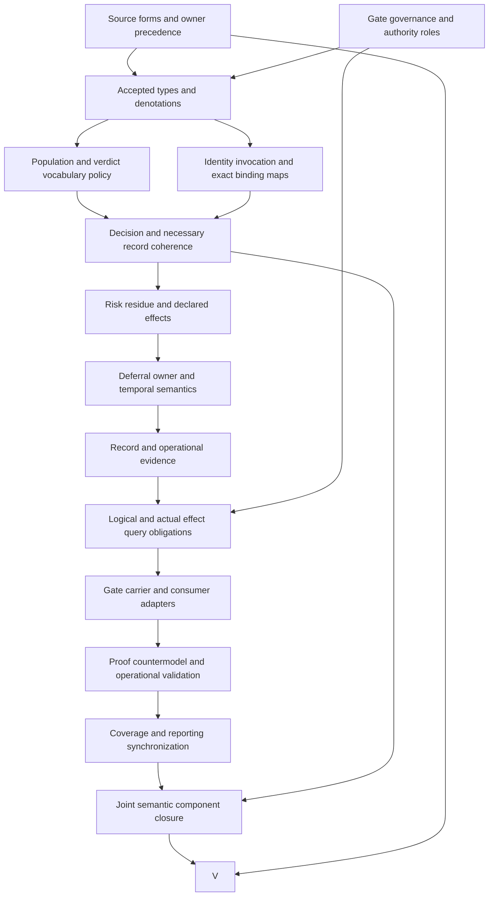

# Gate formalization: forms, types, logic and completion plan

This is a partial candidate analysis of `cal.definition.gate@1.0.0-candidate.1`. Definitions, typed denotations and logical obligations take precedence over executable adapters and broader design work. The selected source is admitted for exact use through C53. Candidate source fidelity remains pending. This review supplies a detailed dependency plan; it does not grant authority or establish whole-definition proof.

## 1. Exact source selection and admission

The selected Definition is bound by digest `29e494b465b013fda1e0ed9eeb6dc8fc17126eb132e15bf153b58db6075e2b97`. The source is selected from the current episode snapshot, rather than from a generated human page or an arbitrary historical version. Its queue admission is checked against the current definition registry, C53 decision, authorization, exact admission manifest and source-use admissions. The retained machine body still carries historical candidate source postures. Admission of those exact bytes for this investigation does not rewrite that body or accept this proposed logical translation.

Two legacy sections contribute to the selected meaning. D5, Promotion Gate, has 1,262 observed section bytes and digest `823d7e6d21278a9feff66b90af90947896439b7a10e68a8d6edb9568feccba93`. D37, Gate, has 2,275 observed section bytes and digest `7db6b46cf9c4d257c05bfe0783b6e60a2f158b0d6bd1685c1b7fd6e1b7428a2b`. Each selected source-use admission, section selector and section digest is checked independently. The local whole file matches its selected admission digest. The declared legacy producer location is absent, and the local copy does not authenticate the producer repository's current state.

A pure section extractor and a pure Definition renderer observe those selected bytes without executing a materialization writer. The two renders are identical: 7,028 bytes, digest `a0a691d5c88ac69428ba16908433c2555f5404cbbc8073806d380bca8eb43316`. The 22 checks in [source-checks.json](source-checks.json) establish these bounded artifact observations. GATE-FINDING-012 retains live currentness, source-role equivalence, owner fidelity and whole-episode closure as pending work.

## 2. Definition forms and exact source correspondence

The analysis preserves scientific/formal, explanatory and domain-oriented source forms, boundaries, applicability and claim ceiling. It inventories 26 source units and accounts for 34 mapped spans. Of those spans, 12 are encoded, 11 explanatory and 11 deferred. The correspondence checker accounts for all selected characters under the declared inventory policy. Character accounting measures coverage of selected text, while accepted meaning requires a separate source-owner review.

The scientific formal statement defines a gate decision function and necessary conditions on an admissible recorded verdict. Normative paragraphs add nine configuration responsibilities, default verdict vocabulary, narrower exceptions and a promotion-specific owner route. The source also states that a flag carries named risk and follow-up, and that a gate can use validators or human decisions. These responsibilities appear explicitly in the candidate. A boundary may have both a deferred whole statement and an independently encoded local guard; counts therefore refer to spans, not to independent axioms or proven propositions.

All four artifact testable conditions remain deferred in the primary theory. They concern selected Definition identity, selected source digests, machine schema shape and generated human projection. They are tested separately against actual artifacts. Encoding their successful observations as axioms would confuse observed file properties with a proposition about a gate's meaning or behavior. [correspondence.json](correspondence.json), [correspondence-check.json](correspondence-check.json) and [clause-analysis.json](clause-analysis.json) retain that distinction. GATE-FINDING-001 leaves normalized identity and source meaning acceptance to the owner.

## 3. Typed carriers, signature and denotations

The interpretation proposes eleven sorts: Meaning, GateConfig, Invocation, Scope, Input, Evidence, Criteria, Verdict, Record, Route and Token. Gate is a predicate on GateConfig, rather than both a sort identifier and a predicate identifier. Meaning represents the normalized concept; GateConfig represents a configured checkpoint; Invocation represents one declared application; Record represents its declared verdict record. These are intentionally distinct candidate domains whose accepted real-world denotations remain open.

The signature has 150 declarations: eleven sorts, eleven constants, 35 functions, 91 unary predicates and two binary predicates. Four verdict constants denote pass, flag, block and defer and are pairwise distinct. Token constants preserve normalized identity, semantic kind, carrier handle, owner scope and two source relation handles. Configuration, invocation and record functions carry typed references. The declared decision function has five arguments because the configuration itself is explicit alongside scope, input, evidence and criteria.

This signature checks whether a reference is used with the declared sort and arity. It does not resolve real owner routes, actual evidence objects, criterion implementations, storage paths or temporal identities. The model domain contains opaque tokens whose interpretation has been supplied for the finite candidate only. GATE-FINDING-002 and GATE-FINDING-003 require accepted carrier maps and reference semantics before runtime bindings are designed. [static-ir.json](static-ir.json) records the qualified declarations and compiled formulas; [t.json](t.json) preserves the source-bound interpretation.

## 4. Normalized meaning and promotion specialization

The meaning predicate requires the selected identity and classification handles, both source relation handles and the declared preservation of source responsibilities without silent meaning merge. These conditions distinguish a normalized semantic identity from an arbitrary configuration. A Gate configuration refers to a Gate meaning, but no formula equates that configuration with the concept or with the original legacy documents. Normalization observations remain evidence about the retained artifact process.

The retained prototype reports D5 with the disposition `collapse` and D37 with `split`. Those exact dispositions are checked as prototype metadata. They do not prove identity equivalence between Promotion Gate and Gate, nor prove that every generic gate is a promotion gate. The proposed specialization is one direction: a PromotionGate is a Gate with an explicit promotion owner route. The finite witness also contains a generic gate that is not a PromotionGate, preserving the distinction for review.

The prototype remains `prototype-scaffold` with authority effect `none`; its schema facet has no admitted Gate schema. Its normalized kind is definition, carrier handle type.definition and owner scope scope.shared-authority. These axes are checked separately, avoiding an inference from one axis to another. An accepted normalization owner decision does not authorize an actual gate invocation or accept the candidate theory. GATE-FINDING-001 requests review of the specialization and source relation; GATE-FINDING-011 leaves carrier and consumer alignment unresolved.

## 5. Configuration responsibilities and verdict vocabulary

A Gate configuration declares owner route, scope, inputs, criteria, possible verdicts, required evidence, residue handling, record location and downstream effect. The candidate represents these as typed references and declaration predicates, with nonempty tokens for the selected reference fields. Each responsibility has negative controls so an empty or missing declaration cannot become a configured gate through the proposed genus formula. The declarations state what a gate promises to make explicit, without claiming that the referenced evidence or policy is adequate.

The source gives four formal verdict codes and also describes a minimum vocabulary unless a narrower vocabulary is explicitly defined. The candidate distinguishes default configurations from configurations marked with a narrower vocabulary. Defaults allow exactly pass, flag, block and defer. The narrower example allows pass and block. Every allowed verdict must have declared meaning, and the narrower vocabulary must be nonempty. A custom verdict with declared meaning is explored in a separate supplied control; it has no accepted actual downstream semantics.

This treatment exposes an unresolved precedence issue rather than resolving it by omission. The formal four-code range, normative minimum language and explicit exception need an owner decision on extension and restriction policy. GATE-FINDING-004 identifies this decision. The completion plan requires that policy before declaring accepted populations, deciding adapter exhaustiveness or deriving implementation cases. Current truth results apply to the proposed policy only. They do not establish that an existing gate implementation supports any candidate vocabulary.

## 6. Invocation and the declared decision function

The candidate declares `G(config, scope, input, evidence, criteria) -> verdict`. A GateInvocation must refer to a Gate configuration, use its declared scope, return the value selected by G on its exact arguments, and choose a verdict allowed by that configuration. A wrong invocation scope, wrong verdict, or disallowed vocabulary result fails the corresponding authored control. This is a coherent declared decision interface suitable for reviewing types and logical preconditions.

The supplied finite G table contains 32 entries, covering two configurations and two elements in each of scope, input, evidence and criteria. Structural checks enforce totality of that declared finite table, typed results and unique function tuples. A missing entry or duplicate entry is rejected before theory evaluation. A positive control changes an unused context value while keeping the invocations coherent, showing that the theory does not invent an actual invocation for every table entry.

A total mathematical function in a supplied interpretation does not prove that a program terminates, produces a deterministic result under changing inputs, or captures a complete evidence snapshot. GATE-FINDING-002 and GATE-FINDING-005 retain algorithm, time and snapshot obligations. The plan therefore accepts function denotation and invocation binding before introducing live adapters. Actual criteria evaluation, evidence checks and transition execution remain independent query targets. No real gate was run while preparing this candidate.

## 7. Necessary record conditions and admissibility

Admissibility is deliberately a one-way implication. An Admissible invocation must be a GateInvocation with a declared recorded verdict. Its record must match the configuration owner route, invocation scope, input, evidence basis, criteria and verdict. The record location must match the configuration location. Its downstream effect must be nonempty and satisfy the declared effect-policy relation. Declared risk or residue presence requires the corresponding named record fields.

These are necessary record conditions. They are not encoded as an equivalence or as a sufficient authorization rule. A positive control removes the admissibility predicate from an invocation that still has a structurally coherent record; the theory remains true while the required population witness changes. An unrecorded invocation remains possible but is not admissible. Those examples prevent record completeness from silently turning into accepted authority or an automatic owner decision.

GATE-FINDING-006 requires accepted record identity, storage semantics, evidence adequacy, authority and acceptance rules. Record presence in a finite interpretation is a declared fact supplied to the evaluator. It does not show that a record was written, persisted, signed, replayed or consumed. Coherent references also do not authenticate their subjects. [model-controls.json](model-controls.json) retains the positive and negative record controls and the independent actual-outcome countermodels. A future executable record carrier must be justified separately against accepted denotations and operational evidence.

## 8. Flag, pass and block effects

The four verdict constants are pairwise distinct, so a Flag verdict cannot also be Pass in the proposed finite interpretation. An admissible flag requires named risk, named follow-up, nonempty risk and follow-up references, declared continuation with risk, and absence of the SilentPass marker. Controls remove each required field or introduce SilentPass and confirm rejection. This protects the declared boundary without asserting that any human has accepted the residual risk or performed the follow-up.

Pass requires a declared continuation effect; block requires a declared stop effect. Those effects belong to the interpretation's declared layer. ActualContinue and ActualStop remain independent predicates, with supplied countermodels in which the gate and admissible record exist while those actual outcomes do not. The distinction prevents a successful local decision or a complete record from becoming evidence of actual continuation, enforcement or safety.

GATE-FINDING-007 and GATE-FINDING-008 retain real risk treatment, follow-up, authorized continuation and stop enforcement. The completion plan first resolves the accepted effect vocabulary and risk references, then defines what operational evidence can establish each actual outcome. A consumer may interpret a stop effect incorrectly or fail after receiving a valid verdict; the candidate does not model such behavior yet. The formal guards identify obligations for that future design and verification work rather than certify an implementation's behavior.

## 9. Defer, residue and owner routing

An admissible defer verdict has a declared deferral effect and a deferred owner route distinct from the current owner route. Route inequality does not establish inequality of human principals. Two routes may reach the same principal, and a principal may hold multiple roles under different scopes. The selected Gate source does not provide the complete route-to-principal and role assignment semantics needed to infer a distinct person or a completed transfer of authority.

The candidate also requires recorded names when RiskPresent or ResiduePresent is declared. This treatment avoids globally requiring risk or residue for every invocation. It leaves the completeness of presence flags, absence claims, classifications and handling protocols unresolved. A pass invocation can acquire a risk-presence declaration, but then needs its own corresponding record; merely having a pass verdict does not make that risk disappear.

GATE-FINDING-009 concerns risk and residue denotation, and GATE-FINDING-010 concerns owner routing and handoff. A future adapter needs accepted mappings for route identity, owner authority, responsibility changes and acknowledgement. Temporal behavior is particularly relevant for deferred work: naming a recipient at one moment does not prove that the recipient later accepted or acted on the task. ActualDeferralOwnerAccepted and ActualDeferralHandoff remain query targets outside T, and no external owner message or live handoff was performed for this draft.

## 10. Logical boundaries, populations and external queries

The theory contains ten primitive formula templates represented across twelve encoded source spans and eight unique encoded formula values. These counts describe formula representation, not theorem coverage. Gate is prevented from collapsing into bureaucracy alone, a checklist item alone, permission without a record, or a correctness-proof role. Fourteen forbidden inference flags retain additional boundaries. Validators and human decisions may both be used without turning their use into actual evidence adequacy, owner acceptance or correctness.

Seventeen required populations supply explicit witnesses for meaning, gate, promotion specialization, a generic non-promotion gate, default and narrower vocabularies, all four default verdicts, two narrower verdicts, an unrecorded non-admissible invocation, validator/human use, flag distinctness and declared objects without actual outcomes. Ninety-three populations remain unresolved. Required populations are candidate witness policy; they are not a universal taxonomy or an assertion that real instances exist.

The query policy has 43 targets: 22 Gate outcome predicates, sixteen admissible-invocation outcomes, flag/pass distinction and four verdict-specific actual-effect questions. Two source boundary obligations are retained exactly in [source-query-obligation.json](source-query-obligation.json), outside T. Their countermodels show non-entailment from this selected candidate, not impossibility under every richer theory. GATE-FINDING-005 through GATE-FINDING-010 retain the actual-outcome maps and source denotations needed before stronger proof obligations can be formulated.

## 11. Supplied models and actual carrier observations

The evaluator checks 138 authored finite controls: 46 satisfy the primary theory, 85 fail it as expected and seven are rejected for malformed model structure. The domains contain one Meaning, two GateConfig elements, seven Invocations, two each of Scope, Input, Evidence and Criteria, five Verdict elements, seven Records, two Routes and 21 Tokens. Every query has an explicitly evaluated T/I countermodel with its selected target false and witness condition true. The controls are supplied examples, not an exhaustive native model search.

Qualified profile checks cover 27 hypotheses, with 25 expected rejections. They bind fourteen independent envelope fields and guard eleven forbidden inferences. The finite record-frame suite has 22 frames, with seventeen expected rejections. It exercises pass, flag, block, defer, an unrecorded invocation without an admissibility claim, ten binding drifts, missing necessary records, silent flag, same-route defer and an unsupported actual-effect claim. These are hypothesis qualification checks, not operational executions.

Seventeen actual catalog/prototype checks inspect 143 registry rows and 121 current rows. No current type directly binds the selected Gate definition. Generic Definition/v2 is current and binds the current Definition@1 meaning; Definition/v1 is retained as historical. Thirty Definition/v1 shape probes have five acceptances, including unresolved names and overclaimed normative prose. Shape acceptance does not validate those meanings. [authority-profile-checks.json](authority-profile-checks.json) retains those observations; GATE-FINDING-011 leaves a Gate-specific carrier and consumer contract pending.

## 12. Dependency closure and detailed completion DAG

Gate declares 34 semantic dependencies. The local graph has 120 nodes and 1,352 edges; the joint declared graph has 121 nodes and 1,386 edges. Sixty counterpart packets remain missing. One unresolved strongly connected component contains sixty members and 904 internal edges. A semantic dependency graph can contain cycles; the implementation completion plan below is a DAG that schedules explicit component review rather than pretending the semantic graph is already acyclic.

The foundations-first parent plan remains 121 tasks, 511 edges, 797 SWUs and 36 frontiers. The parent whole-family acceptance gates remain unsatisfied. The Gate plan refines obligations within that preserved scope, with definitions, types, population policy and logical coherence ahead of runtime adapters. Every node requires reviewable evidence and an explicit acceptance criterion before its successor can close.

| Node | Dependencies | Required deliverable | Completion evidence |
|---|---|---|---|
| S | none | Source precedence and the twelve findings | Recorded owner disposition on both sources and candidate losses |
| A | none | Promotion and generic gate ownership, authority and scope rules | Accepted routes and authority contract |
| T | S, A | Meaning/configuration/invocation/record sorts and denotations | Approved type maps and qualified signatures |
| P | T | Default/narrower/custom vocabulary and population policy | Accepted range, exception and witness obligations |
| I | T | Identity, version, invocation and snapshot bindings | Accepted object and temporal reference maps |
| C | P, I | G semantics and necessary versus sufficient record rules | Accepted formulas and coherence counterexamples |
| B | C | Risk, residue and declared continuation/stop semantics | Accepted names, presence policy and effect contract |
| H | B | Defer route, recipient responsibility and temporal policy | Accepted handoff meaning and principal mapping |
| R | H | Record storage, trace and evidence adequacy requirements | Identified evidence carriers and actual observation criteria |
| E | R, A | Actual outcome queries and proof obligations | Source-aligned obligations without assumed targets |
| Q | E | Executable Gate type and consumer adapters | Exact admitted contracts and adapter mapping evidence |
| D | Q | Proof, countermodel and operational validation package | Appropriate independent checks on accepted theory and adapters |
| F | D | Full coverage and reporting updates | Accepted per-definition coverage with explicit claim ceiling |
| J | F, C | Common-carrier alignment and cyclic component review | Reviewed joint interpretation and classified dependency cycles |
| V | J, S | Whole-definition review and acceptance disposition | Owner fidelity and all required obligations closed |

## 13. Preservation, reproducibility and whole-episode status

The preflight preserves all 4,910 files from the immediately prior EPAI seal and all 201 captured source files. It leaves unrelated dirty work and live/private configuration untouched. Two early builds exposed a sort/predicate namespace collision and an incomplete sort-reference repair. Their exact scripts, diagnostics and logs are retained under attempts. A subsequent metadata correction retained eight exact producer files before correcting inherited report wording and the immediate prior preservation reference; formulas, models, query targets and outcomes did not change. The first fresh replay then exposed one stale inventory reference to the pre-correction model report: five checks exited zero and inventory exited one at its final report comparison. Eighteen exact files are retained under attempt004. Refreshing exactly that input digest leaves all semantic inventory rows, witnesses, counts and graphs unchanged; a new complete replay checks the refreshed binding.

The delivery process requires six actual fresh terminal checks: interpretation contract, authored models, source observations, profile/catalog observations, dependency declarations and current inventory. Sealing binds the exact candidate file set. A separate read-only preservation audit verifies receipt inputs, outputs and the entire sealed set. A successful bounded check must remain reported at its actual claim level; generated receipts and diagrams cannot substitute for accepted semantic review or whole proof.

The refreshed episode inventory contains 61 partial drafts and 122 current identities without a per-definition T draft, out of 183 current identities and 189 admitted versions. Aggregate correspondence counts are 1,393 source units, 1,889 mapped spans, 599 encoded, 484 explanatory and 806 deferred. Required populations total 645; unresolved populations total 2,527. Accepted whole translations and whole-definition proofs both remain zero. The next independent definition priority is Governance Axis Independence Invariant. [current-inventory.json](current-inventory.json) and the sealed [receipt.json](receipt.json) preserve that scope. Full formalization remains active, with owner fidelity, missing counterparts, common-carrier alignment, operational evidence and whole acceptance still required.
