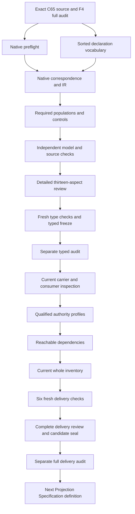

# Generated Output: types and logic review

This candidate interpretation selects `cal.definition.generated-output@1.0.0-candidate.1`, admitted-current by C65. It describes exact canonical input records, an exact governed generator version, reproducibility records, lineage and parity bindings, and the explicit Artifact Type contract exception for canonical status. The primary theory concerns necessary declarations. It does not run a generator, compute hashes, authenticate lineage, adopt a contract or grant authority. Source fidelity remains pending, semantic readiness false, source-owner accepted whole translations zero and whole-definition proofs zero.

The previous Four-Facet full delivery passed a separate actual audit before this native unit was created. Preflight verifies all 8,253 previously sealed candidate file hashes and all 201 source files. There are now 93 native candidate interpretations against 183 current identities, leaving 90 without native T files. The latest completed full inventory still records 92 partial drafts until the current consumer/dependency/inventory delivery is completed. Neither creating this candidate nor passing its finite controls closes the whole episode.

## 1. Exact source, admission and explanatory evidence

The selected Definition digest is `f54b29e0b52ffdc4c57eb5df8525f3c065c1545f664ffd479188657b10d0c9cf`. C65 is `CAL-DECISION-0065-INTEGRATED-LAB-DEFINITION-MODEL-ADMISSION`. Source checking binds its decision, exact authorization and exact selected Definition row. That decision admitted sixty Definition versions and activated no carrier or consumer. Its historical registry postimage is not treated as the current complete registry; the current snapshot independently selects 183 identities and 189 versions.

The body remains candidate-authored and says the term supplies meaning for review only. Its embedded review source retains candidate-unadmitted posture and a null source-admission reference. The current whole review file has digest `1c92c720e176027597db09579276f9ea6e1d13b3d52bda233f9b0c4543dcb5eb`, equal to the embedded whole-file selection. The later Definition admission overlay is retained without rewriting that earlier metadata or treating it as acceptance of this interpretation.

The domain example concerns regeneration of DEFINITIONS-INDEX.md from registry.json with exact byte parity. Here that example is explanatory and not executed. The only projection executed is the isolated pure Definition renderer. Current Artifact Type contracts, generator adoption, relation availability, ontology use and runtime behavior require their own evidence and owners.

## 2. Sorted vocabulary and qualification

The theory has 17 nonempty sorts, six constants, 75 total functions and 130 predicate/relation signatures, totaling 228 declarations. OutputReference identifies the subject record. InputSetReference separates plural input selection from individual InputReference records. GeneratorReference names the producer version, while RunReference names a declaration of one result. LineageReference and ParityReference separate ancestry/check records from run records. ArtifactTypeContractReference carries the conditional canonical-status contract.

ByteStateReference and DigestReference are different sorts. SemanticIdentity, VersionReference, OwnerReference, SourceReference, ScopeReference and TypeReference keep identity, version, responsible owner, source, bounded scope and classification independent. Token contains explicit EMPTY, NONE, MATCH and nonempty descriptions. Nonempty model domains and total functions are representation requirements; they do not prove that a real output, generator or contract exists.

All symbols are qualified by exact source version and the candidate scope. Each field has a typed selector and an exact binding relation so missing or conflicting declarations can be detected. Handles make empty references observable. Seventy-five selectors do not establish shared denotations with another theory. The declaration of a function is not a call to a real tool, and qualification is not a proof of source-owner correspondence.

## 3. Genus, scope and declaration classification

OutputApplicable is equivalent to OutputInScopeDeclared. Each selected output has exact identity, Definition version, owner, source, scope, type, effect, input-set, generator, generator identity/version/digest, state/digest, first/second run, lineage and parity bindings. The candidate record uses CURRENT_DEFINITION_VERSION, CURRENT_SCOPE, CURRENT_SOURCE and NONE effect. Its source is declared current and owner-approved. These are record declarations, with actual source currentness and owner fidelity kept as query targets.

GeneratedOutputDeclared holds for each selected output. Its classification formula ties it to in-scope posture, nominated input membership, governed generator, run, lineage and parity declarations. The full normative conjunction supplies the detailed necessary guards. The shorter formal/applicability clauses point to classification and inference boundaries without repeatedly expanding every field formula.

An outside output remains in the model to test scope. Prohibited inference attached to that outside subject does not fail the selected theory. This makes the boundary explicit without asserting that every object elsewhere in the repository obeys the same record shape. Actual output selection, identity uniqueness, scope completeness and source precedence still require reviewed correspondence.

## 4. Plural exact canonical inputs

Each selected output binds an InputSetReference. The set has exact nominee and source bindings, and InputMemberDeclared includes the nominee. Every declared member of that set has complete identity, type, version, owner, source, byte-state and digest records, is declared canonical, and names a declared current owner-approved source. The digest selector agrees with the declared digest of its byte-state selector.

The baseline includes two distinct canonical input references. Removing the additional member leaves the theory true but makes the required multiple-input demonstration false. Removing the nominee fails theory coverage. Adding an outside input with incomplete canonical/current posture fails. A total input selector cannot conceal missing membership or an invalid extra record.

The source says exact canonical inputs but does not prescribe ordering, duplicate-reference policy or a particular aggregate encoding. The candidate uses set membership with a nominated member as an explicit representation choice. It does not impose a universal two-input requirement or claim that the declared set captures every real generator dependency. Actual input canonicalness, ordering, completeness, aliases, byte fidelity and digest computation remain unassumed obligations.

## 5. Exact governed generator and version

The selected generator has complete identity, version, owner, source, code-state, code-digest and output-type bindings. GeneratorGovernedDeclared is required. Output generator identity, version and digest equal the corresponding generator fields, and output type equals the generator's declared output type. Code digest agrees with the declared digest selector for code-state. The generator source is declared current and owner-approved.

Hostile controls change output generator identity/version/digest, remove governed posture, change code digest or output type, remove exact field relations and add conflicting relations. These fail even when their references remain well-sorted. Type correctness is necessary but does not establish that two separately named versions mean the same thing, or that source code really matches the declared digest.

GeneratorGovernance, GeneratorVersionFidelity, GeneratorCodeFidelity and GeneratorExecution are separate actual queries. No canonical Generator Definition is invented: that label is unavailable in the current identity inventory. Related Artifact Type, Source, Provenance and Derived Refresh definitions provide qualified context only. The model neither installs a producer nor adopts a changed generator, and a shared name cannot silently merge versions.

## 6. Declared result state and digest coherence

GeneratedState is a total function of GeneratorReference and InputSetReference returning ByteStateReference. Each selected output's state equals that declared result, and its digest equals the declared digest of that state. These equations record necessary coherence for a reproducible product from the exact selected producer and inputs. They do not execute the producer, serialize inputs or calculate the digest.

Byte-state and digest references remain distinct. A changed output state with an unchanged digest label can fail the result equation; a correctly typed digest label still has no demonstrated computation behind it. The candidate assumes neither collision resistance nor injectivity of the digest selector. Equal labels cannot stand in for actual byte equality, and unequal references need not establish different real content without an accepted reference/content map.

This distinction is central to interpretation. A deterministic mathematical selector supplies one declared state for a pair of arguments, but actual reproducibility is a property of governed execution and its environment. OutputBytesFidelity, OutputDigestComputed, GeneratorExecution and Reproducibility remain actual targets. No renderer, build process, filesystem writer or real byte comparison is invoked by these formula evaluations.

## 7. Repeated runs and additional records

Each selected output nominates first and second RunReference values and declares RunForOutputDeclared for them. Every declared run for that output has complete generator, input-set, state, digest and source fields matching the selected output and producer. The baseline includes an additional run for the ordinary noncanonical output. An incompatible hidden run fails rather than escaping through the nominated selector.

Distinct first and second references are a required demonstration population, not a universal source axiom. A control sets both nominated runs to the same reference and adjusts the parity link coherently. The primary theory remains true while the distinct-run witness is false. This exposes why record repetition, two independent execution events and actual reproducibility require different evidence.

Additional complete run records are allowed. Removing the extra record preserves the theory but makes its demonstration witness false. Actual run-universe completeness, execution environment, nondeterminism and omitted results remain source-owner issues. The candidate does not fabricate two real runs to pass a checker. Run membership is a declaration, and all declared records are checked under the selected output scope.

## 8. Lineage records and checking responsibility

Every selected output nominates a LineageReference and declares its lineage link. Every additional lineage record for that output has exact output, input-set, generator, generator-digest and source fields. The baseline has a second complete lineage record for one output, demonstrating that nomination does not enforce unsupported uniqueness. Removing it preserves the theory while failing the additional-lineage population.

Changing an extra lineage record's output, inputs, generator, digest or source fails. Adding an outside incompatible lineage record fails. These controls expose endpoint coherence and source bindings rather than treating a lineage reference as self-authenticating evidence. Complete declared fields can still refer to fabricated or stale sources.

The source binds output to lineage and parity checks but does not specify a canonical lineage carrier shape or check algorithm. This candidate records a minimal explicit correspondence proposal. LineageAuthenticity and LineageCheckExecution remain independent actual queries, and accepted relations, endpoint identities, qualifier schemas, evidence authenticity and consumer interpretation remain pending. No current canonical Lineage Definition is fabricated and no check is run merely because a record names its source.

## 9. Parity records and MATCH posture

Each output nominates and declares a ParityReference. Every declared parity record binds its output, exact first/second run references, first/second digest references, MATCH result description and source. The digest fields agree with the corresponding run digests and with each other. The source field agrees with the selected output source. These are declared parity conditions on the supplied model.

Hostile controls change the output endpoint, nominate a run from the other output, alter either digest, replace MATCH or add an incompatible parity record. They fail despite well-sorted field values. The candidate therefore checks more than the presence of a nonempty parity handle. It also keeps the selected run records and their declared content equations coherent.

MATCH is a Token, not an authentic comparison receipt. ParityComputation and ParityCheckExecution remain actual outcomes. The record neither computes a hash nor establishes a real byte-for-byte comparison. The source's index-regeneration example may require stronger byte evidence in an accepted consumer map, but that example does not silently import an index algorithm or a validation-contract theory into this primary interpretation.

## 10. Conditional canonical-status contract

The source says Generated Output is not a second semantic authority and is canonical only when an explicit Artifact Type contract says so. The theory preserves both parts. It forbids the second-authority inference and, for canonical-declared outputs, requires an exact contract binding and contract link. Every declared linked contract on such an output has complete type, version, owner, source and nonempty explicit canonical-clause fields, declared admitted posture, declared canonical permission and a declared current owner-approved source.

Canonical status is not universally forbidden. The baseline includes one output declared canonical under its permitted contract. Conversely, permission does not force an output canonical: the ordinary output also links that permitted contract while remaining noncanonical. Controls make all selected outputs noncanonical or both canonical. Both satisfy the theory but lose the particular mixed demonstration populations.

Missing links, missing admission, missing permission, wrong contract type and incompatible additional contracts fail. Actual ArtifactTypeContractAuthenticity and CanonicalStatus remain unassumed. An opaque canonical clause or admitted marker does not perform admission, bind a real carrier or resolve the true meaning of canonicalness. This condition is necessary rather than an unsupported equivalence between contract permission and actual status.

## 11. Authority, actual outcomes and forbidden inference

Twenty-nine actual-outcome predicates remain outside the primary theory's assumptions. The baseline ordinary output has all actual outcomes false. The other output has independently supplied actual authority. Each nonentailment query receives a freshly evaluated theory-and-population model with false actual target and a true all-outcomes-false witness. This shows that necessary declaration records do not entail the queried actual properties.

Positive controls independently add each actual outcome to the ordinary output, including authority and canonical status. They preserve the primary theory while losing the all-outcomes-false demonstration. Nonentailment does not deny independent evidence or impose a ban on real outcomes. The candidate NONE effect is a record posture, with no actual effect predicate assumed from it.

Fourteen forbidden inference declarations prevent term/admission/schema success, reproducibility labels, lineage refs, MATCH, digest labels, projection labels or canonical status from proving execution, semantic preservation, general proof or approval. They also prevent universal noncanonicalness, forced canonicalness from permission and shared-generator-name version collapse. These boundaries preserve the source's separation of meaning from separately admitted carrier, relation, runtime and authority contracts.

## 12. Source correspondence and finite verification

All 21 selected source-string units have exact correspondence: ten encoded clauses, six explanatory clauses and five deferred clauses. The normative clause includes all ten primitive formulas. Shorter expression, applicability and boundary clauses use classification, exclusions and conditional canonical guards. Five distinct formula values avoid unnecessary repeated expansion while retaining the normative constraints. Three source tests, authority scope and claim ceiling remain deferred semantic clauses rather than actual execution assertions.

Eleven required populations exercise selected/outside outputs, plural inputs, distinct/additional runs, additional lineage, noncanonical output, explicit-contract canonical output, permitted-but-noncanonical status and independent authority. The 130 signature populations remain unresolved. The model verifier evaluates 279 supplied controls: forty satisfy the primary theory, 231 fail it and eight reject malformed model structures. Maximum prepared evaluation uses 11,657 steps under the unchanged 100,000-step limit.

Native input size is 214,840 bytes and qualified IR has 25,507 nodes, within unchanged byte/tree limits. Forty-six concrete source checks bind C65, the embedded review source, two identical 4,410-byte pure projections and 28 source/query obligations. No preparation or native producer failure occurred. Actual author, build, model and source commands terminate zero. Passing these checks remains bounded evidence and cannot establish source fidelity, accepted shared meaning or a whole-definition proof.

## 13. Detailed delivery DAG and remaining episode work

Eighteen exact current Definition identities provide Artifact, Artifact Type, Source, Provenance, Derived Refresh, representation, validation, authority, schema, facet and separation context. Generator, Generation, Reproducibility, Lineage, Parity and CanonicalInput are unavailable requested labels and are not silently introduced as canonical identities. Thirteen separately qualified comparison sources remain outside the primary theory. Source-owner precedence and shared denotations remain pending.

This is the unit's work dependency DAG, not a proof that the semantic-use graph is acyclic or closed. Three fresh type checks precede a sixteen-input freeze and a separate actual audit. Full delivery then requires current carrier/consumer correspondence, qualified mapping obligations, profiles, static-reuse checks, dependency selection, current whole inventory, six fresh checks, the full review, a candidate seal and a separate full audit. Projection Specification native creation waits for that audit.

The current GeneratedOutput/v2 carrier is admitted-current by C74A and binds the exact Generated Output Definition. Its existing payload names generator, input, output-digest and reproducibility-receipt references. Exact correspondence to this interpretation's input-set, run, lineage, parity and canonical-contract fields remains a later consumer obligation. Carrier shape alone cannot establish authentic references, computed digests, check execution or canonical status.

The original episode remains 183 identities, 189 versions, 201 source files, 121 tasks, 511 planning edges, 797 work units and 36 frontiers. Accepted whole translations and whole-definition proofs remain zero. Its eventual complete review must explain every definition, type, formula, population, source correspondence, consumer map, authority boundary, dependency and proof obligation across that scope. This typed stage is concrete progress toward that episode, with its completion and claim boundaries recorded precisely.

### Unresolved source and interpretation findings

- GO-FINDING-001: Exact C65 admitted-current Definition candidate.1 preserves its candidate-authored body and embedded review-source candidate metadata;admission does not accept this translation.
- GO-FINDING-002: Generated Output source semantics are distinct from the C74A current GeneratedOutput/v2 carrier and prior Derived Refresh/representation theories.
- GO-FINDING-003: Applicability selects purported output records;actual selection completeness,identity and bounded-scope correspondence remain pending.
- GO-FINDING-004: Exact canonical inputs are plural membership records with a nominee and complete additional members;actual input-set completeness,ordering and duplicate/alias policies require accepted maps.
- GO-FINDING-005: Input identity,type,version,owner,source,state and digest are declared;canonical input authenticity and digest computation remain actual targets.
- GO-FINDING-006: Exact generator identity,version,code-state,digest,owner and source are declared;governance,code authenticity,execution and version equivalence remain separate.
- GO-FINDING-007: GeneratedState denotes declared state for an exact generator/input-set pair;it does not execute a generator or prove reproducibility.
- GO-FINDING-008: First and second run references are nominated and additional complete run records are permitted;distinct runs are a required demonstration witness,not an unsupported universal source axiom.
- GO-FINDING-009: Every declared run record for a selected output binds its generator,input-set,state,digest and source;actual run universe completeness and determinism remain pending.
- GO-FINDING-010: Lineage records bind output,input-set,generator,digest and source;their presence does not execute or authenticate lineage checks.
- GO-FINDING-011: Parity records bind exact run/digest references and MATCH description;actual equality checks,computed hashes and parity evidence remain separate.
- GO-FINDING-012: Generated Output is not a second semantic authority;the source explicitly permits canonical status under an explicit Artifact Type contract.
- GO-FINDING-013: Canonical-declared outputs need declared admitted contract,type,version,owner,source and explicit canonical clause;actual admission,contract authenticity and canonical status remain queries.
- GO-FINDING-014: Contract permission is necessary for canonical declaration and is not sufficient to force every permitted output canonical;noncanonical and independently supported actual outcomes remain allowed.
- GO-FINDING-015: Candidate NONE effect and forbidden inference declarations do not imply a real absence of effects or deny independently governed authority,approval or deployment.
- GO-FINDING-016: Source tests for exact Definition version,scope and prohibited inference are deferred semantic clauses with separately checked source/query bindings.
- GO-FINDING-017: Plain-language,domain example and notation remain explanation;the registry-index byte-parity example does not execute an index generator.
- GO-FINDING-018: Current carrier payload reference fields and missing exact input/generator/run/lineage/parity contract fields require reviewed correspondence or explicit residue.
- GO-FINDING-019: Source labels do not activate consumer/runtime/ontology/relation contracts or establish semantic preservation.
- GO-FINDING-020: No whole prior Artifact,DerivedRefresh,Provenance,Validation,Representation or Authority theory is imported.
- GO-FINDING-021: Shared denotations,dependency cycles,source precedence,source-owner acceptance and whole-definition proof remain pending across183identities.
- GO-FINDING-022: No real generator execution,canonical output creation,carrier admission,validation,proof,authority,publication,deployment or external effect is performed.
