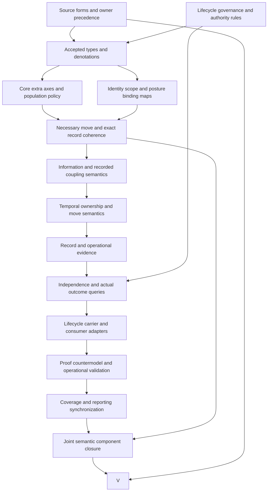

# Governance-Axis Independence: forms, types, logic and completion plan

This is a partial candidate interpretation of `cal.definition.governance-axis-independence-invariant@1.0.0-candidate.1`. Definitions, types, information semantics and logical transition conditions take priority over executable lifecycle design. The exact source is admitted for definition use through C53. This proposed translation remains pending source-owner fidelity review. It grants no actual authority, promotion or transition permission, and supplies no whole-definition proof.

## 1. Source identity, source use and observation boundaries

The selected current Definition has digest `2249daf97a66af5bdf8b9ab0476b2dfa290e8e523cb0d94d8fe9978b1b845de8`. Its snapshot binding, registry identity/version, admission manifest row, C53 decision and authorization bytes are checked independently. The machine body still retains the historical source posture `candidate-unadmitted` and a null embedded source-admission reference. The current admission overlay selects those exact bytes for use without rewriting their historical contents or accepting the candidate formulas.

The retained D23 section, Authority Lifecycle Axis, is selected through an exact source-use admission for this definition version. A local copy supplies 4,472 observed section bytes with digest `7d80add516f2499e2a4110c629570da9e77336b80ba500235597ba9e43ff20df`. Its whole-file digest matches the admission record. The declared legacy producer file is absent at its retained location; the local copy does not authenticate current producer repository identity, branch or live state. No producer configuration is changed.

A pure section extractor and a pure Definition renderer establish bounded byte observations. Two renders equal the selected human projection: 6,655 bytes with digest `a318ca9bae6c384e1eb69df626dd46c1cdc9a1c33ef04c3ee4a73610985846e8`. All eighteen checks in [source-checks.json](source-checks.json) pass. GAI-FINDING-012 leaves live producer currentness, owner fidelity, joint closure and whole-episode completion unresolved. Actual file agreement supplies evidence for artifact freshness, while accepted denotation requires its own review.

## 2. Definitional forms, roles and source correspondence

The source combines a normalized invariant introduction, a minimum-axis principle, a formal lifecycle tuple, a necessary move-validity rule and explanatory examples. The candidate therefore uses genus/differentia, finite enumeration, axiomatic/implicit specification and operational forms at selected spans. These labels describe how meaning is introduced. They do not imply that the machine artifact itself is an admitted invariant carrier or that a particular governance move satisfies the stated obligation.

The correspondence inventory contains 22 source units and 27 mapped spans: eight encoded, nine explanatory and ten deferred. The checker accounts for all selected characters under the declared string-leaf inventory policy. Six unique encoded formula values use eleven primitive templates. Several source spans combine multiple templates or repeat the same candidate guard; span counts therefore do not count independent theorems or accepted obligations. [correspondence.json](correspondence.json), [correspondence-check.json](correspondence-check.json) and [clause-analysis.json](clause-analysis.json) retain the full account.

All four artifact testable conditions remain deferred observations outside T. The retained historical claim ceiling is also treated as an artifact observation, rather than a universal lifecycle proposition or a current admission fact. Identity, source digest, schema and projection observations are checked separately. The whole source boundary remains an external query, while its repeated scientific boundary supplies a local candidate no-collapse guard. GAI-FINDING-001 preserves normalized identity and source-role acceptance as distinct from successful correspondence accounting.

## 3. Typed signature and candidate carriers

The interpretation declares ten sorts: Invariant, Artifact, Posture, Move, Axis, Value, InfoState, ChangeRecord, Scope and Token. They separate the invariant's normalized meaning, a subject artifact, a lifecycle snapshot, a governance move and a record of additional component changes. Value and InfoState are distinct carriers. Scope and Token references are also distinct from subjects or records. Each sort has a nonempty declared domain in the selected classical fragment.

The signature contains 150 declarations: ten sorts, 26 constants, 29 total functions, eighty unary predicates, four binary relations and one ternary relation. Functions include `L(artifact)`, posture subject/scope, component value/information/source reference, move subject/before/after/intended axis/scope/record and exact record fields. The ternary SilentAxisSubstitution relation names a declared move and two axes. Arity and argument/result sorts are checked independently of theory satisfaction.

These are proposed denotations. A correctly sorted owner component does not identify a real principal or prove permission. A total declared component function does not resolve partial data representation or complete temporal history. GAI-FINDING-003 and GAI-FINDING-004 request accepted subject, posture, value, information and scope maps. [static-ir.json](static-ir.json) qualifies symbols by exact source identity and scope, while [t.json](t.json) retains the candidate interpretation and unresolved populations. Equal printed labels across other definitions are not silently unified.

## 4. Six minimum dimensions and the seven-component tuple

The normative voice lists role/kind, maturity/status, evidence confidence, commitment/conviction, provenance and owner as minimum separations when relevant to a decision. The formal tuple adds residue: `L(a) = (kind, status, evidence, commitment, provenance, owner, residue)`. This is an explicit source difference. The candidate keeps all seven named formal components and records the six-versus-seven and applicability issue as GAI-FINDING-002. It does not delete residue or declare that the selected tuple is a complete lifecycle taxonomy.

CoreAxis is a finite enumeration of the seven selected core constants, with pairwise distinct identities. The model also contains a custom eighth axis. LifecyclePosture requires declarations of the seven core components. A move may explicitly declare an additional axis; once that axis applies, both snapshots must declare its component and any other-axis change is subject to the record rule. This represents an extensible selected core within the proposed fragment.

The scope policy still needs acceptance. The phrase “when they matter to a decision” does not supply a complete relevance classifier, and the tuple does not provide every possible status vocabulary. GAI-FINDING-009 retains additional-axis declaration, scope relevance and extension rules. A supplied control can remove the custom axis from the move's declared scope while preserving T and losing its required extension witness. That exposes a limitation of scope selection; it cannot support a claim that every possible dimension has been checked.

## 5. Information states, unknown values and source-local references

The formal voice permits each component to be known, unknown, deferred or source-local. The candidate represents these as four distinct InfoState constants and defines an allowed-state predicate for the selected fragment. A component has both a Value and an InfoState. Unknown information is not encoded as logical falsity, and it does not force the component value to a designated absent value. The underlying evaluator remains classical rather than acquiring extra truth values from status names.

A source-local component requires a nonempty declared source reference. The predicate does not authenticate that source, establish its live currentness, or choose a canonical interpretation. Deferred information similarly records a candidate information posture without proving that an owner will later resolve the value. Controls cover all four states, remove allowed-state declarations, alias state constants, treat unknown as false and omit a source-local reference. Positive controls allow an unknown component's value to vary without making the proposition false.

GAI-FINDING-004 leaves partiality, absence and information denotation unresolved. The source does not fully specify whether a known value can still be source-local, whether statuses can overlap, or whether the four words form one exclusive datatype in every implementation. The candidate's distinct allowed states are reviewable proposed semantics. Required witnesses for each state prevent the model from satisfying the information rules only through empty predicate extensions, but do not establish real-world observations.

## 6. Subject, scope and lifecycle snapshot binding

For a declared authority-bearing Artifact, `L(a)` must be a LifecyclePosture whose subject is that same artifact and whose scope matches its artifact scope. A GovernanceMove refers to the selected invariant, an authority-bearing subject, before/after lifecycle postures, an intended axis and a move scope. Both postures must have the move's subject and scope; the artifact scope must agree as well. The intended axis must apply within that declared move.

These bindings prevent checking one subject's evidence against another subject's maturity, or silently transferring a rule across scopes. Negative controls change L's subject or scope, replace before/after snapshots with another artifact's posture, change the move subject or scope, or choose an undeclared intended extra axis. The formal guards reject those supplied cases. The identity functions and references remain mathematical declarations rather than authenticated object identifiers or storage pointers.

GAI-FINDING-003 retains lineage, time and snapshot completeness. A before/after pair in a static structure does not prove that either snapshot was actually observed, that a transition occurred between them, or that a live service remains in the recorded state. `L(a)` is a selected declared posture map, with no automatic equation making every move's before snapshot the globally latest posture. A future history adapter must identify exact temporal semantics and observation criteria before claiming an actual state transition.

## 7. Necessary validity and the intended component change

The source says a governance move is valid only if it changes the intended component and does not silently change other components without records. The candidate therefore uses `ValidMove -> conditions`, not a biconditional or an automatic grant rule. A ValidMove must be a GovernanceMove, and its intended component must differ between before and after. Difference is provisionally measured over component value, information state or source reference.

A positive control changes only the intended value and uses no additional-change record. Another changes only the intended information state. A third changes only the intended source reference. These show how the proposed component equality behaves. An idempotent reaffirmation has no intended difference and is represented as a GovernanceMove without ValidMove. Marking it valid fails the necessary rule. Clearing all ValidMove declarations keeps T true while failing required validity populations, demonstrating that coherent data does not force accepted validity.

GAI-FINDING-005 leaves idempotence, information-only changes, source-reference changes and intended-axis sets unresolved. GAI-FINDING-007 leaves sufficient acceptance, owner grants and actual authority separate. A declared valid move can coexist with every actual authorization and execution outcome false. That supplied witness is essential: the candidate checks the necessary representation contract without presenting it as evidence that a real owner approved or performed the move. No live governance action is executed.

## 8. Other-axis frame conditions and exact records

For each applicable axis other than the intended one, a component difference requires an explicit additional-change record. An intended-only move does not globally require such a record. When an additional change needs one, the record must be declared present and contain the changed axis. Its subject, scope, before and after snapshots must match the move. Recorded before/after value, information state and source reference must match that exact axis in those snapshots.

These guards permit explicitly recorded coupling. The model includes an owner change with a recorded evidence change and an intended status change with a recorded custom-axis change. An unrecorded status-and-evidence change is a GovernanceMove without ValidMove. Adding a matching declared record permits a ValidMove assertion under the candidate conditions without producing actual authority. Other negative controls omit the record or axis entry and alter each subject/scope/snapshot/value/information/source binding independently.

GAI-FINDING-006 retains real record identity, storage, authenticity, completeness and adequacy. Total record-field functions in a finite model are not evidence of a stored record. Matching values do not show that their subjects were measured or that an owner accepted the additional change. The source's “explicitly recorded” requirement still needs an admitted evidence carrier and accepted interpretation. ActualRecordWritten and ActualRecordAuthenticated remain query targets outside T; a successful frame check cannot establish them.

## 9. Silent substitution and the strength of independence claims

The candidate forbids SilentAxisSubstitution between distinct applicable axes for a declared ValidMove. Forty-two negative controls cover every ordered pair of the seven core axes. A same-axis marker is allowed because it does not substitute another axis. Eighteen additional no-collapse/inference guards reject declarations such as maturity implying canonicality, evidence implying commitment, commitment implying authority, utility implying promotion, unknown implying false or validity implying actual execution.

Those markers make prohibited candidate claims explicit, but their extensions remain supplied denotations. The evaluator does not inspect every natural-language argument or prove universal semantic independence from a marker's absence. The actual frame obligation uses before/after differences and exact records, so it checks concrete declared preservation/coupling cases as well. Both surfaces require accepted source alignment before stronger claims can be made.

GAI-FINDING-008 retains universal independence and actual maturity, evidence and commitment meanings. Distinct Axis constants alone cannot prove that the dimensions are independent, and nominally separate sorts cannot prove semantic disjointness. Explicitly recorded coupling may be legitimate. Common-carrier alignment, implication direction, permitted overlap and forbidden inference policy must be reviewed with Classification-Axis and Classification Orthogonality Invariant. Their qualified comparison sources remain separate; none is silently assembled into this primary theory.

## 10. The four shared-subject source examples

The candidate supplies four shared-subject patterns from the normative voice: mature with weak evidence; well-evidenced imported source without local canonicality; useful ontology candidate without promotion; and a committed owner posture for a hypothesis without authority. Declared maturity, evidence, source/candidate/hypothesis kind and commitment predicates are tied to selected component codes. Utility remains an independent declared property because the source supplies no utility measurement function.

Required populations retain the combinations and their absent actual canonicality, promotion or authority outcomes. They do not assert that every mature artifact lacks authority, every imported source is noncanonical, or every hypothesis can never become authoritative. Each example has a query asking whether its declared properties entail the relevant actual governance outcome. The supplied model satisfies T and I while making those target implications false. This is candidate non-entailment evidence with a specific denotation and scope.

GAI-FINDING-010 leaves those codes, pattern meanings and actual world mappings unresolved. An authority-bearing subject predicate identifies the selected lifecycle scope without granting ActualAuthority. An ontology-candidate code on one subject does not make every Artifact an ontology node. The source explicitly warns against that expansion. Actual ontology typing, owner commitment, evidence quality, usefulness and provenance authentication remain independent targets rather than consequences of the tuple's field names.

## 11. Supplied evidence and actual carrier observations

The evaluator checks 187 supplied finite controls: 47 satisfy T, 133 fail T as expected and seven are rejected for malformed structure. Domains contain one Invariant, four Artifacts, ten Postures, seven Moves, eight Axes, nine Values, four InfoStates, seven ChangeRecords, two Scopes and eight Tokens. Twenty-one required populations have witnesses in the selected base model; eighty-five populations remain unresolved. All 42 queries have independently evaluated T/I countermodels, with the target false and witness condition true.

Qualification profiles cover 27 hypotheses with 25 expected rejections. The finite frame suite covers 24 hypotheses with eighteen expected rejections, including intended-only change, recorded coupling, information/source changes, idempotence without validity, an explicit extra axis, binding drift, missing records, unknown-as-false and an unsupported actual authority claim. These are supplied controls rather than exhaustive native enumeration or operational executions. The checked structure is a static snapshot model, without unbounded trace or probabilistic claims.

Seventeen actual catalog/prototype checks inspect 143 type rows and 121 current rows. No directly bound Governance-Axis invariant carrier or generic invariant carrier is admitted there. The prototype remains `prototype-scaffold`, authority effect none, with D23 disposition `reclassify` and no admitted lifecycle/transition schema. Generic Definition/v2 is current and binds current Definition@1 meaning. Thirty Definition/v1 shape probes have five acceptances, including unresolved names and overclaimed text. GAI-FINDING-011 preserves the carrier/consumer gap; [authority-profile-checks.json](authority-profile-checks.json) records the bounded observations.

## 12. Semantic dependencies and detailed completion DAG

The candidate declares forty semantic dependencies. Unavailable exact labels for lifecycle posture, component information state, governance move, additional-change record, inventory card, task, task result and implementation claim remain explicit gaps rather than invented canonical identities. The local declared graph has 120 nodes, 1,392 edges and 59 missing counterpart packets. Its unresolved strongly connected component has 61 members and 940 internal edges. A declared dependency graph is not an accepted common-carrier theory.

The parent foundations-first plan remains 121 tasks, 511 edges, 797 work units and 36 frontiers. The completion DAG below has fifteen nodes and eighteen edges. It schedules source precedence and typed denotations before frame rules, proof obligations and adapters. Cyclic semantic dependencies receive an explicit joint component review downstream; they are not disguised as an already acyclic semantic graph. Every completion node needs actual evidence at the appropriate strength.

| Node | Depends on | Required deliverable | Completion evidence |
|---|---|---|---|
| S | none | Source precedence and twelve findings | Recorded owner treatment of tuple, minimum dimensions and retained source |
| A | none | Lifecycle scope, owner and authority rules | Accepted governance/authority contract |
| T | S, A | Subject/posture/move/value/information/record denotations | Reviewed type and carrier maps |
| P | T | Core, relevance, extension and witness policy | Accepted tuple/population scope without complete-schema inference |
| I | T | Subject, scope, version and snapshot bindings | Accepted identity and temporal reference maps |
| C | P, I | Necessary validity, intended change and exact record guards | Accepted formulas and coherence counterexamples |
| B | C | Information states, absence, source locality and explicit coupling | Accepted component equality and information rules |
| H | B | Ownership, idempotence and actual move semantics | Accepted authority and temporal interpretation |
| R | H | Record authenticity, storage and evidence adequacy | Exact evidence carriers and observation criteria |
| E | R, A | Semantic independence and actual governance queries | Source-aligned obligations with targets outside assumptions |
| Q | E | Lifecycle/transition carrier and consumer mapping | Exact admitted contracts and adapter evidence |
| D | Q | Appropriate proof, countermodel and operational checks | Independently verified results at required scope/strength |
| F | D | Complete per-definition coverage and reporting | Accepted coverage with explicit unresolved limits |
| J | F, C | Common-carrier alignment and cyclic component review | Reviewed combined interpretation and cycle classification |
| V | J, S | Whole-definition review and disposition | Owner fidelity and every required obligation closed |

## 13. Preservation, replay and whole-episode status

The preflight verifies all 5,015 files from the preceding Gate seal and all 201 captured source files, then creates the absent unit within its declared write scope. It preserves unrelated dirty work, canonical metadata and private/live producer state. The initial builder stopped before artifact output because its signature dictionary lacked a closing brace. Exact code and terminal logs are retained in attempt001. A later successful profile producer retained one Gate-oriented case label; attempt002 preserves four exact files before that label is corrected, with envelopes, outcomes, frames and observations unchanged.

The delivery requires six fresh terminal checks: interpretation contract, supplied models, actual source observations, qualification/catalog profiles, declared dependencies and current inventory. A sealed manifest binds the current candidate set, followed by a separate read-only preservation audit. [model-controls.json](model-controls.json) establishes only supplied finite outcomes. [source-query-obligation.json](source-query-obligation.json) keeps the complete-status-schema boundary outside T. [receipt.json](receipt.json) reports partial fidelity rather than promoting successful artifact checks into whole proof.

The refreshed episode contains 62 partial drafts and 121 current identities without per-definition T drafts, out of 183 current identities and 189 admitted versions. Aggregate counts are 1,415 source units, 1,916 mapped spans, 607 encoded, 493 explanatory and 816 deferred; required populations total 666 and unresolved populations 2,612. Accepted whole translations and whole-definition proofs remain zero. The next independent definition priority is Parent-Instance Authority Separation Invariant. The full objective remains active: missing drafts, owner fidelity, accepted denotations, common-carrier alignment, joint closure and required actual proof/evidence still need completion. [current-inventory.json](current-inventory.json) retains that full scope.
