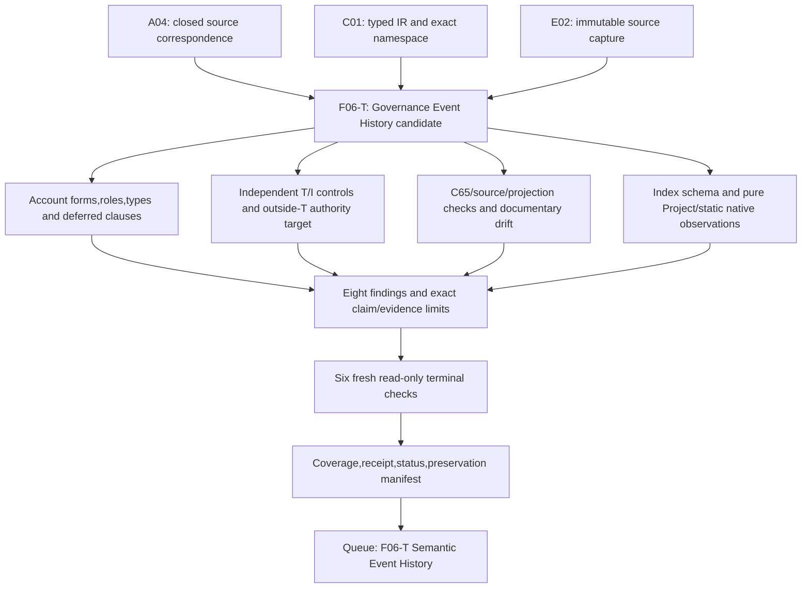

# Governance Event History — bounded formalization candidate

This partial candidate formalizes `cal.definition.governance-event-history@1.0.0-candidate.1` under SWU `F06-T.cal.definition.governance-event-history`. It keeps definition forms, types, logical semantics and proof obligations ahead of implementation. Source-owner fidelity, whole-definition translation/proof, actual append-only behavior and meaning-aligned combined closure remain pending. Authority effect is none.

The source describes a canonical append-only observation history of complete resulting governance states, bound to exact semantic events and upstream Governance evidence. It expressly separates observation from originating or replacing Policy, challenge, admission or other authority decisions. The candidate gives those responsibilities typed constraints and explicit finite witnesses. It does not mistake an event index or a source admission for an actual complete-state, integrity or authorization proof.

## Source selection and complete character account

[Interpretation](t.json), [correspondence](correspondence.json), [checked character account](correspondence-check.json), [typed IR](static-ir.json) and [denominator](denominator.json) bind the exact current source SHA-256 `29da47008390e0ebfd8a4b3828858dcf9170df3a3414e2ffe1fcfbfd653fbe2a`. The account covers 21 nonempty source units and 25 exact spans: 13 encoded, 6 explanatory and 6 deferred. Every character within the declared source inventory policy is accounted for; deferred text is not thereby translated or accepted.

Unlike Context View's copied Context formulas, this source has a target-specific positive statement and a weaker generic formal expression. Repeated normative/applicability/boundary sentences retain separate spans. Plain-language explanation, event-842 example, domain explanation and notation remain explanatory. Separate identity/lifecycle/authority contracts, exact-version consumer use and source precedence are unresolved. There are no invented selected assumptions, exemptions, owner principals or approval references.

The current Definition is admitted through C65, `CAL-DECISION-0065-INTEGRATED-LAB-DEFINITION-MODEL-ADMISSION`. Its embedded source-ref posture remains historical `candidate-unadmitted`. The candidate manifest labels its editorial family `interaction`, while the formal-assurance work queue places it in F06. Family labels do not create semantic equivalence or dependency closure.

[Actual source checks](source-checks.json) verify fourteen read-only observations: current identity, Definition/v1 shape and schema/generator hashes, two exact pure renders, source preservation, current registry row, exact C65 admission row, recorded authorization bytes, candidate manifest selection/contract, historical source posture, observed interaction-document drift, source query placement, deferred exact-version consumer condition and unimported comparisons/no assumptions. The selected generated projection is 4738 bytes, SHA-256 `46811ad19e25970da5cb2e9a4ef92f9fb7eda57246a197c8845f7efa47ae9456`.

The source cites a historical whole-file interaction review with SHA-256 `3c6e2afff90d07c7ea30f40bf7f3e2df8a05a7ff3e9da38c8ffdfd1d717b2c0f`. The selected local document has 40774 bytes and SHA-256 `abbfc5ee963e329e732c8330651f602a04f92e1f4e9cfbcf90af86fb6e61f384`. Those differ. The checker records that drift without rewriting the Definition, recovering historical bytes, or admitting the current document as theory. C65 authenticates the selected Definition admission; it does not accept this candidate's interpretation or erase documentary drift.

All three source testable conditions remain partial at their universal scope. This work checks the exact selected version and admission, supplied applicability/no-inference controls, and actual artifact observations. It does not prove that every consumer resolves this version or an admitted successor, every instance complies with scope, or every consumer avoids forbidden inferences.

## Definition forms, roles and theory

Thirteen encoded source occurrences comprise nine axiomatic/implicit occurrences, three genus–differentia plus axiomatic/implicit plus operational occurrences, and one axiomatic/implicit plus operational occurrence. They contain six unique formula values assembled from nine primitive templates. Repetition increases source correspondence coverage, not the number of independent logical constraints. Every encoded clause has the candidate role `definition`; explanatory clauses do not enter T.

| Primitive | Candidate constraint | Remaining meaning obligation |
| --- | --- | --- |
| Genus | Governance Event History iff five canonical/append-only/complete-state/exact-event/upstream-evidence qualifiers. | Biconditional strength, canonical selection, subject/stream scope and qualifier denotations require owner review. |
| Observations | Histories observe governance state and require append-only behavior. Contained entries have roles, complete resulting state roles, a semantic-event role and at least one typed upstream evidence reference. | Markers do not validate actual complete states or authenticate evidence. |
| Exact join | Each contained entry's semantic ID, digest and cursor tokens are nonempty and equal the corresponding values of its selected semantic event. | Token equality is not actual reference lookup, byte hashing, positive-integer arithmetic or epoch qualification. |
| Retention | A successor of a history is also a history; every prior contained entry has a retention requirement in the successor. | Requirement markers do not force actual membership, immutable bytes, order, successful persistence or replay. |
| Nonauthorship | History does not originate or replace Policy, challenge, admission or other authority decisions. | Upstream decision identity, provenance and actual authority remain independently governed. |
| Bounded record | History has governed-identity-or-record and bounded-scope markers. | This source formal fragment is weaker than the positive normative definition and does not replace it. |
| No inferred effects | History alone does not infer admission, authority, success, identity equivalence, Artifact Type/instance/relation/Policy/Decision/runtime/publication/release/deployment or external effect. | Independently authorized outcomes can coexist; they are not established by history presence. |
| Sibling separation | History does not become Policy, an authority decision or Semantic Event History. | Cross-layer correspondence still requires accepted maps. |
| Consumer scope | Declared consumers have a consumer role and a scope-use relation. | Supplied relations do not prove universal consumer compliance or exact-version resolution. |

The source's negative formal line is retained exactly:

```text
GovernanceEventHistory(x) =/=> authority_effect(x).
```

[Source query obligation](source-query-obligation.json) binds its exact selector, character interval, excerpt digest and deferred clause. [Query policy](query-policy.json) keeps its candidate authority target outside T. An independent T/I model falsifies the universal history-to-actual-authority target. This demonstrates nonentailment for the selected candidate theory. It does not assert the target as an axiom or establish complete source equivalence.

## Types, populations, semantics and evidence strengths

The signature has 79 declarations: two nonempty sorts (`Entity`, `Token`), one constant (`EMPTY`), eight total functions, 62 unary predicates and six binary relations. Functions map entries to resulting governance states and selected semantic events, and map entry/event identities to three semantic reference tokens. Six relations describe containment, upstream evidence, successor history, prior-entry retention requirement, consumer use and scope-qualified use. Exact source/version/scope namespaces prevent printed labels from silently unifying different definitions.

Classical many-sorted first-order logic with equality is the supported fragment. Total function tables are complete Cartesian tables in supplied finite structures. A function naming a state does not execute reconstruction. A predicate saying “complete” does not inspect completeness. A “canonical” marker does not prove one globally unique stream. A cursor Token is not a positive integer without an accepted value map. Normative append-only and retention predicates are not temporal operators or successful storage transitions.

Nine required populations give non-vacuous supplied witnesses: history, nonempty history, empty history, successor retention without actual storage, history without actual outcomes, raw index without history, current history without source truth, two governance observations joined to one semantic event, and qualified consumer use. Sixty-seven other population obligations remain unresolved. An empty generic history is permitted by this theory; the current carrier schema requires a nonempty event list. Neither convention silently overrides the other.

The base model uses eleven Entity elements and six Token elements. Three histories include a nonempty original, its successor and an empty history. Two entries map to complete-state-role elements and share one semantic event and upstream evidence element. The model supplies nine population witnesses, while all sixteen actual-outcome predicates remain false. The required histories are authored mathematical structures, not sampled persisted streams.

[Independent model controls](model-controls.json) evaluate 87 authored cases: 27 satisfy T, 53 violate T and seven malformed structures are rejected. The failures cover genus qualifiers, bounded/observation/append requirements, entry/state/event/evidence roles, missing upstream evidence, exact ID/digest/cursor mismatch or emptiness, missing successor retention, decision authorship, inferred effects, sibling collapse and consumer scope. Malformed cases cover nontotal/ill-sorted functions, ill-sorted constants, wrong arity, duplicate tuples and empty domains. The original finite-engine 100000-step and 30-second limits are retained.

Eighteen countermodel queries remain outside T: sixteen actual state/storage/join/evidence/hash/order/retention/replay/truth/owner/authority/admission/publication/release/deployment/external outcomes, raw-index/history, and current-history/source-truth. Finite model witnesses do not constitute whole-definition proof or universal temporal separation.

Permissive controls make the candidate's gaps visible: empty histories, multiple observations of one semantic event, shared upstream evidence, multiple canonical markers without stream uniqueness, opaque cursor/digest tokens, raw index containment without history genus and retention requirements without successor membership. `SemanticPatchAuthority` is also an unresolved marker that remains unconstrained here: the concrete carrier's prohibition is not silently imported into the general source theory. Accepted carrier and native-runtime maps are required before adopting stronger operational statements.

## Current carrier and actual schema evidence

[Carrier/profile evidence](authority-profile-checks.json) selects the sole current direct binding `cal.artifact-type.governance-event-history/v1`, among 143 registry rows and 121 admitted-current rows. Registry admission is C70; the retained descriptor is `1.0.0-candidate.1`, `candidate-unadmitted`, and uses `cal.schema.governance-event-history/v1`. The positive fixture's record state is `candidate`. Those axes remain distinct from the source's C65 admission.

Fifteen catalog observations check exact source/descriptor/schema/root bindings, valid fixture, preserved pure render input, two identical fixture renders, actual artifact-template projection, closed top/payload/entry/exact-join shapes, external event-record index responsibility, four hostile fixtures, generic package-validator scope, native complete-state/append source, historical Definition shape and the captured Project-history baseline. Only the bound pure `render_record` function is extracted from the generator. Its materialization writer is not executed. The package validator writes receipts and is inspected as source, not run against canonical artifacts.

The manifest lists event ID/digest/cursor, previous digest, exact semantic reference, upstream evidence refs and `record_ref`. It does not contain `complete_resulting_governance_state`; adding an inline complete state is rejected. The fixture uses repeated-digit synthetic hashes and an unresolved event-record locator. It is a closed-shape example, not authenticated state reconstruction.

Thirty-seven actual schema mutations yield sixteen acceptances and twenty-one rejections. Accepted shapes include unrelated semantic ID/digest/cursor, zero-filled hashes, duplicate events, missing chain continuity, out-of-order/noncontiguous cursors, mismatched latest watermark, changed record locator under the same history identity, whitespace identifiers, huge integer cursors, admitted record-state text and permission-sounding claims with `authority_effect: none`. Empty top-level evidence/successor sets also pass. These acceptances do not establish their claimed meanings.

The schema rejects empty event lists, empty or duplicate upstream evidence lists, false append-only/semantic-patch/replay/index flags, invalid cursor types/ranges, malformed digests, absent semantic digest or record locator, inline full-state additions, forbidden extra fields and an admitted authority effect. Constant booleans constrain representation; they do not verify behavior across time. The selected historical Definition/v1 record fails four current Definition/v2 shape requirements. No migration or admission invalidation is performed.

## Project and native runtime comparison

The captured Project semantic and governance histories each contain four events. The existing pure `validate_histories` function and its exact bound `digest`, `require` and `RuntimeFault` helpers are extracted through AST and executed only on in-memory captured records. No runtime is activated or source record rewritten.

Thirteen controls produce five acceptances and eight rejections. The captured baseline passes. Cursor, previous-chain, unsealed summary, chain hash, watermark and three resealed exact semantic ID/digest/cursor mutations fail. Four additional resealed/shape cases pass this specific function: empty upstream evidence, unverified summary truth, duplicate governance event IDs and a false append-only flag. Those are limits of this pure function in isolation; the full application has other gates. Hashing changed records anew does not authenticate upstream owner decisions or prove preservation of an earlier history.

Native Rust source defines `GovernanceEvent` with `complete_resulting_governance_state: OntologyGovernanceState`, unlike the generic index. Its state includes provenance, owner route, status/promotion/authority posture, confidence references, Challenge Contract, residue/conflicts and drift/invalidation routes. Static inspection finds cursor continuity, event IDs, event hash/state checks, state-reference equality, duplicate-event rejection, exact semantic lookup/join, stream identity and per-stream chain checks. Append code checks expected stream versions, validates the proposed complete history and calls persistence. These are inspected source paths, not fresh runtime executions or universal preservation proofs.

The generic index, Project histories and native events have different representations and validation scopes. Their common-carrier map is unaccepted. Actual complete-state validation, reference resolution, canonical hashes, exact order, concurrent append, storage immutability and replay claims need separately qualified evidence.

Thirty-one hypothetical qualification profiles exercise eleven axes and ten support hypotheses; twenty-eight reject, one allows use under hypotheses and two deny reuse for stale history or changed bindings. Fifteen finite history frames exercise unchanged prefix, separately authorized append, deletion/mutation of prior state/join/evidence, same-semantic-event observations, upstream decision authorship, semantic patching and actual-compliance claims; twelve reject. These frames do not import additional carrier rules into T or prove an unbounded trace property.

## Dependencies, findings and detailed DAG plan

Twenty-three semantic uses bind exact current definitions. No exact `Governance` Definition exists in the selected snapshot; that dependency-label gap is explicit and is not replaced by an invented identity. Governance-related model/authority/evidence definitions are separate selected dependencies, with meaning alignment pending. [Comparison selection](comparison-selection.json) imports no predecessor, contextual or runtime theory.

[Declared dependency graph](dependency-graph.json) and [current inventory](current-inventory.json) contain 109 nodes and 927 edges, 62 missing counterpart packets, and one unresolved 47-member component with 581 internal edges. View-root/local and all-inventory selection bindings remain distinct, while their declared graph structure agrees. Inventory independently evaluates one supplied T/I model per draft; it does not create a shared model with aligned meaning. Aggregate accounting is 1076 source units, 1463 spans (379 encoded, 386 explanatory, 698 deferred), 426 required populations and 1513 unresolved populations.

Eight owner findings cover genus/canonical/cardinality; actual complete states and indexed record resolution; semantic reference/token/hash/epoch maps; upstream Governance evidence/authorship and missing exact label; append-only/retention temporal semantics; weaker formal source and authority target; universal exact-version/scope/consumer conditions; and source-document drift plus common runtime/carrier/dependency maps. The agent's review supplies no source-owner decision.



The final queue arrow is episode review order, not a new native dependency edge. Native prerequisites are A04, C01 and E02 with bounded PASS receipts. Whole family/theory/proof/implementation gates retain their separate scope and criteria.

| Work | Concrete exit evidence | What remains open |
| --- | --- | --- |
| Scope/source selection | Exact source/snapshot/SWU/receipts and 3856-file prior seal | Contextual historic-source reconstruction and owner meaning review. |
| Forms/types/logic | 21 units/25 spans, 79 declarations, nine required populations and eight findings | Complete translation, denotation and accepted dependencies. |
| Finite verification | 87 controls, seven malformed rejections, eighteen target-false countermodels | Whole proof, universal temporal and actual storage claims. |
| Source/carrier comparison | Fourteen source checks, fifteen catalog observations, 37 schema probes/four hostile fixtures | Source drift, indexed complete-state lookup and common runtime maps. |
| Runtime/temporal evidence | Thirteen pure captured Project controls, static native paths, 31 profiles/15 frames | Fresh qualified native execution, owner authority/evidence and universal preservation. |
| Fresh verification/delivery | Six actual terminal results and exhaustive seal/read-only audit | Source-owner approval, cycle classification and final episode review. |
| Continue full scope | Next exact source: Semantic Event History F06-T | Remaining 136 current identities and full joint/historical-version obligations. |

## Delivery and episode status

[Fresh results](fresh-command-results.json) retain contract, model, source, profile, dependency and inventory terminal outputs. [Receipt](receipt.json), [coverage row](coverage-row.json), [episode status](episode-status.json) and [delivery manifest](delivery-manifest.json) are produced only after all six pass. The delivery audit verifies source, prior/current file preservation and the partial claim boundary. Writes are confined to this candidate directory; unrelated Git changes, original sources, prior evidence, runtime and private/live state remain preserved.

The episode advances to **47 partial drafts out of 183 current identities**, with **136 identities lacking a per-definition draft**. The admitted denominator stays **189 versions**. There are **zero source-owner-accepted whole translations and zero whole-definition proofs**. I04's original exact eight-draft report remains preserved and requires a separate scoped refresh. Next priority: **F06-T.cal.definition.semantic-event-history**. The complete formalization episode and final review explaining each aspect remain active.
