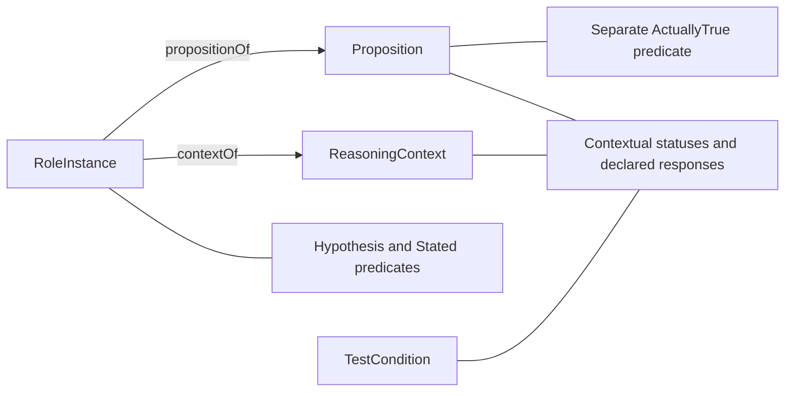

# Hypothesis: formalization review

Candidate progress, 2026-10-08. Authority effect: none. `F01-T.cal.definition.hypothesis` has a verified **partial** target interpretation and a separately typed inherited-Premise comparison. Complete translation, source precedence, fidelity, semantic dependency closure and whole-definition proof remain pending. The episode retains all 183 current identities and 189 admitted source versions.

The selected source is `cal.definition.hypothesis@1.0.0-candidate.1`, at `evidence/migrations/cyberalchemy-v2-to-lab/candidates/0004-artifact-reconstruction-pipeline/layers/l1-semantic-repeatability/definitions/hypothesis/v1/definition.json`, SHA-256 `73ff2afa18f644175bab998fc4b0372d1d9e556d725fec968d6a8bec24817a9f`. Its 24 selected string units are accounted through 41 exact clause spans: one encoded, nine explanatory and 31 deferred. The inherited comparison selects four of those deferred spans separately. It does not move them into the primary theory or supply whole-source fidelity.

## 1. The existing correspondence conflict

The target-specific normative statement describes a falsifiable provisional proposition posed for investigation or experiment, with declared possible evidence responses. It says statement alone does not adopt it as a working basis. The inherited formal expression instead describes a Premise adopted to proceed, unestablished and defeasible. The same document also retains inherited premise boundaries, typicality and lifecycle language.

Earlier A04 recorded this conflict as `FID-HYP-001`. That finding remains open. This draft selects the target-specific necessary conditions as a candidate primary slice and preserves the inherited material in exact spans and a separate comparison. This is a reviewable interpretation proposal, not a source-owner precedence decision. Neither source JSON nor the earlier packet is rewritten.

The earlier C01 whole-Hypothesis boundary remains meaningful. A selective supported first-order clause does not make all its unresolved epistemic, typicality and lifecycle requirements supported. Character accounting and static typing must not replace whole-source interpretation.

## 2. Artifact, role instance, proposition and context

The signature has 27 declarations: four nonempty sorts, two total functions, eight unary predicates and thirteen relations. RoleInstance, Proposition, ReasoningContext and TestCondition are separate mathematical carriers. `propositionOf` and `contextOf` associate a role instance with its investigated proposition and reasoning context.

RoleInstance is an abstract representation of a proposition's contextual role. It is not the Definition/v1 document and does not select a stored Artifact Type. The target's normalized Definition identity, a hypothesis role and the proposition content are distinct layers. `HYP-LAYER-002` retains the owner/carrier mapping question.

The diagram shows the candidate signature; it supplies no admitted storage shape or observed truth.

This separation permits the same proposition to be investigated under one context and deliberately adopted under another without equating the role instances. A reasoning-context change is not an authorized authority-scope transfer or a proved lifecycle transition. Temporal and governance mappings remain separate obligations.

The independent evaluator rejects a context accessor returning a Proposition value, a missing total-accessor row, a wrong predicate arity and a duplicate predicate tuple. The functions are total only within the selected abstract structure; no canonical serializer, complete proposition interpreter or real-world context registry is proved.

## 3. Target conditions, alternatives and denotation

For a Hypothesis role, the associated proposition/context must be Provisional and Falsifiable, and have at least one investigation mode: ForInvestigation or ForExperiment. It must also have a declared TestCondition with at least one potential response: CouldSupport, CouldRefine or CouldReject. Both choices use inclusive or.

Controls reject missing provisionality, falsifiability, a mode, a declared test or every potential response. They permit each response alone, response pairs, experiment alone and both modes. A test or falsifiability status attached only to another proposition cannot satisfy the investigated proposition's condition.

Falsifiable and the could-response relations are primitive conditions. A support-only declared response with a Falsifiable flag can satisfy this projection; it does not establish an actual rejection protocol or a reachable empirical outcome. `HYP-OUTCOMES-004` explicitly retains the relationship between falsifiability, declared conditions and possible evidence responses. Classical first-order evaluation of these relations is not a modal-possibility proof or experimental validation.

The condition is necessary, not a membership biconditional. A complete recognizer for Hypothesis instances requires the missing source/carrier contracts and fidelity review. Underlying proposition values are uninterpreted objects here; the evaluator does not execute or establish the propositions they represent.

## 4. Statements, adoption and assumptions

Hypothesis, Stated and AdoptedToProceed represent different facts. Four metalevel queries ask whether a stated Hypothesis entails working adoption, epistemic establishment, actual truth or WorkingPremise membership. One model with a stated investigation, a declared rejection condition and none of those conclusions satisfies the primary theory T and its required population obligations. It falsifies all four implications.

These are four checked query outcomes supported by the same model. The targets remain outside T; they are not premises. Non-entailment does not become a universal ban on later adoption. A positive control adds deliberate working adoption in the same context while retaining investigation conditions and satisfying the separate working comparison. This is a hypothetical compatibility control, not an actual adoption event or evidence of canonical role compatibility.

The interpretation's selected-assumption list is empty. Defining a Hypothesis or a working-Premise role does not adopt its proposition as a reasoning premise. The source's actual lifecycle, consumer and authority requirements remain conditional on independently selected evidence and decisions.

## 5. Epistemic establishment, truth and typicality

EstablishedTrue is contextual epistemic status; ActuallyTrue is a separate predicate on Proposition. A positive model permits the investigated proposition to be actually true while unestablished. Another permits a working proposition to be actually true while remaining unestablished. Thus the comparison does not encode “unproved” as “false.” These are interpretations of hypothetical structures, not observations of world truth.

The inherited wording says typically low veracity and often high conviction. The draft does not turn those qualifiers into universal constraints. A working comparison with no high-conviction flag still satisfies its selected static conditions. High conviction with low veracity also does not establish actual truth or promotion.

`HYP-STATUS-003` retains the unresolved qualitative/status semantics and the applicability field's hedge-marker classifier. The latter concerns candidate axioms in a specified workflow; it is not a global rule converting every Hypothesis label or proposition into an adopted Premise. No frequency distribution, numeric confidence scale or classifier implementation is fabricated.

## 6. Inherited Premise comparison

`comparison-input.json` and `comparison-ir.json` contain a separately typed four-clause slice from the inherited formal expression and three root-boundary spans. Local WorkingPremise implies adoption to proceed, absence of EstablishedTrue and defeasibility; it excludes AxiomRole and InvariantRole, and requires LoadBearing while excluding DisposableHypothesis.

This comparison uses the same typed vocabulary for direct model comparison, but it is not assembled into primary T. It is not a full, fidelity-approved translation of `cal.definition.premise`, and its selected spans do not claim complete source correspondence. Seven negative controls violate one of its working conditions while leaving the primary Hypothesis model intact; the comparison reports failure separately.

Both roles can coexist in the partial mathematical structure when additional adoption conditions hold. The source's explicit target distinction concerns identity and validation purpose; it does not automatically establish disjoint extensions. Shared lineage and aliases likewise cannot prove semantic equality. Full counterpart composition requires actual carrier and meaning alignment.

## 7. Nonvacuity and dependencies

There are five required and seven unresolved population policies. A hypothetical Hypothesis witness is required. The same subject must supply provisionality, falsifiability, an investigation-mode choice and a declared response choice. These four additional existence requirements follow from T plus the Hypothesis witness, without claiming any actual experiment or world proposition.

Auxiliary role/status and world-truth populations remain unresolved. No actual axiom, invariant, premise, load-bearing instance or truth population is invented as an owner exemption or required canonical existence claim. An empty Hypothesis population satisfies the directional T vacuously but fails the required obligations.

Eight authored direct uses bind exact current Premise, Axiom, Invariant, Authority Promotion, Evidence, Observation, Experiment Design and Definition sources. Their use sites match the relevant target, inherited source or lifecycle spans. Experiment Design supplies the pre-run comparison; there is no current Definition identified as `cal.definition.experiment`, and no such identity is manufactured.

Including the available partial Axiom and Definition packets extends the graph to thirteen nodes and fifteen edges. Ten counterpart packets remain missing. This is checked direct/transitive provenance, not a proof of combined theory consistency or reviewed semantic dependency completeness. No recursive fixed point or source-owner fidelity follows from the graph.

## 8. Actual source, admission and projection evidence

Thirteen read-only checks validate the source identity, actual Definition/v1 schema, schema/generator digests, two-render equality, projection parity, the selected legacy section, exact source admission, current registry selection, historical candidate lookup and sibling identity distinction.

The projection has 8,061 bytes, SHA-256 `b09c2d5750dd00f34b78c887ea6e92211a9ad27445f843e72851cd5e6408fc9c`. The existing bounded extractor selects 4,648 bytes of CAV2-D55, SHA-256 `03beeea979f731ec26bca412cab385eedf9bda012ea7517f827442963204aef6`. Its unique-heading/trailing-whitespace policy is recorded; no raw unnormalized section hash is substituted.

Decision `CAL-DECISION-0053-FULL-DEFINITION-QUEUE-ADMISSION` exactly binds the source-admission record admitting that selection for both Hypothesis and Premise. The local file's complete digest also matches the recorded admission-time file digest. Embedded candidate-unadmitted source wording remains unchanged; the separate decision overlay establishes the current bounded source-use fact. Source acceptance does not settle `FID-HYP-001` or approve this interpretation.

The producer's declared Definitions file is absent. The checked local copy is `/home/vlad_/projects/cyberAlchemy-v2/authority/definitions/DEFINITIONS.md`, bound by its absolute path and exact admitted bytes. The producer configuration and source repositories were not changed. Repository identity or live routing registration is not authenticated by this content match. The source-digest testable condition is therefore PARTIAL for live-source currentness: exact selected-copy bytes pass, while the declared live source cannot be checked there.

## 9. Verification strength and remaining work

Thirty-four authored model controls and four separate countermodel targets pass independent denotation. Primary T, required populations and the inherited comparison have distinct reported outcomes. Fresh model, dependency and source replays reproduce the stored evidence. No native-provider enumeration, exhaustive absence result, modal/temporal proof, actual empirical outcome or unbounded theorem is claimed.

All 201 captured source/registry/provenance files, one selected external source file and all 811 files in the previous sealed Governed Model delivery remain checked. An earlier source-check report is preserved before making this live-source ceiling explicit. The failed initial lookup for a nonexistent generic Experiment identity is preserved; it was corrected to the inspected Experiment Design comparison before successful evidence publication.

Thirty-one clauses remain deferred. Five findings, seven auxiliary population policies, ten missing counterpart packets, quantitative/typical status semantics, evidence-gated lifecycle and source-owner fidelity remain open. `HYP-LIFECYCLE-005` covers promotion/revision/retirement guards, reachable states, consumer preservation and actual authority decisions. The next independent foundational draft is Invariant. Whole-episode completion and its final complete aspect review remain unestablished.
