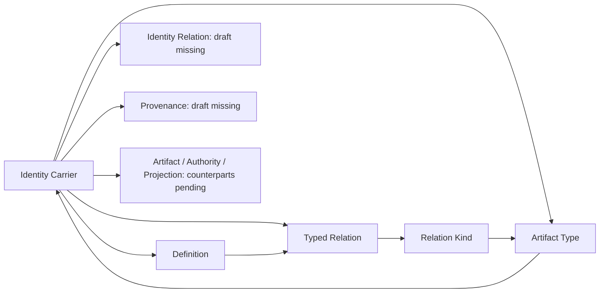

# Identity Carrier: subject, identity, relations and preservation review

This partial candidate translates the exact current source `cal.definition.identity-carrier@1.0.0-candidate.1`, SHA-256 `ddfdb1a06f8c2bbb751b3dab27d0d72ea0a7189c6c2d3ad95c7244a3d3ac104a`, from `authority/definitions/candidates/0007-cml07-semantic-closure/definitions/identity-carrier/v1/definition.json`. F04-T prerequisites A04, C01 and E02 and the absent output were checked before production. Source, registry, specialized carriers and existing delivery bytes remain preserved.

The work advances definition/type/logical formalization. It creates no canonical carrier, subject, relation, ownership, admission or runtime. The source's registry admission selects an authoritative source version; it does not certify this translation's source fidelity. Whole translation, attributable owner review and whole-definition proof remain pending.

## 1. Concept and source accounting

An Identity Carrier is a canonical artifact for exactly one primary subject identity. It explicitly binds the subject's stable identifier, kind Definition, owner route, lifecycle identity and provenance. Related identities remain externally connected through typed relations. A folder, name, shared owner, graph membership or generated projection cannot silently become the identity source or replace the carried subject.

The source has 26 nonempty string units and 31 mapped spans: 17 encoded, 9 explanatory and 5 deferred. All inventoried characters are accounted for. The explanatory spans preserve notation and specialized Product/Project examples. Deferred spans retain scope/applicability and claim-ceiling obligations, plus two formal non-entailment expressions that are checked as targets outside the theory. Character completeness is not whole semantic translation or owner acceptance.

Positive identity/component clauses use an axiomatic form. Allowed-state preservation clauses use an operational form with the separate logical role **constraint**. The initial build used an unsupported `operational-specification` classification label; the correspondence schema rejected it before writing primary outputs. The schema's established `operational` label is used in the final slice. The failed build and premature dependent reads are preserved under `attempt-001-operational-form-enum`. Those failures produced no source/admission mutation or primary interpretation.

## 2. Signature and meanings of carriers

There are 53 declarations: 10 nonempty sorts, 12 total functions, one initial-state constant and 30 predicates/relations. Sorts cover Carrier, Identity, DefinitionRef, OwnerRoute, LifecycleIdentity, ProvenanceRef, Link, State, AuthorityState and LocationPath.

A carrier's identity and its primary subject identity select values in the same local Identity carrier. Subject kind, owner route and lifecycle identity have their own typed selectors; provenance is a nonempty relation rather than a fabricated single source. Typed links have selected source/target identities. State-dependent selectors record subject identity, authority, placement and link endpoints, with an explicitly named initialState.

This is a declared mathematical signature. Nonempty sorts are the core denotation convention, not proof that corresponding live objects exist. Total functions require complete tables in a supplied model; they do not establish that a filesystem resolver, authority service or lineage system is operationally total. Equality within this Identity sort is meaningful. Equality or inequality between symbols from other definition scopes still requires reviewed common-carrier alignment.

The logical slice does not require `carrierIdentity(k) != primarySubject(k)`. The source gives different roles/fields but does not state that their encoded values must differ. Actual specialized carriers often expose only their subject ID; translating a generic carrier_id requires review rather than inventing an extra identity to make a test pass.

## 3. One primary subject and the direction of uniqueness

An IdentityCarrier is canonical, has explicit stable subject/kind and declared owner/lifecycle statuses, carries its selected primary identity, and has that identity in its initial canonical record. Every Carries binding for that carrier must equal its selected primary identity. Thus one carrier cannot have two different primary subjects in the selected theory.

The converse is not asserted. Two carrier objects can select the same subject identity unless a separate canonical uniqueness policy forbids it. The finite controls demonstrate that this slice permits that configuration. It is a countermodel to inverse injectivity, not approval to create duplicate canonical files or a finding that canonical duplication is operationally safe.

Different subjects can also share an owner, path or display label. Two countermodels show that shared owner and shared initial path do not entail equal subject identities. Placement is a context value; it does not supply the primary identity by deduction.

## 4. Subject-kind resolution, provenance and authority posture

The selected kind Definition must have ResolvableDefinition status, and each carrier must have at least one provenance binding. These requirements connect the identity claim to explicit semantic subject meaning and evidence. They do not fabricate resolution, authenticate provenance, establish current owner authority or prove that evidence is sufficient for an admission.

Five outcome targets remain outside the theory: IdentityCarrier does not entail AdmittedCarrier, AuthorityGrant, OwnershipEstablished, SubjectCreated or RuntimeActive. Supplied finite countermodels satisfy the selected theory and required populations while falsifying those targets. Recording a carrier contract or a hypothetical carrier is therefore distinct from asserting that a real subject was created or activated.

Owner route and lifecycle identity are declared contract components, not live owner authentication or lifecycle-transition decisions. An authority value in a model is uninterpreted state. Frame equality preserves that selected value; it supplies no grant or proof that its previous value was legitimate.

## 5. Related identities and separately typed links

For a selected directed Related endpoint from a primary subject, the target must have independent identity and a typed Link with exact Connects endpoints. Typed links bind their source/target selectors uniquely, and their initial endpoint state matches those selectors. Multiple Link identities may connect the same endpoint pair.

The source's statement “carries(K,x) and related(x,y) does not imply x=y” is a non-entailment target, not a universal inequality. The control with two distinct endpoints falsifies the equality target, while another valid control permits a self-relation. Actual self-links still need the exact Relation Kind/pair policy. No admission of a self-link or other relation is created here.

Related is directed in this candidate slice so its external endpoint witness has an explicit source and target. Whether every source use intends direction, inverse visibility, projection or a particular IdentityRelation meaning is unresolved in IDC-RELATION-002. Private link sorts and role tags cannot settle that mapping.

These relation conditions constrain identity bindings rather than merging subjects or copying ownership. They do not assert that every possible relation exists, grant authority through membership or require all relations to be acyclic.

## 6. Normative frame conditions and their limits

Three first-order frame constraints make the source's preservation requirements explicit:

1. An **allowed context-only step** for a selected carrier preserves its carried identity and primary-subject authority state.
2. An **allowed graph/projection removal step**, starting with a canonical record, preserves canonical presence and the carried identity.
3. An **allowed typed-relation step** preserves source/target endpoint identities and both endpoint authority states.

The guards define the selected allowed-state scope. They are normative constraints, not observations that a running system always complies. Their truth in one finite structure is not a temporal liveness result, proof of all reachable states, or authorization to remove a canonical carrier.

A control with a changed identity on an unallowed step is permitted by the guarded clauses. That demonstrates the limit of the theory's selected scope; it does not certify the step. Exact transition classifications, permitted actions, atomicity, rollback, reachability and policy enforcement require reviewed operational bindings and their own evidence.

The source's prohibition on erasing canonical identity when a view is removed is therefore treated as a preservation obligation. It is not implemented by deleting actual files during this analysis.

## 7. Required populations and independent model evidence

Twelve existential populations require one hypothetical IdentityCarrier with its seven carrier statuses, resolved subject kind, independent primary identity, provenance, Carries binding and initial canonical presence. Eighteen remaining role/outcome/link/transition populations are unresolved. No live subject, relation, admission or transition is invented to fill them; no owner exemption is fabricated.

There are no selected assumptions or assumption links. Forty-nine authored model controls are evaluated independently against the qualified static IR. They check missing component/status/population requirements, unique primary identity, correct initial record and link bindings, external typed references, frame violations, shared contextual values, same-subject carriers, permissible self-links and independent outcomes. Five malformed models exercise ill-sorted functions, incomplete total functions, tuple arity, duplicate tuples and an ill-sorted initial-state constant.

The empty IdentityCarrier extension satisfies guarded carrier clauses but fails required inhabitation. That vacuity distinction is retained. Nine target queries have valid finite countermodels: five outcome shortcuts, related-equality inference, shared owner/path identity inference and inverse primary-carrier uniqueness.

These are exact supplied models with independently checked denotation. They are not exhaustive native-provider search, unbounded mechanized proof, a truth assertion about actual subjects or a jointly aligned model of all definitions.

## 8. Bounded records and finite context/view traces

The synthetic closed record profile checks explicit carrier/subject/kind/owner/lifecycle/provenance fields and separately typed external links. Its selected catalog and authority strings are fixture values. Eighteen controls include 4 accepted and 14 rejected cases, covering missing/bare/Boolean identifiers, directory substitution, embedded related identity, empty provenance, unresolved endpoints, unversioned/duplicate link identity and an implicit authority grant.

Eight finite traces independently check the declared context frame: 4 preserve identity/authority and 4 are rejected. Valid cases move/relabel a carrier, add/remove related membership, remove graph/human views and retain shared contextual labels. Invalid cases replace identity from a path, erase a canonical record with its view, merge two subjects and transfer authority through relation context. All traces operate on in-memory synthetic state; no real record is deleted or changed.

The bounded frame comparison preserves exact canonical records and authority maps, which is a selected fixture policy. It does not prove every permissible owner/lifecycle revision is forbidden or that a live implementation has the same state representation. Embedding review remains pending.

## 9. Actual specialized-carrier evidence and unresolved mappings

Read-only evidence selects Product Identity/v2, Project Identity/v1 and Goal/v1. The selected registry records all three exact contracts as current admitted entries, while immutable descriptors and positive fixtures retain candidate wording. Thirty-seven checks cover exact descriptor/schema overlay bytes, current contract selection, closed instance schemas, six current admitted semantic-source bindings, IdentityCarrier binding, positive fixture shape and explicit non-effect identity, deterministic render parity on selected inputs and seven actual hostile fixture rejections.

Each descriptor and positive fixture renders twice to its existing human projection without changing its input. There are six selected projections. This proves parity for those files, not universal determinism or human projection authority. Receipt-writing validators/generator entry points are not executed.

The fixtures use product_id, project_id and goal_id. They do not literally contain generic carrier_id, subject_id, subject_kind_definition_ref, lifecycle_ref or provenance_refs. Product has its own owner/lineage/evidence fields; Project and Goal use accountable-owner/evidence fields. Semantic Definition bindings belong partly to the type contract. These differences are recorded as **mapping gaps**, not automatic conformance failures or assumed equivalent meanings. Source-to-carrier embedding requires an owner-reviewed interpretation of exactly where each generic role resides.

The source's historical statement that specialized carrier Artifact Types remain unauthored is retained. It cannot be used as a current-state inventory claim after the selected contracts have been admitted. Conversely, their admission and schema-valid fixtures do not accept this formal translation or create the actual subjects named by examples.

## 10. Dependencies, episode coverage and remaining review

Eight authored semantic uses bind Definition, Artifact, ArtifactType, TypedRelation, IdentityRelation, Authority, Provenance and ProjectionSpecification. The root and current joint graphs have 43 nodes, 87 edges and 31 missing counterpart packets. All 12 available drafts form one unclassified strongly connected component with 36 internal edges. IdentityCarrier's links to ArtifactType/TypedRelation and their existing return paths enlarge the previous component.

This shows representative edges, not the full 87-edge denominator. Declared cycles do not prove inconsistency, safe recursion, prohibited value cycles or least-fixed-point semantics. Dependency completeness and shared meanings need independent review; separate private-theory witnesses are insufficient to settle the joined theory.

The inventory now has 12 partial drafts and 171 remaining current identities without T drafts. It accounts for 274 source units and 418 clauses: 142 encoded, 99 explanatory and 177 deferred; 113 required and 161 unresolved populations. Whole owner-accepted translations and whole-definition proofs remain zero. Every current draft has one supplied independently evaluated T/I witness, with no meaning-aligned combined-model claim.

Six findings remain pending: primary/inverse identity policy; directed relation and shared endpoint meaning; exact allowed-state/frame scope; specialized component embedding; historical admission/source precedence; and dependency completeness/joint semantics. Agent receipts and passing bounded checks cannot supply those owner decisions. The I04 selected eight-draft report remains valid at its pinned manifest; evolving current inventory needs a later scoped reporting update.

The next definition priority is **F05-T.cal.definition.identity-relation**, whose actual A04/C01/E02 prerequisites are available. It addresses the meaning of related independently identified subjects. The full episode remains active across all 183 current definitions and 189 admitted source versions, including all remaining translations, obligations, joint evidence, fidelity decisions and the final episode-wide review.
